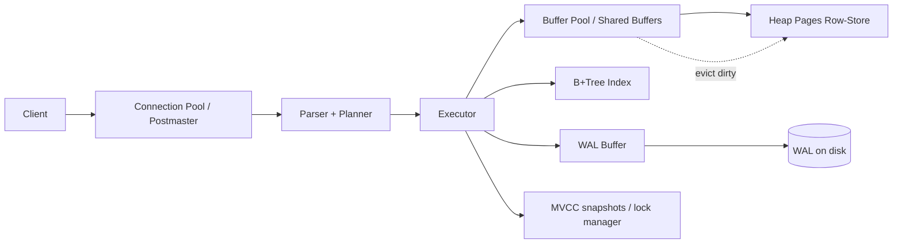
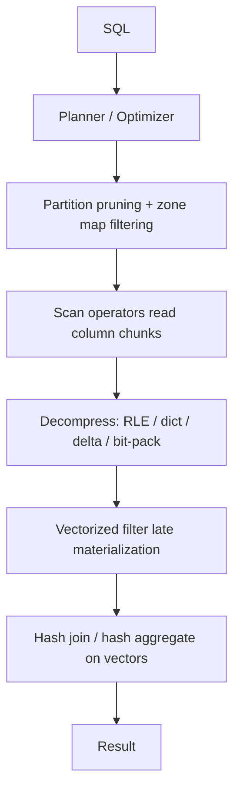
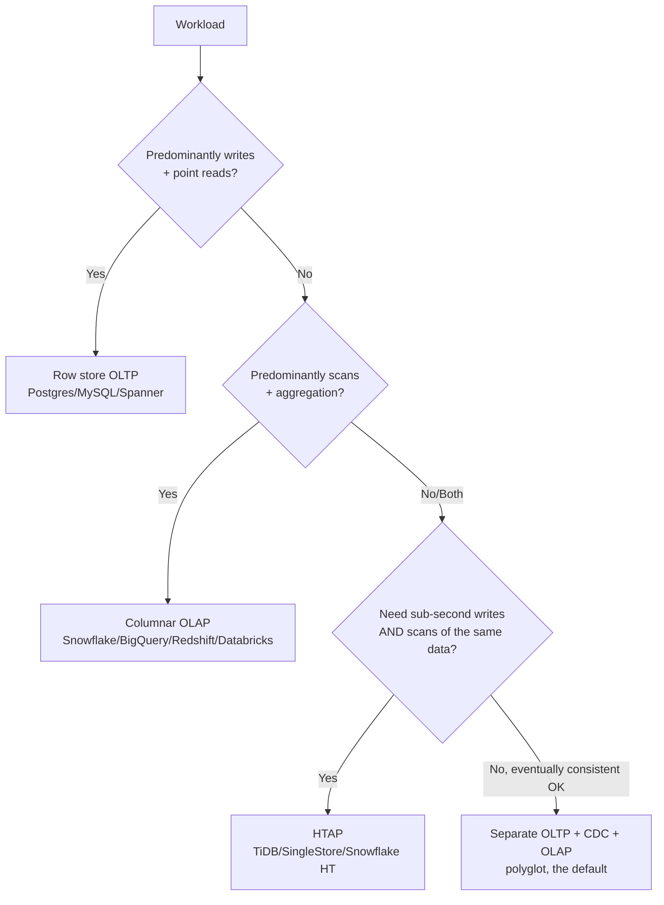

# OLTP vs OLAP

> Every data system you will ever build sits somewhere on the OLTP↔OLAP spectrum. The distinction is not "two kinds of databases" — it is two fundamentally different *access patterns* (many small row-atomic reads/writes vs. few huge columnar scans and aggregations), and each pattern forces a specific physical storage layout, concurrency model, and query engine. A senior engineer can look at a workload and immediately say "that belongs on a row store," "that belongs on a column store," or "that needs HTAP and here is the price you pay." Getting this wrong is one of the most expensive architectural mistakes in the field: you either put analytics on a transactional database and melt it under load, or you put transactional writes on a columnar warehouse and discover that single-row `UPDATE`s are catastrophically slow and lock-prone.

## TL;DR

- **OLTP** = Online Transaction Processing: short, atomic, high-concurrency operations touching *few rows, all columns* — the workload of an application's live database. Optimized for writes and point reads.
- **OLAP** = Online Analytical Processing: long, read-mostly queries touching *few columns, many rows* — the workload of a data warehouse / lakehouse. Optimized for scans, aggregation, and compression.
- The physical root cause is **storage layout**: OLTP uses a **row-oriented** (NSM) layout; OLAP uses a **column-oriented** (DSM) layout. Everything else (indexing, compression, execution, concurrency) follows from that.
- Column stores win analytics because of **column pruning** (read only the columns you need), **compression** (homogeneous data compresses 5–20×), and **vectorized/columnar execution** (SIMD, late materialization).
- Row stores win transactions because a whole logical entity lives on one page → cheap point updates, and **B+Tree + WAL + MVCC** give atomicity and isolation across many concurrent writers.
- **HTAP** (SingleStore, TiDB/TiFlash, Snowflake Hybrid Tables, BigQuery, Databricks SQL, Oracle Dual-Format, SAP HANA) tries to serve both. It works only when you understand the trade-offs; it is never free.
- Real systems are usually **polyglot**: an OLTP core (Postgres/MySQL/Aurora/Spanner) feeding an OLAP layer (Snowflake/BigQuery/Redshift/Databricks/ClickHouse) via CDC, with a modeling boundary in between.
- The **modeling boundary** is the key senior insight: you *never* copy the 3NF OLTP schema into the warehouse. You redesign it as a dimensional star for OLAP. That redesign is the subject of the next five chapters.

---

## 1. Definitions and core vocabulary

### 1.1 The terms

| Term | Meaning |
|------|---------|
| **OLTP** | Online Transaction Processing. Workload: many concurrent, short, atomic operations (INSERT/UPDATE/DELETE/SELECT by key). Latency SLO measured in single-digit milliseconds. |
| **OLAP** | Online Analytical Processing. Workload: fewer, long-running, read-heavy queries with GROUP BY, JOINs, and large scans. Latency measured in seconds to minutes. |
| **HTAP** | Hybrid Transactional/Analytical Processing. One system (or tightly coupled pair) serving both. |
| **DSS** | Decision Support System — an older term overlapping with OLAP. |
| **OLAP cube** | A pre-aggregated multidimensional structure (MOLAP/R-OLAP/HOLAP). Mostly superseded by columnar warehouses, but the vocabulary lives on. |
| **MOLAP / ROLAP / HOLAP** | MOLAP = data stored in proprietary multidimensional arrays (Essbase, SSAS); ROLAP = relational tables queried directly (Snowflake, BigQuery); HOLAP = hybrid. |
| **NSM** | N-ary Storage Model — row-oriented physical storage. |
| **DSM** | Decomposed Storage Model — column-oriented physical storage. |
| **PAX** | Partition Attributes Across — page-level hybrid (row groups of tuples, columns within a page). Used by Parquet/ORC and by some HTAP engines. |
| **Vectorized execution** | Processing a batch (vector) of values per CPU instruction rather than one row at a time; exploits SIMD and hides interpretation overhead. |
| **Late materialization** | In a column store, defer reconstructing full rows until after filtering; operate on column vectors (indices) as long as possible. |

### 1.2 The canonical workload comparison

| Dimension | OLTP | OLAP |
|-----------|------|------|
| Primary operation | Point read/write by key | Full/partial scan + aggregation |
| Rows touched per query | 1–100 | 10⁶–10¹² |
| Columns touched per query | All (whole entity) | Few (2–10 of 50–500) |
| Queries/sec | 10³–10⁶ | 1–100 concurrent |
| Writes vs reads | 50/50 or write-heavy | Read-heavy (95%+) |
| Transaction size | Tiny, ACID | Large, e.g., "load 500M rows" |
| Isolation need | Strong (serializable/SI) | Snapshot, read-your-load |
| Latency target | ms | seconds |
| Concurrency | High (thousands of conns) | Moderate (dozens) |
| Data freshness | Real-time (the truth) | T+0 to T+1 (a copy) |
| Typical schema | 3NF/normalized, entity tables | Star schema / wide denormalized |
| Data volume | GB–low TB (hot) | TB–PB |
| Query shape | `WHERE id = ?` | `GROUP BY ... HAVING` |
| Access pattern | Write-optimized | Read-optimized |
| Cost driver | IOPS, connections, latency | Bytes scanned, compute slots |

> **Senior note:** The single most useful diagnostic question is *"how many columns does the average query need relative to how many exist?"* If queries need all columns of a handful of rows → OLTP. If they need a handful of columns of millions of rows → OLAP.

### 1.3 A worked example of the divergence

Consider one table, `orders`, with 60 columns and 1 billion rows.

```sql
-- OLTP shape: "give me order 987654321 in full"
SELECT * FROM orders WHERE order_id = 987654321;
-- touches: 1 row, 60 columns → 1 page read if clustered on order_id

-- OLAP shape: "revenue by country by month"
SELECT o.country_code, date_trunc('month', o.created_at) AS m,
       SUM(o.total_amount) AS revenue
FROM orders o
GROUP BY 1, 2;
-- touches: 1e9 rows, 3 of 60 columns → 5% of the data matters
```

In a **row store**, the OLAP query must read every byte of every qualifying row (including 57 useless columns) → it scans ~20× more data than necessary.

In a **column store**, the OLAP query reads only `country_code`, `created_at`, `total_amount` → 3 of 60 columns, and those columns are stored contiguously and compressed → often a **50–200× IO reduction** vs. the row store.

In a **column store**, the OLTP point query is worse: the 60 values of the row are scattered across 60 column segments, so reconstructing one row touches many pages and can't be indexed the same way. That is exactly why pure column stores historically shunned single-row updates.

---

## 2. What problem it solves / why it matters

### 2.1 The two problems are genuinely opposite

**Problem A (OLTP):** An application must record and mutate facts about the world with correctness (ACID) under heavy concurrency and low latency. Example: a payment service inserting 50k rows/sec while serving 200k lookups/sec. The database must guarantee that two concurrent transfers don't both win, that a crash doesn't lose an acknowledged write, and that a single-row update is cheap.

**Problem B (OLAP):** Analysts and ML systems must aggregate, slice, and join massive historical datasets to answer questions nobody pre-defined. Example: "Which marketing channel gave the best incremental CAC over the last 18 months by cohort?" The engine must scan terabytes efficiently without contending with the transactional traffic.

Trying to make one engine excellent at both produces tension at every layer:

- **Storage layout**: rows (writes) vs. columns (scans).
- **Indexing**: B+Trees/Hash for point access vs. sparse zone maps/min-max/partition pruning for range scans.
- **Concurrency**: fine-grained locking/MVCC for many writers vs. bulk-load/append-only for few writers.
- **Execution**: tuple-at-a-time (Volcano) vs. vectorized/compiled (SIMD, LLVM).
- **Compression**: cheap and write-friendly vs. aggressive and read-optimized.

### 2.2 Why a senior must internalize this

1. **It dictates your architecture budget.** OLTP storage is expensive (provisioned IOPS, replicas). OLAP storage is cheap (object storage). Moving data between them is the *entire point* of ETL/ELT.
2. **It dictates schema design.** The OLTP 3NF schema is *actively bad* for analytics; the dimensional star is *actively bad* for OLTP (denormalized, wide, needs bulk loads). You need both and a transformation in between.
3. **It explains vendor behavior.** "Why is `UPDATE` slow on Snowflake?" "Why does BigQuery charge by bytes scanned?" "Why does ClickHouse hate row-level updates?" All follow from the layout.
4. **It explains failure modes.** An analytics query accidentally run against the OLTP primary (or an unindexed admin query) is a classic outage cause. CDC lag, warehouse load windows, and read-replica staleness all trace back to separating these workloads cleanly.

### 2.3 The boundary is where the interesting engineering lives

```
      OLTP                    boundary                  OLAP
 ┌───────────┐   CDC / ETL   ┌──────────────┐   modeling   ┌───────────┐
 │ Postgres  │──────────────▶│ raw / staging │─────────────▶│ star      │
 │ App DB    │  Debezium     │ (append-only) │  dbt/Spark   │ schema    │
 └───────────┘   Kafka       └──────────────┘              └───────────┘
```

The boundary is where you:
- capture changes (CDC: Debezium, Fivetran, Airbyte, Snowflake/BigQuery CDC/streaming ingest),
- land them immutably (bronze/raw layer),
- apply **dimensional modeling** and **SCD** (silver/gold),
- expose a **semantic layer** (dbt metrics, Cube, Looker, AtScale).

Everything after the OLTP box is designed for *readers*, not *writers*.

---

## 3. How it works internally (mechanisms, internals)

This is where juniors and seniors separate. Let's go down a level.

### 3.1 OLTP internals



**Page layout (row store, NSM).** Data is stored in fixed-size pages (Postgres 8 KB, MySQL/InnoDB 16 KB). A page holds whole tuples *contiguously*:

```
Page (8 KB)
┌───────────────────────────────────────────────────────────┐
│ header │ t1(order_id,cust,...60 cols) │ t2(...) │ t3(...) │
└───────────────────────────────────────────────────────────┘
A point read of one row touches exactly one page (2–3 IO to read it).
A scan "revenue by month" must read t1,t2,t3 → all 60 columns each.
```

**B+Tree indexes.** Point lookups (`WHERE order_id = ?`) traverse a balanced tree of ~3–4 levels → O(log n) page reads. Secondary indexes exist per searched column. This is why OLTP feels instant on keyed access — and why OLTP databases drown under *unindexed* analytical scans.

**Write path & durability.** A write is appended to the **Write-Ahead Log (WAL)** and fsync'd (durability) before the dirty page is flushed lazily. This turns random writes into sequential WAL writes → high write throughput with crash safety (ARIES-style recovery). **Group commit** batches many transactions into one fsync.

**Concurrency: MVCC.** Postgres/Oracle/MySQL(InnoDB) use Multi-Version Concurrency Control: writers create new row versions; readers see a consistent snapshot without blocking writers. Isolation levels (Read Committed → Serializable) trade correctness vs. throughput. InnoDB also uses row-level locks + a B+Tree clustered index (the table *is* the PK index).

**LSM-tree variant.** Write-heavy OLTP stores (Cassandra, RocksDB, HBase, and now TiKV/MyRocks) use **Log-Structured Merge trees**: writes go to an in-memory memtable + WAL, are flushed to sorted immutable SSTables, and background-compacted. Great write throughput, but **read amplification** (check memtable + several SSTables + bloom filters) and **write amplification** during compaction. Classic row-store B+Trees optimize reads; LSM optimizes writes.

**Latency budget.** A good OLTP read is: parse (µs) → plan (µs) → buffer pool hit (ns–µs) or disk (100µs+) → network. The dominant cost is usually disk/network, so **caching and connection pool efficiency** matter more than CPU. This is why the tail latency (`p99`) of an OLTP system is dominated by lock waits, checkpoint stalls, and vacuum/compaction, not by the SQL itself.

### 3.2 OLAP internals



**Columnar layout (DSM).** Each column is stored as its own contiguous stream, typically split into **row groups / blocks** (Parquet default 128 MB row group; Snowflake micro-partitions ~50–500 MB; ClickHouse parts; BigQuery Capacitor columnar).

```
Column file
┌──────────────────────────────────────────┐
│ rowgroup 1: country[] │ ts[] │ amount[]  │  ← row-oriented group
│ rowgroup 2: country[] │ ts[] │ amount[]  │     column-oriented inside
└──────────────────────────────────────────┘
```

Within a row group, columns are stored separately and encoded independently. This is the **PAX** hybrid: it keeps row-group locality (good for parallelism) while pruning/re-encoding per column.

**Compression.** Because a column holds homogeneous values, encoders get huge wins:

| Encoding | Ideal for | Typical ratio |
|----------|-----------|---------------|
| Dictionary | low-cardinality strings (`country`) | 5–50× |
| Run-length (RLE) | sorted/low-churn columns | 10–100× |
| Delta / delta-of-delta | timestamps, monotonic IDs | 5–20× |
| Bit-packing / frame-of-reference | bounded integers | 4–8× |
| Bitmap | boolean flags | 8–64× |

Compression isn't just disk savings — it's **less IO and faster CPU** (memory bandwidth is a first-class bottleneck). A 10× compressed column streams 10× more values per byte into cache.

**Zone maps & min/max pruning.** Each row group stores min/max (and now bloom filters) per column. A query with `WHERE ts >= '2024-01-01'` skips *whole row groups* whose max < the predicate — without reading them. This is OLAP's substitute for indexes. Snowflake micro-partitions, Delta Lake file stats, Iceberg manifests, Parquet row-group statistics, and BigQuery clustering all use variants of this.

**Vectorized / compiled execution.** Rather than a Volcano iterator that returns one tuple at a time (interpretation overhead per tuple), engines process **batches of 1024–8192 values** per operator using SIMD. Even better, engines like Spark's WholeStage Codegen, Databricks Photon, ClickHouse, DuckDB, and Snowflake compile query fragments to native code. Result: 1–2 orders of magnitude more rows/sec/CPU.

**Late materialization.** A scan "`SELECT region, SUM(amount) WHERE country IN (...)`" first computes a *selection vector* (indices) from the `country` column, then reads `amount` only for selected indices. This avoids materializing full rows until the very end.

**Hash joins & aggregation.** OLAP joins are typically **hash joins** (build a hash table on the smaller side, probe with the large side) and aggregations are **hash aggregations** with spilling. `ORDER BY ... LIMIT` uses top-K heaps; window functions use partitioned sorts. Distributed execution fans out scans to many workers and shuffles intermediate results (see the Spark Internals chapter).

### 3.3 The direct comparison table (internals)

| Concern | OLTP (row) | OLAP (column) |
|---------|-----------|---------------|
| Physical layout | NSM pages | DSM column chunks / PAX row groups |
| Primary index | B+Tree / clustered / hash | Sparse zone maps + partition pruning |
| Secondary access | Secondary B+Trees | Bloom filters, projections, materialized views |
| Writes | In-place update + WAL | Append-only micro-batch / bulk load |
| Concurrency | MVCC + row locks | Snapshot isolation, few writers |
| Query execution | Tuple-at-a-time (Volcano) | Vectorized / compiled / SIMD |
| Joins | Nested loop on indexed PK/FK | Hash join, broadcast/merge join |
| Compression | Minimal (page-level) | Heavy per-column encodings |
| Scaling | Vertical + read replicas + sharding | Horizontal MPP + storage/compute split |
| Update cost | ~1 page | rewrite a micro-partition/file |

### 3.4 HTAP: how it tries to bridge the gap

HTAP systems typically do one of:

1. **Dual engines over shared storage.** TiDB + TiFlash: row store on TiKV for OLTP, columnar replica on TiFlash for OLAP, Raft-replicated; the optimizer routes queries. Oracle uses an in-memory column store alongside row store. SQL Server ships a columnstore index next to a rowstore table.
2. **Unified columnar with delta/main.** SingleStore, Snowflake Hybrid Tables, BigQuery: a **delta store** (row-ish, in memory / small clusters) absorbs fresh writes, periodically merged into the **main columnar store**. Fresh data is fast to write and reasonably fast to query; long-range scans hit the columnar main path.
3. **Same engine, smart storage.** Databricks Photon + Delta, ClickHouse's "MergeTree" with real-time inserts (though single-row updates remain an anti-pattern).

**The price of HTAP** is always some combination of: higher storage cost (two layouts), background-merge complexity and latency spikes, weaker guarantees in one of the two directions, and operational opacity. HTAP is a last resort, not a default.

---

## 4. How to implement it (step-by-step, with SQL / code / config examples)

Say you're building a payments product. You need an OLTP core and an analytics layer. Here is the concrete path.

### 4.1 Model and build the OLTP core (3NF, write-optimized)

Normalize to at least 3NF. Point-read hot tables get tuned indexes. Keep them narrow.

```sql
-- OLTP core: normalized, meant to be written a lot
CREATE TABLE customers (
    customer_id     BIGINT GENERATED ALWAYS AS IDENTITY PRIMARY KEY,
    email           TEXT NOT NULL UNIQUE,
    country_code    CHAR(2) NOT NULL,
    created_at      TIMESTAMPTZ NOT NULL DEFAULT now()
);

CREATE TABLE accounts (
    account_id      BIGINT GENERATED ALWAYS AS IDENTITY PRIMARY KEY,
    customer_id     BIGINT NOT NULL REFERENCES customers(customer_id),
    currency        CHAR(3) NOT NULL,
    balance_minor   BIGINT NOT NULL DEFAULT 0,   -- money as integer minor units
    status          TEXT NOT NULL DEFAULT 'active',
    updated_at      TIMESTAMPTZ NOT NULL DEFAULT now()
);

CREATE TABLE payments (
    payment_id      BIGINT GENERATED ALWAYS AS IDENTITY PRIMARY KEY,
    account_id      BIGINT NOT NULL REFERENCES accounts(account_id),
    amount_minor    BIGINT NOT NULL,
    status          TEXT NOT NULL,      -- 'pending','settled','failed'
    created_at      TIMESTAMPTZ NOT NULL DEFAULT now(),
    updated_at      TIMESTAMPTZ NOT NULL DEFAULT now()
);

-- OLTP-friendly indexes: cheap point lookups + FK joins
CREATE INDEX ix_payments_account_created ON payments (account_id, created_at DESC);
CREATE INDEX ix_payments_status_created  ON payments (status, created_at DESC);
```

Design rules for the OLTP layer:

- **Keep rows narrow** (avoid wide text/JSON in hot tables).
- **Index the exact access paths**: `(account_id, created_at DESC)` supports "last N payments for an account."
- **Avoid over-indexing**: every index slows writes. A table with 10 indexes writes ~10× the IO.
- **Use integer/decimal money**, never float.
- **Short transactions**, no user think-time inside a transaction.
- **Add an `updated_at`** — you *will* need it for CDC and SCD (chapter 05).

### 4.2 Capture changes (CDC) — the boundary

The cleanest, least-risky way to feed OLAP is **log-based CDC** (read the WAL, don't query the primary).

```yaml
# Debezium Postgres connector (Kafka Connect) — logical replication slot
{
  "name": "pg-payments-connector",
  "config": {
    "connector.class": "io.debezium.connector.postgresql.PostgresConnector",
    "database.hostname": "pg-primary.internal",
    "database.dbname": "payments",
    "database.user": "debezium",
    "plugin.name": "pgoutput",
    "slot.name": "dbz_payments",
    "publication.autocreate.mode": "filtered",
    "table.include.list": "public.customers,public.accounts,public.payments",
    "topic.prefix": "cdc.payments",
    "snapshot.mode": "initial",
    "tombstones.on.delete": "false"
  }
}
```

Alternatives:

| Approach | When to use | Caveats |
|----------|-------------|---------|
| Log-based CDC (Debezium, Fivetran, Airbyte, native) | Default choice | Needs logical replication config, slot management |
| Trigger-based / audit tables | When log CDC isn't possible | Write latency hit |
| Timestamp/`updated_at` polling | Slow-changing small tables | Misses deletes, misses rapid updates within a poll window |
| Query-based extraction / dump | Initial/backfill loads | Locks, load on primary |
| Native ingestion (Snowflake/BigQuery/Synapse streaming) | Managed convenience | Vendor lock-in, cost |

### 4.3 Land raw data immutably

Land CDC events as-is (append-only), preserving operation type and source timestamps. This is your **bronze/raw** layer.

```sql
-- Snowflake-style raw landing table (one row per CDC event)
CREATE TABLE raw.payments_cdc (
    kafka_offset       NUMBER,
    kafka_partition    NUMBER,
    op                 STRING,       -- 'c','u','d','r'
    source_ts          TIMESTAMP_NTZ,
    ingested_at        TIMESTAMP_NTZ DEFAULT current_timestamp(),
    payment_id         NUMBER,
    account_id         NUMBER,
    amount_minor       NUMBER,
    status             STRING,
    created_at         TIMESTAMP_NTZ,
    updated_at         TIMESTAMP_NTZ,
    payload            VARIANT      -- full raw record for replay
);
```

> **Senior note:** Never "clean on ingest." Keep the raw source exactly as it was, with ingestion metadata. You will re-derive silver/gold many times as requirements change; you can only do that if bronze is immutable.

### 4.4 Build the OLAP model (star schema, read-optimized)

This is where you stop copying the 3NF schema and start designing for queries.

```sql
-- Dimension: one row per customer *version* (SCD2), surrogate key
CREATE TABLE dwh.dim_customer (
    customer_sk      NUMBER AUTOINCREMENT PRIMARY KEY,   -- surrogate
    customer_id      NUMBER NOT NULL,                    -- natural/business key
    email            STRING,
    country_code     STRING,
    valid_from       TIMESTAMP_NTZ NOT NULL,
    valid_to         TIMESTAMP_NTZ,
    is_current       BOOLEAN NOT NULL DEFAULT TRUE
);

-- Fact: additive measures at the declared grain
CREATE TABLE dwh.fct_payment (
    payment_sk       NUMBER AUTOINCREMENT PRIMARY KEY,
    -- degenerate dimension: the business key lives in the fact
    payment_id       NUMBER NOT NULL,
    -- foreign keys to dimensions
    customer_sk      NUMBER NOT NULL,
    account_sk       NUMBER NOT NULL,
    payment_status_sk NUMBER NOT NULL,
    date_sk          NUMBER NOT NULL,
    -- measures
    amount_minor     NUMBER NOT NULL,
    fee_minor        NUMBER NOT NULL DEFAULT 0
)
CLUSTER BY (date_sk);   -- Snowflake: physical clustering on the hottest filter
```

Key modeling moves (all expanded in later chapters):

- **Surrogate keys** (`customer_sk`) decouple the warehouse from source key churn and enable SCD2.
- **Declare the grain** (`fct_payment` = one row per payment per status version).
- **Keep measures additive**; store non-additive things as FKs to dimensions.
- **Denormalize** the customer's country/info into the dimension instead of joining 3 tables each query.

### 4.5 Tune each side for its workload

**OLTP tuning (Postgres example):**

```sql
-- Verify the plan uses an index, not a seq scan
EXPLAIN (ANALYZE, BUFFERS)
SELECT * FROM payments WHERE account_id = 42 ORDER BY created_at DESC LIMIT 20;
-- Expect: Index Scan using ix_payments_account_created

-- Tune autovacuum on high-churn tables (avoid bloat + xid wraparound)
ALTER TABLE payments SET (autovacuum_vacuum_scale_factor = 0.05,
                          autovacuum_analyze_scale_factor = 0.02);

-- Keep connections sane; use pgbouncer
-- pgbouncer.ini: pool_mode = transaction, default_pool_size = 20
```

**OLAP tuning (BigQuery example):**

```sql
-- Partition + cluster to minimize bytes scanned (cost) and IO (latency)
CREATE TABLE dwh.fct_payment
PARTITION BY DATE(created_at)
CLUSTER BY customer_sk, payment_status_sk
AS SELECT ... ;

-- Always prune partitions in the WHERE clause
SELECT DATE(created_at) AS d, SUM(amount_minor)/100 AS revenue
FROM dwh.fct_payment
WHERE created_at >= TIMESTAMP('2024-01-01')      -- partition pruning
  AND customer_sk IN (SELECT customer_sk FROM dwh.dim_customer WHERE country_code='DE')
GROUP BY 1;
```

**OLAP tuning (Snowflake example):**

```sql
ALTER TABLE dwh.fct_payment CLUSTER BY (to_date(created_at), customer_sk);
-- Check clustering health
SELECT SYSTEM$CLUSTERING_INFORMATION('dwh.fct_payment', '(to_date(created_at))');
-- Dedicated warehouse for ELT vs BI to avoid contention
CREATE WAREHOUSE etl_wh  WAREHOUSE_SIZE = LARGE AUTO_SUSPEND = 60;
CREATE WAREHOUSE bi_wh   WAREHOUSE_SIZE = MEDIUM AUTO_SUSPEND = 60;
```

### 4.6 Orchestrate the pipeline

```
1. CDC streams → Kafka topics (one per source table)
2. Kafka → Snowpipe/Kafka connector → raw.* (append-only, ~1 min)
3. dbt: staging (dedupe/types) → dimensions (SCD2 via snapshot) → facts (incremental)
4. dbt tests: uniqueness, not_null, relationships, accepted_values, freshness
5. Semantic layer / BI reads gold.* only; never raw.*
```

---

## 5. Where to implement it (tools/platforms)

### 5.1 OLTP engines

| Engine | Storage | Strongest at | Watch out |
|--------|---------|--------------|-----------|
| **PostgreSQL** | Heap row store, MVCC, B+Tree | General purpose, extensions | Vacuum/bloat, single-writer |
| **MySQL / InnoDB** | Clustered B+Tree | Ubiquitous, fast PK reads | Secondary index → PK lookup cost |
| **Aurora / RDS** | Managed, log-based storage | Cloud Postgres/MySQL compat | IO charges, failover behavior |
| **Google Spanner** | Distributed row store, TrueTime | Global, strongly consistent | Cost, latency on distant regions |
| **CockroachDB / TiDB** | Distributed row (Raft) | Horizontally scalable OLTP | Cross-region latency |
| **DynamoDB / Cassandra / HBase** | LSM, key-value/wide | Massive write scale | Query flexibility (design per access pattern) |
| **Redis / KeyDB** | In-memory | Caching, counters | Durability model |

### 5.2 OLAP engines

| Engine | Architecture | Best for | Watch out |
|--------|-------------|----------|-----------|
| **Snowflake** | Micro-partitions, storage/compute split, virtual warehouses | General EDW, elasticity | Clustering cost, per-second warehouse cost |
| **BigQuery** | Dremel + Capacitor + Colossus, serverless slots | Serverless scale, ad hoc | Bytes-scanned pricing, no indexes |
| **Redshift** | MPP columnar, RA3, sort/dist keys | Predictable, high-concurrency BI | Vacuum/analyze, key tuning |
| **Databricks SQL / Delta** | Lakehouse, Photon, Delta/Iceberg | Lake + warehouse convergence, ML | Small-file/layout maintenance |
| **ClickHouse** | MergeTree, extremely fast scans | Real-time dashboards, wide events | Updates/deletes are expensive |
| **DuckDB** | In-process columnar | Local/embedded analytics, CI | Not a server (single-writer) |
| **Trino / Presto** | Federated SQL over many sources | Query federation on a lake | Not storage; relies on lake layout |
| **Apache Druid / Pinot** | Columnar, time-series | Sub-second OLAP on events | Complexity, ingestion tuning |
| **Synapse / Fabric** | MPP + OneLake | Microsoft-centric stacks | Historically inconsistent tooling |
| **Amazon Athena** | Trino-on-S3 | Infrequent ad hoc on the lake | Per-query cost, needs good partitioning |

### 5.3 HTAP engines

| Engine | Mechanism |
|--------|-----------|
| **TiDB / TiFlash** | Raft row store + columnar learner replica, cost-based routing |
| **SingleStore** | Unified row+column, in-memory delta → columnstore |
| **Oracle 23ai** | In-memory dual-format + Database In-Memory column store |
| **SQL Server** | Clustered/nonclustered columnstore index alongside rowstore |
| **Snowflake Hybrid Tables** | Row-optimized with PK constraints, co-located with columnar tables |
| **BigQuery** | Streaming inserts + columnar main (serverless unified) |
| **Databricks** | Delta + Photon; predictive I/O for point lookups |
| **SAP HANA** | Row+column in-memory, code pushdown |

### 5.4 Choosing — the decision tree



> **Senior note:** The default answer in modern data platforms is **polyglot, not HTAP**. HTAP is for narrow cases (operational dashboards needing sub-second freshness on the same rows being written, e.g. fraud scoring) where CDC lag is unacceptable. For everything else, a 1–15 minute CDC lag into a warehouse is cheaper, simpler, and more scalable.

---

## 6. Patterns and anti-patterns

### 6.1 Patterns (do this)

**P1. Read replicas for read-mostly OLTP reads.** Offload reporting queries to a follower to protect the primary. Beware replication lag (`stale reads`).

```sql
-- Aurora read replica endpoint; route analytics/report queries here
SELECT pg_last_wal_replay_lsn(); -- monitor lag
```

**P2. CQRS (Command Query Responsibility Segregation).** Separate the write model from the read model, keeping them in sync via events. This is essentially OLTP+OLAP at the application level.

**P3. Immutable append + derived views.** Land raw once, derive many times. Enables replay and backfills.

**P4. Star schema in the warehouse.** Match the storage (columnar) with a shape the optimizer loves (few big joins, wide scans).

**P5. Materialized/late-binding views for hot aggregates.** Snowflake dynamic tables, BigQuery materialized views, Redshift materialized views, dbt incremental models.

**P6. Workload isolation.** Separate warehouses/compute clusters for ETL, BI, ad hoc, and ML to avoid noisy-neighbor effects.

**P7. Idempotent loads.** Use MERGE with natural keys + "latest wins" so reruns don't duplicate facts.

### 6.2 Anti-patterns (don't)

**A1. Running BI directly on the OLTP primary.** A single unindexed `GROUP BY` can hold locks / flush cache / blow out `p99` and cause an outage. Kills the app.

**A2. Copying the 3NF schema into the warehouse.** 8-way joins per dashboard, no readability, terrible performance. This is the #1 modeling mistake.

**A3. Doing single-row `UPDATE`s on a columnar warehouse.** It rewrites a micro-partition/file and is both slow and expensive. Batch updates via MERGE on a staging table instead.

**A4. Over-indexing OLTP.** Every extra index taxes every write. Index the paths you actually use.

**A5. `SELECT *` in OLAP.** In columnar stores this defeats column pruning and can 10–50× your bytes-scanned bill (BigQuery) or IO (Snowflake).

**A6. Assuming warehouse = real-time.** The boundary introduces lag. Design freshness SLOs explicitly.

**A7. Using the OLTP key as the warehouse primary key.** Natural keys churn (reuse, renumbering), which breaks history. Use surrogates.

**A8. Skipping `updated_at` in the source.** Without it, `timestamp`-strategy CDC/SCD is impossible and you fall back to error-prone `check` strategies.

**A9. HTAP by accident.** Running both a transactional and analytical query mix on one shared cluster "because it worked in dev." Production scale exposes it.

**A10. Treating the warehouse as the source of truth.** Warehouses are derived. The OLTP system (or the immutable log) is the system of record.

### 6.3 Anti-pattern diagnosis table

| Symptom | Likely cause | Fix |
|---------|--------------|-----|
| App `p99` spikes during month-end reporting | Analytics on OLTP primary | Move to OLAP / replica |
| Dashboard query takes minutes on 10 TB | Normalized schema, no clustering | Star schema + partition/cluster |
| Warehouse bill 10× expected | `SELECT *`, no partition filters | Column pruning, partition pruning |
| `UPDATE` job takes hours on warehouse | Row-by-row updates | MERGE from staging, batch |
| Duplicate rows after pipeline rerun | Non-idempotent load | MERGE on natural key |
| Wrong historical attribution | SCD1 overwrite instead of SCD2 | Version the dimension (chapter 05) |

---

## 7. Real-world use cases and industry applications

**Retail / e-commerce.** OLTP: orders, carts, inventory (Postgres/Spanner/Aurora). OLAP: revenue by SKU/region/channel, cohort retention, markdown optimization (Snowflake/BigQuery). CDC every minute; dashboards refresh hourly.

**Financial services.** OLTP: ledgers, trades, KYC (Spanner/CockroachDB/Oracle). OLAP: risk aggregation, regulatory reporting, fraud detection, end-of-day P&L. Strict auditability, long history, batch windows.

**AdTech / real-time bidding.** OLTP-like: bid requests at 10⁶+/sec (Kafka/Redis/Cassandra). OLAP: ClickHouse/Druid/Pinot on event streams for sub-second dashboards and attribution windows.

**SaaS product analytics.** OLTP: the app's Postgres. OLAP: product events loaded into a warehouse, star-schema models powering funnels, retention, and the customer-facing analytics feature. Often a **semantic layer** (Airbnb Minerva-style) to keep metrics consistent across the org.

**Logistics / ride-hailing (Uber).** OLTP: trips, drivers (schemaless stores, huge write rate). OLAP: Uber's data lake + warehouse (Hive/Spark → Iceberg/Delta → Pinot/ClickHouse) for pricing, ETA, and marketplace analytics. Kafka is the boundary; each service owns events.

**Telecom / IoT.** OLTP: device/session records. OLAP: time-series scans (billing, capacity planning). Often both a warehouse (analytics) and a TSDB (operations).

**Streaming / media (Netflix).** The "data" side is essentially a lakehouse: event ingestion, Iceberg tables, Spark/Flink transforms, star-schema-style marts for A/B analysis and content analytics — plus operational stores for the product itself.

> **Senior note:** In every one of these, the architecture is the *same shape*: an authoritative OLTP core, an immutable log/CDC boundary, and an OLAP layer with a dimensional model. Vendors and scales differ; the pattern doesn't.

---

## 8. Senior-level deep dive

### 8.1 The fundamental trade-off, restated precisely

Let *N* = rows, *C* = columns. A row store reads ~*N·C* bytes to answer "aggregate one column"; a column store reads ~*N* bytes for that same column (compressed further). So **column stores win by a factor of ~C × compression ratio** for column-selective scans.

Conversely, to write/read one row, a row store touches ~1 page; a column store touches ~*C* pages (one per column) — unless it has a delta/row-store sidecar. So **row stores win by ~C× for single-row point access**.

This single line explains almost every real-world behavior. When someone claims "our columnar system is as fast at OLTP," ask *how*: they have a row-oriented delta layer, secondary row storage, or a point-lookup index. That's fine — but you're now paying for two layouts.

### 8.2 Cost & performance architecture decisions

- **Storage/compute separation** (Snowflake, BigQuery, Databricks serverless): scale compute independently, pay only when running. But every query pays a "wake-up" and scan cost on object storage; caching (Snowflake local disk cache, BigQuery BI Engine) mitigates.
- **Bytes-scanned pricing** (BigQuery, Athena, some Snowflake features): physically shapes your SQL. Partition filters and column pruning are not optional; they are the difference between $10 and $1,000.
- **Concurrency vs. throughput**: MPP warehouses have a sweet spot of concurrent queries. Snowflake multi-cluster warehouses auto-scale; BigQuery uses slots (on-demand or reservations). Plan for your peak concurrency, not your average.
- **Freshness vs. cost**: streaming ingest (Snowpipe Streaming, BigQuery Storage Write API) costs more per byte than micro-batch; CDC lag vs. cost is a real dial.
- **Small files kill lakes**: thousands of tiny files from streaming ingestion destroy scan performance. Compaction (OPTIMIZE, rewrite_data_files) is mandatory.

### 8.3 Performance debugging playbooks

**OLTP slow query:**
1. `EXPLAIN (ANALYZE, BUFFERS)` — is it a seq scan? missing index? bad row estimate?
2. Check lock waits: `pg_locks`, `pg_stat_activity` (Postgres); `SHOW ENGINE INNODB STATUS` (MySQL).
3. Check bloat/vacuum: `pg_stat_user_tables.n_dead_tup`.
4. Check connection saturation and `p99` tail → pgbouncer, pool sizing.
5. Watch for **N+1 queries** from the application (thousands of small queries) — the #1 hidden OLTP killer.

**OLAP slow query:**
1. Read the plan: is partition pruning happening? Are there full scans of huge tables?
2. Check partitioning/clustering/sort-dist keys vs. the filter columns.
3. Look for **implicit casts** that disable pruning (`WHERE dt = '2024-01-01'` on a `TIMESTAMP` column).
4. Look for **exploding joins** (many-to-many creating fan-out) — a modeling bug, not a DB bug.
5. Inspect data layout: file sizes, row-group sizes, skew (Snowflake `SYSTEM$CLUSTERING_INFORMATION`, Delta/Parquet file stats).
6. Check **spill to disk** (Redshift, Databricks) → insufficient memory / bad join order.

### 8.4 Failure modes

| Failure | Cause | Mitigation |
|---------|-------|-----------|
| OLTP outage during report | Analytic query on primary | Isolate, replicas, resource governor |
| Warehouse cost explosion | Unpruned scans, runaway dashboards | Cost guards, `SELECT` discipline, BI caching |
| Stale dashboards | CDC lag / broken pipeline | Freshness SLAs, lag monitoring, alerts |
| Duplicated facts | Retried non-idempotent load | MERGE + unique constraints + tests |
| Fan-out inflation | Bad grain / many-to-many join | Declared grain, bridge tables |
| Hot partition/skew | Bad clustering or key distribution | Repartition, salt keys |
| Schema drift breaks load | Source column add/rename | Schema evolution, staging contracts |

### 8.5 Architecture decision checklist

Before you decide OLTP/OLAP/HTAP for a workload, answer:

1. **Freshness**: how stale can the data be? (seconds → HTAP/streaming; minutes → CDC; hours → batch)
2. **Concurrency**: how many simultaneous users/queries at peak?
3. **Write rate**: rows/sec and update pattern?
4. **Access shape**: rows×columns per query?
5. **Volume & growth**: TB now, PB in 3 years?
6. **Correctness**: does the business require strong consistency or is eventual fine?
7. **Cost envelope**: $/TB scanned, $/warehouse-hour, $/IOPS?
8. **Team skills & ops burden**: can you run two systems? HTAP reduces ops but raises lock-in.

### 8.6 The modeling boundary in depth

The OLTP schema and the OLAP schema are **not the same schema**. The transformation between them is the craft:

| OLTP concept | OLAP counterpart |
|--------------|------------------|
| Entity table (`customers`) | Dimension (`dim_customer`, SCD2) |
| Transaction table (`payments`) | Fact (`fct_payment`), declared grain |
| Enum/status lookup | Junk/“mini”/conformed dimension |
| Mutable attribute | SCD type (chapter 05) |
| Natural/business key | Surrogate key + durable key |
| FK chains (3 tables) | Denormalized dimension (1 table) |
| No measures/money split | Additive measures, money as minor units |
| No date table | Conformed `dim_date` |

The next five files (dimensional modeling, star/snowflake, fact/dimension, SCD, normalization) are the **full treatment of that boundary**.

---

## 9. Common mistakes and how to avoid them

1. **Running analytics on the transactional primary.** *Avoid:* read replicas, separate warehouse, resource governors, and a hard rule that BI never touches the OLTP endpoint.
2. **Reusing the OLTP 3NF schema in the warehouse.** *Avoid:* always re-model to a star for the presentation layer; keep 3NF only in the raw/staging layer.
3. **`SELECT *` in columnar engines.** *Avoid:* enumerate columns; enforce with linting or a semantic layer.
4. **Ignoring partition/cluster/sort keys.** *Avoid:* make partition pruning a code-review checklist item; measure bytes scanned.
5. **Believing "HTAP" removes the trade-off.** *Avoid:* benchmark your real workload; expect to pay somewhere.
6. **Treating freshness as a non-issue.** *Avoid:* define SLOs (e.g., "dashboards ≤ 15 min behind") and monitor CDC lag.
7. **Non-idempotent pipelines.** *Avoid:* MERGE with deterministic keys; make every job rerunnable.
8. **Money in floats.** *Avoid:* integer minor units or `DECIMAL`.
9. **No `updated_at`/CDC metadata.** *Avoid:* mandate it in the source schema; capture it in staging regardless.
10. **One giant shared warehouse/cluster for everything.** *Avoid:* isolate ETL, BI, ad hoc, and ML; use size/compute settings per workload.
11. **Assuming O(1) point lookups on a warehouse.** *Avoid:* use a real OLTP/HTAP store (or Snowflake Hybrid Tables) when you need them.
12. **Forgetting deletes.** *Avoid:* decide how deletes flow (hard delete → tombstone → SCD invalidate) at design time.

---

## 10. Exercises / interview questions

**Conceptual**

1. Explain, in terms of bytes read, why a column store is faster for `SELECT AVG(x) FROM t` but slower for `SELECT * FROM t WHERE pk = 1`. *(Hint: N vs N·C byte counts; page reconstruction.)*
2. Why can't a pure columnar store use a B+Tree primary index effectively? What replaces it? *(Hint: sparse zone maps, min/max pruning, primary-key indexes as separate structures.)*
3. When is HTAP genuinely necessary instead of CDC+warehouse? Give a concrete scenario. *(Hint: sub-second, same rows, operational decisions.)*

**Design**

4. You have a Postgres app DB doing 30k writes/sec. Product wants a dashboard refreshing every 10 seconds on 3-year history. Design the pipeline and name each component and its freshness. *(Hint: logical CDC → Kafka → warehouse; freshness floor is CDC+Kafka+ingest.)*
5. Given a 60-column, 5-billion-row `events` table analyzed by 3-column aggregations, choose a storage/engine and justify with an estimate of IO reduction. *(Hint: columnar + compression factor.)*
6. Design the OLTP schema for a "last 100 transactions per account" endpoint and the corresponding OLAP model; explain why they differ.

**Internals**

7. What is PAX and why do Parquet/ORC use it instead of pure DSM? *(Hint: row-group locality for parallelism + per-column encoding.)*
8. How does late materialization interact with column pruning? *(Hint: selection vectors.)*
9. Explain MVCC vs. LSM read amplification. When would you pick each for OLTP? *(Hint: read-heavy vs write-heavy.)*

**Trade-offs / senior**

10. A stakeholder wants to "just query the production database with the BI tool, it's easier." Write the three-sentence rebuttal naming the concrete failure modes. *(Hint: lock/cache/plan/resource contention; SLO; cost.)*
11. Your warehouse bill tripled after a new dashboard. List the five most likely causes in order. *(Hint: `SELECT *`, no partition filter, high concurrency, no clustering, full refresh.)*
12. When would you deliberately choose *not* to separate OLTP and OLAP? *(Hint: small scale, single team, read replica suffices.)*

**Debugging**

13. A nightly `UPDATE`-heavy job on a columnar warehouse takes 6 hours for 50M rows. Diagnose and rewrite it. *(Hint: MERGE from a staging table; batch micro-partition rewrites.)*
14. Dashboards show yesterday's numbers twice. What did the pipeline likely do wrong? *(Hint: non-idempotent insert, fan-out from an SCD join, missing dedup.)*

---

## References

- **Kimball Group — Dimensional Modeling Techniques (hub for all Kimball techniques)**: https://www.kimballgroup.com/data-warehouse-business-intelligence-resources/kimball-techniques/dimensional-modeling-techniques/
- **Kimball Group — The Matrix (enterprise bus matrix, conformance)**: https://www.kimballgroup.com/1999/12/the-matrix/
- **Snowflake — Micro-partitions & Data Clustering**: https://docs.snowflake.com/en/user-guide/tables-clustering-micropartitions
- **Snowflake — Hybrid Tables (HTAP)**: https://docs.snowflake.com/en/user-guide/tables-hybrid
- **Google BigQuery — Introduction to partitioned tables**: https://cloud.google.com/bigquery/docs/partitioned-tables
- **Google BigQuery — Query performance / clustering**: https://cloud.google.com/bigquery/docs/clustered-tables
- **Google Cloud — Dremel paper (the ancestor of BigQuery)**: https://research.google/pubs/pub36632/
- **Amazon Redshift — Designing tables (sort/dist keys)**: https://docs.aws.amazon.com/redshift/latest/dg/c_designing-tables-best-practices.html
- **AWS — Amazon Redshift RA3 / AQUA**: https://aws.amazon.com/redshift/features/
- **Databricks — Medallion lakehouse architecture**: https://docs.databricks.com/aws/en/lakehouse/medallion
- **Databricks — Data warehousing concepts & modeling**: https://docs.databricks.com/aws/en/sql/get-started/data-warehousing-concepts
- **ClickHouse — MergeTree engine (columnar internals)**: https://clickhouse.com/docs/en/engines/table-engines/mergetree-family/mergetree
- **DuckDB — Why DuckDB (vectorized, columnar)**: https://duckdb.org/why_duckdb
- **MonetDB/X100 — "MonetDB/X100: Hyper-Pipelining Query Execution" (vectorized execution)**: https://www.cidrdb.org/cidr2005/papers/P19.pdf
- **Abadi et al. — "Column-Stores vs. Row-Stores: How Different Are They Really?" (SIGMOD 2008)**: https://dl.acm.org/doi/10.1145/1376616.1376712
- **Stonebraker et al. — "C-Store: A Column-oriented DBMS"**: https://www.cs.umd.edu/~abadi/papers/vldb05.pdf
- **RocksDB — LSM Trees (write-optimized storage)**: https://github.com/facebook/rocksdb/wiki/RocksDB-Overview
- **PostgreSQL — Concurrency Control / MVCC**: https://www.postgresql.org/docs/current/mvcc.html
- **PostgreSQL — Write-Ahead Logging**: https://www.postgresql.org/docs/current/wal-intro.html
- **MySQL/InnoDB — Clustered and Secondary Indexes**: https://dev.mysql.com/doc/refman/8.0/en/innodb-index-types.html
- **Debezium — PostgreSQL CDC connector**: https://debezium.io/documentation/reference/stable/connectors/postgresql.html
- **Apache Parquet — File format specification (row groups, encodings)**: https://parquet.apache.org/docs/file-format/
- **PingCAP — TiDB + TiFlash HTAP architecture**: https://docs.pingcap.com/tidb/stable/tiflash-overview
- **SingleStore — Universal Storage (HTAP)**: https://www.singlestore.com/blog/universal-storage/
- **Dataversity — Inmon vs. Kimball**: https://www.dataversity.net/articles/data-warehouse-design-inmon-versus-kimball/
- **Airbnb Engineering — Minerva metric platform**: https://airbnb.tech/blog/
- **Uber Engineering — data platform / lakehouse evolution**: https://www.uber.com/blog/engineering/
