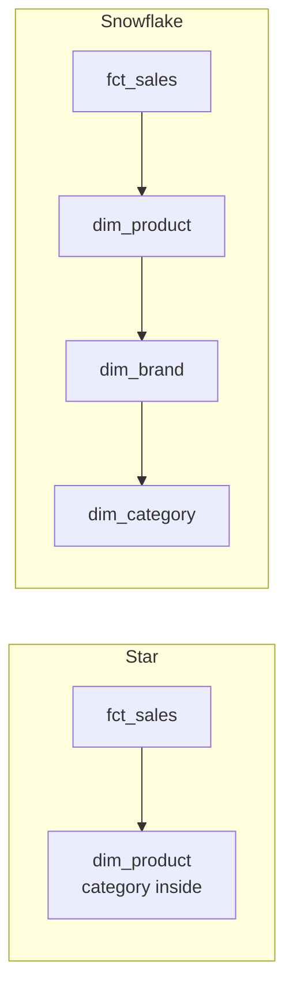
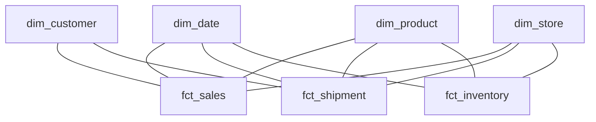
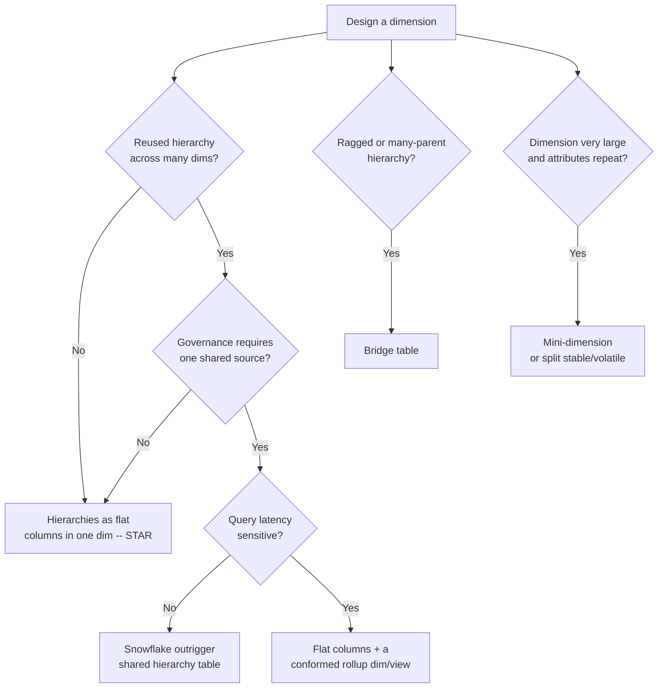

# Star and Snowflake Schemas

> A star schema is a fact table in the center with denormalized dimension tables fanning out like points of a star; a snowflake schema is the same model but with dimensions normalized into sub-dimensions (a hierarchy of tables). The choice between them looks cosmetic — "one extra join" — but it decides the join count of every query, the readability of every model, the physical layout of every columnar table, and the maintainability of the whole warehouse. A senior engineer knows that on modern columnar platforms the **star almost always wins for the presentation layer**, that **snowflaking has narrow legitimate uses** (governed shared hierarchies, volatile outriggers, very large dimensions), and that the real question is not "star or snowflake" but "which layer of the architecture each belongs to."

## TL;DR

- **Star schema** = fact table + denormalized (flat, wide) dimensions. Fewest joins, simplest for BI, best on columnar stores.
- **Snowflake schema** = fact table + normalized dimensions (a dimension's attributes split into related tables). More joins, less redundancy, closer to 3NF.
- The **star is the default** for the presentation/consumption layer on Snowflake, BigQuery, Redshift, Databricks Gold, and Synapse.
- **Columnar storage changed the calculus**: denormalized dimensions are cheap to store (great compression), and *joins are expensive* — so the star's "redundancy" is no longer a real cost, while its join savings are a real benefit.
- Snowflaking is legitimate when: (a) a hierarchy is reused across many dims and must be governed centrally, (b) an outrigger is truly shared, (c) the base dimension is enormous and attributes repeat massively, (d) the platform's optimizer handles joins as well as denormalization.
- The names are **shapes**, not strict rules: real models are **hybrids** — a star with one or two snowflaked outriggers, or a "galaxy" of multiple fact tables sharing conformed dimensions.
- The star does not remove the need for normalization; it **relocates** it. You normalize in the integration layer (3NF/Data Vault) and *denormalize* in the presentation layer.
- Hierarchy handling is the crux: **flat hierarchy columns** (fast, rigid), **snowflaked hierarchy tables** (flexible, more joins), **bridge tables** (ragged/variable-depth hierarchies).
- Optimizing a star is about physical layout: partition/cluster/sort/dist keys, dimension sizes, and join distribution — not about the logical shape alone.

---

## 1. Definitions and core vocabulary

### 1.1 The two shapes

**Star schema**

```
        dim_date        dim_store
            \             /
             \           /
   dim_customer — fct_sales — dim_product
             /           \
            /             \
        dim_promo       dim_employee

Every dimension is ONE table. Join from fact → dimension is a single hop.
```

**Snowflake schema**

```
                      dim_category
                           |
   dim_customer — fct_sales — dim_product
        |                      |
   dim_geography           dim_brand
        |
   dim_region

Dimensions are normalized: product → brand → category; customer → geography → region.
Each level adds a join to reach attributes.
```

### 1.2 Vocabulary

| Term | Meaning |
|------|---------|
| **Star schema** | Fact + denormalized dimensions; a "star" shape. Also called a *dimensional star*. |
| **Snowflake schema** | Fact + normalized (hierarchical) dimensions; looks like a snowflake. |
| **Snowflaking** | The act of normalizing a dimension into multiple related tables. |
| **Outrigger** | A secondary dimension table attached to a dimension (e.g., `dim_date` attached to `dim_promotion`). Snowflaking is outriggers taken to the extreme. |
| **Galaxy / fact constellation** | Multiple fact tables sharing conformed dimensions — the realistic enterprise shape. |
| **Base dimension** | The main dimension table (before splitting). |
| **Hierarchy** | A drill path, e.g., category → subcategory → brand → product. |
| **Ragged hierarchy** | A hierarchy with variable depth (org charts, bill-of-materials). |
| **Bushy hierarchy** | A hierarchy where one node has multiple parents (many-to-many). |
| **Bridge table** | A table resolving a many-to-many (often ragged) hierarchy or attribute assignment. |
| **Conformed dimension** | A dimension shared, with identical meaning, across fact tables. |
| **Star join** | The pattern of a fact joined to several dimensions; optimizers have special paths for it (e.g., Redshift star joins, Snowflake's automatic join optimization). |
| **OBT** | "One Big Table" — full denormalization of fact + dims; an extreme, anti-snowflake pattern used for specific serving cases. |

### 1.3 The same query, both shapes

```sql
-- STAR: revenue by category by month — 2 joins
SELECT d.month, p.category, SUM(f.net_rev_minor)/100.0 AS revenue
FROM fct_sales f
JOIN dim_date    d ON f.date_sk    = d.date_sk
JOIN dim_product p ON f.product_sk = p.product_sk       -- category lives HERE
GROUP BY 1,2;

-- SNOWFLAKE: same question — 4 joins
SELECT d.month, c.category, SUM(f.net_rev_minor)/100.0 AS revenue
FROM fct_sales f
JOIN dim_date     d ON f.date_sk     = d.date_sk
JOIN dim_product  p ON f.product_sk  = p.product_sk
JOIN dim_brand    b ON p.brand_sk    = b.brand_sk
JOIN dim_category c ON b.category_sk = c.category_sk    -- category lives FAR away
GROUP BY 1,2;
```

Two extra joins per analytic query, multiplied by hundreds of dashboards and millions of executions. That is the star's core practical advantage.

---

## 2. What problem it solves / why it matters

### 2.1 Why the star exists

The star is the *physical form of dimensional modeling*: it maximizes **query simplicity** and **optimizer friendliness** while sacrificing some **storage redundancy** and **update normalization**. Its designers accepted redundancy because:

- dimension tables are **tiny** relative to facts (thousands–millions of rows vs. billions),
- dimension attributes are **repeated across a few narrowed rows**, not across the whole fact,
- in a **row store**, fewer joins meant dramatically faster queries (pre-columnar era),
- in a **column store**, denormalized text columns compress extremely well (dictionary/RLE).

### 2.2 Why snowflaking exists (and its honest costs)

Snowflaking exists because normalization has genuine benefits:

- **Storage savings** — a category name stored once instead of a million times.
- **Update anomalies eliminated** — rename a category in one place.
- **Shared hierarchy governance** — one official `dim_category`, reused everywhere.
- **Cleaner change isolation** — a new attribute on `brand` doesn't touch `product`.
- **Support for ragged/bushy hierarchies** — variable-depth structures need separate tables or bridges.

But its costs compound:

- **More joins per query** → more optimizer work, more shuffle, higher latency.
- **BI complexity** — tools must traverse multi-level hierarchy joins.
- **Harder to learn** — business users can't see "everything about a product" in one place.
- **Worse compression/pruning** in columnar engines vs. a single wide table.

### 2.3 Why a senior must understand the trade-off

1. **It affects cost and latency at scale.** One extra join across a billion-row fact can add meaningful shuffle/IO. Multiplied across a dashboard, it's the difference between a 2-second and a 20-second page load.
2. **Modern columnar platforms pay for *joins and scans*, not for *redundant strings*.** This inverts the classic (row-store) intuition. Knowing *why* prevents you from snowflaking "for storage reasons" on Snowflake and paying in joins for a nonexistent benefit.
3. **It's a governance decision as much as a performance one.** Sometimes you *want* a centrally governed hierarchy (snowflake) even at a join cost.
4. **Most real schemas are hybrids**, and you must be able to justify each snowflake. "Star by default, snowflake by exception, with a reason" is the senior stance.

> **Senior note:** The question "star or snowflake?" is often the wrong question. Ask instead: *"which layer?"* Integration layers (3NF/Data Vault) are normalized; presentation layers (marts/BI) are stars. If the modeler is snowflaking the presentation layer on a columnar warehouse, ask what concrete requirement (governance, dimension size, shared outrigger) justifies the extra joins — and require an answer.

---

## 3. How it works internally (mechanisms, internals)

### 3.1 Join mechanics and why the star is cheaper

Query optimizers classify joins and pick algorithms:

| Algorithm | Best for | Cost model |
|-----------|----------|-----------|
| **Nested loop** | Small outer × indexed inner | O(outer × inner-lookup) |
| **Hash join** | Large equi-joins | Build hash on smaller side, probe larger |
| **Merge join** | Sorted inputs | Stream both, match on order |
| **Broadcast join** | One side small | Send small table to every worker |
| **Star join (specialized)** | Fact + many dims | Bitmap/join-index tricks (Redshift, some DW) |

A **star** creates *fewer, simpler* joins from the fact to each dimension: each is a single many-to-one hash/broadcast join. A **snowflake** chains joins (fact→dim_product→dim_brand→dim_category) which:
- forces the optimizer to plan a **join order**,
- can produce interim results that don't shrink,
- prevents some broadcast optimizations (the dimension is no longer small once you join its children),
- increases shuffle in distributed engines.



### 3.2 Cardinality, fan-out, and join safety

The fundamental safety property of a star: **dimensions join to the fact many-to-one**, so no fan-out occurs. Two hazards:

1. **Snowflaked hierarchies with many-to-many** create fan-out unless resolved by a bridge table. E.g., a product with multiple brands, or a customer belonging to multiple segments.
2. **SCD2 dimensions** multiply rows; joining on `is_current` incorrectly can duplicate or mis-attribute. The star doesn't protect you here — grain discipline does.

The rule: **every join from a fact to a dimension must not increase the fact's row count.** Verify with `COUNT(*)` before/after the join in tests.

### 3.3 How columnar engines change the arithmetic

Consider a `dim_product` with these attributes:

| Attribute | Cardinality | Avg length |
|-----------|-------------|-----------|
| product_name | 5,000,000 | 40 B |
| brand | 5,000 | 12 B |
| category | 400 | 15 B |
| subcategory | 3,000 | 20 B |

**Star (flat):** all four columns live in `dim_product`. The `category` column on 5M rows = 75 MB raw, but with **dictionary encoding** (400 distinct values) it's stored as 400 strings + 5M small codes → often < 5 MB. Compression makes the redundancy nearly free.

**Snowflake (normalized):** `category` stored once (400 rows, tiny). But every query needing category must join `product → brand → category`. On a columnar engine, that's:
- an extra hash-build/probe of a small table (cheap), *but*
- a shuffle/hash-join that breaks the "one big scan + tiny lookups" pattern,
- and it prevents the optimizer from **filtering by category before scanning the fact** in some cases (join order matters).

**Net:** on modern columnar warehouses, the storage saving of snowflaking is negligible while the join cost is real. So the star wins for the presentation layer.

> **Senior note:** The exception is when the *dimension itself* is gigantic — e.g., a 500M-row `dim_customer` where 90% of columns repeat across SCD2 versions, or a 200M-row `dim_product_catalog`. Here, splitting stable/volatile attributes (mini-dimension, type 4) or snowflaking a rare, huge attribute set can genuinely reduce scan bytes. That's a *data-size* argument, not a purity argument.

### 3.4 Hierarchy representation — the real design crux

| Approach | Structure | Query cost | Flexibility | Best for |
|----------|-----------|-----------|-------------|----------|
| **Flat columns** | `category`, `subcategory`, `brand` in `dim_product` | 0 extra joins | Rigid (fixed depth) | Fixed, shallow hierarchies (the common case) |
| **Snowflake outriggers** | `dim_product → dim_brand → dim_category` | +1–2 joins | Better governance/reuse | Shared, governed hierarchies |
| **Bridge table** | `bridge_product_category(product_sk, category_sk, depth, weight)` | +1 join | Ragged/bushy, many-to-many | Org charts, BOM, multi-segment |
| **Recursive/path** | `path`, `parent_sk`, `level` | Recursive CTE / path parse | Arbitrary depth | Graph-like hierarchies |

**Flat is the default** because most business hierarchies are shallow and fixed. Use a bridge when depth varies or a node has multiple parents.

```sql
-- Ragged hierarchy via bridge (employee reports-to)
CREATE TABLE bridge_emp_org (
    employee_sk   NUMBER,   -- descendant
    manager_sk    NUMBER,   -- ancestor
    depth         NUMBER,   -- 0 = self
    is_top        BOOLEAN
);
-- "Revenue of every subordinate under manager X":
SELECT SUM(f.amount_minor)
FROM fct_sales f
JOIN bridge_emp_org b ON f.employee_sk = b.employee_sk
WHERE b.manager_sk = :X;
```

### 3.5 The galaxy (fact constellation)

Real enterprises are not one star; they are **many stars sharing conformed dimensions**:



This is the actual output of the bus-matrix plan (chapter 02). "Star vs. snowflake" is really "how flat is each dimension in the galaxy."

---

## 4. How to implement it (step-by-step, with SQL / code / config examples)

### 4.1 Deciding the shape — a decision procedure



**Default: STAR.** Snowflake only with a named requirement.

### 4.2 Implement a star (recommended default)

```sql
-- Fact: sales at order-line grain
CREATE TABLE dwh.fct_sales (
    order_line_sk   NUMBER PRIMARY KEY,
    date_sk         NUMBER NOT NULL,
    customer_sk     NUMBER NOT NULL,
    product_sk      NUMBER NOT NULL,
    store_sk        NUMBER NOT NULL,
    promo_sk        NUMBER,
    quantity        NUMBER NOT NULL,
    net_rev_minor   NUMBER NOT NULL
);

-- Dimension: denormalized product (hierarchy flat inside)
CREATE TABLE dwh.dim_product (
    product_sk      NUMBER PRIMARY KEY,
    product_id      STRING NOT NULL,     -- natural key
    product_name    STRING,
    category        STRING,              -- hierarchy kept FLAT
    subcategory     STRING,
    brand           STRING,
    supplier_name   STRING,              -- denormalized, not a snowflake
    list_price_minor NUMBER,
    is_current      BOOLEAN
);
```

Build the flat dimension in dbt from the normalized source — **denormalize at the edge, in the mart**:

```sql
-- models/marts/core/dim_product.sql  (star: flatten the hierarchy)
with p as (select * from {{ ref('stg_products') }}),
     b as (select * from {{ ref('stg_brands') }}),
     c as (select * from {{ ref('stg_categories') }}),
     s as (select * from {{ ref('stg_suppliers') }})

select
    {{ dbt_utils.generate_surrogate_key(['p.product_id']) }} as product_sk,
    p.product_id,
    p.product_name,
    c.category_name      as category,       -- flattened
    c.subcategory_name   as subcategory,    -- flattened
    b.brand_name         as brand,          -- flattened
    s.supplier_name      as supplier_name,  -- flattened
    p.list_price_minor,
    true                 as is_current
from p
left join b on p.brand_id    = b.brand_id
left join c on b.category_id = c.category_id
left join s on p.supplier_id = s.supplier_id
```

> **Senior note:** You *do* join the normalized hierarchy tables — but **once, at build time**, in the mart. Users then pay zero joins at query time. This is the essence of "normalize upstream, denormalize downstream."

### 4.3 Implement a snowflake (the justified exception)

Legitimate scenario: a **governed, shared geography hierarchy** used by customer, store, employee, and supplier dimensions. Centralizing it means one place to fix a region mapping.

```sql
-- Governance-friendly snowflake for geography
CREATE TABLE dwh.dim_region (
    region_sk   NUMBER PRIMARY KEY,
    region_code STRING,
    region_name STRING
);
CREATE TABLE dwh.dim_geography (
    geo_sk      NUMBER PRIMARY KEY,
    country_code STRING,
    country_name STRING,
    state_code  STRING,
    city        STRING,
    region_sk   NUMBER REFERENCES dwh.dim_region(region_sk)
);
CREATE TABLE dwh.dim_customer (
    customer_sk NUMBER PRIMARY KEY,
    customer_id NUMBER,
    full_name   STRING,
    geo_sk      NUMBER REFERENCES dwh.dim_geography(geo_sk)   -- outrigger
);

-- Query pays the extra join
SELECT r.region_name, SUM(f.net_rev_minor)/100.0
FROM dwh.fct_sales f
JOIN dwh.dim_customer c ON f.customer_sk = c.customer_sk
JOIN dwh.dim_geography g ON c.geo_sk = g.geo_sk
JOIN dwh.dim_region    r ON g.region_sk = r.region_sk
GROUP BY 1;
```

**Soften the cost with a flat reporting view** (best of both worlds):

```sql
-- Denormalized view so the 99% of queries pay no joins
CREATE VIEW dwh.dim_customer_flat AS
SELECT c.customer_sk, c.customer_id, c.full_name,
       g.country_code, g.state_code, g.city,
       r.region_name AS region
FROM dwh.dim_customer c
LEFT JOIN dwh.dim_geography g ON c.geo_sk = g.geo_sk
LEFT JOIN dwh.dim_region    r ON g.region_sk = r.region_sk;
```

> **Senior note:** "Snowflake with a flat view" is one of the most pragmatic patterns in warehousing: governance/consistency from normalization, performance from the denormalized presentation view. Materialize the view when BI latency matters (`CREATE MATERIALIZED VIEW` / dynamic table / dbt table model).

### 4.4 Bridge table for a ragged hierarchy

```sql
-- Variable-depth product category hierarchy (category can nest arbitrarily)
CREATE TABLE dwh.dim_category (
    category_sk   NUMBER PRIMARY KEY,
    category_id   STRING,
    category_name STRING,
    parent_sk     NUMBER REFERENCES dwh.dim_category(category_sk),
    level         NUMBER,
    path          STRING          -- e.g. 'Electronics/Phones/Smartphones'
);

-- Pre-materialized closure table (bridge) so no recursion at query time
CREATE TABLE dwh.bridge_category_closure (
    ancestor_sk   NUMBER,
    descendant_sk NUMBER,
    depth         NUMBER,      -- 0 = self
    is_leaf       BOOLEAN
);
```

Build the closure with a recursive CTE once per load:

```sql
WITH RECURSIVE closure AS (
    SELECT category_sk AS ancestor_sk, category_sk AS descendant_sk, 0 AS depth
    FROM dwh.dim_category
    UNION ALL
    SELECT c.ancestor_sk, p.category_sk AS descendant_sk, c.depth + 1
    FROM closure c
    JOIN dwh.dim_category p ON p.parent_sk = c.descendant_sk
)
SELECT * FROM closure;
```

### 4.5 Physical layout per platform

**Snowflake**

```sql
ALTER TABLE dwh.fct_sales CLUSTER BY (to_date(order_ts), product_sk);
-- Verify clustering quality
SELECT SYSTEM$CLUSTERING_INFORMATION('dwh.fct_sales', '(to_date(order_ts), product_sk)');
```

**BigQuery**

```sql
CREATE TABLE dwh.fct_sales
PARTITION BY DATE(order_ts)
CLUSTER BY customer_sk, product_sk
AS SELECT ... ;
-- Star queries: prefer JOIN over correlated subqueries; let the optimizer broadcast small dims.
```

**Redshift**

```sql
CREATE TABLE dwh.fct_sales (...)
DISTKEY(product_sk)        -- co-locate with the largest dimension
SORTKEY(order_date);
CREATE TABLE dwh.dim_product (...) DISTSTYLE ALL;  -- broadcast small dims
```

**Databricks / Delta**

```sql
-- Liquid clustering (replaces static partitioning/Z-ORDER in modern Databricks)
CREATE TABLE dwh.fct_sales (...) CLUSTER BY (order_date, product_sk);
OPTIMIZE dwh.fct_sales;      -- compaction
```

> **Senior note:** On Redshift, the **star's performance depends heavily on dist/sort keys**: distribute the fact on the key of the largest or most-joined dimension, and broadcast (`DISTSTYLE ALL`) the small ones. A star with bad dist keys performs worse than a snowflake with good ones — physical layout can dominate logical shape.

### 4.6 dbt project structure for a star-on-snowflake-in-source setup

```
models/
  staging/        # 1:1 cleaned source, normalized as-is
    stg_products.sql
    stg_brands.sql
    stg_categories.sql
  marts/core/     # STAR: flattened dims + facts
    dim_product.sql        # flattens brand/category
    dim_customer.sql       # flattens geo (unless governance demands outrigger)
    fct_sales.sql
  marts/finance/
    fct_gl_entry.sql
```

Rule of thumb: **staging mirrors the source (normalized); marts flatten (star).**

---

## 5. Where to implement it (tools/platforms)

### 5.1 Platform-by-platform guidance

| Platform | Recommended shape | Why / caveats |
|----------|-------------------|---------------|
| **Snowflake** | Star; `CLUSTER BY` on big facts | Micro-partition pruning + cheap storage make flat dims ideal; joins cost compute minutes |
| **BigQuery** | Star; `PARTITION BY` + `CLUSTER BY` | Bytes-scanned pricing punishes wide scans less than joins/nested subqueries; broadcast small dims |
| **Redshift** | Star + deliberate `DISTKEY`/`SORTKEY`; `DISTSTYLE ALL` small dims | Star join optimizations exist; layout is critical |
| **Databricks / Delta / Iceberg** | Star as Gold; silver is normalized/DV | Photon + liquid clustering; MERGE for SCD2; compaction matters |
| **Synapse / Fabric** | Star in dedicated SQL pool | Histograms/statistics matter; distribution like Redshift |
| **Trino / Athena** | Star on Parquet/Iceberg | Star is best; performance depends on file partitioning/sorting |
| **Postgres/MySQL (serving)** | Star or OBT for read replicas | Row store: joins more expensive, so stars/OBT help; but limited scan scale |
| **ClickHouse** | Often OBT/wide table; star aggregates for BI | Real-time wide events beat stars for event analytics |
| **Druid / Pinot** | Pre-aggregated sketches + dimensions | Not a full star engine; modeling via dimensions + metrics |
| **DuckDB** | Star (great at local stars) | Vectorized joins are fast; good for dev/testing models |

### 5.2 The layering that resolves star vs. snowflake

```
Layer            Shape                    Owner
-------------    ---------------------    -------------------
Raw/bronze       as-is                    ingestion
Staging/silver   normalized-ish           analytics eng
Integration      3NF or Data Vault        data eng
Presentation     ★ STAR (denormalized)    analytics eng
Semantic         metrics over the star    analytics eng
```

Every "snowflake vs star" debate dissolves once you accept that **normalization lives upstream and denormalization lives downstream** — each layer uses the shape that is optimal for its purpose.

### 5.3 Tooling for each shape

| Task | Tools |
|------|-------|
| Model & version stars | dbt, SQLMesh, Dataform, Coalesce |
| ER/relational modeling (snowflake-friendly) | erwin, ER/Studio, PowerDesigner |
| Semantic layer over the star | LookML, Cube, AtScale, MetricFlow, dbt Semantic Layer |
| Lineage/impact of snowflake changes | dbt docs, OpenLineage, DataHub, Atlan |
| Auto-flattening | dbt macros (`dbt_utils.star`, custom pivot macros), dbt packages |

---

## 6. Patterns and anti-patterns

### 6.1 Patterns

**P1. Star by default.** Flat dimensions in the presentation layer; one join from fact to each dimension.

**P2. Snowflake with a flat view (or materialized view).** Governance from normalization, performance from a flat presentation.

**P3. Flatten at build time.** Join normalized hierarchy tables once in the ELT, not per query.

**P4. DISTSTYLE ALL / broadcast small dimensions.** Optimize star joins physically.

**P5. Bridge tables for ragged/bushy hierarchies.** Pre-compute closure; avoid recursive CTEs at query time.

**P6. Conformed rollup dimensions.** A small `dim_category` used by several fact tables, kept as a separate conformed dimension (not snowflaked into every product dim).

**P7. Keep dimensions narrow-ish, not maximal.** A 300-column dimension is hard to manage; split rarely-queried attribute groups if they're truly huge (mini-dimension / outrigger).

**P8. Star the facts, normalize the integration.** 3NF/DV upstream; stars downstream.

**P9. Galaxy + bus matrix.** Many stars sharing conformed dims; plan with the matrix.

**P10. Document the snowflake reason.** Every extra join has a comment explaining the requirement it serves.

### 6.2 Anti-patterns

**A1. Snowflaking by reflex.** Normalizing on a columnar warehouse "to save space" — you pay joins for a nonexistent savings.

**A2. Fully normalized "star."** A fact connected to 40 small tables is not a star; it's a 3NF model wearing a costume. BI users suffer.

**A3. Snowflaked giant facts.** Normalizing the fact table into multiple tables (a recurring conceptual error) destroys scan performance and star joins.

**A4. Deep outrigger chains.** `fact → dim → dim → dim → dim`; each hop is a join and a plan risk. Cap at 1, justify beyond.

**A5. Many-to-many joins without bridges.** Fan-out inflates totals. Use bridges with weights.

**A6. Redundant conformed dimensions.** Every mart created its own `dim_date`. Should be one conformed `dim_date`.

**A7. Hierarchy attributes duplicated inconsistently.** `category` defined differently in two flat dims. Conform or centralize.

**A8. `SELECT *` across a snowflake.** Multiplies join cost and bytes scanned.

**A9. Ignoring physical layout.** Assuming the logical star is enough. Partition/sort/cluster/dist decide real performance.

**A10. Snowflaking the same attribute both ways.** Some marts flat, some normalized → inconsistent metrics.

### 6.3 Star vs. snowflake decision table

| Criterion | Star | Snowflake |
|-----------|:----:|:---------:|
| Join count per query | Low | High |
| Storage redundancy | Higher | Lower |
| Query readability | High | Lower |
| Optimizer friendliness | High | Medium |
| Governance of shared hierarchies | Medium | High |
| Handles ragged/many-to-many | Via bridges | Via bridges |
| Best on columnar warehouses | ✅ | ⚠️ case-by-case |
| Best on legacy row-store DW | ✅✅ | ⚠️ |
| Best for very large dimensions | Split (mini-dim) | ✅ (splitting) |
| Change isolation of attributes | Lower | Higher |

---

## 7. Real-world use cases and industry applications

**Retail BI (classic).** Snowflake/Redshift star: `fct_sales` + flat `dim_product` (category/brand inside), `dim_store`, `dim_promo`, `dim_date`. Snowflaking was common in the row-store era (Teradata, Oracle) where joins were expensive and storage precious; modern columnar warehouses flatten.

**Banking regulatory reporting.** A **governed `dim_geography`/`dim_entity` snowflake** is often mandated: legal entity → country → region → reporting block must be defined once and reused across regulatory marts. Here the snowflake earns its joins through governance.

**Healthcare (claims).** `fct_claim_line` + `dim_member` (SCD2), `dim_provider` (snowflaked to `dim_facility`/`dim_specialty`), `dim_diagnosis` (bridge to a many-to-many). Deep hierarchies (ICD codes) and many-to-many.

**Supply chain / manufacturing.** Bill-of-materials and org charts are **ragged hierarchies** → bridge/closure tables, not flat columns. Product catalog may be snowflaked (product→part→material) because it is genuinely large and reused.

**Adtech.** Wide-event tables (impressions/clicks) often stored as OBT for real-time; the *analytics* layer flattens into stars for cross-channel reporting. Conformed `dim_campaign`, `dim_creative`.

**SaaS.** dbt-built star in Snowflake/BigQuery; `dim_account`/`dim_user` SCD2; `fct_subscription_monthly` snapshot. Semantic layer (Cube/MetricFlow) on top. Snowflaking appears only for a shared `dim_date`/fiscal calendar.

**Uber / Netflix-scale.** Integration layer is large and normalized/DV; the **presentation** layer materializes stars (or wide tables) per domain for specific consumption. Shared dimensions are governed centrally.

> **Senior note:** The recurring pattern across industries is: **normalize to integrate, denormalize to serve.** The star is the serving shape; the snowflake is the integration shape. Teams that conflate the two either build unusable 3NF "warehouses" or unmanageable OBTs.

---

## 8. Senior-level deep dive

### 8.1 Trade-offs, precisely

**Storage/compression:**
- Star stores duplicate, low-cardinality strings; columnar **dictionary/RLE encoding** collapses them to near-nothing.
- Snowflake stores each attribute once, but pays joins forever.
- **Net on columnar:** star usually wins on bytes-scanned *for the same query* because it reads a small dimension once and filters the fact directly.

**Latency:**
- Each extra join ≈ one hash-build/probe + shuffle decision. For small dims it's microseconds; for a 100M-row outrigger it's material.
- Optimizers may **push predicates** through joins differently in snowflake chains, sometimes helping, often not.

**Concurrency:**
- Fewer joins → less CPU per query → more concurrency per warehouse/cluster. Star helps at high BI concurrency.

**Maintainability:**
- Star: one dim to change; changes ripple to everyone using it (which is usually desired — conformance).
- Snowflake: attribute changes localized to a sub-dim; but the join graph must be documented.

**Change management:**
- Adding an attribute: both fine.
- Changing hierarchy depth: snowflake is more flexible; star requires model redesign (or a bridge).

### 8.2 Architecture decisions

| Decision | Choose star when... | Choose snowflake when... |
|----------|---------------------|--------------------------|
| Shared governed hierarchy | Hierarchy is simple/fixed | Must be identical across many marts and centrally owned |
| Dimension size | Small–medium | Huge, with heavy attribute repetition |
| Platform | Columnar warehouse | Row store OR a governance-heavy environment |
| BI concurrency | High | Moderate |
| Query patterns | Ad hoc, many dims per query | Few, narrow queries |
| Team maturity | Broad user base | Power users/engineers |

### 8.3 Performance deep dive

- **Predicate pushdown through joins.** In a snowflake chain, `WHERE category = 'Phones'` may only be applicable after joining `dim_category`. Some optimizers reorder to filter early; others don't. Test with real plans.
- **Broadcast vs. shuffle joins.** Small dimension tables should broadcast. In a snowflake, the "small table" may become medium-sized after joining children, defeating broadcast → shuffle → slower.
- **Skew.** A dominant dimension key (one mega-customer) skews a hash join. Salt the key or broadcast the dimension.
- **Dimension statistics.** In Redshift/Synapse, stale stats on a snowflaked dimension produce catastrophic plans. `ANALYZE` matters.
- **Star join optimizations.** Redshift star joins, Snowflake's join pruning, BigQuery's broadcast heuristic — all are more effective with fewer, simpler joins.

### 8.4 Failure modes and debugging

| Symptom | Likely cause | Diagnosis | Fix |
|---------|-------------|-----------|-----|
| Dashboard slow after "cleanup" snowflaking | Extra joins | Count joins in the plan | Flatten or add a flat view |
| Bytes-scanned spike | `SELECT *` across snowflake | Query logs | Column pruning |
| Fan-out of totals | Many-to-many hierarchy without bridge | `COUNT` before/after join | Bridge table with weights |
| Wrong category totals | Hierarchy duplicated inconsistently | Compare dim sources | Conform the hierarchy |
| Join explosion | Deep outrigger chain | Plan join order | Flatten to ≤1 outrigger |
| Broadcast failed | Outrigger no longer small | Plan shows shuffle | Broadcast hint or flatten |
| Redshift slow star joins | Bad DISTKEY/SORTKEY | `EXPLAIN SVL_QUERY` | Realign dist keys, `DISTSTYLE ALL` |

### 8.5 The governance overlay

- **Conformed dimensions registry**: maintain a catalog of the shared dims (date, customer, product, geography) and their definitions.
- **Flat-view pattern**: keep the governed snowflake as the source of truth and expose materialized flat views for consumers.
- **Semantic layer**: metric definitions over the star so a snowflake change doesn't silently alter metrics.
- **Contract tests**: referential integrity between fact and every dimension; uniqueness on the grain.

### 8.6 Anti-conformance math (why "just snowflake a bit" is dangerous)

If `dim_product.category` is defined in two places with a slightly different mapping, then:
- `SUM` by category differs per dashboard,
- reconciliations fail,
- trust collapses.

The star's flatness is not merely performance — it is a **single source of truth per attribute**. Snowflaking reintroduces the *possibility* of divergence, which is exactly what conformance avoids. This is why "star by default, snowflake by exception *with governance*."

---

## 9. Common mistakes and how to avoid them

1. **Snowflaking for storage on columnar warehouses.** *Avoid:* estimate bytes saved (usually tiny after compression) vs. join cost; default to star.
2. **Building a 3NF model and calling it a star.** *Avoid:* if the fact joins 30 tiny tables, it's not a star. Flatten.
3. **Deep outrigger chains.** *Avoid:* cap at one level; use flat views beyond.
4. **No bridge tables for many-to-many.** *Avoid:* model the bridge explicitly with weights and depth.
5. **Inconsistent hierarchy definitions.** *Avoid:* conformed hierarchy dims + a registry.
6. **Ignoring physical layout.** *Avoid:* choose partition/cluster/dist/sort keys from the top queries.
7. **Using snowflaking to "isolate changes" without governance.** *Avoid:* isolation without conformance creates metric drift.
8. **Neglecting small-dimension broadcast.** *Avoid:* `DISTSTYLE ALL` (Redshift), rely on BigQuery/Snowflake broadcast heuristics, keep dims small.
9. **Recursive CTEs at query time for hierarchies.** *Avoid:* pre-compute closures/bridges at load time.
10. **Mixing shapes across marts inconsistently.** *Avoid:* establish one presentation convention ("all marts are stars").
11. **Assuming the star is "wrong" because it's redundant.** *Avoid:* recognize that redundancy is the deliberate mechanism, not a flaw.
12. **Forgetting that BI tools traverse hierarchies.** *Avoid:* user-facing dims should be flat so drill-downs are one hop.

---

## 10. Exercises / interview questions

**Conceptual**

1. Define star and snowflake schemas precisely, and state the one structural difference that matters. *(Hint: dimension normalization.)*
2. Why did the star/snowflake debate change with the rise of columnar warehouses? *(Hint: compression makes redundancy cheap; joins stay expensive.)*
3. What is an outrigger, and how does it relate to snowflaking? *(Hint: dimension attached to a dimension; snowflaking = extreme outriggers.)*

**Design**

4. Design a star for retail sales; then refactor one dimension into a snowflake and list the exact queries that gain/lose. *(Hint: count joins; consider bytes scanned.)*
5. A company needs a single governed `geography` hierarchy across customer, store, and supplier. Design it and explain how you keep query latency low. *(Hint: snowflake + flat materialized view.)*
6. Model an employee-to-manager hierarchy of arbitrary depth and optimize queries for "all reports under X." *(Hint: bridge/closure table.)*

**Internals**

7. Why does a snowflake often prevent broadcast joins, and what is the performance consequence? *(Hint: joined child makes the "small" side larger.)*
8. Explain how columnar dictionary encoding makes a flat `category` column nearly free. *(Hint: low-cardinality codes + dictionary.)*
9. In a distributed engine, what determines whether a star join shuffles or broadcasts? *(Hint: size thresholds and statistics.)*

**Trade-offs / senior**

10. Your BI suffers under concurrency; the model is a snowflake. Lay out a migration to a star with minimal downstream breakage. *(Hint: flat views first, then materialize, then deprecate.)*
11. Argue *for* snowflaking in a specific, concrete scenario, and quantify when it's worth the joins. *(Hint: huge dimension with massive repetition; governance.)*
12. How would you decide star vs. snowflake if the platform were Redshift instead of Snowflake? *(Hint: dist/sort keys change the calculus.)*

**Debugging**

13. Revenue by category differs between two dashboards built on the same fact. Where do you look first, and why? *(Hint: hierarchy conformance.)*
14. After adding a `brand` outrigger, a dashboard got 10× slower. Diagnose. *(Hint: broadcast → shuffle; join order.)*

---

## References

- **Kimball Group — Dimensional Modeling Techniques (star, conformance, outriggers)**: https://www.kimballgroup.com/data-warehouse-business-intelligence-resources/kimball-techniques/dimensional-modeling-techniques/
- **Kimball Group — The Matrix (bus matrix, conformed dimensions)**: https://www.kimballgroup.com/1999/12/the-matrix/
- **Wikipedia — Star schema**: https://en.wikipedia.org/wiki/Star_schema
- **Wikipedia — Snowflake schema**: https://en.wikipedia.org/wiki/Snowflake_schema
- **Databricks — When to use star schema (lakehouse guidance)**: https://answers.databricks.com/build-star-schema-databricks
- **Databricks — Data warehousing concepts & modeling**: https://docs.databricks.com/aws/en/sql/get-started/data-warehousing-concepts
- **Snowflake — Micro-partitions, clustering, and join pruning**: https://docs.snowflake.com/en/user-guide/tables-clustering-micropartitions
- **Snowflake — Query optimization / join pruning**: https://docs.snowflake.com/en/user-guide/querying-joins
- **Google BigQuery — Query performance optimization (broadcast joins)**: https://cloud.google.com/bigquery/docs/best-practices-performance-communication
- **Amazon Redshift — Star schema and DISTSTYLE/DISTKEY/SORTKEY**: https://docs.aws.amazon.com/redshift/latest/dg/c_designing-tables-best-practices.html
- **Amazon Redshift — Query planning and execution (star joins)**: https://docs.aws.amazon.com/redshift/latest/dg/c-query-planning.html
- **Abadi et al. — "Column-Stores vs. Row-Stores: How Different Are They Really?"**: https://dl.acm.org/doi/10.1145/1376616.1376712
- **dbt — How we structure our dbt projects (staging vs marts)**: https://docs.getdbt.com/best-practices/how-we-structure/1-guide-overview
- **Microsoft — Synapse dedicated SQL pool table design**: https://learn.microsoft.com/en-us/azure/synapse-analytics/sql-data-warehouse/sql-data-warehouse-tables-overview
