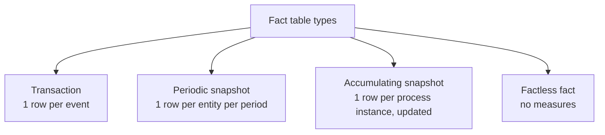

# Fact and Dimension Tables

> Facts and dimensions are the two halves of every dimensional model: **facts** hold the quantitative measurements of a business process at a declared grain, and **dimensions** hold the descriptive context — the who, what, where, when, why, and how — that makes those numbers meaningful. Getting this split right is the difference between a warehouse that answers questions nobody anticipated and one that only answers the questions someone hard-coded. A senior engineer knows the full taxonomy — four fact-table types (transaction, periodic snapshot, accumulating snapshot, factless), the additivity rules for measures, and the dimension portfolio (conformed, role-playing, degenerate, junk, mini, outrigger, bridge) — and, more importantly, knows *when* each is the right tool.

## TL;DR

- **Fact tables** = measurements (numbers) + foreign keys to dimensions, at a **declared grain**. They are tall and narrow and grow with events.
- **Dimension tables** = descriptive text/attributes + a **surrogate key** + the **natural key**. They are short and wide and grow with entities.
- **Grain declaration** ("one row per ___") is the single most important design decision; it must be written down and enforced with a `unique` test.
- **Measure additivity** drives correctness: store **additive** components; never store ratios/averages. Semi-additive (balances) must not be summed over time.
- **Four fact types**: transaction (one row per event), periodic snapshot (one row per entity per period), accumulating snapshot (one row per process instance, updated as it progresses), factless fact (records coverage/events with no measures).
- **Dimension portfolio**: conformed (shared), role-playing (one dim, many roles), degenerate (ID in the fact, no table), junk (bundled flags), mini-dimension (volatile/small attribute sets), outrigger (snowflaked sub-dim), bridge (many-to-many).
- **Surrogate keys** join fact↔dimension; **natural keys** identify the entity; **durable keys** identify the entity across versions. Keep all three roles distinct.
- **NULLs are forbidden in fact FKs** — pre-build **unknown** (`-1`) and **inferred** (`-2`) dimension members.
- **Always add a `dim_date`** with fiscal/holiday attributes; date-as-timestamp loses calendar semantics.
- **Degenerate dimensions** (order numbers, invoice IDs, ticket IDs) live in the fact table for drill-through — do not force a tiny dimension.
- Physical reality: facts must be **partitioned/clustered/sorted** on the most common filters; dimensions should stay **small enough to broadcast**.

---

## 1. Definitions and core vocabulary

### 1.1 Fact table

A fact table contains:
1. **Foreign keys** to dimensions (surrogate keys),
2. **Measures** — numeric, mostly additive,
3. Optionally, **degenerate dimension keys** (business identifiers kept inline).

```sql
CREATE TABLE dwh.fct_sales (
    sale_sk         NUMBER PRIMARY KEY,
    date_sk         NUMBER NOT NULL,   -- FK → dim_date
    customer_sk     NUMBER NOT NULL,   -- FK → dim_customer
    product_sk      NUMBER NOT NULL,   -- FK → dim_product
    store_sk        NUMBER NOT NULL,   -- FK → dim_store
    promo_sk        NUMBER,            -- FK → dim_promo (nullable → use -1)
    order_number    STRING NOT NULL,   -- degenerate dimension
    quantity        NUMBER NOT NULL,   -- additive
    gross_rev_minor NUMBER NOT NULL,   -- additive
    discount_minor  NUMBER NOT NULL,   -- additive
    net_rev_minor   NUMBER NOT NULL    -- additive
);
```

**Properties:** tall (millions–trillions of rows), narrow, insert-heavy, indexed/clustered by date, joined to dims many-to-one.

### 1.2 Dimension table

A dimension table contains:
1. A **surrogate key** (PK),
2. The **natural/business key(s)**,
3. **Descriptive attributes** (text, codes, flags, hierarchies).

```sql
CREATE TABLE dwh.dim_product (
    product_sk      NUMBER PRIMARY KEY,   -- surrogate
    product_id      STRING NOT NULL,      -- natural key (SKU)
    product_name    STRING,
    category        STRING,               -- flat hierarchy
    subcategory     STRING,
    brand           STRING,
    list_price_minor NUMBER,
    valid_from      TIMESTAMP_NTZ,        -- SCD2
    valid_to        TIMESTAMP_NTZ,
    is_current      BOOLEAN
);
```

**Properties:** short–medium (thousands–millions of rows, occasionally more), wide (dozens–hundreds of columns), updated via SCD, joined one-to-many from facts.

### 1.3 Vocabulary (the full portfolio)

| Term | Definition |
|------|-----------|
| **Grain** | The meaning of one row; the fact table's contract. |
| **Measure / fact** | A numeric value captured at the grain. |
| **Additive** | Sums correctly across all dimensions. |
| **Semi-additive** | Sums across some dimensions but not time (balances, inventory). |
| **Non-additive** | Cannot be summed (ratios, prices, percentages). |
| **Surrogate key** | Warehouse-assigned key used for joins; enables SCD. |
| **Natural/business key** | Source identifier for the entity. |
| **Durable key** | Stable key identifying the entity across SCD versions. |
| **Degenerate dimension** | A business identifier kept in the fact with no dimension table. |
| **Junk dimension** | A table bundling several low-cardinality flags/indicators. |
| **Mini-dimension** | A small dimension of frequently changing (or hot) attributes, split from a large dimension. |
| **Outrigger dimension** | A dimension attached to another dimension (snowflaked sub-dim). |
| **Conformed dimension** | A dimension shared, identically, across fact tables. |
| **Role-playing dimension** | One physical dimension referenced in multiple roles (date as order/ship/due). |
| **Bridge table** | Resolves a many-to-many between a fact and a dimension (with weights). |
| **Unknown member** | A placeholder dimension row (SK = -1) for missing FKs. |
| **Inferred member** | A placeholder row for a dimension not yet known (SK = -2). |
| **Late-arriving dimension/fact** | Data arriving after its related rows were already processed. |
| **Transaction fact** | One row per event. |
| **Periodic snapshot fact** | One row per entity per period (daily/monthly). |
| **Accumulating snapshot fact** | One row per process instance, updated as it progresses. |
| **Factless fact** | A fact table with no measures; records that something happened / was covered. |

### 1.4 Fact vs. dimension quick test

| Question | Fact | Dimension |
|----------|:----:|:---------:|
| Is it numeric and aggregatable? | ✅ | rarely (price is dimensional) |
| Does it grow with events? | ✅ | ❌ |
| Is it text describing context? | ❌ | ✅ |
| Does it change over time (SCD)? | sometimes | ✅ |
| Is there usually one SK per row? | ❌ (many FKs) | ✅ (one PK) |
| Is it joined many-to-one from the fact? | — | ✅ |
| Would you `SUM` or `GROUP BY` it? | SUM | GROUP BY |

> **Senior note:** The "price" trap: `unit_price` *feels* like a fact but in a retail star it's often a **dimension attribute** (`dim_product.list_price`) because you filter by price band and join it, but you aggregate `revenue` = `quantity × price`. Only keep `unit_price` in the fact if it's genuinely transaction-specific (negotiated price per sale). Ask: "Is it a measurement of the event, or an attribute of the entity?"

---

## 2. What problem it solves / why it matters

### 2.1 The problem: raw events are unusable without context

A raw event table records *what happened* in a compact, machine-friendly way (`customer_id=1123, product_id='SKU-9', qty=3, ts=...`). To answer business questions you must join it to *who/what/where/when/why/how* repeatedly, with consistent semantics. Two analysts will do that join differently; results diverge; performance suffers.

Splitting into **facts (measurements) + dimensions (context)** solves:
- **Consistency:** the customer's segment is defined once (`dim_customer`), not per query.
- **Performance:** facts scan efficiently; dims are small and broadcastable.
- **Usability:** business users see recognisable attributes.
- **Extensibility:** new attributes → dimensions; new events → facts.
- **History:** dimensions carry time (SCD); facts are immutable events.

### 2.2 Why the *types* matter

Choosing the wrong fact type creates subtle, expensive bugs:

- Using a **transaction fact** where a **periodic snapshot** is needed ("average inventory") gives the wrong answer (you'd average events, not balances).
- Using a **periodic snapshot** where a **transaction fact** is needed loses detail.
- Using an **accumulating snapshot** for events that can restart (returns) breaks the "one row per instance" assumption.
- Forgetting **factless facts** forces you to hack coverage questions ("which products were on promotion but sold nothing?") with anti-joins.

Similarly, dimensions have a portfolio because a single "flat dimension" cannot serve every need at scale: giant SCD2 dims need mini-dimensions; flags need junk dimensions; many-to-many needs bridges.

### 2.3 Why a senior must internalize this

- **Grain errors are the #1 cause of "wrong numbers."** Knowing the fact taxonomy lets you spot a grain mismatch instantly.
- **Additivity errors** silently produce 30%-wrong dashboards.
- **The dimension portfolio** is what separates a toy model from a warehouse that scales to a million-row dimension without melting.
- **Physical layout** decisions (cluster/sort/dist) only make sense once you know which columns are FKs vs. measures.

---

## 3. How it works internally (mechanisms, internals)

### 3.1 The four fact table types



**1) Transaction fact table.** One row per event at the atomic grain. Highest fidelity; grows with activity; no updates (except late-arriving fixes). Example: every order line, every payment, every click.

```sql
-- grain: one row per order line
CREATE TABLE dwh.fct_order_line (
    order_line_sk NUMBER PRIMARY KEY,
    date_sk       NUMBER NOT NULL,
    customer_sk   NUMBER NOT NULL,
    product_sk    NUMBER NOT NULL,
    quantity      NUMBER NOT NULL,
    net_rev_minor NUMBER NOT NULL
);
```

**2) Periodic snapshot fact table.** One row per entity per regular period, even if nothing happened. Used for **semi-additive balances** and time-series of a state. Example: daily inventory by product/store; monthly account balances; daily headcount.

```sql
-- grain: one row per product per store per day
CREATE TABLE dwh.fct_inventory_daily (
    date_sk        NUMBER NOT NULL,
    product_sk     NUMBER NOT NULL,
    store_sk       NUMBER NOT NULL,
    on_hand_qty    NUMBER NOT NULL,     -- semi-additive
    on_hand_value_minor NUMBER NOT NULL,-- semi-additive
    units_received NUMBER NOT NULL,     -- additive (flow)
    units_sold     NUMBER NOT NULL      -- additive (flow)
);
-- Correct "average inventory": AVG over days of the daily SUM, not SUM over days.
```

**3) Accumulating snapshot fact table.** One row per **process instance**, updated as the instance moves through milestones. Rows carry multiple **role-playing date keys** (one per milestone) and **lag measures**. Example: order lifecycle (placed → paid → shipped → delivered → returned).

```sql
-- grain: one row per order, updated as it progresses
CREATE TABLE dwh.fct_order_lifecycle (
    order_sk            NUMBER PRIMARY KEY,
    order_number        STRING,
    placed_date_sk      NUMBER NOT NULL,
    paid_date_sk        NUMBER,          -- NULL until milestone reached
    shipped_date_sk     NUMBER,
    delivered_date_sk   NUMBER,
    returned_date_sk    NUMBER,
    order_amount_minor  NUMBER,
    days_to_pay         NUMBER,          -- lag measures
    days_to_ship        NUMBER,
    days_to_deliver     NUMBER,
    current_stage       STRING           -- convenience status
);
-- MERGE-updated each run (this is the one fact type that is heavily updated).
```

**4) Factless fact table.** No measures; one row per occurrence of a relationship or coverage event. Two flavors:
- **Event tracking** ("a student attended") — measures could be added but the fact is the existence.
- **Coverage** ("this product was on promotion in this store on this day") — used for "what *didn't* happen" analysis.

```sql
-- coverage factless fact: promotion eligibility
CREATE TABLE dwh.fct_promo_coverage (
    date_sk     NUMBER NOT NULL,
    product_sk  NUMBER NOT NULL,
    store_sk    NUMBER NOT NULL,
    promo_sk    NUMBER NOT NULL
);
-- "Products promoted but with zero sales" = anti-join to fct_sales.
```

### 3.2 Choosing a fact type

| Requirement | Fact type |
|-------------|-----------|
| Detailed event analysis ("revenue by line") | Transaction |
| Balances / inventory / headcount over time | Periodic snapshot |
| Process throughput, cycle times, funnels | Accumulating snapshot |
| "Which X was eligible/covered/attended?" | Factless |
| Both detail and periodic views | Build both (one per grain) |

> **Senior note:** It is normal and correct to have **both** a transaction fact and a periodic snapshot for the same process. `fct_order_line` (everything that happened) and `fct_inventory_daily` (state each day) coexist. Never force one table to serve both grains.

### 3.3 Measure additivity — the correctness backbone

Three classes, and the aggregation rule for each:

| Class | Example | Correct aggregation |
|-------|---------|---------------------|
| **Additive** | revenue, quantity, cost | `SUM` across every dimension |
| **Semi-additive** | account balance, inventory on hand, headcount | `SUM`/`AVG` across dimensions, but **not over time** — use `LAST_VALUE` or period-end |
| **Non-additive** | unit price, margin %, conversion rate | Never `SUM`; recompute from additive components: `SUM(rev)/SUM(cost)` |

**Why semi-additive matters:** summing a daily balance across days produces a meaningless (and inflated) number. The correct pattern:

```sql
-- WRONG: sum of daily balances over a month
SELECT SUM(on_hand_qty) FROM fct_inventory_daily WHERE month = 6;  -- nonsense

-- RIGHT: month-end balance (semi-additive)
SELECT product_sk, SUM(on_hand_value_minor) AS value_at_month_end
FROM (SELECT product_sk, date_sk, on_hand_value_minor,
             ROW_NUMBER() OVER (PARTITION BY product_sk ORDER BY date_sk DESC) rn
      FROM fct_inventory_daily
      WHERE date_sk BETWEEN 20240601 AND 20240630)
WHERE rn = 1
GROUP BY product_sk;

-- WRONG: average of daily unit prices
SELECT AVG(unit_price_minor) ...

-- RIGHT: recompute from components
SELECT SUM(gross_rev_minor)/NULLIF(SUM(quantity),0) AS avg_unit_price FROM fct_sales;
```

### 3.4 Dimension internals: keys and SCD

**Three key roles** (keep them distinct!):

| Key | Purpose | Example |
|-----|---------|---------|
| Surrogate key (SK) | Fact↔dim join; version identity | `customer_sk = 482913` |
| Natural/business key (NK) | Identify from source | `customer_id = 1123` |
| Durable key | Same entity across SCD versions | `customer_durable_key = 'C1123'` |

A type-2 dimension row:

| customer_sk | customer_id | segment | valid_from | valid_to | is_current |
|------------:|-------------|---------|-----------|----------|-----------|
| 1 | 1123 | Bronze | 2022-01-01 | 2023-06-30 | false |
| 2 | 1123 | Silver | 2023-07-01 | 2024-02-29 | false |
| 3 | 1123 | Gold | 2024-03-01 | NULL | true |
| -1 | NULL | Unknown | 1900-01-01 | NULL | true |

Facts point at the SK that was current *when the event happened* → correct historical attribution.

### 3.5 Dimension internals: pattern selection

| Pattern | Addresses | Example |
|---------|-----------|---------|
| **Conformed** | Consistency across facts | one `dim_date`, one `dim_customer` |
| **Role-playing** | One dim, many roles | `dim_date` as order/ship/due dates |
| **Degenerate** | Document IDs for drill-through | `order_number` in the fact |
| **Junk** | Many low-cardinality flags | `is_gift, is_expedited, is_mobile` |
| **Mini-dimension** | Volatile/hot attribute sets | customer `income_band`+`risk_score` |
| **Outrigger** | Snowflaked sub-dimension | `dim_customer → dim_geography` |
| **Bridge** | Many-to-many | order↔promotions, patient↔diagnoses |
| **Shrunken** | Reuse a subset for rollups | `dim_product_brand` |

### 3.6 Physical internals

- **Facts** are the scan target: partition by date, cluster/sort by high-selectivity FKs, distribute by the largest dimension's key (Redshift). Keep them **narrow** (avoid fat text columns).
- **Dimensions** should be **small enough to broadcast** (< a few hundred MB). If a dim is huge, consider **mini-dimension splitting** or pre-joined flat marts.
- **Compression** works best when fact columns are homogeneous (dictionary for low-cardinality FKs, delta for timestamps, RLE for sorted dates).

### 3.7 NULL and late-arriving semantics

- **Unknown member** (`-1`): the fact references an entity we can't identify. Keeps counts; enables "unknown" reporting.
- **Inferred member** (`-2`): an entity we know exists (from a fact) but haven't loaded yet. Filled by a later process.
- **Late-arriving dimension**: fact arrives before its dimension → use inferred member, backfill.
- **Late-arriving fact**: event for a period already closed → idempotent MERGE by natural key + reprocess partition.

---

## 4. How to implement it (step-by-step, with SQL / code / config examples)

Let's build a complete, realistic model: an e-commerce business with orders, shipments, inventory, and promotions.

### 4.1 Step 1 — Declare grains (write them down)

| Fact | Grain | Type |
|------|-------|------|
| `fct_order_line` | one row per order line | Transaction |
| `fct_shipment_line` | one row per shipment line | Transaction |
| `fct_order_lifecycle` | one row per order (updated) | Accumulating snapshot |
| `fct_inventory_daily` | one row per product per store per day | Periodic snapshot |
| `fct_promo_coverage` | one row per product per store per promo per day | Factless |

### 4.2 Step 2 — Build the conformed dimensions

```sql
-- dim_date (see chapter 02 for full generation)
CREATE TABLE dwh.dim_date (
    date_sk      NUMBER PRIMARY KEY,   -- e.g. 20240115
    date_day     DATE NOT NULL,
    year         NUMBER, quarter NUMBER, month NUMBER,
    month_name   STRING, iso_week NUMBER, day_of_week NUMBER,
    is_weekend   BOOLEAN, is_month_end BOOLEAN,
    fiscal_year  NUMBER, fiscal_period NUMBER,
    is_holiday   BOOLEAN
);

-- dim_customer (SCD2) with an unknown member
CREATE TABLE dwh.dim_customer (
    customer_sk   NUMBER PRIMARY KEY,
    customer_id   NUMBER NOT NULL,
    durable_key   STRING NOT NULL,
    email         STRING,
    full_name     STRING,
    segment       STRING,
    geo_sk        NUMBER,
    valid_from    TIMESTAMP_NTZ NOT NULL,
    valid_to      TIMESTAMP_NTZ,
    is_current    BOOLEAN NOT NULL
);
INSERT INTO dwh.dim_customer
VALUES (-1, -1, 'UNKNOWN', NULL, 'Unknown', 'Unknown', NULL,
        '1900-01-01', NULL, TRUE);

-- dim_product (flat hierarchy)
CREATE TABLE dwh.dim_product (
    product_sk     NUMBER PRIMARY KEY,
    product_id     STRING NOT NULL,
    product_name   STRING,
    category       STRING,
    subcategory    STRING,
    brand          STRING,
    is_current     BOOLEAN
);
INSERT INTO dwh.dim_product
VALUES (-1, 'UNKNOWN', 'Unknown', 'Unknown', 'Unknown', 'Unknown', TRUE);
```

**Junk dimension** — bundle the order flags:

```sql
CREATE TABLE dwh.dim_order_flags (
    order_flags_sk  NUMBER PRIMARY KEY,    -- generated from the combination
    is_gift         BOOLEAN,
    is_expedited    BOOLEAN,
    is_first_order  BOOLEAN,
    channel         STRING
);
-- Cardinality is small (2 × 2 × 2 × channels), so the table is tiny.
```

Build it from distinct combinations:

```sql
INSERT INTO dwh.dim_order_flags
SELECT ROW_NUMBER() OVER (ORDER BY 1), is_gift, is_expedited, is_first_order, channel
FROM (
    SELECT DISTINCT is_gift, is_expedited, is_first_order, channel FROM stg_orders
) x;
```

**Mini-dimension** (type 4) for volatile customer attributes:

```sql
CREATE TABLE dwh.dim_customer_profile (
    profile_sk    NUMBER PRIMARY KEY,   -- surrogate for the attribute combination
    age_band      STRING,
    income_band   STRING,
    risk_score    STRING,
    loyalty_tier  STRING
);
-- Fact carries BOTH customer_sk and profile_sk for point-in-time profiling.
```

### 4.3 Step 3 — Build the fact tables

**Transaction fact:**

```sql
CREATE TABLE dwh.fct_order_line (
    order_line_sk   NUMBER PRIMARY KEY,
    date_sk         NUMBER NOT NULL,
    customer_sk     NUMBER NOT NULL,
    product_sk      NUMBER NOT NULL,
    store_sk        NUMBER NOT NULL,
    order_flags_sk  NUMBER NOT NULL,
    promo_sk        NUMBER NOT NULL DEFAULT -1,
    profile_sk      NUMBER NOT NULL DEFAULT -1,   -- mini-dimension FK
    order_number    STRING NOT NULL,              -- degenerate dimension
    order_line_no   NUMBER NOT NULL,
    quantity        NUMBER NOT NULL,
    gross_rev_minor NUMBER NOT NULL,
    discount_minor  NUMBER NOT NULL DEFAULT 0,
    net_rev_minor   NUMBER NOT NULL
)
CLUSTER BY (date_sk);
```

**Accumulating snapshot fact (updated over the lifecycle):**

```sql
CREATE TABLE dwh.fct_order_lifecycle (
    order_sk           NUMBER PRIMARY KEY,
    order_number       STRING,
    customer_sk        NUMBER NOT NULL,
    placed_date_sk     NUMBER NOT NULL,
    paid_date_sk       NUMBER,
    shipped_date_sk    NUMBER,
    delivered_date_sk  NUMBER,
    returned_date_sk   NUMBER,
    order_amount_minor NUMBER,
    days_to_pay        NUMBER,
    days_to_ship       NUMBER,
    days_to_deliver    NUMBER,
    current_stage      STRING
);
```

Upsert as milestones complete:

```sql
MERGE INTO dwh.fct_order_lifecycle t
USING (
    SELECT order_id, customer_sk,
           MIN(CASE WHEN event='placed'    THEN date_sk END) AS placed_date_sk,
           MIN(CASE WHEN event='paid'      THEN date_sk END) AS paid_date_sk,
           MIN(CASE WHEN event='shipped'   THEN date_sk END) AS shipped_date_sk,
           MIN(CASE WHEN event='delivered' THEN date_sk END) AS delivered_date_sk,
           MIN(CASE WHEN event='returned'  THEN date_sk END) AS returned_date_sk
    FROM stg_order_events GROUP BY 1,2
) s ON t.order_sk = s.order_id
WHEN MATCHED THEN UPDATE SET
    t.paid_date_sk      = COALESCE(t.paid_date_sk, s.paid_date_sk),
    t.shipped_date_sk   = COALESCE(t.shipped_date_sk, s.shipped_date_sk),
    t.delivered_date_sk = COALESCE(t.delivered_date_sk, s.delivered_date_sk),
    t.returned_date_sk  = COALESCE(t.returned_date_sk, s.returned_date_sk),
    t.days_to_ship      = DATEDIFF('day', t.placed_date_sk::date, s.shipped_date_sk::date)
WHEN NOT MATCHED THEN INSERT (...) VALUES (...);
```

**Factless fact (coverage):**

```sql
CREATE TABLE dwh.fct_promo_coverage AS
SELECT DISTINCT p.date_sk, p.product_sk, p.store_sk, p.promo_sk
FROM stg_promotions p;
```

### 4.4 Step 4 — dbt implementation with tests

```sql
-- models/marts/core/fct_order_line.sql
{{ config(
    materialized='incremental',
    unique_key='order_line_id',
    incremental_strategy='merge',
    cluster_by=['date_sk']
) }}

select
    l.order_line_id                                   as order_line_id,
    to_number(to_char(o.created_at,'YYYYMMDD'))       as date_sk,
    c.customer_sk,
    p.product_sk,
    s.store_sk,
    f.order_flags_sk,
    coalesce(pr.promo_sk, -1)                         as promo_sk,
    coalesce(cp.profile_sk, -1)                       as profile_sk,
    o.order_number,
    l.line_no                                         as order_line_no,
    l.quantity,
    l.quantity * l.unit_price_minor                   as gross_rev_minor,
    l.discount_minor,
    l.quantity * l.unit_price_minor - l.discount_minor as net_rev_minor,
    current_timestamp() as _loaded_at
from {{ ref('stg_order_lines') }} l
join {{ ref('stg_orders') }}      o  on l.order_id = o.order_id
left join {{ ref('dim_customer') }} c
       on o.customer_id = c.customer_id
      and l.created_at >= c.valid_from
      and l.created_at <  coalesce(c.valid_to, '9999-12-31')   -- as-of SCD2
left join {{ ref('dim_product') }} p on l.product_id = p.product_id and p.is_current
left join {{ ref('dim_store') }}   s on o.store_id = s.store_id and s.is_current
left join {{ ref('dim_order_flags') }} f
       on coalesce(o.is_gift,false)      = f.is_gift
      and coalesce(o.is_expedited,false) = f.is_expedited
      and coalesce(o.is_first_order,false)= f.is_first_order
      and coalesce(o.channel,'unknown')  = f.channel
left join {{ ref('dim_promo') }}   pr on o.promo_id = pr.promo_id and pr.is_current
left join {{ ref('dim_customer_profile') }} cp on c.customer_id = cp.customer_id

where l.updated_at > (select coalesce(max(_loaded_at),'1900-01-01') from {{ this }})

```

```yaml
# models/marts/core/schema.yml — the safeguards
version: 2
models:
  - name: fct_order_line
    description: "Grain: one row per order line."
    tests:
      - dbt_utils.unique_combination_of_columns:
          combination_of_columns: [order_number, order_line_no]
    columns:
      - name: order_line_id
        tests: [unique, not_null]
      - name: customer_sk
        tests:
          - relationships: {to: ref('dim_customer'), field: customer_sk}
      - name: product_sk
        tests:
          - relationships: {to: ref('dim_product'), field: product_sk}
      - name: net_rev_minor
        tests: [not_null]

  - name: dim_customer
    description: "SCD2 customer dimension; one row per customer version."
    columns:
      - name: customer_sk
        tests: [unique, not_null]
      - name: customer_id
        tests: [not_null]
    tests:
      # exactly one current row per customer — implement as a singular test in tests/
      # tests/assert_one_current_customer.sql (see chapter 05)
```

### 4.5 Step 5 — Physical layout choices

```sql
-- Snowflake: cluster the big facts on the hottest filter
ALTER TABLE dwh.fct_order_line CLUSTER BY (date_sk, product_sk);

-- Redshift: distribute on the largest dimension's key, sort by date
CREATE TABLE dwh.fct_order_line (...)
DISTKEY(product_sk) SORTKEY(date_sk, order_number);
ALTER TABLE dwh.dim_product ALTER DISTSTYLE ALL;   -- broadcast small dim

-- BigQuery: partition + cluster
CREATE TABLE dwh.fct_order_line
PARTITION BY DATE(created_at) CLUSTER BY customer_sk, product_sk AS SELECT ...;

-- Databricks: liquid clustering
CREATE TABLE dwh.fct_order_line (...) CLUSTER BY (order_date, product_sk);
OPTIMIZE dwh.fct_order_line;
```

### 4.6 Step 6 — Enforce the contracts

- **Uniqueness** on the grain key.
- **Relationships** (FK) from fact to every dimension (including unknown members).
- **Not-null** on required measures and FKs.
- **Accepted values** on status/flags.
- **Freshness** on source tables.
- **Grain drift test**: `COUNT(*)` of the fact must equal `COUNT(DISTINCT <grain key>)`.

---

## 5. Where to implement it (tools/platforms)

### 5.1 Facts and dimensions per platform

| Platform | Facts | Dimensions | Notes |
|----------|-------|-----------|-------|
| **Snowflake** | `CLUSTER BY` on big facts; `MERGE` for snapshots | Wide flat dims; mini-dim for huge dims | Micro-partition pruning; dynamic tables for snapshots |
| **BigQuery** | `PARTITION BY` date, `CLUSTER BY` FKs | Flat dims; star joins broadcast small sides | Bytes-scanned pricing |
| **Redshift** | `DISTKEY`/`SORTKEY`; `DISTSTYLE ALL` dims | Broadcast small dims | Star join optimizer; vacuum/analyze |
| **Databricks/Delta/Iceberg** | Liquid clustering; `MERGE INTO` | Gold dims; SCD2 via MERGE | Photon; compaction |
| **Synapse/Fabric** | Hash-distributed facts | Replicated small dims | Histograms/statistics |
| **Trino/Athena** | Partitioned Parquet | Small dims on the same lake | File layout dominant |
| **ClickHouse** | Wide events; `ReplacingMergeTree` for dims | Dictionaries for lookups | Updates expensive |
| **DuckDB** | Local stars | Any | Great for dev & model testing |
| **Postgres (serving)** | Star on read replica | Materialized dims | Row-store joins cost more |

### 5.2 Tooling

| Need | Tool |
|------|------|
| Build dims/facts, SCD2 | dbt, SQLMesh, Dataform |
| SCD2 snapshots | dbt snapshots, custom MERGE |
| Surrogate key generation | `dbt_utils.generate_surrogate_key`, sequences, `IDENTITY`, hashing |
| Grain/relationship tests | dbt tests, Great Expectations, Soda |
| Semantic/metrics layer | MetricFlow, Cube, LookML, AtScale |
| Lineage | dbt docs, OpenLineage, DataHub |
| Mini-dimension/junk generation | custom SQL (distinct + row_number) |

### 5.3 Which fact type in which platform

- **Streaming / real-time (ClickHouse, Druid, Pinot):** wide transaction-style event tables; materialize snapshot facts for balances.
- **Warehouse (Snowflake/BigQuery/Redshift):** all four types; snapshots via scheduled MERGE/dynamic tables.
- **Lakehouse (Databricks/Iceberg):** transaction facts as Delta/Iceberg; accumulating snapshots via MERGE; periodic snapshots via scheduled overwrite of a partition (idempotent).

---

## 6. Patterns and anti-patterns

### 6.1 Patterns

**P1. Declare and test the grain.** The fact table's docstring says the grain; a `unique` test enforces it.

**P2. Atomic transaction facts as the source of truth.** Capture the finest event; aggregate later.

**P3. Periodic snapshots for semi-additive states.** Inventory/balances/headcount at a fixed cadence.

**P4. Accumulating snapshots for process throughput.** Funnel/cycle-time analysis with role-playing date keys and lag measures.

**P5. Factless facts for coverage/eligibility.** Enables "what didn't happen" analysis.

**P6. Junk dimensions for flags.** Keep the fact narrow; pre-build the combination table.

**P7. Mini-dimensions for volatile attributes.** Avoids exploding a giant dimension with type-2 churn (type 4).

**P8. Unknown + inferred members.** No NULL FKs; no dropped rows.

**P9. Conformed dimensions + consistency tests.** One definition everywhere.

**P10. Store additive components, compute ratios.** `SUM(rev)/SUM(qty)`, never `AVG(price)`.

**P11. As-of (point-in-time) SCD2 joins.** Correct historical attribution.

**P12. Degenerate dimensions for drill-through.** Keep `order_number`/`invoice_id` in the fact.

**P13. Additive-only facts in snapshot tables; flows + levels separated.** Don't mix `on_hand` (level) with `units_sold` (flow) without labeling additivity.

### 6.2 Anti-patterns

**A1. Mixing grains.** Line rows + order totals in one fact → double counting.

**A2. Storing ratios/averages/percentages as measures.** Non-additive; drifts; recompute instead.

**A3. Summing semi-additive measures over time.** Meaningless "balance" numbers.

**A4. NULL foreign keys.** Silent row loss on inner joins. Use `-1`.

**A5. Natural keys as the fact join key.** Breaks SCD2; bloats the fact; churns with source renumbering.

**A6. Skipping `dim_date`.** Loses fiscal calendars, holidays, is-month-end.

**A7. Forcing a dimension table for every ID.** `order_number` doesn't need a table — make it a degenerate dimension.

**A8. A single 400-column dimension.** Manageability, SCD2 churn, storage blow-up. Split (mini-dim) if needed.

**A9. Forgetting the accumulating snapshot for a process.** Teams rebuild funnels from raw events with inconsistent logic.

**A10. `SELECT *` on facts.** Defeats column pruning; explodes scan cost.

**A11. Updating a transaction fact in place.** Facts are immutable events; use MERGE-by-natural-key for late fixes only.

**A12. Treating a periodic snapshot like a transaction fact.** Averaging flows instead of levels; wrong semantics.

**A13. Over-indexing/clustering facts on low-selectivity columns.** No pruning benefit.

---

## 7. Real-world use cases and industry applications

**Retail/e-commerce.** `fct_order_line` (transaction), `fct_inventory_daily` (periodic snapshot), `fct_promo_coverage` (factless), `fct_order_lifecycle` (accumulating). Dimensions: `dim_product` (flat hierarchy), `dim_customer` (SCD2), `dim_store`, `dim_date`, junk `dim_order_flags`.

**Banking.** `fct_transaction` (transaction), `fct_account_balance_daily` (periodic snapshot, semi-additive), `fct_trade_lifecycle` (accumulating), `fct_fee_event`. Mini-dimensions for customer risk attributes that change fast.

**Insurance.** `fct_claim_line` (transaction), `fct_policy_inforce_monthly` (periodic snapshot), `fct_claim_lifecycle` (accumulating with adjustment counts). `dim_policyholder` SCD2; bridge for claim↔coverage (many-to-many).

**Healthcare.** `fct_encounter`, `fct_claim_line`, `fct_census_daily` (patient count, periodic snapshot). `dim_patient` SCD2 with merges; bridge for diagnoses.

**Telecom/subscription SaaS.** `fct_usage_event` (transaction), `fct_subscription_monthly` (periodic snapshot for MRR), `fct_subscription_lifecycle` (accumulating: trial→active→churned). `dim_subscriber` SCD2.

**Advertising.** `fct_impression`, `fct_click`, `fct_conversion` (transaction facts), `fct_campaign_daily_spend` (periodic snapshot), bridge for attribution (conversion↔many campaigns).

**Manufacturing/supply chain.** `fct_production_order`, `fct_inventory_daily`, `fct_shipment_line`, `fct_supplier_promise_lifecycle` (accumulating). Ragged BOM → bridge.

**Logistics/ride-hailing.** `fct_trip` (transaction), `fct_driver_availability_daily` (periodic snapshot), `fct_trip_lifecycle` (accumulating: requested→matched→pickup→dropoff). Junk dim for ride flags.

> **Senior note:** The same four fact types and the same dimension portfolio recur in every industry. The mapping to *your* business is the exercise; the *shapes* are universal.

---

## 8. Senior-level deep dive

### 8.1 Trade-offs

| Decision | Option A | Option B | Pick A when | Pick B when |
|----------|----------|----------|-------------|-------------|
| Fact granularity | Atomic | Aggregated summary | Detail, flexible | Pure dashboard, cost-bound |
| Snapshot cadence | Daily | Monthly | Trend/variance analysis | Long history, cheap |
| Dimension keys | Integer surrogate | Hashed/deterministic | Classic DW, single writer | dbt reproducible, distributed |
| Flags | Inline columns | Junk dimension | Very few flags | Many flags/existing in EAV |
| Volatile attrs | SCD2 in base dim | Mini-dimension | Low churn | High churn / huge dim |
| Lag measures | Store in accumulating fact | Compute at query | Fast funnels | Flexibility |
| Measures | Store components | Store derived | Always, in facts | In semantic layer/marts |

### 8.2 Architecture decisions

- **Where does history live?** Transaction facts are the immutable history; snapshots derive state; accumulating facts summarize a process. Don't duplicate history across all three without reason.
- **How much to pre-aggregate?** Summary facts and materialized views trade storage+maintenance for latency. Build them deliberately when concurrency/scan cost bites.
- **Which keys to expose?** BI should see surrogate + natural keys; end users should mostly see natural keys and attributes.
- **How to enforce grain?** Tests + code review + a documented grain registry.

### 8.3 Performance deep dive

- **Fact scans dominate cost.** Partition by the most common time filter; cluster/sort on the next most selective FK; keep the fact narrow.
- **Dimension joins should broadcast.** Keep dims under the engine's broadcast threshold; a giant SCD2 dimension breaks this → mini-dimension.
- **Storage of money**: integer minor units (cents) or `NUMBER(38,0)` beats floats for exactness and compression.
- **Snapshot table upserts**: use MERGE with a stable key; fully idempotent. For warehouses that hate row updates, rebuild the affected partition.
- **Factless facts are cheap** but need good statistics; ensure the anti-join path is optimized.
- **Skew**: a dominant dimension key (or a single huge customer) skews joins → salt or broadcast.

### 8.4 Failure modes and debugging

| Symptom | Root cause | Diagnosis | Fix |
|---------|-----------|-----------|-----|
| Inflated totals | Grain mix / fan-out | `COUNT(*)` vs `COUNT(DISTINCT grain)` | Split facts, bridge, dedupe |
| Balance doubled | Summed semi-additive over time | Check aggregation over `date_sk` | Use last-value-per-period |
| Rows disappear | NULL FK + inner join | Left-join count test | Unknown members |
| History re-attributed | Joined SCD2 on `is_current` | Compare old vs new dim | As-of join |
| Ratios drift | Stored non-additive measure | Inspect measure derivation | Store components |
| Snapshot stale | Missed upsert run | Freshness/rowcount monitor | Idempotent MERGE + retry |
| Huge dimension slows joins | SCD2 churn on a big dim | Row count vs broadcast threshold | Mini-dimension, split |
| Fact scan expensive | No partition/cluster | Plan + bytes scanned | Realign layout |

### 8.5 The "one row per X" discipline in practice

Senior teams maintain a **grain registry**: a document (or catalog) mapping every fact table to its grain sentence and grain key. Every new fact requires a new line. Every reconciliation bug is investigated by comparing the grains of the two numbers. This single practice eliminates most "wrong numbers" incidents.

### 8.6 Beyond the basics

- **Wide-event/OHT tables** (one big denormalized serving table) for real-time personalized analytics — a deliberate departure from the star that keeps the fact/dimension *thinking* but not the physical split.
- **Feature stores** are essentially point-in-time facts + dimensions with SCD2 correctness; the fact/dimension discipline transfers directly to ML.
- **Streaming facts**: Kafka → micro-batch MERGE into facts, or a streaming table. Same modeling; different latency.
- **Multi-currency facts**: store `amount_minor` + `currency_sk` + `amount_usd_minor` (converted at a documented rate) so users can sum in either currency consistently.

---

## 9. Common mistakes and how to avoid them

1. **Not writing the grain.** *Avoid:* docstring + `unique` test on the grain key.
2. **Mixing grains in one fact.** *Avoid:* one fact per process/grain; split.
3. **Storing non-additive measures.** *Avoid:* store additive components; compute ratios at query/semantic layer.
4. **Summing semi-additive measures over time.** *Avoid:* last-value-per-period patterns; document additivity per column.
5. **NULL FKs.** *Avoid:* unknown (`-1`) and inferred (`-2`) members with referential tests.
6. **Natural keys as fact FKs.** *Avoid:* surrogates; keep NK on the dimension.
7. **Skipping `dim_date`.** *Avoid:* generate and conform it.
8. **A dimension per ID.** *Avoid:* degenerate dimensions for document numbers.
9. **Many low-cardinality flags as fact columns.** *Avoid:* junk dimension.
10. **Giant SCD2 dimensions.** *Avoid:* mini-dimensions for volatile/hot attributes.
11. **Backfilling by overwriting dimensions.** *Avoid:* immutable SCD2 snapshots; never rewrite history.
12. **Ignoring physical layout.** *Avoid:* choose partition/cluster/dist/sort keys from real queries.
13. **No tests.** *Avoid:* uniqueness, relationships, not-null, accepted values, freshness.
14. **Duplicate loads on retry.** *Avoid:* idempotent MERGE keyed on natural key + version.

---

## 10. Exercises / interview questions

**Conceptual**

1. Define fact and dimension in one sentence each; give a test to classify a column. *(Hint: measure vs. context; SUM vs GROUP BY.)*
2. Name the four fact table types and one concrete example each. *(Hint: transaction/periodic/accumulating/factless.)*
3. What distinguishes a semi-additive measure, and how do you aggregate it correctly? *(Hint: not over time.)*
4. Contrast surrogate, natural, and durable keys. *(Hint: join/version/identity.)*

**Design**

5. Model a subscription business. Which facts (types) and dimensions do you need for MRR, churn, and trial conversion? *(Hint: periodic snapshot for MRR; accumulating for lifecycle.)*
6. A table has 12 boolean flags and 6 status codes. Redesign. *(Hint: junk dimensions.)*
7. An order can have up to 5 promotions. Model it. *(Hint: bridge table with weights; factless coverage.)*
8. `dim_customer` has 200M rows and 40 columns, half volatile. Redesign for performance. *(Hint: mini-dimension; split stable/volatile.)*

**Internals**

9. Why must facts be immutable events, and how do you handle corrections? *(Hint: MERGE by natural key; no in-place mutation of history.)*
10. How does a mini-dimension (type 4) avoid the "huge SCD2" problem? *(Hint: split volatile attrs, assign profile SKs, keep fact FKs.)*
11. Why is `order_number` best as a degenerate dimension rather than its own table? *(Hint: no descriptive attributes; drill-through only.)*
12. Explain as-of SCD2 joins and why `is_current` is wrong for history.

**Trade-offs / senior**

13. Stakeholders want daily, weekly, and monthly inventory numbers. One periodic snapshot or three summary facts? Justify. *(Hint: atomic daily + aggregate up; avoid triple maintenance.)*
14. Your fact contains both `on_hand_qty` (level) and `units_sold` (flow). What problems arise and how do you fix the model? *(Hint: additivity mismatch; separate or document.)*
15. When is a wide-event/OHT table preferable to a star, and what do you lose? *(Hint: real-time single-team serving; lose conformance/reuse.)*

**Debugging**

16. Revenue is 40% higher than the source system. List five fact/dimension explanations. *(Hint: grain mix, fan-out, duplicate load, double-counted bridge, wrong join key.)*
17. A backfill added customers to `dim_customer`; historical orders now point at the wrong segment. Diagnose and prevent. *(Hint: overwrote SCD2; snapshot immutability; as-of joins.)*
18. A dashboard shows zero for products that were promoted but not sold. What's missing from the model? *(Hint: factless coverage fact + anti-join.)*

---

## References

- **Kimball Group — Dimensional Modeling Techniques (facts, dimensions, bridges, mini/junk)**: https://www.kimballgroup.com/data-warehouse-business-intelligence-resources/kimball-techniques/dimensional-modeling-techniques/
- **Kimball Group — Fact Table Core Concepts (category)**: https://www.kimballgroup.com/category/fact-table-core-concepts/
- **Kimball Group — Dimension Table Core Concepts (category)**: https://www.kimballgroup.com/category/dimension-table-core-concepts/
- **Kimball Group — Degenerate Dimensions**: https://www.kimballgroup.com/data-warehouse-business-intelligence-resources/kimball-techniques/dimensional-modeling-techniques/degenerate-dimension/
- **Kimball Group — Junk Dimension**: https://www.kimballgroup.com/data-warehouse-business-intelligence-resources/kimball-techniques/dimensional-modeling-techniques/junk-dimension/
- **Kimball Group — Design Tip #48: De-Clutter With Junk (Dimensions) (PDF)**: http://ralphkimball.com/wp-content/uploads/2020/08/Kimball-Design-tip-48.pdf
- **Kimball Group — Slowly Changing Dimensions**: https://www.kimballgroup.com/2008/08/slowly-changing-dimensions/
- **Kimball Group — Design Tip #152: SCD Types 0, 4, 5, 6, 7**: https://www.kimballgroup.com/2013/02/design-tip-152-slowly-changing-dimension-types-0-4-5-6-7/
- **dbt — Snapshots (SCD Type 2)**: https://docs.getdbt.com/docs/build/snapshots
- **dbt_utils — generate_surrogate_key**: https://github.com/dbt-labs/dbt-utils#generate_surrogate_key-source
- **Snowflake — MERGE**: https://docs.snowflake.com/en/sql-reference/sql/merge
- **Snowflake — Dynamic tables (snapshots/aggregates)**: https://docs.snowflake.com/en/user-guide/dynamic-tables-about
- **Amazon Redshift — Best practices for designing tables (DISTKEY/SORTKEY)**: https://docs.aws.amazon.com/redshift/latest/dg/c_designing-tables-best-practices.html
- **Google BigQuery — Partitioned and clustered tables**: https://cloud.google.com/bigquery/docs/partitioned-tables
- **Databricks — Medallion architecture (gold layer facts/dims)**: https://docs.databricks.com/aws/en/lakehouse/medallion
- **Microsoft — Synapse table design (replicate/hash distribution)**: https://learn.microsoft.com/en-us/azure/synapse-analytics/sql-data-warehouse/sql-data-warehouse-tables-overview
- **ClickHouse — ReplacingMergeTree (dimension upserts)**: https://clickhouse.com/docs/en/engines/table-engines/mergetree-family/replacingmergetree
