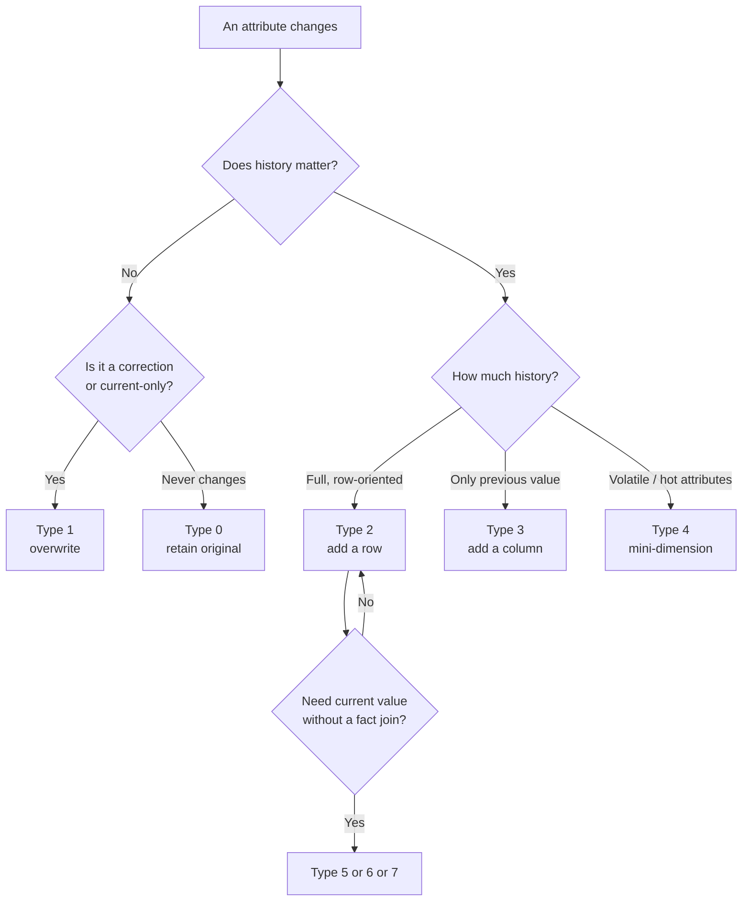

# Slowly Changing Dimensions (SCD Types 0–7)

> Attributes change: a customer moves country, a product changes category, an employee gets promoted, an account changes tier. If you simply overwrite the old value, every historical report silently rewrites itself — last year's revenue suddenly belongs to this year's region. **Slowly Changing Dimensions (SCD)** are the set of techniques for deciding, attribute by attribute, what the warehouse does when a value changes. A senior engineer must know all eight types (0–7), because the choice is not cosmetic: it determines whether attribution is correct, whether dashboards reconcile, whether dimension tables stay performant at hundreds of millions of rows, and how much complexity your ETL must absorb. This is the chapter where dimensional modeling gets genuinely hard, and where most "our numbers changed" incidents originate.

## TL;DR

- **SCD is per-attribute, not per-table.** A single `dim_customer` can have type-1 email, type-2 country, type-0 original_credit_score, and type-3 previous_tier simultaneously.
- **Type 1 (overwrite)** — no history; simplest; for corrections and attributes where "current" is all that matters.
- **Type 2 (add a row)** — full history via versioned rows + validity dates + `is_current`; the workhorse for analytical attribution.
- **Type 3 (add a column)** — limited history: `current_value` + `previous_value`; rarely the right choice.
- **Type 0 (retain original)** — never changes; durable identifiers, original dates, birth dates.
- **Type 4 (add mini-dimension)** — split fast-changing attributes into a small dimension; avoids a huge, churning base dimension.
- **Type 5** = type 4 + a type-1 "current profile" outrigger. **Type 6** = type 2 rows + type-1 (and type-3) columns overwritten across versions for "as-was" and "as-is" in one table. **Type 7** = dual keys (type-2 SK + durable key to current row).
- **Row ordering vs. column ordering.** Type 2 (and 4, 6, 7) add *rows*; type 3 (and 5, 6) add *columns*. Type 6/7 are hybrids designed to answer both "as-was" and "as-is" questions.
- **Correctness rule:** facts must join to the dimension version that was **in effect when the event happened** (an *as-of join* on `valid_from`/`valid_to`), never blindly to `is_current = true`.
- **The gold standard for implementation:** dbt snapshots (SCD2) with the **timestamp strategy**, or a hand-rolled idempotent `MERGE` when you need more control.
- **Failure modes are subtle:** overwriting history, joining on the wrong version, non-idempotent reruns, retroactively rewriting attributes, type-2 churn exploding a huge dimension, and duplicate/tombstoned deletes.

---

## 1. Definitions and core vocabulary

### 1.1 The problem statement

A dimension attribute has a **behavior over time**:
- **Fixed forever** (birth date, original credit score) → type 0.
- **Correctable** (a typo'd name) → type 1.
- **Slowly changing with meaningful history** (country, segment, plan) → type 2.
- **Fast-changing / high volume** (risk score, recent spend band) → mini-dimension (type 4).
- **You occasionally need "this vs. previous"** → type 3.
- **You need both historical and current views in one query** → type 6 / type 7.

SCD assigns a **response policy per attribute**.

### 1.2 Vocabulary

| Term | Meaning |
|------|---------|
| **SCD** | Slowly Changing Dimension — technique family for handling attribute changes. |
| **Type 0** | Retain the original value; never change. |
| **Type 1** | Overwrite in place; destroys history. |
| **Type 2** | Insert a new row per change; preserves history with validity dates. |
| **Type 3** | Add a column holding the previous value; limited history. |
| **Type 4** | Move volatile attributes to a separate mini-dimension. |
| **Type 5** | Type 4 + a type-1 "current profile" outrigger on the base dimension. |
| **Type 6** | Type 2 rows + type-1 columns (and/or a type-3 column) overwritten on all versions for as-was/as-is. |
| **Type 7** | Dual keys: type-2 SK + durable key pointing to the current row. |
| **Surrogate key (SK)** | Warehouse key; new value per version in type 2. |
| **Natural/business key (NK)** | Source identifier; constant across versions. |
| **Durable key** | Stable key identifying the entity across all versions. |
| **valid_from / valid_to** | Half-open interval `[valid_from, valid_to)` marking when a version was current. |
| **is_current** | Boolean flag; exactly one `true` per entity. |
| **Effective dating / point-in-time** | Querying the version valid at a given timestamp. |
| **As-of join** | `fact.ts >= dim.valid_from AND fact.ts < dim.valid_to`. |
| **Late-arriving dimension** | Dimension version arriving after facts that need it. |
| **Inferred member** | Placeholder row (SK `-2`) for an entity not yet known. |
| **Type-1 propagation** | Overwriting a type-1 column on *all* type-2 versions (or the current one, per design). |
| **Tombstone / hard delete** | A row removed at source; modeled as an invalidated or `is_deleted` version. |

### 1.3 The eight types at a glance



| Type | Adds | History? | Cardinality impact | Typical use |
|------|------|----------|--------------------|-------------|
| **0** | nothing (immutable) | none | none | original attributes, durable IDs |
| **1** | nothing (overwrite) | none | none | corrections, current-only attrs |
| **2** | **rows** | full | grows with changes | country, segment, plan, address |
| **3** | **columns** | 1 previous value | none | "previous vs. current" pairs |
| **4** | **rows in a mini-dim** | full (split) | small, bounded | risk score, income band, hot attrs |
| **5** | type-4 rows + type-1 outrigger column | full + current | mini-dim growth | current profile accessible without the fact |
| **6** | type-2 rows + type-1 columns (+type-3 col) | full + as-is | grows with changes | both as-was and as-is in one table |
| **7** | dual FKs (SK + durable key) | full + current | grows with changes | analysts pick as-was or as-is via join |

> **Senior note:** The "type" numbers come from Kimball's 2005 and 2013 writing. They are a **shared vocabulary**, not a prescription. Real dimensions mix types per attribute, and the numbered label is shorthand for a specific mechanical pattern. When someone says "we'll SCD2 that," confirm *which attributes* and *what they do about deletes and late data*.

---

## 2. What problem it solves / why it matters

### 2.1 The core problem: time-consistent attribution

Business questions are almost always time-indexed:
- "What was revenue by the customer's region **at the time of sale**?"
- "How did churn differ between customers on the **old** pricing plan vs. the **new** one?"
- "Show me promotion lift **by the product category in effect then**."

If the dimension holds only the current value, every one of these questions returns the *current* attribution applied retroactively — which is wrong. Type 2 preserves the "as-was" state so facts land on the correct version.

Conversely, some questions want "as-is":
- "Show historical revenue by the **current** region of each customer (so my report matches the sales org's current structure)."

Types 6 and 7 let you answer both from one model. This is why SCD is not "one technique" but a **portfolio**.

### 2.2 Why a senior must master it

1. **It is the #1 source of reconciliation failures.** Two dashboards differ because one used as-was and the other as-is. Knowing the vocabulary lets you diagnose in seconds.
2. **It has direct cost and performance impact.** A type-2 dimension on a high-churn attribute can explode from thousands to hundreds of millions of rows, breaking broadcast joins and blowing up storage.
3. **It dictates pipeline design.** Type 2 requires idempotent, append-oriented loads, careful handling of late data, and immutability guarantees. Pipelines that overwrite are incompatible.
4. **It is where correctness meets complexity.** Every SCD choice trades analytical fidelity for engineering complexity. Choosing deliberately is a senior responsibility.
5. **It interacts with everything else**: grain, conformance, fact/dimension design, semantics, and even ML point-in-time correctness.

### 2.3 Consequences of getting it wrong

| Wrong choice | Consequence |
|--------------|-------------|
| Type 1 where history matters | Historical reports silently change; audits fail |
| Type 2 where churn is huge and irrelevant | Dimension explodes; queries crawl; costs spike |
| NaN / NULL `valid_to` mishandled | "Open" interval bugs; duplicate current rows |
| Joining on `is_current` for as-was | Retroactive re-attribution |
| Non-idempotent type-2 loads | Duplicate versions; double-counted history |
| No inferred members | Dropped facts or wrong attribution for late data |
| No deletes handling | Ghost entities forever; inflated counts |

---

## 3. How it works internally (mechanisms, internals)

### 3.1 Type 0 — Retain Original

The attribute is written once and never updated. Facts always group by the original value.

```sql
-- customer_original_credit_score, birth_date, first_order_date, durable_key
UPDATE dwh.dim_customer SET original_credit_score = :initial_value
WHERE customer_sk = :sk AND original_credit_score IS NULL;  -- set once, never change
```

**Internals:** no special machinery — it's a convention. The danger is accidental overwrite: protect it by never listing it in the update column set.

### 3.2 Type 1 — Overwrite

```sql
UPDATE dwh.dim_customer c
SET email = s.email
FROM stg_customers s
WHERE c.customer_id = s.customer_id
  AND s.email <> c.email;
```

**Internals:**
- In-place mutation; affects **all** facts (past and future) because they join on the same SK.
- Cheap: no new rows.
- **Irreversible**: the old value is gone unless you keep an audit log.
- On columnar warehouses (Snowflake/BigQuery), row-level `UPDATE` rewrites micro-partitions/files — do the update as a `MERGE` from a staged change set, or rebuild the dimension.

**When valid:** correcting typos, fixing source-system errors, or when the business genuinely only cares about the current value (e.g., a preferred marketing channel that should always reflect today).

### 3.3 Type 2 — Add a Row (the workhorse)

The dimension gets a **new row per version**, with validity dates, a new surrogate key, and an `is_current` flag.

| customer_sk | customer_id | country | segment | valid_from | valid_to | is_current |
|------------:|------------|---------|---------|-----------|----------|-----------|
| 100 | 1123 | US | Bronze | 2022-01-01 | 2023-06-30 | false |
| 101 | 1123 | US | Silver | 2023-07-01 | 2024-02-29 | false |
| 102 | 1123 | DE | Silver | 2024-03-01 | 9999-12-31 | true |

**Internals:**
- Half-open interval `[valid_from, valid_to)` — the standard avoids gaps/overlaps. Use `9999-12-31` instead of `NULL` for the open end to simplify range predicates (or `NULL` + a `dbt_valid_to_current` convention).
- **Two operations per change:** (1) close the current row (`valid_to = change_ts`, `is_current = false`), (2) insert a new row (`valid_from = change_ts`, `valid_to = 9999-12-31`, `is_current = true`).
- **Determinism:** if `valid_from` is derived from a *source* updated timestamp, reruns are idempotent. If derived from *pipeline execution time*, reruns create phantom versions.
- **No gaps, no overlaps:** at most one row per entity per instant. Enforce with a test.
- **Growth:** number of rows = number of distinct attribute-value changes + 1. High-churn attrs → explosion (see type 4).
- **Facts never change:** they keep pointing at the SK that was current when they occurred. Type 2 is **append-only history**, which is why it is robust.

**The as-of join** (the whole point of type 2):

```sql
SELECT f.*, d.country AS country_at_sale
FROM dwh.fct_sales f
JOIN dwh.dim_customer d
  ON f.customer_id = d.customer_id        -- natural/durable key, NOT the SK
 AND f.sold_at    >= d.valid_from
 AND f.sold_at    <  d.valid_to;
```

> **Senior note:** Note the join is on the **natural key** plus the date range, because the surrogate key differs per version and the fact's SK was assigned at load time. Some designs instead store the resolved SK directly on the fact at ETL time (a "star join then persist") — faster at query time, but requires reprocessing facts when late dimensions arrive.

### 3.4 Type 3 — Add a Column

The dimension keeps only the **previous and current** values.

| customer_sk | customer_id | current_segment | previous_segment | segment_changed_date |
|------------:|------------|-----------------|------------------|----------------------|
| 102 | 1123 | Gold | Silver | 2024-03-01 |

**Internals:**
- One extra column per tracked attribute (sometimes a "prior" pair).
- Loses everything older than the previous value; not a substitute for type 2.
- Cheap for "compare this period vs. last period" if you only need one step back.
- Often used in combination (type 6) to label the *previous* value on each type-2 row.

**When valid:** the business only ever needs "current and immediately previous" (e.g., a price-change audit of the last revision).

### 3.5 Type 4 — Add Mini-Dimension

Split **frequently changing** attributes out of a large dimension into a small "mini-dimension" holding only the distinct combinations.

```sql
-- Base dimension: stable attributes only
CREATE TABLE dwh.dim_customer (
    customer_sk   NUMBER PRIMARY KEY,
    customer_id   NUMBER,
    full_name     STRING,
    country       STRING,
    signup_date   DATE,
    valid_from    TIMESTAMP, valid_to TIMESTAMP, is_current BOOLEAN
);

-- Mini-dimension: volatile attributes, one row per distinct profile combination
CREATE TABLE dwh.dim_customer_profile (
    profile_sk    NUMBER PRIMARY KEY,
    age_band      STRING,
    income_band   STRING,
    risk_score    STRING,
    loyalty_tier  STRING
);

-- Fact carries BOTH keys
CREATE TABLE dwh.fct_sales (
    ...,
    customer_sk  NUMBER NOT NULL,
    profile_sk   NUMBER NOT NULL,   -- point-in-time profile
    ...
);
```

**Internals:**
- The mini-dimension is **type-1** in nature (`profile_sk` maps to exactly one attribute combination) but the **fact** stores the profile *at the time of the event*, so history is preserved on the fact side.
- This avoids adding a type-2 row to the giant base dimension every time a volatile attribute changes.
- Cardinality is bounded by the **cross-product of the attribute bands** (e.g., 6 age bands × 4 income bands × 5 risk scores × 4 tiers = 480 rows), not by customer count.
- Requires the ETL to **look up or create** the profile combination at each fact load.

**When valid:** income band, risk score, credit band, recency/frequency/monetary (RFM) buckets — attributes that change often and are analyzed as bands.

### 3.6 Type 5 — Type 4 + Type-1 "Current Profile" Outrigger

Build on type 4 by embedding a **current profile key** in the base dimension, overwritten as a type-1 attribute.

```sql
ALTER TABLE dwh.dim_customer
ADD COLUMN current_profile_sk NUMBER;   -- type-1: overwritten on every load
```

**Internals:**
- Lets users query *current* profile attributes without going through a fact table (the base dimension carries them).
- The historical profile is still available via the fact's `profile_sk`.
- Name is "5" because 4 + 1 = 5.

**When valid:** analysts need both "profile at event time" (via fact) and "current profile" (via dimension) without a double join.

### 3.7 Type 6 — Type 2 Rows + Type-1 Columns (hybrid)

This is the most important advanced hybrid: it keeps **type-2 rows** but **overwrites the current attributes on all rows** for the durable key, so each row carries *both* as-was and as-is.

| customer_sk | customer_id | segment_as_was | segment_current | valid_from | valid_to | is_current |
|------------:|------------|----------------|-----------------|-----------|----------|-----------|
| 100 | 1123 | Bronze | Gold | 2022-01-01 | 2023-06-30 | false |
| 101 | 1123 | Silver | Gold | 2023-07-01 | 2024-02-29 | false |
| 102 | 1123 | Gold | Gold | 2024-03-01 | 9999-12-31 | true |

**Internals:**
- Each load (a) inserts/closes type-2 rows for the *as-was* columns and (b) **propagates the new current value to the `current_*` column on every version row** of that entity. That's the type-1 overwrite.
- Optionally add a type-3 column (`previous_segment_as_was`) for the prior label.
- Result: one table where users can filter by `segment_as_was` (correct history) or `segment_current` (matches today's org chart).
- Name "6" because it's type 2 + type 3 + type 1 (2×3×1 = 6, or 2+3+1 = 6).

**The propagation update (the subtle part):**

```sql
-- After inserting the new version, propagate current value to all rows of that entity
MERGE INTO dwh.dim_customer t
USING (
    SELECT customer_id, segment
    FROM stg_customers
) s
ON t.customer_id = s.customer_id
WHEN MATCHED THEN UPDATE SET t.segment_current = s.segment;   -- ALL versions
```

**When valid:** the business frequently wants both "as-was" and "as-is" from the same dimension, and you can tolerate the extra storage/complexity. Very common in financial and regulatory reporting.

### 3.8 Type 7 — Dual Type-1 and Type-2 Dimensions (dual keys)

Instead of physically overwriting current attributes (type 6), the fact carries **two keys**:
1. the **type-2 surrogate key** (the version at event time, for as-was), and
2. the **durable key** (looked up to the current row, for as-is).

```sql
-- Fact carries both
CREATE TABLE dwh.fct_sales (
    ...,
    customer_sk          NUMBER NOT NULL,  -- type-2 version at event time
    customer_durable_key STRING NOT NULL,  -- joins to the current row
    ...
);

-- As-was query
SELECT d.country_as_was FROM fct_sales f
JOIN dim_customer d ON f.customer_sk = d.customer_sk;

-- As-is query
SELECT d.country_current FROM fct_sales f
JOIN dim_customer d ON f.customer_durable_key = d.customer_durable_key
                   AND d.is_current = TRUE;
```

**Internals:**
- Same functionality as type 6 but achieved via keys and joins rather than data overwrite.
- No propagation updates → simpler, more append-friendly ETL; more joins at query time.
- The dimension itself can be presented as two views: `dim_customer_historical` (all versions) and `dim_customer_current` (`is_current = true`).

**When valid:** type 6's propagation is too costly or the platform hates wide updates; and you need both perspectives.

### 3.9 SCD mechanics comparison

| Mechanism | Writes | Storage | Query cost | Idempotency |
|-----------|--------|---------|-----------|-------------|
| Type 1 | update in place | none | none | easy |
| Type 2 | close + insert | +1 row/change | as-of join | needs source timestamps |
| Type 3 | update columns | none | none | easy but lossy |
| Type 4 | mini-dim insert + fact FK | bounded | one more join | profile lookup |
| Type 5 | type-4 + 1 column update | small | 1 join + column | profile lookup |
| Type 6 | type-2 + propagate columns | +row +columns | none extra | careful propagation |
| Type 7 | type-2 + dual keys | +row +key | extra join | easy (append) |

---

## 4. How to implement it (step-by-step, with SQL / code / config examples)

### 4.1 Decide the type per attribute (worksheet)

| Attribute | Behavior | Type | Rationale |
|-----------|----------|------|-----------|
| `customer_id` | constant | 0 (key) | identity |
| `signup_date` | constant | 0 | original, never changes |
| `email` | correctable | 1 | typos; only current matters |
| `country` | slow, matters | 2 | regulatory/region attribution |
| `segment` | slow, matters | 2 | historical analysis |
| `previous_segment` | last change only | 3 | "changed recently" reports |
| `income_band` | fast | 4 (mini) | high churn, banded analysis |
| `risk_score` | fast | 4 (mini) | high churn |
| `current_income_band` | current view | 5 | convenience column |
| `segment` (as-is view) | dual need | 6 or 7 | as-was + as-is |

### 4.2 Hand-rolled Type 2 with SQL (full control)

**Step 1 — Stage changes and compute a change key.**

```sql
-- Identify changed rows and the effective timestamp
CREATE OR REPLACE TEMP TABLE stg_customer_changes AS
SELECT
    s.customer_id,
    s.email,
    s.country,
    s.segment,
    s.updated_at                       AS change_ts,
    md5(concat_ws('|', s.country, s.segment, s.email)) AS row_hash
FROM stg_customers s;
```

**Step 2 — Detect differences vs. the current dimension row (row hash is the reliable way).**

```sql
CREATE OR REPLACE TEMP TABLE changed AS
SELECT c.*
FROM stg_customer_changes c
LEFT JOIN dwh.dim_customer d
       ON c.customer_id = d.customer_id AND d.is_current
WHERE d.customer_sk IS NULL                        -- brand new
   OR md5(concat_ws('|', d.country, d.segment, d.email)) <> c.row_hash;
```

**Step 3 — Close the current rows (`valid_to = change_ts`).**

```sql
MERGE INTO dwh.dim_customer t
USING changed s
ON t.customer_id = s.customer_id AND t.is_current = TRUE
   AND md5(concat_ws('|', t.country, t.segment, t.email)) <> s.row_hash
WHEN MATCHED THEN UPDATE SET
    t.valid_to   = s.change_ts,
    t.is_current = FALSE;
```

**Step 4 — Insert the new versions.**

```sql
INSERT INTO dwh.dim_customer
    (customer_sk, customer_id, email, country, segment,
     valid_from, valid_to, is_current)
SELECT
    dwh.dim_customer_sk_seq.NEXTVAL,          -- or a hash-based SK
    s.customer_id, s.email, s.country, s.segment,
    s.change_ts,
    TIMESTAMP '9999-12-31 00:00:00',
    TRUE
FROM changed s
WHERE NOT EXISTS (
    SELECT 1 FROM dwh.dim_customer t
    WHERE t.customer_id = s.customer_id
      AND t.valid_from = s.change_ts
      AND t.is_current = TRUE
);
```

**Idempotency:** rerunning steps 3–4 is safe because (a) closing only matches rows whose hash differs and are current, and (b) the insert's `NOT EXISTS` guards against re-inserting the same version. Deterministic `valid_from` (from an `updated_at`) is what makes reruns idempotent.

**Deterministic surrogate key** (avoid sequences if you want reproducibility):

```sql
-- Snowflake
SELECT md5_bigint(customer_id || '|' || to_char(change_ts, 'YYYYMMDDHH24MISS')) AS customer_sk
```

**Step 5 — Add a grain/integrity test.**

```sql
-- Exactly one current row per entity, and no overlaps
SELECT customer_id, COUNT_IF(is_current) AS n_current,
       COUNT(*) AS n_rows
FROM dwh.dim_customer
GROUP BY customer_id
HAVING COUNT_IF(is_current) <> 1;   -- must return zero rows
```

### 4.3 dbt snapshots (the gold standard for SCD2)

dbt implements type-2 SCDs over mutable sources with **snapshots**.

**Timestamp strategy (recommended):**

```yaml
# snapshots/customers_snapshot.yml  (dbt v1.9+ YAML config)
snapshots:
  - name: customers_snapshot
    relation: source('oltp', 'customers')
    description: "SCD2 history of the customer dimension."
    config:
      schema: snapshots
      unique_key: customer_id
      strategy: timestamp
      updated_at: updated_at
      dbt_valid_to_current: "to_date('9999-12-31')"
      hard_deletes: new_record      # track deletes with dbt_is_deleted
```

**Check strategy (no reliable timestamp):**

```yaml
snapshots:
  - name: customers_snapshot_check
    relation: ref('stg_customers')
    config:
      schema: snapshots
      unique_key: customer_id
      strategy: check
      check_cols: [email, country, segment]   # explicit; avoid 'all'
      updated_at: updated_at                   # optional fallback
```

**Key dbt concepts:**
- Meta columns: `dbt_scd_id` (unique per version), `dbt_valid_from`, `dbt_valid_to`, `dbt_updated_at`, and (with `hard_deletes: new_record`) `dbt_is_deleted`.
- With the **timestamp** strategy, `dbt_valid_from/to` come from the source `updated_at` → deterministic and idempotent.
- With the **check** strategy, dbt uses the run timestamp unless `updated_at` is configured.
- **Snapshots ignore `--full-refresh`** — history is preserved. Put them in their own schema and protect them.
- **Order of source versions is by `updated_at`**; the running schedule must be frequent enough not to miss an intermediate state.

**Model reads the snapshot and exposes the surrogate key:**

```sql
-- models/marts/core/dim_customer.sql
{{ config(materialized='table') }}

select
    -- deterministic surrogate key from the snapshot meta column
    {{ dbt_utils.generate_surrogate_key(['dbt_scd_id']) }} as customer_sk,
    customer_id,
    email,
    country,
    segment,
    dbt_valid_from              as valid_from,
    coalesce(dbt_valid_to, to_timestamp('9999-12-31')) as valid_to,
    (dbt_valid_to is null)      as is_current
from {{ ref('customers_snapshot') }}
```

**Tests for the snapshot-derived dimension:**

```yaml
version: 2
models:
  - name: dim_customer
    tests:
      - dbt_utils.expression_is_true:
          expression: "valid_to > valid_from"
    columns:
      - name: customer_sk
        tests: [unique, not_null]
      - name: customer_id
        tests: [not_null]
      - name: is_current
        tests:
          - not_null
```

Add a custom test for "exactly one current version per customer":

```sql
-- tests/assert_one_current_customer.sql
SELECT customer_id, COUNT(*) AS n
FROM {{ ref('dim_customer') }}
WHERE is_current
GROUP BY 1
HAVING COUNT(*) <> 1;
```

### 4.4 The as-of join in the fact model

```sql
-- models/marts/core/fct_sales.sql
select
    s.sale_id,
    to_number(to_char(s.sold_at,'YYYYMMDD')) as date_sk,
    c.customer_sk,                -- resolved at the event timestamp
    p.product_sk,
    s.quantity,
    s.net_rev_minor
from {{ ref('stg_sales') }} s
join {{ ref('dim_customer') }} c
  on s.customer_id = c.customer_id
 and s.sold_at    >= c.valid_from
 and s.sold_at    <  c.valid_to
join {{ ref('dim_product') }} p
  on s.product_id = p.product_id and p.is_current
```

> **Senior note:** Resolving the SK at ETL time and **persisting it on the fact** is a common performance optimization: queries then do a plain SK join instead of a range join. The cost is reprocessing facts when late-arriving dimension versions change the correct SK. Trade-off: query speed vs. pipeline complexity.

### 4.5 Mini-dimension (type 4) implementation

```sql
-- 1) Build the profile combination set
CREATE OR REPLACE TABLE dwh.dim_customer_profile AS
WITH combos AS (
    SELECT DISTINCT age_band, income_band, risk_score, loyalty_tier
    FROM stg_customer_profiles
)
SELECT md5_bigint(concat_ws('|', age_band, income_band, risk_score, loyalty_tier)) AS profile_sk,
       age_band, income_band, risk_score, loyalty_tier
FROM combos;

-- 2) Resolve the profile_sk at fact load time (point-in-time)
select
    f.sale_id,
    c.customer_sk,
    coalesce(p.profile_sk, -1) as profile_sk,
    f.amount_minor
from stg_sales f
join {{ ref('dim_customer') }} c
     on f.customer_id = c.customer_id
    and f.sold_at >= c.valid_from and f.sold_at < c.valid_to
left join {{ ref('dim_customer_profile') }} p
     on f.age_band = p.age_band and f.income_band = p.income_band
    and f.risk_score = p.risk_score and f.loyalty_tier = p.loyalty_tier
```

### 4.6 Type 6 (as-was + as-is) with propagation

```sql
-- Insert new version (as-was columns), then propagate current values to ALL versions
WITH new_version AS (
    SELECT customer_id, segment AS segment_as_was
    FROM stg_customers
)
MERGE INTO dwh.dim_customer t
USING new_version s
ON t.customer_id = s.customer_id
WHEN MATCHED THEN UPDATE SET
    t.segment_current = s.segment_as_was;   -- overwrite on every version (type 1)
```

### 4.7 Deletes / tombstones

Three policies:

1. **Ignore** (`hard_deletes: ignore`): the entity disappears from the source but its history remains; `is_current` stays `true` forever. Simple, but "active customer" counts stay stale.
2. **Invalidate** (`hard_deletes: invalidate`): set `valid_to = now()`, `is_current = false`. The entity is "closed."
3. **New record** (`hard_deletes: new_record`): insert a version with `dbt_is_deleted = true`. Preserves full lineage and supports restore.

```sql
-- Hand-rolled invalidation for missing entities
MERGE INTO dwh.dim_customer t
USING (
    SELECT customer_id FROM dwh.dim_customer WHERE is_current
    EXCEPT
    SELECT customer_id FROM stg_customers
) d
ON t.customer_id = d.customer_id AND t.is_current
WHEN MATCHED THEN UPDATE SET t.valid_to = current_timestamp(), t.is_current = FALSE;
```

### 4.8 Late-arriving dimensions & backfill

```sql
-- 1) Insert an inferred member so facts don't drop
INSERT INTO dwh.dim_customer (customer_sk, customer_id, full_name, valid_from, valid_to, is_current)
SELECT -2, f.customer_id, 'INFERRED', f.first_seen, TIMESTAMP '9999-12-31', TRUE
FROM (SELECT DISTINCT customer_id, MIN(sold_at) first_seen FROM stg_sales) f
WHERE NOT EXISTS (SELECT 1 FROM dwh.dim_customer d WHERE d.customer_id = f.customer_id);

-- 2) Later, when the real dimension row arrives, the fact's as-of join will find it.
--    If the fact stored a resolved SK, reprocess the affected fact partitions.
```

### 4.9 Full worked example: an idempotent daily SCD2 job in dbt

```
dbt_project.yml
snapshots/customers_snapshot.yml          # timestamp strategy, hard_deletes: new_record
models/staging/stg_customers.sql
models/marts/core/dim_customer.sql        # surrogate key + validity + is_current
models/marts/core/fct_sales.sql           # as-of join to dim_customer
tests/assert_one_current_customer.sql
```

```yaml
# dbt_project.yml
snapshot-paths: ["snapshots"]
vars:
  scd_tracking_enabled: true
```

```sql
-- models/staging/stg_customers.sql (single source of truth shape)
select
    customer_id::bigint        as customer_id,
    email::varchar             as email,
    country_code::varchar      as country,
    segment::varchar           as segment,
    updated_at::timestamp_ntz  as updated_at
from {{ source('oltp','customers') }}
where _deleted = false
```

Run order: `dbt snapshot` (daily, e.g. hourly for high churn) → `dbt run --select dim_customer fct_sales` → `dbt test`.

---

## 5. Where to implement it (tools/platforms)

### 5.1 Implementation options by need

| Need | Approach | Where |
|------|----------|-------|
| Standard SCD2 on mutable source | dbt snapshots (timestamp) | dbt + any warehouse |
| Source has no reliable `updated_at` | dbt snapshot (check) or hand-rolled hash compare | dbt / custom SQL |
| Complex multi-table SCD logic | Hand-rolled MERGE | Snowflake/BigQuery/Redshift/Databricks |
| Streaming/CDC-driven SCD2 | MERGE from CDC stream, ordered by source LSN/ts | Debezium + warehouse MERGE, Spark Structured Streaming, Flink |
| Type 6/7 as-was+as-is | Propagation MERGE / dual keys | any warehouse |
| Mini-dimension (type 4) | distinct + hash SK | dbt macro / custom |
| Point-in-time correctness for ML | SCD2 + as-of joins / feature store | Feast, Tecton, Databricks FS |

### 5.2 Platform specifics

| Platform | Notes |
|----------|-------|
| **Snowflake** | `MERGE` is the primitive; snapshots via dbt; dynamic tables for continuous SCD marts; `AUTOINCREMENT`/hash SKs; row-level updates rewrite micro-partitions → batch them |
| **BigQuery** | `MERGE` per statement limit (avoid huge single merges; chunk); `GENERATE_UUID()`/hash keys; partition by `valid_from`; snapshots via dbt |
| **Redshift** | `MERGE`; heavy updates trigger vacuum; use sort keys aligned to `natural_key`; `IDENTITY` SKs |
| **Databricks/Delta** | `MERGE INTO` with `WHEN MATCHED ... AND` conditions; Delta CDF for change capture; SCD2 helpers in Lakeflow/DLT (`APPLY CHANGES`) |
| **Iceberg (Spark/Trino)** | `MERGE`; Iceberg snapshots give table-level time travel (different from SCD) |
| **Snowflake/BigQuery** for mini-dims | Stick with hash SKs for determinism and distributed builds |
| **Streaming (Flink/Kafka Streams)** | Maintain SCD2 in state; emit close+open pairs; land via MERGE |

### 5.3 dbt snapshot strategies compared

| Aspect | timestamp | check |
|--------|-----------|-------|
| Requires | reliable `updated_at` | list of columns (or `all`) |
| Meta timestamps | from source `updated_at` | run time (or `updated_at` if configured) |
| Schema-change resilience | high | low (must update `check_cols`) |
| Idempotent reruns | yes (deterministic dates) | mostly (run-time based) |
| Missed intermediate states | can miss if run too infrequently | can miss too |
| Recommended | ✅ default | when no reliable timestamp |

> **Senior note:** The **timestamp strategy is preferred** because it tracks only one column, tolerates source schema changes, and is deterministic. Reserve `check` for sources with no trustworthy `updated_at`, and always enumerate `check_cols` explicitly rather than `all` (which silently breaks on new columns and adds cost).

### 5.4 Delta Lake / Databricks `APPLY CHANGES` (DLT)

```python
import dlt

dlt.create_streaming_table("dim_customer")

dlt.apply_changes(
    target="dim_customer",
    source="stg_customers_stream",
    keys=["customer_id"],
    sequence_by="updated_at",
    stored_as_scd_type=2,          # native SCD2
    track_history_column_list=["country", "segment"],
)
```

This is the streaming equivalent of dbt snapshots and is the idiomatic Databricks approach.

---

## 6. Patterns and anti-patterns

### 6.1 Patterns

**P1. Per-attribute SCD policy.** Decide type-0/1/2/3/4/6/7 for each attribute, documented in the dimension's metadata.

**P2. Half-open validity intervals.** `[valid_from, valid_to)`; use `9999-12-31` for the open end.

**P3. `is_current` as a derived convenience.** Exactly one true per entity; tested.

**P4. Deterministic surrogate keys.** Hash of `natural_key + version` → reproducible, idempotent, distributed-friendly.

**P5. Source-time-based `valid_from`.** Use the source's `updated_at`/CDC timestamp, never pipeline execution time, for idempotency.

**P6. As-of joins in facts.** Resolve the correct version at event time (or persist the resolved SK for speed).

**P7. Mini-dimensions for volatile attributes.** Bound growth; keep the base dimension stable.

**P8. Type 6/7 for as-was + as-is.** One table (or one fact with dual keys) serving both questions.

**P9. Inferred members + late-arriving handling.** No dropped facts; documented backfill.

**P10. Explicit delete policy.** Ignore vs. invalidate vs. `new_record`, chosen deliberately.

**P11. Immutable snapshots.** Never rewrite history; snapshots are append-only and protected.

**P12. Tests as contracts.** uniqueness of SK, one current row, `valid_to > valid_from`, no overlaps, referential integrity from facts.

**P13. Column-level lineage.** Track which attributes are SCD2 so impact analysis works.

### 6.2 Anti-patterns

**A1. Overwriting history with type 1.** The single most common correctness bug. Historical reports change retroactively.

**A2. Joining facts on `is_current = true`.** Retroactive re-attribution. Use as-of joins or the persisted SK.

**A3. Using pipeline run time as `valid_from`.** Reruns create duplicate/phantom versions.

**A4. Non-idempotent SCD loads.** Reruns duplicate rows or open multiple "current" versions.

**A5. Type 2 on a high-churn attribute in a huge dimension.** Explodes the dimension; breaks broadcast joins; melts the warehouse.

**A6. Type 3 for real history.** Only one step back; loses everything else.

**A7. Type 2 with `NULL` `valid_to` and no `is_current`.** Every query becomes awkward; often leads to duplicate-current bugs.

**A8. Mixed semantics without documentation.** Some attributes as-was, others as-is, no labeling → reconciliation chaos.

**A9. Rebuilding snapshots.** Dropping/recreating the snapshot table destroys history irrecoverably.

**A10. No delete handling.** Deleted entities stay "current" forever, inflating active counts.

**A11. `check_cols = 'all'`.** Silently tracks unintended columns and slows snapshots.

**A12. Type 6 propagation without care.** Propagating current values to *all* rows can also be used wrongly, or propagated to only the current row (breaking as-is).

**A13. Per-attribute types that nobody knows.** If analysts can't tell which columns are as-was vs. as-is, the model is unusable.

### 6.3 Choosing the right type — decision table

| If the attribute... | Use |
|---------------------|-----|
| Never changes / must stay original | **0** |
| Is a correction and only current matters | **1** |
| Changes occasionally and history matters | **2** |
| Needs only previous + current | **3** |
| Changes fast / should be banded | **4** (mini) |
| Needs current profile without a fact join | **5** |
| Needs as-was and as-is in one table | **6** |
| Needs as-was and as-is with append-only ETL | **7** |
| Has unreliable source timestamp | snapshot **check** strategy |
| Is deleted (hard) in the source | **new_record** / invalidate |

---

## 7. Real-world use cases and industry applications

**Retail/e-commerce.** `dim_customer`: country (type 2), email (type 1), income band (type 4 mini), original acquisition channel (type 0). Demand: "revenue by the country the customer was in when they bought."

**Banking.** `dim_account` (SCD2 on product, status), `dim_customer` (SCD2 on risk rating/segment), mini-dimensions for fluctuating risk scores. Regulatory reporting demands **as-was** attribution for every historical period; type 6 is common to also produce current-entity views.

**Insurance.** `dim_policy` (SCD2 on coverage level, premium tier), `dim_agent` (SCD2 on territory). Audit trails require immutable history; type 7 gives both as-was and as-is without destructive updates.

**Healthcare.** `dim_member` (SCD2 on plan, PCP) with frequent churn; member merges handled via type-1 corrections + a bridge; `dim_provider` SCD2 on specialty. Point-in-time attribution is mandatory for claims.

**Telecom / subscription SaaS.** `dim_subscriber` SCD2 on plan/segment; mini-dimensions for usage tiers; churn analysis depends on as-was plan assignment (otherwise every historical churn is attributed to the customer's *current* plan).

**Advertising.** `dim_campaign` SCD2 on budget/targeting; `dim_creative` SCD2; attribution windows require the campaign's state at impression time.

**HR / operations.** `dim_employee` SCD2 on role/cost-center; org-chart history; type 3 for "previous manager" reporting.

**Product / engineering.** `dim_service`/`dim_feature_flag` SCD2 to attribute incidents and latency to the config in effect at the time.

> **Senior note:** The industry pattern is universal: **anything that affects attribution or money must be as-was (type 2+), anything that is a correction or purely current-state can be type 1, and any high-churn attribute must be a mini-dimension.** The art is in distinguishing these per attribute.

---

## 8. Senior-level deep dive

### 8.1 The central trade-off: fidelity vs. complexity vs. cost

| More fidelity (type 2/6/7) | More simplicity (type 0/1/3) |
|---------------------------|------------------------------|
| Correct historical attribution | Retroactive errors possible |
| Bigger dimensions, more rows | Tiny dimensions |
| Append-only, robust ETL | In-place updates, lossy |
| Requires as-of joins | Simple SK joins |
| Needs late-arriving handling | Less machinery |
| Audit-friendly | Audit-hostile |

Seniors choose **per attribute**, and write down the choice.

### 8.2 Type 2 at scale — the explosion problem

If `dim_customer` has 50M customers and 30 attributes, and 12 of them are SCD2 with an average of 4 changes each, you get ~250M rows. Consequences:

- **Broadcast joins fail** (too big to broadcast) → shuffle joins → slower.
- **Storage and clustering cost** rise.
- **Mini-dimension splitting** becomes necessary for churning attributes.
- **Deterministic SKs** (hash) avoid needing a sequence hot spot in distributed builds.
- **Partitioning** the dimension (by `is_current`, or by a hash of the durable key, or by `valid_from`) helps prune.

Mitigations:
1. **Mini-dimension** the volatile attributes (type 4).
2. **Split "current" from "historical"** into two tables/views: most BI queries hit the small current table.
3. **Type 7 dual keys**: fact → current lookup is cheap; as-was only when needed.
4. **Partition** the historical dimension and cluster by durable key.

### 8.3 Correctness deep dive: gaps, overlaps, and the open interval

Three invariants must hold for a type-2 dimension:

1. **Exactly one row per entity is current.**
2. **No gaps:** each version's `valid_from` = the previous version's `valid_to`.
3. **No overlaps:** `valid_from < valid_to` for every row; intervals half-open.

Tests:

```sql
-- gaps / overlaps: consecutive versions must meet exactly
WITH v AS (
  SELECT customer_id, valid_from, valid_to,
         LEAD(valid_from) OVER (PARTITION BY customer_id ORDER BY valid_from) AS next_from
  FROM dwh.dim_customer
)
SELECT * FROM v WHERE next_from IS NOT NULL AND next_from <> valid_to;
```

Also guard against **same-timestamp double changes** (two source updates inside one poll window): deduplicate to the last change per `(key, change_ts)` before closing/inserting.

### 8.4 Streaming/CDC SCD2 (event-time ordering)

With CDC you have **ordering** concerns:
- Use the source **log sequence number (LSN)/commit timestamp**, not wall-clock ingestion time, to order versions.
- Handle **out-of-order** events (a late `update` with an older LSN) by either (a) buffering/watermarking, or (b) recomputing the interval from the merged change history.
- **Deletes** arrive as tombstones → apply the delete policy.
- **Idempotency:** MERGE keyed on `(natural_key, version)`.

```sql
MERGE INTO dwh.dim_customer t
USING v_ordered_changes s            -- ordered and deduped by LSN
ON t.customer_id = s.customer_id
   AND t.valid_from = s.change_ts
WHEN NOT MATCHED THEN INSERT (...)   -- append new versions
WHEN MATCHED AND t.row_hash <> s.row_hash THEN UPDATE SET t.valid_to = s.change_ts, t.is_current = FALSE;
```

> **Senior note:** In streaming, "SCD2" is really "maintain a sorted, deduplicated version timeline per key." The hard part is not the SQL; it is ordering, watermarks, and idempotency under replays. Treat the dimension's history as a *merge of an ordered event log*, not as a series of daily snapshots.

### 8.5 Failure modes and debugging

| Symptom | Root cause | Diagnosis | Fix |
|---------|-----------|-----------|-----|
| History changed retroactively | Type 1 overwrite or `is_current` join | Compare old report to new | Type 2 + as-of joins |
| Duplicate current rows | Non-idempotent close/insert; missed `is_current` reset | `COUNT_IF(is_current)` per entity | Reset `is_current` in the close step; add test |
| Phantom versions | `valid_from` = run time | Check `valid_from` source | Use source `updated_at` |
| Overlap/gap | Failed interval math | LEAD/NOT EXISTS gap test | Enforce half-open intervals |
| Dimension explosion | Type 2 on high churn | Row count growth | Mini-dimension, split current/hist |
| Deleted entities still active | No delete policy | Compare to source counts | `invalidate`/`new_record` |
| Facts dropped | Missing/inferred dimensions | Left-join count test | Inferred members |
| Snapshot table lost history | Dropped/recreated | Snapshot schema metadata | Never drop; protect schema |
| Slow as-was queries | Range joins on huge dim | Plan; broadcast failure | Persist resolved SK; partition dim |
| Mini-dim SK mismatch | Profile combination not found | Anti-join to profile dim | Rebuild profile dim; `-1` fallback |

### 8.6 Interplay with the rest of the architecture

- **Fact design:** as-of joins require the fact to carry the **event timestamp**. Persisting the resolved SK is an optimization that pushes complexity into late-arriving handling.
- **Conformance:** conformed dimensions must use the **same SCD policy** everywhere. A type-1 `segment` in one mart and type-2 in another guarantees mismatched metrics.
- **Semantic layer:** metric definitions must state whether they use as-was or as-is. Encode it.
- **ML/feature store:** point-in-time correctness is SCD2 applied to features. Getting SCD right here prevents training-serving skew.
- **Governance:** column-level lineage should record the SCD type per attribute so downstream users know what a change means.

### 8.7 Design review checklist

1. For **each attribute**, is the SCD type documented and justified?
2. Is the **history-bearing key** (SK) distinct from the **durable** and **natural** keys?
3. Are **half-open intervals** used with a defined open end (`9999-12-31` or `NULL`)?
4. Is **exactly one current version** guaranteed and tested?
5. Is `valid_from` derived from **source/semantic time**, ensuring idempotent reruns?
6. Do facts do **as-of (or persisted-SK) joins**, never `is_current`?
7. Is the **delete policy** defined?
8. Is there a **late-arriving/inferred** strategy?
9. Has **dimension growth** been estimated, with mini-dimensions for volatile attributes?
10. Are **conformed dimensions consistent** across all marts?
11. Is the **semantic layer** aware of as-was vs. as-is?
12. Can the pipeline **rerun safely**?

---

## 9. Common mistakes and how to avoid them

1. **Type-1 overwriting where history matters.** *Avoid:* decide per attribute; document; review with the business.
2. **Joining on `is_current`.** *Avoid:* as-of joins (or persist the resolved SK). Add a test that historical attribution is stable.
3. **Run-time `valid_from`.** *Avoid:* use the source `updated_at`/CDC timestamp.
4. **Non-idempotent SCD jobs.** *Avoid:* deterministic keys, `MERGE` on `(natural_key, version)`, and `NOT EXISTS` guards.
5. **Type 2 on volatile attributes in a huge dimension.** *Avoid:* mini-dimensions (type 4).
6. **No `is_current`, only `NULL valid_to`.** *Avoid:* keep both (`is_current` for convenience, `valid_to` for ranges).
7. **Dropping/recreating snapshots.** *Avoid:* separate schema, restricted privileges, backups; snapshots ignore `--full-refresh`.
8. **`check_cols = 'all'`.** *Avoid:* enumerate the columns you actually track.
9. **Ignoring deletes.** *Avoid:* choose `ignore`/`invalidate`/`new_record` deliberately and test counts.
10. **No gaps/overlaps test.** *Avoid:* LEAD-based gap test + `valid_to > valid_from`.
11. **Undocumented mixed semantics.** *Avoid:* column naming (`_as_was`, `_current`) and a metadata catalog.
12. **Type 3 mistaken for history.** *Avoid:* use type 2 for real history; type 3 only for "previous vs current."
13. **Forgetting late-arriving dimensions.** *Avoid:* inferred members and a documented backfill.
14. **Inconsistent SCD across marts.** *Avoid:* conformed dimensions with a shared SCD policy.
15. **No performance planning for as-was joins.** *Avoid:* partition/broadcast strategy; persist SKs when needed.

---

## 10. Exercises / interview questions

**Conceptual**

1. Define SCD types 0–7 in one line each, and state whether each adds rows, columns, or neither. *(Hint: 0 none; 1 none; 2 rows; 3 columns; 4 rows (mini); 5 rows+column; 6 rows+columns; 7 rows+dual keys.)*
2. Why is SCD per-attribute rather than per-table? Give an example of mixed types in one dimension. *(Hint: email type 1, country type 2, original score type 0.)*
3. What is the difference between as-was and as-is, and which SCD types answer each? *(Hint: 2 for as-was; 6/7 for both.)*

**Design**

4. Design `dim_customer` for a bank with country, segment, email, risk score, and original credit score. Assign an SCD type per attribute and justify. *(Hint: 0/1/2/2/4.)*
5. `dim_customer` has 80M rows and 30 SCD2 attributes. Growth is unmanageable. Redesign. *(Hint: mini-dimensions, split current/historical, type 7 dual keys.)*
6. The business wants to report historical revenue by **current** customer segment AND by **segment at sale**. Design it. *(Hint: type 6 or type 7.)*

**Implementation**

7. Write an idempotent type-2 load (close + insert) and state exactly why reruns are safe. *(Hint: deterministic `valid_from`, `NOT EXISTS`, hash compare.)*
8. Configure a dbt snapshot for a source with a reliable `updated_at`, then for one without. What changes? *(Hint: timestamp vs check strategy.)*
9. How do you handle a hard delete in the source? Compare the three `hard_deletes` options. *(Hint: ignore/invalidate/new_record.)*

**Internals / correctness**

10. Prove that a type-2 dimension is gapless and non-overlapping with a SQL test. *(Hint: LEAD(valid_from) vs valid_to.)*
11. Why does joining facts on `is_current` produce wrong history, and what does the as-of join do differently? *(Hint: retroactive re-attribution vs. point-in-time.)*
12. In a streaming CDC pipeline, what ordering/time issues arise for SCD2, and how do you resolve them? *(Hint: LSN/commit time, out-of-order, watermarks, dedupe.)*

**Trade-offs / senior**

13. Compare type 6 (propagation) vs. type 7 (dual keys) for as-was + as-is, on maintenance and query cost. *(Hint: overwrite cost & storage vs. extra join & append-only.)*
14. Persist the resolved SK on the fact vs. as-of join at query time: argue both sides. *(Hint: query speed vs. late-arriving reprocessing.)*
15. When is a type-1 dimension actually the *right* answer, despite "no history"? *(Hint: corrections; purely current-state attributes.)*

**Debugging**

16. A report's numbers changed for last year without new data. Give three SCD explanations. *(Hint: type-1 overwrite, `is_current` join, snapshot rebuild.)*
17. You find two rows with `is_current = true` for one customer. Enumerate the causes and the fix. *(Hint: non-idempotent close, missing reset, race.)*
18. "Active customers" is 20% higher than the CRM. What SCD/delete issue is likely? *(Hint: no delete policy; ghost entities.)*

---

## References

- **Kimball Group — Slowly Changing Dimensions (original column)**: https://www.kimballgroup.com/2008/08/slowly-changing-dimensions/
- **Kimball Group — Design Tip #152: SCD Types 0, 4, 5, 6, 7**: https://www.kimballgroup.com/2013/02/design-tip-152-slowly-changing-dimension-types-0-4-5-6-7/
- **Kimball Group — "Slowly Changing Dimensions are Not Always as Easy as 1, 2, 3" (2005)**: http://www.kimballgroup.com/2005/03/10/slowly-changing-dimensions-are-not-always-as-easy-as-1-2-3/
- **Kimball Group — Dimensional Modeling Techniques (mini-dimension, SCD)**: https://www.kimballgroup.com/data-warehouse-business-intelligence-resources/kimball-techniques/dimensional-modeling-techniques/
- **Kimball & Ross — *The Data Warehouse Toolkit*, 3rd Edition (2013)**: https://www.kimballgroup.com/data-warehouse-business-intelligence-resources/books/
- **Wikipedia — Slowly changing dimension (types 0–7)**: https://en.wikipedia.org/wiki/Slowly_changing_dimension
- **dbt — Snapshots (SCD Type 2)**: https://docs.getdbt.com/docs/build/snapshots
- **dbt — Snapshot `strategy` config**: https://docs.getdbt.com/reference/resource-configs/strategy
- **dbt — Snapshot `hard_deletes` config**: https://docs.getdbt.com/reference/resource-configs/hard-deletes
- **dbt — Snapshot meta column names**: https://docs.getdbt.com/reference/resource-configs/snapshot_meta_column_names
- **dbt — Choosing incremental models or snapshots (CDC guidance)**: https://docs.getdbt.com/best-practices/how-we-handle-cdc/2-choosing-incremental-or-snapshots
- **Databricks — `APPLY CHANGES` / SCD Type 2 in Lakeflow/DLT**: https://docs.databricks.com/aws/en/delta-live-tables/cdc
- **Snowflake — MERGE**: https://docs.snowflake.com/en/sql-reference/sql/merge
- **Google BigQuery — MERGE DML**: https://cloud.google.com/bigquery/docs/reference/standard-sql/dml-syntax#merge_statement
- **Apache Iceberg — Row-level MERGE / upsert guidance**: https://iceberg.apache.org/docs/latest/spark-writes/#row-level-updates
- **Debezium — CDC and ordering semantics**: https://debezium.io/documentation/reference/stable/tutorial.html
- **Delta Lake — MERGE and change data feed**: https://docs.delta.io/latest/delta-update.html
- **Databricks — Medallion architecture (where SCD lives)**: https://docs.databricks.com/aws/en/lakehouse/medallion
