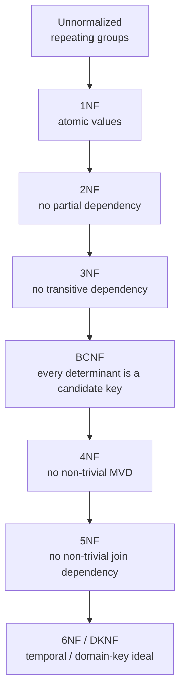

# Normalization vs Denormalization (1NF–5NF, When to Break the Rules)

> Normalization is the discipline of structuring data so that each fact is stored exactly once, eliminating update anomalies; denormalization is the deliberate stacking of redundant copies to make reads fast and simple. Neither is "correct." Normalization makes transactional systems correct and evolvable; denormalization makes analytical systems fast and usable. A senior engineer is fluent in all normal forms (1NF through 5NF, plus BCNF, DKNF, and 6NF), knows the anomaly each one removes, and — crucially — knows **when and how to break them on purpose**, with eyes open about the consistency debt that denormalization incurs and the mechanisms (materialized views, SCD2, idempotent pipelines, contracts) that pay it back.

## TL;DR

- **Normalization** removes redundancy and update anomalies by decomposition, guided by **functional dependencies**. The normal forms are a ladder: 1NF → 2NF → 3NF → BCNF → 4NF → 5NF (→ DKNF/6NF).
- **Each form targets an anomaly class**: 1NF atomicity; 2NF partial dependencies; 3NF transitive dependencies; BCNF every determinant is a key; 4NF multivalued dependencies; 5NF join dependencies.
- **OLTP wants normalization** (3NF/BCNF): correctness, small write footprint, easy evolution, no update anomalies under concurrency.
- **OLAP wants denormalization** (stars, wide tables, pre-aggregates): fewer joins, faster scans, simpler SQL — especially on columnar engines where redundancy compresses well and joins are the bottleneck.
- **Denormalization is a *performance* technique**, not a modeling philosophy. Do it at the right layer (presentation/consumption), not in the integration layer.
- **Redundancy's cost is consistency**: denormalized copies can drift. You pay it back with **idempotent rebuilds, materialized views, CDC, SCD2, tests, and semantic-layer definitions of truth**.
- **Denormalization is *not* "no design."** The star schema *is* a disciplined denormalization: facts + denormalized dimensions, keys preserved, grain declared.
- Classic denormalization techniques: pre-joined dimensions, pre-aggregated summary/mart tables, materialized/late-binding views, replicated reference data (broadcast dims), stored derived columns, arrays/structs/nested types, and the "One Big Table" (OBT/wide-event) pattern.
- Modern twist: **columnar storage and cheap storage invert the classic math** — compressing a duplicated low-cardinality string is nearly free, while joins and shuffles are the real cost. This is why stars beat 3NF for analytics almost everywhere.
- Vendor differences matter: Snowflake/BigQuery/Redshift stars; Databricks Gold stars over Delta/Iceberg; ClickHouse/Druid/Pinot favorites wide events; dbt/SQLMesh orchestrate the normalize-upstream/denormalize-downstream layering.

---

## 1. Definitions and core vocabulary

### 1.1 The anomaly vocabulary (the "why" of normalization)

| Anomaly | What happens | Removed by |
|---------|--------------|-----------|
| **Insertion anomaly** | Can't insert a fact without inventing unrelated data | 2NF/3NF |
| **Update anomaly** | One change must be applied in many places; miss one → inconsistent | 2NF/3NF/BCNF |
| **Deletion anomaly** | Deleting one fact destroys unrelated data | 3NF |
| **Redundancy** | The same fact stored multiple times | all forms |

### 1.2 Functional dependency vocabulary

| Term | Definition |
|------|------------|
| **Functional dependency (FD)** `X → Y` | For any two rows, if X values match, Y values must match. |
| **Determinant** | The left side `X` of an FD. |
| **Candidate key** | A minimal set of attributes that uniquely identifies a row. |
| **Primary key (PK)** | The chosen candidate key. |
| **Prime attribute** | An attribute that is part of some candidate key. |
| **Non-prime attribute** | An attribute in no candidate key. |
| **Partial dependency** | A non-prime attribute depends on part of a composite key (1NF→2NF issue). |
| **Transitive dependency** | A non-prime attribute depends on another non-prime attribute (2NF→3NF issue). |
| **Multivalued dependency (MVD)** `X ↠ Y` | For each X, Y values are independent of other attributes (3NF/BCNF→4NF issue). |
| **Join dependency (JD)** | A relation can be losslessly decomposed into >2 relations (4NF→5NF issue). |
| **Lossless decomposition** | Splitting a table so a natural join reconstructs exactly the original rows. |
| **Dependency preservation** | Decomposition keeps all FDs enforceable without joins. |
| **Closure / Armstrong's axioms** | Rules (reflexivity, augmentation, transitivity) to derive all FDs. |
| **Denormalization** | Deliberately reintroducing redundancy for read performance. |
| **Fact constellation / OBT** | Galaxy of stars / One Big Table (full denormalization). |

### 1.3 The normal-form ladder



| Form | Removes | One-line test |
|------|---------|---------------|
| **1NF** | repeating groups, non-atomic values | Every cell holds one atomic value; no arrays-in-cell. |
| **2NF** | partial dependencies on a composite key | 1NF **and** every non-prime attribute fully depends on the whole PK. |
| **3NF** | transitive dependencies | 2NF **and** no non-prime attribute depends on another non-prime. |
| **BCNF** | all FD anomalies on keys | Every determinant is a candidate key. (Stricter than 3NF; may lose a dependency.) |
| **4NF** | multivalued dependencies | BCNF **and** no non-trivial MVD except where the determinant is a superkey. |
| **5NF (PJNF)** | join dependencies | 4NF **and** every join dependency is implied by candidate keys. |
| **6NF** | remaining temporal/join dependencies | Irreducible relations anchored on a key + timestamp; the anchor-model haven. |
| **DKNF** | all dependencies | Every constraint is a consequence of domain and key constraints. |

> **Senior note:** In practice, OLTP schemas target **3NF (often BCNF)**; a "5NF" schema in production is almost always the result of a tool or a specific temporal design (anchor modeling, Data Vault satellites). Know the ladder, but don't over-normalize: normalization beyond what removes real anomalies costs joins without benefit.

---

## 2. What problem it solves / why it matters

### 2.1 What normalization buys you

1. **No update anomalies.** Each fact has one home. Changing a category name is one write, not thousands.
2. **No insertion anomalies.** You can add a new category before any product exists.
3. **No deletion anomalies.** Deleting a product doesn't wipe its category.
4. **Smaller storage / write footprint.** Less duplication → less IO on writes, less WAL, better cache behavior.
5. **Evolvability.** New entities attach cleanly; the schema is a graph of well-defined relationships.
6. **Data integrity by construction.** FDs are enforced by keys, not by hope.
7. **Concurrency friendliness.** Narrow rows mean short locks (or small MVCC versions) → less contention.

These properties matter enormously for **OLTP**, where correctness under concurrency is paramount.

### 2.2 What denormalization buys you

1. **Fewer joins per query.** Each eliminated join removes optimizer work, shuffle, and latency.
2. **Simple, readable SQL.** Business users can query a star or a wide table directly.
3. **Fewer scan bytes / better pruning** in columnar engines (a wide table can be partitioned/clustered by the filter columns).
4. **Predictable performance** at high concurrency (BI tools).
5. **Pre-computed results** (summary tables, materialized views) that turn a 10-second aggregation into a 100-ms lookup.
6. **Storage/compression exploiting low-cardinality redundancy** (dictionary encoding), making the redundancy nearly free.

These properties matter enormously for **OLAP**, where read performance and usability dominate.

### 2.3 Why a senior must own this trade-off

- **It is the central design axis of a data platform.** "Normalize to integrate, denormalize to serve" is the one-liner senior architects use.
- **It explains why the OLTP schema is wrong for the warehouse** (chapter 01) and why the star (chapters 02–04) is a *deliberate denormalization*.
- **It determines where correctness lives.** If you denormalize, you must design the *re-sync* mechanism; if you normalize, you must design the *join* strategy.
- **It's where cost is decided.** Columnar engines pay for joins/scans; row engines pay for IOPS/writes. The right normalization level differs by engine.
- **It's the difference between a warehouse people trust and one they don't.** Every uncontrolled denormalization is a future divergence.

### 2.4 The core tension, quantified

Let a denormalized table store *k* redundant attributes across *N* rows, each attribute value *s* bytes. Naive cost: `k·N·s` bytes. In a row store, that's real storage and real scan cost. In a columnar store with dictionary encoding, a low-cardinality attribute of cardinality *c* costs roughly `c·s + N·log(c)/8` bytes — the redundancy of the *value* is gone; you pay only the codes. So the "storage" argument for normalizing analytics almost vanishes, while the "join" cost of normalizing remains. Hence:

- **Row store:** normalization often worth it for storage/scan reasons.
- **Columnar store:** denormalization (star) usually worth it; joins are the bottleneck.

---

## 3. How it works internally (mechanisms, internals)

### 3.1 Decomposition mechanics — a worked normalization

Start with a single denormalized `enrollment` table:

| student_id | course_id | student_name | course_name | instructor_id | instructor_name | grade |
|-----------:|----------:|--------------|-------------|--------------:|-----------------|-------|
| 1 | 10 | Ana | Databases | 200 | Dr. Kim | A |
| 1 | 20 | Ana | Networks | 201 | Dr. Lee | B |
| 2 | 10 | Bo | Databases | 200 | Dr. Kim | A |

**1NF:** already atomic (no repeating groups). If `courses` were a comma-separated column, we'd split it.

**2NF:** the key is `(student_id, course_id)`. But `student_name` depends only on `student_id`, and `course_name`/`instructor_id` only on `course_id` → **partial dependencies**. Split:

```
student(student_id PK, student_name)
course(course_id PK, course_name, instructor_id)
enrollment(student_id, course_id, grade)  -- PK (student_id, course_id)
```

**3NF:** `course → instructor_id → instructor_name` is a **transitive dependency**. Split:

```
course(course_id PK, course_name, instructor_id FK)
instructor(instructor_id PK, instructor_name)
```

**BCNF:** check every determinant is a candidate key. In the above, yes. If there were `(student, course) → instructor` and `instructor → course` (a teacher teaches exactly one course), BCNF would force further splitting (and might sacrifice dependency preservation).

**4NF example:** suppose a student can have multiple advisors *and* multiple minors, independently. A table `student_advisor_minor(student, advisor, minor)` has the MVDs `student ↠ advisor` and `student ↠ minor`. Split into `student_advisor(student, advisor)` and `student_minor(student, minor)`.

**5NF example:** a table `supplier_part_project(supplier, part, project)` meaning "supplier supplies part to project" might satisfy the JD: any combination where supplier-part, part-project, and supplier-project all hold implies the triple holds. Then it can be losslessly decomposed into three binary relations — that's 5NF/PJNF.

### 3.2 Lossless vs. lossy decomposition

A decomposition is **lossless** if `R = R1 ⋈ R2 ⋈ ...` (natural join reproduces exactly the original rows — no spurious tuples). The test for a binary decomposition of `R` into `R1, R2`: the decomposition is lossless iff `R1 ∩ R2 → R1` or `R1 ∩ R2 → R2` (the common attributes form a superkey of at least one side).

**Why it matters practically:** normalization that isn't lossless corrupts data by *inventing* rows on join (fan-out). This is the theoretical root of the "my totals are inflated" bug.

### 3.3 Denormalization mechanics

Denormalization deliberately reintroduces redundancy. The mechanisms:

| Mechanism | What it does | Cost / risk |
|-----------|--------------|-------------|
| **Pre-joined dimensions** | Flatten hierarchy attributes into a dimension (star) | larger dim; consistent rebuild |
| **Pre-aggregated summary tables** | Store `SUM`/`COUNT` by a dimension combination | must be maintained incrementally; staleness |
| **Materialized views** | Engine-maintained denormalized copies | refresh cost/lag; storage |
| **Late-binding views** | Query-time joins hidden behind a view | no storage, still joins |
| **Replicated reference data** | Duplicate small dims everywhere (`DISTSTYLE ALL`) | sync issues if mutable |
| **Stored derived columns** | Keep `net = gross - discount` | can drift; must be recomputed |
| **Arrays/structs/JSON** | Nest child rows inside a column | harder aggregation; schema rigidity |
| **One Big Table (OBT)** | Fact + all dims flattened into one wide table | massive redundancy; rebuild cost; schema churn |

### 3.4 How each engine "sees" normalization

- **Row store (Postgres/MySQL):** joins are IO-bound indexed lookups; normalized schemas are fine for point access; analytic joins get expensive (hash/merge over many pages). Denormalizing (stars, OBT) helps analytics but bloats writes.
- **MPP columnar (Redshift/Snowflake/BigQuery/Synapse):** joins are hash/shuffle-heavy; scans are cheap; **stars/denormalized dims win**, snowflakes cost joins, OBT can hurt when most queries need only a few of its 200 columns (still scans only the needed columns, so OBT is often fine on columnar!). Key: **column pruning** means a wide table only pays for the columns queried — so OBT is more viable than in a row store.
- **Lakehouse (Delta/Iceberg + Spark/Photon):** layout and compaction dominate; stars in Gold; OBT for specific serving; joins cost shuffles.
- **Real-time OLAP (ClickHouse/Druid/Pinot):** OBT/wide-event is the default; stars are materialized for BI.

### 3.5 The atomicity of "one fact, one place"

Normalization's deepest principle: **each fact has exactly one authoritative home**. Denormalization copies facts, so you must ask *which copy is authoritative* and *how the others stay in sync*. Every denormalization decision should come with an explicit answer:

- authoritative source (which table/layer),
- sync mechanism (rebuild nightly, incremental MERGE, materialized view, streaming),
- tolerance (how stale is acceptable),
- detection (tests/metrics for divergence).

> **Senior note:** The senior question about any denormalized structure is not "why is it redundant?" but "what is the authoritative source and how do we keep this copy correct?" If there's no answer, it's not denormalization — it's data corruption waiting to happen.

---

## 4. How to implement it (step-by-step, with SQL / code / config examples)

### 4.1 Normalize an OLTP schema to 3NF/BCNF

```sql
-- 3NF/BCNF-ish OLTP core
CREATE TABLE customer (
    customer_id   BIGINT GENERATED ALWAYS AS IDENTITY PRIMARY KEY,
    email         TEXT NOT NULL UNIQUE,
    full_name     TEXT NOT NULL
);
CREATE TABLE geography (
    geo_id        BIGINT GENERATED ALWAYS AS IDENTITY PRIMARY KEY,
    country_code  CHAR(2) NOT NULL,
    state_code    TEXT,
    city          TEXT
);
CREATE TABLE customer_geo (            -- resolves MVD: a customer can have several addresses
    customer_id   BIGINT NOT NULL REFERENCES customer(customer_id),
    geo_id        BIGINT NOT NULL REFERENCES geography(geo_id),
    address_type  TEXT NOT NULL,         -- 'billing','shipping'
    PRIMARY KEY (customer_id, geo_id, address_type)
);
CREATE TABLE category (
    category_id   BIGINT PRIMARY KEY,
    name          TEXT NOT NULL,
    parent_id     BIGINT REFERENCES category(category_id)   -- ragged hierarchy (adjacency list)
);
CREATE TABLE product (
    product_id    BIGINT PRIMARY KEY,
    sku           TEXT NOT NULL UNIQUE,
    name          TEXT NOT NULL,
    brand         TEXT,
    category_id   BIGINT REFERENCES category(category_id)
);
CREATE TABLE sales_order (
    order_id      BIGINT GENERATED ALWAYS AS IDENTITY PRIMARY KEY,
    customer_id   BIGINT NOT NULL REFERENCES customer(customer_id),
    created_at    TIMESTAMPTZ NOT NULL DEFAULT now(),
    status        TEXT NOT NULL
);
CREATE TABLE sales_order_line (
    order_id      BIGINT NOT NULL REFERENCES sales_order(order_id),
    line_no       INT    NOT NULL,
    product_id    BIGINT NOT NULL REFERENCES product(product_id),
    quantity      INT    NOT NULL,
    unit_price_cents BIGINT NOT NULL,
    discount_cents   BIGINT NOT NULL DEFAULT 0,
    PRIMARY KEY (order_id, line_no)
);
```

**Why this is 3NF:** no partial dependencies (each non-key attribute depends on the whole key), no transitive dependencies (`product → category`, category not in product's non-key chain beyond the FK), and `category` is its own table.

### 4.2 Denormalize the star for analytics

```sql
-- Presentation layer: deliberately denormalized (star)
CREATE TABLE dwh.dim_product (
    product_sk      NUMBER PRIMARY KEY,
    product_id      BIGINT NOT NULL,      -- natural key
    sku             STRING,
    product_name    STRING,
    brand           STRING,
    category        STRING,               -- flattened
    subcategory     STRING,
    list_price_minor BIGINT,
    is_current      BOOLEAN
);

CREATE TABLE dwh.dim_customer (
    customer_sk     NUMBER PRIMARY KEY,
    customer_id     BIGINT NOT NULL,
    email           STRING,
    full_name       STRING,
    country_code    STRING,               -- flattened from geography
    state_code      STRING,
    city            STRING,
    valid_from      TIMESTAMP_NTZ,
    valid_to        TIMESTAMP_NTZ,
    is_current      BOOLEAN
);

CREATE TABLE dwh.fct_sales (
    sales_sk        NUMBER PRIMARY KEY,
    date_sk         NUMBER NOT NULL,
    customer_sk     NUMBER NOT NULL,
    product_sk      NUMBER NOT NULL,
    order_number    STRING,               -- degenerate dimension
    quantity        NUMBER NOT NULL,
    net_rev_minor   NUMBER NOT NULL
)
CLUSTER BY (date_sk);
```

**Impact of flattening:** `dim_product.category` replaces the chain `product → category → parent` with a single column (plus optionally `category_l1`, `category_l2` if you need multiple levels flat).

### 4.3 Build the denormalized star in dbt (normalize upstream, denormalize downstream)

```sql
-- models/staging/stg_products.sql  (keeps 3NF shape, cleaned)
select product_id, sku, name, brand, category_id
from {{ source('oltp','product') }}

-- models/marts/core/dim_product.sql  (denormalized star dim)
with p as (select * from {{ ref('stg_products') }}),
     cat as (select * from {{ ref('stg_categories') }}),
     catp as (select * from {{ ref('stg_categories') }})   -- parent level
select
    {{ dbt_utils.generate_surrogate_key(['p.product_id']) }} as product_sk,
    p.product_id,
    p.sku,
    p.name        as product_name,
    p.brand,
    coalesce(cat.name,  'Unknown') as category,           -- flattened level 1
    coalesce(catp.name, 'Unknown') as subcategory,        -- flattened level 2
    true as is_current
from p
left join cat  on p.category_id = cat.category_id
left join catp on cat.parent_id = catp.category_id
```

### 4.4 Pre-aggregated summary tables (the classic denormalization)

When BI concurrency and scan cost bite, pre-aggregate:

```sql
-- Grain: one row per day per product per customer segment
CREATE TABLE dwh.agg_sales_daily AS
SELECT
    f.date_sk,
    f.product_sk,
    c.segment,               -- denormalized attribute
    SUM(f.quantity)      AS units,
    SUM(f.net_rev_minor) AS revenue_minor,
    COUNT(*)             AS order_lines
FROM dwh.fct_sales f
JOIN dwh.dim_customer c ON f.customer_sk = c.customer_sk
GROUP BY 1,2,3;

-- "Revenue by month by segment" is now a tiny aggregation
SELECT d.year, d.month, a.segment, SUM(a.revenue_minor)/100.0 AS revenue
FROM dwh.agg_sales_daily a
JOIN dwh.dim_date d ON a.date_sk = d.date_sk
GROUP BY 1,2,3;
```

**Maintenance rules for aggregates:**
- Rebuild **idempotently** (overwrite the affected partitions, or `MERGE` incrementally).
- Keep the **atomic fact** as the source of truth; aggregates are caches.
- Test that `SUM(agg.revenue) = SUM(fact.revenue)` for the same slice.

### 4.5 Materialized views, late-binding views, and dynamic tables

```sql
-- Snowflake materialized view (engine-maintained denormalization/aggregate)
CREATE MATERIALIZED VIEW dwh.mv_revenue_by_day_segment AS
SELECT date_sk, segment, SUM(revenue_minor) AS revenue_minor
FROM dwh.agg_sales_daily GROUP BY 1,2;

-- Snowflake dynamic table (declarative incremental, near-real-time)
CREATE OR REPLACE DYNAMIC TABLE dwh.dt_revenue_by_day
  TARGET_LAG = '5 minutes'
  WAREHOUSE = transform_wh
AS
SELECT date_sk, SUM(net_rev_minor) AS revenue_minor
FROM dwh.fct_sales GROUP BY 1;

-- BigQuery materialized view
CREATE MATERIALIZED VIEW dwh.mv_revenue_by_day
PARTITION BY DATE(date_day)
CLUSTER BY segment
AS SELECT ...;
```

**Choosing:** materialized views for engine-managed refresh; dynamic tables/streaming for freshness; dbt aggregate models for full control and testability.

### 4.6 OBT (One Big Table) — extreme denormalization

```sql
-- For a specific, high-concurrency serving use case
CREATE TABLE serving.obt_orders AS
SELECT
    o.order_id, o.order_number, o.created_at,
    c.customer_id, c.email, c.country_code, c.segment,
    p.product_id, p.sku, p.category, p.brand,
    ol.quantity, ol.unit_price_cents, ol.discount_cents,
    ol.quantity*ol.unit_price_cents - ol.discount_cents AS net_rev_cents
FROM sales_order o
JOIN customer c         ON o.customer_id = c.customer_id
JOIN sales_order_line ol ON o.order_id    = ol.order_id
JOIN product p          ON ol.product_id  = p.product_id;
```

**When OBT is right:** a single team's dashboard, a real-time serving path, or a BI tool that struggles with joins — and you accept **rebuild cost** and **schema churn** (adding an attribute = rebuild the table).

> **Senior note:** OBT is a *serving* artifact, not a modeling layer. Never let it become the source of truth; always rebuild it from the star. Its whole value is "zero joins at query time."

### 4.7 Handling the consistency debt of denormalization

Every denormalized structure needs a sync contract:

| Denormalized artifact | Authoritative source | Sync mechanism | Staleness tolerance | Divergence test |
|-----------------------|----------------------|----------------|---------------------|-----------------|
| `dim_product.category` | `category` table | nightly dbt rebuild | 1 day | reconcile counts by category |
| `agg_sales_daily` | `fct_sales` | incremental MERGE | 1 hour | `SUM` equality test |
| Materialized view | base tables | engine refresh | minutes | freshness + rowcount |
| OBT | star | full/partitioned rebuild | hours | join back and compare |
| Derived column (`net`) | components | recompute | 0 (same row) | `net = gross - disc` test |

### 4.8 Tooling workflow

```
1. Model sources in 3NF (as-is)                      → staging
2. Apply business rules in a normalized integration   → silver / DV
3. Denormalize into stars + aggregates in the mart    → gold (dbt)
4. Add materialized views / OBT for serving           → consumption
5. Test reconciliation between layers                 → tests
6. Expose metrics via a semantic layer                → definitions of truth
```

---

## 5. Where to implement it (tools/platforms)

### 5.1 Normalization vs denormalization by platform

| Platform | OLTP-side | Analytics-side guidance |
|----------|-----------|--------------------------|
| **PostgreSQL / MySQL** | 3NF/BCNF; add stars/OBT on read replicas for reporting | Normalize the core; denormalize replicas |
| **Aurora / RDS** | 3NF; report from replicas | Same |
| **Snowflake** | — | Stars + `CLUSTER BY`; dynamic tables for aggregates; MVs for hot slices |
| **BigQuery** | — | Stars; partition/cluster; MVs; nested/array types for OBT-ish structures |
| **Redshift** | — | Stars; `DISTSTYLE ALL` small dims; MVs; summary tables |
| **Databricks / Delta / Iceberg** | — | Bronze (as-is) → Silver (3NF/DV) → Gold (stars); `APPLY CHANGES`; liquid clustering |
| **Synapse / Fabric** | — | Stars in dedicated SQL pool; replicated dims |
| **Trino / Athena** | — | Stars on partitioned Parquet/Iceberg |
| **ClickHouse / Druid / Pinot** | — | OBT/wide events by default; materialized views for aggregates |
| **DuckDB** | — | Stars normalizable locally; great for testing models |
| **Snowflake / BigQuery nested types** | — | Arrays/structs reduce joins (a form of denormalization within a row) |

### 5.2 Choosing the layer

| Layer | Shape | Rationale |
|-------|-------|-----------|
| Raw/bronze | as-is, unmodeled | fidelity, replay |
| Staging/silver | light normal form | clean, typed, deduped |
| Integration | 3NF / Data Vault | correctness, integration, audit |
| Presentation | star (denormalized) | query speed, usability |
| Aggregates | pre-computed | concurrency, cost |
| Serving | OBT / MV | zero-join, real-time |

### 5.3 Tooling

| Need | Tools |
|------|-------|
| Normalize/integration | dbt, SQLMesh, Data Vault tools, ER/modeling tools |
| Denormalize/build stars | dbt, Dataform, SQLMesh |
| Pre-aggregate | dbt aggregate models, MVs, dynamic tables, Snowflake MVs |
| Nested/array modeling | BigQuery ARRAY/STRUCT, Snowflake VARIANT, Parquet nested, Iceberg structs |
| Consistency tests | dbt tests, Great Expectations, Soda, Monte Carlo |
| Definitions of truth | MetricFlow, Cube, LookML, AtScale |

---

## 6. Patterns and anti-patterns

### 6.1 Normalization patterns

**P1. Normalize to 3NF/BCNF for OLTP.** Remove partial and transitive dependencies; keys enforce FDs.
**P2. Model many-to-many explicitly.** Junction tables for MVDs (4NF).
**P3. Adjacency list or closure table for hierarchies.** Store `parent_id`, and optionally a pre-computed closure for queries.
**P4. Keep SCD history in satellites/type-2 tables.** Don't overwrite facts.
**P5. Freeze the raw layer un-modeled.** Normalization begins at staging.

### 6.2 Denormalization patterns

**P6. Star schema as the canonical denormalization.** Flat dims + facts.
**P7. Pre-joined dimension attributes.** Flatten hierarchies at build time.
**P8. Pre-aggregated summary tables.** For high-concurrency BI.
**P9. Materialized/dynamic views.** Engine-maintained denormalization with declarative freshness.
**P10. Replicated (broadcast) small dimensions.** Physical denormalization for join performance.
**P11. Stored derived columns with tests.** `net = gross - discount`, checked.
**P12. Nested/array types for child collections.** Reduce joins within a row (BigQuery/Snowflake/Parquet).
**P13. OBT for a single, well-defined serving path.** Rebuilt from the star, never authoritative.

### 6.3 Anti-patterns

**A1. Over-normalizing analytics.** A 3NF warehouse forces 8-way joins for a simple question — the classic failure.
**A2. Denormalizing without a sync contract.** Redundant copies drift; metrics diverge.
**A3. Denormalizing the OLTP primary.** Wide tables multiply write amplification, locks, and contention.
**A4. Materialized views nobody monitors.** Silent staleness; "why is the dashboard behind?".
**A5. OBT as the source of truth.** Rebuilds lose data; schema churn is brutal; lineage dies.
**A6. Lossy decomposition.** Joins produce spurious tuples → inflated totals (fan-out).
**A7. Uncontrolled derived columns.** `net` computed in five places, inconsistently.
**A8. Normalizing (snowflaking) on a columnar warehouse for "storage."** Pays joins for a savings that compression already provided.
**A9. Storing arrays/JSON to avoid modeling.** Aggregation and integrity become impossible; schema-on-read chaos.
**A10. Mixing normalization levels randomly across marts.** Inconsistent joins, inconsistent semantics.
**A11. No tests for redundancy.** No divergence detection.
**A12. Denormalizing volatile attributes into immutable facts.** Either stale or perpetually rebuilt.

### 6.4 Choosing: the decision table

| Situation | Recommendation |
|-----------|----------------|
| Transactional writes, correctness-critical | Normalize (3NF/BCNF) |
| Analytics, columnar warehouse | Denormalize (star) |
| Snowflake/Redshift physical joins | Denormalize + tune dist/broadcast |
| BigQuery cost control | Denormalize + partition/cluster; prune columns |
| High BI concurrency | Pre-aggregate (summary/MV) |
| Real-time serving | OBT/wide-event + materialized aggregates |
| Frequently changing hierarchies with governance | Normalize the hierarchy, expose a flat view |
| ML feature generation | Point-in-time (SCD2) denormalized feature tables |
| Audit/regulatory | Normalize integration + immutable history |

---

## 7. Real-world use cases and industry applications

**E-commerce.** OLTP normalized (orders, order_lines, products, categories). Warehouse star: `fct_order_line` + flat `dim_product` (category/brand inside) + `dim_customer`. Pre-aggregated `agg_sales_daily` for dashboards; OBT for the customer-facing analytics feature.

**Banking.** Core ledger normalized to 3NF/BCNF for integrity and audit. Regulatory marts denormalized into stars with as-was/as-is attributes (SCD6/7). Pre-aggregated balances for reporting. Anti-pattern avoided: never denormalize the transaction ledger.

**Retail merchandising.** Product hierarchy (category → subcategory → brand) normalized for governance, flattened into `dim_product` for BI. Inventory is a periodic snapshot fact (semi-additive) — a denormalized analytical artifact.

**Healthcare.** Normalized clinical source (patients, encounters, diagnoses) integrated (often Data Vault) then denormalized into stars; bridge tables for many-to-many (diagnoses/procedures) — a *lossless* denormalization for analytics.

**Marketing / adtech.** Wide-event OBT (impressions/clicks) ingested from Kafka, served from ClickHouse/Druid; denormalized aggregates for campaign dashboards; normalized `dim_campaign` for governance.

**SaaS.** dbt project: staging (normalized) → marts (stars) → aggregates; semantic layer for metric definitions. Pre-aggregated MRR/churn tables for finance dashboards.

**Uber / Netflix-scale.** Integration layer is heavily normalized (or Data Vault) for auditability; presentation layers are denormalized stars/wide tables per consumer; materialized aggregates for low-latency dashboards.

**Log analytics / observability.** Almost entirely denormalized wide events (a JSON/Parquet wide table), with a handful of dimension lookups. Normalization would be counterproductive at this scale.

> **Senior note:** The industry-consistent pattern is **normalize where writes/correctness dominate; denormalize where reads/latency dominate; always keep the raw layer immutable.** Which side of the boundary a table falls on is determined by who writes it and who reads it.

---

## 8. Senior-level deep dive

### 8.1 Trade-off matrix

| Dimension | Normalize | Denormalize |
|-----------|-----------|-------------|
| Write cost | Low (narrow rows) | High (write amplification) |
| Read cost (analytics) | High (many joins) | Low (few/no joins) |
| Storage | Low | Higher (but compresses) |
| Update anomaly risk | Low (by construction) | Higher (needs sync) |
| Evolvability | High (attach entities) | Lower (wide tables churn) |
| Query simplicity | Low | High |
| Concurrency (BI) | Lower | Higher |
| Consistency guarantees | Strong | Requires mechanisms |
| Governance | Clear ownership per entity | Risk of divergence |
| Best for | OLTP, integration, audit | OLAP, serving, BI |

### 8.2 Where exactly to denormalize (the layering rule)

```
raw (as-is)  →  staging (light clean)  →  integration (3NF/DV)  →  presentation (star)  →  serving (MV/OBT)
   ↑                                                                        ↑                    ↑
  immutable                                                        denormalization       more denormalization
```

**Rule:** denormalization increases as you move right; normalization increases as you move left. Each layer has exactly one "source of truth" for its facts.

### 8.3 The consistency problem, formally

If you copy fact `f` into tables `T1..Tk`, correctness requires that, at any point, all copies agree or the divergence is bounded and acceptable. Because distributed updates aren't instantaneous, you must choose:

- **Strong sync** (transactional, same transaction): impossible/expensive across systems.
- **Materialized view refresh:** engine-managed, bounded lag, but refresh cost grows with the view.
- **Incremental/CDC sync:** near-real-time, complex, order-sensitive.
- **Batch rebuild:** simple, high lag, cost concentrated.
- **Accept divergence:** define tolerance and test for it.

Seniors pick per artifact and write it down. Denormalization without a declared sync model is a latent incident.

### 8.4 Performance deep dive

- **Join elimination:** a good optimizer can *eliminate* joins to dimensions that aren't selected (e.g., if you filter by `customer_sk` but select no customer columns, the join may be dropped). Denormalizing can *prevent* this optimization by forcing wide scans — a subtle argument in favor of *some* normalization even in analytics.
- **Projection/column pruning:** columnar engines read only referenced columns, so OBT's "width" is not scanned unless needed. This is why OBT performs better than classic intuition suggests.
- **Predicate pushdown:** denormalized attributes can be filtered before the fact scan if the join is pre-resolved (star dims), whereas snowflaked attributes may only be known after joins.
- **Data skipping:** partition/cluster/sort keys on denormalized columns enable skipping; normalized schemas often can't skip the same way.
- **Shuffle vs. broadcast:** normalized dimensions that are "small" after joins may broadcast; normalization chains can defeat broadcast thresholds.
- **Update amplification:** a single attribute change in a normalized table is one row; in a denormalized OBT it can require rewriting millions of rows (or the whole table).

### 8.5 Failure modes and debugging

| Symptom | Likely cause | Diagnosis | Fix |
|---------|--------------|-----------|-----|
| Inflated totals | Lossy decomposition / fan-out | `COUNT(*)` vs `COUNT(DISTINCT)` | Lossless joins, bridge tables |
| Metrics differ per tool | Denormalized copies diverged | Compare copies on a slice | Sync contract + test |
| Slow dashboards | Over-normalized (many joins) | Count joins in plan | Denormalize into stars |
| High write cost | Denormalized OLTP | Write amplification analysis | Normalize the write path |
| Stale MV / aggregate | Unmonitored refresh | Freshness check | Monitor lag; alert |
| Category rename broke history | Overwrote denormalized dim | SCD2 check | Version the dimension |
| OBT schema churn | Source added a column | Migration effort | Rebuild policy, staging views |
| Join elimination lost | Denormalized "just in case" | Compare plans | Remove unused denormalization |
| Storage spike | Uncontrolled duplication | Column cardinality review | Dictionary-encode; normalize cold data |

### 8.6 Design review checklist

1. For every table, is the **normal form** (or deliberate denormalization) documented and justified?
2. For every denormalized copy: what is the **authoritative source**, **sync mechanism**, **staleness tolerance**, and **divergence test**?
3. Are all decompositions **lossless**? Any fan-out risk?
4. Does the read path live on the **right layer** (not the OLTP primary)?
5. Are aggregates **idempotently rebuildable** and reconciled to the atomic fact?
6. Are derived columns **tested** for drift?
7. Is the raw layer **immutable** so any denormalization can be rebuilt?
8. Do the SCD/versioning choices (chapter 05) match the normalization level (no overwriting of history)?
9. Is there a **semantic layer** so metric definitions don't fragment across denormalized marts?
10. Is **join elimination / column pruning** preserved where it matters?

### 8.7 Modern reframings

- **"Denormalization" = materialization.** In modern terms, denormalization is choosing *what to materialize* vs. *what to compute on read*. Materialized views, dynamic tables, cached results, and search indexes are the same idea with different machinery.
- **Nested types are denormalization within a row.** BigQuery/Snowflake/Parquet arrays and structs avoid joins by nesting children. Great for read-heavy nested reads; hard for cross-nested aggregation.
- **Data contracts institutionalize the boundary.** A contract on the staging layer means the denormalized marts can be rebuilt safely.
- **Feature stores are point-in-time denormalization.** They materialize SCD2-correct features, exactly the "denormalize to serve" principle applied to ML.

---

## 9. Common mistakes and how to avoid them

1. **Over-normalizing the warehouse.** *Avoid:* normalize upstream, star downstream; measure joins per top query.
2. **Denormalizing the OLTP primary.** *Avoid:* keep the write path narrow and 3NF; denormalize replicas/marts.
3. **Denormalizing without a sync contract.** *Avoid:* document source/sync/tolerance/test per copy.
4. **Lossy decomposition.** *Avoid:* verify losslessness (`R1 ∩ R2` is a superkey of one side); test for fan-out.
5. **Unmonitored materialized views/aggregates.** *Avoid:* freshness and reconciliation tests + alerts.
6. **OBT as the source of truth.** *Avoid:* rebuild OBT from the star; keep the star authoritative.
7. **Derived columns drifting.** *Avoid:* compute once in the model; test the identity.
8. **Snowflaking for storage on columnar stores.** *Avoid:* understand dictionary encoding; joins cost more.
9. **JSON/arrays as a substitute for modeling.** *Avoid:* nest only for genuine containment; keep keys queryable.
10. **Inconsistent normalization levels across marts.** *Avoid:* one presentation convention; conformance.
11. **No raw immutability.** *Avoid:* land raw as-is; everything downstream is rebuildable.
12. **Ignoring join elimination.** *Avoid:* don't denormalize attributes nobody selects.
13. **Mixing SCD types inconsistently with the normalization level.** *Avoid:* align SCD policy with the layer.
14. **Estimating denormalization savings without measuring compression.** *Avoid:* measure bytes; modern columnar compression is aggressive.

---

## 10. Exercises / interview questions

**Conceptual**

1. State each normal form (1NF–5NF/BCNF) and the anomaly it removes. *(Hint: atomicity, partial, transitive, determinant, MVD, JD.)*
2. Define a functional dependency and give an example from your last project. *(Hint: `order_id → customer_id`.)*
3. What is a lossless decomposition, and what breaks if it isn't lossless? *(Hint: spurious tuples, fan-out.)*

**Design**

4. Given an unnormalized `enrollment` table, normalize it step by step to 3NF, then BCNF. *(Hint: partial → transitive → determinants.)*
5. Design a 4NF-correct schema for "employees with multiple skills and multiple certifications, independently." *(Hint: split MVDs.)*
6. Take a 3NF OLTP schema and produce the star schema. State every denormalization you perform and why.

**Internals**

7. Why is a decomposition lossless iff `R1 ∩ R2 → R1` or `R1 ∩ R2 → R2`? *(Hint: superkey property.)*
8. How does dictionary encoding make a denormalized low-cardinality column nearly free? *(Hint: codes + dictionary.)*
9. Explain join elimination and how over-denormalization can *remove* it. *(Hint: unused dimension joins dropped by the optimizer.)*

**Trade-offs / senior**

10. Argue when denormalization is *worth it* on a columnar warehouse, quantifying bytes vs. joins. *(Hint: compression vs. shuffle.)*
11. You inherit a warehouse where each mart denormalized its own customer table. Outline a plan to converge without breaking dashboards. *(Hint: golden dim, flat views, deprecation.)*
12. When would you choose OBT over a star, and what does each cost you? *(Hint: zero-join serving vs. rebuild cost and schema churn.)*
13. Should an OLTP system ever be denormalized? Give two legitimate cases and the guardrails. *(Hint: read models/CQRS, counters, hot-path joins; guardrails: sync + invariants.)*

**Debugging**

14. A summary table's total is 3% lower than the fact. Enumerate causes. *(Hint: late data, stale aggregate, join key mismatch, filter drift.)*
15. Two dashboards built on the same domain disagree. Trace the normalization/denormalization decisions that could cause it. *(Hint: diverging denormalized copies, different SCD joins.)*

**Applied**

16. Write the divergence test that ensures `agg_sales_daily` reconciles with `fct_sales`. *(Hint: group by the same dims; compare sums.)*
17. Write a SQL check that proves a star's joins don't fan out the fact. *(Hint: `COUNT(*)` unchanged after join, or `COUNT(DISTINCT grain key)`.)*

---

## References

- **Wikipedia — Database normalization (1NF–6NF, DKNF)**: https://en.wikipedia.org/wiki/Database_normalization
- **Wikipedia — Lossless join decomposition**: https://en.wikipedia.org/wiki/Lossless_join_decomposition
- **Wikipedia — Functional dependency / Armstrong's axioms**: https://en.wikipedia.org/wiki/Functional_dependency
- **Wikipedia — Multivalued dependency (4NF)**: https://en.wikipedia.org/wiki/Multivalued_dependency
- **Wikipedia — Join dependency and 5NF (PJNF)**: https://en.wikipedia.org/wiki/Join_dependency
- **Codd — "A Relational Model of Data for Large Shared Data Banks" (1970)**: https://dl.acm.org/doi/10.1145/362384.362685
- **Codd — "Further Normalization of the Data Base Relational Model" (2NF/3NF, 1971)**: https://www.informatik.uni-rostock.de/~weber/codd72.pdf
- **Fagin — "Multivalued Dependencies and a New Normal Form" (4NF, 1977)**: https://dl.acm.org/doi/10.1145/320557.320571
- **Fagin — "Normal Forms and Relational Database Operators" (5NF, 1979)**: https://dl.acm.org/doi/10.1145/582095.582109
- **Kimball Group — The Matrix / bus matrix (controlled denormalization at the presentation layer)**: https://www.kimballgroup.com/1999/12/the-matrix/
- **Dataversity — Inmon vs. Kimball (normalized EDW vs. dimensional marts)**: https://www.dataversity.net/articles/data-warehouse-design-inmon-versus-kimball/
- **Snowflake — Materialized views**: https://docs.snowflake.com/en/user-guide/views-materialized
- **Snowflake — Dynamic tables**: https://docs.snowflake.com/en/user-guide/dynamic-tables-about
- **Google BigQuery — Materialized views**: https://cloud.google.com/bigquery/docs/materialized-views-intro
- **Google BigQuery — Nested and repeated fields (denormalization within a row)**: https://cloud.google.com/bigquery/docs/nested-repeated
- **Amazon Redshift — Materialized views / summary tables**: https://docs.aws.amazon.com/redshift/latest/dg/materialized-view-overview.html
- **Databricks — Medallion architecture (normalize upstream, denormalize downstream)**: https://docs.databricks.com/aws/en/lakehouse/medallion
- **dbt — How we structure our dbt projects (staging vs. marts)**: https://docs.getdbt.com/best-practices/how-we-structure/1-guide-overview
- **Abadi et al. — "Column-Stores vs. Row-Stores: How Different Are They Really?"**: https://dl.acm.org/doi/10.1145/1376616.1376712
- **ClickHouse — Denormalization for real-time analytics (wide tables)**: https://clickhouse.com/docs/en/guides/developer/denormalization
