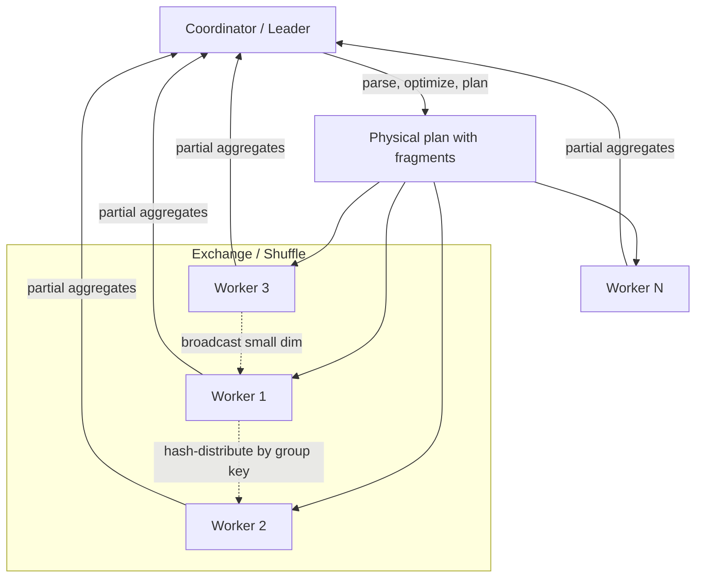
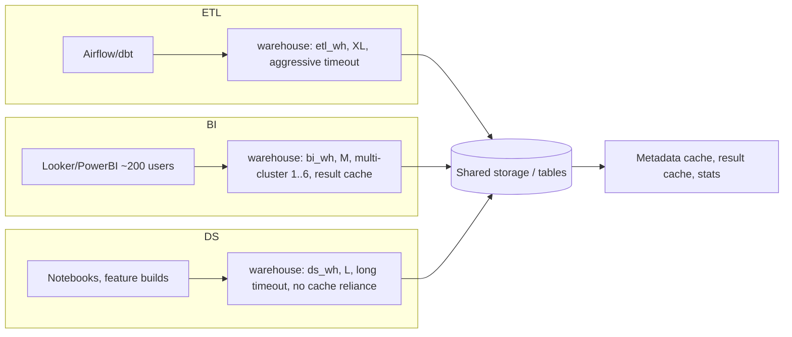

# Data Warehouses

> A data warehouse is not "a database with a lot of data". It is a *system* engineered around a
> single bet: that analytical queries are read-mostly, scan-huge-column-oriented, and can be
> parallelized to death — so you separate storage from compute, store data column-wise, compress
> it, keep statistics about it, and throw a fleet of workers at every query. Every design decision
> in this chapter (MPP, columnar layout, micro-partitions, sort keys, materialized views) follows
> from that bet. A senior engineer must know *why* each one exists, because the moment your
> workload stops matching the bet (high-concurrency point lookups, update-heavy CDC, unstructured
> data), the warehouse stops being the right answer — and knowing when that happens is the job.

---

## TL;DR

- **A warehouse is an OLAP system**: columnar storage + MPP execution + cost-based optimizer +
  metadata-based pruning. Remove any one of the four and performance collapses.
- **History matters**: Inmon's top-down 3NF EDW (Corporate Information Factory) vs Kimball's
  bottom-up dimensional bus matrix. Modern cloud warehouses are practically Kimball-flavored
  (denormalized star schemas) with Inmon's governance discipline.
- **Separation of storage and compute** (BigQuery 2010, Snowflake 2014, Redshift RA3 2019) is the
  defining architectural break of the cloud era. It decouples *cost* from *capacity* and makes
  concurrency and isolation an explicit, billable design decision.
- **Columnar + compression + encoding** gives 5–20× I/O reduction versus row storage on typical
  analytical queries, because you read only the columns you touch and columns of similar values
  compress extremely well.
- **Pruning is the whole game**: micro-partitions / row groups / zone maps let the engine skip
  90–99% of the data before scanning a byte. If your query can't prune, you pay full price.
- **MPP execution**: coordinator parses/optimizes, workers execute fragments; data is redistributed
  (shuffle/exchange) for joins and aggregates. Bad distribution keys cause skew, and skew means
  10× wall-clock time on the same data volume.
- **Concurrency is a separate resource from throughput**: multi-cluster warehouses, Redshift
  concurrency scaling, BigQuery slot reservations. Design for the *peak concurrent user count*,
  not the average.
- **The warehouse is a governance product, not just a query engine**: RBAC, masking, lineage, audit,
  time travel, and contracts are the reason regulated enterprises pay a premium.
- **Cost is proportional to bytes scanned and time warehouses are *running*, not to rows stored.**
  A suspended warehouse costs nothing; a query that scans 1 TB costs $5–6 on-demand on BigQuery.
- **Anti-pattern**: using the warehouse as a data lake (raw JSON landing, unmodeled `SELECT *` on
  10 TB, one giant "wide table" table per source) — see
  [03-warehouse-vs-lake-decision.md](./03-warehouse-vs-lake-decision.md).

---

## 1. Definitions and core vocabulary

| Term | Meaning |
|---|---|
| **OLAP** | Online Analytical Processing. Few users, complex queries, full scans/aggregates, high latency tolerance (ms→minutes). Contrast with OLTP: many users, tiny row-level reads/writes, low latency. |
| **Data warehouse (DW)** | A subject-oriented, integrated, time-variant, non-volatile collection of data in support of management's decision-making process (Inmon's classic definition, still the best one-line test of whether something *is* a warehouse). |
| **MPP** | Massively Parallel Processing. Shared-nothing architecture: N independent workers, each with its own CPU/memory/disk slice, coordinated by a leader node. |
| **Columnar storage** | Values of a column stored contiguously, rather than row-by-row. Enables reading only needed columns and encoding/compressing homogeneous value streams. |
| **Micro-partition** | Snowflake's automatic, immutable, compressed unit of storage (50–500 MB uncompressed), each with column-level min/max metadata. You never manage them. |
| **Row group / stripe** | The equivalent physical unit in Parquet (~128 MB target) / ORC (~64 MB default). |
| **Zone map** | Per-unit min/max statistics used to skip storage units. Redshift's name for it; the concept is universal. |
| **Partition pruning** | Eliminating storage units at plan time based on predicates against partition/cluster keys. See [05-partitioning.md](./05-partitioning.md). |
| **Cluster key / sort key / distribution key** | Physical layout hints. Cluster/sort key = ordering within a unit (helps range pruning); distribution key = which worker owns which rows (helps joins and skew). |
| **CBO (cost-based optimizer)** | Optimizer that enumerates plans, estimates cardinalities from statistics/histograms, and picks the cheapest. Its accuracy is bounded by statistics freshness. |
| **Runtime filter / dynamic partition pruning** | A filter built during execution from a small build-side join input and pushed into the large probe-side scan. Also "bloom join", "min-max join filter". |
| **Late materialization** | Delay fetching non-predicate columns until after filtering, so predicate columns (which compress well and have stats) drive I/O. |
| **Vectorized execution** | Operators process batches (e.g., 1024–4096 values) with tight loops/SIMD instead of one row at a time. |
| **Spilling** | When an operator exceeds its memory grant it writes intermediate data to local/remote disk. Silent 5–50× slowdowns. |
| **Conformed dimension** | A dimension (e.g., `dim_date`, `dim_customer`) shared identically across multiple facts — Kimball's precondition for a coherent warehouse. |
| **Materialized view (MV)** | A precomputed, persistent result set the optimizer can transparently rewrite queries against. |
| **Data mart** | A subset warehouse (departmental/domain) built for one consumer group. Dependent (fed by EDW) vs independent (its own pipeline). |
| **Time travel** | Querying a table as of a past timestamp/version — requires retention of old versions and is in direct tension with vacuum/cleanup. |
| **Workload isolation** | Physically or logically separate compute for, e.g., ETL, BI, and data science, so one cannot starve the others. |

---

## 2. What problem it solves / why it matters

### 2.1 Why not just query the OLTP database?

```text
OLTP (Postgres/MySQL/Oracle)                  OLAP (warehouse)
──────────────────────────────                ──────────────────────────────
Row-oriented heap + B-tree indexes            Columnar + zone maps + scans
10–1000 rows per query                        10^6–10^12 rows per query
Index seeks, buffer cache residency           Sequential I/O, throughput-bound
Write-optimized (WAL, locks, MVCC)            Read-optimized (immutable units)
Normalized (no redundancy)                    Denormalized (star schemas)
Concurrency: 1000s of tiny transactions       Concurrency: 10s of huge scans
```

Running `SELECT region, SUM(amount) FROM orders GROUP BY 1` over 5 billion rows on the OLTP
primary will (a) take hours, (b) evict the working set the application needs, (c) generate huge
WAL replication traffic, and (d) risk a reporting query taking down production. The warehouse
exists to absorb that class of query.

### 2.2 The five problems a warehouse actually solves

1. **Workload isolation** — analytics never touches the transactional path.
2. **Integration** — the same customer is one customer across billing, CRM, and support (the
   "integrated" in Inmon's definition). This is a *modeling and process* problem, not a storage
   problem, and it is where most of the real work lives.
3. **Performance at scale** — parallelism + pruning + compression.
4. **History** — non-volatile, time-variant: you can reproduce "what did the world look like on
   March 3rd" months later (bitemporality, SCD2, snapshots).
5. **Governance and trust** — one place with one access model, one lineage graph, one audit trail,
   one definition of `revenue`. Cheap fast query engines are commodities; *governed* data is not.

> **Senior note**: the value of a warehouse is inversely proportional to how easy it is to
> replace. If your warehouse is "a fast Postgres that we `SELECT *` from into notebooks", you built
> an expensive OLTP replica. The moat is the semantic layer, governance, and modeled data.

---

## 3. How it works internally

### 3.1 The four-layer anatomy

```text
┌──────────────────────────────────────────────────────────────────────┐
│ CLIENT / SEMANTIC LAYER   BI tools, dbt, notebooks, REST/JDBC/Arrow   │
├──────────────────────────────────────────────────────────────────────┤
│ QUERY LAYER (per-query, stateless)                                   │
│   parser → binder → logical plan → CBO (stats, rules) → physical plan │
│   coordinator: fragment scheduling, shuffle, memory grants, spilling  │
├──────────────────────────────────────────────────────────────────────┤
│ COMPUTE LAYER (elastic, billed per second)                           │
│   workers (N clusters / MPP nodes / slots) — vectorized exec, cache   │
├──────────────────────────────────────────────────────────────────────┤
│ STORAGE + METADATA LAYER (durable, cheap)                            │
│   object store (S3/GCS/ADLS) or proprietary cloud storage             │
│   micro-partition / row-group metadata: min, max, null count, NDV     │
│   catalog: databases, schemas, tables, partitions, statistics, ACLs   │
└──────────────────────────────────────────────────────────────────────┘
```

The key insight of modern cloud warehouses: layers 2 and 3 are **ephemeral and elastic**; layers
1 and 4 are **persistent**. That is what "separation of storage and compute" means operationally —
you can spin up a 512-credit-behemoth for one ETL job and destroy it, while the data never moves.

### 3.2 Columnar storage: why it changes the math

Consider a 1 TB `events` table with 40 columns, and:

```sql
SELECT country, COUNT(*), SUM(revenue)
FROM events
WHERE event_date = DATE '2026-03-01'
GROUP BY country;
```

| Layout | Bytes read | Notes |
|---|---|---|
| Row store | ~1 TB (all columns) or index seeks | Must read whole rows. |
| Columnar, no pruning | ~(4/40) × 1 TB ≈ 100 GB | Only the 4 referenced columns. |
| Columnar + partition on `event_date` | ~100 GB × (1/365) ≈ 280 MB | One day of partitions. |
| Columnar + partition + per-unit min/max on `country` | tens of MB | Zone maps skip most units of the day. |
| Columnar + partition + pre-aggregated MV | KB–MB | MV rewrite. |

That is a ~10,000× reduction in I/O from four independent mechanisms. **This is why columnar
matters and why "we'll just add an index" is the wrong mental model.**

Internally a columnar file looks like this:

```text
Parquet file
├── Row Group 0 (≈128 MB target)
│   ├── ColumnChunk: user_id      → pages [dict page][data page×k] + stats
│   ├── ColumnChunk: event_date   → pages [RLE/dict] + stats
│   ├── ColumnChunk: revenue      → pages [delta-binary-packed] + stats
│   └── ...
├── Row Group 1 ...
└── Footer: schema, per-column stats (min/max/null_count/distinct_count),
            row-group offsets, page index (offset index + column index),
            bloom filters, key-value metadata
```

Because each column chunk is a homogeneous stream, it compresses far better than interleaved rows
(more in [06-file-formats.md](./06-file-formats.md) and [07-compression.md](./07-compression.md)).

### 3.3 MPP execution model



Execution operators that matter:

| Operator | What it does | Failure mode |
|---|---|---|
| **Scan + filter** | Reads column chunks, applies predicate pushdown using stats, then row-level filter | Poor pruning → full scan cost |
| **Hash aggregate** | Partials locally, then repartitions by group key, then final aggregate | High-cardinality group-by → huge shuffle |
| **Hash join** | Builds hash table on the smaller input; probe streams the larger | Build side too big → spill |
| **Broadcast join** | Ships the small side to every worker | Wrong stats → network storm |
| **Sort (merge join / windows)** | Range-partition then sort per worker | Skew on a single key → one worker does everything |
| **Exchange** | Repartition / broadcast / gather | The dominant cost in most slow queries |

> **Senior note**: in warehouse tuning, "the query is slow" is ~80% of the time one of three
> things: (1) the scan wasn't pruned, (2) the shuffle is skewed, (3) an operator spilled. Look at
> the query profile in that order.

### 3.4 The optimizer and statistics

```sql
-- What the optimizer needs, and what you must maintain
ANALYZE TABLE fact_orders COMPUTE STATISTICS FOR COLUMNS order_date, customer_sk, amount;
```

Estimators use:

- **Table/partition-level**: row count, size, last modified, per-column min/max/null count/NDV.
- **Histograms**: for join and filter selectivity on skewed columns.
- **Sketches** (HyperLogLog / Theta): approximate NDV at scale, used by Iceberg's Puffin stats
  and by Snowflake's Optimus work.
- **Join-order enumeration**: with N tables, exhaustive search is N!. Real optimizers use DPccp/
  greedy plus heuristics, and pruned search space is why "the optimizer chose the wrong join order"
  happens.

Cost model (conceptually):

```text
cost(plan) = Σ_ops [ io_cost(bytes_read_estimate) × w_io
                   + cpu_cost(rows_processed_estimate) × w_cpu
                   + net_cost(rows_shuffled_estimate) × w_net
                   + spill_penalty ]
```

Garbage statistics → garbage estimates → catastrophic plans (e.g., a broadcast join of a 40 GB
"small" dimension). This is why statistics maintenance is a first-class operational duty.

### 3.5 Where pruning is implemented

| Layer | Mechanism | Typical skip rate |
|---|---|---|
| Partition / micro-partition | Directory or metadata partition values | 99%+ for time-filtered queries |
| Row group / stripe | Min/max, null count in footer | 50–95% |
| Page | Column index (page-level min/max), bloom filters | 10–80% additional |
| Row | Predicate evaluation, late materialization | — |
| Result cache | Whole-query result reuse | 100% on exact repeat |
| MV rewrite | Precomputed aggregate | 100% |

---

## 4. History: how we got here (and why the debates are still alive)

```text
1990  Inmon: Corporate Information Factory — 3NF EDW (top-down)
      "Data warehouse" formalized; normalized, integrated, atomic.
1996  Kimball: The Data Warehouse Toolkit — bottom-up dimensional bus matrix,
      star schemas, conformed dimensions; "the DW is the union of its data marts".
2000s Teradata, Netezza, Vertica: appliance MPP, shared-nothing, columnar.
2004  Data Vault (Linstedt): hubs/links/satellites — auditable, insert-only,
      designed for high-rate source change and parallel loading.
2010  Google Dremel paper → BigQuery (2010–2012): separation of storage/compute,
      columnar on Colossus, serverless slots.
2012  Amazon Redshift: managed MPP, columnar, DS2 → RA3 separates storage in 2019.
2012/2014 Snowflake: multi-cluster shared data, micro-partitions, per-second
      credits, "data warehouse as a service".
2015+ Spark SQL / Databricks SQL warehouses: warehouse UX on lake storage.
2020+ ClickHouse / Druid / Pinot: real-time OLAP; sub-second on raw event streams.
2020+ Lakehouse table formats (Iceberg/Delta/Hudi) push warehouse features
      DOWN into the lake (more in 04-lakehouse-architecture.md).
2023+ Iceberg as the de facto open table standard; catalogs as the control plane.
```

### 4.1 Inmon vs Kimball (still the best interview discriminator)

| Dimension | Inmon (top-down) | Kimball (bottom-up) |
|---|---|---|
| Core structure | 3NF Enterprise Data Warehouse + dependent data marts | Star schemas + bus matrix; DW = union of marts |
| Build order | EDW first, marts derive from it | One business process at a time, iterate |
| Redundancy | Minimized | Deliberately introduced (denormalization) |
| Query simplicity | Complex joins, hard for BI users | Simple, near-business-language |
| Speed to first value | Slow (years) | Fast (weeks) |
| Strength | Integration, auditability, single source of truth | Usability, delivery cadence, BI performance |
| Classic failure | Boiling the ocean; EDW never ships | Mart sprawl; conflicting `revenue` definitions |

Modern practice is a hybrid and usually looks like this:

```text
raw/landing (immutable, source-shaped)
   ↓   ELT (dbt / Spark)
staging (cleansed, typed, deduplicated)
   ↓
integration layer (conformed dimensions, normalized-ish core / Inmon influence)
   ↓
dimensional marts (star schemas, Kimball; what BI and ML actually consume)
   ↓
semantic layer (metrics, certified definitions, RBAC)
```

Data Vault sits between raw and dimensional for orgs with many rapidly-changing sources and needs
for full auditability: hubs (business keys), links (relationships), satellites (descriptive
attributes, insert-only). It buys parallel-loadability and audit at the cost of join count.

> **Senior note**: the Inmon/Kimball war is over — the answer is "model the core to be
> integrated and auditable; model the marts to be fast and legible". What is *not* over is the
> question of who owns metric definitions. That is a governance problem, and the tools that solve
> it (dbt semantic layer, MetricFlow, LookML, Cube) are architecturally the successor to the
> "conformed dimension" 30 years later.

---

## 5. How to implement it (step by step, with code)

### 5.1 End-to-end reference implementation

```text
1. Land raw data (no transformation)            → bronze / landing
2. Profile & contract the source                → schema + quality expectations
3. Standardize types, dedupe, soft-delete flags → silver / staging
4. Build conformed dimensions (SCD2 where needed)
5. Build facts at declared grain (transaction / periodic snapshot / accumulating)
6. Add aggregates + materialized views for top consumers
7. Cluster/sort by the query patterns you actually see
8. Add access control, masking, row filters, lineage
9. Wire cost guardrails (resource monitors, quotas, query timeouts)
10. Operate: statistics refresh, MV refresh, concurrency scaling, monitoring
```

### 5.2 DDL across the major platforms

**Snowflake**

```sql
CREATE OR REPLACE WAREHOUSE etl_wh
  WAREHOUSE_SIZE = 'X-LARGE'
  AUTO_SUSPEND = 60            -- seconds; 0 = never suspend (cost trap)
  AUTO_RESUME = TRUE
  INITIALLY_SUSPENDED = TRUE
  MAX_CLUSTER_COUNT = 1;       -- multi-cluster for BI, not ETL

CREATE OR REPLACE WAREHOUSE bi_wh
  WAREHOUSE_SIZE = 'MEDIUM'
  AUTO_SUSPEND = 300
  MAX_CLUSTER_COUNT = 6        -- concurrency scaling (billed per cluster-second)
  SCALING_POLICY = 'STANDARD';

CREATE OR REPLACE TABLE analytics.fact_order_line (
  order_line_sk BIGINT AUTOINCREMENT,
  order_sk      BIGINT NOT NULL,
  product_sk    BIGINT NOT NULL,
  customer_sk   BIGINT NOT NULL,
  order_date    DATE   NOT NULL,
  quantity      NUMBER(38,4),
  net_amount    NUMBER(38,4),
  CONSTRAINT pk_fol PRIMARY KEY (order_line_sk) RELY
)
CLUSTER BY (order_date, customer_sk)   -- for date-ranged + customer-faceted scans
COMMENT = 'Grain: one row per order line at order placement';

-- Prune-friendly query: predicate on the cluster key
SELECT customer_sk, SUM(net_amount)
FROM analytics.fact_order_line
WHERE order_date BETWEEN '2026-01-01' AND '2026-01-31'
GROUP BY 1;
```

**BigQuery**

```sql
CREATE TABLE `proj.analytics.events` (
  event_ts   TIMESTAMP NOT NULL,
  event_date DATE      NOT NULL,
  user_id    STRING,
  country    STRING,
  revenue    NUMERIC,
  payload    JSON
)
PARTITION BY DATE(event_ts)         -- or DATE_TRUNC(event_ts, MONTH), or RANGE_BUCKET
OPTIONS (
  partition_expiration_days = 1095,
  require_partition_filter  = TRUE,   -- hard guard against full scans
  description = 'Raw click events, 1 row per event'
);

-- Clustering is a *sort* hint inside partitions; free to change, applies to new data
CREATE TABLE `proj.analytics.events_clustered`
PARTITION BY DATE(event_ts)
CLUSTER BY country, user_id
AS SELECT * FROM `proj.analytics.events` WHERE FALSE;
```

**Amazon Redshift**

```sql
CREATE TABLE analytics.fact_order_line (
  order_line_id BIGINT  ENCODE az64,
  order_id      BIGINT  ENCODE az64,
  product_id    BIGINT  ENCODE az64,
  order_ts      TIMESTAMP ENCODE az64,
  net_amount    DECIMAL(18,4) ENCODE az64
)
DISTSTYLE KEY
DISTKEY (order_id)                 -- co-locate with line items for the dominant join
SORTKEY (order_ts, product_id);    -- compound sortkey = zone-map pruning

-- Alternatively, automatic table optimization (ATO):
ALTER TABLE analytics.fact_order_line ALTER DISTSTYLE AUTO;
ALTER TABLE analytics.fact_order_line ALTER SORTKEY AUTO;

-- Materialized view for the top dashboard
CREATE MATERIALIZED VIEW analytics.mv_daily_sales AUTO REFRESH YES AS
SELECT DATE_TRUNC('day', order_ts) AS d, product_id, SUM(net_amount) AS revenue
FROM analytics.fact_order_line
GROUP BY 1,2;
```

### 5.3 Distribution/skew diagnostics

```sql
-- Snowflake: find skew in a table's micro-partition clustering
SELECT SYSTEM$CLUSTERING_INFORMATION('analytics.fact_order_line', '(order_date, customer_sk)');

-- Snowflake: what did my last query actually read?
SELECT query_id, warehouse_name, total_elapsed_time/1000 AS sec,
       bytes_scanned, percentage_scanned_from_cache, partitions_scanned, partitions_total
FROM SNOWFLAKE.ACCOUNT_USAGE.QUERY_HISTORY
WHERE query_id = LAST_QUERY_ID();
```

```sql
-- BigQuery: slot time vs bytes billed
SELECT job_id, total_slot_ms, total_bytes_billed, cache_hit, statement_type
FROM `region-us`.INFORMATION_SCHEMA.JOBS_BY_PROJECT
WHERE creation_time > TIMESTAMP_SUB(CURRENT_TIMESTAMP(), INTERVAL 1 DAY)
ORDER BY total_bytes_billed DESC
LIMIT 20;
```

```sql
-- Redshift: detect skew at the table level
SELECT TRIM(name) AS tbl, slice, COUNT(*) AS rows_per_slice
FROM svv_table_info t
JOIN stv_tbl_perm p ON t.table_id = p.id
GROUP BY 1,2
HAVING COUNT(*) > 0
ORDER BY 3 DESC
LIMIT 50;
```

### 5.4 ELT into the warehouse (dbt example)

```sql
-- models/marts/fct_orders.sql
{{ config(
    materialized='incremental',
    unique_key='order_sk',
    incremental_strategy='merge',   -- Snowflake/BigQuery/Redshift variants
    cluster_by=['order_date'],      -- dbt generates the DDL hint
    partition_by={'field':'order_date','data_type':'date','granularity':'day'}
) }}

SELECT
  o.order_id                                   AS order_sk,
  o.customer_id                                AS customer_sk,
  DATE(o.created_at)                           AS order_date,
  o.status,
  o.amount                                     AS gross_amount,
  o.amount - COALESCE(r.refund_amount, 0)      AS net_amount
FROM {{ ref('stg_orders') }} o
LEFT JOIN {{ ref('stg_refunds') }} r USING (order_id)

WHERE o.updated_at > (SELECT COALESCE(MAX(_loaded_at), '1900-01-01') FROM {{ this }})

```

> **Senior note**: prefer **`merge` on a deterministic key** over `INSERT OVERWRITE` whole
> partitions when the source emits late corrections; prefer **partition overwrite** when the
> source is a clean daily batch and you want cheap idempotency. Getting this wrong is a top-3
> cause of "the numbers changed twice today" incidents.

---

## 6. Where to implement it (platform selection)

| Platform | Architecture | Pricing axis | Best at | Watch out for |
|---|---|---|---|---|
| **Snowflake** | Shared-disk storage + per-warehouse MPP compute; micro-partitions | Credits/hour × warehouse size (+ storage, + cloud services) | Mixed workloads, workload isolation, semi-structured `VARIANT`, data sharing, least-ops | Credit spend creep (never-suspend warehouses, oversized BI warehouses), clustering costs |
| **BigQuery** | Serverless Dremel + Colossus; slots | Bytes scanned (on-demand) or slot-hours (editions) | Ad-hoc analytics, huge scans, JSON/ML (`BQML`), partitioning/clustering | `SELECT *` on on-demand pricing, `require_partition_filter` neglect |
| **Amazon Redshift** | Provisioned/serverless MPP on RA3; managed storage | Node-hours / RPU-hours | Predictable high-throughput ETL, deep AWS integration (Glue/Lake Formation), Redshift Spectrum on S3 | Distribution key mistakes, VACUUM/ANALYZE legacy burdens, cluster resizes |
| **Azure Synapse / Fabric Warehouse** | MPP (dedicated SQL pool) or Fabric capacity units | DWUs / capacity units | Microsoft-centric enterprises, Power BI co-location | Legacy Synapse DWU model vs new Fabric semantics |
| **Databricks SQL Warehouses** | Compute on Delta/Iceberg in object storage; Photon engine | DBUs | Lakehouse shops, Unity Catalog governance, BI on open formats | Warehouse semantics depend on table layout; serverless/classic provisioning choices |
| **Trino / Starburst, Athena, Presto** | Federated query engine over catalogs | Cluster time / bytes scanned | Query-federation across many sources, S3 lake querying | No storage layer of its own; performance is a property of your file layout |
| **ClickHouse, Druid, Pinot, Doris/StarRocks** | Purpose-built real-time OLAP | Node count | Sub-second dashboards on high-ingest event data | Not general-purpose ELT; modeling is specialized |
| **Teradata / Exadata / Vertica (on-prem)** | Classic appliance MPP | Licenses/hardware | Regulated on-prem, extreme-scale batch | Capex, elastic scaling pain, talent scarcity |

**Selection heuristic**

```text
IF you need sub-second BI on high-ingest event streams and can shape the model  → real-time OLAP
IF you want zero operations, spiky ad-hoc analytics, and huge scans             → serverless DW (BQ)
IF you need heavy workload isolation + semi-structured + sharing                → Snowflake
IF you're all-in on AWS with ETL-heavy batch at predictable volume              → Redshift
IF you need open formats and one engine for BI + ML + streaming                 → lakehouse SQL warehouse
IF you need federated query over 10 heterogeneous sources                       → Trino/Starburst
IF you must keep data on-prem by regulation                                     → appliance MPP or self-hosted lakehouse
```

---

## 7. Patterns and anti-patterns

### 7.1 Patterns that work

| Pattern | Why it works |
|---|---|
| **Medallion / zone layering inside the DW** (raw → staging → marts) | Each layer has a single responsibility; failures are local; lineage is legible. |
| **One warehouse per workload class** (ETL / BI / DS) | Isolation; different sizing and auto-suspend policies; chargeback. |
| **Star schemas in the serving layer** | BI-tool-friendly, well-understood, and the optimizer likes them (clean join graphs, small dimensions to broadcast). |
| **Declared grain + primary/foreign keys with `RELY`** | Enables join elimination, `NOT NULL` optimizations, and prevents fanout bugs (`RELY` is Snowflake; BQ uses `NOT ENFORCED` PK/FK metadata similarly). |
| **Materialized views for the 5 dashboards that matter** | 10–1000× cheaper concurrency than recomputing. |
| **Incremental models keyed on a deterministic business key** | Idempotent reruns; cheap late-arrival handling. |
| **Cluster/sort keys derived from real query logs** | Layout that pays for itself, instead of guesswork. |
| **Resource monitors + query timeouts + statement tagging** | Turns runaway cost into an alert instead of an invoice. |
| **Semantic layer above physical tables** | One definition of `revenue`; RBAC enforced at the metric level. |

### 7.2 Anti-patterns

| Anti-pattern | Symptom | Fix |
|---|---|---|
| **`SELECT *` culture** | Bytes-billed scales with table width, not with need | Column pruning; views exposing only needed columns; `require_partition_filter` |
| **Warehouse as a lake** (multi-TB JSON blobs land in the DW) | Storage + scan costs explode; no reuse | Land in object storage; parse in the lake; load curated into the DW (see 03) |
| **Over-normalized EDW queried by BI** | 12-table joins per dashboard; BI authors get it wrong | Build dimensional marts on top |
| **Under-modeled "one big table"** | Fanout double counting; no reuse; every consumer re-implements logic | Declared grain + conformed dimensions |
| **Clustering key on a high-cardinality ID** | Reclustering costs accumulate, pruning benefit negligible | Cluster on date/low-cardinality facets; consider search optimization instead |
| **Never-suspend warehouses** | 24×7 credits | `AUTO_SUSPEND = 60`, `INITIALLY_SUSPENDED = TRUE` |
| **One giant XXL warehouse for everyone** | Poor concurrency, no isolation, expensive idle | Right-size + multi-cluster for BI; separate ETL warehouse |
| **Stale statistics** | Wrong join types, spills, OOM | Scheduled `ANALYZE`/auto-stats; verify after bulk loads |
| **MERGE into huge target tables every 5 min** | Micro-partition churn, lock waits, cost | Batch micro-updates; consider `INSERT`-only with dedup at read, or a lakehouse MoR format |
| **Using the DW as a message bus / queue** | Polling tables, lock contention | Streaming platform + CDC (see Chapter 06) |

---

## 8. Real-world use cases and industry applications

| Industry / company pattern | What they build | Notable architecture choices |
|---|---|---|
| **Retail (e.g., Walmart, Amazon internal BI)** | Daily/periodic sales marts, inventory snapshots, demand forecasting features | Kimball star schemas + aggregates; strict partitioning by business date |
| **Uber** | Global Data Warehouse (Hive/Hudi-based lake with warehouse semantics), incremental ETL, dimensional marts | MoR upserts, incremental processing instead of full rebuilds; see Hudi at Uber at trillion-record scale |
| **Netflix** | Central warehouse for experimentation/reporting metrics on top of S3, with Iceberg as the table format | Separation of storage and compute; table format abstraction; iceberg open source origin |
| **Airbnb** | Data warehouse over a "Minerva"/star-based semantic layer; metric certification | Conformed dimensions + metric definitions as a product |
| **Fintech (banks, payments)** | Regulatory reporting, ledger reconciliation, risk marts | On-prem/hybrid MPP, full auditability, SCD2 everywhere, immutable facts |
| **Telecom** | CDR-scale usage facts (billions/day), churn features | Sort-key design per region/date; heavy partition pruning |
| **SaaS product analytics** | Product usage events → warehouse → dashboards + reverse ETL | ELT with dbt, event dedup, high-cardinality dims |
| **Healthcare/Insurance** | Claims, eligibility, PHI governance | HIPAA-grade access control, column masking, row-level filters in the DW |
| **Ad-tech** | Impression/click facts, near-real-time reporting | Real-time OLAP (Druid/Pinot/ClickHouse) rather than a batch DW |

Note the recurring theme: **warehouses win where the workload is "many concurrent, medium-complexity,
governed aggregate queries over modeled data"**. They lose where the workload is "arbitrary files,
rapid schema churn, ML feature engineering on raw text/images", which is the lake's territory.

---

## 9. Senior-level deep dive

### 9.1 The cost equation you must be able to write from memory

```text
Snowflake   cost ≈ Σ (warehouse_size_credits_per_hour × hours_running)
                  + storage $/TB-month + cloud-services credits (usually small)
BigQuery    cost ≈ bytes_billed × $/TB            (on-demand)
                  or Σ slot_hours × $/slot-hour   (capacity/editions)
Redshift    cost ≈ Σ node_hours (or RPU-hours) + managed storage $/TB-month
Databricks  cost ≈ DBU_rate × warehouse_size × hours (+ cloud VM cost if classic)

Universal identity: cost ≈ (data touched) × (compute efficiency) × (unit price)
```

The lever with the largest effect is almost always **data touched**, not unit price. That is why
partitioning/clustering/compaction (Chapters 05 and 07) dominate warehouse TCO conversations.

### 9.2 Workload isolation as an architecture decision



Consequences of *not* isolating:

- An ad-hoc `SELECT * ... CROSS JOIN` from a data scientist saturates the BI warehouse; dashboards
  queue. (Classic "warehouse contention" incident.)
- ETL loads (many concurrent MERGEs) block BI queries on the same tables, or vice versa.
- Chargeback becomes impossible: you cannot attribute spend to teams without per-workload tags.

### 9.3 Concurrency: the resource nobody plans for

Throughput (queries/hour) and concurrency (simultaneous users at acceptable latency) are different
resources.

| Mechanism | How it scales | Cost note |
|---|---|---|
| Bigger warehouse | More workers per query → faster single queries | Doubles cost; no concurrency gain |
| More clusters (Snowflake multi-cluster) | More simultaneous queries | Billed per additional cluster-second |
| Multi-cluster + statement queues | Auto-scale 1..N with a queuing policy | Configure `SCALING_POLICY = ECONOMY` for cost, `STANDARD` for latency |
| Redshift concurrency scaling | Transient clusters for burst reads | Billed per second used, free credits |
| BigQuery editions/reservations | Slot pools + autoscaling | Reservation-based; predictable cost |
| Result cache / MV / aggregate awareness | Removes queries entirely | Cheapest of all — do this first |

### 9.4 Failure modes and how to debug them

| Symptom | Likely cause | Diagnostic | Fix |
|---|---|---|---|
| Query suddenly 20× slower, same SQL | Data grew past a pruning or spilling threshold | Query profile: `bytes_scanned`, `partitions_scanned/total`, spill bytes | Add predicate on partition key; reduce scanned columns |
| Long "compilation"/planning time | Huge metadata (millions of partitions) or complex view nesting | Profile timing breakdown | Reduce partitions; materialize instead of deeply nested views |
| One worker at 100% CPU, others idle | Skew (bad distribution key or hot key) | Profile per-node row counts; `stv_tbl_perm` slice distribution | Change distkey, salt the hot key, pre-aggregate |
| "Resources exceeded" / OOM | Build side too large, wrong join order | Profile memory per operator | Update stats; add join keys in predicate; force broadcast/partition |
| Rows "disappear" after load | MERGE matched on a non-unique key (fanout/nondeterministic update) | Check `unique_key` cardinality | Enforce uniqueness upstream; add a surrogate key |
| Duplicate metrics across reports | Multiple definitions / fanout joins | Lineage + metric registry | Semantic layer; conformed dimensions |
| Queue times for BI | Concurrency saturation | Warehouse load history; queued vs running | Multi-cluster, MVs, right-size |
| Cost spike with no query change | An unbounded dashboard query or a crawler re-scanning | `QUERY_HISTORY` top bytes; resource monitors | `require_partition_filter`, resource monitors, query timeouts |

### 9.5 Trade-off table for the decisions you will actually be asked to make

| Decision | Option A | Option B | Choose A when | Choose B when |
|---|---|---|---|---|
| Storage model | Managed warehouse storage | Open table format on object storage (lakehouse) | You value zero-ops, governance, and predictable SQL | You need multi-engine access, cheap scale, ML reuse, no egress of data |
| Physical layout control | Automatic (micro-partitions) | Manual (dist/sort/cluster keys) | Team is small, workload is mixed/unpredictable | Workload is known and hot; you want maximum performance per dollar |
| Modeling style | Dimensional marts | 3NF/Data Vault core | BI-facing, fast delivery | Regulatory audit, many volatile sources |
| Updates | INSERT-overwrite partitions | MERGE/upsert | Source is a clean batch | Late-arriving corrections, CDC |
| Concurrency | One big warehouse | Multiple isolated warehouses | Few heavy jobs | Many interactive users + ETL + DS |
| Aggregation | Precompute MVs | Compute on the fly | Repeated expensive aggregates | Ad-hoc exploration |

### 9.6 Modern cloud DW features worth knowing concretely

- **Automatic clustering**: Snowflake reclusters asynchronously in the background (credits);
  key operators must be *human-startable, machine-stoppable* — put a resource monitor on it.
- **Result caching**: Snowflake's 24-hour result cache is invalidated by DML on underlying tables
  (but not by adding data to *other* micro-partitions... know the semantics), and BigQuery's cache
  is per-user. Dashboard performance often comes from cache, not compute.
- **Search optimization / inverted indexes**: Snowflake search optimization service and BigQuery
  search indexes for point lookups (`WHERE uuid = ...`), which zone maps cannot prune.
- **Semi-structured types**: `VARIANT` (Snowflake), `JSON` (BigQuery), `SUPER` (Redshift). They
  are the pragmatic answer to schema churn, but they break columnar encodings for nested paths
  unless the engine materializes typed subpaths.
- **Iceberg/Delta on a cloud DW**: Snowflake, BigQuery (BigLake), Redshift (Spectrum/zero-ETL),
  Databricks, and Athena can all read Iceberg/Delta. This is the single biggest architectural
  shift of the 2020s: *the warehouse becomes a compute option over a shared open table* rather
  than the owner of the data. See [04-lakehouse-architecture.md](./04-lakehouse-architecture.md).
- **Zero-copy clone / shallow clone**: cheap dev/test of production-sized data (Snowflake clones,
  BigQuery `COPY` of table metadata, Databricks clone). Huge for CI/CD of data pipelines.
- **Snowpark / Spark connectors / Arrow Flight**: moving compute into the warehouse or moving data
  via Arrow instead of dumping CSV.

---

## 10. Common mistakes and how to avoid them

1. **Treating the warehouse as "where data goes" instead of "where modeled data is served".**
   Fix: define the target consumption layer and its grain before ingestion.
2. **Not knowing the grain of your fact tables.** Undeclared grain causes double counting. Fix:
   write the grain as a comment on every table, enforce uniqueness where possible.
3. **Building one giant wide table per source.** Fix: separate integration from presentation.
4. **Sizing warehouses once and never revisiting.** Fix: review size vs queue time vs spill
   monthly; use auto-scaling and auto-suspend.
5. **Ignoring `bytes_scanned` metrics.** Fix: instrument cost per query per team from day one via
   statement tags; alert on anomalies.
6. **Full-table MERGE for incremental loads.** Fix: restrict to affected partitions; or use
   insert-only + dedup at read.
7. **Deeply nested views.** Modern optimizers may or may not push predicates through all levels;
   plan bloat and duplicated logic are common. Fix: materialize intermediate layers.
8. **Partitioning a warehouse by high-cardinality keys.** In Snowflake you cannot even specify
   partitions — good reason not to try. In BigQuery, prefer date partition + cluster.
9. **Assuming the warehouse is a good ML feature store.** It is acceptable for batch training
   features, terrible for low-latency online inference. Fix: feature platform (offline + online).
10. **No dev/test strategy.** Fix: zero-copy clones + `dbt` target switching + data subsetting.
11. **Mixing unit systems silently** (`created_at` in local time in one pipeline and UTC in
    another). Fix: everything UTC + explicit timezone dimensions.
12. **Assuming "the cloud vendor handles security".** Fix: you own RBAC design, masking policies,
    row filters, key management, and audit review. The provider owns the *availability* of those
    features.

---

## 11. Exercises / interview questions

> Hints only. Write the answer; then verify against the query profile of a real system.

1. **Design.** You must support 300 concurrent BI users on a 400 TB fact table with daily loads,
   plus nightly ML feature builds. Sketch warehouse topology (how many warehouses, sizes,
   auto-suspend/scaling policies) and the physical layout of the fact table. *Hint: separate ETL,
   BI, DS; cluster on the columns your dashboards filter.*

2. **Numbers.** Your BigQuery table is 200 TB, all columns `SELECT *`-ed by a legacy dashboard
   that filters on `DATE(event_ts)`. Estimate monthly cost on-demand; then estimate after adding
   partitioning, clustering, and column pruning. *Hint: 4 columns of 40; one day of ~3 years.*

3. **Diagnosis.** A query that ran in 12 s now takes 9 minutes after the data doubled. The profile
   shows `bytes_spilled_to_local_storage = 400 GB` and one node processing 30× the rows of others.
   Name the two independent problems and the fix for each. *Hint: skew is one; the other is a
   memory grant/plan issue.*

4. **Modeling.** The business reports "revenue" five different ways. Design a layer that fixes it
   without breaking existing dashboards. *Hint: conformed dimension + semantic layer + deprecation
   plan, not a big-bang migration.*

5. **Trade-off.** Your CFO asks why the warehouse costs $40k/month when "S3 costs $500".
   Give a structured argument with the four cost axes and at least three mitigations. *Hint:
   compute price, IOPS/scan volume, governance, concurrency, and elasticity; mitigation:
   lakehouse + warehouse front door.*

6. **Inmon vs Kimball.** For a bank with 40 source systems, regulatory audit needs, and a 6-week
   delivery deadline for the first mart, propose an architecture and justify the Inmon/Kimball
   balance. *Hint: Data Vault/3NF core + dimensional presentation, delivered incrementally.*

7. **Internals.** Explain why a columnar store with 1% selectivity can beat a B-tree index on the
   same predicate, and when the index still wins. *Hint: I/O per matched row vs per scanned unit;
   point lookups and small hot ranges favor indexes.*

8. **Operations.** Design the monitoring for a warehouse: which metrics, which thresholds, which
   alerts. *Hint: queue time, spill bytes, bytes scanned per query, credit burn rate, MV freshness,
   failed tasks, cache hit ratio.*

9. **Failure.** A MERGE-based incremental load silently duplicated 3% of rows last night. Write
   the postmortem root cause and the two guardrails you would add. *Hint: non-unique unique_key +
   missing uniqueness test; add a dbt test and a reconciliation check.*

10. **Architecture.** Your company wants "one copy of data". Argue for or against consolidating
    the lake and the warehouse, and describe the migration path you would actually take. *Hint:
    open table formats + catalog as the control plane; warehouse as a compute engine.*

---

## References

- Inmon, W. H. *Building the Data Warehouse* (Corporate Information Factory) — the top-down canon.
- Kimball, R. & Ross, M. *The Data Warehouse Toolkit*, 3rd ed. — bus matrix, star schemas, SCDs.
- Linstedt, D. *Data Vault 2.0* — hubs/links/satellites, auditable insert-only modeling. https://datavaultalliance.com/
- Melnik et al., **Dremel: Interactive Analysis of Web-Scale Datasets** (VLDB 2010) — the paper behind BigQuery. https://research.google/pubs/pub36632/
- Abadi, Madden, Hachem, **Column-Stores vs. Row-Stores: How Different Are They Really?** (SIGMOD 2008). https://www.cs.umd.edu/~abadi/papers/abadi-sigmod08.pdf
- Stonebraker et al., **C-Store: A Column-oriented DBMS** (VLDB 2005) — origin of Vertica-style designs. https://www.cs.umd.edu/~abadi/papers/cstore-vldb05.pdf
- Snowflake Documentation — **Micro-partitions & Data Clustering**. https://docs.snowflake.com/en/user-guide/tables-clustering-micropartitions
- Snowflake Documentation — **Warehouses / multi-cluster & scaling policies**. https://docs.snowflake.com/en/user-guide/warehouses-overview
- Snowflake Engineering Blog — **Snowflake Optima: Faster Micro-Partition Pruning**. https://www.snowflake.com/en/blog/engineering/snowflake-optima-metadata-query-pruning/
- BigQuery Documentation — **Introduction to partitioned tables**. https://cloud.google.com/bigquery/docs/partitioned-tables
- BigQuery Documentation — **Introduction to clustered tables**. https://cloud.google.com/bigquery/docs/clustered-tables
- Amazon Redshift Documentation — **Distribution styles, sort keys, materialized views**. https://docs.aws.amazon.com/redshift/latest/dg/c_choosing_dist_sort.html
- Amazon Redshift — **Automatic table optimization (ATO)**. https://docs.aws.amazon.com/redshift/latest/dg/t_automatic-table-optimization.html
- Databricks Documentation — **SQL warehouses (serverless/classic, Photon)**. https://docs.databricks.com/aws/en/compute/sql-warehouse/
- Trino Documentation — **Query planning and connectors**. https://trino.io/docs/current/overview/use-cases.html
- Uber Engineering — **Uber's Lakehouse Architecture / incremental ETL**. https://www.uber.com/blog/ubers-lakehouse-architecture/
- Netflix Technology Blog — **Iceberg: A Modern Table Format for Big Data** (warehouse-scale table formats). https://netflixtechblog.com/iceberg-a-modern-table-format-for-big-data-cbc6c0b2f0d6
