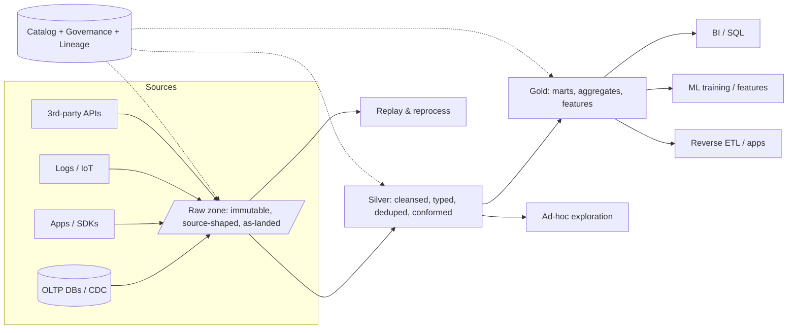

# Data Lakes

> A data lake is object storage plus a decision: *we will store data before we know what it is for.*
> That single decision makes the lake the cheapest, most flexible place to land data at any
> volume — and simultaneously creates the most famous failure mode in our industry, the **data
> swamp**: petabytes of untitled, untyped, unowned files that nobody trusts and everybody pays to
> store. The difference between a lake and a swamp is not technology; it is *discipline applied to
> a directory tree*. This chapter is about the lake's physical model (raw zone, zones, schema
> evolution), the mechanisms that make it work (schema-on-read, engines, formats), and the
> governance and layout practices that keep it from rotting.

---

## TL;DR

- **A data lake = object storage + open file formats + a compute-on-read engine + a catalog.**
  Storage is dumb, cheap, and immutable; all intelligence lives in the compute layer and metadata.
- **Object storage is not a filesystem.** No atomic rename, PUT-per-object semantics, latency
  per request, and per-request costs. Every lake design decision follows from this one fact.
- **Schema-on-read vs schema-on-write** is the core trade: flexibility vs guarantees. "Write now,
  type later" is what makes lakes good for exploration and bad for dashboards unless you add a
  curation process.
- **Zoning (raw/bronze → silver/staging-cleansed → gold/marts)** is the discipline that prevents
  the swamp: each zone has a contract, an owner, and a defined level of cleanliness. Name it
  whatever you want; the layers are what matter.
- **The lake's job is to be the durable system of record for data that the warehouse would charge
  too much to hold or that doesn't fit a schema yet.** Reuse (ML, ad-hoc, compliance replay) is
  where the ROI lives.
- **The swamp becomes a lakehouse** when you add table formats (Iceberg/Delta/Hudi) for ACID,
  snapshots, schema enforcement/evolution, pruning statistics, and table services. See
  [04-lakehouse-architecture.md](./04-lakehouse-architecture.md).
- **Small files are the lake's chronic disease** — thousands of tiny objects destroy planning time,
  request cost, and task efficiency. Compaction is not optional; it is a scheduled table service.
- **You cannot have a lake without a catalog and a governance model.** "Discoverable" is a
  feature; "guessable" is an outage waiting to happen.
- **Cost != free.** S3/GCS/ADLS storage is cheap ($0.02–0.03/GB-month for standard tiers) but
  requests, egress, early-delete charges, and *compute to scan it* are where the money goes.
  Lifecycle tiering (IA → Glacier) is arithmetic, not magic.

---

## 1. Definitions and core vocabulary

| Term | Meaning |
|---|---|
| **Data lake** | A centralized repository that stores data in its native/raw format (structured, semi-structured, unstructured) on cheap object storage, with compute applied at read time. |
| **Object storage** | Blob store exposing `PUT/GET/DELETE/LIST` over HTTP with strong read-after-write consistency (S3 since Dec 2020, GCS, ADLS Gen2). No directories, no rename, no `fsync`, no partial writes. |
| **Zone / layer** | A directory-level contract describing data cleanliness and purpose: raw/landing → cleansed → curated/marts. |
| **Bronze / Silver / Gold** | Databricks' medallion terminology for the same three zones (also: raw/refined/consumption; landing/staging/marts). |
| **Schema-on-read** | The schema is applied by the reader at query time; files carry no enforced schema. Contrast: **schema-on-write** (warehouse: rejected at load if it doesn't fit). |
| **Schema-on-write + evolution** | Modern lakes enforce a *table* schema at write time (Iceberg/Delta) while allowing controlled evolution — the best of both. |
| **Table format** | A metadata specification (Iceberg, Delta, Hudi) that turns a directory of files into a transactional table with snapshots. |
| **Catalog** | The service mapping logical names → physical metadata location and enforcing permissions. |
| **Partition** | A directory (or a metadata-declared grouping) that groups files by a low-cardinality value, e.g. `dt=2026-03-01`. |
| **Small file problem** | Degradation caused by millions of tiny objects: planning overhead, per-file request latency, task startup cost. |
| **Compaction** | Rewriting many small files into fewer large ones (and usually clustering/sorting them). |
| **Manifest / file listing** | The set of files that make up a table snapshot. Listing a directory is O(files); reading a manifest is O(1) requests — the key lake scalability win. |
| **Data swamp** | A lake without ownership, cataloging, contracts, or curation. Symptoms: nobody knows what's in `s3://bucket/tmp2/final_v3/`. |
| **Iceberg / Delta / Hudi** | The three dominant open table formats (Chapter 04). |
| **Open file formats** | Parquet (columnar), ORC (columnar), Avro (row), plus text formats (JSON, CSV, XML) and images/audio for ML. |
| **ELT** | Extract-Load-Transform: land raw first, transform in the target engine. The natural lake pattern (vs ETL's transform-then-load). |
| **Reverse ETL** | Pushing curated (gold) data back into operational systems. |
| **Data mesh** | Organizational pattern: domain ownership of data products, federated governance, self-serve platform. Often implemented *on* a lake. |

---

## 2. What problem it solves / why it matters

### 2.1 The historical motivation

Around 2010, three things collided:

1. **Volume**: web-scale companies started generating logs at rates no MPP appliance could
   economically ingest or retain.
2. **Variety**: JSON, XML, protobuf, images, clickstreams, sensor data — data whose schema is
   unknown, unstable, or multiple-schema-per-record.
3. **Economics**: object storage costs ~$0.023/GB-month vs traditional SAN/NAS at 10–50× that.

The lake's bet: **store everything cheaply in an open format, and figure out the schema later,
per use case, because compute is disposable and storage is not.**

```text
1990s-2000s                        2010s+ lake
──────────────                     ─────────────────────────────────
Load into schema  (reject bad)     Store whatever   (nothing rejected)
Storage expensive                  Storage ~free vs compute
Transform before load (ETL)        Load then transform (ELT)
One use case per table             Many use cases per file
```

### 2.2 What the lake buys you

| Benefit | Why it matters concretely |
|---|---|
| **Cheap retention at scale** | Keep 7 years of raw events for replay/compliance; object storage tiers make this arithmetic-friendly. |
| **Schema agility** | A new JSON field arrives tomorrow; it lands and becomes queryable without a migration. |
| **Single copy, many engines** | One Parquet/Iceberg dataset read by Spark, Trino, Flink, Snowflake, BigQuery, DuckDB, pandas. |
| **Decoupling of producers and consumers** | Teams can land data without negotiating with the warehouse team. |
| **Replayability / auditability** | Raw immutable zone = ability to rebuild everything downstream after a bug (the single most valuable lake feature in practice). |
| **ML/AI reuse** | The same files serve feature engineering, training, and (with retrieval layers) RAG corpora. |
| **Separation of storage and compute** | Independent scaling and independent cost control. |

### 2.3 What the lake costs you

| Cost | Mitigation |
|---|---|
| Weak guarantees by default (no ACID, no snapshots, no isolation) | Table formats (Iceberg/Delta/Hudi) |
| Silent schema drift and unreadable data | Contracts, schema registry, validation gates at zone boundaries |
| Small-file explosion | Compaction, stream-to-batch file sizing, AQE bin-packing |
| Metadata/listing scalability | Table formats with manifests; partition pruning; avoid `LIST`-heavy patterns |
| Governance gaps (who owns `s3://.../tmp/`) | Mandatory ownership metadata, catalog-only access, no direct-path reads |
| Cost opacity ("S3 is cheap") | Request-cost and scan-cost monitoring, lifecycle policies |
| Talent: lake ops are an engineering discipline | Invest in a platform team, not a ticket queue |

> **Senior note**: the lake's real deliverable is **replayability**. If you can re-derive every
> downstream table from immutable raw data with versioned code, most data incidents become
> recoverable events rather than company-wide outages. Design for that explicitly: immutable raw
> zone, no in-place mutation of raw, deterministic transforms, and retention long enough to matter.

---

## 3. How it works internally

### 3.1 The canonical lake architecture



### 3.2 Zone contract table (the thing that keeps a lake from becoming a swamp)

| Aspect | Raw / Landing / Bronze | Cleansed / Staging / Silver | Curated / Marts / Gold |
|---|---|---|---|
| **Content** | Byte-faithful copy of source (or close) | Typed, deduplicated, standardized, joined | Business-level, aggregated, denormalized |
| **Schema** | Source schema as-is; may be unenforced | Enforced, versioned, forward-compatible | Enforced + documented + tested |
| **Mutation** | **Append-only, immutable** (or partition-replace on source refresh) | Idempotent upsert/overwrite | Deterministic rebuild or incremental upsert |
| **Format** | Whatever arrived (JSON, CSV, Avro, Parquet) | Parquet/Iceberg, typed | Parquet/Iceberg × (Delta/Iceberg), often optimized |
| **Retention** | Long (7–N years), maybe tiered | Medium (1–3 years) | Short (30–365 days) or rebuilt on demand |
| **Owner** | Ingestion/platform team + source-system owner | Data engineering domain team | Domain team + analytics/BI |
| **Consumers** | Only pipelines (never humans, ideally) | Data engineers, data scientists | BI, ML, apps |
| **Access** | Restricted (writes only by ingestion service) | Team-scoped read | Broad read via semantic layer |
| **Quality gate** | "Did we get the file?" (completeness) | "Are values valid, unique, in range?" | "Do business rules hold and reconcile?" |
| **Naming** | `raw/<source>/<entity>/ingest_date=.../` | `silver/<domain>/<entity>/` | `gold/<domain>/<mart>/` |

> **Senior note**: the single most valuable table in a lake architecture is the **zone contract
> table above**. In practice, most swamps are swamps because zone boundaries were implicit. Write
> it down; enforce it in CI (e.g., a dbt/Spark test that fails if a gold model references raw).

### 3.3 Object storage internals (why the lake is shaped this way)

| Property | Consequence for lake design |
|---|---|
| `PUT` is atomic per object; no partial writes | Writers must publish complete files; never "append" to a data file (log files in Hudi are the exception, with their own protocol). |
| **No atomic rename** (S3: a copy+delete, not atomic; GCS/ADLS similar semantics but different details) | Classic HDFS commit protocol (`write to _temporary/, rename dir to final`) is unsafe/expensive on S3 → table formats use **atomic metadata commits** instead. |
| Strong read-after-write consistency (S3 since Dec 2020) | Listing races are now mostly historical, but timestamp granularity/eventual listing of *new* prefixes still bites some tools. |
| Flat namespace; "directories" are key prefixes | `LIST` with a prefix is a paginated scan (1000 keys/request). Millions of files → thousands of requests → seconds-to-minutes of planning. |
| Request pricing | `GET`/`PUT`/`LIST` cost money; a job touching 1M objects has a real request bill. |
| Byte-range reads | Engines can read only the footer or specific column chunks → the foundation of predicate pushdown. |
| No POSIX locks / no shared mutable state | Concurrency must be handled by optimistic protocols in a catalog or in the table format. |

Concretely: a naive Spark job reading a partitioned dataset does

```text
LIST s3://bucket/table/                      → 1 request (gets common prefixes)
LIST s3://bucket/table/dt=2026-03-01/        → 1 request per partition read
  ... repeated for each partition  → N_partitions requests
GET  each Parquet footer (or range read)  → 1 request per file
GET  each needed column chunk             → more requests
```

Whereas with Iceberg/Delta:

```text
GET  s3://bucket/table/metadata/v42.metadata.json   → 1 request
GET  snap-...avro (manifest list)                   → 1 request
GET  manifest-...avro × M (parallel)                → pruning happens HERE
GET  only the surviving data files' footers/chunks
```

The manifest layer converts an O(files) listing problem into an O(1 + manifests) metadata problem.
**This is the single most important scalability mechanism in a lake.**

### 3.4 Schema-on-read in practice

```text
Writer (unknown schema)                    Reader (asserts a schema)
────────────────────────                   ─────────────────────────
writes {"a":1,"b":"x"}                     reads with schema {a INT, b STRING}
writes {"a":2}          (missing b)        → b = NULL  (reader must tolerate)
writes {"a":"3"}        (wrong type)       → runtime error or NULL (engine-dependent)
writes {"a":4,"c":true} (new column)       → ignored unless schema updated
```

Three ways to reconcile:

1. **Tolerant inference** (Spark `mergeSchema=true`, `inferSchema`): convenient, slow (extra
   pass to infer), and non-deterministic across runs.
2. **Declared schema at read** (Glue/Athena DDL, `spark.read.schema(...)`): fast, safe, breaks
   loudly when the writer changes.
3. **Enforced + evolving table schema** (Iceberg/Delta/Hudi): the writer is validated against
   the table schema, and evolution is an explicit, cheap metadata operation.

```python
# 1. Tolerant (dangerous: two passes, silent nulls, type coercion surprises)
df = spark.read.option("mergeSchema", "true").json("s3://lake/raw/events/")

# 2. Explicit (deterministic, fail-fast)
from pyspark.sql.types import StructType, StructField, LongType, StringType, TimestampType
events_schema = StructType([
    StructField("event_id", StringType(), False),
    StructField("event_ts", TimestampType(), False),
    StructField("user_id", LongType(), True),
    StructField("payload", StringType(), True),
])
df = spark.read.schema(events_schema).json("s3://lake/raw/events/")

# Rescue bad rows instead of crashing the whole batch
df = (spark.read
        .option("mode", "PERMISSIVE")
        .option("columnNameOfCorruptRecord", "_corrupt")
        .schema(events_schema)
        .json("s3://lake/raw/events/"))
good = df.filter("_corrupt IS NULL")
bad  = df.filter("_corrupt IS NOT NULL")   # write to a quarantine zone
```

> **Senior note**: always provide a **quarantine zone**. Every real ingestion pipeline has bad
> records; the difference between a mature and an immature lake is whether bad records are
> *dropped silently* (the swamp's version of correctness) or *routed to a quarantine dataset with
> the reason attached and a dashboard* (the lake's version).

### 3.5 The "schema-on-read tax"

Schema-on-read moves cost from load time to query time:

- **Inference passes**: reading files just to guess types.
- **Null padding**: missing fields become NULLs, quietly breaking aggregates.
- **Type coercion**: `"3"` (string) vs `3` (int) — cheap in small data, catastrophic when mixed
  types force fallback to string in a huge column.
- **No statistics**: without declared/enforced schemas, engines cannot build reliable min/max
  stats and pruning degrades.
- **Repeated work**: every consumer re-derives the same cleaning logic (the "pipeline in a
  notebook" anti-pattern).

Moving this tax to a *single* curation step (raw → silver) is the whole economic argument for
medallion architecture.

---

## 4. How to implement it (step by step)

### 4.1 Reference layout on object storage

```text
s3://company-lake/
├── raw/                                  # immutable, source-faithful
│   ├── postgres_orders/
│   │   ├── _manifest.json               # optional: run metadata, ingestion id
│   │   └── ingest_date=2026-03-01/part-00000-....json.gz
│   ├── kafka_clickstream/topic=clicks/ingest_hour=2026-03-01T05/
│   └── s3_inventory_snapshot/snapshot_date=2026-03-01/*
├── silver/
│   └── orders/v1/  (Iceberg table)       # typed, deduped, conformed
├── gold/
│   ├── fct_orders/ (Iceberg/Delta)
│   └── dim_customer_scd2/
├── quarantine/
│   └── postgres_orders/_corrupt/dt=2026-03-01/
├── _ops/                                 # job artifacts, checkpoints, logs
└── _sandbox/<user>/                      # TTL-enforced scratch
```

Rules that make the layout survive contact with reality:

1. **Path encodes only low-cardinality, query-relevant keys** (`source`, `entity`, `ingest_date`).
2. **Never mutate raw.** Corrections land as new files; consumers dedupe.
3. **One writer per path.** Concurrent writers to the same directory is how you get duplicates.
4. **Ingestion metadata is a column, not just a path** (`_ingested_at`, `_source_file`,
   `_batch_id`) — so you can trace any row back to its origin.
5. **No human writes to raw.** Enforce with IAM (write-only role for ingestion, read-only for
   everyone else).

### 4.2 Ingestion: batch and CDC

```python
# Batch: land raw as-is, add provenance columns
from pyspark.sql import functions as F

src = (spark.read.format("jdbc")
        .option("url", jdbc_url).option("dbtable", "public.orders")
        .option("partitionColumn", "id").option("numPartitions", 16)
        .option("lowerBound", 0).option("upperBound", 10_000_000)
        .load())

(src.withColumn("_ingested_at", F.current_timestamp())
    .withColumn("_source", F.lit("postgres.public.orders"))
    .withColumn("_batch_id", F.lit(batch_id))
    .write.mode("append")
    .parquet(f"s3://company-lake/raw/postgres_orders/ingest_date={run_date}/"))
```

```sql
-- CDC landing: Debezium/Kafka Connect → raw zone (append-only change log)
-- Every row is an operation: c=create, u=update, d=delete, r=snapshot read
SELECT
  op,
  after:id                 AS id,
  after:status::string     AS status,
  after:amount::decimal(18,4) AS amount,
  ts_ms,
  _ingested_at
FROM raw_cdc.orders
WHERE ingest_date = CURRENT_DATE;
```

```sql
-- Silver: collapse the changelog to current state, deterministically
CREATE OR REPLACE TABLE silver.orders AS
WITH ranked AS (
  SELECT
    after:id::bigint                    AS order_id,
    after:customer_id::bigint           AS customer_id,
    after:status::string                AS status,
    after:amount::decimal(18,4)         AS amount,
    to_timestamp(ts_ms/1000)            AS changed_at,
    op,
    ROW_NUMBER() OVER (
      PARTITION BY after:id::bigint
      ORDER BY ts_ms DESC, _ingested_at DESC
    ) AS rn
  FROM raw_cdc.orders
)
SELECT * EXCLUDE (rn, op) FROM ranked WHERE rn = 1 AND op <> 'd';
```

> **Senior note**: the `ORDER BY ts_ms DESC, _ingested_at DESC` tiebreaker is the difference
> between a correct CDC pipeline and a pipeline that flaps. Source timestamps collide constantly
> (microsecond resolution, clock skew, batch commits). Always have a deterministic tiebreak, and
> always model deletes explicitly (`op = 'd'` or a `is_deleted` flag) rather than dropping rows.

### 4.3 DDL: raw → silver → gold with a table format

```sql
-- Raw: external, unmanaged, as-landed (Athena/Glue/Spark SQL)
CREATE EXTERNAL TABLE raw.postgres_orders (
  id BIGINT, customer_id BIGINT, status STRING, amount DECIMAL(18,4), updated_at TIMESTAMP
)
PARTITIONED BY (ingest_date STRING)
STORED AS PARQUET
LOCATION 's3://company-lake/raw/postgres_orders/';

MSCK REPAIR TABLE raw.postgres_orders;   -- registers new partitions (metadata op!)
```

```sql
-- Silver: Iceberg table with enforced schema, evolution, and sorting
CREATE TABLE silver.orders (
  order_id     BIGINT,
  customer_id  BIGINT,
  status       STRING,
  amount       DECIMAL(18,4),
  updated_at   TIMESTAMP,
  _ingested_at TIMESTAMP
)
USING iceberg
PARTITIONED BY (days(updated_at))
TBLPROPERTIES (
  'write.target-file-size-bytes' = '134217728',   -- 128 MB
  'write.distribution-mode'      = 'hash',
  'write.metadata.delete-after-commit.enabled' = 'true'
);

-- Idempotent upsert with MERGE
MERGE INTO silver.orders t
USING (SELECT * FROM staging.orders_delta) s
ON t.order_id = s.order_id
WHEN MATCHED AND s.updated_at > t.updated_at THEN UPDATE SET *
WHEN NOT MATCHED THEN INSERT *;
```

```sql
-- Gold: business aggregate, optimized for the dashboard
CREATE OR REPLACE TABLE gold.daily_sales
USING iceberg
PARTITIONED BY (days(order_date))
TBLPROPERTIES ('write.sort.order' = 'revenue DESC')
AS
SELECT
  order_date,
  customer_segment,
  SUM(amount)  AS revenue,
  COUNT(*)     AS orders
FROM silver.orders
WHERE status IN ('completed','shipped')
GROUP BY 1,2;
```

### 4.4 Zone-boundary quality gates (what makes it a lake and not a swamp)

```yaml
# contracts/orders.yaml — a machine-enforceable zone contract
entity: orders
zone: raw
owner: platform-ingestion
freshness_sla: 30m
schema:
  order_id:    {type: bigint, required: true}
  customer_id: {type: bigint, required: true}
  amount:      {type: decimal(18,4), required: true}
  updated_at:  {type: timestamp, required: true}
checks:
  - row_count_min: 1000
  - freshness_max_lag_minutes: 90
  - no_null: [order_id, customer_id]
  - unique_within_batch: [order_id]
  - referential: {column: customer_id, to: silver.dim_customer.customer_id, max_missing_pct: 0.5}
on_failure: [block_promotion_to_silver, alert:#data-incidents, write_quarantine]
```

```python
# Great Expectations / Soda-style execution inside the pipeline
import great_expectations as gx

validator.expect_column_values_to_not_be_null("order_id")
validator.expect_column_values_to_be_unique("order_id")
validator.expect_column_values_to_be_between("amount", min_value=0, max_value=10_000_000)
validator.expect_table_row_count_to_be_between(min_value=1000)
result = validator.validate()
if not result.success:
    # Do not silently continue. Either stop, or load to quarantine + alert.
    raise PipelineContractViolation(result)
```

### 4.5 Small-file management

```python
# Spark write-side: control the number of output files
(df.repartition(200, "customer_id")            # hash distribution → ~equal file sizes
   .write.mode("overwrite")
   .option("maxRecordsPerFile", 2_000_000)     # cap rows per file
   .parquet("s3://company-lake/silver/orders/"))

# AQE (Spark 3.x): coalesce shuffle partitions and bin-pack the write
spark.conf.set("spark.sql.adaptive.enabled", "true")
spark.conf.set("spark.sql.adaptive.coalescePartitions.enabled", "true")
spark.conf.set("spark.sql.adaptive.advisoryPartitionSizeInBytes", "128m")
spark.conf.set("spark.sql.adaptive.coalescePartitions.parallelismFirst", "false")
spark.conf.set("spark.sql.adaptive.enabled", "true")
spark.conf.set("spark.databricks.delta.optimizeWrite.enabled", "true")
```

```sql
-- Iceberg: rewrite small files, grouped by partition, targeting 128 MB
CALL catalog.system.rewrite_data_files(
  table   => 'silver.orders',
  options => map(
    'target-file-size-bytes','134217728',
    'min-input-files','5',
    'rewrite-all','false'
  )
);

-- Delta: compaction + clustering
OPTIMIZE silver.orders;                      -- bin-pack small files per partition
OPTIMIZE silver.orders ZORDER BY (customer_id, status);  -- multidimensional clustering
```

---

## 5. Where to implement it (tools and when each fits)

| Layer | Options | When each fits |
|---|---|---|
| **Object storage** | AWS S3 (S3 Express One Zone for hot), GCS, Azure ADLS Gen2, MinIO/Ceph on-prem, R2 (no egress fees) | Cloud-native by default. R2/MinIO when egress cost or data residency dominates. S3 Express One Zone for latency-critical lakehouse writes (single-digit ms). |
| **Table format** | Apache Iceberg (multi-engine default), Delta Lake (Databricks-centric, widening), Apache Hudi (upsert/streaming-heavy), Apache Paimon (Flink-first streaming) | Iceberg unless you're all-in on Databricks; Hudi when you need high-frequency upserts and MoR at huge scale (Uber); Paimon for streaming-first Flink lakes. |
| **Catalog** | Hive Metastore, AWS Glue, Unity Catalog, Nessie, Polaris, Lakekeeper, Gravitino, Snowflake Open Catalog | See [08-metadata-catalogs.md](./08-metadata-catalogs.md). |
| **Ingestion (batch)** | AWS Glue, Airbyte, Fivetran, Singer, Spark jobs, Meltano, Kafka Connect sink-agnostic loaders | Managed connectors → Fivetran/Airbyte; bespoke logic or volume → Spark/Glue. |
| **Ingestion (CDC)** | Debezium + Kafka, AWS DMS, Qlik/Attunity, Datastream, Fivetran HVR | Debezium for control; DMS for AWS-native RDS sources; managed when you don't want to operate Kafka Connect. |
| **Ingestion (streaming)** | Kafka → Flink/Spark Structured Streaming → Iceberg; Kinesis; Pub/Sub + Dataflow | Flink for exactly-once + Iceberg commits with low latency; Structured Streaming when the team already lives in Spark. |
| **Computation** | Spark, Trino/Starburst, Flink, Databricks SQL Warehouses, Athena, Snowflake/BigQuery reading Iceberg | Trino/Athena for SQL-on-lake/federation; Spark for heavy transforms/ML; DW engines when you need their governance & BI integration. |
| **Compaction & maintenance** | Iceberg `rewrite_data_files`, Delta `OPTIMIZE`, Hudi table services, Databricks predictive optimization, Trino `OPTIMIZE` | Always; schedule as a table service. |
| **Quality/observability** | Great Expectations, Soda, dbt tests, Monte Carlo, OpenLineage/Marquez, Elementary | OSS for logic you own; commercial for anomaly detection & blast-radius analysis. |
| **Governance** | Lake Formation, Unity Catalog, Ranger, Apache Atlas, DataHub, Collibra, Immuta | Lake Formation/UC if your compute is AWS/Databricks; Ranger for Hadoop-era; DataHub for lineage/discovery. |
| **Query/interactive** | DuckDB (local lake), Trino, Athena, Starburst Galaxy, Databricks SQL, Snowflake | DuckDB for single-node analysis of Parquet (extremely underrated); Trino/Athena for serverless SQL on the lake. |

---

## 6. Patterns and anti-patterns

### 6.1 Patterns

| Pattern | Description | Why it works |
|---|---|---|
| **Immutable raw + idempotent silver** | Raw is append-only; every silver build is reproducible from raw + code version | Makes recovery a rerun, not an archaeology project |
| **Zones with enforced boundaries** | Promotion gates raw→silver→gold | Prevents the swamp's root cause: unowned intermediate data |
| **Manifest/managed table format from day one** | Use Iceberg/Delta/Hudi even for "simple" datasets | Retro-fitting metadata later means rewriting the whole history |
| **Partition by ingestion time *and* event time** | `ingest_date` for operations, business date for queries | Separates "when did we receive it" from "when did it happen" |
| **Quarantine zone** | Bad records retained with a reason | Correctness without data loss; enables reprocessing after a parser fix |
| **Data contracts at the boundary** | Producer-owned schema + SLA, tested in CI | Shifts the conversation to the producer who can actually fix it |
| **Lake + warehouse front door** | Curated gold in Iceberg, warehouse reads it | Cheap storage + best BI governance (see Chapter 03) |
| **Compaction as a scheduled table service** | Runs every N minutes/hours, incremental | Keeps read performance stable under continuous ingestion |
| **TTL sandboxes** | `s3://.../sandbox/<user>/` auto-deleted after 14 days | Kills the biggest source of orphan storage |
| **Data-product thinking** | Each gold table has an owner, SLA, docs, tests | Turns the lake into a product catalog rather than a junk drawer |

### 6.2 Anti-patterns

| Anti-pattern | Symptom | Fix |
|---|---|---|
| **No catalog / direct path access** | Analysts hardcode `s3://.../dump2/`; nobody knows what's current | Catalog-only access; IAM denies unlisted prefixes; document everything in the catalog |
| **Mutable raw zone** | Rows disappear; no replay possible | Append-only + partition-replace only on full source refresh, with versioned directories |
| **`tmp/`, `final/`, `final_v2/`, `final_v2_really/`** | The swamp, in its natural habitat | Namespaces + catalog + deprecation metadata; nothing lands outside the catalog |
| **Schema inferred on every read** | 2× cost, non-deterministic nulls | Declared/enforced schema in a table format |
| **Partition per day for a 50 MB/day table** | 3650 tiny directories, listing overhead dominates | Partition only when a partition holds ≳128 MB–1 GB |
| **Partition by high-cardinality key** (`user_id`, `uuid`) | Millions of partitions; metastore/OOM pain | Partition by date, cluster/sort by the high-cardinality key |
| **Store everything "raw" forever at full price** | Storage bill grows linearly forever | Lifecycle policies: delete aggregated raw, tier to IA/Glacier, archive with a legal hold plan |
| **Streaming micro-batches writing one file per minute** | Millions of small files, no compaction jobs | Buffer time / file-size triggers + scheduled compaction |
| **No dedup key on CDC tables** | Duplicate rows after replay/restart | Deterministic dedup with `_ingested_at` + source offset |
| **Using the lake as an OLTP database** | Random updates, point reads, contention | Keep OLTP in OLTP; feed the lake via CDC |
| **"We'll add governance later"** | Retrofit = full re-ingestion + policy archaeology | Catalog + ownership + PII tagging from the first dataset |
| **Unbounded `SELECT *` on the lake via Trino/Athena** | Bill surprises, throttling | Views with column subsets, deny-by-default prefixes, query quotas |

---

## 7. Real-world use cases and industry applications

| Company / domain | Lake usage | Architecture notes |
|---|---|---|
| **Netflix** | S3 lake + Iceberg table format as the warehouse storage layer; thousands of datasets across analytics, ML, personalization | Invented Iceberg to get warehouse-like semantics on a lake; heavy use of manifests for scalability |
| **Uber** | Multi-hundred-petabyte lake (19,500+ datasets), Hudi for incremental upserts, "lakehouse" with dimensional modeling on top | Metadata table + record index for trillion-record scale; incremental ETL not full rebuilds |
| **Airbnb** | S3 + Hive/Hudi lake with a metric/semantic layer ("Minerva", "Chronon" features) | Strong certification of metrics and datasets; used for ML features too |
| **Amazon (retail/Ads)** | S3 data lake with Athena/Redshift Spectrum/EMR; Lake Formation governance | Peta-to-exa scale; heavy partition-based access control |
| **LinkedIn** | HDFS/S3 lake + Iceberg (they run one of the largest Iceberg deployments), Kafka-origin data | Streaming + table format convergence (Polaris, Kafka, Iceberg) |
| **Spotify** | GCS-based lake ("Big Data" platform) with Scio (Beam) pipelines, data portal for discovery | Emphasis on standardized pipelines and discovery/ownership |
| **Twitter/X, Meta** | Petabyte-scale HDFS/object lakes; Meta built Hive/Iceberg-era formats, and "Raptor"/DWRF internally | Internal columnar format; lesson: at extreme scale you design your own storage layout |
| **Fintech** | Regulatory archive lake (WORM), immutable ledger snapshots, feature store for fraud models | Retention/compliance drive design; immutability is a legal requirement, not an optimization |
| **Healthcare** | Imaging + clinical text + claims lake for research and ML | Unstructured-heavy; governance & de-identification are the hard parts |
| **Gaming** | Telemetry/event lakes (billions of events/day), sessionization, matchmaking telemetry, ML | Streaming ingest + strong compaction discipline |
| **IoT / Industrial** | Time-series/high-frequency sensor lakes (often Parquet + Delta/Iceberg + TSDB hybrid) | Partition by device/date; downsampling tiers to control cost |

---

## 8. Senior-level deep dive

### 8.1 Object storage versus filesystem semantics (the table that explains everything)

| Operation | HDFS/NFS | S3 / GCS / ADLS |
|---|---|---|
| Create object | `create` | `PUT` (atomic, whole object; ≤5 GB single PUT, multipart for larger) |
| Rename | Atomic metadata op | `Copy` + `Delete` (O(n) bytes, not atomic) |
| Delete | Atomic | `DELETE` per object (bulk delete API improves this) |
| List | Directory listing, cheap-ish | Paginated prefix scan, per-request latency |
| Append | Yes (single writer) | No (read-modify-write whole object) |
| Locking | POSIX/lease | None (must be built: DynamoDB, catalog CAS, conditional writes) |
| Latency | ~ms | ~5–100 ms per request; S3 Express One Zone ~1–5 ms |
| Throughput | Bounded by disks | Effectively unbounded aggregate, but per-request bounded |

The three resulting rules:

1. **Commit via metadata, not via rename.** (Iceberg/Delta/Hudi all do this.)
2. **Batch your operations.** Fewer, larger requests beat many small ones — always.
3. **Never assume exclusive access.** Concurrency is opt-in, implemented by the format + catalog.

### 8.2 Cost model

```text
Total lake cost =
    storage_bytes × $/GB-month × (1 - tiered_fraction) + tiered_bytes × cheaper_rate
  + request_count × $/1000 requests        (PUT/GET/LIST — the silent one)
  + egress_bytes × $/GB                   (cross-region / internet / cross-AZ!)
  + compute_cost(scan_bytes / engine_throughput)
  + human_cost(debugging an unnavigable lake)   ← usually the largest
```

Concrete example of the request trap:

```text
Table: 20 TB, partitioned by day × 200 files/day × 3 years = 219,000 files.
Full scan job (naive, no pruning):
  LIST:    219,000 / 1000 = ~219 requests
  GET footer per file: 219,000 GETs  → at $0.0004/1000 ⇒ $0.09   (cheap)
  But: 219,000 tasks × ~1 s scheduling/handshake overhead ⇒ ~60 CPU-hours of
       pure overhead before reading a byte.
Now with a 1-day partition filter: 200 files ⇒ 200 tasks. 1000× better.
```

> **Senior note**: in the lake, the dominant cost of bad layout is not storage — it is
> **task-count overhead** and **bytes scanned**. A 3-year unclustered scan vs a pruned,
> clustered scan is routinely a 100–1000× cost difference on the same platform.

### 8.3 Small files: numbers you can quote

| Metric | Healthy | Warning | Critical |
|---|---|---|---|
| Average file size (columnar) | 128 MB – 1 GB | 16–128 MB | < 8 MB |
| Files per partition | 1–10 | 10–50 | > 100 |
| Files per table | < 100k | 100k–1M | > 1M |
| Manifest count (Iceberg) | 1–10 | 10–100 | > 100 |
| Planning time share of total query | < 5% | 5–25% | > 25% |
| Partition size (physical) | ≥ 128 MB | 16–128 MB | < 16 MB |

Symptoms you will hear from users: "the query takes 4 minutes even though it returns 12 rows"
(planning-dominated), "our Spark job spends 10 minutes in `Listing leaf files`", "the S3 bill is
mostly requests".

Fixes ranked by leverage:

1. **Ingestion-side**: buffer, coalesce, and target file size *before* writing (or write
   streaming with a later compaction).
2. **Scheduled compaction**: Iceberg `rewrite_data_files`, Delta `OPTIMIZE`, Hudi compaction.
3. **Right-size partitions** so each partition is one or a few files.
4. **Metadata-layer**: trigger-level compaction in streaming; `delete-after-commit` for old
   metadata to bound manifest counts.
5. **Read-side mitigation**: don't rely on it — but `spark.sql.files.openCostInBytes` and AQE
   bin-packing can hide some of the pain.

### 8.4 Failure modes and debugging

| Failure mode | Symptom | Root cause | Debug/fix |
|---|---|---|---|
| **Duplicate data after replay** | Row counts double; sums inflated | Re-reading the same source files and appending | Idempotent writes: partition overwrite, MERGE on key, or dedupe on `(_source_file, offset)` |
| **Partial-write visibility** | Readers see half a batch | Writing files directly into the target path (readers list during write) | Write to a staging prefix and commit atomically (table format), or write to `_commit_ts=`-versioned dirs |
| **Missing data after "successful" job** | Job green, tables empty | Silent overwrite of unrelated partitions (`partitionOverwriteMode=STATIC`) | Set `spark.sql.sources.partitionOverwriteMode=dynamic` and always include the partition filter |
| **Metastore/partition explosion** | DDL, `MSCK`, or planning hangs | Millions of partitions in HMS/Glue | Reduce partition cardinality; move to `bucket`/clustering; use Iceberg partition stats |
| **S3 503 / `SlowDown` throttling** | Random read failures under load | >3,500 PUT/s or >5,500 GET/s per prefix | Randomize prefixes; use a table format with manifests (fewer requests); retry with jitter |
| **Skew in compaction jobs** | One task takes 10× the rest | One partition with 100× the data | Repartition by size, `zorder`/sort to balance, or split heavy partitions |
| **Undeletable data / cost creep** | Storage grows forever | No retention policy; orphan files after failed writes | `expire_snapshots` + `remove_orphan_files` (Iceberg), `VACUUM` (Delta), lifecycle rules |
| **Schema drift breaks dashboards** | Column vanished / renamed | Writer changed; reader inferred a new schema | Enforce schema-on-write + explicit evolution + contract tests |
| **Time travel after retention expired** | Query fails on old snapshot | Snapshot expired by maintenance | Coordinate retention policy with consumers' time-travel expectations |

Debugging toolkit:

```bash
# What is actually in this prefix? How many files and how big?
aws s3 ls --recursive s3://company-lake/silver/orders/ | wc -l
aws s3 ls --recursive s3://company-lake/silver/orders/ | awk '{print $3}' | sort -n | tail -20

# File-size histogram
aws s3 ls --recursive --summarize --human-readable s3://company-lake/silver/orders/
```

```sql
-- Iceberg: inspect what the table thinks it has (no listing!)
SELECT * FROM silver.orders.files ORDER BY file_size_in_bytes LIMIT 20;
SELECT partition, record_count, file_count, total_size
FROM silver.orders.partitions ORDER BY file_count DESC LIMIT 20;

-- Iceberg: snapshot growth over time (metadata bloat check)
SELECT committed_at, summary['added-data-files'], summary['total-data-files'],
       summary['total-delete-files']
FROM silver.orders.snapshots ORDER BY committed_at DESC LIMIT 20;
```

```sql
-- Delta: check file sizes and clustering quality
DESCRIBE DETAIL silver.orders;           -- numFiles, sizeInBytes, minReaderVersion
SELECT COUNT(*) AS files, AVG(size) AS avg_bytes
FROM (SELECT size FROM delta.`s3://company-lake/silver/orders/_delta_log/`);  -- illustrative
```

### 8.5 Architecture decision: how many zones, and where do they live?

| Option | Description | Pros | Cons | Use when |
|---|---|---|---|---|
| **Two zones** (raw, curated) | Minimal | Simple, fast to build | No quarantine/conformed-entity reuse | Small teams, < 20 datasets |
| **Three zones** (raw/silver/gold, medallion) | Standard | Clear contracts, reuse, testability | More jobs, more storage | Default for most organizations |
| **Four+ zones** (raw, validated, conformed, marts, sandbox, quarantine) | Enterprise | Explicit failure handling and exploration sandboxes | Governance overhead, more pipelines | Regulated industries, many domains |
| **Lake-as-staging-only** (raw lands, everything else in the DW) | Warehouse-centric | Strong governance, best BI | Costs; data stuck in one engine's format | BI-dominant orgs with modest volume |
| **Open table format all the way through** | Warehouse reads/writes Iceberg | One copy, multi-engine, cheap | Requires table-format competence; engine feature gaps | Modern default for mixed BI/ML |

### 8.6 Retention, tiers, and compliance math

```text
Scenario: 2 PB lake, growing 40 TB/month.
Standard (S3):      $0.023/GB-mo  → 2,000,000 GB × 0.023 ≈ $46,000/mo
Intelligent-Tiering: frequently accessed → standard, else IA ~$0.0125 (30-day min),
                    or Glacier IR ~$0.004 (90-day min, retrieval fees)
Realistic mix (20% hot / 60% IA / 20% Glacier IR):
  0.2×46,000 + 0.6×(46,000×0.54) + 0.2×(46,000×0.17) ≈ $9,200 + $14,900 + $1,564 ≈ $25,700/mo
Rule of thumb: lifecycle tiering is worth doing once > 30% of data is cold.
Trap: retrieval/monitoring/min-duration fees can exceed savings if access is sporadic
      but unpredictable → prefer Intelligent-Tiering over hand-rolled rules.
```

Add the compliance dimension: legal holds, right-to-erasure (GDPR/CCPA) over an *immutable*
zone is a genuine architectural conflict. Practical resolutions: crypto-shredding (per-subject
keys), tombstones in the curated layer + documented exceptions, or subject-scoped partitions you
can delete.

---

## 9. Common mistakes and how to avoid them

1. **Calling a pile of files a data lake.** A lake has a catalog, zones, owners, retention, and an
   access model. Otherwise it's a swamp with a marketing name.
2. **Starting with technology, not consumers.** Enumerate the use cases (BI, ML, compliance) and
   reverse-engineer the zones from them.
3. **No raw retention decision.** You either can replay or you cannot. Decide explicitly, and
   write down the retention period per dataset class.
4. **Treating object storage like a filesystem** (rename-based commits, appends, concurrent
   writers to one path).
5. **Skipping compaction because "the reads are fast enough today".** They never stay fast enough.
6. **Inferring schemas on every read.** Two passes + silent nulls. Declare or enforce.
7. **Letting every team invent its own layout.** Standardize a small number of layout templates
   (partition convention, file sizes, provenance columns).
8. **No lineage.** When gold is wrong, nobody can trace which silver step caused it. Emit
   OpenLineage events from day one; it's cheap then and expensive later.
9. **Unmanaged PII in raw.** Raw zones contain everything; tag and enforce the moment it lands,
   not after an audit.
10. **Over-tiering.** Glacier for data that is read monthly is a false economy: retrieval fees and
    latency exceed the savings.
11. **Ignoring the metadata/commit layer cost.** Each commit touches a few objects; at thousands
    of commits/hour in streaming, the metadata path becomes the bottleneck. Batch commits and
    tune `commit.retry`/`history.expire` settings.
12. **Assuming "one copy of data" means "one bucket".** It means one *governed naming system* over
    one storage account family, with clear ownership.

---

## 10. Exercises / interview questions

1. **Design.** Design the path layout for a lake ingesting (a) CDC from 30 Postgres databases,
   (b) 5 TB/day of clickstream from Kafka, (c) nightly CSV files from 12 partners, (d) 500 GB/month
   of PDFs. *Hint: only (a)/(b) benefit from date partitioning; (c) needs quarantine + schema
   variability; (d) needs a metadata-indexing layer, not a scan engine.*

2. **Numbers.** A team's Spark job lists 4.2M files before reading anything. Estimate planning
   cost and the fix, and quantify the improvement. *Hint: LIST pagination + per-file task
   overhead; fix = table format + compaction to ~128 MB files.*

3. **Correctness.** A CDC pipeline produces 0.3% duplicates after every restart. Diagnose and fix.
   *Hint: offset/checkpoint semantics + dedupe key + `MERGE`.*

4. **Cost.** Move 1 PB from standard S3 to a three-tier lifecycle and compute the monthly saving.
   Then explain one case where tiering *loses* money. *Hint: retrieval fees, min-duration,
   monitoring cost; sporadic access patterns.*

5. **Governance.** Your raw zone contains PII for 40M people across 900 datasets. Design the
   tagging, access, and erasure strategy. *Hint: automated PII scanning at ingest; crypto-shredding;
   subject-scoped deletes; audit trail.*

6. **Trade-off.** Argue for and against a "gold tables in the warehouse, raw in the lake"
   architecture versus "gold in Iceberg, warehouse as compute". *Hint: egress/duplication cost vs
   engine capability and governance depth.*

7. **Operations.** Propose the compaction schedule for a table receiving 5,000 small files/hour
   with a 30-minute freshness SLA. *Hint: trigger-based compaction inside the writer + hourly
   full compaction; watch commit latency; measure read amplification.*

8. **Failure.** After a bad deploy, 200 gold tables are wrong. Walk through the recovery using only
   raw + code. *Hint: versioned code, immutable raw, deterministic rebuild, parallel reprocessing
   with backfill windows.*

9. **Internals.** Explain why `LIST`-based partition discovery (Hive/Spark) doesn't scale and how
   manifests fix it. *Hint: O(files) requests vs O(1) metadata + parallel manifest reads.*

10. **Anti-pattern hunt.** Given a bucket, list the 6 strongest signals that it is a swamp, and the
    remediation order. *Hint: no catalog; oversized `tmp/` prefix; > 1M files; unknown owners;
    unpartitioned 50 TB tables; no retention policy.*

---

## References

- Amazon S3 User Guide — **Consistency model, request rate guidance, multipart upload, storage classes**. https://docs.aws.amazon.com/AmazonS3/latest/userguide/Welcome.html
- AWS — **Best practices design patterns: optimizing Amazon S3 performance**. https://docs.aws.amazon.com/AmazonS3/latest/userguide/optimizing-performance.html
- Google Cloud Storage Documentation — **Object naming, request pricing, strong consistency**. https://cloud.google.com/storage/docs
- Azure — **Introduction to Azure Data Lake Storage Gen2**. https://learn.microsoft.com/en-us/azure/storage/blobs/data-lake-storage-introduction
- Databricks — **What is a data lake? / Medallion Lakehouse Architecture**. https://www.databricks.com/glossary/data-lake
- Databricks — **Medallion architecture (bronze/silver/gold best practices)**. https://docs.databricks.com/aws/en/lakehouse/medallion
- Netflix Technology Blog — **Iceberg: A Modern Table Format for Big Data**. https://netflixtechblog.com/iceberg-a-modern-table-format-for-big-data-cbc6c0b2f0d6
- Uber Engineering — **Apache Hudi at Uber: Engineering for Trillion-Record-Scale Data Lake Operations**. https://www.uber.com/blog/apache-hudi-at-uber/
- Apache Hudi Documentation — **Table types (CoW/MoR), timeline, table services**. https://hudi.apache.org/docs/table_types/
- Martin Fowler / Zhamak Dehghani — **Data Mesh principles**. https://martinfowler.com/articles/data-mesh-principles.html
- Apache Parquet — **File format documentation**. https://parquet.apache.org/docs/file-format/
- Trino Documentation — **Hive connector, S3 performance and file layout guidance**. https://trino.io/docs/current/connector/hive.html
- Delta Lake Documentation — **Optimize / Z-order / vacuum**. https://docs.delta.io/latest/optimizations-oss.html
- Apache Iceberg Documentation — **Maintenance: rewrite_data_files, expire_snapshots, remove_orphan_files**. https://iceberg.apache.org/docs/latest/maintenance/
- OpenLineage — **Lineage event specification**. https://openlineage.io/docs/spec/object-model
- Soda / Great Expectations — **Data quality testing**. https://greatexpectations.io/ , https://docs.soda.io/
