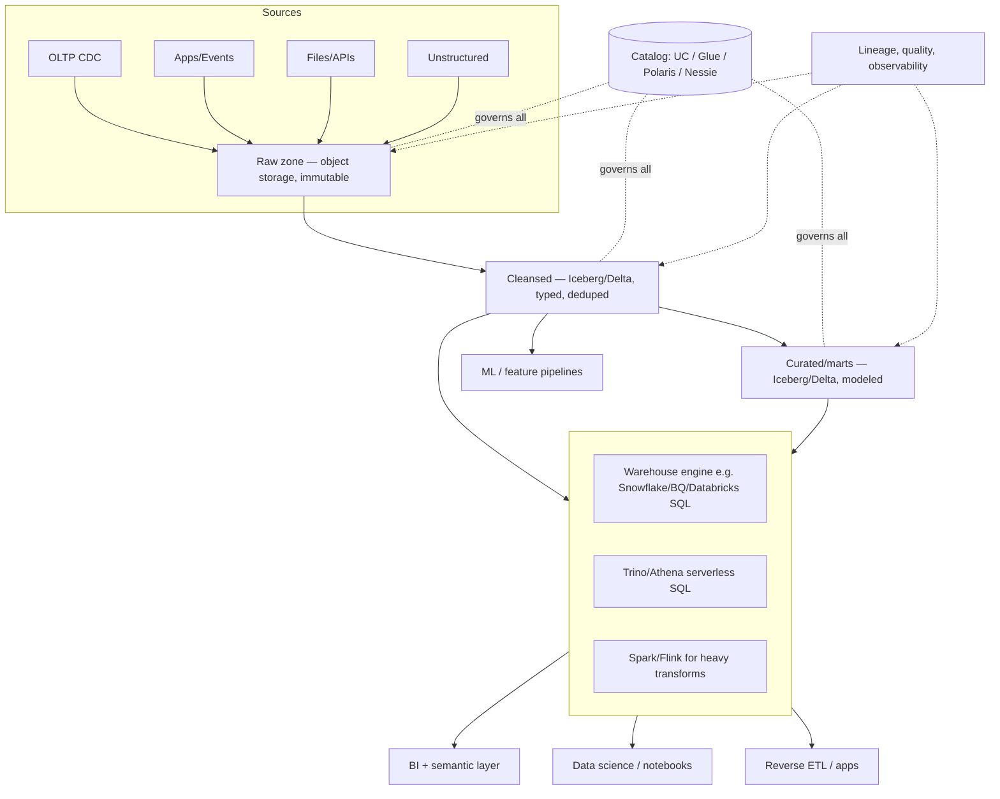

# Warehouse vs Lake: A Decision Framework

> Every real data platform eventually faces the same fight: the analytics team wants a warehouse
> (fast, governed, SQL-first, expensive per byte), and the platform/ML team wants a lake (cheap,
> unlimited, open formats, ungoverned by default). Most companies "resolve" this by building both
> and duplicating everything. Senior engineers resolve it by understanding that the choice is not
> *warehouse or lake* but *which layer owns which responsibility*, and by knowing the three or four
> workload attributes that actually determine the answer. This chapter gives you a decision
> framework you can defend in a design review, with the cost arithmetic, the failure modes of each
> choice, and the migration path when you inevitably change your mind.

---

## TL;DR

- **The question is not "which is better"** — it is "which of these five properties dominates my
  workload: query latency/concurrency, governance depth, data variety, cost per byte stored, or
  multi-engine/multi-consumer reuse?"
- **Default modern answer for most organizations: an open table format (Iceberg/Delta) on object
  storage as the system of record, plus a warehouse-class engine as one of the query front doors.**
  That is the lakehouse pattern, and it wins on cost and reuse without giving up SQL.
- **Pure warehouse is right when** the data volume is modest relative to budget, the workload is
  BI/regulatory-heavy, governance is the primary risk, and the team's scarce resource is
  operations time, not storage dollars.
- **Pure lake is right when** data is huge/unstructured/schema-unstable, consumers are mostly
  engineers/ML, and you can afford a platform team to enforce discipline.
- **Hybrid ("lake for raw + curated in the warehouse") is the most common real architecture**, and
  is a perfectly defensible endpoint — as long as you do not duplicate the *curated* layer.
- **Duplication is the hidden cost**: two copies of gold means two owners, two test suites, two
  definitions of revenue, and drift. Count it in every comparison.
- **Cost is dominated by bytes scanned/touched, not storage.** A warehouse scan of the same data
  can be 10–100× the cost of a lake scan on the same query; a poorly laid out lake can be 10–100×
  slower than a well-clustered warehouse table. Layout quality beats platform choice.
- **Migrations are one-way in practice**: "warehouse → lake" is easy (dump Iceberg, run Spark);
  "lake → warehouse" is hard (you must model what you never modeled). Choose the system of record
  with that asymmetry in mind.
- **Decision inputs you must collect before choosing**: bytes of data, growth rate, query mix,
  concurrency, latency SLO, DML rate (upserts/deletes), schema volatility, number of engines,
  consumers (BI vs ML vs apps), regulatory constraints, and team capacity.

---

## 1. Definitions and core vocabulary

| Term | Meaning |
|---|---|
| **System of record (SoR)** | The authoritative, single copy of the data. Everything else is derived. Choosing your SoR is the actual architectural decision. |
| **Query front door** | The engine users point their tools at. Can be different from the SoR. |
| **Schema-on-write** | Warehouse model: validate at load. Guarantees: strong typing, statistics, enforcement. Cost: ETL friction, rejected/blocked loads. |
| **Schema-on-read** | Lake model: validate at query. Gain: flexibility. Cost: inference passes, silent nulls, weak stats. |
| **Lakehouse** | Open table format on object storage that provides warehouse semantics (ACID, snapshots, evolution, pruning) to any engine. See [04-lakehouse-architecture.md](./04-lakehouse-architecture.md). |
| **ELT vs ETL** | Load-then-transform (lake-native, engine-agnostic) vs transform-then-load (warehouse-friendly, pipeline-heavy). |
| **Zero-copy / shallow clone** | Metadata-level table copies (Snowflake clone, BigQuery `COPY`, Iceberg branching) used for dev/test without data duplication. |
| **Egress** | Cost of moving bytes out of a cloud boundary. Often the hidden tax of "one copy in the warehouse". |
| **Separation of storage and compute** | Pricing/architecture model where you pay for bytes at rest separately from compute time. Prerequisite for both modern DWs and the lakehouse. |
| **Workload class** | A grouping by access pattern (batch ETL, interactive BI, ad-hoc exploration, ML training, streaming, point lookups, federation). Each class has different optimal storage. |
| **Medallion / zones** | Raw → cleansed → curated layering. Orthogonal to the warehouse-vs-lake decision; you need it either way. |
| **Federated query** | Querying across sources (lake + warehouse + OLTP + APIs) from one engine, pushing down what it can. |
| **Data gravity** | The tendency of data to accumulate coprocessors, tools, and pipelines around it, making it expensive to move later. |

---

## 2. What problem it solves / why it matters

### 2.1 The underlying tension

```text
                     WAREHOUSE                           LAKE
                ┌────────────────────┐             ┌────────────────────┐
Fast queries    │  ✅ columnar+pruning│             │  ⚠️ depends on layout│
Governance      │  ✅ native RBAC/lineage│         │  ⚠️ bolt-on        │
Cheap @ scale   │  ❌ $/TB high      │             │  ✅ $0.02/GB-mo     │
Schema change   │  ❌ migrations     │             │  ✅ schema-on-read  │
Unstructured    │  ❌ out of scope   │             │  ✅ native          │
Multi-engine    │  ❌ vendor format  │             │  ✅ open files      │
Ops burden      │  ✅ managed        │             │  ❌ you run it      │
ACID/isol.      │  ✅ native         │             │  ⚠️ needs table fmt │
Concurrency     │  ✅ elastic clusters│            │  ⚠️ engine-dependent│
```

You cannot have all columns green in one system, at one price. The decision framework below tells
you which columns your workload actually needs.

### 2.2 What a bad decision costs

| Wrong choice | Typical bill |
|---|---|
| Warehouse as a lake (all raw JSON in the DW) | 5–50× storage cost; scans dominated by data nobody queries; schema churn causes daily pipeline incidents |
| Lake as a warehouse (BI directly on raw Parquet) | 10–100× slower dashboards; inconsistent metrics; a BI-refresh armada; analysts writing Spark |
| Both, duplicated curated layer | 2× engineering cost for ingestion/testing/lineage; silent metric drift between the two copies; the classic "which number is right?" meeting |
| Lake without a table format | Small-file and listing problems; no time travel; no reliable incremental; every consumer re-lists and re-guesses |
| Warehouse-only for ML | Feature/label pipelines fight the warehouse's DML model; GPU clusters download over the network; training data not reproducible |

---

## 3. How it works internally — the five axes that actually decide

Think of the decision as five independent axes, not one binary.

### 3.1 Axis 1: Data volume and growth

```text
Solid state / managed DW sweet spot:        0.1 TB – 100 TB active, hot
Lake sweet spot:                            > 100 TB, cold/archival, ML corpora
Break-even intuition:                       when storage+scan cost of the DW exceeds the
                                            engineering cost of running a lake + engine
```

Rough monthly arithmetic (list prices, order of magnitude):

| Volume | Warehouse-ish cost (Snowflake-style: $23/TB-mo storage + compute) | Lake-ish cost ($0.023/GB-mo + compute) |
|---|---|---|
| 10 TB, light query | ~$230 storage + ~$1–3k compute | ~$230 storage + ~$200–1k compute (Trino/Spark hours) |
| 100 TB, moderate query | ~$2.3k storage + ~$10–30k compute | ~$2.3k storage + ~$2–10k compute |
| 1 PB, heavy ML + BI | $23k storage + $50k+ compute, plus egress if data leaves | $23k storage (or ~$10k tiered) + $20–60k compute across engines |

> **Senior note**: the crossover is not a fixed number of terabytes — it is a function of *query
> pattern per byte*. A 2 TB dataset scanned 500 times a day with sub-second SLAs is warehouse
> territory. A 2 PB dataset scanned twice a month is lake territory. Write the axis as
> **"bytes scanned per month"**, not "bytes stored".

### 3.2 Axis 2: Workload mix and latency

| Workload | Latency target | Concurrency | Best home |
|---|---|---|---|
| Executive dashboards | < 3 s | 50–500 users | Warehouse (MVs, result cache, multi-cluster) — or lakehouse SQL engine with pre-aggregation |
| Ad-hoc exploration by analysts | 5 s – 2 min | 10–50 | Either; warehouse if SQL-only, lake if you need raw data |
| Nightly batch ELT | minutes–hours | n/a | Lake (cheap scale) with warehouse as a target for marts |
| Feature engineering / training data | hours | n/a | Lake, always |
| Streaming / near-real-time aggregates | seconds | n/a | Lake (Flink/Spark → Iceberg) or real-time OLAP store |
| High-cardinality upserts / DML | seconds | high | Table format with MoR, or a DW with real MERGE |
| Regulatory reporting / immutable audit | hours | low | Warehouse for presentation; immutable raw in lake for evidence |
| Federated query across 10 sources | seconds–min | 5–20 | Trino/Starburst-style engine |
| Point lookups by ID (app serving) | < 50 ms | 1000s | Neither — use a KV store/OLTP; consider a serving layer (Redis, DynamoDB, Pinot) |

### 3.3 Axis 3: Governance depth required

Ask, in order:

1. Do we need **column-level masking** and **row-level filters** enforced by the platform? (PHI/PCI)
2. Do we need **auditable access logs** per query per column?
3. Do we need **certified metrics** with change management?
4. Do we need **residency/data-sovereignty** enforcement?
5. Do we need **right-to-erasure** over historical data?

A warehouse gives 1–5 natively and maturely. An open lakehouse gives 1–5 through a catalog +
policy engine (Unity Catalog, Lake Formation, Ranger, Immuta, Polaris) — increasingly comparable,
but requires more assembly. `> Senior note`: the difference has shrunk a lot since 2023; the
remaining gap is in *policy semantics maturity* and *runtime enforcement coverage across engines*.

### 3.4 Axis 4: Data variety

```text
Structured, stable schema, SQL-consumable        → warehouse-friendly
Semi-structured (JSON/Protobuf/Avro), evolving   → lake-friendly (or DW with VARIANT)
Unstructured (text, PDFs, images, audio, video)  → lake-only
Geospatial / vector / time-series / graph        → lake + specialized engine (or specialized store)
```

### 3.5 Axis 5: Organization and operations capacity

| Signal | Implication |
|---|---|
| No platform team, < 10 data engineers | Managed warehouse: buy operations time |
| Strong platform team already running Spark/K8s | Lakehouse is viable and cheaper long-run |
| Regulated industry with a small team | Managed warehouse whose compliance is vendor-supported |
| ML-heavy org with GPU clusters | Lake must be the SoR; a DW-only design will fail |
| Multi-cloud mandate | Open formats + separate catalog; avoid engine-specific formats |

### 3.6 The decision as code

```python
def recommend_architecture(d: dict) -> str:
    """Toy but real: encode the axes, get a defensible default."""
    # d keys: tb, tb_per_year, budget_sensitivity, unstructured_pct, ml_workloads,
    #         bi_concurrency, latency_slo_s, governance_level(1-5), upsert_rate_per_min,
    #         engines_needed, platform_team_fte, regulated
    if d["unstructured_pct"] > 0.2 or d["ml_workloads"]:
        return "LAKEHOUSE (open table format) — lake is SoR; add a SQL engine front door"
    if d["engines_needed"] > 2:
        return "LAKEHOUSE — multi-engine access rules out engine-proprietary formats"
    if d["governance_level"] >= 4 and d["platform_team_fte"] < 2:
        return "MANAGED WAREHOUSE — buy governance and operations"
    if d["tb"] > 100 and d["budget_sensitivity"] == "high":
        return "LAKE + WAREHOUSE FRONT DOOR (curated gold in Iceberg)"
    if d["bi_concurrency"] > 100 and d["latency_slo_s"] <= 3:
        return "WAREHOUSE-LED — pre-aggregation + concurrency scaling matter most"
    if d["upsert_rate_per_min"] > 1000 and d["latency_slo_s"] < 60:
        return "STREAMING LAKEHOUSE (MoR/Delta/Iceberg DVs) + serving store"
    return "HYBRID: raw in lake, curated+served in warehouse (lowest risk default)"
```

### 3.7 The canonical reference architecture (what most mature orgs converge on)



Key property: **one copy of data, many compute options.** The warehouse is demoted from "the
place data lives" to "a compute engine with excellent governance and BI ergonomics".

---

## 4. How to implement the decision (step-by-step)

### Step 1 — Inventory the workload (2 weeks, no technology decisions)

```sql
-- Query-log forensics: what actually happens, not what people say happens
SELECT
  DATE_TRUNC('week', start_time)                     AS wk,
  warehouse_name,
  COUNT(*)                                           AS queries,
  AVG(total_elapsed_time)/1000                       AS avg_sec,
  PERCENTILE_CONT(0.95) WITHIN GROUP (ORDER BY total_elapsed_time)/1000 AS p95_sec,
  SUM(bytes_scanned)/POWER(1024,4)                   AS tb_scanned,
  SUM(credits_used_cloud_services)                   AS credits
FROM SNOWFLAKE.ACCOUNT_USAGE.QUERY_HISTORY
WHERE start_time > DATEADD(month, -3, CURRENT_DATE)
GROUP BY 1,2 ORDER BY tb_scanned DESC;
```

```sql
-- BigQuery: top scans by table (identify what actually costs money)
SELECT
  t.table_id,
  COUNT(*)                                   AS referenced_in_jobs,
  SUM(j.total_bytes_billed)/POWER(1024,4)    AS tb_billed
FROM `region-us`.INFORMATION_SCHEMA.JOBS_BY_PROJECT j,
     UNNEST(j.referenced_tables) t
WHERE j.creation_time > TIMESTAMP_SUB(CURRENT_TIMESTAMP(), INTERVAL 90 DAY)
GROUP BY 1 ORDER BY tb_billed DESC LIMIT 50;
```

Deliverable: a table of `dataset | rows | tb | growth/mo | query freq/day | avg bytes scanned/query |
concurrency | consumers | latency SLO | governance class | upsert rate | engines used`.

### Step 2 — Classify each dataset into one of six archetypes

| Archetype | Signature | Typical home |
|---|---|---|
| **A. Operational events** | High volume, append-mostly, time-series, wide | Lake, Iceberg, partitioned by day |
| **B. Master data (dims)** | Small, frequently updated, high reuse | Either; warehouse for speed, lake + table format for multi-engine |
| **C. Transactional facts** | Large, upsert-heavy, correctness-critical | Table format MoR or DW; duplicate-free key enforcement |
| **D. Analytic aggregates** | Small, hot, dashboard-facing | Warehouse MVs / materialized gold tables (in Iceberg or DW) |
| **E. Unstructured/semi** | Files, text, images, JSON blobs | Lake only + specialized index (search/vector) |
| **F. Regulatory archive** | Cold, immutable, must be provable | Lake with object-lock/WORM, tiered storage, checksums |
| **G. Feature stores** | Point-in-time correct, offline + online split | Lake (offline) + KV store (online) |

### Step 3 — Compute cost per archetype, both ways

```text
For each dataset D:
  bytes_scanned_month = Σ over queries (bytes scanned per query × queries/month)
  DW cost    = bytes_scanned/1e12 × $5/TB (BigQuery on-demand-equivalent)
             + storage_tb × $23   (warehouse storage $/TB-mo)
  Lake cost  = bytes_scanned/1e12 × (engine $/TB equivalent, often 3–10× cheaper per TB
             because you can use cheaper compute)
             + storage_tb × $23/1000
             + compaction_engine_hours × $/hour
             + platform_team_cost (the one everyone forgets)
```

Sanity check with real numbers (illustrative but typical):

| | Warehouse (BQ on-demand/ Snowflake credits) | Lake (Spark/Trino on the same data) |
|---|---|---|
| Storage 500 TB | ~$11,500/mo (Snowflake) / ~$10,200 (BQ active logical) | ~$11,500 (S3 standard) / ~$5,000 tiered |
| Scan 2 PB/month | ~$10,000 (BQ @ $5/TB) or ~$30k of credits | ~$2,000–8,000 of Spark/Trino hours |
| Compaction | $0 (handled) | ~$1,000–3,000/mo of engine hours |
| Platform headcount | 0.2 FTE | 1.5–3 FTE (~$25–60k/mo loaded) |
| **Verdict** | **Wins at small scale** | **Wins above ~100–500 TB if scan volume is high** |

The headcount line is why small companies should buy managed services. Do not model only the
infrastructure.

### Step 4 — Choose the SoR, then the front doors

```text
1. SoR: exactly one place is authoritative.
   - Feature/history-heavy, unstructured, or > ~100 TB of mostly-cold data → object storage with
     an open table format.
   - Modest volume + governance-first + small platform team → the warehouse itself.
2. Front doors (any number, all read-only over the SoR):
   - BI: warehouse engine or lakehouse SQL warehouse + semantic layer.
   - Data science: Spark/Trino/DuckDB directly on the open tables.
   - Apps: serving store fed by reverse ETL / CDC, not by direct lake reads.
3. Never: a second *curated* copy in a proprietary format as the SoR.
```

### Step 5 — Write the decision record (ADR)

```markdown
# ADR-014: System of record for analytics data

Status: Accepted (2026-03-14)
Context: 380 TB across 1,900 datasets; 62% of scan volume from 40 dashboards;
         7 ML pipelines reading raw events; 2 engine requirement (Databricks + Snowflake
         for finance); data volume growing 25 TB/month; 1.5 FTE platform capacity.
Decision: Object storage + Iceberg as system of record. Gold tables remain Iceberg.
          Snowflake reads Iceberg via external catalog for finance reporting.
          Dashboards served by Databricks SQL warehouses with materialized gold aggregates.
Consequences:
  + One copy of data; ML and BI read the same tables.
  - We own compaction, snapshot expiration, and catalog operations (budgeted 1.2 FTE).
  - Snowflake Iceberg read latency is higher than native tables → pre-aggregate for finance.
  - Requires table-format literacy in the team; onboarding material to be written.
Alternatives rejected:
  - Warehouse-only: 380 TB storage + scan volume ≈ $X/month plus egress for ML, and
    unstructured corpora don't fit.
  - Duplicate gold in warehouse: two owners, metric drift risk, 2× pipeline cost.
Review date: 2026-09-01 or if monthly lake platform cost > $40k.
```

---

## 5. Where to implement it — the comparison matrix

| Criterion | Pure cloud warehouse | Lake (raw files only) | Lakehouse (Iceberg/Delta/Hudi) | Hybrid (raw in lake, curated in DW) | Real-time OLAP (ClickHouse/Druid/Pinot) |
|---|---|---|---|---|---|
| SQL/BI ergonomics | ★★★★★ | ★★ | ★★★★ | ★★★★★ | ★★★ |
| Cost at PB scale | ★★ | ★★★★★ | ★★★★★ | ★★★ | ★★★ |
| Governance out of the box | ★★★★★ | ★★ | ★★★★ | ★★★★★ | ★★★ |
| ACID / isolation | ★★★★★ | ☆ | ★★★★ | ★★★★★ | ★★★★ |
| Schema evolution | ★★★ | ★★★★ | ★★★★★ | ★★★ | ★★ |
| Unstructured data | ★ | ★★★★★ | ★★★★ | ★★ | ☆ |
| Multi-engine access | ★★ | ★★★★★ | ★★★★★ | ★★ | ★★ |
| Streaming ingest | ★★★ | ★★★★ | ★★★★ | ★★★ | ★★★★★ |
| Upserts at scale | ★★★★ | ★ | ★★★★ | ★★★★ | ★★★★ |
| Sub-second dashboards | ★★★★ | ★★ | ★★★ | ★★★★★ | ★★★★★ |
| Ops burden | ★★★★★ | ★★ | ★★★ | ★★★★ | ★★ |
| Vendor lock-in risk | High | Low | Low | High (curated copy) | High |
| Time to first value | ★★★★★ | ★★★ | ★★★ | ★★★★ | ★★ |

**Engine-specific fits**

| Situation | Recommendation | Why |
|---|---|---|
| 5-person startup, < 5 TB, mostly BI | BigQuery or Snowflake, no lake | Ops time is the scarcest resource |
| 200 TB events + 30 dashboards + 3 ML teams | Iceberg on S3 + Databricks SQL/Snowflake for BI | One copy, both consumers served |
| Bank, 40 sources, regulatory audit | Data Vault/3NF core in warehouse (or on-prem MPP) + immutable raw archive | Auditability and lineage are the product |
| Ad-tech, 500k events/s, sub-second dashboards | Kafka → Flink → Iceberg (raw) + ClickHouse/Druid (serving) | Lake for retention/replay, OLAP store for latency |
| Multi-cloud mandate | Iceberg + REST catalog (Polaris/Unity OSS/Nessie) + Trino/Spark | Format and catalog portability |
| Legacy Hadoop shop | Hive → Iceberg in place, Trino for SQL, Spark for jobs | Migration without a data move |
| Retail with 25 years of history to replay | Immutable raw + table format, tiered storage, deterministic rebuilds | Replayability is the requirement |

---

## 6. Patterns and anti-patterns

### 6.1 Patterns

| Pattern | Description | When to use |
|---|---|---|
| **One SoR, many front doors** | Single governed copy; multiple engines read it | Default modern pattern |
| **Lake for raw, warehouse for curated** | Raw lands in object storage; modeled marts live in the DW | Small platform team, BI-first, moderate volume |
| **Iceberg as the interchange format** | Everything writes Iceberg; each engine reads what it needs | Multi-engine, multi-cloud |
| **Tiered zones by access frequency** | Hot in warehouse/lakehouse, warm in IA, cold in Glacier | Storage > 100 TB with mixed access |
| **Pre-aggregate for BI, keep detail in the lake** | Dashboards hit MVs/aggregates; drill-down goes to the lake | Latency SLAs + huge detail data |
| **Federation instead of copying** | Trino/warehouse external tables read the source directly | Low-frequency, low-volume cross-source reads |
| **Zero-copy clones for dev/test** | Clone production metadata for testing | Any organization with CI/CD for data |
| **Serving layer for apps** | Reverse ETL/CDC into a KV/OLAP store | User-facing analytics < 100 ms |
| **Contract-first promotion gates** | Zone contracts enforced in CI | All of the above |

### 6.2 Anti-patterns

| Anti-pattern | Symptom | Fix |
|---|---|---|
| **Two curated copies** | Numbers disagree between the DW and the lake dashboards | Pick one SoR; make the other a read-only view |
| **"We'll use the lake for everything including BI"** | 30-minute dashboards, analyst revolt | Add an aggregation/serving layer or a warehouse engine |
| **"We'll put everything in the warehouse including raw JSON/logs"** | Storage and scan costs 10–50×; ingestion pipes break on schema change | Land raw in the lake first |
| **Choosing a table format before choosing a catalog** | Migration pain, multi-engine gaps | Catalog is the long-lived decision; see Chapter 08 |
| **Ignoring the egress line** | Surprise bills when the warehouse reads cross-region/cloud | Co-locate compute with data; measure egress monthly |
| **Modeling the lake like an OLTP DB** | One row per update, no compaction | Append + merge, or MoR table format |
| **Assuming query federation is free** | Trino reading an OLTP DB under load | Rate limits, read replicas, or CDC to the lake |
| **No cost attribution** | Nobody knows which team spends the $80k | Per-team compute/tags, per-dataset scan dashboards |
| **Rebuilding everything when you change engines** | 6-month migration projects | Open formats from the start; engine churn becomes cheap |
| **Big-bang migration** | Two years of work, no delivery | Strangler pattern: dataset-by-dataset, dual-run, deprecate |

---

## 7. Real-world use cases and industry applications

| Scenario | Decision | Why it went that way |
|---|---|---|
| **Netflix** | S3 lake with Iceberg as the table format for warehouse-scale datasets | Volume + reuse across many engines; invented Iceberg to get warehouse semantics without vendor lock-in |
| **Uber** | Hudi lakehouse (19.5k+ datasets, hundreds of PB) with dimensional modeling on top | High-frequency upserts and incremental processing at a scale where full rebuilds are impossible |
| **Airbnb** | Lake (S3/Hive/Hudi) + certified semantic layer for BI | One copy for BI and ML, with metric certification doing the "warehouse" governance job |
| **Amazon (retail/ads)** | S3 + Athena/Redshift Spectrum/EMR + Lake Formation | Party-by-party partition-level access control; federation rather than duplication |
| **Retail bank** | On-prem MPP warehouse (Teradata/Exadata) + immutable archive + Spark for feature engineering | Regulatory audit, residency, and 30-year retention outweigh cost optimization |
| **SaaS scale-up (~50 TB)** | Snowflake native | Small platform team; governance and BI ergonomics beat 20% infra savings |
| **Ad-tech / gaming** | Kafka → Flink → Iceberg + Druid/ClickHouse serving | Sub-second dashboards plus long retention; two-store pattern with a streaming `raw → serving` path |
| **Healthcare provider** | Lake for imaging/clinical text + warehouse for claims marts | Unstructured fits nowhere but a lake; claims fit a warehouse |
| **Insurance** | Warehouse-first with a lake landing zone | Actuarial models are SQL-shaped; data volume modest; audit requirements high |
| **Multi-cloud enterprise** | Iceberg + REST catalog + Trino/Spark, engine-agnostic marts | Regulatory multi-cloud mandate; portability matters more than per-query speed |

Common thread in successful architectures: **the lake holds replayable raw + reusable detail; a
query engine with good BI ergonomics serves the modeled layer; the two are the same bytes whenever
possible.**

---

## 8. Senior-level deep dive

### 8.1 Trade-off matrix for the decisions you'll actually be asked

| Decision | Option A | Option B | Decide by |
|---|---|---|---|
| System of record | Warehouse | Object storage + table format | Unstructured/volume/multi-engine vs governance/ops capacity |
| Curated layer location | DW-native tables | Iceberg/Delta read by the DW | Do you need > 1 engine on curated data? Vendor lock-in tolerance? |
| BI serving | Direct on detail | Pre-aggregated MVs/aggregates | Latency SLO, concurrency, cost per dashboard refresh |
| Ingestion path | ELT into DW (loader) | Land raw in lake then transform | Schema volatility, volume, need to replay |
| Processing engine | Warehouse SQL (ELT in-database) | Spark/Trino on object storage | Cost per TB scanned, transform complexity, team skills |
| Catalog | Vendor-managed | Open standard (REST) + OSS catalog | Multi-engine/multi-cloud requirement |
| Dev/test | Clones | Data subsetting in a sandbox zone | Volume and cost; subsetting risks missing edge cases |
| Deletion/RTE | Warehouse semantics | Lake + crypto-shredding | Regulatory requirement and data model flexibility |
| Time travel retention | DW native (1–90 days) | Table format snapshots (configurable) | Compliance window vs storage cost |

### 8.2 Cost model you should be able to write on a whiteboard

```text
TCO_platform = storage_tiered
             + Σ_engines (query_cost per engine)
             + compaction_and_maintenance_compute
             + egress_and_api_requests
             + duplication_cost        # 2nd copy of curated data (storage + pipeline + tests)
             + platform_headcount × loaded_cost
             + opportunity_cost_of_poor_latency   # analysts waiting, decisions delayed

Warehouse-led:  storage ↑↑, engine cost ↑↑ per TB scanned, headcount ↓↓, governance ↑↑
Lake-led:       storage ↓, engine cost ↓ per TB (if layout is good), headcount ↑↑, assembly required
Hybrid:         storage ↑ (2 copies of curated), pipeline cost ↑↑, everything else in between
```

### 8.3 Rules of thumb (defensible, not absolute)

| Rule | Rationale |
|---|---|
| Data < 50 TB and BI-dominant → managed warehouse | Headcount dominates TCO at this scale |
| Data > 500 TB with cold history → lake for the cold part | Storage math is unambiguous |
| > 2 engines needed on the same data → open table format | Avoid N copies and N pipelines |
| Unstructured > 10–20% of data → lake mandatory | Warehouses cannot hold it |
| Latency SLO < 3 s at > 100 concurrent users → pre-aggregate, whatever the platform | Detail scans cannot meet the SLA |
| Upstream schema changes weekly → land raw first | Warehouse loads block on schema |
| Regulated + small team → managed warehouse, archive raw to object storage | Governance maturity + ops capacity |
| ML is a first-class consumer → lake is the SoR | Training data must be reproducible and engine-independent |
| Need audit/replay for compliance → immutable raw with long retention | The only way to answer "what did it look like then" |

### 8.4 Failure modes specific to each choice

| Choice | Failure mode | Early warning | Mitigation |
|---|---|---|---|
| Warehouse-only | Storage/scan cost creep; pipeline brittle on schema change; ML blocked | Monthly storage growth > 15%; increasing load failures; data-science tickets | Archive raw to object storage; add Iceberg for detail; pre-aggregate |
| Lake-only | Dashboards too slow; governance gaps; small files | BI refresh times growing; analyst tickets; file-count alarms | Add engine + aggregation layer; adopt table format + catalog; compaction |
| Both (duplicated) | Metric drift; double cost; ownership ambiguity | "Why do these two dashboards disagree?" | Choose a SoR; retire the duplicate; add reconciliation tests if transitional |
| Lakehouse + DW front door | Catalog/engine feature gaps; Iceberg read performance lower than native | p95 BI query time regression post-migration | Pre-aggregate in the DW for hot dashboards; verify engine feature support matrix |
| Real-time OLAP store | Retention/cost explosion; hard queries impossible | Cluster cost per query rising; unmatched ad-hoc needs | Keep detail in the lake; use the OLAP store only for the ~20 hot dashboards |
| Federation | Source overload, unpredictable latency | Source DB CPU alerts; p95 spikes | Rate-limit, read replicas, or materialize into the lake |

### 8.5 Migration playbook (strangler pattern)

```text
Phase 0  Inventory + contract (weeks)
          - Query-log analysis; dataset inventory; cost baseline; SLO baseline
Phase 1  Establish the target SoR for NEW data only (weeks)
          - New datasets land in Iceberg; no migration yet; build team literacy
Phase 2  Dual-write / dual-read for one business domain (1–2 months)
          - Reconcile row counts and key metrics; automate the comparison
Phase 3  Promote dataset-by-dataset, lowest-risk first (months)
          - Keep the old copy readable for the deprecation window
Phase 4  Deprecate: freeze writes, announce, delete, remove pipelines (1 month each)
Phase 5  Re-baseline: costs, SLAs, runbooks, on-call ownership
Invariant at every phase: exactly one writer per dataset; never two SoRs in production
          without a reconciliation job and an end date.
```

### 8.6 Debugging: how to answer "is our architecture wrong?"

```sql
-- Signal 1: is the warehouse scanning data nobody consumes?
SELECT t.table_name, SUM(hi.bytes_scanned) AS bytes
FROM SNOWFLAKE.ACCOUNT_USAGE.TABLES t   -- join with query history in practice
GROUP BY 1 ORDER BY 2 DESC;

-- Signal 2: which dashboards dominate query volume (concurrency drivers)?
-- Signal 3: which datasets have zero queries in 90 days (candidates for tiering/deletion)?
-- Signal 4: what share of total query time is "planning" vs "execution"? (>25% planning = small files)
-- Signal 5: duplication — do the same table name exist in both lake and DW with row-count drift?
```

Decision-review questions that expose a broken architecture fast:

1. How many copies of the curated `orders` data exist, and who owns each?
2. What fraction of our storage bill is data with zero queries in 90 days?
3. What is p95 dashboard latency, and how much of it is data scanning vs planning?
4. If we changed engines tomorrow, how many datasets would need rewriting?
5. Can we reproduce last quarter's numbers exactly? How long would it take?

---

## 9. Common mistakes and how to avoid them

1. **Deciding by vendor demo instead of workload profile.** Fix: Steps 1–2 above, first.
2. **Modeling TCO without headcount.** Fix: include loaded platform FTE in every option.
3. **Ignoring the duplication line.** Fix: name the SoR explicitly; reconcile during transitions.
4. **Choosing based on a benchmark of 1 TB.** Fix: benchmark at your data's *shape* (partition
   count, file sizes, cardinality, skew), not size alone.
5. **Assuming the warehouse can't do semi-structured.** Modern `VARIANT`/`JSON`/`SUPER` types are
   fine for moderate volumes. Fix: test with your real nested data before ruling it out.
6. **Assuming the lake is cheap.** Fix: measure request costs and compaction cost, not just
   storage.
7. **No exit plan.** Fix: open formats, catalog abstraction, and an ADR that states the review date.
8. **Choosing a table format and catalog as an afterthought.** Fix: the catalog survives engine
   changes; pick it deliberately (Chapter 08).
9. **Optimizing the median when the SLA is about p95.** Fix: measure p95/p99 per dashboard.
10. **Treating migration as a rewrite.** Fix: strangler pattern; deliver value per phase.
11. **Letting each domain choose.** Fix: one platform standard for layout, catalog, and contracts;
    autonomy in modeling, not in storage conventions.
12. **Forgetting the serving layer.** Fix: user-facing analytics needs a KV/OLAP store, not a
    columnar scan engine.

---

## 10. Exercises / interview questions

1. **Score a real case.** Take your current employer's largest table: rows, TB, growth, queries/day,
   consumers, latency SLO, upsert rate. Run the five axes and produce a recommendation. *Hint: you
   will likely find it should move, and that the migration cost is the real blocker.*

2. **Build the cost model.** For 200 TB, 2 PB scanned/month, 60 concurrent BI users, and 5 ML teams,
   compute both options including headcount. Where is the crossover? *Hint: vary scan volume, not
   storage; the crossover moves a lot.*

3. **Hybrid defense.** Argue to a skeptical CTO why a hybrid architecture is *not* wasteful. Then
   argue the opposite. *Hint: duplication cost vs governance maturity and team capacity.*

4. **Governance gap analysis.** List five policies your warehouse enforces natively. For each,
   describe exactly how an open lakehouse would enforce it. *Hint: masking, row filters, RBAC,
   audit, contracts — each maps to a catalog/policy feature.*

5. **SLA math.** Direct-read your dashboard from 5 TB of detail data at 150 concurrent users.
   Estimate the platform cost to hold p95 < 3 s. Then redesign with pre-aggregation. *Hint: bytes
   × concurrency × cache-hit assumption; aggregates shrink bytes by 100–1000×.*

6. **Migration plan.** Write the 6-month plan to move the curated layer from a warehouse to
   Iceberg without a BI outage. Include reconciliation and rollback. *Hint: dual-read behind the
   semantic layer; freeze the schema for both.*

7. **Failure drill.** The BI layer and the ML layer report different revenue for the same week.
   Walk the diagnosis to root cause and write the prevention. *Hint: two code paths over two
   copies; conformed definitions; reconciliation tests.*

8. **Anti-pattern detection.** Given a description of a platform (raw JSON in the DW, gold tables
   in both DW and lake, 4 PB in S3 with no table format, 3 BI tools), list the five most urgent
   remediations in order and justify the sequence. *Hint: catalog + SoR first; consolidation
   before optimization.*

9. **Interview classic.** "Would you ever put a data lake inside a data warehouse?" Make the
   strongest possible case, then refute it. *Hint: semi-structured types + external tables + cheap
   managed storage blur the line; refutation: unstructured, egress, multi-engine.*

10. **Reverse the decision.** Your company has been warehouse-first for 5 years and now has 8 ML
    teams. Design the smallest change that unblocks ML without destabilizing BI. *Hint: land raw
    in object storage + Iceberg for detail; leave curated marts where they are.*

---

## References

- AWS — **Modern data architecture: data lake, lake house, and data warehouse**. https://docs.aws.amazon.com/whitepapers/latest/build-modern-data-streaming-analytics-architectures/architecture-patterns.html
- Databricks — **What is a data lakehouse?** https://www.databricks.com/glossary/data-lakehouse
- Databricks — **Lakehouse architecture and medallion patterns**. https://docs.databricks.com/aws/en/lakehouse/
- Snowflake — **Iceberg tables: architecture and read/write support**. https://docs.snowflake.com/en/user-guide/tables-iceberg
- Google Cloud — **BigLake: unifying data lakes and warehouses**. https://cloud.google.com/biglake/docs/overview
- Amazon Redshift — **Querying external data with Amazon Redshift Spectrum / zero-ETL**. https://docs.aws.amazon.com/redshift/latest/dg/c-using-spectrum.html
- Apache Iceberg — **Table specification and catalogs**. https://iceberg.apache.org/spec/
- Delta Lake — **Documentation home / UniForm (Iceberg compatibility)**. https://docs.delta.io/latest/index.html , https://docs.delta.io/latest/delta-uniform.html
- Uber Engineering — **Uber's Lakehouse Architecture**. https://www.uber.com/blog/ubers-lakehouse-architecture/
- Netflix Technology Blog — **Iceberg: A Modern Table Format for Big Data**. https://netflixtechblog.com/iceberg-a-modern-table-format-for-big-data-cbc6c0b2f0d6
- Zhamak Dehghani / Martin Fowler — **Data Mesh Principles**. https://martinfowler.com/articles/data-mesh-principles.html
- Kleppmann, M. *Designing Data-Intensive Applications* — data gravity, batch vs stream, architecture evolution.
- Microsoft Azure Architecture Center — **Modern data warehouse / lakehouse reference architectures**. https://learn.microsoft.com/en-us/azure/architecture/solution-ideas/articles/modern-data-warehouse
- Snowflake Engineering Blog — **Snowflake Optima: faster micro-partition pruning** (metadata/pruning economics). https://www.snowflake.com/en/blog/engineering/snowflake-optima-metadata-query-pruning/
