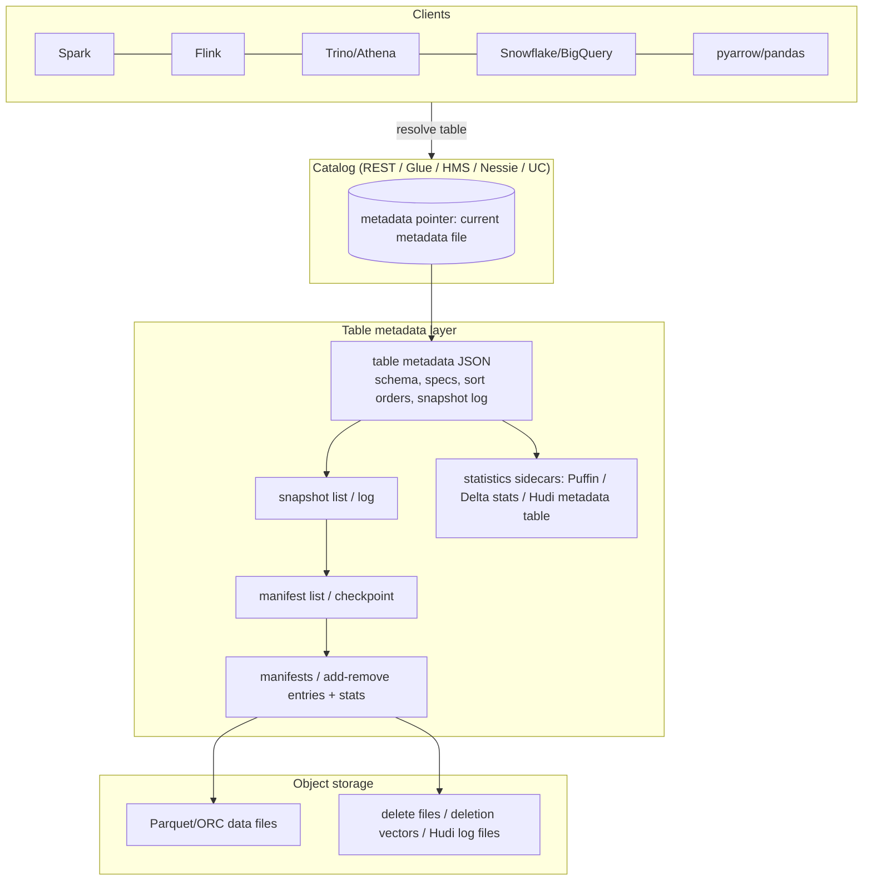

# Lakehouse Architecture

> A lakehouse is a lake that behaves like a warehouse: object storage underneath for cost and
> openness, a **table format** on top for ACID transactions, snapshots, schema evolution, and
> pruning statistics, and any number of engines for compute. The intellectual core of the idea is
> that the *transaction log* — the metadata that says which files constitute the table right now —
> is a first-class artifact, and that commits are atomic operations on that log rather than on the
> filesystem. Get that log right and you get a warehouse's correctness guarantees on storage that
> costs $0.02/GB-month. Get it wrong and you get a swamp with snapshots. This chapter is about the
> three dominant implementations — **Apache Iceberg**, **Delta Lake**, and **Apache Hudi** — how
> they commit, prune, delete, evolve, and fail, and how to choose between them without regretting
> it in two years.

---

## TL;DR

- **Lakehouse = open file format (Parquet/ORC) + table format (Iceberg/Delta/Hudi) + catalog +
  engines.** The table format is the innovation; the rest is composition.
- **ACID on object storage is achieved by an atomic metadata commit, not by filesystem atomicity.**
  Either the catalog does a compare-and-swap on a metadata pointer (Iceberg, with REST/Glue/HMS
  semantics) or writers use conditional/optimistic protocols on a log directory (Delta, Hudi).
- **Snapshots are the unit of consistency**: readers see an immutable snapshot; writers create a
  new one. That gives snapshot isolation, time travel, reproducible pipelines, and cheap rollback.
- **Row-level deletes come in two flavors**: copy-on-write (rewrite files, fast reads) and
  merge-on-read (write delete files, fast writes). Delta calls its encoding **deletion vectors**;
  Iceberg v2 used positional/equality delete files and v3 adds **deletion vectors** too. Hudi has
  CoW vs MoR table types with a log-file design.
- **Pruning is driven by metadata**: Iceberg manifests, Delta log checkpoint stats, Hudi metadata
  table. Min/max, null counts, and NDV sketches let engines skip files *and pages* without listing
  a directory.
- **The small-file problem is universal and permanent.** Every format ships table services for
  compaction, clustering, and cleanup. If you do not schedule them, your lakehouse degrades.
- **Concurrency is optimistic.** Two writers touching disjoint files usually both win; overlapping
  writes get a conflict exception and must retry. Plan for retries, not locks.
- **Iceberg is the multi-engine interoperability leader** (REST catalog spec, broad engine support,
  v3 with deletion vectors and row lineage). **Delta is the most integrated with Spark/Databricks**
  and now ships UniForm for Iceberg compatibility. **Hudi is the strongest for high-frequency
  upserts and streaming ingestion at extreme scale** (Uber: trillion-record datasets).
- **Feature convergence is real**: deletion vectors, clustering, variant/semi-structured types,
  type widening, and multi-engine readers now exist in more than one format. The *catalog* is
  becoming the more consequential long-term choice.
- **Cost/perf levers, in order of impact**: (1) file sizing and compaction, (2) clustering/sort
  order matching query predicates, (3) metadata pruning statistics, (4) snapshot/manifest
  maintenance, (5) engine and cache choices.
- **Anti-pattern**: adopting a table format without a maintenance budget. A lakehouse without
  compaction, snapshot expiration, and orphan-file cleanup is a lakehouse for about 90 days.

---

## 1. Definitions and core vocabulary

| Term | Meaning |
|---|---|
| **Table format** | A specification for the metadata that defines a transactional table over files in object storage: schema, partitioning, snapshots, file lists, statistics, and the commit protocol. |
| **Catalog** | The service holding the current metadata-pointer for each table and enforcing access control. See [08-metadata-catalogs.md](./08-metadata-catalogs.md). |
| **Snapshot** | An immutable, complete description of a table at one point in time (the set of files + delete files + schema + partition spec). |
| **Commit** | The atomic operation that publishes a new snapshot. Either a catalog CAS on the metadata pointer, or a new log entry that other writers can detect. |
| **Manifest / log entry** | Per-snapshot metadata listing data files (and delete files), usually with per-file and per-partition statistics. |
| **Metadata table (Iceberg)** | A virtual table exposing table metadata as SQL: `table.snapshots`, `table.files`, `table.manifests`, `table.partitions`, `table.history`, `table.refs`. |
| **Copy-on-write (CoW)** | Updates/deletes rewrite affected data files. Read-optimized, write-expensive. |
| **Merge-on-read (MoR)** | Updates/deletes write small delete/delta files; readers merge at query time. Write-optimized, read-expensive until compacted. |
| **Positional delete** | A delete file listing `(data_file, row_position)` for removed rows (Iceberg v2). |
| **Equality delete** | A delete file listing key values to remove (Iceberg v2). More general, more expensive to apply. |
| **Deletion vector (DV)** | A compact bitmap of deleted row positions folded into a data file, referenced by the table metadata (Iceberg v3; Delta feature). |
| **Puffin file** | Iceberg sidecar binary metadata file holding sketches/statistics (e.g., Theta NDV) and, in v3, deletion vectors. |
| **Hidden partitioning** | Partitioning declared by *transform* on a source column (`days(ts)`), so users filter the source column and pruning happens automatically without exposing partition columns. |
| **Partition evolution** | Changing a table's partition spec without rewriting data; old partitions keep their layout, new writes use the new spec. |
| **Row lineage** | Iceberg v3 capability: every row carries a stable `_row_id` and last-updated sequence number, enabling efficient incremental/CDC consumption. |
| **Table service** | A maintenance operation the format provides: compaction, clustering, snapshot expiration, orphan-file removal, manifest rewriting. |
| **Time travel** | Querying a snapshot by timestamp or snapshot id. |
| **Ref (Iceberg) / branch / tag** | Named pointers to snapshots, enabling WAP (write-audit-publish) workflows. |
| **Protocol version** | Delta's `minReaderVersion`/`minWriterVersion` and table features; Iceberg's `format-version` 1/2/3; Hudi's `hoodie.table.version`. |
| **UniForm** | Delta feature that writes Iceberg-compatible metadata alongside Delta metadata so Iceberg readers can read the same files. |
| **XTable** | Apache project for translating table metadata between formats (Iceberg/Delta/Hudi) without copying data. |

---

## 2. What problem it solves / why it matters

### 2.1 The lake's missing guarantees

A plain Parquet-on-S3 "table" fails in six specific ways:

| Problem | Consequence | Lakehouse mechanism |
|---|---|---|
| No atomic visibility | Readers see half-written batches | Snapshot commit |
| No isolation | Two writers overwrite each other | Optimistic concurrency + conflict detection |
| Listing-bound planning | Millions of files → minutes of `LIST` | Manifests/log-based file sets |
| No schema enforcement | Type drift, silent nulls | Schema-on-write + explicit evolution |
| No row-level update/delete | GDPR erasure, CDC, corrections are impossible | Delete files / DVs / MoR |
| No history | Cannot reproduce or roll back | Snapshots, time travel, branches |

### 2.2 What you get in exchange

- **One copy of data, many engines.** BI, ML, streaming, and SQL all read the same Iceberg/Delta
  tables.
- **Correct incremental processing.** Read only the files added since a snapshot → 10–1000× cheaper
  pipelines (Airbnb's "Chronon" and Uber's incremental ETL both exploit this idea).
- **Cheap time travel** for audit, debugging, and backfills.
- **Storage cost decoupling**: keep years of detail in cheap storage; pay compute only when queried.
- **Streaming and batch unified** on one table with one set of semantics.

### 2.3 Where it does *not* solve your problems

- **Latency**: lakehouse is not a serving layer. Point lookups at <50 ms need a KV/OLAP store.
- **High-frequency single-row updates**: even with MoR/DVs, per-row commits are far more expensive
  than in a B-tree database. Batch your writes.
- **Deep governance**: catalogs give RBAC/masking/lineage, but enforcement consistency across every
  engine still requires care (see Chapter 08).
- **Small files**: no format prevents them; they only provide the tools to fix them.

---

## 3. How it works internally

### 3.1 The universal architecture



The invariant: **readers only ever need metadata + the files it references.** No listing. No
guessing. No coordination at read time.

### 3.2 Iceberg internals

```text
s3://bucket/warehouse/analytics/orders/
├── data/                                 # (can be co-located or separate prefix)
│   ├── order_date=2026-03-01/00000-0-<uuid>.parquet
│   └── ...
├── metadata/
│   ├── 00000-<uuid>.metadata.json        # v1.metadata.json … vN.metadata.json
│   ├── snap-<snapshotId>-1-<uuid>.avro   # manifest list (one per snapshot)
│   ├── <uuid>-m0.avro                    # manifest: data files + per-file stats
│   ├── <uuid>-m1.avro
│   ├── <uuid>.stats                      # Puffin file: NDV sketches / DVs (v3)
│   └── version-hint.text                 # only for the Hadoop-catalog fallback
└── ...
```

**Table metadata JSON** contains: `format-version`, `table-uuid`, `location`, `last-sequence-number`,
`last-updated-ms`, `schemas`, `current-schema-id`, `partition-specs`, `default-spec-id`,
`last-partition-id`, `sort-orders`, `properties`, `current-snapshot-id`, `refs`, `snapshots`,
`snapshot-log`, `metadata-log`, `statistics`, `partition-statistics`.

**Manifest list entry** (per snapshot): manifest path, length, partition field summaries, added/
existing/deleted file counts. This is what lets the planner prune *without reading manifests*:
if a manifest's partition summary is `[2025-01-01, 2025-01-31]` and the query wants March, the
manifest — and its hundreds of files — is skipped after reading one small Avro row.

**Manifest entry** (per data file): path, format, partition values, `record_count`, `file_size_in_bytes`,
and per-column `value_counts`, `null_value_counts`, `nan_value_counts`, `lower_bounds`, `upper_bounds`,
plus optional `split_offsets` (for splittable tasks) and per-file sort-order id.

**Commit protocol** (Iceberg):

```text
1. Writer reads current metadata (vN.metadata.json), snapshot S_cur.
2. Writer writes data files (unreferenced; invisible).
3. Writer writes new manifests + manifest list + v(N+1).metadata.json, referencing S_new.
4. Writer calls catalog.commitTable(requirements, updates):
     requirements (assertions evaluated atomically by the catalog):
       - assert-table-uuid            (same table)
       - assert-ref-snapshot-id       (main == S_cur)   ← the optimistic check
       - assert-last-assigned-field-id, assert-default-spec-id, ...
     updates:
       - add-snapshot S_new, set-current-snapshot S_new, maybe set-properties, ...
5. Catalog atomically swaps the metadata pointer vN → v(N+1).
   If a competing writer already advanced `main`, commit fails → writer retries
   (rebase its changes if the formats/touched partitions are disjoint).
```

REST catalog commit endpoint (conceptually):

```http
POST /v1/{prefix}/namespaces/{namespace}/tables/{table}
Authorization: Bearer <oauth-token>
Content-Type: application/json

{
  "requirements": [
    {"type": "assert-table-uuid", "uuid": "9c12d441-..."},
    {"type": "assert-ref-snapshot-id", "ref": "main", "snapshot-id": 30572114570456981}
  ],
  "updates": [
    {"action": "add-snapshot", "snapshot": {"snapshot-id": 849726..., "manifest-list": "s3://..."}},
    {"action": "set-snapshot-ref", "ref-name": "main", "snapshot-id": 849726..., "type": "branch"}
  ]
}
```

**Row-level deletes:**

| Version | Mechanism | Cost profile |
|---|---|---|
| v1 | No row-level deletes (partition overwrite only) | CoW semantics |
| v2 | Position delete files, equality delete files; `merge-on-read` | Write cheap, read cost grows with delete-file count |
| v3 | **Deletion vectors** (Roaring bitmap in a Puffin file) + `_row_id`/lineage columns; default values; variant; nanosecond timestamps; multi-arg transforms | Delete cost ~O(bytes of bitmap), read cost ~O(1 bitmap lookup) |

> **Senior note**: deletion vectors are the single most consequential v3 change. Before them, a
> position-delete file could hold millions of small 10-byte records and had to be read and
> materialized per data file — a classic cause of "our MoR table got slower over months". A DV is
> a bitmap: ~1 byte per 8 deleted rows, and it can be referenced *in place* in the data file
> metadata. Engines that do not yet support v3 cannot read those tables — check your engine matrix
> before enabling.

**Partition transforms**: `identity`, `bucket[N]`, `truncate[W]`, `year`, `month`, `day`, `hour`,
`void` — and v3's multi-argument transforms. Example spec:

```sql
-- Hidden partitioning: users never mention `order_date`; filtering ts prunes.
CREATE TABLE silver.orders (
  order_id    BIGINT,
  customer_id BIGINT,
  ts          TIMESTAMP,
  amount      DECIMAL(18,4)
)
USING iceberg
PARTITIONED BY (days(ts), bucket(16, customer_id))
TBLPROPERTIES ('format-version' = '2');
```

The partition values are derived and stored in the file metadata; a `WHERE ts BETWEEN ...` query
prunes without any change to the SQL, and `bucket(16, customer_id)` co-locates a customer's rows
for equality joins/merges.

### 3.3 Delta Lake internals

```text
s3://bucket/delta/orders/
├── _delta_log/
│   ├── 00000000000000000000.json      # initial: protocol, metaData, add actions
│   ├── 00000000000000000001.json      # one commit = one (or a few) JSON files
│   ├── ...
│   ├── 00000000000000000010.checkpoint.parquet   # every 10 commits by default
│   ├── _last_checkpoint               # pointer to the latest checkpoint (+ sidecars)
│   └── _sidecars/                     # V2 checkpoints: multi-part checkpoint files
├── _change_data/                      # CDF files when change data feed is enabled
├── part-00000-<uuid>-c000.snappy.parquet
└── ...
```

**Log actions** in each commit: `protocol`, `metaData`, `add`, `remove`, `txn` (app-transaction
idempotency), `commitInfo`, `addCDCFile`, `cdc`, `domainMetadata`.

**Commit protocol:**

```text
1. Writer reads _last_checkpoint → replays log entries after it → current state.
2. Writer writes new Parquet data files.
3. Writer attempts an atomic PUT of the next log file N+1 (`0000...N+1.json`).
   - On HDFS/ADLS: rename-based atomicity or lease.
   - On S3: single-PUT + conditional write (If-None-Match) on modern runtimes;
     historically a DynamoDB-backed LogStore provided mutual exclusion.
   - Catalog-managed tables (Unity Catalog): the catalog coordinates commits directly
     ("coordinated commits"), giving the strongest guarantees + cross-engine atomicity.
4. If the object already exists → another writer won the race → conflict check:
     - If the conflict is non-overlapping (different files/partitions) → the writer may
       retry and commit; Delta performs "conflict resolution" on known-commutative changes
       (adds, removes, deletion-vector updates, disjoint metadata changes).
     - Otherwise → ConcurrentModificationException → the job must retry.
```

**Table features / protocol versions** (fail-fast protection): `appendOnly`, `invariants`,
`checkConstraints`, `changeDataFeed`, `generatedColumns`, `columnMapping`, `identityColumns`,
`timestampNtz`, `deletionVectors`, `v2Checkpoint`, `domainMetadata`, `variantType`, `typeWidening`.
Readers/writers declare what they support; an unsupported feature makes the table unreadable/unwritable
rather than corrupt — a genuinely strong design choice.

**Physical layout features**: `OPTIMIZE` (bin-packing compaction), `ZORDER BY` (multidimensional
clustering), **liquid clustering** (`CLUSTER BY (a,b)` — incremental, no full rewrite, replaceable
without rewriting history), generated columns for partition derivation, and `VACUUM` for cleanup.

### 3.4 Hudi internals

```text
s3://bucket/hudi/orders/
├── .hoodie/
│   ├── .hoodie.properties                       # table version, type (COW/MOR), name
│   ├── 20260301050000000.commit                 # completed instant
│   ├── 20260301051000000.inflight               # in-progress marker
│   ├── 20260301051500000.requested
│   └── metadata/                                # metadata table (HFile base + log files)
│       ├── files/        # file listing → no S3 LIST needed
│       ├── column_stats/ # min/max per column per file → pruning
│       ├── bloom_filters/
│       ├── record_index/ # record key -> file group (avoids full index scan)
│       ├── secondary_index/
│       └── expression_index/
├── order_date=2026-03-01/
│   ├── <fileId>_<writeToken>_<instantTime>.parquet      # base file (file slice)
│   └── .<fileId>_<...>.log.3_0-0-0                       # log files (MoR deltas)
└── ...
```

**Timeline**: Hudi's commit log. Each *instant* has an action (`commit`, `deltacommit`,
`replacecommit`, `clean`, `rollback`, `savepoint`, `restore`, `indexing`) and a state
(`requested` → `inflight` → `completed`). Readers ignore instants that are not completed, which is
how in-flight writes stay invisible.

**Table types**: **CoW** rewrites base files on update (read-fast); **MoR** appends log files with
record-level deltas and merges on read or during compaction (write-fast). MoR read modes: `snapshot`
(merge logs), `read_optimized` (base files only — stale but fast), plus `incremental` reads.

**Indexes** determine upsert cost:

| Index | Ideal for | Trade-off |
|---|---|---|
| Simple/`SimpleIndex` | Small tables, no partition path logic | Full table scan for lookups |
| Bloom | Large tables, default | False positives → extra file reads |
| Bucket | Strictly monotonically increasing keys, hash-bucketed layout | Needs careful bucketing |
| HBase | Huge tables needing sub-second lookups | External HBase cluster to operate |
| **Record-Level Index (RLI)** | Very large tables, high upsert volume | Storage of the index; Hudi 1.0's headline feature |
| Secondary/Expression index | Lookups by non-primary-key fields | Extra write cost |

**Table services**: compaction (MoR log → base file), clustering (file-group reorganization for
layout), cleaning (delete old file slices), archival (move old timeline instants out), rollback
(cancel a failed write), **non-blocking concurrency control (NBCC)** in Hudi 1.x for concurrent
writers on the same table.

### 3.5 Format comparison: the table you must be able to reproduce

| Dimension | **Apache Iceberg** | **Delta Lake** | **Apache Hudi** |
|---|---|---|---|
| Metadata model | Metadata JSON + manifest list + manifests; catalog holds the pointer | `_delta_log` JSON + Parquet checkpoints + `_last_checkpoint`; optional sidecars | Timeline under `.hoodie/` + **metadata table** (multi-modal indexes) |
| Commit coordination | Catalog CAS on metadata pointer (REST spec standardizes it); 3 atomic-rename/CAS strategies | Log-file atomic PUT + optimistic conflict resolution; coordinated commits w/ catalog | Timeline with OCC; NBCC for multi-writer in 1.x |
| Row-level deletes | v2: positional + equality delete files. **v3: deletion vectors** (+row lineage) | **Deletion vectors** (feature-gated), MoR-style | MoR log files with record-level payloads; CoW rewrite |
| Update performance | Good; best with DVs + MoR + bucket partitioning | Good; DVs + liquid clustering | **Best at very high upsert rates** (RLI, MoR, streaming-first) |
| Multi-engine reading | **Strongest**: Spark, Flink, Trino, Presto, Snowflake, BigQuery, Redshift, Athena, DuckDB, ClickHouse, StarRocks, pyarrow/pandas | Spark, Flink (limited), Trino, Snowflake, BigQuery, Databricks; UniForm adds Iceberg readers | Spark, Flink, Presto/Trino, Hive, Athena (with caveats) |
| Schema evolution | Field IDs; rename/drop/reorder are metadata-only | Column mapping for rename/drop; type widening (4.0) | Avro-schema-based evolution; some constraints |
| Partition evolution | **Native and free** (multiple specs coexist) | Requires rewriting with new partition columns (liquid clustering sidesteps this) | Supports simple/complex key generators; changes need rewrites |
| Hidden partitioning | **Yes** (transforms) | No (explicit columns / generated columns / liquid clustering) | No (key generators) |
| Time travel | Snapshots + refs (branches/tags); `VERSION AS OF`, `TIMESTAMP AS OF` | `VERSION AS OF`, `TIMESTAMP AS OF`, `RESTORE` | Timeline-based; `savepoint`, incremental queries, time travel queries |
| Statistics for pruning | File-level min/max/null counts, MD5/split offsets, Puffin NDV sketches, partition stats | File-level stats in log/checkpoint, data skipping with DVs, deletion-vector-aware counts | Metadata table: file index, column stats, bloom filters, record index |
| Streaming ingestion | Flink/Spark streaming writers with commit batching | Spark Structured Streaming, Flink (community), Kafka Connect sink via Databricks | **Native, first-class** (Hudi Streamer, deltastreamer, Kafka Connect) |
| Interop bridge | Format-of-record for most lakehouse vendors | **UniForm** generates Iceberg metadata for Delta tables | XTable/OneTable integration |
| Governance integration | Any catalog (Nessie, Polaris, Unity, Glue, HMS REST) | Unity Catalog first-class; others via Iceberg UniForm | Glue/HMS/Hudi catalogs |
| Sweet spot | Multi-engine, open-standard, analytical + moderate upserts | Databricks/Spark-centric, unified BI+ML, strong feature gating | High-frequency upserts, CDC ingestion, streaming at extreme scale |
| Notable scale reference | Netflix, LinkedIn, Apple, AWS Athena/EMR | Databricks + >60% of Fortune 500 per Delta | Uber (trillions of records, hundreds of PB), Robinhood, Walmart |

**Also in the field**: **Apache Paimon** (Flink-first, LSM-tree with primary keys, excellent for
streaming upserts into a lake), and **DuckLake** (2025) which pushes table metadata *into a SQL
database* to avoid object-store listing entirely — an interesting reversal of the metadata-outside-
the-database trend.

### 3.6 Interop: reading each other's tables

```text
Approach 1: UniForm (Delta writer emits Iceberg metadata alongside Delta)
  Pros: no extra jobs, single source of truth is the Delta table
  Cons: requires feature-compatible tables (no unsupported types/features); Iceberg is read-only

Approach 2: Apache XTable / OneTable (metadata translation service)
  Source format → incremental metadata sync → target format metadata
  Pros: works across all three formats without copying data
  Cons: another moving part; sync lag; feature matrix limits (e.g., MoR log files need compaction)

Approach 3: Native multi-format engines (Spark/Trino with both connectors, Snowflake external Iceberg)
  Pros: no metadata duplication; simplest
  Cons: engine coverage varies; read-only access more common than write
```

> **Senior note**: choose format by *write* path, not read path. Most engines can read everything;
> far fewer can write everything with full feature support. Your writers determine your format.

---

## 4. How to implement it (step by step, with code)

### 4.1 Iceberg with Spark

```python
# --- Configuration: REST catalog + S3 storage ---
spark = (SparkSession.builder
    .appName("lakehouse-iceberg")
    .config("spark.sql.extensions",
            "org.apache.iceberg.spark.extensions.IcebergSparkSessionExtensions")
    .config("spark.sql.catalog.lake", "org.apache.iceberg.spark.SparkCatalog")
    .config("spark.sql.catalog.lake.type", "rest")
    .config("spark.sql.catalog.lake.uri", "https://catalog.company.com")
    .config("spark.sql.catalog.lake.credential", "client-id:client-secret")  # OAuth2
    .config("spark.sql.catalog.lake.warehouse", "s3://company-lake/warehouse")
    .getOrCreate())
```

```sql
-- DDL with hidden partitioning + sort order + write tuning
CREATE TABLE lake.silver.orders (
  order_id    BIGINT      NOT NULL,
  customer_id BIGINT      NOT NULL,
  status      STRING,
  amount      DECIMAL(18,4),
  ts          TIMESTAMP   NOT NULL
)
USING iceberg
PARTITIONED BY (days(ts), bucket(8, customer_id))
TBLPROPERTIES (
  'format-version'                        = '2',
  'write.target-file-size-bytes'          = '134217728',
  'write.distribution-mode'               = 'hash',
  'write.merge.mode'                      = 'copy-on-write',   -- or 'merge-on-read'
  'write.update.mode'                     = 'merge-on-read',
  'write.delete.mode'                     = 'merge-on-read',
  'write.metadata.delete-after-commit.enabled' = 'true',
  'write.metadata.previous-versions-max'  = '20',
  'history.expire.max-snapshot-age-ms'    = '604800000'         -- 7 days
);

-- Upsert with MERGE
MERGE INTO lake.silver.orders t
USING (SELECT * FROM staging.orders_delta) s
ON t.order_id = s.order_id
WHEN MATCHED AND s.ts > t.ts THEN UPDATE SET *
WHEN MATCHED AND s.op = 'D'   THEN DELETE
WHEN NOT MATCHED THEN INSERT *;

-- Incremental read (the killer feature for pipelines)
SELECT * FROM lake.silver.orders
WHERE _change_type IS NOT NULL;   -- via incremental read APIs in Spark SQL:
-- SELECT * FROM lake.silver.orders.changes  (SQL: snapshot-range reads)
```

```sql
-- Maintenance: incremental compaction + clustering
CALL lake.system.rewrite_data_files(
  table   => 'silver.orders',
  strategy=> 'sort',
  sort_order => 'zorder(customer_id, status)',
  options => map(
    'target-file-size-bytes','134217728',
    'min-input-files','5',
    'max-concurrent-file-group-rewrites','8',
    'partial-progress.enabled','true'
  )
);

CALL lake.system.rewrite_manifests('silver.orders');          -- faster planning
CALL lake.system.expire_snapshots(
  table  => 'silver.orders',
  older_than => TIMESTAMP '2026-01-01 00:00:00',
  retain_last => 10
);
CALL lake.system.remove_orphan_files(
  table => 'silver.orders', older_than => TIMESTAMP '2026-02-01 00:00:00'
);
```

```sql
-- Metadata tables are your debugging interface
SELECT snapshot_id, committed_at, operation, summary
FROM lake.silver.orders.snapshots ORDER BY committed_at DESC LIMIT 10;

SELECT file_path, file_size_in_bytes, record_count, partition
FROM lake.silver.orders.files ORDER BY file_size_in_bytes ASC LIMIT 20;   -- small files!

SELECT partition, record_count, file_count, total_size, position_delete_file_count
FROM lake.silver.orders.partitions ORDER BY file_count DESC LIMIT 20;
```

### 4.2 Delta Lake with Spark

```sql
-- DDL: liquid clustering (replaces static partitioning for many workloads)
CREATE TABLE silver.orders (
  order_id    BIGINT,
  customer_id BIGINT,
  status      STRING,
  amount      DECIMAL(18,4),
  ts          TIMESTAMP
)
USING delta
CLUSTER BY (customer_id, ts)          -- liquid clustering: incremental, rewritable
TBLPROPERTIES (
  'delta.enableDeletionVectors'   = 'true',
  'delta.enableChangeDataFeed'    = 'true',
  'delta.targetFileSize'          = '134217728',
  'delta.autoOptimize.optimizeWrite' = 'true',
  'delta.autoOptimize.autoCompact'   = 'true',
  'delta.logRetentionDuration'    = 'interval 30 days',
  'delta.deletedFileRetentionDuration' = 'interval 7 days'
);

-- Upsert
MERGE INTO silver.orders t
USING staging.orders_delta s
ON t.order_id = s.order_id
WHEN MATCHED THEN UPDATE SET *
WHEN NOT MATCHED THEN INSERT *;

-- Maintenance
OPTIMIZE silver.orders;                                  -- bin-pack
OPTIMIZE silver.orders ZORDER BY (customer_id, status);   -- classic multidimensional
VACUUM silver.orders RETAIN 168 HOURS;                    -- 7 days

-- History & time travel
DESCRIBE HISTORY silver.orders;
SELECT * FROM silver.orders VERSION AS OF 42;
SELECT * FROM silver.orders TIMESTAMP AS OF '2026-03-01T00:00:00Z';
RESTORE TABLE silver.orders TO VERSION AS OF 42;          -- destructive undo
```

```sql
-- Change Data Feed consumption (incremental CDC from a Delta table)
SELECT * FROM table_changes('silver.orders', 100, 110)
WHERE _change_type IN ('insert','update_postimage','delete');
```

### 4.3 Hudi with Spark (streaming upserts)

```python
hudi_opts = {
    "hoodie.table.name": "orders",
    "hoodie.datasource.write.recordkey.field": "order_id",
    "hoodie.datasource.write.partitionpath.field": "order_date",
    "hoodie.datasource.write.table.type": "MERGE_ON_READ",          # or COPY_ON_WRITE
    "hoodie.datasource.write.precombine.field": "ts",               # dedupe by latest
    "hoodie.datasource.write.operation": "upsert",                  # upsert|insert|bulk_insert|delete
    "hoodie.index.type": "RECORD_INDEX",                            # Hudi 1.x default for large tables
    "hoodie.metadata.enable": "true",                               # metadata table: no LIST, stats, indexes
    "hoodie.metadata.record.index.enable": "true",
    "hoodie.datasource.write.keygenerator.class":
        "org.apache.hudi.keygen.SimpleKeyGenerator",
    "hoodie.cleaner.policy": "KEEP_LATEST_COMMITS",
    "hoodie.cleaner.commits.retained": "10",
    "hoodie.compact.inline": "false",                                # async compaction
    "hoodie.archivelog.folder": "archived",
    "hoodie.parquet.max.file.size": str(128 * 1024 * 1024),
}

(df.write.format("hudi")
   .options(**hudi_opts)
   .mode("append")
   .save("s3://company-lake/silver/orders_hudi/"))
```

```sql
-- Hudi: incremental query (only rows changed since a commit)
CREATE TEMPORARY VIEW orders_inc
USING hudi
OPTIONS (
  'hoodie.table.name' = 'orders',
  'hoodie.datasource.query.type' = 'incremental',
  'hoodie.datasource.read.begin.instanttime' = '20260301050000000'
);
SELECT * FROM orders_inc;
```

```bash
# Hudi CLI: the operational interface
hoodie-cli
hudi->connect --path s3://company-lake/silver/orders_hudi
hudi->commits show --desc false --limit 20      # timeline
hudi->fsview show --partition order_date=2026-03-01
hudi->stats filesystem --limit 10
hudi->compaction show pending
hudi->repair rollback --instant 20260301051500000
```

### 4.4 Maintenance schedule (the part teams forget)

```yaml
# operations/maintenance.yaml — every lakehouse needs this equivalent
tables:
  - name: silver.orders
    format: iceberg
    compaction:      { every: 1h,  target_file_size: 128MB, min_input_files: 5 }
    clustering:      { every: 6h,  sort_order: "zorder(customer_id, status)" }
    rewrite_manifests: { every: 1d }
    expire_snapshots:  { every: 1d, retain_last: 20, older_than: 7d }
    remove_orphans:    { every: 7d, older_than: 3d }
    monitoring:
      - files_lt_8mb_ratio < 0.10
      - manifest_count < 50
      - avg_file_size > 64MB
      - snapshot_growth_per_day < 200
  - name: gold.daily_sales
    format: delta
    optimize:   { every: 6h }
    zorder:     { columns: [customer_segment, order_date], every: 1d }
    vacuum:     { retain_hours: 168, every: 1d }
```

> **Senior note**: put compaction on an *incremental* schedule driven by table metrics
> (`files < 8 MB > 10%`), not a fixed hourly cron. Fixed schedules either overpay (compacting a
> quiet table every hour) or underperform (a busy table grows 40k small files between runs).
> Databricks' predictive optimization, Iceberg's `rewrite_data_files` with `partial-progress`, and
> Hudi's async/inline compaction options all exist to make this incremental.

---

## 5. Where to implement it (tools and when each fits)

| Concern | Options | Guidance |
|---|---|---|
| Table format | Iceberg, Delta, Hudi, Paimon | Iceberg for multi-engine openness; Delta if Spark/Databricks-centric; Hudi for heavy upsert/streaming; Paimon if Flink-first |
| Catalog | REST (Polaris, Lakekeeper, Unity, Gravitino), Glue, HMS, Nessie, Snowflake Open Catalog | Catalog is the long-lived decision; prefer REST-based for portability (Chapter 08) |
| Compute (batch) | Spark, Trino, Flink (batch), Databricks, Athena, Snowflake/BigQuery external | Match engine to transform complexity and team skills |
| Compute (streaming) | Flink + Iceberg/Delta/Paimon, Spark Structured Streaming, Kafka Connect sinks | Flink for low-latency exactly-once commits with batching; Spark SS if you already run Spark |
| Maintenance automation | Databricks predictive optimization, Iceberg `system.*` procedures, Hudi table services, custom Airflow/Dagster jobs, AWS Glue/EMR jobs | Automate before you need it |
| Governance | Unity Catalog, Lake Formation, Polaris + Ranger/Immuta, DataHub/OpenMetadata | Centralize; enforce at the catalog, not per-engine |
| Interop | Delta UniForm, Apache XTable, native multi-format engines | Only when required; each adds a moving part |
| Local dev | Spark local + `hadoop-aws`, DuckDB reading Iceberg/Parquet, MinIO | DuckDB is an excellent zero-infrastructure way to validate table layout |
| Storage optimization | S3 Intelligent-Tiering, S3 Express One Zone for hot writes, GCS Autoclass, ADLS lifecycle | Combine with table `expire_snapshots` for real savings |

---

## 6. Patterns and anti-patterns

### 6.1 Patterns

| Pattern | Description | Why it works |
|---|---|---|
| **Immutable-raw + table-format-curated** | Raw stays files; every modeled table is Iceberg/Delta/Hudi | Replayability + warehouse guarantees |
| **CoW for small/medium tables, MoR for high-churn** | Choose per table, not per platform | Optimal write/read balance |
| **Partition + bucket for join-heavy upserts** | `days(ts)` + `bucket(N, key)` | Co-locates rows by key → cheap MERGE |
| **Sort/cluster by the most selective frequent predicate** | `zorder(a,b)` or `CLUSTER BY (a,b)` | Data skipping actually fires |
| **Incremental reads instead of full scans** | Read only added snapshots | 10–1000× cheaper pipelines |
| **WAP with branches (Iceberg refs)** | Write to `audit` branch, validate, fast-forward `main` | Publish-quality gate without duplicate tables |
| **Snapshot-expiration aligned with consumer SLAs** | Retention = max(time-travel need, downstream reprocessing window) | Prevents "the table we needed time-traveled too" incidents |
| **Table-format-aware CI** | Tests run against a cloned/branched table | Realistic pipelines without production risk |
| **Metadata-table-driven monitoring** | Alert on `files` histogram, manifest counts, snapshot growth | Catches degradation before users do |
| **One writer per table, many readers** | Serialize writes through a service or a single job | Eliminates the hardest concurrency class |
| **Auto-compaction during streaming** | `delta.autoOptimize.autoCompact`, Iceberg `write.distribution-mode`, Hudi inline compaction | Keeps small files bounded by construction |

### 6.2 Anti-patterns

| Anti-pattern | Symptom | Fix |
|---|---|---|
| **No maintenance jobs** | Query time degrades weekly; storage grows without bound | Compaction + snapshot expiration + orphan removal on a schedule |
| **Over-partitioning + MoR** | Millions of tiny delete files; scans read 10× the data | Compact, reduce partition cardinality, switch to DVs/liquid clustering |
| **MoR without compaction** | "Read-optimized" queries drift from reality; snapshot reads get slower every day | Scheduled compaction with a freshness SLO |
| **VACUUM/expire too aggressively** | Long-running readers fail or a rollback becomes impossible | Retention > longest-running query/streaming job + reprocessing window |
| **Concurrent writers to the same table with different engines** | `ConcurrentModificationException` storms, orphan files | Serialize writers, or use a catalog with coordinated commits |
| **Schema evolution without column mapping (Delta)** | Rename breaks readers; data appears null | Enable column mapping *before* you need it (it's not retroactively cheap) |
| **Enabling a format feature globally** | Old readers/writers in the fleet break | Feature-by-feature rollout with a reader/writer version inventory |
| **Using V1 Iceberg semantics for a churn-heavy table** | No row-level deletes → full rewrites | Use v2/v3 with appropriate write modes |
| **Ignoring `split_offsets`/small row groups** | Under-parallelized scans (one task per file) | Write with ~128 MB row groups; compact |
| **Storing raw + curated in the same table prefix** | Blast-radius deletes; confusing permissions | Separate prefixes/catalogs per zone |
| **Treating the lakehouse as a database** | Per-row commits, point lookups, lock-like contention | Batch writes; add a serving store |
| **Z-ordering on more than ~4 columns** | Marginal pruning benefit, 3× compaction cost | Z-order on 2–3 high-value columns or use clustering/partitioning instead |

---

## 7. Real-world use cases and industry applications

| Organization | What they built | Mechanism / lesson |
|---|---|---|
| **Netflix** | S3 as warehouse storage with Iceberg as the table format across analytics and ML | Invented Iceberg because Hive tables could not scale to their listing/metadata demands; strong metadata pruning is the core benefit |
| **Uber** | Hundreds of PB, 19,500+ Hudi datasets, incremental ETL instead of nightly rebuilds | Metadata table + record-level index made trillion-record upserts tractable; NBCC enables concurrent writers |
| **LinkedIn** | One of the largest Iceberg deployments; Kafka + Iceberg convergence; Polaris catalog | Format standardization across engines; streaming ingestion into Iceberg with low latency |
| **Airbnb** | Lakehouse with incremental computation ("Chronon") and certified metrics | Incremental reads off table snapshots beat full-table recomputation by an order of magnitude |
| **Apple / AWS (Athena, EMR, Glue)** | Iceberg as the default open format for cloud analytics | Managed catalog (Glue) + serverless engines + open format = no lock-in per engine |
| **Databricks customers (>60% of the Fortune 500 per Delta)** | Delta tables + Unity Catalog + Photon + SQL warehouses; UniForm for Iceberg readers | Unified BI + ML on one copy; governance in the catalog |
| **Robinhood / Walmart / Shopee** | Hudi MoR for CDC ingestion at high volume | MoR absorbs write bursts; compaction manages read amplification |
| **Snowflake customers** | External Iceberg tables as a "lakehouse front door" to data they don't want to copy | Cost/egress avoidance; native tables still used for hot BI |
| **Gaming / ad-tech** | Kafka → Flink → Iceberg with 1–5 minute visibility; Druid for the sub-second layer | Two-tier serving: lakehouse for retention and correctness, OLAP for latency |
| **Regulated finance** | Immutable Iceberg history + branches for WAP; audit-approved snapshot retention | Snapshots are the audit artifact; `expire_snapshots` must respect the retention policy |

---

## 8. Senior-level deep dive

### 8.1 The commit path is the performance bottleneck at scale

Every commit writes metadata objects and calls the catalog. Numbers to reason with:

```text
N commits/hour, each writing ≈ (1 manifest per 100 files + 1 manifest list + 1 metadata json)
  → ~3–10 small object PUTs per commit (plus data PUTs)
  → 3,000 commits/hour ⇒ ~30k metadata PUTs/hour ⇒ real request cost + catalog load

Worst case: a streaming job committing every 10 seconds with 1 file each =
  360 commits/hour × ~5 metadata objects = 1,800 metadata objects/hour,
  and after 1 week: 360*24*7 = 60,480 snapshots
  → manifest lists grow, planning slows, expire_snapshots becomes essential.

Mitigations:
  - Batch commits: Flink `sink.iceberg.commit.interval` (10s–5min),
    Spark SS `trigger(processingTime='5 minutes')`, Hudi `hoodie.auto.commit=false` + manual commits.
  - `write.metadata.delete-after-commit.enabled=true` + `previous-versions-max` (Iceberg).
  - Periodic `rewrite_manifests` to bound manifest-list fan-out.
  - Delta checkpoints (every 10 commits by default) + V2 checkpoints for very large tables.
  - Hudi: archival + cleaning keep the timeline and file slices bounded.
```

### 8.2 Delete/update cost model

```text
CoW update of k rows spread over F files:
  cost ≈ Σ (rewrite file size of affected files)     ← can be GBs for a few KB of changes
MoR update:
  cost_write ≈ write delete/delta file (bytes ≈ k × row-id size or bitmap)
  cost_read  ≈ read + merge delete files per query   ← grows with number of delete files
DV:
  cost_write ≈ bitmap bytes ≈ k/8
  cost_read  ≈ bitmap lookup per data file (near-constant)

Rule of thumb:
  < 1% of a file changes per commit  → MoR/DV
  > 30% of a file changes, read-heavy → CoW
  Very high frequency, small updates → MoR + frequent compaction (or Hudi MoR)
```

### 8.3 Trade-off matrix: the decisions reviewers will ask about

| Decision | Options | Decide by |
|---|---|---|
| Format | Iceberg / Delta / Hudi / Paimon | Write path + engines + catalog strategy; not benchmarks |
| Write mode | CoW / MoR / DVs | Change ratio per file, read/write frequency, compaction capacity |
| Partitioning | Static compound partitioning / liquid clustering / hidden transforms | Do predicates vary per query? Is partition evolution needed? |
| Clustering | Sort order / Z-order / liquid clustering | Number of clustering columns (≤3), rewrite budget for full sorts |
| Catalog | REST / Glue / HMS / Nessie / UC | Multi-engine need, multi-cloud need, governance depth, ops budget |
| Snapshot retention | Short (cost) vs long (audit) | Regulatory retention, downstream reprocessing window, storage cost |
| Compaction ownership | Inline (simple, latency cost) vs async/scheduled (complex, cheaper) | Freshness SLA vs compute budget |
| Metadata strategy | Manifests (Iceberg/Delta) vs metadata table (Hudi) | Engine support; Hudi's index-based lookups matter at high upsert rates |
| Interop | Native multi-format engines / UniForm / XTable | How many engines must *write*, not just read |
| Serving | Lakehouse-only / + warehouse / + KV or OLAP store | Latency SLO and concurrency |

### 8.4 Failure modes and debugging playbook

| Failure | Root cause | Detect | Fix |
|---|---|---|---|
| Queries slow uniformly | Small files / manifest bloat | `files` metadata table histogram; manifest count | Compaction, `rewrite_manifests` |
| Queries slow on one predicate | Layout doesn't match predicate (no clustering) | Compare `files` scanned vs total; check `EXPLAIN`/scan metrics | Add clustering/sort order, or repartition |
| `ConcurrentModificationException` / commit conflicts | Two writers on overlapping files | Commit logs, job logs | Serialize writers; retry with backoff; coordinated-commit catalog |
| Orphan files accumulate | Failed writes, expired metadata not cleaned | `remove_orphan_files --dry-run` | Schedule orphan removal; fix job retry logic |
| Table unreadable by an older engine | Format/feature version bump | Error mentions minimum reader version / format-version | Feature-gated rollout; maintain engine version matrix |
| Time travel fails after N days | Snapshot expiration too aggressive | `snapshots` metadata table | Align expiration with consumer needs; document retention |
| Reads see stale data in a streaming pipeline | Compaction or commit batching not yet applied | Compare snapshot times vs Kafka offsets | Compact more frequently; check commit interval |
| Storage grows with no query growth | Dead snapshots + orphan files + no lifecycle tiering | Storage metrics by prefix age | Expire, remove orphans, tier cold data |
| Skewed compaction | One huge partition | Task durations in the compaction job | Size-based repartitioning; process heavy partitions separately |
| Delete files pile up (MoR) | No compaction, or updates touch many files | `position_delete_file_count` per partition | Compact; switch CoW or DVs for that table |
| Catalog is a single point of failure | Catalog outage = whole platform down | Availability monitoring, failover tests | HA catalog (multi-AZ Postgres/DynamoDB, REST behind LB), local metadata caching |
| Streaming job restarts produce duplicates | Non-idempotent commits / no checkpoint alignment | Row counts at the destination vs offsets | Idempotent commits (Iceberg snapshot-based), `txn`/app-transaction ids (Delta), Hudi commit times |

Diagnostics code:

```python
# Spark: is pruning actually happening?
df = spark.read.format("iceberg").load("lake.silver.orders") \
        .filter("ts >= '2026-03-01' AND customer_id = 42")
df.explain("formatted")     # look for PushedFilters, partition filters, files read
```

```sql
-- Delta: what did the scan actually read?
EXPLAIN FORMATTED SELECT * FROM silver.orders WHERE customer_id = 42;
DESCRIBE DETAIL silver.orders;      -- numFiles, sizeInBytes, partitionColumns, clusteringColumns
```

```bash
# Is it a small-file problem? File-size distribution from the table metadata (no LIST needed)
spark-sql -e "SELECT COUNT(*), MIN(file_size_in_bytes), AVG(file_size_in_bytes), MAX(file_size_in_bytes)
              FROM lake.silver.orders.files"
```

### 8.5 Cost economics of a lakehouse

```text
Cost components (monthly):
  storage_bytes × tier_rate                       (S3 standard 0.023, IA 0.0125, Glacier IR 0.004)
+ request_costs  (PUT/GET/LIST)                   ← metadata commit count × objects per commit
+ compaction_compute (engine hours × rate)
+ query_compute (scan bytes / engine throughput × rate)
+ catalog cost (usually small, but Glue/UC/enterprise catalogs charge per object/request)
+ engineering (the maintenance surface is real: 0.5–2 FTE at scale)

Example: 500 TB Iceberg table, 30 TB scanned/day, 1 compaction job/hour on 50 GB
  storage: 500,000 GB × ~$0.015 blended            ≈ $7,500
  scan:    30 TB/day × 30 × ($1.5–3/TB Spark)      ≈ $1,350–2,700
  compaction: 50 GB × 24 × 30 = 36 TB/mo @ $2/TB   ≈ $72
  requests: 6,000 commits/day × ~8 objects × 30    ≈ $0.6  (cheap until you hit 100k+/day)
  → total ≈ $9,000/month + query-engine cost, versus $11,500 storage alone in a
    warehouse at $23/TB-month for the same 500 TB.
```

The real saving is not the storage rate — it's that the *same bytes* serve BI, ML, and streaming
without copies, and that compute is elastic. The real cost is the maintenance surface.

---

## 9. Common mistakes and how to avoid them

1. **Picking a format by benchmark.** Benchmarks rarely reflect your file sizes, update ratios, and
   engines. Fix: prototype with *your* data for 2 weeks, including maintenance jobs.
2. **No maintenance budget.** Fix: assign owners and schedules on day one; monitor file-size
   histograms and snapshot growth.
3. **Enabling every feature at once.** Fix: feature-gated rollout, with a reader/writer version
   inventory.
4. **Forgetting that old engines can't read new features.** Fix: publish a supported-version matrix
   in the ADR; test in a canary namespace.
5. **Using a lakehouse for point lookups.** Fix: replicate to a KV/OLAP store.
6. **Single-writer assumption violated by "just one more job".** Fix: enforce write ownership in
   the catalog; use coordinated commits if you need multi-writer.
7. **Partition columns that duplicate hidden transforms.** Fix: in Iceberg, do not materialize
   `order_date` if `days(ts)` already prunes; in Delta, use liquid clustering instead of adding a
   partition.
8. **Vacuuming without knowing the longest reader.** Fix: retention ≥ longest query + reprocessing
   window; monitor failures with "file does not exist".
9. **Ignoring delete-file debt.** Fix: alert on `position_delete_file_count` and delete-file bytes;
   compact aggressively.
10. **Treating the catalog as an afterthought.** Fix: catalog choice outlives format choice; prefer
    REST-based, portable catalogs.
11. **Not testing failure paths.** Fix: chaos-test commit conflicts, catalog failover, and
    concurrent compaction-vs-read.
12. **Assuming the lakehouse replaces the semantic layer.** Fix: you still need modeling, metrics,
    and contracts; the format only makes the storage layer correct.

---

## 10. Exercises / interview questions

1. **Internals.** Explain, step by step, how Iceberg achieves atomicity on S3 where rename is not
   atomic. What does the catalog do, and what happens on a conflicting commit? *Hint: metadata
   pointer CAS + requirements; rebase or fail.*

2. **Design.** You must support CDC from 40 tables with ~5k updates/sec and dashboard reads every
   5 minutes. Choose format, write mode, partitioning, and maintenance schedule. *Hint: MoR/DV,
   bucket by key, compaction every 10–30 min, alert on delete-file debt.*

3. **Numbers.** A table has 4.2M files averaging 3 MB. Estimate planning overhead and redesign the
   layout. What will the file count and average size be after compaction? *Hint: target 128 MB
   files; 4.2M × 3 MB = ~12.6 TB → ~100k files.*

4. **Trade-off.** Compare CoW vs MoR for a table where 0.1% of rows change daily but 500 dashboards
   query it hourly. *Hint: MoR + scheduled compaction, or CoW if change ratio per file is low.*

5. **Failure.** A MERGE-based pipeline starts throwing `ConcurrentModificationException` daily at
   the same hour. Diagnose and propose two fixes. *Hint: overlapping writers/partitions; serialize
   or use coordinated commits.*

6. **Ops.** Write the runbook for "the dashboard got progressively slower over 6 weeks". List the
   five metrics you would check in order. *Hint: file-size histogram, manifest count, snapshot
   growth, delete-file debt, clustering quality.*

7. **Migration.** You have 3,000 Hive tables. Plan a migration to Iceberg without a data move.
   What are the risks? *Hint: in-place table migration, metadata conversion, partitioning
   differences, catalog migration, read-path cutover, rollback.*

8. **Interop.** Two teams insist on Delta and Iceberg for the same data. Enumerate three
   architectures that avoid two copies, with costs. *Hint: native multi-format readers, UniForm,
   XTable.*

9. **Governance.** How do you implement "no one may read the `ssn` column" across 5 engines reading
   Iceberg? *Hint: catalog-level policy + engine enforcement + verifying each engine respects it.*

10. **Interview classic.** "Why not just use Parquet files in S3 and call it a data lakehouse?"
    Give the six concrete failures and the mechanism that fixes each. *Hint: section 2.1 table.*

---

## References

- Apache Iceberg — **Table specification (v1/v2/v3)**. https://iceberg.apache.org/spec/
- Apache Iceberg — **REST Catalog specification**. https://iceberg.apache.org/rest-catalog-spec/
- Apache Iceberg — **Maintenance procedures (`rewrite_data_files`, `expire_snapshots`, `remove_orphan_files`)**. https://iceberg.apache.org/docs/latest/maintenance/
- Apache Iceberg — **Row-level deletes and deletion vectors (spec v3)**. https://iceberg.apache.org/spec/#delete-files
- AWS Big Data Blog — **Accelerate data lake operations with Apache Iceberg V3 deletion vectors and row lineage**. https://aws.amazon.com/blogs/big-data/accelerate-data-lake-operations-with-apache-iceberg-v3-deletion-vectors-and-row-lineage/
- Delta Lake — **Protocol / table features**. https://github.com/delta-io/delta/blob/master/PROTOCOL.md
- Delta Lake — **Optimizations: OPTIMIZE, Z-ORDER, liquid clustering, deletion vectors**. https://docs.delta.io/latest/optimizations-oss.html
- Delta Lake — **Delta Lake 4.0 release notes**. https://delta.io/blog/2025-09-25-delta-lake-40/
- Delta Lake — **UniForm: Iceberg compatibility**. https://docs.delta.io/latest/delta-uniform.html
- Apache Hudi — **Technical specification (table versions 8/9)**. https://hudi.apache.org/learn/tech-specs/
- Apache Hudi — **Table & query types (CoW/MoR)**. https://hudi.apache.org/docs/table_types/
- Apache Hudi — **Indexes (bloom, bucket, record-level, secondary)**. https://hudi.apache.org/docs/indexes/
- Uber Engineering — **Apache Hudi at Uber: Engineering for Trillion-Record-Scale Data Lake Operations**. https://www.uber.com/blog/apache-hudi-at-uber/
- Netflix Technology Blog — **Iceberg: A Modern Table Format for Big Data**. https://netflixtechblog.com/iceberg-a-modern-table-format-for-big-data-cbc6c0b2f0d6
- Databricks Blog — **Advancing Apache Iceberg on Databricks: Iceberg v3 GA, open sharing, Unity Catalog**. https://www.databricks.com/blog/unity-catalog-and-next-era-apache-icebergtm
- Apache XTable (formerly OneTable) — **Cross-format metadata translation**. https://xtable.apache.org/
- Apache Paimon — **Streaming lakehouse with primary keys (LSM)**. https://paimon.apache.org/docs/master/concepts/overview/
- Databricks — **Predictive optimization and liquid clustering**. https://docs.databricks.com/aws/en/tables/liquid-clustering
- Snowflake — **Iceberg tables: external and managed (v3 support)**. https://docs.snowflake.com/en/user-guide/tables-iceberg
