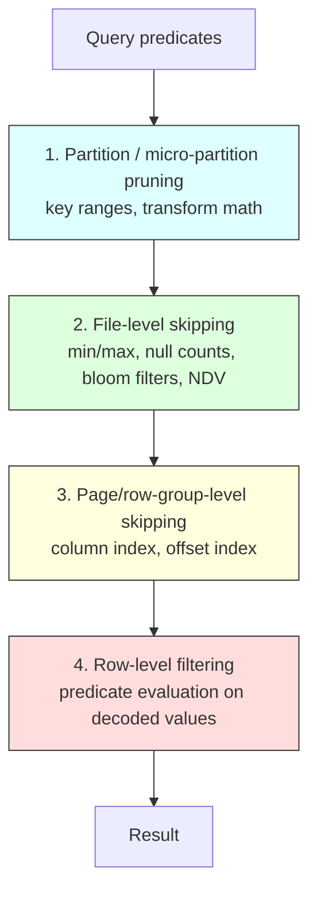

# Partitioning

> Partitioning is how you tell the storage engine which parts of a table *cannot possibly* contain
> the answer, so it never reads them. Everything else in analytical performance — columnar layout,
> compression, vectorized execution, GPU-accelerated scans — is downstream of that single
> mechanism. A senior engineer treats partitioning as a **contract with the query workload**: the
> physical layout must match the predicates people actually write. Get it right and scans drop by
> 99%+; get it wrong and you spend seven figures scanning data you didn't need, while your metadata
> layer melts under millions of tiny files. This chapter covers the mechanism (pruning), the
> encodings (Hive-style directories, hidden transforms, cluster/sort keys), the pathologies
> (over-partitioning, small files, skew), and the modern tools that replaced hand-rolled
> partitioning (liquid clustering, automatic micro-partitioning, partition evolution).

---

## TL;DR

- **Partitioning exists to enable pruning.** If a layout does not let the engine skip storage units
  for your real predicates, it is decoration.
- **Three layout mechanisms, often confused**: *partitioning* (splits data into independently
  managed units — coarse, no cross-unit pruning), *sorting/clustering* (orders within units —
  enables range skipping inside a unit), and *bucketing* (hash-distributes for joins/merges).
  You need all three for different jobs.
- **Target ~128 MB – 1 GB per partition unit and 128 MB – 1 GB files.** Under ~16 MB units, your
  overhead dominates your data.
- **Over-partitioning is the most common senior-level self-inflicted wound**: partitioning by
  `user_id`, `hour` for low-volume data, or by five columns "just in case". Symptoms: millions of
  small files, minutes of planning, metastore/OOM pain.
- **Hidden partitioning (Iceberg) decouples pruning from the table schema**: `PARTITIONED BY
  (days(ts))` prunes on `ts` without exposing partition columns, and supports **partition
  evolution** — change the spec without rewriting history.
- **Warehouse engines replaced manual partitioning with automatic metadata**: Snowflake
  micro-partitions + cluster keys, BigQuery date/integer/range partitioning + clustering, Redshift
  sort keys + zone maps, Delta liquid clustering. In those systems "partitioning" is often a
  *clustering* concern, not a directory concern.
- **Pruning happens at four levels**: partition → file (min/max, null counts, bloom) → page (column
  index) → row (filter). Each level needs statistics; missing or stale statistics silently disable
  pruning.
- **Predicate form matters**: casts, functions, and implicit conversions on the partition column
  (`WHERE DATE(ts) = '2026-03-01'`, `WHERE cast(dt AS date) = ...`, timezone mismatches) can kill
  pruning entirely. This is the #1 "why is this query 100× slower" cause in practice.
- **Dynamic partition pruning** (runtime filters) pushes a filter derived from one side of a join
  into the scan of the other side. Enabling it is often a bigger win than any manual layout change.
- **Small files are a partitioning problem in disguise.** Partition cardinality × write frequency
  × concurrency = file count. Control all three.
- **Compaction and clustering are maintenance, not one-off migrations.** Without a schedule,
  layout decays monotonically.

---

## 1. Definitions and core vocabulary

| Term | Meaning |
|---|---|
| **Partition** | A coarse, independently managed subset of rows, usually identified by a value or range of a column (or a derived transform of it). Often a directory in lake layouts. |
| **Partition key / spec** | The column(s) or transform(s) that define the partitioning. |
| **Partition pruning** | Eliminating whole partitions at plan time because their key range cannot satisfy the predicate. |
| **Partition column** | The column whose value determines the partition. In Hive-style layouts it is often materialized in the path (`dt=2026-03-01`). |
| **Hive-style partitioning** | Directory convention `<col>=<value>/` (or nested `dt=.../hour=...`), registered in a metastore. |
| **Hidden partitioning** | Partitioning declared as a transform on a data column, not surfaced as a user-visible column (Iceberg). Predicates on the source column prune automatically. |
| **Partition transform** | A function from a source column to a partition value: `identity`, `bucket[N]`, `truncate[W]`, `year`, `month`, `day`, `hour`, `void`. |
| **Partition evolution** | Changing the partition spec over time; existing data keeps its old layout, new writes use the new spec. |
| **Bucketing** | Hash-distributing rows into a fixed number of buckets (`bucket(16, customer_id)`) to co-locate join/merge keys. |
| **Cluster key** | In Snowflake, a declared column set used to co-locate values inside micro-partitions (plus background reclustering). |
| **Micro-partition** | Snowflake's automatic 50–500 MB storage unit with per-column min/max metadata. |
| **Zone map** | Per-unit min/max statistics (Redshift's term; the general mechanism). |
| **Data skipping / file skipping** | File-level pruning using min/max, null counts, and (in Delta) deletion-vector-aware stats. |
| **Page index / column index** | Parquet feature: per-page min/max statistics enabling page-level skipping within a row group. |
| **Bloom filter** | Probabilistic membership structure used to prune files for equality predicates on high-cardinality columns (where min/max is useless). |
| **Dynamic partition pruning (DPP)** | Runtime pruning using a filter produced by the other side of a join (aka runtime filter, min-max filter, bloom join filter). |
| **Static vs dynamic partition overwrite** | Whether a write replaces only the partitions present in the data (dynamic) or all partitions in the table (static). |
| **Over-partitioning** | Partition cardinality far exceeding what the data volume and query patterns justify. |
| **Small file problem** | Degradation caused by millions of tiny files (planning time, request cost, task overhead). |
| **Compaction** | Rewriting many small files into fewer large ones (bin-packing), optionally re-sorted/clustered (Z-order). |
| **Z-order / Hilbert clustering** | Space-filling-curve ordering that preserves locality in multiple dimensions simultaneously. |
| **Liquid clustering** | Delta's incremental clustering: declare `CLUSTER BY (cols)`, engine clusters new data in the background without a full rewrite. |

---

## 2. What problem it solves / why it matters

### 2.1 The fundamental win

```text
SELECT SUM(revenue) FROM events WHERE event_date = '2026-03-01';
```

| Layout | Bytes read (10 TB table, 3 years) | Relative cost |
|---|---|---|
| No partitioning | 10 TB + all footers | 1× |
| Partitioned by day | ~9 GB (one day) + 1095 footers | ~1/1100 |
| Partitioned by day, clustered by `country` | ~300 MB | ~1/33000 |
| Partitioned by day, page-index + bloom on `country` | ~30 MB | ~1/330000 |

At $5/TB scanned (BigQuery-equivalent) that is the difference between **$50,000** and **$0.15** for
one query. Multiply by the number of dashboards and refreshes and you have the entire economic
argument for caring about partitioning.

### 2.2 Four independent pruning levels



Pruning is *conjunctive*: a query gets the benefit only if the predicate can be expressed against
the metadata. `WHERE dt >= '2026-01-01'` prunes; `WHERE UPPER(dt) >= '...'` does not.

### 2.3 What partitioning also enables (and costs)

| Enables | Costs |
|---|---|
| Pruning → cheaper scans | Metadata growth (one entry per partition) |
| Independent overwrite (idempotent backfills per partition) | Planning overhead proportional to partition count |
| Parallelism (one task per partition/file) | Small files when partitions are small |
| Retention/expiry by partition (DROP PARTITION) | Skew when data is unevenly distributed |
| Tiering (move old partitions to cheaper storage) | Complexity in queries that don't filter on the key |
| Isolation (partition-level access control) | Rigidity if the workload changes |

---

## 3. How it works internally

### 3.1 Hive-style directory partitioning (the classic lake layout)

```text
s3://bucket/events/
├── event_date=2026-02-27/
│   ├── part-00000.parquet      (128 MB)
│   ├── part-00001.parquet
│   └── part-00002.parquet
├── event_date=2026-02-28/
│   └── ...
└── event_date=2026-03-01/
    └── ...
```

The directory name *is* the metadata. To prune, the engine needs the **partition list**:

```sql
-- Hive-style: partitions registered in the metastore
ALTER TABLE events ADD PARTITION (event_date='2026-03-01')
  LOCATION 's3://bucket/events/event_date=2026-03-01/';

-- If files appeared without registration (e.g. an external writer):
MSCK REPAIR TABLE events;              -- Hive/Spark: lists S3 and adds missing partitions
ALTER TABLE events RECOVER PARTITIONS; -- Spark 3.3+ equivalent (much faster)
```

The failure mode is obvious: **without registration, the engine does not know the partition
exists** — and registration requires a listing, which is O(files) in S3.

With partition discovery enabled (`spark.sql.hive.metastorePartitionPruning`,
`spark.sql.sources.partitionOverwriteMode`), Spark can also list and infer partitions from the path
directly — which is convenient and the reason "listing leaf files" appears in job logs for minutes
at a time.

### 3.2 Iceberg hidden partitioning and transforms

```sql
CREATE TABLE lake.silver.events (
  event_id  STRING,
  ts        TIMESTAMP,
  user_id   BIGINT,
  country   STRING,
  revenue   DECIMAL(18,4)
)
USING iceberg
PARTITIONED BY (days(ts), bucket(16, user_id));
```

Three things happen that Hive-style layouts cannot do:

1. **No partition columns in the schema.** Users write `WHERE ts >= '2026-03-01'`; Iceberg computes
   `days(ts)` and prunes. No `WHERE event_date = '2026-03-01'` gymnastics, no null partitions from
   unqualified writers.
2. **Transforms are declarative.** `bucket(16, user_id)` co-locates all rows for a hash bucket;
   `truncate(4, name)` groups by prefix; `hour(ts)` for high-volume streams.
3. **Partition evolution.** Change to `PARTITIONED BY (hours(ts))` and only new data uses the new
   spec; old data is still pruned correctly because each manifest carries its own spec id.

```sql
ALTER TABLE lake.silver.events
  REPLACE PARTITION FIELD days(ts) WITH hours(ts);   -- metadata-only, no rewrite
```

The planner evaluates pruning per *transform*: for `days(ts)` and predicate `ts >= X`, it computes
`days(X)` and skips manifests whose partition summaries don't overlap. The manifest list holds
**partition summaries per manifest**, so pruning happens before reading manifests at all.

### 3.3 Delta partitioning, generated columns, and liquid clustering

```sql
-- Classic: physical partition columns
CREATE TABLE silver.events (
  event_id STRING, ts TIMESTAMP, country STRING
)
USING delta
PARTITIONED BY (DATE(ts))          -- Delta supports generated expressions for partition columns
TBLPROPERTIES ('delta.autoOptimize.optimizeWrite' = 'true');

-- Modern: liquid clustering (Delta 3.0+)
ALTER TABLE silver.events CLUSTER BY (country, ts);
-- or, at creation
CREATE TABLE silver.events_clustered (...)
USING delta CLUSTER BY (country, ts);

OPTIMIZE silver.events;             -- clusters new data incrementally; no full rewrite required
```

Liquid clustering is important because it decouples two things that static partitioning conflated:
*file size management* and *data ordering*. You no longer need to choose between "one file per day
for pruning" and "128 MB files for efficiency" — the engine clusters within the data to hit both,
and you can change clustering columns without rewriting history (the old data remains queryable;
new data follows the new clustering).

### 3.4 Warehouse-side modulo: micro-partitions, sort keys, clustering

| Engine | Unit | Layout control | Pruning metadata |
|---|---|---|---|
| **Snowflake** | 50–500 MB micro-partitions (automatic) | Optional `CLUSTER BY (cols)`; background Automatic Clustering | Per-column min/max/null count per micro-partition; evaluated at plan time |
| **BigQuery** | Storage blocks (automatic) | `PARTITION BY` (date/timestamp/datetime/range/integer-range/ingestion-time) + `CLUSTER BY (≤4 cols)` | Partition metadata + block-level clustering stats |
| **Redshift** | 1 MB blocks in columnar slices | `DISTKEY` (worker placement) + `SORTKEY` (compound/interleaved) or AUTO | Zone maps per 1 MB block |
| **Databricks SQL** | Delta files | Liquid clustering / partition columns | Delta log file stats (+ DV-aware pruning) |
| **Athena/Trino on Iceberg** | Iceberg manifests | Iceberg partition spec + sort orders | Manifest partition summaries + file stats |
| **ClickHouse** | Parts + granules (8192 rows) | `PARTITION BY`, `ORDER BY` (the primary index) | Granule-level min/max from the primary index |
| **BigQuery** | Storage blocks | See above | Clustering block pruning |

The conceptual unification: **every engine needs (a) a coarse unit with a key range and (b) a
manifest of which unit holds what range.** The vocabulary changes; the mechanism does not.

```sql
-- Snowflake: check clustering quality before and after adding a cluster key
SELECT SYSTEM$CLUSTERING_INFORMATION('analytics.fact_events', '(country, ts)');
-- output includes average_depth / average_overlaps: lower is better
ALTER TABLE analytics.fact_events CLUSTER BY (country, ts);
```

```sql
-- BigQuery: partition + cluster (the standard pattern)
CREATE TABLE analytics.events
PARTITION BY DATE(ts)
CLUSTER BY country, event_type
AS SELECT * FROM staging.events;

-- Verify pruning (bytes processed is shown in the job stats; information_schema for history)
SELECT job_id, total_bytes_processed, total_bytes_billed
FROM `region-us`.INFORMATION_SCHEMA.JOBS
WHERE creation_time > TIMESTAMP_SUB(CURRENT_TIMESTAMP(), INTERVAL 1 DAY)
ORDER BY total_bytes_processed DESC LIMIT 10;
```

```sql
-- Redshift: choose a sort key that matches range predicates
ALTER TABLE fact_events ALTER SORTKEY (event_ts, country);   -- zone maps prune per 1 MB block
```

### 3.5 Bucketing: the join/merge accelerator

Bucketing is not about pruning; it is about **co-location**.

```sql
-- Iceberg: bucket both sides by the join key → each task joins matching buckets only
CREATE TABLE lake.silver.orders
  PARTITIONED BY (bucket(16, customer_id)) ...
CREATE TABLE lake.silver.customers
  PARTITIONED BY (bucket(16, customer_id)) ...

-- Result: no full shuffle for the join; each of 16 buckets joins locally.
```

```python
# Spark: same idea with a keyed repartition (beware: repartition ≠ bucketing across writers)
df.repartition(16, "customer_id")
```

Bucketing helps when:

- The table is joined/MERGEd repeatedly on the same high-cardinality key.
- The write is a MERGE with a large update volume (fewer files to touch per key).
- You want to avoid shuffle for a specific join.

Bucketing hurts when:

- The key changes (you must rewrite the table to rebucket).
- The key has skew (one huge bucket).
- The number of buckets is misconfigured (too few → huge files; too many → small files).

> **Senior note**: distinguish *bucketing for pruning* (wrong — hash values have no order) from
> *bucketing for co-location* (right). A common mistake is to bucket by a key and then expect
> range queries to prune. They won't.

### 3.6 Dynamic partition pruning in practice

```text
Plan:  fact  ⟕ dim_filtered
       fact is 10 TB partitioned by day (1095 partitions)
       dim_filtered selects 3 days

Without DPP: fact scans 1095 partitions (or a full-table filter at row level)
With DPP:    at runtime, the dim side produces {2026-03-01, 03-02, 03-03}
             → pushed as a dynamic filter into the fact scan
             → 3 partitions read.
```

```sql
-- Spark: DPP is on by default for supported joins; verify in the plan
SET spark.sql.optimizer.dynamicPartitionPruning.enabled = true;
SET spark.sql.optimizer.dynamicPartitionPruning.reuseBroadcastOnly = false;
SET spark.sql.optimizer.dynamicPartitionPruning.useStats = true;
EXPLAIN FORMATTED
SELECT f.* FROM fact f JOIN dim d ON f.dt = d.dt WHERE d.region = 'EU';
-- look for: DynamicPartitionPruning / "DynamicPruningSubquery" / partition filters on fact
```

```sql
-- BigQuery: join on the partitioning column enables runtime pruning automatically
SELECT f.*
FROM analytics.facts f
JOIN (SELECT DISTINCT dt FROM dims WHERE region='EU') d
  ON f.dt = d.dt;      -- dt is the partitioning column → pruned at runtime
```

DPP requires the filter to be expressible on the partition key. Joining on `f.event_ts = d.ts` when
the table is partitioned by `days(event_ts)` generally works in Iceberg (transform-aware) but not in
Hive-style layouts.

---

## 4. How to implement it (step by step)

### Step 1 — Derive the layout from the query log, not from intuition

```sql
-- Snowflake: which columns appear in filters, and how often?
SELECT
  query_text_sample,
  REGEXP_COUNT(UPPER(query_text_sample), 'WHERE') AS has_where
FROM SNOWFLAKE.ACCOUNT_USAGE.QUERY_HISTORY_SAMPLE
LIMIT 5;
```

In practice you will parse query logs (or use a profiler / `system.query_log` in ClickHouse /
`INFORMATION_SCHEMA.JOBS` in BigQuery) and produce:

| Prediction column | Query frequency | Selectivity | Range vs equality | Appears with other predicates |
|---|---|---|---|---|
| `event_date` | 92% of queries | day | range | always |
| `country` | 41% | ~200 values | equality + IN | often |
| `event_type` | 33% | ~30 values | equality | sometimes |
| `user_id` | 6% | very high | equality | rare (point lookups) |

**Rule**: partition by the lowest-cardinality, most-frequently-filtered *coarse* column
(usually time). Cluster/sort by the next 2–3.

### Step 2 — Choose the partition granularity by volume math

```text
Target: 128 MB – 1 GB per partition, 128 MB – 1 GB per file, < 100 files per partition.

scenario A: 50 TB/day of events
  → hourly partitions: 50e12/24 ≈ 2.1 TB/hour → too big for one file, but fine as a
    partition with ~16 files. Use hour(ts) + bucket on join key.

scenario B: 500 MB/day
  → daily partitions give one 500 MB file/day: fine. Never use hourly (24 tiny files/day
    → 8,760 files/year of ~20 MB).

scenario C: 5 GB/day but only 2 years of history and queries always filter a week at a time
  → day partitions are OK (5 GB/day is comfortable), or month partitions if queries are monthly.

scenario D: 40 TB total, 10 TB/month, queries filter by month and by country
  → month partitions (10 TB is too big!) → no: use day, or month + cluster on country.
```

Formal heuristic:

```text
bytes_per_partition = total_bytes / partition_count
choose partition_count ∈ [total_bytes / 1GB, total_bytes / 128MB]  →  hmm
Better: choose the granularity G such that  bytes_per_bucket(G) ∈ [256 MB, 8 GB]
        (256 MB keeps file counts reasonable; >8 GB makes single files too few/large for pruning)
```

### Step 3 — Implement per platform

**Iceberg (recommended for lakes)**

```sql
CREATE TABLE lake.silver.events (
  event_id  STRING,
  ts        TIMESTAMP,
  user_id   BIGINT,
  country   STRING,
  payload   STRING
)
USING iceberg
PARTITIONED BY (days(ts), bucket(64, user_id))
TBLPROPERTIES (
  'write.target-file-size-bytes'   = '134217728',
  'write.distribution-mode'        = 'hash',
  'write.sort-order'               = 'country ASC NULLS LAST'
);

-- Add local ordering to improve within-file skipping
ALTER TABLE lake.silver.events WRITE ORDERED BY country, ts;
```

**Delta (Spark/Databricks)**

```sql
CREATE TABLE silver.events (
  event_id STRING, ts TIMESTAMP, user_id BIGINT, country STRING
)
USING delta
CLUSTER BY (country, ts)                 -- liquid clustering (preferred)
TBLPROPERTIES (
  'delta.autoOptimize.optimizeWrite' = 'true',
  'delta.autoOptimize.autoCompact'   = 'true',
  'delta.targetFileSize'             = '134217728'
);
-- For classic layouts: PARTITIONED BY (event_date) with a generated column
```

**Hive-style on S3 (legacy but still common)**

```sql
CREATE EXTERNAL TABLE raw.events (
  event_id STRING, ts TIMESTAMP, user_id BIGINT, country STRING
)
PARTITIONED BY (event_date DATE)
STORED AS PARQUET
LOCATION 's3://bucket/raw/events/'
TBLPROPERTIES ('parquet.compression' = 'ZSTD');

-- Write with dynamic partition insertion
SET hive.exec.dynamic.partition = true;
SET hive.exec.dynamic.partition.mode = nonstrict;
INSERT OVERWRITE TABLE raw.events PARTITION (event_date)
SELECT event_id, ts, user_id, country, DATE(ts) AS event_date
FROM staging.events_incoming;

-- Spark equivalent with dynamic partition overwrite (idempotent daily loads)
SET spark.sql.sources.partitionOverwriteMode = dynamic;
```

**Snowflake**

```sql
ALTER TABLE analytics.fact_events CLUSTER BY (event_date, country);
-- Or, better, keep the table automatically clustered and rely on natural ingestion order
-- + micro-partition pruning; only add cluster keys where pruning demonstrably fails.
SELECT SYSTEM$CLUSTERING_INFORMATION('analytics.fact_events', '(event_date, country)');
```

**BigQuery**

```sql
CREATE TABLE analytics.fact_events (
  ts TIMESTAMP, country STRING, user_id INT64, revenue NUMERIC
)
PARTITION BY DATE_TRUNC(ts, DAY)
CLUSTER BY country, user_id
OPTIONS (require_partition_filter = TRUE, partition_expiration_days = 1825);
```

### Step 4 — Fix pathological predicates (the highest-ROI change)

```sql
-- ❌ No pruning: function on the partition column
WHERE DATE(ts) = '2026-03-01'

-- ✅ Pruning works
WHERE ts >= '2026-03-01' AND ts < '2026-03-02'

-- ❌ No pruning: cast/conversion
WHERE CAST(dt AS STRING) = '2026-03-01'
WHERE dt = DATE '2026-03-01'          -- type mismatch vs STRING partition column
WHERE DATE_TRUNC('day', ts) = '2026-03-01'

-- ✅ Type-correct literal
WHERE dt = '2026-03-01'               -- matches the partition column's type

-- ❌ No pruning: OR across different columns
WHERE dt = '2026-03-01' OR country = 'EU'

-- ❌ No pruning: timezone drift
-- data written in UTC as ts=...Z, query with local timestamp literal
WHERE ts = TIMESTAMP '2026-03-01 00:00:00'   -- ambiguous TZ → may scan extra/miss data

-- ✅ Explicit and unambiguous
WHERE ts >= TIMESTAMP '2026-03-01 00:00:00+00:00'
  AND ts <  TIMESTAMP '2026-03-02 00:00:00+00:00'
```

`> Senior note`: in Hive-style layouts also avoid `WHERE dt > '2026-03-01'` against a *STRING*
partition column when the values are zero-padded inconsistently (`2026-3-1` sorts wrong). Use
`DATE`-typed partition columns or Iceberg's transforms.

### Step 5 — Schedule layout maintenance

```sql
-- Iceberg: incremental bin-pack (small files) + clustering (ordering)
CALL lake.system.rewrite_data_files(table => 'silver.events',
     options => map('min-input-files','5','target-file-size-bytes','134217728'));

CALL lake.system.rewrite_data_files(table => 'silver.events', strategy => 'sort',
     sort_order => 'zorder(country, event_type)',
     options => map('min-input-files','5'));

-- Delta
OPTIMIZE silver.events;                            -- bin-pack
OPTIMIZE silver.events ZORDER BY (country, event_type);

-- Hive/Spark legacy: rewrite a partition with the right file count
INSERT OVERWRITE TABLE raw.events PARTITION (event_date='2026-03-01')
SELECT /*+ REPARTITION(8) */ * FROM raw.events WHERE event_date='2026-03-01';
```

### Step 6 — Monitor partitioning health continuously

```sql
-- Iceberg: files per partition and size distribution (no S3 LIST needed)
SELECT partition, file_count, record_count,
       CAST(total_size / NULLIF(file_count,0) AS BIGINT) AS avg_file_bytes
FROM lake.silver.events.partitions
ORDER BY file_count DESC LIMIT 20;
```

```python
# Spark: AQE + skew join for hot partitions
spark.conf.set("spark.sql.adaptive.enabled", "true")
spark.conf.set("spark.sql.adaptive.skewJoin.enabled", "true")
spark.conf.set("spark.sql.adaptive.skewJoin.skewedPartitionFactor", "5")
spark.conf.set("spark.sql.adaptive.skewJoin.skewedPartitionThresholdInBytes", "256m")
spark.conf.set("spark.sql.adaptive.advisoryPartitionSizeInBytes", "128m")
spark.conf.set("spark.sql.adaptive.coalescePartitions.enabled", "true")
spark.conf.set("spark.sql.shuffle.partitions", "400")   # only a starting point; AQE adjusts
```

---

## 5. Where to implement it (tool/platform guidance)

| Platform / format | Partition mechanism | Layout API | Pruning metadata | Gotcha |
|---|---|---|---|---|
| **Apache Iceberg** | Hidden transforms (`days`, `bucket`, `truncate`), partition evolution | `PARTITIONED BY (transform(col))`, `WRITE ORDERED BY` | Manifest partition summaries + file stats + Puffin NDV | v3 features unsupported by older engines |
| **Delta Lake** | Physical partition columns, generated columns, **liquid clustering** | `PARTITIONED BY`, `CLUSTER BY` | Delta log stats (min/max, nulls) + DV-aware counts | Static partitioning is hard to change → prefer liquid clustering |
| **Apache Hudi** | Partition path field (simple/complex key generators) | `hoodie.datasource.write.partitionpath.field` | Metadata table column stats + bloom + record index | Partition path changes are expensive; key generators must be stable |
| **Snowflake** | Automatic micro-partitions | `CLUSTER BY` + Automatic Clustering | Per-column min/max per micro-partition | Clustering consumes credits; don't cluster everything |
| **BigQuery** | Date/timestamp/datetime/range/integer-range/ingestion-time | `PARTITION BY`, `CLUSTER BY` (≤4 cols) | Partition metadata + block clustering | `require_partition_filter` is your cost friend |
| **Redshift** | Blocks within slices | `DISTKEY`, `SORTKEY` (compound/interleaved) or AUTO | Zone maps | VACUUM/ANALYZE legacy burden; interleaved sort keys expensive to maintain |
| **Athena / Trino (Hive)** | Hive-style directories | `PARTITIONED BY` + `MSCK`/`RECOVER PARTITIONS` | Partition list + file stats + optional bloom | Listing cost; unregistered partitions invisible |
| **Trino + Iceberg** | Iceberg spec | same as Iceberg | Manifest summaries | Needs `iceberg.*` catalog config |
| **ClickHouse** | `PARTITION BY` + `ORDER BY` primary index | DDL | Granule min/max from primary index | MergeTree parts management (merges) |
| **Hive/Spark legacy** | Hive-style directories | `PARTITIONED BY` | Partition list only (plus file stats in ORC/Parquet) | Metastore scalability walls |
| **Databricks** | Delta + liquid clustering + predictive optimization | `CLUSTER BY` | Delta log stats | Auto-compaction must be on |

---

## 6. Patterns and anti-patterns

### 6.1 Patterns

| Pattern | Description | When it applies |
|---|---|---|
| **Time-first partitioning** | Partition by day/hour/month depending on volume | Almost every event/fact table |
| **Partition + cluster (two-level)** | Coarse partition, fine clustering inside (`country`, `event_type`) | Multi-dimensional predicates |
| **Bucket co-location** | Bucket both join sides by the same key | Repeated large joins/MERGEs |
| **Hidden transforms (Iceberg)** | Never expose partition columns | When writers are diverse or SQL authors are many |
| **Partition evolution over migration** | Change spec for new data only | When query patterns change over time |
| **Dynamic partition overwrite** | `INSERT OVERWRITE ... PARTITION (dt)` replaces only written partitions | Idempotent daily/hourly backfills |
| **Ingest-time + event-time partitioning (dual)** | Operational audit vs business queries | Late-arriving data |
| **Partition-level retention** | Drop/expire old partitions to control cost | Regulatory retention policies |
| **Skew-aware partitioning** | Salt hot keys or split the giant partition | Celebrity/hot-key datasets |
| **Statistics-first** | Ensure stats collection is enabled (`COMPUTE STATISTICS`, Parquet stats on) | Before blaming the engine |
| **`require_partition_filter` / guardrails** | Prevent accidental full scans | BigQuery, Trino resource groups, Snowflake query timeouts |

### 6.2 Anti-patterns

| Anti-pattern | Why it hurts | Detection | Fix |
|---|---|---|---|
| **Partition by high-cardinality ID** (`user_id`, `uuid`) | Millions of tiny partitions; metastore and listing melt | Partition count from metadata tables, HMS table size | Partition by date; cluster/bucket by ID |
| **Hourly partitions for low-volume data** | 24 tiny files/day; 8,760/year | Avg file size < 8 MB | Daily or monthly partitioning |
| **Five-column partition schemes** | Explosion of combinations; sparse directories | Partition count ≫ data/128MB | At most 1–2 partition columns; cluster the rest |
| **Partitioning by a column nobody filters on** | Zero pruning benefit, all costs | Query log analysis | Repartition by an actually-filtered column |
| **`SELECT *` with no partition predicate** | Full-table scan | Bytes scanned per query | Guardrails + views |
| **Function/cast on the partition column** | Pruning silently disabled | Compare `partitions_scanned` vs `partitions_total` | Rewrite predicate |
| **Static partition overwrite by accident** | Wipes unrelated partitions | Sudden row-count drop | `partitionOverwriteMode=dynamic`; test in CI |
| **Partitioning without compaction** | File count grows forever | Files per partition metric | Schedule compaction |
| **Ignoring skew** | One task 100× slower | Task duration distribution | Salting, AQE skew join, split heavy partitions |
| **Changing partition scheme by rewriting everything** | Weeks of compute, high risk | Migration tickets | Iceberg partition evolution / liquid clustering |
| **Materializing the partition column redundantly** | Two columns for one concept; drift | Duplicate `ts`/`event_date` values disagreeing | Use hidden transforms; or derive with a generated column, single source |
| **Partitioning the warehouse like a lake** | Snowflake/BigQuery don't need directory structures | Manual date columns in DDL | Use native clustering/partitioning instead |
| **Mixing timezones in partition values** | Missing/duplicated days | `partitions` metadata shows both `2026-03-01` and shifted values | Force UTC (or a single declared zone) at ingest |

---

## 7. Real-world use cases and industry applications

| Domain | Layout pattern | Why |
|---|---|---|
| **Clickstream / ad-tech (billions of events/day)** | `hour(ts)` partition + `bucket(N, user_id)` + sort by `event_type` | Hourly volume is terabytes; queries filter recent hours and specific campaigns |
| **Financial transactions (regulatory)** | `day(ts)` partition + cluster on `account_id`; immutable partitions | Daily reconciliation and per-account investigation; retention by partition |
| **IoT / telemetry** | `day(ts)` + `device_id` bucketed; downsampled aggregates in gold | High ingest, range queries by device/time |
| **Retail sales** | `date` partition + cluster by `store_id`, `product_category` | Dashboards filter date ranges and compare stores/categories |
| **Healthcare claims / EHR** | Partition by `service_month`; cluster by `payer`, `member_id`; PHI separated by catalog | Regulatory retention and access isolation per partition |
| **Log analytics** | `day(ts)` + `hour` for hot weeks; older data compacted monthly | Recent data is queried far more; monthly compaction reduces file count |
| **ML feature tables** | `entity_id` bucket + `day(ts)` partition; point-in-time correctness | Join-heavy feature retrieval; snapshot-consistent training sets |
| **CDC mirrors (ERP/CRM)** | Partition by change-date; cluster by primary key | Incremental consumption plus key lookups |
| **Public data / research** | Coarse partitioning (year/month) + heavy clustering | Queries are broad, data is mostly cold, small files cost dominates |

Illustrative real architectures:

- **Uber**: Hudi tables with `partitionpath` fields and metadata-table statistics; they explicitly
  measure and tune "file group" sizes to avoid small files in a streaming-write regime.
- **Netflix**: Iceberg with hidden partitioning to keep the query surface simple while allowing
  partition evolution as ingestion patterns shifted.
- **LinkedIn**: large Iceberg tables where manifest-level partition summaries do the pruning, with
  background compaction jobs to control file counts.
- **BigQuery users generally**: date partitioning + up to 4 clustering columns, with
  `require_partition_filter` as a hard cost guardrail.

---

## 8. Senior-level deep dive

### 8.1 Comparing layout strategies with a single worksheet

| Strategy | Prunes on | Prunes multi-dim? | Cost to change | Best for |
|---|---|---|---|---|
| Directory partitioning (Hive-style) | Equality/range on the partition column | No | Full rewrite | Legacy lakes, cheap simple layouts |
| Iceberg hidden partitioning | Transforms on any column | Partially (bucket + partition) | Free (evolution) | Multi-engine lakehouse |
| Sort order within files | Range on sorted columns | Limited | Compaction job | Time-series, single dominant filter |
| Z-order / space-filling curve | Multiple columns simultaneously | Yes (2–4 columns) | Compaction job (full sort) | Multi-predicate dashboards |
| Liquid clustering | Declared columns | Yes | Incremental (background) | Evolving workloads, Delta |
| Bucketing | Join co-location only | n/a | Full rewrite | Repeated big joins/MERGEs |
| Micro-partitioning + cluster key (Snowflake) | Any column (auto min/max) | Via cluster key | Automatic (background credits) | Warehouses with mixed workloads |
| Partitioning + clustering (BigQuery) | Partition column + ≤4 cluster cols | Yes | Re-cluster new data | BigQuery-native designs |

### 8.2 The small-file arithmetic

```text
Given: ingest rate R rows/sec, rows per file F, N writers, D directories (partitions)

files_per_hour = R × 3600 / F × N
One streaming job, 5,000 rows/s, 200k rows/file, 1 writer:
  files/hour = 5,000 × 3600 / 200,000 = 90 files/hour = 2,160/day = 788,400/year

Consequences:
  - Planning: 788k files ⇒ 788+ LIST pages, or manifest fan-out; planners take seconds→minutes.
  - Requests: 788k GETs per full scan (footer reads) ⇒ thousands of $ per year in requests
    alone, plus 788k task creations at ~1s each ⇒ 219 CPU-hours of pure overhead per scan.
  - Fix: buffer to 128 MB files (200k rows × ~600 bytes = 120 MB ✓) — already assumed.
    Real fix: reduce file count via compaction to 128 MB-1 GB, and/or reduce partitions.

Sanity targets:
  avg file size      ≥ 64 MB  (128 MB+ ideal)
  files per partition 1–10    (< 100 hard)
  partitions per table < 100k (metadata scalability)
  planning share of query time < 5%
```

### 8.3 Trade-off matrix: granularity vs overhead

| Partition granularity | Pruning quality | Metadata/planning cost | Small-file risk | Recommended when |
|---|---|---|---|---|
| Year | Poor (scans a year) | Trivial | None | Archival, tiny tables |
| Month | Moderate | Low | Low | < 1 GB/day, monthly queries |
| Day | Good (default) | Moderate | Moderate | 100 MB–50 GB/day |
| Hour | Strong for recent data | High (8.7k/yr) | High | > 50 GB/day or strict freshness |
| 15 min | Very strong | Very high | Very high | Extreme-volume streams with narrow queries |
| High-cardinality key | None (unusable) | Catastrophic | Catastrophic | Never as a partition; use bucketing |

### 8.4 Failure modes and debugging

| Symptom | Likely cause | Diagnostic | Fix |
|---|---|---|---|
| Query scans all partitions despite a filter | Predicate not expressible on the partition key (function/cast/type mismatch) | Check `partitions_scanned/total` or the physical plan's partition filters | Rewrite predicate; align types/timezones |
| "Listing leaf files for X paths" takes minutes | Hive-style discovery over millions of files | Spark UI / driver logs | Use a table format with manifests; `RECOVER PARTITIONS` instead of `MSCK`; reduce partitions |
| Job has 200k tiny tasks | One task per small file | Task count vs data volume | Compaction; AQE coalescing; `maxPartitionBytes` |
| One task 50× slower | Skew (hot key or unbalanced partition) | Task duration histogram | Salt the key, AQE skew join, split the partition |
| New partitions not visible | Not registered in the metastore | `SHOW PARTITIONS` vs S3 listing | `MSCK REPAIR`/`RECOVER PARTITIONS`, or write via the table format |
| Old partitions unreadable after schema change | Hive-style partition key semantics vs evolved schema | Error or null partition columns | Iceberg partition evolution; migrate to transform-based layout |
| Compaction job never finishes | Too many files per group, undersized cluster | Job progress per group | `partial-progress.enabled`, `max-concurrent-file-group-rewrites`, larger cluster |
| Cost spikes without query changes | Data growth crossed a granularity threshold, or a dashboard dropped its filter | Bytes scanned trend | Re-partition/re-cluster; enforce `require_partition_filter` |
| Metastore slow / locking | Millions of partition rows in HMS/Glue | HMS DB metrics; Glue `GetPartitions` throttling | Reduce partition cardinality; use table-format metadata; partition index in Glue |
| Duplicate rows after backfill | Static partition overwrite | Compare partition row counts | Dynamic overwrite + idempotent writes |

Debugging snippets:

```python
# Spark: see exactly which partitions/files were read
df = spark.read.table("lake.silver.events").filter("ts >= '2026-03-01'")
plan = df._jdf.queryExecution().executedPlan().toString()
print(plan)                      # look for PartitionFilters / PushedFilters
```

```sql
-- Iceberg: manifest-level pruning evidence
SELECT * FROM lake.silver.events.manifests LIMIT 5;   -- partition_summaries per manifest
EXPLAIN SELECT * FROM lake.silver.events WHERE ts >= TIMESTAMP '2026-03-01 00:00:00';
```

```sql
-- Snowflake: were micro-partitions pruned?
SELECT query_id, partitions_scanned, partitions_total,
       bytes_scanned, percentage_scanned_from_cache
FROM SNOWFLAKE.ACCOUNT_USAGE.QUERY_HISTORY
WHERE query_id = LAST_QUERY_ID();

-- Snowflake clustering depth guide
SELECT SYSTEM$CLUSTERING_INFORMATION('analytics.fact_events', '(event_date, country)');
```

### 8.5 Design review checklist (use this in code review of layouts)

```text
[ ] Partition key appears in > 70% of the queries on this table (evidence from query logs)
[ ] Partition granularity yields 256 MB – 8 GB per partition at current AND projected volume
[ ] Total partition count < 100k, and < 10k for Hive-metastore-backed tables
[ ] Clustering/sort order chosen for the O(1)-3 next-most-common predicates
[ ] No function/cast applied to the partition column in the top-20 production queries
[ ] Compaction + clustering jobs scheduled, monitored, and owned
[ ] Retention/expiry implemented at the partition level where legally required
[ ] Skew analyzed on the partition key (max/median partition size ratio < 5×)
[ ] Partition evolution path documented for when query patterns change
[ ] Partition column type and timezone are consistent across all writers
[ ] `require_partition_filter`-style guardrails enabled where the engine supports them
[ ] Metadata tables/monitoring expose files-per-partition and avg file size
```

---

## 9. Common mistakes and how to avoid them

1. **Choosing partitions from the schema instead of the query log.** Fix: instrument queries
   first; derive layout from evidence.
2. **Partitioning by a key that is only used for joins.** Fix: bucket instead.
3. **Forgetting that pruning requires the right predicate form.** Fix: review top queries with an
   `EXPLAIN`-based test in CI for the top 20 queries.
4. **Underestimating partition count growth.** Fix: compute the 3-year projection before choosing
   hourly granularity.
5. **Skipping compaction because "reads are OK today".** Fix: monitor file counts as a first-class
   SLO.
6. **Partitioning on a column that is null for a large fraction of rows.** Fix: handle nulls
   explicitly (Iceberg has a dedicated null partition; Hive gets `__HIVE_DEFAULT_PARTITION__`,
   which is easy to miss).
7. **Using `DATE(ts)`-derived string columns inconsistently (`2026-3-1` vs `2026-03-01`).** Fix:
   typed partition columns or transforms.
8. **Assuming clustering is free.** Fix: budget credits/engine hours for reclustering and measure
   `SYSTEM$CLUSTERING_INFORMATION` / `DESCRIBE DETAIL` before/after.
9. **Using Z-order on five columns.** Fix: 2–3 columns, chosen for the dominant multi-predicate
   queries.
10. **Leaving the sort/cluster key in place after the workload changed.** Fix: revisit layout
    yearly or when query mix shifts; Iceberg and liquid clustering make that cheap.
11. **Not sizing partitions for the *largest* day (Black Friday, a batch backfill).** Fix: size for
    p99 daily volume and let compaction handle spikes.
12. **Ignoring the write path's file sizing while tuning partitions.** Fix: `write.target-file-size-bytes`
    / `delta.targetFileSize` / `maxRecordsPerFile` are part of the layout, not just the partition key.

---

## 10. Exercises / interview questions

1. **Design.** A table receives 8 TB/day, growing to 40 TB/day within a year. Queries filter a
   specific hour, a specific campaign, and a date range. Choose partitioning, clustering, file
   sizing, and a compaction schedule. *Hint: hour(ts) + bucket(campaign_id) + sort by event_type;
   compaction every 30 min for the last 24 h.*

2. **Numbers.** `SELECT COUNT(*) FROM events WHERE ts BETWEEN '2026-01-01' AND '2026-03-31'`
   scans 3 TB of 60 TB with daily partitioning. What would it scan with monthly partitioning, and
   with clustering on `country`? Which is better and why? *Hint: partition pruning is coarse; the
   answer depends on how often the country filter is used.*

3. **Diagnosis.** `partitions_scanned = partitions_total` but the query has `WHERE dt = '2026-03-01'`.
   List three reasons. *Hint: type mismatch, function on the column, partition column is actually a
   different column name, or the table isn't partitioned at all (warehouse auto-layout).*

4. **Over-partitioning.** A team partitioned by `(dt, hour, country, device_type, app_version)`
   and now has 4.2M partitions. Explain what breaks, then propose a new layout. *Hint: metastore,
   listing, file count, planning; new layout = day + clustering.*

5. **Bucketing.** When does bucketing beat partitioning, and when is it a trap? *Hint: co-location
   for joins vs no pruning for ranges; rebucketing cost.*

6. **Dynamic pruning.** Explain how DPP works and construct a query where it fires and one where it
   cannot. *Hint: partition-key equality in the join condition; a function on the key breaks it.*

7. **Small files.** A streaming job emits 1 file/minute into daily partitions. Compute the 1-year
   file count, and design the maintenance plan. *Hint: 525,600 files/year; buffer to 5-min commits
   + compaction every hour.*

8. **Warehouse vs lake layout.** Explain why Snowflake needs a cluster key and not a partition
   spec, and why BigQuery wants both partition and clustering. *Hint: micro-partitioning is
   automatic; clustering is manual and coarse.*

9. **Skew.** 30% of events come from 0.1% of devices. Design a layout that avoids skew without
   breaking time-range pruning. *Hint: partition by day, bucket by device hash, salt device_id.*

10. **Migration.** You must move a 300 TB Hive table from daily partitions to hourly partitioning
    with no downtime and no full rewrite. Describe the approach. *Hint: Iceberg partition
    evolution; dual-write during transition; adjust queries (which no longer reference the
    partition column because it's hidden).*

---

## References

- Apache Iceberg — **Partitioning and partition transforms (spec)**. https://iceberg.apache.org/spec/#partitioning
- Apache Iceberg — **Partition evolution and hidden partitioning**. https://iceberg.apache.org/docs/latest/partitioning/
- Apache Iceberg — **Metadata tables (`partitions`, `files`, `manifests`)**. https://iceberg.apache.org/docs/latest/spark-queries/#inspecting-tables
- Delta Lake — **Liquid clustering**. https://docs.databricks.com/aws/en/tables/liquid-clustering
- Delta Lake — **Optimizations: OPTIMIZE, Z-ORDER, file skipping**. https://docs.delta.io/latest/optimizations-oss.html
- Snowflake — **Micro-partitions & data clustering**. https://docs.snowflake.com/en/user-guide/tables-clustering-micropartitions
- Snowflake — **`SYSTEM$CLUSTERING_INFORMATION`**. https://docs.snowflake.com/en/sql-reference/functions/system_clustering_information
- BigQuery — **Partitioned tables (date/range/integer-range/ingestion-time)**. https://cloud.google.com/bigquery/docs/partitioned-tables
- BigQuery — **Clustered tables**. https://cloud.google.com/bigquery/docs/clustered-tables
- Amazon Redshift — **Choosing sort keys and distribution styles / zone maps**. https://docs.aws.amazon.com/redshift/latest/dg/c_best-practices-sort-key.html
- Apache Spark — **Dynamic partition pruning & Adaptive Query Execution**. https://spark.apache.org/docs/latest/sql-performance-tuning.html#dynamic-partition-pruning
- Apache Hive — **Dynamic partitioning and `MSCK REPAIR TABLE`**. https://cwiki.apache.org/confluence/display/Hive/LanguageManual+DDL#LanguageManualDDL-DropPartitions
- Apache Parquet — **Page index / column index for page-level filtering**. https://parquet.apache.org/docs/file-format/pageindex/
- AWS Big Data Blog — **Optimize query performance with partition projection and small-file management**. https://aws.amazon.com/blogs/big-data/
- Databricks — **Predictive optimization**. https://docs.databricks.com/aws/en/optimizations/predictive-optimization
- ClickHouse — **MergeTree partitioning and primary index (granules)**. https://clickhouse.com/docs/en/engines/table-engines/mergetree-family/mergetree
