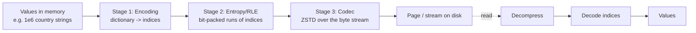

# Compression

> Compression is the highest-leverage single knob in a data platform, and the most misunderstood.
> Done well it cuts storage bills by 5–10×, cuts scan bytes by the same factor, makes shuffles small
> enough to fit in memory, and lets a network link carry 4× the events. Done badly it burns CPU in
> the hot path of every query, creates unsplittable files that serialize your cluster, and makes an
> "optimization" that is invisible in the query profile. The senior insight is that compression
> operates at *two* layers — **encoding** (how values are represented: dictionary, RLE, delta) and
> **codec** (a byte-level compressor like Snappy/ZSTD/GZIP) — and that the encoding layer usually
> matters 5–10× more than the codec. This chapter covers the algorithms, where each is used across
> the stack (files, shuffle, Kafka, network), how to reason about splittability, and how to choose
> and benchmark without fooling yourself.

---

## TL;DR

- **Encode first, then compress.** Dictionary/RLE/delta encodings reduce data 5–10× *before* a codec
  runs; the codec then works on already-repetitive bytes and gets another 1.2–3×.
- **Ranking for columnar analytics**: **ZSTD** (best default) > Snappy (legacy default, fast) >
  GZIP (legacy, slow, higher ratio) > LZ4 (lowest latency) > Brotli (web, poor ecosystem support) >
  bzip2 (splittable, obsolete).
- **Decompression speed matters more than compression speed** in read-heavy analytics — you compress
  once and decompress thousands of times. ZSTD was designed exactly for that asymmetry.
- **Compression is not splittable at the stream level, but it usually doesn't need to be.** Inside
  Parquet/ORC/Avro, the container provides the boundaries: each page, stream, or block is compressed
  independently, so parallelism is preserved. Only raw `file.gz` and raw `file.snappy` streams lose
  splittability.
- **ZSTD level 3 is the sweet spot** for hot data (near-Snappy speed, GZIP-like ratio). Use level
  9–19 only for cold/archival data, and remember levels above ~9 cost CPU superlinearly for
  diminishing gains.
- **Every layer has its own codec setting and its own default**, and the defaults are often wrong for
  your workload: Parquet page codec, shuffle codec, spill codec, Kafka producer codec, transport
  codec, JVM/MemoryManager. Know each one.
- **Data quality beats codecs**: sorting, low-cardinality columns, dropped unneeded columns, and
  removing high-entropy fields (UUIDs, timestamps-as-strings, JSON blobs) reduce size more than any
  codec choice.
- **Floats compress badly.** Use Parquet's `BYTE_STREAM_SPLIT` (or ClickHouse's `Gorilla`/`T64`) to
  make floating-point columns compressible. This is one of the few genuinely surprising wins.
- **Cost model**: compression trades CPU for I/O and storage. It's a win when you are I/O or network
  bound (almost always in analytics) and a loss when you are CPU bound (rare, but real for
  high-throughput low-latency streaming).
- **Benchmark end-to-end.** A 20% better compression ratio that costs 3× decompression CPU is a
  regression. Measure scan wall-clock, bytes read, CPU seconds, and storage; not just file size.

---

## 1. Definitions and core vocabulary

| Term | Meaning |
|---|---|
| **Codec** | A byte-level compression algorithm + format (Snappy, ZSTD, GZIP/deflate, LZ4, Brotli, bzip2, LZO, XZ). |
| **Encoding** | A value-representation transformation inside a columnar file (dictionary, RLE, delta, bit-packing, byte-stream-split). |
| **Compression ratio** | Uncompressed size ÷ compressed size. Also "effective compression" including column pruning and encoding. |
| **Compression level** | Trade-off parameter for some codecs (GZIP 1–9, ZSTD −5..22, Brotli 0–11). Higher = better ratio, more CPU/time. |
| **Block-based vs streaming** | Block codecs work on independent chunks (parallelizable, seekable); streaming codecs maintain state across a stream (better ratio, no random access). |
| **Splittability** | Whether a reader can start processing at an interior offset. Requires independent, address-recoverable blocks. |
| **Frame** | The unit a codec writes; ZSTD and LZ4 frame formats contain blocks and optional checksums/content size. |
| **Dictionary encoding** | Replace values with integer indexes into a per-chunk dictionary. Great for low cardinality. |
| **RLE (run-length encoding)** | Store `(value, run length)` pairs. Great for sorted/repetitive data. |
| **Delta encoding** | Store differences between consecutive values (optionally zig-zag + bit-packed). Great for monotonic sequences. |
| **Byte-stream split** | Transpose N-byte floats into N byte planes so each plane compresses well (Parquet `BYTE_STREAM_SPLIT`, "shuffle" filters in other formats). |
| **Gorilla / T64 / DoubleDelta** | Time-series compression schemes (XOR-delta for floats, delta-of-delta for timestamps) used by Gorilla/InfluxDB/ClickHouse. |
| **Window / search distance** | How far back a codec can reference previous bytes. Larger windows find more redundancy (ZSTD default window scales with level; LZ4 limited to 64 KB offsets). |
| **Shuffle compression** | Codec applied to intermediate data exchanged between Spark/Flink tasks. |
| **Zombie compression** | Compressing already-compressed data (e.g. GZIP over JPEG/Parquet) — pure CPU waste. |

---

## 2. What problem it solves / why it matters

### 2.1 The I/O-bound reality

Analytical workloads are overwhelmingly **I/O and memory-bandwidth bound**, not CPU bound. For a
typical scan:

```text
Time ≈ max(bytes_read / storage_throughput, bytes_read / network_bandwidth,
           cycles_per_byte / cpu)  +  coordination overhead

Example: 100 GB scan on a cluster with 2 GB/s aggregate read:
  Storage-bound: 100 GB / 2 GB/s = 50 s
  If compressed 4×: 25 GB / 2 GB/s = 12.5 s, plus decode CPU (ZSTD ~1.5 GB/s/core):
    25 GB / (1.5 GB/s × 16 cores) = ~1 s of CPU spread over cores → hidden
  → ~4× faster, for ~1 s of added CPU time.
```

That is the essence: **you spend CPU that was idle to save I/O that was the bottleneck.** In
contrast, on an already-CPU-bound workload (some ML preprocessing, some streaming operators),
compression makes things slower.

### 2.2 Where compression pays (all four at once)

| Layer | Cost driver | Typical saving |
|---|---|---|
| Object storage at rest | $/TB-month | 3–10× fewer bytes to store |
| Scan/read path | $/TB scanned, seconds of wall-clock | 3–10× fewer bytes read |
| Shuffle / exchange | Network + disk spill | 2–5× smaller intermediate data (fewer spills, less skew impact) |
| Transport (Kafka, HTTP, replication) | Network bandwidth, broker disk | 2–5× more events per link |
| Backups / exports | Transfer time and egress | 3–8× |

### 2.3 Where compression costs (and how it bites)

| Cost | When it matters |
|---|---|
| CPU cycles in the hot path | CPU-bound transforms, low-latency streaming, small batches |
| Latency of a single record | Per-record compression has fixed overhead; batch before compressing |
| Debuggability | Compressed files can't be `head`-ed or grepped directly |
| Splittability loss | Raw `.gz` files serialize your cluster (one task per file) |
| Compatibility | Codec availability differs per engine/distro (Brotli, LZO licensing) |
| Silent CPU regressions | ZSTD-19 on a hot table looks fine in storage, terrible in p95 latency |

---

## 3. How it works internally

### 3.1 The two-stage pipeline



For real columns the pipeline behaves like this:

```text
country  (200 distinct, random order):
  dictionary:  1e6 × 1 byte index  = 1 MB   (from ~10 MB raw)
  codec:       ~0.8 MB                      → 12× total
event_ts (monotonic monotonic microseconds):
  delta+zigzag+bitpack: ~2 bytes/value     = 2 MB (from 8 MB)
  codec:                ~1.2 MB             → 6.6× total
session_id (UUID, random):
  plain: 16 bytes (or 36 as string)         = 16–36 MB
  codec: ~14–30 MB (high entropy → almost nothing gained) → 1.0–1.2×
embedding (1536 float32, values in [-1,1]):
  byte-stream-split → 4 planes of 1e6 bytes
  codec: ~2.5× better than naive float layout
```

**Conclusion you should internalize**: compression ratio is a property of the *value distribution*,
not the algorithm. Random UUIDs cannot be compressed; low-cardinality strings and sorted timestamps
almost disappear.

### 3.2 The algorithms

| Codec | Family | Ratio (typical) | Compress speed | Decompress speed | Level | Notes |
|---|---|---|---|---|---|---|
| **Snappy** | LZ77 variant, byte-oriented | 1.5–2.5× | ~250–500 MB/s | ~500–1500 MB/s | none | Designed by Google for speed; the historical Hadoop/Parquet default; no window tuning |
| **LZ4** | LZ77 variant, extreme speed | 1.5–2.2× | ~400–700 MB/s | ~1.5–4 GB/s | HC variant | Fastest decompression; frame format supports independent blocks + seekable variants; great for hot cache-like data and shuffle |
| **ZSTD** | LZ77 + FSE (tANS) entropy stage | 2.5–4× (lvl 3), 4–6× (lvl 19) | ~200–500 MB/s (lvl 3) | ~1–1.5 GB/s | −5..22 | Best ratio/speed trade-off; supports dictionaries and long-range matching; **the modern default** |
| **GZIP / deflate** | LZ77 + Huffman | 2.5–4× | ~20–100 MB/s | ~200–400 MB/s | 1–9 | Ubiquitous, but slow to compress and unsplittable as a stream; legacy |
| **Brotli** | LZ77 + static dictionary + context modeling | 3–5× | ~1–50 MB/s | ~300–600 MB/s | 0–11 | Excellent for web/text; poor big-data ecosystem support (no native Hadoop codec); mostly irrelevant for analytics |
| **bzip2** | BWT + MTF + Huffman | 3–5× | ~5–15 MB/s | ~40–80 MB/s | 1–9 | Block-structured (splittable!), very slow; use only if you need splittable archival compression and cannot convert to Parquet |
| **XZ/LZMA** | LZ77 + range coding | 4–7× | ~1–5 MB/s | ~50–100 MB/s | 0–9 | Best ratio, worst speed; archival only (Avro supports it) |
| **LZO** | LZ77 | 1.8–2.5× | ~200–400 MB/s | ~400–800 MB/s | — | GPL licensing quirks; historically used in Hadoop; avoid |

> **Senior note**: these numbers are ballpark and dataset-dependent. The only trustworthy comparison
> is on your own data with your own engine. That said, the *ordering* is stable: LZ4 fastest,
> Snappy next, ZSTD comparable-to-Snappy at level 3 with better ratio, GZIP slower and bulkier,
> XZ/Brotli slowest.

### 3.3 How LZ77-derived codecs actually work

```text
Input:  "the quick brown fox jumps over the quick brown dog"

LZ77 pass: find repeated substrings within a window and emit:
  literal "the quick brown fox jumps over "   (ref: none)
  match   (length=13, distance=31)  → "the quick brown"
  literal " dog"
Then entropy-code the token stream (Huffman for deflate/bzip2, FSE/tANS for ZSTD,
range coder for LZMA). Longer matches + better entropy coding = smaller output.

Implications:
  - Repetition is everything. Dictionary-encoded columns are pure repetition → excellent.
  - A larger window finds more matches: ZSTD's window grows with level
    (lvl 3 ≈ 256 KB–1 MB, lvl 19 ≈ 8 MB+). Long-range matching helps files with
    structure at large offsets (e.g. repeated headers).
  - Entropy coding is where ZSTD's FSE beats deflate's Huffman on skewed distributions,
    which is why ZSTD wins on real column data, not just on synthetic benchmarks.
```

### 3.4 Columnar-specific machinery

| Mechanism | What it exploits | Where implemented |
|---|---|---|
| Dictionary encoding | Low cardinality | Parquet (PLAIN_DICTIONARY/RLE_DICTIONARY), ORC (dictionary streams) |
| RLE / bit-packing hybrid | Repetition, sorted runs, booleans | Parquet (RLE), ORC (RLE v2) |
| Delta + zig-zag + bit-packing | Monotonic integers/timestamps | Parquet DELTA_BINARY_PACKED, ORC DELTA/PATCHED_BASE |
| Prefix/incremental encoding | Sorted strings sharing prefixes | Parquet DELTA_BYTE_ARRAY, ORC string encoders |
| Byte-stream split / shuffle | Float bit patterns | Parquet BYTE_STREAM_SPLIT, ClickHouse `shuffle` filter |
| Gorilla / delta-of-delta | Time-series floats/timestamps | ClickHouse Gorilla/T64/DoubleDelta, InfluxDB, Prometheus |
| Bloom filters | Membership tests (not compression, but written into the same metadata region) | Parquet, ORC |
| Page/stream-level compression | Independent decoding units for parallelism | Parquet pages, ORC streams, Avro blocks |
| Column pruning | Not reading columns at all | Any columnar format |

**Order matters.** Compression is applied to the *encoded* representation. That is why a
dictionary-encoded `country` column (200 distinct values) with a mediocre codec beats a
plain-encoded column with an excellent codec.

### 3.5 Splittability: what actually breaks parallelism

```text
Case A — raw gzip stream (splittable? NO)
  file.csv.gz = [deflate stream][EOF]
  Deflate maintains a sliding window across the whole stream.
  Offset N cannot be decoded without decoding 0..N.
  ⇒ 1 file = 1 task. A 10 GB .csv.gz = one non-parallel task.
  (Hadoop's "splittable gzip" with an external index mitigates this, at the cost of a
   pre-pass that scans the whole file to build the index.)

Case B — bzip2 (splittable? YES)
  BWT with independent blocks of ~900 KB. Offsets (derived from bit patterns) are
  discoverable, allowing a reader to align to a block boundary.

Case C — ZSTD frame (splittable? NOT by itself)
  A ZSTD frame may use cross-block references, so an arbitrary offset is not decodable.
  However ZSTD frames can be written with independent blocks, and the **seekable ZSTD
  format** (a sequence of frames with a skippable index) allows random access.
  Multiple concatenated frames are decodable independently by many implementations.

Case D — container formats (splittable? YES, irrelevant but fine)
  Parquet: each page is compressed independently → readers decode at page granularity.
  ORC: each stream within a stripe is compressed independently.
  Avro: each block is compressed independently, and blocks end with a 16-byte sync marker
        plus a byte-length prefix → a reader can start at any block boundary.
  ⇒ Inside a container the codec's own "splittability" never matters.
```

**Practical rule**: never store analytics data as raw `.gz`/`.bz2`/compressed text files. Convert
into Parquet/ORC (or JSONL if you must), where compression units are small and independent.

### 3.6 Compression across the stack (the table you need)

| Layer | Setting / example | Default | Recommendation |
|---|---|---|---|
| Parquet pages | `spark.sql.parquet.compression.codec`, `write.parquet.compression-codec` (Iceberg), `parquet.compression` (Hive) | Spark: **snappy**; Iceberg: **zstd**; Hive: often gzip | **ZSTD level 3** for hot; ZSTD 9+ for cold |
| ORC streams | `orc.compress`, `orc.compress.size` | ZLIB (spec); ZSTD in modern distros | ZSTD with 256 KB chunks |
| Avro blocks | `avro.codec` compile-time/reader | `null` if unspecified | `zstandard` (or `deflate` for max compatibility with old readers) |
| Spark shuffle/spill | `spark.io.compression.codec`, `spark.io.compression.zstd.level` | `lz4` (Spark 3.x) | `zstd` at level 1–3; measure CPU |
| Spark broadcast | `spark.broadcast.compress` + `spark.io.compression.codec` | true, lz4 | Keep on; zstd for large broadcasts |
| Flink state/network | `state.backend`, `taskmanager.network.compression` | varies | zstd for network; check checkpoint size |
| Kafka producer | `compression.type` = none/gzip/snappy/lz4/zstd | none | `lz4` (latency) or `zstd` (ratio); requires `linger.ms`/`batch.size` to be effective |
| Kafka broker | `compression.type` (recompression) | producer | Leave `producer` to avoid broker-side recompression |
| JVM/Kryo serialization | `spark.serializer` | Java | Kryo (`org.apache.spark.serializer.KryoSerializer`) + compression |
| Warehouse-native | Snowflake (automatic, ZSTD internally); BigQuery (automatic); Redshift (AZ64/auto) | automatic | You still control *cardinality and types*, which dominate |
| ClickHouse columns | Per-column `CODEC(...)`: Delta, DoubleDelta, Gorilla, T64, LZ4, ZSTD(3) | `LZ4` | Match codec to column semantics |
| HTTP/gRPC/REST | `Accept-Encoding: zstd,gzip,br` | varies | Enable zstd end-to-end where supported |
| Object storage | S3/GCS do **not** compress by default | none | Compress client-side (or let Parquet do it) |
| Backups/exports | `pg_dump | zstd -3`, `mongodump | zstd` | — | zstd over gzip every time |

---

## 4. How to implement it (step by step)

### Step 1 — Fix the data before fixing the codec

```text
Checklist before touching a codec:
[ ] Are you writing only the columns consumers read? (column pruning)
[ ] Are low-cardinality columns actually typed as low-cardinality?
    (a `country` column polluted with `USA`, `usa`, `U.S.A.` has 3× the cardinality)
[ ] Are strings sorted so prefix encoding can work?
[ ] Are numeric IDs stored as integers, not strings or UUIDs?
[ ] Are timestamps stored as typed timestamps (delta-encoded well) and not strings?
[ ] Are high-entropy payloads separated from analytic columns?
[ ] Are floats transposed (BYTE_STREAM_SPLIT)?
```

```python
# Practical: sort by the columns with the highest entropy and the ones used in filters.
# Sorting is the single cheapest "compression" trick because it converts random
# repetition into runs and narrows min/max ranges.
(df.write.mode("overwrite")
   .sortBy("country", "event_type")     # runs → RLE + prefix encoding
   .parquet("s3://lake/silver/events/"))
```

### Step 2 — Choose codecs per layer, deliberately

```python
# Spark session: set all four layers explicitly. Do not inherit defaults blindly.
spark = (SparkSession.builder
  .config("spark.sql.parquet.compression.codec", "zstd")     # file layer
  .config("spark.sql.parquet.compression.level", "3")
  .config("spark.sql.orc.compression.codec", "zstd")
  .config("spark.io.compression.codec", "zstd")              # shuffle/spill layer
  .config("spark.io.compression.zstd.level", "2")
  .config("spark.broadcast.compress", "true")
  .config("spark.shuffle.compress", "true")
  .config("spark.shuffle.spill.compress", "true")
  .config("spark.serializer", "org.apache.spark.serializer.KryoSerializer")
  .getOrCreate())
```

```sql
-- Iceberg table properties (per table! because cold vs hot differ)
ALTER TABLE lake.silver.events SET TBLPROPERTIES (
  'write.parquet.compression-codec' = 'zstd',
  'write.parquet.compression-level' = '3'
);
-- Cold archive table: spend CPU once, save storage forever
ALTER TABLE lake.archive.events_2020 SET TBLPROPERTIES (
  'write.parquet.compression-codec' = 'zstd',
  'write.parquet.compression-level' = '19'
);
```

```sql
-- Delta: per-table Parquet codec via table properties
ALTER TABLE silver.events SET TBLPROPERTIES ('delta.parquet.compression.codec' = 'zstd');
```

```properties
# Kafka producer: compression only helps if you batch. Defaults are too small.
compression.type=zstd
linger.ms=50
batch.size=1048576
max.request.size=10485760
```

```yaml
# Hudi writer options
hoodie.parquet.compression.codec: zstd
hoodie.parquet.compression.ratio: 0.2
hoodie.parquet.max.file.size: 134217728
```

```sql
-- ClickHouse: per-column codecs matched to column semantics
CREATE TABLE events (
  ts       DateTime64(3) CODEC(DoubleDelta, ZSTD(3)),
  device   LowCardinality(String) CODEC(ZSTD(3)),
  status   LowCardinality(String) CODEC(ZSTD(1)),
  user_id  UInt64        CODEC(Delta, ZSTD(3)),
  lat      Float64       CODEC(Gorilla, ZSTD(3)),
  payload  String        CODEC(ZSTD(9))
) ENGINE = MergeTree ORDER BY (device, ts);
```

### Step 3 — Control the *encoding* layer explicitly (Parquet)

```python
# Bloom filters for high-cardinality equality columns; dictionary for the rest
(df.write.mode("overwrite")
   .option("parquet.enable.dictionary", "true")
   .option("parquet.dictionary.page.size", str(1024*1024))
   .option("parquet.page.size", str(1024*1024))
   .option("parquet.page.row.count.limit", "20000")
   .option("parquet.statistics.truncate.length", "64")
   .option("parquet.bloom.filter.enabled#session_id", "true")
   .parquet("s3://lake/silver/sessions/"))
```

```python
# Floats: transpose byte planes to make the codec's job possible (PyArrow exposes the encoding
# indirectly via the writer; in Spark you get BYTE_STREAM_SPLIT automatically for some types
# when it detects poor compressibility. In PyArrow/Iceberg you can request it explicitly.)
import pyarrow.parquet as pq
import pyarrow as pa

schema = pa.schema([
    pa.field("embedding_0", pa.float32()),
    # ...
])
# PyArrow >= 12: column_encoding lets you pin the encoding
pq.write_table(table, "out.parquet",
               column_encoding={"embedding_0": "BYTE_STREAM_SPLIT"},
               compression="zstd", compression_level=3,
               use_dictionary=True, data_page_version="2.0")
```

### Step 4 — Benchmark properly (and settle the argument with numbers)

```python
# A minimal, honest benchmark harness
import time, os
import pyarrow as pa, pyarrow.parquet as pq

def bench(table: pa.Table, codec: str, level=None, reps=3) -> dict:
    path = f"/tmp/bench_{codec}_{level}.parquet"
    kw = dict(compression=codec, data_page_version="2.0", use_dictionary=True)
    if level is not None:
        kw["compression_level"] = level
    t0 = time.time(); pq.write_table(table, path, **kw); write_s = time.time() - t0
    size = os.path.getsize(path)
    t0 = time.time()
    for _ in range(reps):
        pq.read_table(path, columns=["country", "amount"]).num_rows
    read_s = (time.time() - t0) / reps
    return {"codec": codec, "level": level, "size_mb": round(size/1e6, 1),
            "write_s": round(write_s, 2), "read_s": round(read_s, 3)}

for codec, lvl in [("snappy", None), ("lz4", None), ("zstd", 1), ("zstd", 3),
                   ("zstd", 9), ("gzip", 6)]:
    print(bench(table, codec, lvl))
```

```sql
-- End-to-end: the only benchmark that counts. Compare bytes scanned and wall-clock,
-- not file size.
-- BigQuery
SELECT job_id, total_bytes_billed, total_slot_ms, elapsed_time_ms
FROM `region-us`.INFORMATION_SCHEMA.JOBS
WHERE creation_time > TIMESTAMP_SUB(CURRENT_TIMESTAMP(), INTERVAL 2 HOUR)
ORDER BY creation_time DESC LIMIT 10;

-- Snowflake
SELECT query_id, bytes_scanned, bytes_spilled_to_local_storage, total_elapsed_time/1000 AS sec
FROM SNOWFLAKE.ACCOUNT_USAGE.QUERY_HISTORY
WHERE start_time > DATEADD(hour, -2, CURRENT_TIMESTAMP())
ORDER BY total_elapsed_time DESC LIMIT 10;
```

```bash
# Compression comparison at the shell level (useful for landing-zone decisions)
for c in "zstd -3" "zstd -9" "gzip -6" "lz4" "xz -6"; do
  /usr/bin/time -f "$c  %e s" sh -c "$c -c big.jsonl > /tmp/out.bin"
  stat -c "%s" /tmp/out.bin | awk -v c="$c" '{printf "%-8s %8.1f MB\n", c, $1/1048576}'
done
```

### Step 5 — Recompress what is already written (when it pays)

```sql
-- Iceberg: rewrite a table with a new codec (this is a full data rewrite; schedule it)
CALL lake.system.rewrite_data_files(
  table => 'archive.events_2020',
  options => map(
    'target-file-size-bytes','536870912',
    'rewrite-all','true'));
-- Then apply the new codec via table properties and (re)write:
ALTER TABLE lake.archive.events_2020 SET TBLPROPERTIES
  ('write.parquet.compression-codec' = 'zstd',
   'write.parquet.compression-level' = '19');
```

```python
# One-off storage optimization: recompress a cold prefix at a high level.
(spark.read.parquet("s3://lake/archive/events_fy2020/")
   .write
   .option("compression", "zstd")
   .option("parquet.compression.level", "19")   # engine-dependent key
   .option("maxRecordsPerFile", 5000000)
   .mode("overwrite")
   .parquet("s3://lake/archive/events_fy2020_v2/"))
# Then repoint the table and delete the old prefix (with a rollback window).
```

---

## 5. Where to implement it (tools/platforms and when each fits)

| Platform / tool | Compression surface | Guidance |
|---|---|---|
| **Spark (Parquet/ORC/Avro writes)** | `spark.sql.parquet.compression.codec`, `spark.sql.orc.compression.codec`, `.option("compression", …)` | ZSTD 3 hot; ZSTD 9+ cold; keep Snappy only for cross-engine compatibility |
| **Spark (internal)** | `spark.io.compression.codec`, `spark.io.compression.zstd.level`, shuffle/spill/broadcast compression flags | ZSTD for shuffle when CPU allows; LZ4 is a safe fast default |
| **Snowflake** | Automatic (columnar + internal compression, typically ZSTD-class) | You influence size via data types, clustering, and not storing redundant columns |
| **BigQuery** | Automatic (Capacitor columnar + compression) | Partitioning/clustering and types dominate; long strings are the cost driver |
| **Redshift** | `AZ64` and automatic encoding/compression (per-column) | `ENCODE az64` for numerics/dates, `zstd` for strings, `bytedict` for low-cardinality |
| **Databricks (Delta)** | Parquet-level codecs + Photon; `delta.parquet.compression.codec` | ZSTD-3 is a good default; verify Photon compatibility/benefit |
| **Apache Iceberg** | `write.parquet.compression-codec` (default zstd) / `-level` | Set per table; cold tables at higher levels |
| **Apache Hudi** | `hoodie.parquet.compression.codec`, `hoodie.logfile.data.block.format` | HFile/Avro log blocks compress differently from base Parquet |
| **Apache ORC / Hive** | `orc.compress`, `orc.compress.size`, `orc.bloom.filter.*` | ZSTD; keep small streams uncompressed if they're tiny |
| **Kafka** | Producer `compression.type`, broker `compression.type` | `lz4` for latency, `zstd` for bulk; always increase `linger.ms`/`batch.size` together |
| **Flink** | `taskmanager.network.compression`, state backend (RocksDB + ZSTD) | ZSTD for network; watch checkpoint size |
| **ClickHouse** | Per-column `CODEC(...)` | Delta/DoubleDelta/Gorilla/T64 + ZSTD — the most tunable system in the field |
| **PostgreSQL / MySQL / OLTP** | TOAST, page compression, `innodb_compression` | OLTP compression trades CPU for buffer-cache hit rate; measure TPS impact |
| **Object storage / transport** | S3/GCS/ADLS do not compress; HTTP `Content-Encoding` | Compress at the producer (Parquet or zstd the payload) |
| **Backups** | `zstd -3` (or `-19` + `--long` for archives) | Never GZIP for new backups; ZSTD is faster and smaller |
| **Go/Java/Python clients** | `klauspost/compress` (Go), `zstd-jni` (JVM), `zstandard` (Python) | Use native bindings; avoid pure-Java deflate for bulk data |

---

## 6. Patterns and anti-patterns

### 6.1 Patterns

| Pattern | Description | Why it works |
|---|---|---|
| **ZSTD-3 as the house default** | One codec for hot data everywhere | Near-Snappy speed with GZIP-class ratio |
| **Two-tier codec policy** | ZSTD-3 hot, ZSTD-9..19 cold/archive | Optimizes the right objective per tier |
| **Sort before compress** | Sort by low-cardinality/high-repetition columns | Converts randomness into runs; nothing else comes close |
| **Encode-aware schema design** | Keep low-cardinality columns low-cardinality; normalize casing | Dictionary encoding is only as good as your normalized values |
| **Separate high-entropy payloads** | Keep JSON/blobs in their own column or table | Prevents skewing the compressible columns' statistics |
| **Compress the shuffle, not just the file** | Unified codec policy for inter-task data | Shuffle is often the largest transfer in a job |
| **Cap per-layer CPU budget** | Measure decompression time in the profile | Avoid converting an I/O win into a CPU loss |
| **Codec compatibility matrix** | Pin the codec to the least capable reader in your fleet | Prevents "works in Spark, fails in Presto" incidents |
| **Recompress on tier change** | Move cold data to a higher level at tiering time | Storage is forever; CPU is once |
| **Memory-mapped/zero-copy reads where available** | Arrow + mmap on Parquet | Removes copies; compression still applies at the page level |
| **Dictionary encoding for dimension keys** | Numeric surrogate keys over strings | Cuts both storage and join cost |

### 6.2 Anti-patterns

| Anti-pattern | Symptom | Fix |
|---|---|---|
| **GZIP for hot data** | High CPU, slow compression, no benefit over ZSTD | ZSTD-3 |
| **ZSTD-19 for hot data** | Queries slower; CPU saturated; tiny storage gain | ZSTD-1..3 |
| **Raw `.csv.gz` / `.json.gz` lake files** | One task per file; no parallelism | Convert to Parquet; or split into many small files (worse) — conversion is the answer |
| **Compressing already-compressed data** | CPU burned for ~0% gain | Detect (magic bytes) and skip; store images/media uncompressed |
| **Treating compression as a substitute for modeling** | "We'll compress the wide table instead of splitting it" | Model first; compress last |
| **One codec for all tables and all tiers** | Hot tables over-compressed, cold tables under-compressed | Per-table properties |
| **Ignoring the codec in the shuffle** | Spills and network dominate runtime | Tune `spark.io.compression.*` |
| **Kafka `compression.type=zstd` with default `linger.ms=0`** | Almost no compression (tiny batches), added latency | Increase `linger.ms`/`batch.size` along with the codec |
| **Relying on default Parquet codec** | Spark writes Snappy while you assumed ZSTD | Set it explicitly; verify with `parquet-tools`/`pyarrow` |
| **Brotli in a lakehouse because "it compresses best"** | No native reader support; jobs fail or force re-encoding | ZSTD |
| **Measuring compression ratio only** | Storage looks great; p95 latency regressed | Measure bytes read, wall-clock, CPU seconds |
| **Recompressing the same data every run** | Compaction jobs double as accidental recompression loops | Separate compaction from codec changes; use `rewrite-all` only when intended |
| **Assuming the warehouse codec is a lever** | Tuning Snowflake/BigQuery for compression | Their compression is automatic; tune layout/types instead |

---

## 7. Real-world use cases and industry applications

| Context | Compression choice | Why |
|---|---|---|
| **Netflix / large Iceberg lakes** | Parquet + ZSTD (per-table levels) | Ratio matters at petabyte scale and ZSTD decompresses fast enough for interactive queries |
| **Uber's Hudi lake** | Parquet base files (Snappy historically → ZSTD), HFile log blocks | Write throughput vs read throughput balance; log-block format tuned for upserts |
| **Kafka-based event platforms** | `lz4` (latency-sensitive) or `zstd` (bulk), with large batches | Compression ratio is a function of batch size; brokers must not recompress |
| **ClickHouse deployments** | Per-column codecs: `DoubleDelta` (timestamps), `Gorilla`/`T64` (metrics), `Delta` (IDs), `ZSTD(3)` for text | The most granular compression tuning available; 5–20× on time-series |
| **Snowflake / BigQuery / Redshift users** | Warehouse-managed compression | Levers are types, clustering, and column pruning |
| **Spark shuffle-heavy ETL** | `spark.io.compression.codec=zstd`, fewer partitions, AQE | Shuffle spill is often the top cost driver in wide joins |
| **Data archival / compliance** | Parquet + ZSTD-19 (or level 9 with long-range mode) on cold tiers | Optimize bytes/month; retrieval is rare |
| **Telecom CDR / IoT telemetry** | Columnar + delta/double-delta + ZSTD | Extreme repetition in device IDs and timestamps |
| **Media/ML corpora** | Do not compress media; compress the metadata index | Media is already entropy-dense |
| **Backups and exports** | `zstd -3` (or `-10` with `--long=27` for static archives) | 3–5× faster than gzip at similar or better ratios |
| **gRPC/HTTP APIs** | `Content-Encoding: zstd` (with gzip fallback) | Modern clients support zstd; saves egress and latency on JSON payloads |

---

## 8. Senior-level deep dive

### 8.1 The economics in one worksheet

```text
Scenario: 400 TB Parquet table, read-heavy (30 TB scanned/day), ZSTD-class compression available.

Compressed size vs codec (illustrative for typical analytics data):
  Snappy   1.9× → 210 TB on disk
  ZSTD-3   2.9× → 138 TB on disk
  ZSTD-9   3.4× → 118 TB on disk
  ZSTD-19  4.1× → 98 TB on disk

Monthly S3 standard ($0.023/GB-mo):
  Snappy  210 TB × 1024 × 0.023 ≈ $4,945
  ZSTD-3  138 TB × 1024 × 0.023 ≈ $3,250   → saves ~$1,695/mo for near-zero CPU delta
  ZSTD-19  98 TB × 1024 × 0.023 ≈ $2,307   → saves another ~$940/mo, but compression
                                             is ~5-10× slower (one-off cost per rewrite)

Scan cost (BigQuery-style $5/TB, or Spark equivalent):
  Bytes scanned scale with compression up to the encoding limit:
  Snappy  → 30 TB/day  ≈ $4,500/mo
  ZSTD-3  → ~21 TB/day ≈ $3,150/mo   → saves ~$1,350/mo
  ZSTD-19 → ~18 TB/day ≈ $2,700/mo

CPU cost of ZSTD-3 decompression at 21 TB/day:
  21 TB/day / 1.2 GB/s/core ≈ 4.9 hour-cores/day ≈ 147 hour-cores/month
  → pennies to a few dollars. NEGATIVE-latency-risk, positive-ROI.
```

The conclusion nearly always lands in the same place: **move hot data from Snappy/GZIP to ZSTD-3
first (free win), then consider higher levels for cold tiers (one-time CPU cost).**

### 8.2 When compression loses

| Situation | Why compression hurts | What to do |
|---|---|---|
| Tiny records / tiny batches | Fixed per-block overhead dominates; ratio ~1.1× | Batch first; disable compression for tiny payloads |
| CPU-bound pipeline | Decoding competes for the bottleneck resource | Measure; consider LZ4 or none for the intermediate hop |
| Already-compressed content (JPEG, Parquet, gzip) | Near-zero gain, real CPU cost | Detect and skip |
| Very low-latency serving (p99 < 10 ms) | Decode adds milliseconds | Precompute/serve uncompressed or cached |
| Random-access single-row reads | You pay decode for the whole page | Use a KV store for point lookups, not compressed columnar |
| Highly random data (crypto keys, UUIDs) | Entropy bound: cannot compress | Accept it; reduce bytes by using binary types (UUID 16 B, not 36 B string) |

### 8.3 Codec decision matrix

| Requirement | Choose | Notes |
|---|---|---|
| Best all-round default | **ZSTD level 3** | Set it explicitly in every writer |
| Lowest decode latency | **LZ4** | Shuffle, cache, hot serving paths |
| Maximum compatibility (old readers, no native lib) | **GZIP/deflate** or **Snappy** | Snappy is more broadly supported in Hadoop-era stacks |
| Maximum ratio for cold/archive | **ZSTD 19** (or XZ if you truly don't care about speed) | One-time cost |
| Splittable text archive with no conversion | **bzip2** | Rare; prefer converting to Parquet |
| Kafka latency-sensitive | **lz4** with `linger.ms≈5–20` | |
| Kafka bulk throughput | **zstd** with `linger.ms≈50–200`, 1 MB batches | Brokers keep producer compression |
| Floating-point-heavy columns | **BYTE_STREAM_SPLIT + ZSTD** | Transpose before compressing |
| Time-series metrics | **Gorilla/DoubleDelta + ZSTD** (ClickHouse) | 5–20× on metrics |
| Column with < ~1000 distinct values | **dictionary encoding**, codec almost irrelevant | Encoding does the work |
| Monotonic IDs / timestamps | **delta/delta-of-delta** | Then codec |

### 8.4 Failure modes and debugging

| Symptom | Likely cause | Diagnostic | Fix |
|---|---|---|---|
| File sizes barely smaller than the source | High-entropy data; dictionary fallback; wrong codec | Inspect per-column compressed sizes and encodings | Fix types/cardinality; ZSTD; byte-stream-split for floats |
| One task processing a whole file | Raw `.gz`/non-splittable | Task count == file count; "cannot split" warnings | Convert to Parquet; avoid `.gz` |
| p95 query latency regressed after enabling ZSTD-19 | Decompression CPU | Query profile: CPU time vs I/O wait | Drop to level 3 for hot data |
| Shuffle spill dominates | Uncompressed or LZ4 shuffle with huge intermediate data | Spark UI shuffle read/write vs spill bytes | ZSTD shuffle + fewer partitions + AQE |
| Kafka throughput collapsed after enabling zstd | Small batches, high level, broker recompression | Producer metrics: batch size, compression ratio | Increase linger/batch; keep producer compression |
| "Unsupported codec" / file unreadable | Engine lacks the codec (brotli, xz, lzo) | Error on read | Use ZSTD/Snappy/GZIP; add the codec library to all engines |
| Storage bill not dropping despite ZSTD | Old files still in Snappy; new writes only | Metadata by file modification/creation date | Rewrite history (compaction with `rewrite-all`) |
| Compression quality drifted over time | Data distribution changed; dictionary fallback kicked in | Track avg file size per partition over time | Re-tune; consider splitting the column |
| Very high CPU on write-heavy ingestion | Compressing per micro-batch | Writer metrics | Lower level or disable compression for the raw landing zone (compress once, in silver) |
| Decompression bomb / memory blowup | Highly compressible data (e.g., zeros) expanding | Task memory errors | Bound batch sizes; validate inputs; check for logically-odd data |

### 8.5 A note on warehouses: where the lever really is

```text
Snowflake, BigQuery, Redshift, Databricks SQL: compression is automatic.
What you control instead:
  1. Column pruning      → don't store 60 columns if 8 are used
  2. Cardinality hygiene → normalized values, correct types (INT vs STRING)
  3. Clustering/sorting   → narrow min/max ranges → better skipping
  4. Not storing redundant derived columns (unless they replace expensive computation)
  5. Retention/tiering    → storage is the one line item you can shrink at will
  6. Type choice          → NUMBER(38,4) is not free; STRING dates cost more than DATE

> Senior note: teams asking "how do I tune compression in Snowflake?" are asking the
> wrong question. The answer is "you don't; you tune the shape of the data."
```

---

## 9. Common mistakes and how to avoid them

1. **Assuming Spark writes ZSTD.** It writes Snappy by default in most versions. Fix: set it, then
   verify with `parquet-tools meta`.
2. **Using GZIP because it's familiar.** Fix: ZSTD for everything new.
3. **Compressing at maximum level everywhere.** Fix: tier-based levels; measure p95.
4. **Ignoring the shuffle codec.** Fix: check the Spark UI for shuffle bytes and spill; set
   `spark.io.compression.codec` deliberately.
5. **Leaving Kafka compression at `none` while complaining about network cost.** Fix: `lz4`/`zstd`
   with adequate batching.
6. **Storing raw `.gz` files in the lake.** Fix: convert; never compress text streams you need to
   read in parallel.
7. **Figuring compression out AFTER the table is 400 TB.** Fix: set defaults in the platform's
   template/table-creation code, not per job.
8. **Not knowing your column-level compression.** Fix: periodically inspect per-column compressed
   sizes; the outlier is usually the interesting column.
9. **Confusing encoding with compression.** Fix: learn which Parquet/ORC encoding a column will use
   and why; that's where the ratios come from.
10. **Measuring only file size.** Fix: bytes read, wall-clock, CPU seconds, storage $.
11. **Compressing media or already-compressed archives.** Fix: detect and skip.
12. **Forgetting the read-side codec support matrix.** Fix: pin the codec to the least-capable
    engine in the fleet, and document it.

---

## 10. Exercises / interview questions

1. **Ranking.** Rank LZ4, Snappy, ZSTD-3, ZSTD-19, GZIP-6 by decompression speed, and explain why
   decompression speed matters more than compression speed for a data lake. *Hint: write once, read
   many.*

2. **Numbers.** A 200 TB Snappy Parquet table costs $4,700/month in storage. Compute the cost with
   ZSTD-3 assuming a 1.5× size improvement, then estimate the one-time CPU cost of rewriting it
   with a 200-core cluster at $0.10/core-hour and 300 MB/s/core. *Hint: rewrite time = bytes /
   (cores × throughput × ratio).*

3. **Splittability.** Explain why `data.csv.gz` cannot be processed in parallel but `data.avro`
   (zstandard codec) can. *Hint: independent framed units vs a single deflate stream; sync markers.*

4. **Encoding.** A `status` column has 8 values; a `country` column has 240; a `session_id` column
   has 1e9; a `ts` column is sorted. Predict the encoding and the total compression multiplier for
   each. *Hint: dictionary, dictionary, plain, delta.*

5. **Floats.** Why does a column of floats between −1 and 1 compress poorly, and how does
   byte-stream-split fix it? *Hint: exponent bytes repeat; mantissa bytes are random; transposition
   groups the repetitive planes.*

6. **Kafka.** You enable zstd on a producer and see no improvement in broker disk usage. List three
   causes. *Hint: tiny batches due to linger/batch size; broker recompression setting; already
   compressed payloads.*

7. **Trade-off.** A team wants ZSTD-19 on a table queried every 30 seconds. Make the argument
   against, with numbers. *Hint: decode CPU per query vs storage saving.*

8. **Debug.** A Parquet table's `payload` column is 40× larger than all others combined, and its
   compressed size barely beats its raw size. Diagnose and propose two fixes. *Hint: high-entropy
   string; split into extracted columns, or drop from the hot table.*

9. **Design.** Design a compression policy for a platform with: hot dashboards (p99 < 5 s), a
   nightly ETL reading 20 TB, streaming ingest at 50k events/s, and a 5-year archive. Specify
   codecs, levels, and where each applies. *Hint: hot = ZSTD-3; shuffle = ZSTD-1..3; streaming
   landing = light compression then compaction; archive = ZSTD-19.*

10. **Interview classic.** "Our storage costs dropped 30% after switching to ZSTD, but our query
    latency went up 15%. Why?" Enumerate the plausible causes and how you'd confirm each. *Hint:
    level too high for hot data; fewer, larger pages; CPU-bound operators; lost dictionary
    encoding; cache effects; changed file counts after the rewrite.*

---

## References

- Facebook/Meta Engineering — **Zstandard: fast real-time compression algorithm** (design + benchmarks). https://facebook.github.io/zstd/
- Zstandard — **Format specification and compression levels**. https://github.com/facebook/zstd/blob/dev/doc/zstd_compression_format.md
- Google — **Snappy: a fast compressor/decompressor**. https://github.com/google/snappy
- LZ4 — **Frame format (block independence, seekable format)**. https://github.com/lz4/lz4/blob/dev/doc/lz4_Frame_format.md
- RFC 1951 — **DEFLATE Compressed Data Format Specification** (gzip/deflate basis). https://www.rfc-editor.org/rfc/rfc1951
- RFC 1952 — **GZIP file format specification**. https://www.rfc-editor.org/rfc/rfc1952
- RFC 7932 — **Brotli Compressed Data Format**. https://www.rfc-editor.org/rfc/rfc7932
- Apache Parquet — **Encodings (dictionary, RLE, delta, byte-stream-split)**. https://parquet.apache.org/docs/file-format/data-pages/encodings/
- Apache ORC — **Compression and per-stream compression chunking**. https://orc.apache.org/docs/compress.html
- Apache Avro — **Object container file codecs (null, deflate, bzip2, snappy, xz, zstandard)**. https://avro.apache.org/docs/1.11.1/specification/#required-codecs
- Apache Spark — **Configuration: `spark.io.compression.codec`, shuffle/broadcast compression**. https://spark.apache.org/docs/latest/configuration.html
- Apache Kafka — **Producer configuration: `compression.type`, `linger.ms`, `batch.size`**. https://kafka.apache.org/documentation/#producerconfigs_compression.type
- ClickHouse — **Compression codecs (Delta, DoubleDelta, Gorilla, T64, ZSTD) and column-level codecs**. https://clickhouse.com/docs/en/sql-reference/statements/create/table#column_compression_codec
- Amazon Redshift — **Compression encodings (AZ64, ZSTD, BYTEDICT) and automatic compression**. https://docs.aws.amazon.com/redshift/latest/dg/c_Compression_encodings.html
- Apache Iceberg — **Table properties: `write.parquet.compression-codec` (default ZSTD)**. https://iceberg.apache.org/docs/latest/configuration/
- Gorilla / Facebook — **Gorilla: A Fast, Scalable, In-Memory Time Series Database** (XOR-delta float compression). https://www.vldb.org/pvldb/vol8/p1816-teller.pdf
- Kleppmann, M. *Designing Data-Intensive Applications* — encoding/compression trade-offs in serialization.
- DuckDB — **Compression in Parquet and DuckDB's own columnar format**. https://duckdb.org/docs/data/parquet/overview
