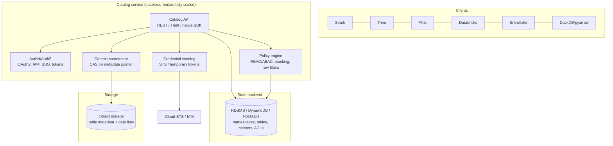

# Metadata Catalogs

> The catalog is the piece of a modern data platform that everyone underestimates and nobody can
> live without. It is where "the table" actually exists: parquet files are bytes, a table format is
> a metadata convention, but the **catalog is the authoritative answer to "what is this table, where
> is its metadata right now, and who is allowed to touch it?"** — and it is the coordination point
> that makes atomic commits possible on object storage. Choose it badly and you will own a
> Hive-Metastore-MySQL database melting under 40 million partitions, five engines with five
> different ideas of what tables exist, credentials pasted into cluster configs, and no way to
> answer "who read the PII column last Tuesday". This chapter covers Hive Metastore, AWS Glue,
> Unity Catalog, Nessie, Polaris and friend, the Iceberg REST catalog protocol that is quietly
> standardizing all of it, and how to design, migrate, scale, and debug a catalog like the production
> dependency it is.

---

## TL;DR

- **The catalog is the control plane of a data platform.** It holds the mapping from a logical name
  to the current metadata location, and it is the serialization point for commits.
- **Catalog ≠ table format ≠ storage.** Format says what metadata means; catalog says where the
  metadata lives and who can read/write it; storage holds the bytes. You can change format and
  storage independently of the catalog, but changing catalog is a project.
- **Three generations of implementation**: (1) **Hive Metastore** — Thrift + RDBMS, table/partition
  rows, the default for a decade; (2) **cloud catalogs** — AWS Glue (managed, HMS-compatible),
  Unity Catalog, Snowflake Open Catalog; (3) **REST-based, stateless catalogs** — the Iceberg REST
  Catalog spec, now implemented by Glue, Unity, Polaris, Lakekeeper, Gravitino, Nessie, and Hive 4
  itself.
- **The Iceberg REST Catalog protocol is the most important interoperability development since
  Parquet.** It standardizes discovery, table loading, commit with assertions, credential vending,
  and configuration delivery, so engines stop needing per-catalog connectors.
- **Credential vending** (or remote signing) is the feature that kills the "S3 keys in every client"
  anti-pattern: the catalog returns short-lived, scoped credentials per table, derived from the
  user's identity.
- **Versioned catalogs (Nessie) add git semantics**: branches, tags, commits, and multi-table atomic
  transactions. Excellent for CI/CD and isolated environments; extra operational surface for
  everyone else.
- **The Hive Metastore's real limit is partitions, not tables.** A table with 10 million partitions
  is an HMS/Glue-scale event; the fix is fewer partitions or a manifest-based metadata layer.
- **Governance is a separate concern that vendors bundle into catalogs**: RBAC, column masking, row
  filters, tags, lineage, audit. Decide where enforcement happens and verify each engine respects
  it.
- **The catalog is the highest-blast-radius single point of failure you own.** No catalog → no
  commits, no table discovery, no jobs, often no reads. HA, backups, and failover drills are
  mandatory.
- **Migrating catalogs is a first-class project** with a rollback plan: names change, permissions
  must be recreated, lineage must be re-wired, and clients must be cut over per-environment.

---

## 1. Definitions and core vocabulary

| Term | Meaning |
|---|---|
| **Catalog** | Service that resolves a logical table identifier to its current metadata (and usually enforces access control). |
| **Metastore** | The part of a catalog that *stores* table/partition/schema metadata. Historically the whole thing (Hive Metastore). |
| **Metadata pointer / metadata location** | The URI of the current table-metadata file (e.g., `s3://…/metadata/v42.metadata.json`). The catalog's core responsibility is maintaining this atomically. |
| **Namespace** | A container for tables. 2-level (`database.table`) in HMS; 3-level (`catalog.schema.table`) in Unity Catalog, Polaris, Gravitino ("metalake.catalog.schema.table"). |
| **Table identifier** | The fully qualified name: `catalog.namespace.table`. |
| **Atomic commit** | The catalog operation that swaps the metadata pointer under an optimistic-concurrency check. |
| **Commit requirements / assertions** | Preconditions the catalog must verify (e.g. `assert-ref-snapshot-id`) for a commit to succeed. |
| **Credential vending** | The catalog returns short-lived, table-scoped storage credentials to a client based on the caller's identity (`X-Iceberg-Access-Delegation: vended-credentials`). |
| **Remote signing** | The client asks the catalog to sign specific storage requests instead of receiving credentials (`remote-signing`). |
| **REST catalog** | An implementation of the Iceberg REST Catalog protocol: HTTP + JSON, no Thrift, no per-engine library. |
| **Stateless catalog** | A catalog process that holds no local state (all state in a database or in the object store), so it scales horizontally. |
| **Catalog federation** | A catalog exposing tables owned by *other* catalogs as read-only foreign tables (Unity Catalog "foreign catalogs", Polaris/Glue equivalents). |
| **Managed vs external table** | Managed: the catalog owns the storage lifecycle (drop table = drop data). External: the catalog only registers; the data lifecycle is yours. |
| **Table UUID** | An immutable identifier for a table independent of its name — the thing that makes rename safe and prevents "same name, different data" accidents. |
| **Versioned catalog** | A catalog with git-like history (`Nessie`): branches, tags, merges, and multi-table commits. |
| **Data governance layer** | RBAC, ABAC/tags, masking, row filters, lineage, audit. Often integrated in the catalog; conceptually distinct. |
| **Catalog events / notification log** | A change feed (HMS listeners, Glue events) that downstream systems use to react to DDL changes. |
| **HMS-compatible** | An implementation that speaks the Hive Metastore Thrift API (Glue, HMS itself) so Hive-era clients work unchanged. |

---

## 2. What problem it solves / why it matters

### 2.1 Six jobs a catalog does

```text
1. DISCOVERY      "What tables exist, in which namespaces, owned by whom, with which schema?"
2. RESOLUTION     "Where is table X's metadata right now?" (the metadata pointer)
3. COORDINATION   "Only one writer advances the table from snapshot N to N+1." (atomic commit)
4. SECURITY       "Who may read/write/browse this table, which columns, which rows?"
5. TRUST/METADATA "Schema, statistics, partitioning, retention, lineage."
6. CREDENTIALS    "Here are short-lived, scoped storage credentials for exactly this table."
```

Without a catalog you get:

- **Listing-based discovery**: jobs that spend minutes in `LIST s3://…` and are still sometimes
  wrong (eventual listing, half-written partitions).
- **N sources of truth**: Hive says the table has 12 partitions, Spark's own table registry says 14,
  Trino says 9, and the Athena workgroup sees a different location. Everyone "fixes" it by pointing
  at the path directly.
- **No atomicity**: two writers both write `_SUCCESS` markers into the same directory.
- **Credential sprawl**: long-lived IAM keys in 40 cluster configs, impossible to rotate or audit.
- **No governance**: nobody can answer "which tables contain PII, and who queried them?"
- **No rename safety**: rename = copy + delete + hope, with a window where readers see nothing.

### 2.2 Why the catalog became the control plane

```text
2020: "compute and storage are separate"          → warehouse/lakehouse
2023: "the table format is the interface"          → Iceberg/Delta/Hudi
2026: "the CATALOG is the control plane"           → who owns the metadata pointer, policies,
                                                     credentials, lineage, and interoperability
Evidence: every major vendor now ships a catalog (or buys one):
  Databricks → Unity Catalog (open-sourced 2025)
  Snowflake  → Polaris → donated to Apache; Snowflake Open Catalog (managed)
  AWS        → Glue Data Catalog + Lake Formation + Iceberg REST endpoint
  Google     → BigLake / Dataplex Universal Catalog
  Apache     → Gravitino, Polaris, Nessie, Hive Metastore (with its own Iceberg REST API)
Consequence: the catalog is the least replaceable, most lock-in-relevant component you pick.
```

---

## 3. How it works internally

### 3.1 The anatomy of a catalog



Two architecture families:

| Family | State lives in | Examples | Scales by |
|---|---|---|---|
| **Database-backed metastore** | RDBMS (MySQL/Postgres/Oracle) or DynamoDB | Hive Metastore, Glue, Polaris, Unity Catalog, Lakekeeper | Scaling the DB, caching, partitioning metadata |
| **Versioned/content-addressed** | A commit graph in a KV store + objects | Nessie | Backend DB scaling; smart clients with SHA-based addressing |
| **Hybrid** | Catalog pointer + in-table metadata | Iceberg with any catalog; Hudi's metadata table; Delta with a catalog or `_delta_log` | Reducing catalog calls by putting metadata in the table itself |

### 3.2 Hive Metastore: internals, and why it eventually hurts

```text
Client (Spark/Hive/Presto) ──Thrift──► HMS (Java) ──JDBC──► MySQL/Postgres
                                          │
                                          └─ active/passive or active/active behind a VIP

Key RDBMS tables (this schema explains all the scaling problems):
  DBS, TBLS, SDS            – database/table/storage descriptors
  COLUMNS_V2, FIELDS         – schema
  PARTITIONS, PARTITION_KEY_VALS, PARTITION_PARAMS – one ROW PER PARTITION
  TAB_COL_STATS, PART_COL_STATS – statistics
  NOTIFICATION_LOG, catalog events – DDL change feed
```

Operational realities:

- **Partition rows are the scale wall.** 1 table × 5 years × 24 hours × 20 dimensions = millions of
  rows; `get_partitions` on a heavily partitioned table can take seconds and hammer the RDBMS.
  Engines then cache the partition list client-side, which is where "stale partition list"
  inconsistencies come from.
- **Statistics are optional and stale.** `ANALYZE TABLE … COMPUTE STATISTICS` writes to
  `TAB_COL_STATS`; nothing enforces freshness, and many engines ignore HMS stats in favor of their
  own.
- **Thrift + Java = deployment friction.** Version skew between client `hive-metastore` jars and the
  server is a classic source of `NoSuchMethodError`.
- **HA is doable but you own it**: multiple HMS instances + HA RDBMS + connection pooling +
  `hive.metastore.client.socket.timeout` tuning. A single-instance HMS with a single MySQL is a
  platform-wide outage waiting for a maintenance window.
- **Iceberg on HMS** stores the metadata pointer in table/partition parameters
  (`metadata_location`, `previous_metadata_location`) — which means each commit is an HMS write, and
  concurrent writes rely on HMS's locking/`metastore.*.lock.*` semantics. This is fine at moderate
  scale and unpleasant at high commit rates.
- **Hive 4 added an Iceberg REST API** to HMS, so HMS clients can speak REST instead of Thrift;
  useful for modernization without a catalog migration.

> **Senior note**: if you inherit an HMS with millions of partitions, resist the urge to "tune
> MySQL" indefinitely. The two real fixes are (1) reduce partition cardinality, and (2) move to a
> table format whose metadata lives in manifests/metadata files rather than in metastore rows, so
> the catalog holds O(1) metadata per table instead of O(partitions).

### 3.3 AWS Glue Data Catalog

```text
Two APIs in one service:
  • Native Glue API       – GetTable, GetPartitions, CreateTable, … (AWS SDK)
  • Hive-compatible API   – thrift endpoints used by Hive/Spark/EMR/Athena
  • Iceberg REST endpoint – https://glue.<region>.amazonaws.com/iceberg
                            (SigV4-signed; /iceberg/v1/config?warehouse=…)

Roles:
  • Physical metadata store for Athena/EMR/Glue/Redshift Spectrum/Lake Formation
  • Iceberg REST catalog (glue_catalog_id + warehouse) for Spark/Trino/Flink/etc.
  • Crawler-managed discovery (schema inference) — convenient, and the source of
    accidental full-table schema churn if you let crawlers rewrite schemas.
```

Practically important details:

| Concern | Reality |
|---|---|
| Permissions | The catalog is not the security layer: **Lake Formation** adds table/column/row-level control, LF-Tags, and cross-account sharing |
| Rate limits | `GetPartitions` is throttled per account/table; batching (`MaxResults`, expression pushdown) and the **partition index** matter at scale |
| Crawlers | Useful for one-off discovery, dangerous as a permanent schema-management mechanism (they can clobber schemas/partition indexes) |
| Iceberg | Glue can be the Iceberg REST catalog; managed compaction is available but the maintenance ownership is still yours to define |
| Cross-account | Resource links + Lake Formation grants; expect to debug IAM *and* LF policies together |
| Delta | Glue can host Delta tables' metadata location; engine support varies |

### 3.4 Unity Catalog (Databricks, open-sourced)

```text
Namespace: metastore → catalog → schema → table/view/volume/function/model
  e.g.  main.analytics.fct_orders
Interfaces:
  • Native REST API (UC API)              – governance, lineage, grants, tags
  • Apache Iceberg REST Catalog API       – engines read/write UC tables as Iceberg
  • Delta Sharing                         – cross-org data sharing
  • Credential vending + remote signing   – no long-lived storage keys in clients
Capabilities:
  • Centralized RBAC + ABAC (tags/policies), column masking, row filters
  • Automatic lineage (table-, column-, and job-level) from query plans
  • Audit logs, data classification, model/volume/function registry
  • Foreign catalogs (federation): a catalog can expose tables from other catalogs
  • Open-sourced in 2025 → UC OSS server + CLI, Iceberg REST compatible
```

Unity Catalog is the clearest example of the 2026 pattern: **a governance-first catalog that also
speaks the open Iceberg REST protocol**, so non-Databricks engines (Trino, Flink, DuckDB, Spark on
any cloud) can read the same governed tables.

### 3.5 Nessie: git for data

```text
Nessie = a "data version control" catalog.
  • Commits: immutable, content-addressed snapshots of the whole catalog state
  • Branches / tags / merges: branch the entire catalog (all tables), not one table
  • Authority: a commit log in a KV backend (RocksDB / DynamoDB / MongoDB / Postgres)
  • Tables: Iceberg (primary), plus Delta (older versions) and "namespaces"
  • Interface: native Nessie API + Iceberg REST catalog API

Why it's useful:
  - Isolated developer/CI environments: `nessie branch dev_123` gives a full copy of
    all production tables with zero data copy.
  - Multi-table atomic commits: write fact + dims + aggregates as ONE commit, so
    consumers never see a half-updated warehouse.
  - Rollback: `nessie revert` a bad pipeline run without rewinding every table manually.
  - Audit: the commit log *is* the change history, with hashes and messages.

Why it's not for everyone:
  - An extra stateful service to operate and back up (and its backend is now the
    source of truth).
  - Engine support is narrower than REST/HMS/Glue; client compatibility varies.
  - Team-wide adoption of branch/merge workflows is a cultural change.
  - Long-lived branches accumulate old snapshots → storage growth unless expired.
```

### 3.6 The Iceberg REST Catalog protocol (the standardization that matters)

```text
Goal: one HTTP API for "any Iceberg catalog", analogous to JDBC-ODBC for databases.

Core endpoints (simplified):
  GET    /v1/config                                    → defaults & overrides (warehouse, auth)
  POST   /v1/oauth/tokens                              → OAuth2 client-credentials token
  GET    /v1/{prefix}/namespaces                       → list namespaces (paginated)
  POST   /v1/{prefix}/namespaces                       → create namespace
  GET    /v1/{prefix}/namespaces/{ns}/tables           → list tables
  POST   /v1/{prefix}/namespaces/{ns}/tables           → create table
  GET    /v1/{prefix}/namespaces/{ns}/tables/{table}    → load table (metadata-location + config)
  POST   /v1/{prefix}/namespaces/{ns}/tables/{table}    → COMMIT (requirements + updates)
  POST   /v1/{prefix}/namespaces/{ns}/tables/{table}/metrics → report metrics (optional)
  DELETE /v1/{prefix}/namespaces/{ns}/tables/{table}    → drop table (with purgeRequested flag)

Auth: OAuth2 (client credentials / token exchange), or SigV4 (AWS), or bearer tokens
      from the platform's identity provider.
Credential vending: client sends  X-Iceberg-Access-Delegation: vended-credentials
  (or `remote-signing`) → catalog returns table-scoped, short-lived credentials or
  signs requests on the client's behalf.
Caching: loadTable responses carry ETag; 304 responses let clients avoid refetch.
Commit semantics: `requirements` are assertions evaluated atomically; `updates` are the
  changes. A catalog must reject the commit if any requirement fails.
```

Example commit payload (the pattern every Iceberg writer uses):

```json
{
  "requirements": [
    {"type": "assert-table-uuid", "uuid": "9c1d2e3f-..."},
    {"type": "assert-ref-snapshot-id", "ref": "main", "snapshot-id": 1234567890},
    {"type": "assert-default-spec-id", "default-spec-id": 0},
    {"type": "assert-last-assigned-field-id", "last-assigned-field-id": 27},
    {"type": "assert-current-schema-id", "current-schema-id": 3}
  ],
  "updates": [
    {"action": "add-snapshot", "snapshot": {"snapshot-id": 987654321, "manifest-list": "s3://..."}},
    {"action": "set-snapshot-ref", "ref-name": "main", "type": "branch", "snapshot-id": 987654321},
    {"action": "remove-snapshots", "snapshot-ids": [111111111]}
  ]
}
```

Why this matters to a senior engineer:

| Before REST spec | After REST spec |
|---|---|
| Each engine had its own catalog connector, each with its own bugs and version skew | One connector; new catalogs implement one spec |
| Credentials had to be configured in every client | Credential vending/remote signing centralizes it |
| Adding an engine meant a catalog integration project | Adding an engine means configuring a URL |
| Governance features set per catalog-vendor pair | Governance is enforced at the catalog, uniformly |

### 3.7 Catalog comparison

| Dimension | **Hive Metastore** | **AWS Glue** | **Unity Catalog** | **Nessie** | **Polaris / Lakekeeper / Gravitino** |
|---|---|---|---|---|---|
| Type | RDBMS-backed metastore | Managed cloud catalog | Governance-first catalog | Versioned (git-like) catalog | OSS REST catalogs |
| Interface | Thrift (+ Iceberg REST in Hive 4) | Native API + HMS-compatible + Iceberg REST | Native REST + Iceberg REST + Delta Sharing | Native API + Iceberg REST | Iceberg REST (+ native) |
| Namespace | `db.table` | `db.table` | `catalog.schema.table` | branch/namespace/table | `catalog.schema.table` / `metalake.catalog…` |
| Atomic commit | Yes (HMS locks/params) | Yes (conditional updates on table params) | Yes (coordinated commits) | Yes (commit graph) | Yes |
| Credential vending | No | Yes (with Lake Formation; SigV4 path) | Yes (vended-credentials + remote signing) | Depends on deployment | Polaris: yes; Lakekeeper/Gravitino: yes |
| Multi-table atomicity | No | No | Limited (multi-statement in one session) | **Yes** (branches/commits) | No |
| RBAC/masking/lineage | External tooling (Ranger/Atlas) | Lake Formation + Glue | **Native (RBAC, ABAC, masking, row filters, lineage, audit)** | Minimal (pairs with other tools) | Polaris: RBAC; others minimal |
| Federation of foreign catalogs | No | Limited | **Yes (foreign catalogs)** | No | Polaris/Gravitino: partial |
| Self-hosted | Yes | No | Yes (open source) | Yes | Yes |
| Best for | Legacy Hive/Spark estates, mixed old clients | AWS-native lakehouses, Athena/EMR | Multi-engine governed lakehouse, Databricks-centric or not | CI/CD, isolated environments, multi-table transactions | Open, portable, self-hosted or managed REST catalogs |
| Main risk | Partition/metadata scale, ops burden | Throttling, crawler schema drift, permission complexity | Ecosystem/feature parity across engines; vendor gravity | Operational complexity, engine support breadth | Maturity/support variance |

---

## 4. How to implement it (step by step)

### Step 1 — Decide the architecture before the product

```text
Questions that determine your catalog:
 1. How many engines must read AND write? (1-2 → almost anything; 4+ → REST-based)
 2. Do we need credential vending (no long-lived storage keys in clients)? (usually yes)
 3. Do we need multi-table atomicity / isolated dev environments? (→ Nessie-like)
 4. Where must policy be enforced — one engine or uniformly? (→ governance-first catalog)
 5. Multi-cloud or "no vendor gravity"? (→ OSS REST catalog, self-hosted)
 6. How much ops capacity do we have? (→ managed if <1 FTE)
 7. Regulatory requirements for audit/lineage/erasure mapped to catalog features?
```

### Step 2 — Namespace design (do this once, correctly)

```text
Recommended 3-level convention (works in UC/Polaris/Gravitino, degrades to 2 in HMS):

  <domain>.<zone>.<entity>
    retail.silver.orders
    retail.gold.fct_daily_sales
    finance.raw.gl_entries
  <env> is usually a separate catalog/metastore, not a name prefix:
    dev  → catalog: dev_lake,   metastore: dev
    prod → catalog: prod_lake,  metastore: prod

Rules:
  - Never encode dates/ids in table names (partition metadata handles that).
  - Never let teams create tables in "someone else's" namespace.
  - Reserve namespaces: `sandbox_<user>` with TTL, `_tmp` (deny in prod), `quarantine`.
  - One writer identity per table, enforced by grants.
```

### Step 3 — Wire the engines (code for each catalog)

**Iceberg REST catalog (the portable path)**

```python
# PySpark against a generic Iceberg REST catalog (Polaris, UC, Lakekeeper, Gravitino, …)
spark = (SparkSession.builder
  .config("spark.sql.extensions", "org.apache.iceberg.spark.extensions.IcebergSparkSessionExtensions")
  .config("spark.sql.catalog.lake", "org.apache.iceberg.spark.SparkCatalog")
  .config("spark.sql.catalog.lake.type", "rest")
  .config("spark.sql.catalog.lake.uri", "https://catalog.example.com")
  .config("spark.sql.catalog.lake.warehouse", "prod_lake")
  .config("spark.sql.catalog.lake.credential", "client-id:client-secret")  # OAuth2
  .config("spark.sql.catalog.lake.scope", "catalog")
  .config("spark.sql.catalog.lake.header.X-Iceberg-Access-Delegation", "vended-credentials")
  .config("spark.sql.catalog.lake.token", None)     # set later from /v1/oauth/tokens if needed
  .config("spark.sql.defaultCatalog", "lake")
  .getOrCreate())
```

```properties
# Trino
connector.name=iceberg
iceberg.catalog.type=rest
iceberg.rest-catalog.uri=https://catalog.example.com
iceberg.rest-catalog.warehouse=prod_lake
iceberg.rest-catalog.security=OAUTH2
iceberg.rest-catalog.oauth2.credential=client-id:client-secret
iceberg.register-table-procedure.enabled=true
```

```python
# PyIceberg (single-node / pandas / DuckDB-style access)
from pyiceberg.catalog.rest import RestCatalog
catalog = RestCatalog(
    name="lake",
    uri="https://catalog.example.com",
    warehouse="prod_lake",
    credential="client-id:client-secret",
    **{"header.X-Iceberg-Access-Delegation": "vended-credentials"},
)
print(catalog.list_namespaces())
tbl = catalog.load_table("silver.orders")
print(tbl.scan(row_filter="order_date >= '2026-03-01'").to_arrow().num_rows)
```

**AWS Glue**

```python
spark = (SparkSession.builder
  .config("spark.sql.catalog.glue", "org.apache.iceberg.spark.SparkCatalog")
  .config("spark.sql.catalog.glue.catalog-impl", "org.apache.iceberg.aws.glue.GlueCatalog")
  .config("spark.sql.catalog.glue.warehouse", "s3://company-lake/warehouse/")
  .config("spark.sql.catalog.glue.io-impl", "org.apache.iceberg.aws.s3.S3FileIO")
  .config("spark.sql.catalog.glue.glue.id", "123456789012")
  .config("spark.sql.catalog.glue.glue.skip-archive", "true")   # keep dropped tables recoverable
  .getOrCreate())
```

```bash
# Glue Data Catalog Iceberg REST endpoint (SigV4-signed; note the /iceberg prefix)
curl --aws-sigv4 "aws:amz:us-east-1:glue" --user "$AWS_ACCESS_KEY_ID:$AWS_SECRET_ACCESS_KEY" \
  "https://glue.us-east-1.amazonaws.com/iceberg/v1/config?warehouse=123456789012"
```

```sql
-- Athena/Glue DDL for an Iceberg table in the catalog
CREATE TABLE glue.analytics.fct_orders (
  order_id BIGINT, customer_id BIGINT, order_date DATE, amount DECIMAL(18,4)
)
LOCATION 's3://company-lake/warehouse/analytics.db/fct_orders'
TBLPROPERTIES ('table_type'='ICEBERG', 'format'='parquet', 'write_compression'='zstd');
```

**Unity Catalog (OSS or Databricks)**

```sql
-- Databricks/UC: governance objects around the table
CREATE CATALOG IF NOT EXISTS prod_lake;
CREATE SCHEMA IF NOT EXISTS prod_lake.silver;
CREATE TABLE prod_lake.silver.orders (...) USING iceberg LOCATION 's3://…';
GRANT USE CATALOG, USE SCHEMA, SELECT ON TABLE prod_lake.silver.orders TO `data-analysts`;
ALTER TABLE prod_lake.silver.orders SET TAGS ('pii'='true', 'domain'='retail');
ALTER TABLE prod_lake.silver.orders ALTER COLUMN email SET MASK email_mask;
ALTER TABLE prod_lake.silver.orders SET ROW FILTER eu_only ON (region);
```

```properties
# Trino -> Unity Catalog OSS over Iceberg REST
connector.name=iceberg
iceberg.catalog.type=rest
iceberg.rest-catalog.uri=https://unity-catalog.internal/api/2.1/unity-catalog/iceberg
iceberg.rest-catalog.warehouse=prod_lake
iceberg.rest-catalog.security=OAUTH2
```

**Nessie**

```bash
# Run Nessie, then use it as an Iceberg REST catalog
docker run -p 19120:19120 ghcr.io/projectnessie/nessie

nessie branch create etl_run_2026_03_01 --from main
nessie content list --ref etl_run_2026_03_01
nessie merge etl_run_2026_03_01 --into main -m "nightly load 2026-03-01"
nessie log --limit 20
```

```python
# Spark pointing at Nessie as an Iceberg catalog
spark = (SparkSession.builder
  .config("spark.sql.catalog.nessie", "org.apache.iceberg.spark.SparkCatalog")
  .config("spark.sql.catalog.nessie.type", "rest")
  .config("spark.sql.catalog.nessie.uri", "http://nessie:19120/iceberg/main")
  .config("spark.sql.catalog.nessie.warehouse", "s3://company-lake/warehouse")
  .getOrCreate())
```

**Hive Metastore (legacy + Hive 4 Iceberg REST)**

```properties
# hive-site.xml — modern, security-aware HMS client config
hive.metastore.uris=thrift://hms1:9083,thrift://hms2:9083
hive.metastore.client.socket.timeout=600
hive.metastore.client.connection.timeout=60
hive.metastore.warehouse.dir=s3://company-lake/hive/warehouse
```

```python
# Spark reading/writing Hive-style + Iceberg-on-HMS tables
spark = (SparkSession.builder
  .config("spark.sql.catalog.hms", "org.apache.iceberg.spark.SparkCatalog")
  .config("spark.sql.catalog.hms.type", "hive")
  .config("spark.sql.catalog.hms.uri", "thrift://hms1:9083")
  .config("spark.sql.catalog.hms.warehouse", "s3://company-lake/warehouse")
  .config("spark.sql.catalog.hms.cache-enabled", "true")
  .config("spark.sql.catalog.hms.cache.expiration-interval-ms", "30000")
  .getOrCreate())
```

### Step 4 — Automate table creation through the catalog (never by writing paths)

```python
# Platform template: the ONLY sanctioned way to create a table.
# It forces catalog registration, ownership tags, retention, codec, and layout defaults.
def create_table(spark, fqtn: str, ddl_columns: str, owner: str, domain: str,
                 zone: str, partitioning: str = "", clustering: str = "",
                 retention_days: int = 3650, pii: bool = False):
    props = [
        "'write.parquet.compression-codec' = 'zstd'",
        f"'owner' = '{owner}'",
        f"'domain' = '{domain}'",
        f"'zone' = '{zone}'",
        f"'retention_days' = '{retention_days}'",
        "'write.target-file-size-bytes' = '134217728'",
        "'format-version' = '2'",
    ]
    stmt = f"""
    CREATE TABLE IF NOT EXISTS {fqtn} ({ddl_columns})
    USING iceberg
    {f'PARTITIONED BY ({partitioning})' if partitioning else ''}
    TBLPROPERTIES ({', '.join(props)})
    """
    spark.sql(stmt)
    if clustering:
        spark.sql(f"ALTER TABLE {fqtn} WRITE ORDERED BY {clustering}")
    if pii:
        spark.sql(f"ALTER TABLE {fqtn} SET TAGS ('pii' = 'true')")
    return fqtn
```

### Step 5 — Federate, don't duplicate

```sql
-- Unity Catalog: expose a table owned by another catalog as a foreign table
CREATE CONNECTION snowflake_prod TYPE SNOWFLAKE
  OPTIONS (host '...', port '443', user 'uc_service', password secret('scope','snowflake_pw'));
CREATE FOREIGN CATALOG snowflake_prod USING CONNECTION snowflake_prod
  OPTIONS (database 'analytics');
-- Result: one namespace to query; data stays where it is.
```

### Step 6 — Cut over engines one at a time (migration pattern)

```text
Catalog migration (e.g., HMS/Glue → REST catalog), strangler style:
  1. Stand up the new catalog; import namespaces/tables as *read-only* registrations
     pointing at the SAME metadata locations (no data movement).
  2. Validate: row counts, snapshots, schema equality, permissions mapping.
  3. Cut over read paths per engine (Trino → Spark → Flink → BI tools), one at a time.
  4. Dual-write window: only ONE catalog may accept writes for a table at a time.
     Use ownership flags in the old catalog to make violations loud.
  5. Retire the old catalog's write path; keep read-only for the deprecation window.
  6. Delete old entries; rotate credentials; document the rollback for 30 days.
```

---

## 5. Where to implement it (platform guidance)

| Situation | Catalog choice | Rationale |
|---|---|---|
| AWS-native, Athena/EMR, mostly Iceberg | **Glue + Lake Formation** | Managed; tight AWS integration; Iceberg REST endpoint available |
| Multi-engine, multi-cloud, no vendor gravity | **Apache Polaris / Lakekeeper / Gravitino (Iceberg REST)** | Open standard; self-hostable; broad engine support |
| Databricks-centric with other engines too | **Unity Catalog** (Databricks or OSS) | Deep governance + Iceberg REST + credential vending |
| CI/CD isolation, multi-table atomic loads | **Nessie** | Branch/merge/tag semantics; test on production-shaped data |
| Legacy Hive/Spark estate, minimal disruption | **Hive Metastore (Hive 4 with Iceberg REST)** | No client changes; modernize the interface gradually |
| Snowflake-centric with external Iceberg | **Snowflake Open Catalog (managed Polaris)** | Governed external Iceberg with Snowflake's operational backing |
| On-prem / air-gapped | **HMS + optional Nessie/Polaris; or Unity Catalog OSS** | Self-hosted only |
| GCP-centric | **BigLake / Dataplex Universal Catalog** | Google's governance + Iceberg interop |
| Just need a local sandbox | **Hadoop catalog (Iceberg) or DuckDB + local files** | Zero infrastructure — but never for shared storage |

---

## 6. Patterns and anti-patterns

### 6.1 Patterns

| Pattern | Description | Why it works |
|---|---|---|
| **One catalog per environment, many engines per catalog** | `dev`/`staging`/`prod` catalogs; all engines point at the same one per env | One source of truth per environment; environment isolation |
| **REST-based catalog** | Single protocol for all engines | Portfolio flexibility; add an engine in an afternoon |
| **Credential vending / remote signing** | No storage secrets in clients | Rotation, scoped least privilege, auditable access |
| **Table-as-product registration** | Creatable only through platform templates with owner/domain/retention tags | Metadata completeness by construction |
| **Catalog as the CI/CD target** | Tests create tables in `sandbox_*` namespaces and drop them | Realistic pipeline testing with governance intact |
| **Manifest-first metadata, catalog as pointer** | Iceberg/Delta/Hudi keep heavy metadata in the table, catalog holds O(1) per table | Avoids the HMS partition-scaling wall |
| **Federation over duplication** | Foreign catalogs/catalog federation | No copies, no drift; one query surface |
| **Versioned catalog for CI** | Nessie branches per PR | Production-shaped testing without copies |
| **Catalog events → downstream automation** | Notification log feeds lineage/catalog-of-catalog tools | Discovery stays fresh automatically |
| **HA by design** | Stateless catalog behind a load balancer + HA backend + tested failover | Catalog outages are platform outages |
| **Explicit ownership at table level** | `owner` in properties AND in the catalog's ACL model | Prevents orphan tables |

### 6.2 Anti-patterns

| Anti-pattern | Symptom | Fix |
|---|---|---|
| **The object store is the catalog** ("just use the path") | Jobs hardcode `s3://…/tmp_v3/`; nobody knows what exists | Mandatory catalog registration; IAM denies unlisted prefixes |
| **One catalog per engine** | Trino sees 800 tables, Spark sees 812, Athena sees 790 | Single catalog; engines configured as clients |
| **Long-lived storage keys in client configs** | 40 copies of the same IAM key, rotation panic | Credential vending with per-user identity |
| **HMS as a partition warehouse** | Millions of partition rows, slow DDL, metastore timeouts | Reduce partitions; move metadata into the table format |
| **Version-hint.text as a lock** (Iceberg Hadoop catalog) | Lost commits, corrupt tables on concurrent writes | Never use the Hadoop catalog on shared storage; use a real catalog |
| **Catalog without HA** | A maintenance restart stops all pipelines | Multi-instance + HA DB + rehearsed failover |
| **Crawler-driven schemas** | Schema flips between runs; types change; jobs break | Explicit schemas + contracts; crawlers for discovery only, then disable |
| **Governance deferred** | Retrofit = re-permissioning thousands of objects | Decide the policy model before onboarding data |
| **Mixing managed and external tables without a rule** | `DROP TABLE` deletes data in one namespace and not another | Document and enforce a policy; prefer external for shared zones |
| **Renaming via copy** | Multi-hour copies; readers see partial data | Catalogs with table UUIDs support atomic rename |
| **Unbounded namespace sprawl** | `db1`, `db2`, `temp_alice`, `final_final` | Namespace standards + approval + TTL sandboxes |
| **Catalog used as a job scheduler / control DB** | Coupling that makes migration impossible | Keep orchestration state in the orchestrator |

---

## 7. Real-world use cases and industry applications

| Organization | Catalog approach | Lesson / detail |
|---|---|---|
| **Netflix** | Iceberg tables with catalog-agnostic metadata; heavy investment in metadata scalability | Motivations: metastore listing/scalability limits of Hive-era designs; manifests move the metadata into the table |
| **Uber** | Hive-metastore-backed lake at extreme scale + Hudi's metadata table to avoid `LIST` | Shows the pattern of pushing metadata *into* the table to survive catalog-scale limits (19k+ datasets) |
| **LinkedIn** | Polaris (they authored it with Snowflake's donation) + a huge Iceberg estate | REST catalog as the interoperability layer for many engines |
| **Airbnb** | HMS-era lake + strong dataset/metadata portal ("Data Portal") and certification | Discovery/ownership is a product, not a byproduct |
| **Databricks customers** | Unity Catalog for RBAC/lineage/masking + Iceberg REST for other engines | Governance-first catalog with open read/write paths |
| **Snowflake customers** | Snowflake Open Catalog / Polaris for external Iceberg; native catalog for internal tables | Two-catalog reality: internal + open; plan the boundary deliberately |
| **AWS-native shops** | Glue + Lake Formation; crawlers for onboarding | Throttling and permission complexity are the operational realities |
| **Regulated finance** | Catalog with native masking/row filters + full audit + lineage retention | The catalog is the compliance artifact |
| **ML-heavy orgs** | UC/Nessie to version feature tables and models alongside data | Reproducibility is the requirement; catalog branching helps |
| **Mid-size SaaS** | Managed REST catalog (fewer services to run) | Buy ops time while keeping the open protocol |

---

## 8. Senior-level deep dive

### 8.1 Scale and performance characteristics

| Catalog | Metadata unit of work | Practical limits | Scaling levers |
|---|---|---|---|
| **Hive Metastore** | Row per partition; Thrift call per lookup | `get_partitions` latency grows with partition count; RDBMS IOPS bound; ~thousands of DDL/day comfortable | Fewer partitions, client caching, DB tuning, read replicas for reads, partition pruning in the API |
| **AWS Glue** | API call with request quotas | `GetPartitions`/`CreatePartition` throttling; 1000 partitions per page | Partition index, expression pushdown, batching, request-rate budgeting, `BatchCreatePartition` |
| **Unity Catalog** | REST call per object; governance metadata in its own store | Governed by deployment sizing; lineage/audit writes add volume | Serverless scaling (Databricks) or horizontal scaling of UC OSS + backend sizing |
| **Nessie** | Commit (hash) + content lookups | Backend KV throughput; commit graph depth | Backend choice (DynamoDB/Postgres), GC of old commits, per-branch pruning |
| **Polaris / Lakekeeper / Gravitino** | REST call per object; RDBMS or KV backend | Backend-dependent; connection pooling is the usual bottleneck | Horizontal app scaling, DB tuning, response caching |

**Commit throughput math** (why metadata-in-table designs win):

```text
Iceberg + HMS/Glue: each commit = catalog write + a few metadata object PUTs.
  5,000 commits/hour ⇒ 5,000 catalog writes/hour ⇒ fine for REST catalogs,
  potentially painful for a single-instance HMS.

Hive-style table: registering a new partition = a metastore write per partition.
  Streaming into 1 partition/minute = 525,600 metastore writes/year per table.
  With 200 tables: 105 million rows/year in PARTITIONS/PARTITION_PARAMS.
  ⇒ This is why "just use Hive-style partitioning for streaming" fails at scale.
```

### 8.2 Governance architecture: where do policies live?

```text
Layer 1 – Identity:    users/groups/service principals in the IdP; short-lived tokens in engines
Layer 2 – Catalog ACL: which principals may USE CATALOG/SCHEMA, SELECT/INSERT/ALTER a table
Layer 3 – Policy:      column masks, row filters, tag-based (ABAC) rules, data classification
Layer 4 – Storage ACL: temporary credentials scoped to prefixes (vended per table)
Layer 5 – Engine:      does THIS engine enforce layers 2–3 identically? (the eternal question)

Enforcement test you must run for every engine you add:
  [ ] Denied user cannot SELECT the table
  [ ] Denied user cannot read the underlying path with their own credentials
  [ ] Masked column returns masked values for the masked principal, in EVERY engine
  [ ] Row filter applies in EVERY engine
  [ ] The query is logged in the audit log with user identity
  [ ] Service principals are scoped to the tables they actually need
```

### 8.3 Trade-off matrix: decisions reviewers will ask about

| Decision | Option A | Option B | Decide by |
|---|---|---|---|
| Catalog ownership | Managed vendor catalog | Self-hosted OSS REST catalog | Ops capacity vs portability/price |
| Interface | Thrift (HMS) | REST | Engine breadth and future-proofing |
| Metadata location | Catalog stores metadata (HMS rows) | Catalog stores a pointer (Iceberg/Delta) | Partition/metadata scale; commit throughput |
| Heterogeneous engine access | Per-engine catalogs | One catalog for all | Consistency vs short-term convenience |
| Credentials | IAM roles per client | Credential vending | Auditability, rotation, least privilege |
| Environments | Separate catalogs per env | Branches (Nessie) | Isolation guarantees vs extra service |
| Multi-table atomicity | Per-table commits | Versioned catalog commits | Do consumers ever need cross-table consistency? |
| Discovery | Catalog events + portal | Manual governance | How many tables/teams? |
| Federation | Duplicate into one catalog | Foreign catalogs | Copy cost + drift vs query-time dependency |
| Governance depth | Catalog ACLs only | Catalog + masking/row filters/lineage | Regulatory scope |

### 8.4 Failure modes and debugging

| Failure | Root cause | Symptom | Detect / fix |
|---|---|---|---|
| Catalog outage | No HA, DB failover, bad deploy | All DDL and often all reads fail; `Connection refused`, `thrift.TransportException` | HA + LB + health checks; rehearse failover; cache table metadata client-side where supported |
| `Table not found` for an existing table | Registered under a different catalog/namespace; wrong warehouse/prefix config | Job fails while the files obviously exist | Compare identifiers across engines; standardize `catalog.schema.table` conventions |
| Commit conflicts | Two writers on the same table | `CommitFailedException`, retries, occasional lost updates | Serialize writers, retry with backoff, or use coordinated commits |
| Metastore/API throttling | Too many partition/table ops per second | `ThrottlingException`, timeouts under load | Batch, cache, index partitions (Glue), reduce partition cardinality |
| Stale partition lists | Client-side caching | New partitions "not found" until restart | Short cache TTL; table-format metadata instead of partition registration |
| Permission drift | Policies applied in one system but not another | Some engines return rows others deny | Centralize policy at the catalog; per-engine enforcement tests in CI |
| Orphan tables / dangling pointers | Table dropped but data kept (or vice versa) | Storage cost with no table; or table pointing at deleted files | Distinguish managed vs external; run orphan-file scans; audit drops |
| Rename broke readers | Name-based resolution without table UUIDs | Downstream jobs fail after rename | Use catalogs with table UUIDs; announce renames; alias views |
| Crawler/automation clobbered schemas | Auto-inference rewriting metadata | Type changes, jobs failing, silent nulls | Disable write-back crawlers; enforce schemas via DDL as code |
| Lineage gaps | Engines not emitting lineage events | "Who produces this table?" unanswered | Emit OpenLineage events; require lineage for onboarding |
| Wrong credentials after rotation | Static keys in configs | Sudden `403` on a fleet of jobs | Credential vending; automated rotation; secrets manager |

Debugging toolkit:

```bash
# Is the table registered, and where does the catalog think the metadata is?
aws glue get-table --database-name analytics --name fct_orders \
  --query 'Table.Parameters' --output json

# Iceberg REST catalog: load a table and see the pointer + vended config
curl -s -H "Authorization: Bearer $TOKEN" \
  "https://catalog.example.com/v1/prod_lake/namespaces/silver/tables/orders?snapshots=all" \
  | jq '{metadata_location, config: (.config | keys)}'

# Nessie: inspect commits and content
nessie log --limit 10
nessie content list --ref main | head
nessie show content main | jq '.tables.orders.metadataLocation'
```

```sql
-- Hive Metastore / Spark: what does the catalog actually say?
SHOW DATABASES;
SHOW TABLES IN analytics;
DESCRIBE FORMATTED analytics.fct_orders;   -- includes Location, Table Properties, transient_lastDdlTime
SHOW PARTITIONS analytics.events_hive LIMIT 20;
SHOW CREATE TABLE analytics.fct_orders;
-- Snapshot counts / commit history (Iceberg)
SELECT snapshot_id, committed_at, operation FROM analytics.fct_orders.snapshots ORDER BY committed_at DESC LIMIT 5;
```

```sql
-- Find the biggest metadata offenders in HMS/Glue (partition count per table)
-- HMS (RDBMS):
SELECT t.TBL_NAME, t.DB_ID, COUNT(p.PART_ID) AS parts
FROM TBLS t LEFT JOIN PARTITIONS p ON p.TBL_ID = t.TBL_ID
GROUP BY 1,2 ORDER BY 3 DESC LIMIT 20;
-- Glue: use the API per table, or Athena's information_schema
SELECT table_schema, table_name, COUNT(*) AS partitions
FROM "information_schema"."partitions" GROUP BY 1,2 ORDER BY 3 DESC LIMIT 20;
```

### 8.5 Migration and lock-in analysis

| Migration | Difficulty | Key risks | Mitigation |
|---|---|---|---|
| HMS → Glue | Low–medium | Partition registration semantics, permissions, crawler conflicts | Import in place; validate counts; keep HMS read-only during cutover |
| HMS/Glue → Iceberg REST (Polaris/UC/Lakekeeper) | Medium | Metadata pointer location, engine cutover order, credential model | Register (not move) tables; per-engine cutover; dual-read validation |
| Delta-native (Unity/`_delta_log`) → Iceberg | Medium–high | Feature parity (DVs, liquid clustering), write-path changes | UniForm or XTable for read interop; migrate writers incrementally |
| Iceberg REST → Nessie | Medium | Branch model adoption, backend operations | Start with Nessie for CI only; keep prod on a plain catalog |
| Any → Hadoop catalog (files only) | Low effort, high regret | Lost commits, no concurrency safety | Never for shared production storage |
| Multi-catalog → single catalog (consolidation) | High | Permissions, lineage, namespaces, hundreds of consumers | Federation first (read through one surface), then consolidate writes |

**Lock-in assessment** (what it costs to leave):

```text
Easiest to leave:  table format (Iceberg is a spec; readers exist everywhere)
Medium:            storage layout (Parquet + manifests are portable; compactions can re-layout)
Hardest:           catalog + governance (identities, policies, lineage, audit history, connections)
⇒ Therefore: treat the catalog as the architecture, and choose it for portability,
  not for today's convenience.
```

---

## 9. Common mistakes and how to avoid them

1. **Letting the filesystem be the catalog.** Fix: catalog-only access; IAM denies unregistered
   prefixes; path-based readers are the exception, documented and time-boxed.
2. **Choosing the catalog last.** Fix: the catalog is the first architectural decision; formats and
   engines are swappable.
3. **No HA story.** Fix: multi-instance, HA backend, health checks, failover rehearsals, and a
   documented degraded mode.
4. **Deferring governance.** Fix: define namespace standards, ownership, PII tagging, and masking
   *before* onboarding the first 100 tables — retrofitting thousands is brutal.
5. **Using crawlers as schema management.** Fix: schemas as code; crawlers for discovery only.
6. **Static storage credentials in client configs.** Fix: credential vending / remote signing.
7. **Ignoring table UUIDs and rename semantics.** Fix: prefer catalogs where rename is atomic and
   metadata-only.
8. **Not budgeting catalog request volume.** Fix: model commits/hour × catalog calls; monitor
   throttling; batch commits in streaming writers.
9. **One mega-namespace.** Fix: 3-level naming with domain/zone conventions and per-domain grants.
10. **Mixing managed/external tables ad hoc.** Fix: a documented rule ("all shared zones are
    external; only ephemeral tables are managed").
11. **Testing in production namespaces.** Fix: sandbox namespaces with TTL and a CI path that
    creates and drops real tables.
12. **Skipping the migration rehearsal.** Fix: import-validation-cutover with a written rollback and
    a 30-day dual-read window.

---

## 10. Exercises / interview questions

1. **Design.** For 6 engines (Spark, Trino, Flink, Snowflake, DuckDB, BI tool), 3 environments, and
   a multi-cloud mandate, propose a catalog architecture. Justify each choice and name the
   hard-to-reverse decisions. *Hint: REST-based catalog per env; federation; credential vending;
   avoid per-engine catalogs.*

2. **Scale.** A Hive-style table has 4 million partitions and `SHOW PARTITIONS` times out. Explain
   what is happening inside the metastore, then design the replacement layout. *Hint: partition
   rows, `get_partitions`, client caching; replacement = Iceberg/manifests + fewer partitions.*

3. **Commit protocol.** Describe the exact sequence of a REST catalog commit, including the
   assertions, and explain what happens on a conflicting write. *Hint: requirements → updates →
   CAS; failure → retry/rebase.*

4. **Governance.** A user is denied in Trino but can read the same table via Spark. List five
   possible causes and how you would verify each. *Hint: path-based access, engine not enforcing
   policy, credential vending misconfig, stale grants, a different catalog registered.*

5. **Migration.** Plan HMS → REST-catalog migration for 3,000 tables with zero downtime and a
   rollback. Include validation queries. *Hint: register in place, dual-read, per-engine cutover,
   freeze schema.*

6. **Nessie.** Describe two concrete workflows where a versioned catalog beats a plain one, and two
   where it is over-engineering. *Hint: isolated CI environments and multi-table atomic loads vs
   simple append-only pipelines.*

7. **Failure drill.** The catalog is down for 45 minutes. What keeps working, what stops, and what is
   your recovery order? *Hint: reads with cached metadata may continue; no commits/DDL; recovery
   order = catalog, then writers, then validate snapshots.*

8. **Cost.** Estimate how many catalog requests/day your platform generates from 2,000 tables with
   50 commits/hour and 200 engines-connections. Where would you cache, and what could break?
   *Hint: commits dominate; response caching risks stale metadata.*

9. **Interop.** Explain how the Iceberg REST Catalog protocol reduces the cost of adding a new query
   engine, and name three things it does *not* standardize. *Hint: endpoints/commit/auth; not
   governance semantics, not storage layout, not cost management.*

10. **Interview classic.** "Why not just use S3 + Parquet + a naming convention?" Give the six
    failures a catalog prevents and the mechanism for each. *Hint: discovery, resolution,
    atomicity, security, credentials, lineage.*

---

## References

- Apache Iceberg — **REST Catalog specification (OpenAPI)**. https://iceberg.apache.org/rest-catalog-spec/
- Apache Iceberg — **Catalog implementations (Hive, REST, Glue, Nessie, JDBC, Hadoop)**. https://iceberg.apache.org/docs/latest/catalogs/
- Apache Iceberg — **Table spec: metadata pointer, snapshots, refs**. https://iceberg.apache.org/spec/
- Apache Hive — **Metastore administration and schema (DBS, TBLS, PARTITIONS…)**. https://hive.apache.org/
- Apache Hive — **Iceberg REST Catalog API backed by Hive Metastore (Hive 4)**. https://hive.apache.org/docs/latest/admin/iceberg-rest-catalog/
- AWS — **Glue Data Catalog: tables, partitions, partition indexes, crawlers**. https://docs.aws.amazon.com/glue/latest/dg/catalog-and-crawler.html
- AWS — **Glue Data Catalog Iceberg REST endpoint (`/iceberg/v1/config`)**. https://docs.aws.amazon.com/glue/latest/dg/iceberg-rest.html
- AWS — **Lake Formation: permissions, LF-Tags, column/row-level access**. https://docs.aws.amazon.com/lake-formation/latest/dg/what-is-lake-formation.html
- Databricks — **Unity Catalog documentation (namespaces, grants, lineage, masking, row filters)**. https://docs.databricks.com/aws/en/data-governance/unity-catalog/
- Databricks Blog — **Open sourcing Unity Catalog**. https://www.databricks.com/blog/open-sourcing-unity-catalog
- Databricks — **Iceberg REST catalog access to Unity Catalog tables**. https://docs.databricks.com/aws/en/external-access/iceberg
- Project Nessie — **Concepts: commits, branches, content, and versioned catalogs**. https://projectnessie.org/features/
- Apache Polaris — **Open-source Iceberg REST catalog (formerly Snowflake Polaris)**. https://polaris.apache.org/
- Apache Gravitino — **Metadata lake (metalake/catalog/schema/table) and federation**. https://gravitino.apache.org/docs/
- Lakekeeper — **Open-source Iceberg REST catalog**. https://docs.lakekeeper.io/
- Trino — **Iceberg connector and REST catalog configuration**. https://trino.io/docs/current/connector/iceberg.html
- OpenLineage — **Lineage event model (catalog/lineage integration)**. https://openlineage.io/docs/spec/object-model
- Apache Atlas / DataHub — **Metadata discovery and governance layers**. https://atlas.apache.org/ , https://datahubproject.io/docs/
