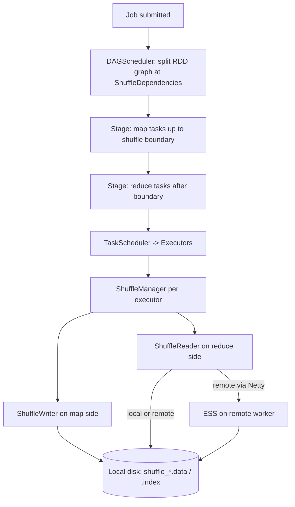
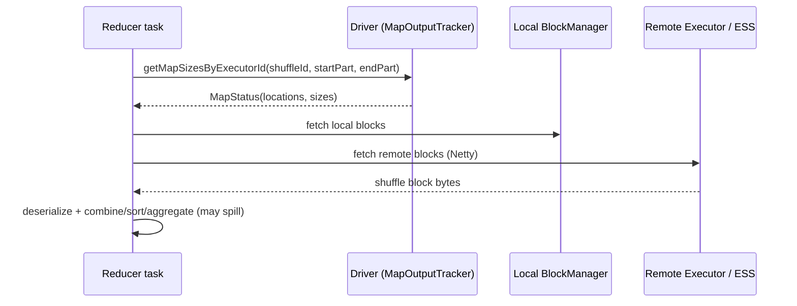
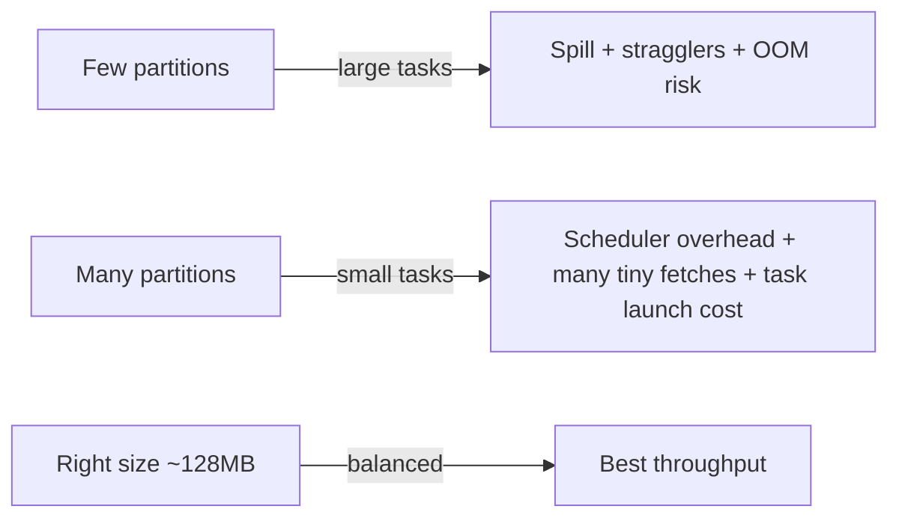

# Shuffle

> Shuffle is the single most expensive, most failure-prone, and most misunderstood operation in Spark. It is the moment when the engine stops being a "map-only distributed loop" and starts moving data across the network so that records sharing a key land on the same executor. Every join that is not broadcast, every `groupBy`, every window, every `distinct`, every `orderBy` triggers one or more shuffles. A senior engineer does not "avoid shuffle"; a senior engineer knows exactly *which* shuffle a plan performs, *how big* its output is, *where* the bytes go, and *what* to tune when it stalls. If you can read a shuffle from the Spark UI metrics and the physical plan and reason about partitions, spill, and fetch failures in seconds, you are operating at senior level. This chapter is the foundation for the next six.

## TL;DR

- **Shuffle = repartitioning of records by key across the network.** It happens when a downstream operator needs all records with the same key co-located (join, `groupByKey`, `reduceByKey`, window, `distinct`, `sortByKey`, `repartition`, non-broadcast joins).
- **Three moving parts:** a *shuffle write* on the map side (partition + optionally sort + optionally combine → on-disk files), a *shuffle read* on the reduce side (fetch blocks via the network), and a *ShuffleManager* + *External Shuffle Service* that manage files and blocks.
- **Since Spark 1.2 the default shuffle is sort-based** (`spark.shuffle.manager=sort`). The map side writes **one data file + one index file per map task** (not one file per reduce partition).
- **Spill is not failure.** When the shuffle write buffer exceeds execution memory, sorted runs spill to disk and are merged. Spilling means "this stage needs more partitioned data than RAM allows" — tune memory, partition count, or record size.
- **Fetch failures** mean a reducer could not retrieve a shuffle block because the map output was lost (executor died, disk evicted, node lost). Spark retries, then re-runs the lost **map** stage. The **External Shuffle Service** exists precisely so a dead executor does not force map re-computation.
- **Too few partitions → huge partitions → spill; too many partitions → small network fetches + scheduler overhead.** Target roughly **100–200 MB of shuffle output per task** as a starting heuristic, then let AQE coalesce.
- **AQE (`spark.sql.adaptive.enabled`, on by default since 3.2) turns partition sizing from a guess into a runtime decision** — set `spark.sql.shuffle.partitions` high (1000–5000) and let AQE coalesce.

---

## 1. Definitions and core vocabulary

| Term | Meaning |
|---|---|
| **Shuffle** | Redistribution of records across executors so all records for a given key are on the same partition/task. |
| **ShuffleDependency** | The RDD dependency that describes a shuffle: the partitioner, whether map-side combine is allowed (`mapSideCombine`), the serializer, the key ordering. Contrast with `NarrowDependency` (no network). |
| **Partitioner** | Function key → partition id. `HashPartitioner` (default, `key.hashCode % numPartitions`), `RangePartitioner` (for sorted/skew-aware splits), custom. |
| **Map side** | Tasks that *produce* shuffle data (the "shuffle write"). |
| **Reduce side** | Tasks that *consume* shuffle data (the "shuffle read"). |
| **Shuffle block** | A chunk of the shuffle output for one mapId × one reduceId, identified by `shuffle_<shuffleId>_<mapId>_<reduceId>`. |
| **ShuffleManager** | Pluggable component (`sort` is the only real one since 3.0) that registers shuffles and returns writers/readers. |
| **External Shuffle Service (ESS)** | A process on each worker node, independent of executors, that serves shuffle blocks over the network so data survives executor death. |
| **Spill** | Writing sorted/combined runs to disk because they exceed the memory budget; later merged. |
| **MapStatus / MapOutputTracker** | Driver-side bookkeeping: where each map output lives and its size. Reducers ask the tracker, then fetch. |
| **Shuffle write file** | `<shuffleId>_<mapId>_0.data` + `.index`. Data file = concatenation of all partitions; index = per-reduce offsets/lengths. |
| **Fetch failure** | Reducer cannot retrieve a block; `FetchFailedException`. Can trigger map-stage re-execution. |
| **Push-based shuffle** | Spark 3.2+ optional optimization: merge shuffle blocks on remote ESSs to improve locality of reads. |
| **Local shuffle reader** | AQE optimization that reads shuffle data locally when partitioning is not actually needed (e.g., SMJ downgraded to BHJ). |
| **`spark.sql.shuffle.partitions`** | SQL shuffle partition count (default **200**). RDD-side default is `spark.default.parallelism`. |
| **Shuffle accounting** | The metrics in the Spark UI: *Shuffle Write* (bytes + records written per map task), *Shuffle Read* (bytes + records per reduce task), *Spill (memory)*, *Spill (disk)*, *Fetch Wait Time*. |

> **Senior note:** "Shuffle write" in the UI is *compressed on-disk bytes*; "shuffle read" is *post-fetch, potentially decompressed* bytes and is often larger than write. Do not compare them naively.

---

## 2. What problem it solves / why it matters

A distributed engine partitions data across executors and computes each partition independently. That works beautifully until you need **all rows with the same key in one place**:

```
groupBy("user_id")            -> all rows of user_id=42 must be in one task
join on order.user_id = u.id  -> order rows of user 42 must meet user row 42
window over user_id           -> the whole user partition must be co-located
distinct / dropDuplicates     -> duplicates may be on different executors
orderBy                       -> global ordering requires global partitioning
```

Without shuffle you would have to broadcast one side of every operation (impossible for huge data) or scan the entire dataset per key (quadratic). Shuffle is the mechanism that makes **data-parallel computation able to do key-parallel computation**.

Why it matters operationally:

1. **It is the dominant cost.** In real pipelines, 60–90% of wall-clock time in a shuffle-heavy job is shuffle write + spill + network fetch + reduce-side merge. Everything else is I/O and CPU on local data.
2. **It is the dominant failure mode.** Fetch failures, `OutOfMemoryError` in the shuffle writer, lost executors invalidating map outputs, disk-full on shuffle spills — nearly all "random Spark failures at 3 a.m." are shuffle.
3. **It is the dominant tunable.** Partition count, memory fraction, compression codec, and AQE strategy all change shuffle behavior; a senior's job is to move the right knobs.
4. **It is the boundary of the stage.** A shuffle is where the DAG is cut into stages, where pipelining stops, and where a materialization point exists — which is exactly why AQE can re-optimize there.

---

## 3. How it works internally

### 3.1 Where shuffle sits in the execution stack



### 3.2 Sort-based shuffle (the default)

Spark 1.2 introduced **sort-based shuffle** (SPARK-2926) and it has been the default since. The key design decision: **each map task writes exactly one data file and one index file**, no matter how many reduce partitions there are. For a shuffle with `M` map tasks and `R` partitions you get `2 × M` files instead of `M × R` — this is what makes it scale to tens of thousands of partitions.

**`SortShuffleWriter.write` (the general path):**

1. An in-memory `PartitionedAppendOnlyMap` (or `PartitionedPairBuffer`) collects `(partitionId, key) -> value` records. The partitioning uses the `Partitioner`; the sorting key is `(partitionId, key)`.
2. When the collection exceeds the execution-memory budget, the sorter **spills**: it sorts the map by `(partitionId, key)` and writes a sorted region to disk.
3. On `stop()`, all in-memory data plus all spilled runs are **merged** (a k-way merge of sorted runs) and written to a single `shuffle_<sid>_<mid>_0.data` file, appending partitions in partition-id order.
4. As each partition region is finalized, its (offset, length) is written to `shuffle_<sid>_<mid>_0.index`.
5. A `MapStatus` (compressed) is sent to the driver's **MapOutputTracker**, recording block sizes per reduce partition.

Map-side combine (pre-aggregation before writing, e.g. `reduceByKey`, `aggregateByKey`, SQL partial aggregation) is applied when the shuffle allows it and dramatically shrinks the write volume — this is why `reduceByKey` beats `groupByKey`.

**Writer selection** (`SortShuffleManager.registerShuffle` / `getWriter`):

| Writer | When chosen | Behavior |
|---|---|---|
| **`SortShuffleWriter`** | Default; used when map-side combine is on, or sort/aggregation is required | Partition + sort + spill + merge; supports combine |
| **`BypassMergeSortShuffleWriter`** | No map-side combine **and** `numPartitions <= spark.shuffle.sort.bypassMergeThreshold` (default **200**) | Writes one temp file per partition in parallel, then concatenates → data + index. No sort, no in-memory map. Fast for low-cardinality partitioning. |
| **`UnsafeShuffleWriter`** | No map-side combine, serializer supports relocation (e.g. Kryo/UnsafeRow, *not* the plain Java serializer), `numPartitions <= 2^24` | Stores serialized records as 8-byte `(partitionId, pageNumber, offset)` pointers in a `ShuffleExternalSorter`, sorts pointers only (cache-friendly), spills and merges without deserializing. |

> **Senior note:** The "tungsten-sort" shuffle you read about in old blogs was folded into `sort`; in Spark 3.x `spark.shuffle.manager` accepts `sort`. The `UnsafeShuffleWriter` *is* the Tungsten path, selected automatically. There is nothing to configure except the serializer and the bypass threshold.

### 3.3 Shuffle read

`BlockStoreShuffleReader.read()` on the reduce side:

1. Ask the driver's `MapOutputTracker` for the `MapStatus` of every map task (block sizes + locations).
2. Build a `ShuffleBlockFetcherIterator` that issues fetch requests. **Local blocks are read directly** from the local `BlockManager`; remote blocks are fetched over Netty from the remote executor's `BlockManager` *or* from the node's External Shuffle Service.
3. Respect the in-flight throttles: `spark.reducer.maxSizeInFlight` (48 MB default), `spark.reducer.maxReqsInFlight`, `spark.reducer.maxBlocksInFlightPerAddress`. These bound memory on the reducer and network pressure.
4. Deserialize records (or reuse `UnsafeRow`), then apply the reduce-side operator: `ExternalAggregator` for aggregations (combine into a hash map with spill), `ExternalSorter` for sort/merge joins, `CoGroupedRDD` for joins.



### 3.4 Shuffle file layout on disk

```
spark.local.dir/<appId>/<executorId>/blockmgr-<uuid>/
  shuffle_3_0_0.data      <- map task 0, whole output for all reduce partitions
  shuffle_3_0_0.index     <- offsets: [partition0 len][partition1 len]...
  shuffle_3_1_0.data
  shuffle_3_1_0.index
  ...
```

The index is a compact array: for each reduce partition, a 4-byte length (or 8-byte offset+length for large shuffles), so a reducer can seek directly to its byte range without scanning the whole data file.

### 3.5 External Shuffle Service (ESS)

Without ESS, a reduce task fetches blocks from the **executor** that produced them. If that executor dies (or is preempted for dynamic allocation), the block is gone, the driver sees a fetch failure, and it must **re-run the entire map stage**. With ESS:

- Shuffle files are registered with the ESS and served by a long-lived process on each worker, independent of executors.
- Executors can be killed for dynamic allocation or spot-instance reclamation *without* invalidating shuffle output.

| Setting | Purpose |
|---|---|
| `spark.shuffle.service.enabled=true` | Executor registers shuffle files with the ESS |
| `spark.shuffle.service.port=7337` | ESS listen port |
| `spark.shuffle.service.index.cache.size` | Cache of index files |
| YARN: `yarn.nodemanager.aux-services=mapreduce_shuffle,spark_shuffle` + `yarn.nodemanager.aux-services.spark_shuffle.class=org.apache.spark.network.yarn.YarnShuffleService` | NodeManager hosts the ESS |
| K8s: run the ESS as a DaemonSet (or via the Spark operator / Databricks-managed shuffle) | ESS is not managed by YARN there |

### 3.6 Fetch failures and stage re-execution

A `FetchFailedException` carries the map index, reduce index, and reason (`TooLargeFrame`, `ChunkFetchFailure`, `OOM`, connection reset...). The driver's behavior:

1. Reducer retries the fetch: `spark.shuffle.io.maxRetries` (3), `spark.shuffle.io.retryWait` (60s) with exponential backoff.
2. If it still fails, the task fails; the `DAGScheduler` calls `handleTaskCompletion(Failure)`.
3. Spark decides whether to **re-run only the failed maps** or the whole stage, based on how many map outputs are already lost and `spark.stage.maxConsecutiveAttempts` (default 4). If too many attempts occur, the **stage is aborted** and the job fails with "Fetch failed ... after N attempts".
4. A common trigger is an executor OOM or being killed (YARN container over memory, K8s OOMKilled, spot reclaim) — which is exactly why ESS matters.

### 3.7 Push-based shuffle (Spark 3.2+, "Magnet")

Normally reducers pull N remote blocks from many mappers → poor network locality. Push-based shuffle **pushes** map output blocks to remote ESS instances, which *merge* blocks belonging to the same reduce partition into a single larger file. Reducers then fetch a few big merged blocks instead of many small ones.

```
spark.shuffle.push.enabled=true
spark.shuffle.push.maxBlockSizeToPush=1m
spark.shuffle.push.maxBlockBatchSize=3m
spark.shuffle.push.merge.finalizeThreads=8
# on YARN/standalone the ESS must implement the merge manager:
spark.shuffle.push.server.mergedShuffleFileManagerImpl=org.apache.spark.network.shuffle.RemoteBlockPushResolver
```

Gains are largest for jobs with **high map parallelism and high reduce parallelism** (thousands of each); gains are near-zero for small clusters.

---

## 4. How to implement it / tune it

### 4.1 Find the shuffle first

```python
# PySpark: see the plan and where exchanges happen
df = spark.read.parquet("s3://lake/orders")
agg = df.groupBy("customer_id").agg(F.sum("amount").alias("total"))
agg.explain("formatted")   # look for Exchange / ShuffleExchangeExec nodes

print(agg.rdd.getNumPartitions())     # reduce-side parallelism
spark.conf.get("spark.sql.shuffle.partitions")
```

```
== Physical Plan ==
* HashAggregate (4)
+- Exchange (3)                      <-- SHUFFLE (hash partitioning on customer_id)
   +- * HashAggregate (2)            <-- partial aggregation (map-side combine)
      +- * ColumnarToRow (1)
         +- FileScan parquet (0)
```

### 4.2 Partition sizing — the single most important decision

Rule of thumb: **aim for ~100–200 MB of shuffle output per reduce task.** Below ~10–20 MB you pay scheduler + fetch overhead for nothing; above ~1 GB you spill and straggle.

```python
# Total shuffle output is visible in the Spark UI "Shuffle Write" column,
# or estimate: numPartitions ~= totalShuffleBytes / targetTaskBytes
total_bytes = 500 * 1024**3           # 500 GB shuffle output
target      = 128 * 1024**2           # 128 MB per task
print(int(total_bytes / target))      # ~4000 partitions

# Modern approach: set a LARGE initial number and let AQE coalesce
spark.conf.set("spark.sql.adaptive.enabled", "true")
spark.conf.set("spark.sql.adaptive.coalescePartitions.enabled", "true")
spark.conf.set("spark.sql.shuffle.partitions", "4000")
spark.conf.set("spark.sql.adaptive.advisoryPartitionSizeInBytes", "128m")
spark.conf.set("spark.sql.adaptive.coalescePartitions.initialPartitionNum", "4000")
```

### 4.3 The shuffle-relevant config surface

| Config | Default | When to change |
|---|---|---|
| `spark.sql.shuffle.partitions` | 200 | Raise with AQE; otherwise set to `totalShuffle / ~128MB` |
| `spark.default.parallelism` | #cores | RDD API default parallelism (reduce side) |
| `spark.shuffle.file.buffer` | 32k | Raise to 64k–128k to reduce write-side small I/O (memory cost) |
| `spark.reducer.maxSizeInFlight` | 48m | Lower on flaky/limited-memory reducers; raise on fat executors |
| `spark.reducer.maxReqsInFlight` | ∞ | Cap concurrent fetch requests on huge clusters |
| `spark.reducer.maxBlocksInFlightPerAddress` | ∞ | Cap per-executor requests to avoid melting one node |
| `spark.shuffle.io.maxRetries` | 3 | Raise on preemptible/spot clusters |
| `spark.shuffle.io.retryWait` | 60s | Raise with retries for GC-pause-heavy peers |
| `spark.shuffle.io.numConnectionsPerPeer` | 1 | Raise when nodes have many disks and the network is idle |
| `spark.shuffle.compress` | true | Keep on; `spark.io.compression.codec=zstd` for better ratio |
| `spark.shuffle.spill.compress` | true | Keep on (spill is CPU-cheap to compress) |
| `spark.shuffle.sort.bypassMergeThreshold` | 200 | Raise for many-partition, no-combine, no-sort shuffles |
| `spark.shuffle.spill.numElementsForceSpillThreshold` | ∞ (max) | Lower to force early spill instead of OOM |
| `spark.shuffle.accurateBlockThreshold` | 100m | Accurately track large blocks for better coalescing |
| `spark.shuffle.service.enabled` | false | **Set true** whenever dynamic allocation or preemption exists |
| `spark.memory.fraction` | 0.6 | Raise to 0.7–0.8 for shuffle-heavy jobs with small cached data |
| `spark.memory.storageFraction` | 0.5 | Lower to 0.3 if you cache little and shuffle a lot |
| `spark.shuffle.manager` | sort | Leave alone (only `sort` is meaningful in 3.x) |

### 4.4 `spark-submit` example (tuned shuffle job on YARN)

```bash
spark-submit \
  --master yarn --deploy-mode cluster \
  --conf spark.sql.shuffle.partitions=4000 \
  --conf spark.sql.adaptive.enabled=true \
  --conf spark.sql.adaptive.coalescePartitions.enabled=true \
  --conf spark.sql.adaptive.advisoryPartitionSizeInBytes=128m \
  --conf spark.shuffle.service.enabled=true \
  --conf spark.shuffle.io.maxRetries=10 \
  --conf spark.shuffle.io.retryWait=30s \
  --conf spark.reducer.maxSizeInFlight=96m \
  --conf spark.shuffle.file.buffer=128k \
  --conf spark.io.compression.codec=zstd \
  --conf spark.memory.fraction=0.7 \
  --conf spark.executor.memoryOverhead=2g \
  --executor-cores 5 --executor-memory 20g --num-executors 20 \
  jobs/nightly_shuffle_heavy.py
```

### 4.5 Reduce shuffle volume before you tune it

The best shuffle optimization is **not producing the shuffle**:

```python
# BAD: groupByKey-then-reduce style, ships every raw record
rdd.groupByKey().mapValues(sum)

# GOOD: map-side combine first
rdd.reduceByKey(_ + _)          # Scala
rdd.reduceByKey(lambda a, b: a + b)  # PySpark

# SQL: pre-aggregate, filter, and project BEFORE the exchange
spark.sql("""
  SELECT customer_id, SUM(amount) AS total
  FROM   (SELECT customer_id, amount FROM orders WHERE ds = '2024-01-01' AND amount > 0)
  GROUP  BY customer_id
""")
```

```python
# Broadcast a small side to eliminate a shuffle entirely (see 04-broadcast-joins.md)
from pyspark.sql.functions import broadcast
big.join(broadcast(small), "id")
```

---

## 5. Where to implement it (deployment targets, config locations)

| Platform | How the shuffle is configured / served |
|---|---|
| **Spark on YARN** | ESS is the NodeManager auxiliary service (`YarnShuffleService`). Enable `spark.shuffle.service.enabled=true` and configure `yarn.nodemanager.aux-services`. `spark.local.dir` points at node-local disks. |
| **Spark on Kubernetes** | No built-in ESS in the base image → run it as a **DaemonSet** (or use a managed shuffle service). Dynamic allocation on K8s needs `spark.dynamicAllocation.shuffleTracking.enabled=true` if no ESS, otherwise shuffle data is lost when executors are removed. |
| **Databricks** | Managed "shuffle service" built in; `spark.sql.shuffle.partitions` and AQE configs are the levers. Photon handles shuffle natively. |
| **EMR** | `emrfs`/HDFS-backed shuffle; tune `spark.local.dir` to instance-store (NVMe) volumes; ESS available. |
| **Standalone** | `SPARK_WORKER_OPTS` + `spark.shuffle.service.enabled=true` starts the ESS inside the worker. |
| **Config locations** | `spark-submit --conf`, `spark-defaults.conf` (`$SPARK_HOME/conf`), cluster manager (YARN `spark-defaults.conf`/`spark-defaults.conf.template`, Databricks cluster config), or inline `SparkSession.builder.config(...)` / `spark.conf.set(...)`. |

**Version notes:**

- **Spark 1.2** → sort-based shuffle default.
- **Spark 2.0** → `UnifiedMemoryManager` (execution + storage share one pool) — controls spill behavior.
- **Spark 3.0** → shuffle changes: `spark.shuffle.manager` only `sort`; **adaptive shuffle reader**; AQE.
- **Spark 3.2** → AQE **on by default**; **push-based shuffle** GA (`spark.shuffle.push.enabled`).
- **Spark 3.3+ / 3.4 / 3.5** → skew-join improvements, storage-partition joins (bucket/partition join without shuffle), better `zstd` support.

---

## 6. Patterns and anti-patterns

### Patterns

- **Combine before you shuffle.** `reduceByKey`, `aggregateByKey`, `combineByKey`, SQL partial aggregation. Reduces both bytes and skew impact.
- **Broadcast the small side.** Eliminates the shuffle entirely for one side of a join.
- **Pre-partition / bucket the data once.** `repartitionByRange` + `bucketBy` (or Iceberg/Delta bucketing) lets repeated joins skip the shuffle.
- **Set high partition count + enable AQE.** Let the runtime coalesce, don't hand-tune 200.
- **Enable ESS** whenever executors can disappear.
- **Tune partition size to 100–200 MB** as the target, and verify with the UI's shuffle read/write columns.

### Anti-patterns

- **`groupByKey` then aggregate.** Ships every record; no map-side combine. Use `reduceByKey`/`aggregateByKey`/SQL `GROUP BY`.
- **`repartition(1)` to "merge small files" on huge data.** One task does the whole shuffle reduce; it will OOM or take hours.
- **Leaving `spark.sql.shuffle.partitions=200` on a 500 GB shuffle.** Each partition is ~2.5 GB → guaranteed spill and stragglers.
- **Setting shuffle partitions to hundreds of thousands without AQE.** Scheduler overhead dominates; millions of tiny fetches.
- **Disabling ESS with dynamic allocation enabled.** Guaranteed fetch failures when executors are removed.
- **Ignoring `spark.local.dir` on network-attached storage.** Spills/fetches over NFS destroy performance; use node-local NVMe/SSD.
- **Comparing shuffle write and read bytes as equal.** Write is compressed; read is decompressed + may include re-fetch/retries.
- **Using a custom Java-serialized object as the shuffle key.** Kills `UnsafeShuffleWriter`, causes huge serialized records.

---

## 7. Real-world use cases and industry applications

- **Nightly ETL / medallion pipelines (Databricks, EMR).** Large `GROUP BY` aggregations and joins across fact/dim tables → shuffle is the pipeline's critical path. Teams size partitions by measured shuffle bytes and rely on AQE.
- **Clickstream sessionization / windowing.** Window functions over `user_id` require co-location of a user's events → shuffle per user partition; skew here is notorious (bot users).
- **Clickhouse/warehouse-style SQL engines layered on Spark (Trino/Photon/Delta).** Shuffle is the join backbone; CBO + AQE pick between broadcast and SMJ, and shuffle partitions are coalesced.
- **ML feature engineering at scale.** `groupBy(entity).agg(features)` and joins with feature tables produce massive shuffles; broadcast joins for small dimension tables.
- **Log/deduplication pipelines.** `dropDuplicates`/`distinct` on billions of events shuffles the full key set; partitioning by a coarser key reduces it.
- **Ad-tech / recommendation joins.** Join impressions with users and items → or broadcast the (usually small) item table.

---

## 8. Senior-level deep dive

### 8.1 Reading a shuffle from the Spark UI

| UI signal | Meaning | Action |
|---|---|---|
| **Shuffle Write ~ = total shuffle bytes** | Output volume across a stage | Reduce via pre-aggregation/projection; size partitions |
| **Many tasks with small shuffle write** | Over-partitioned | Fewer partitions or AQE coalescing |
| **Few huge tasks + Spill (disk) > 0** | Under-partitioned / memory-starved | More partitions, higher `spark.memory.fraction` |
| **Spill (memory) only** | Spilled while using primary memory | Usually fine; watch Spill (disk) |
| **Long `Fetch Wait Time`** | Reduce side waiting on network | Raise `maxSizeInFlight`, fix locality, check GC pauses |
| **Few tasks taking 10× median time** | **Data skew** | See `05-data-skew.md` |
| **Stage retried / FetchFailed in logs** | Lost map outputs | Enable ESS, raise `io.maxRetries`, check executor kills |
| **Task GC time high on reduce** | Too much fetched data at once | Lower `maxSizeInFlight`, smaller partitions |

### 8.2 Trade-offs: partition count



There is no universal number. The trade-off is **task launch/scheduler overhead + fetch overhead** vs **spill + straggler risk**. AQE lets you start high and let Spark coalesce, which is the modern default play — but AQE coalescing **does not fix skew by itself** (skew join handling is a separate AQE feature) and does not help RDD-API shuffles (AQE is SQL/DataFrame only).

### 8.3 Failure modes and debugging playbook

| Symptom | Likely cause | Debug / fix |
|---|---|---|
| `FetchFailedException` | Executor died / ESS off / disk evicted | Enable ESS, set dynamic-allocation shuffle tracking, raise `io.maxRetries`, check YARN/K8s kill reasons |
| `java.lang.OutOfMemoryError: Java heap space` in `ShuffleWriter` | Partition too big, memory fraction too low | More partitions, raise `spark.memory.fraction`, raise executor memory |
| `TooLargeFrame` fetch failure | One shuffle block exceeds `spark.maxRemoteBlockSizeFetchToMem` / Netty frame | Increase or lower partition size; often a symptom of skew |
| `disk quota exceeded` / `No space left` | Spill/`spark.local.dir` full | Node-local SSD, more disks, fewer/aged partitions, clean old apps |
| Stage "Fetch failed after 3 attempts" | Repeated executor loss | ESS, spot-instance stability, `spark.stage.maxConsecutiveAttempts` |
| Job hangs in a stage with all-but-one task done | Skewed partition | Salting / AQE skew join (next chapters) |
| Slow despite low shuffle bytes | Many tiny network fetches | Fewer partitions, coalesce, `numConnectionsPerPeer` up |

**How to reproduce and measure:** run `df.explain("cost")` to see stats-based estimates, `spark.sparkContext.setLogLevel("INFO")` to see `ShuffleExchangeExec` sizes, and use `spark.eventLog.enabled=true` + Spark History Server to compare runs.

### 8.4 Architectural decision: shuffle vs pre-partitioned storage

If the same huge join happens every hour, **paying the shuffle once at write time** (bucketing/partitioning by the join key) often beats paying it every read. Delta/Iceberg/Hive bucketing + Spark's **Storage Partition Join** (3.3+) can eliminate the exchange entirely if both sides are bucketed compatibly. This is a *storage-layout architecture decision*, not a Spark config.

---

## 9. Common mistakes and how to avoid them

1. **Believing shuffle is always bad.** It's the price of key co-location; the mistake is *unnecessary* or *misfit* shuffles.
2. **Tuning partitions to a magic number.** Measure shuffle bytes, target 100–200 MB, use AQE.
3. **Ignoring spill.** Spill (disk) > 0 on big tasks is a red flag, not "normal".
4. **Forgetting map-side combine.** `groupByKey`/`reduceByKey` choice changes shuffle volume by orders of magnitude.
5. **Leaving the ESS off with dynamic allocation.** Silent, intermittent fetch failures.
6. **Not setting `spark.local.dir` to fast local disks.** Cloud VMs often default to small/networked temp.
7. **Assuming AQE fixes everything.** It doesn't touch RDD shuffles, doesn't fix `GROUP BY` skew, and needs a high initial partition count to have room to coalesce.
8. **Broadcasting a "small" table that isn't.** Turns a shuffle into OOM/driver broadcast failures. See chapter 04.
9. **Oversized records / fat keys.** A 1 MB key blows up `maxSizeInFlight` and fetch frames.
10. **Not measuring before tuning.** Always capture the baseline (`Shuffle Write`, `Spill`, task duration percentiles) first.

---

## 10. Exercises / interview questions

1. Why does sort-based shuffle produce `2 × numMaps` files instead of `numMaps × numReduces`? What does the index file buy you?
2. Given a job with 800 GB of shuffle write and `spark.sql.shuffle.partitions=200`, what's the per-task size, and what will you change? What does AQE change about your answer?
3. When does Spark choose `BypassMergeSortShuffleWriter` vs `UnsafeShuffleWriter` vs `SortShuffleWriter`? What breaks each choice?
4. Explain, end to end, how a `FetchFailedException` leads to map-stage re-execution. Where exactly does the External Shuffle Service change that path?
5. A reduce stage shows 199 fast tasks and one task running 40× longer with heavy spill. Name three hypotheses and the exact UI/plan evidence you'd gather. *(Hint: skew, partitioner, block size.)*
6. Why is `reduceByKey` cheaper than `groupByKey` in shuffle bytes? What is the SQL equivalent of that optimization?
7. Your cluster enables dynamic allocation but not ESS. What failure appears and why? What's the fix on K8s specifically?
8. What is push-based shuffle and for which cluster shapes does it help? When is it pointless?
9. Given a plan with three exchanges, which one would you attack first and how would `EXPLAIN COST` help?
10. Design a shuffle-ready storage layout for a table joined hourly on `(tenant_id, event_date)`. What bucketing/partitioning would let you skip the exchange, and what breaks that optimization?

---

## References

- Apache Spark, *RDD Programming Guide — Shuffle operations*: https://spark.apache.org/docs/latest/rdd-programming-guide.html#shuffle-operations
- Apache Spark, *Tuning Guide — Shuffle behavior*: https://spark.apache.org/docs/latest/tuning.html#shuffle-behavior
- Apache Spark, *Configuration* (`spark.shuffle.*`, `spark.reducer.*`): https://spark.apache.org/docs/latest/configuration.html
- Apache Spark, *Performance Tuning* (AQE, shuffle partitions): https://spark.apache.org/docs/latest/sql-performance-tuning.html
- Apache Spark, *Job Scheduling — Stages*: https://spark.apache.org/docs/latest/job-scheduling.html
- Apache Spark, *Push-based shuffle overview*: https://spark.apache.org/docs/latest/configuration.html#push-based-shuffle-overview
- Japila Books, *The Internals of Spark Core — ExternalShuffleService*: https://books.japila.pl/apache-spark-internals/external-shuffle-service/
- Japila Books, *ShuffleExternalSorter / SortShuffleManager*: https://books.japila.pl/apache-spark-internals/shuffle/
- Databricks, *Diving into Spark SQL's Catalyst Optimizer*: https://www.databricks.com/blog/2015/04/13/deep-dive-into-spark-sqls-catalyst-optimizer.html
- Databricks, *Adaptive Query Execution: Speeding Up Spark SQL at Runtime*: https://www.databricks.com/blog/2020/05/29/adaptive-query-execution-speeding-up-spark-sql-at-runtime.html
- Wenchen Fan et al., *Push-based Shuffle in Spark (SPARK-30602)* design doc: https://issues.apache.org/jira/browse/SPARK-30602
- Apache Spark source, *SortShuffleManager.scala*: https://github.com/apache/spark/blob/master/core/src/main/scala/org/apache/spark/shuffle/sort/SortShuffleManager.scala
- Apache Spark source, *ShuffleBlockFetcherIterator.scala*: https://github.com/apache/spark/blob/master/core/src/main/scala/org/apache/spark/storage/ShuffleBlockFetcherIterator.scala
- Vinod Kumar, *Spark Internals — Shuffle stories*: https://vinodkc.github.io/sparklearning/shuffle/
