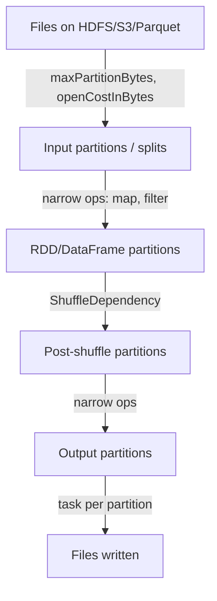
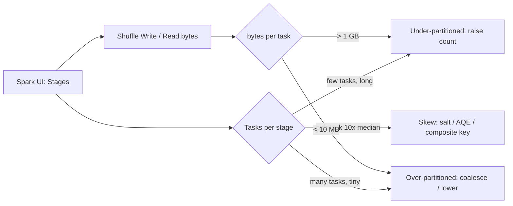

# Partitions

> A partition is the unit of parallelism in Spark: one partition is processed by exactly one task, and one task runs in one thread of one executor. Everything you tune — how many cores you use, how big each task is, whether you spill, whether one task straggles — is downstream of two questions: *how many partitions do I have?* and *how are they sized and laid out?* Juniors treat partitions as an implementation detail. Seniors treat partition count, partitioning function, and partition sizing as the primary levers of their job's runtime, and they reconcile three layers that are easy to confuse: the **storage layout** (files/blocks/directories), the **read partitioning** (how Spark splits files into input partitions), and the **compute partitioning** (RDD/DataFrame partitions, including post-shuffle ones).

## TL;DR

- **One partition → one task → one core.** `numPartitions` is effectively your parallelism and your task-size knob at the same time.
- **Three kinds of partitions:** (1) *input* partitions created when reading files, (2) *in-memory/lineage* partitions of an RDD/DataFrame, (3) *post-shuffle* partitions produced by a `ShuffleDependency` using `spark.sql.shuffle.partitions` (default 200 for SQL) or `spark.default.parallelism` (RDD).
- **`coalesce(n)`** merges adjacent partitions **without a shuffle** (narrow); it can only *reduce* count and may create imbalance. **`repartition(n[, cols])`** does a full **shuffle** (wide); it can increase count and rebalance. **`repartitionByRange(cols)`** uses a `RangePartitioner` (needed for sorted output and for range-friendly layouts).
- **Empty partitions cost almost nothing on write but a full task slot on the scheduler.** Thousands of tiny tasks add up to minutes of overhead.
- **File layout matters:** `spark.sql.files.maxPartitionBytes` (128 MB default) packs file splits into input partitions; HDFS/object-store block size (~128 MB) and Parquet row-group size determine how splittable the data is. Align partitions with files/blocks to avoid tiny reads and skewed scans.
- **Target ~100–200 MB per task** for CPU-bound work; fewer, larger partitions for I/O-light jobs; more, smaller for heavy GC/spill.
- **AQE relieves most post-shuffle sizing pain** but does *not* help RDD partitions or input-file partitioning.

---

## 1. Definitions and core vocabulary

| Term | Meaning |
|---|---|
| **Partition (RDD)** | A slice of an RDD, returned by `RDD.partitions` (`Partition` objects). `rdd.getNumPartitions` is the parallelism. |
| **Partition (DataFrame)** | Same concept via the underlying `RDD[InternalRow]`; visible with `df.rdd.getNumPartitions`. |
| **Input partition / split** | The read-side unit produced by `FileScan`; a file can be split into several (Parquet/ORC/JSON) or read whole (some compressed formats). |
| **Shuffle partition** | A post-exchange partition produced by `ShuffleExchangeExec`; count = `spark.sql.shuffle.partitions` (or AQE-coalesced). |
| **Partitioner** | Function mapping a key to a partition id: `HashPartitioner`, `RangePartitioner`, `Partitioner` subclasses. RDD joins/aggregations preserve/exploit it. |
| **Default parallelism** | Fallback partition count. RDD API: `spark.default.parallelism` (defaults to total cores). SQL: `spark.sql.shuffle.partitions` (200). Read: `spark.sql.files.maxPartitionBytes`. |
| **coalesce** | Narrow transformation that reduces partitions by merging adjacent ones (no shuffle). |
| **repartition** | Wide transformation (shuffle) that can increase/decrease partitions, optionally by column(s). |
| **repartitionByRange** | Wide transformation using a `RangePartitioner` sampling the data to build ranges. |
| **Bucketing** | Pre-shuffle storage layout: `bucketBy(n, cols)` writes data into `n` hash buckets per partition; joins on bucketed tables can skip shuffle. |
| **Partition pruning** | *Storage* term: reading only directories matching a filter (e.g. `ds='2024-01-01'`). Different from compute partitioning. |
| **Block** | Storage-level unit (HDFS block, object-store part, Parquet row group/column chunk). Determines splitability. |
| **Task** | One unit of execution over one partition (or one shuffle-read partition range). |
| **Skew** | Non-uniform partition sizes; some partitions much larger than the median. |

> **Senior note:** "Partitions" appear in four different senses in Spark docs and blogs — RDD partitions, input splits, shuffle partitions, and *storage* partitions (directory-based Hive/Iceberg/Delta partitions). When someone says "I have 200 partitions," always ask *which* 200.

---

## 2. What problem it solves / why it matters

Parallelism requires work to be divided. Spark divides it into partitions. The number and size of partitions determine:

1. **How many cores you actually use.** 10 partitions on a 100-core cluster = 10 tasks = 90 idle cores. This is the #1 cause of "my cluster is huge but my job is slow."
2. **How long each task runs.** Task size = partition size. Big partitions → long tasks, spill, OOM, stragglers. Small partitions → many short tasks, scheduler overhead, low efficiency.
3. **Whether a shuffle can be avoided.** If both sides of a join share a `Partitioner` (or are bucketed compatibly), Spark can skip the exchange (`spark.sql.requireAllClusterKeysForCoPartition` / Storage Partition Join). Co-partitioning is a *paid-once* design.
4. **Whether skew exists.** Partitioning by a hot key creates a hot partition; partitioning by a composite or salted key spreads it.
5. **Write/output file counts.** Each partition writes one file (approximately) — over-partitioning produces thousands of tiny files, a classic lake anti-pattern.

So partitions are simultaneously a **performance**, a **cost**, and a **data-engineering** concern (small files!). Getting them right is a senior core skill.

---

## 3. How it works internally

### 3.1 Where partitions come from



**Read side:**
- `spark.sql.files.maxPartitionBytes` (128 MB) — the FileSourceScanExec packs file splits into partitions of at most this many bytes.
- `spark.sql.files.openCostInBytes` (4 MB) — a virtual cost added per file when packing, so many small files don't end up crammed into one partition with a huge task.
- A file is *splittable* if its format + compression allow seeking (plain Parquet/ORC yes; a single gzip file no). Each split becomes a task.
- Result: `numInputPartitions ≈ ceil(totalBytes / maxPartitionBytes)` (plus small-file effects).

**RDD side:**
- `sc.textFile(path, minPartitions)` — `minPartitions` sets a *minimum*; actual count comes from Hadoop input splits.
- `sc.parallelize(seq, n)` — explicitly `n` partitions.
- `sc.parallelize(seq)` — uses `spark.default.parallelism`.

**Compute side (after shuffle):**
- SQL/DataFrame `ShuffleExchangeExec` creates `spark.sql.shuffle.partitions` partitions (default 200), or AQE's coalesced count.
- RDD `ShuffleDependency` uses the RDD's `Partitioner` (default `HashPartitioner` with `spark.default.parallelism` partitions for `groupByKey`/`reduceByKey`).

### 3.2 Dependencies and whether a partitioner is preserved

Narrow transformations preserve partitioning (a `map` over a hash-partitioned RDD stays hash-partitioned). Wide ones re-partition. Whether Spark *knows* about a partitioner determines whether it can skip a shuffle:

```
hashPartitionedByUser.partitionBy(samePartitioner)                -> no shuffle
hashPartitionedByUser.join(otherHashPartitionedByUser)            -> no shuffle (co-partitioned)
a.repartition(100, "id").join(b.repartition(100, "id"), "id")     -> NO shuffle-free guarantee
                                                                    (different hash salts / Partitioner objects)
```

For a shuffle-free join Spark needs a **single, equal** partitioner instance on both sides — which is why the DataFrame API's `repartition(n, col)` cannot promise it, but **bucketing** can (it's persisted in the metastore).

### 3.3 coalesce vs repartition vs repartitionByRange

| Operation | Shuffle? | Can increase n? | Balance | Typical use |
|---|---|---|---|---|
| `coalesce(n)` | No (narrow) | No | Can be uneven (merges adjacent) | Reduce partitions before write; merge small files |
| `coalesce(n, shuffle=true)` | Yes | Yes | Even hash | Rarely needed (alias of repartition) |
| `repartition(n)` | Yes (wide) | Yes | Even hash | Rebalance; fix under-parallelism |
| `repartition(n, cols...)` | Yes | Yes | Hash by cols | Rebalance + co-locate by key |
| `repartitionByRange(n, cols...)` | Yes | Yes | Range-balanced, ordered | Sorted output; range-friendly layout; large-scale `orderBy` |
| `repartition(cols...)` (no n) | Yes | Uses `spark.sql.shuffle.partitions` | Hash | Same, explicit parallelism via conf |

```python
# Narrow: 400 -> 40 partitions, no data movement
df.coalesce(40)

# Wide: 40 -> 400 partitions, full shuffle
df.repartition(400)

# Wide + key: 200 partitions hashed by customer_id
df.repartition(200, "customer_id")

# Wide + range: sorted-ish partitions, good for skewed keyspaces & range scans
df.repartitionByRange(200, "event_ts")
```

> **Senior note:** `coalesce` merges **adjacent** partitions. If those adjacent partitions are the skewed ones, you turn one skew problem into a bigger one. And `coalesce` after a shuffle is lossy for ordering assumptions; it preserves the (already-computed) partitioning but reduces parallelism, so a downstream wide op re-shuffles.

### 3.4 Partitioners and how hashing works

- **`HashPartitioner`**: `partitionId = Utils.nonNegativeMod(key.hashCode, numPartitions)` (Scala/Java `hashCode`; for Python RDDs it uses the key hash). Uniform *only if the key's hash is uniform*. A null key and an empty string collide in Java hashing → known skew source.
- **`RangePartitioner`**: samples the data (`spark.sql.execution.rangeExchange.sampleSizePerPartition`, default 1000 samples per partition in Spark 3.x) to build `numPartitions-1` boundaries, then assigns by range. Produces balanced, ordered partitions and is used by `sortByKey`/`orderBy`/`repartitionByRange`. Requires an extra job to sample.
- **Custom `Partitioner`** (RDD API only): subclass `Partitioner` and map keys yourself — the escape hatch for salting and for domain-specific balancing.

```python
# Custom partitioner (PySpark), e.g. spread hot keys
class SaltedPartitioner(object):
    def __call__(self, key):
        return hash((key, random.randint(0, 9))) % 200
```

### 3.5 File and block alignment

Storage layout and compute partitioning must be reconciled:

| Layer | Unit | Default / typical | Effect |
|---|---|---|---|
| Object store / HDFS | Block / part | 128 MB | Splittability granularity |
| Parquet/ORC | Row group | 128 MB | Max useful split size; smaller row groups → more splits |
| Delta/Iceberg | File | ~128 MB–1 GB target | File count, small-files problem |
| Spark read | Input partition | `maxPartitionBytes` 128 MB | Number of read tasks |
| Spark compute | Partition | varies | Number of tasks |
| Hive/Delta *table* partitioning | Directory | columns like `ds` | Partition pruning at scan time |
| Spark *bucketing* | Bucket file | `bucketBy(n, col)` | Shuffle-free joins |

**Aligning them:** if each file ≈ one row-group ≈ 128 MB ≈ one input partition, you get even read tasks. Misalignment → one task reads 4 tiny files (wasted open cost) or a task reads one huge row group (skew). On object stores, `maxPartitionBytes` and file sizes drive everything.

### 3.6 Bucketing as persisted partitioning

```sql
-- Hive/Spark SQL
CREATE TABLE orders_bucketed (customer_id BIGINT, amount DECIMAL(18,2))
USING parquet
PARTITIONED BY (ds STRING)
CLUSTERED BY (customer_id) INTO 256 BUCKETS;

-- Iceberg (hidden partitioning + bucket transform)
CREATE TABLE iceberg.orders (id INT, dep STRING)
USING iceberg PARTITIONED BY (dep, bucket(8, id));
```

A bucketed join where both sides have the **same bucket count and key** can skip the shuffle (Storage Partition Join, Spark 3.3+, `spark.sql.sources.v2.bucketing.enabled=true`). This is "partition once, join forever."

### 3.7 Whole-stage codegen and partition boundaries

Whole-stage code generation fuses operators inside a stage (a narrow pipeline) into one generated function to eliminate virtual calls and intermediate rows. But **stage boundaries are shuffle boundaries** (and broadcast boundaries): a shuffle forces materialization, so codegen applies *within* stages, not across the exchange. Partition count controls the number of generated-function invocations (number of tasks).

---

## 4. How to implement it / tune it

### 4.1 Diagnose partition counts

```python
print("reduce-side partitions:", df.rdd.getNumPartitions())
print("input partitions:", spark.read.parquet("s3://lake/orders").rdd.getNumPartitions())

# Distribution of rows/sizes per partition (find skew and emptiness)
import pyspark.sql.functions as F
spark.read.parquet("s3://lake/orders") \
    .groupBy(F.spark_partition_id().alias("pid")) \
    .count().orderBy(F.desc("count")).show(20)
```

```scala
// Scala: partition sizes in bytes via the internal API
val sizes = df.rdd.mapPartitions { it =>
  Iterator(it.size)  // rows per partition
}.collect()
println(sizes.mkString(", "))
```

### 4.2 Choose a partition count

```python
# Heuristic: partition size = totalBytes / numPartitions ~ 100-200 MB
total = 400 * 1024**3        # 400 GB
target = 128 * 1024**2       # 128 MB
n = int(total / target)      # ~3200
spark.conf.set("spark.sql.shuffle.partitions", str(n))

# Simpler and more robust: high number + AQE
spark.conf.set("spark.sql.shuffle.partitions", "4000")
spark.conf.set("spark.sql.adaptive.enabled", "true")
spark.conf.set("spark.sql.adaptive.coalescePartitions.enabled", "true")
spark.conf.set("spark.sql.adaptive.advisoryPartitionSizeInBytes", "128m")
```

### 4.3 Fix under-parallelism on read

```python
# Object stores: many files, control input split size and open cost
spark.conf.set("spark.sql.files.maxPartitionBytes", "64m")     # smaller input partitions
spark.conf.set("spark.sql.files.openCostInBytes", "8m")        # discourage giant multi-file tasks
spark.conf.set("spark.sql.files.minPartitionNum", "2000")      # suggested minimum (3.1+)
spark.conf.set("spark.sql.files.maxPartitionNum", "8000")      # suggested maximum (3.5+)
spark.conf.set("spark.sql.sources.parallelPartitionDiscovery.threshold", "32")
```

```python
# RDD API
rdd = sc.textFile("s3://lake/logs/*.gz", minPartitions=4000)   # gz not splittable -> whole-file tasks
rdd2 = rdd.repartition(2000)                                   # force parallelism
```

### 4.4 Control output file count

```python
# Avoid thousands of tiny files: coalesce BEFORE writing (narrow, cheap)
(df.repartition(200, "event_date")          # distribute by date
   .write
   .partitionBy("event_date")
   .mode("overwrite")
   .parquet("s3://lake/clean/orders"))

# Or write then OPTIMIZE (Delta) / rewrite_data_files (Iceberg)
```

```sql
-- AQE can also reduce post-shuffle output files
SET spark.sql.adaptive.enabled=true;
SET spark.sql.adaptive.coalescePartitions.enabled=true;
SET spark.sql.adaptive.advisoryPartitionSizeInBytes=256m;
```

### 4.5 Co-partition repeatedly joined tables

```python
# Option A: repartition both sides by the join key before the join
a = a.repartition(512, "user_id")
b = b.repartition(512, "user_id")
joined = a.join(b, "user_id")   # one shuffle induced by repartition; join may still shuffle if partitioners differ

# Option B (best for repeated joins): persist a bucketed, partitioned table
(spark.table("orders")
   .write.format("parquet").mode("overwrite")
   .bucketBy(512, "user_id").sortBy("user_id")
   .saveAsTable("orders_bucketed"))

users.write.format("parquet").mode("overwrite") \
     .bucketBy(512, "id").sortBy("id").saveAsTable("users_bucketed")
# Join on user_id == id now has a chance of being shuffle-free.
```

### 4.6 Key configs

| Config | Default | Purpose |
|---|---|---|
| `spark.sql.shuffle.partitions` | 200 | Post-shuffle partition count (SQL/DF) |
| `spark.default.parallelism` | #cores | RDD-side default partition count |
| `spark.sql.files.maxPartitionBytes` | 128m | Max bytes per input partition |
| `spark.sql.files.openCostInBytes` | 4m | Virtual per-file cost when packing splits |
| `spark.sql.files.minPartitionNum` | (parallelism) | Suggested min input partitions (3.1+) |
| `spark.sql.files.maxPartitionNum` | none | Suggested max input partitions (3.5+) |
| `spark.sql.adaptive.advisoryPartitionSizeInBytes` | 64m | AQE target partition size |
| `spark.sql.adaptive.coalescePartitions.enabled` | true | AQE coalescing post-shuffle |
| `spark.sql.adaptive.coalescePartitions.initialPartitionNum` | (=shuffle.partitions) | Upper bound before coalescing |
| `spark.sql.execution.rangeExchange.sampleSizePerPartition` | 1000 | RangePartitioner sampling |
| `spark.sql.sources.v2.bucketing.enabled` | true | Storage Partition Join (skip shuffle) |
| `spark.sql.requireAllClusterKeysForCoPartition` | true | Require keys == partition keys exactly |
| `spark.sql.adaptive.coalescePartitions.parallelismFirst` | true | Prefer parallelism over target size when coalescing |

---

## 5. Where to implement it (deployment targets, config locations)

| Platform | Partition levers / notes |
|---|---|
| **YARN** | `spark-submit --conf`, `spark-defaults.conf` on the gateway; container sizes determine cores → target partition count; HDFS block size 128 MB. |
| **Kubernetes** | `SparkApplication` `spec.sparkConf` (Spark Operator); executors are pods; dynamic allocation may shrink throughput → keep enough partitions. |
| **Databricks** | Cluster config JSON / notebook `spark.conf.set`; AQE on by default; `spark.sql.shuffle.partitions` still applies; Delta `OPTIMIZE`/`Z-ORDER` handle file layout. |
| **EMR** | `spark-defaults` classification; instance-store NVMe for `spark.local.dir`; S3A split settings. |
| **Snowflake/BigQuery-style SPJ** | Not Spark, but the same "partition alignment" idea: clustering keys / partitioning are the storage analogue. |

**Version differences:**

- `spark.sql.files.minPartitionNum` added 3.1; `maxPartitionNum` added 3.5.
- Push-based AQE coalescing improvements 3.2–3.4.
- Storage Partition Join (shuffle-free bucket join) from 3.3 (`spark.sql.sources.v2.bucketing.enabled` default true in 3.3+).
- `spark.sql.leafNodeDefaultParallelism` replaced older behavior for leaf-node defaults in 3.4+.

---

## 6. Patterns and anti-patterns

### Patterns

- **Measure partitions before choosing a number** (`groupBy(spark_partition_id()).count()`).
- **Set a high shuffle count + AQE** rather than a static magic number.
- **`coalesce` before writes, not `repartition(1)`**, to control output file count.
- **Bucket the table you join repeatedly**; pay the shuffle at write time.
- **`repartitionByRange` for range-scan / sorted workloads** and for large `orderBy`.
- **Align file size ≈ row-group size ≈ input partition ≈ 128 MB.**
- **Reuse a `Partitioner` instance** in RDD joins when you want co-partitioning to be recognized.

### Anti-patterns

- **`repartition(1)` / `coalesce(1)` on multi-GB data.** One task does all the work; OOM or hours.
- **`repartition()` to "fix" skew.** It hash-partitions by key — hot keys stay hot.
- **Thousands of shuffle partitions without AQE.** Tiny tasks, unsplittable overhead.
- **Hundreds of tiny files per output partition.** Small-files pathology that cripples every downstream read.
- **Partitioning by a high-cardinality id column** (file-per-id explosion).
- **Ignoring that a single gzip file is not splittable** → 1 task for a 40 GB file.
- **Assuming `df.repartition(n, col)` guarantees shuffle-free joins.** It does not; bucketing does.
- **Setting `spark.default.parallelism` but expecting SQL to use it.** SQL reads `spark.sql.shuffle.partitions`.

---

## 7. Real-world use cases and industry applications

- **Lakehouse ETL on Delta/Iceberg.** `OPTIMIZE`/`rewrite_data_files` + `Z-ORDER`/`bucketBy` set file sizes and clustering so that nightly jobs read ~128 MB splits and join without exchange.
- **Streaming micro-batches.** `foreachBatch` output file count is driven by micro-batch partition count; too many partitions → tiny-file storm in the sink.
- **Large-scale `orderBy`/window jobs.** `repartitionByRange` produces sorted, balanced partitions for windowed analytics on Terabytes of events.
- **Skewed join keys (finance, ad-tech).** Composite partitioning (tenant + date) avoids one mega-partition; salting spreads hot keys (next chapter).
- **Data warehouse migration to Spark.** Team must translate warehouse clustering/partitioning into Spark `bucketBy`/`partitionBy`.
- **Flink/Kafka parity.** Kafka partition count ↔ Spark parallelism; a Kafka topic with 8 partitions caps your Spark streaming parallelism at 8 per ingestion stage.

---

## 8. Senior-level deep dive

### 8.1 The three-panel diagnostic



| Evidence | Conclusion | Fix |
|---|---|---|
| Stage has 5 tasks on 100 cores | Under-parallel | `repartition`/raise `shuffle.partitions`/fix input splits |
| Stage has 50,000 tasks, each 2 s | Over-parallel | Lower counts; AQE coalescing |
| Task duration: p99/p50 > 5× | Skew | Salt, AQE skew join, composite key |
| Spill (disk) large | Partitions too big | More partitions / more memory |
| Output has thousands of small files | Over-partitioned write | `coalesce` before write; query `maxRecordsPerFile` |

### 8.2 Trade-offs

- **Parallelism vs task overhead.** Task launch ~ few ms–tens of ms; on 100k tasks that's minutes. But too few tasks wastes cores. Sweet spot ≈ 2–4 tasks per core *in flight*.
- **Fewer files vs more parallelism on write.** `coalesce` reduces files but also reduces write parallelism (S3 writes become serial per partition). Often `repartition(n, cols)` then `coalesce` per output partition is the balanced play; `maxRecordsPerFile` caps file size.
- **Range vs hash partitioning.** Range gives sorted, balanced partitions but needs a sampling job and is sensitive to skewed *ranges* (one range can still be hot). Hash is cheap but fails on skewed key distributions.
- **Bucketing cost vs join savings.** Bucketing adds write-time cost and constrains later schema/bucket-count changes; only worth it for frequently joined tables on stable keys.

### 8.3 Failure modes / debugging

| Symptom | Cause | Debug |
|---|---|---|
| `javax.ws.rs`/`OOM` in one task | Mega-partition | Find `spark_partition_id` with huge count; repartition |
| Long "scheduling delay" in UI | Too many tasks | Lower partition count; check `spark.scheduler.maxRegisteredResourcesWaitingTime` |
| Slow reads on S3 | Too many small files / no pruning | `maxPartitionBytes`, compaction, `openCostInBytes` |
| Write produces 20k files | Over-partitioned before write | `coalesce`, `partitionBy` + `maxRecordsPerFile` |
| `repartition` didn't help join | Different partitioner on each side | Use bucketing / `repartitionByRange` on both |
| One Kafka-partition always last | Source parallelism cap | Repartition after ingestion |

**Key debugging tricks:** `df.explain("formatted")` shows `Exchange hashpartitioning(...)` and `Exchange rangepartitioning(...)` — read the partitioner and the partition count; the SQL tab shows "number of partitions" under each scan/exchange; `spark_partition_id()` gives the runtime view.

### 8.4 Architecture decision: where to put partitioning

```
Question: is the same key used repeatedly for joins/aggregations?
  YES (hot path)  -> persist bucketed/partitioned storage (pay once)
  NO  (ad hoc)    -> repartition per query, or rely on AQE
Question: is the data append-only and time-scanned?
  YES -> partition storage by date (+ Z-ORDER/bucket on filter columns)
Question: is a key skewed?
  YES -> salt / composite key / AQE skew join
```

---

## 9. Common mistakes and how to avoid them

1. **Treating `numPartitions` as an afterthought** — it *is* your parallelism and your task size.
2. **Expecting SQL to honor `spark.default.parallelism`** — it uses `spark.sql.shuffle.partitions`.
3. **`repartition(1)`/`coalesce(1)` on big data** — never do it; use AQE/composite partitioning.
4. **Using `repartition()` to fix skew** — hot keys stay hot; use salting.
5. **Assuming `coalesce` is always free** — it's narrow, but it *reduces* parallelism and can imbalance merges.
6. **Creating millions of tiny output files** — the downstream read cost dwarfs the write.
7. **Ignoring storage layout** — a 40 GB gzip file is one task; Parquet with tiny row groups is many tasks.
8. **Forgetting that pre-shuffle partitioners must be *identical instances*** for shuffle-free joins.
9. **Not accounting for Kafka/HDFS source parallelism caps.**
10. **Hard-coding a partition count tuned for last quarter's data volume.**

---

## 10. Exercises / interview questions

1. Your job uses 8 tasks on a 200-core cluster. Enumerate the possible root causes and the exact evidence for each. *(Hint: input splits, shuffle count, coalesce, RDD default parallelism.)*
2. Compare `coalesce`, `repartition`, and `repartitionByRange` in terms of shuffle, balance, ordering, and use case. When does `coalesce` *worsen* a problem?
3. Why doesn't `df.repartition(100, "id").join(other.repartition(100, "id"), "id")` guarantee a shuffle-free join? What does?
4. Given 1 TB of shuffle output and `spark.sql.shuffle.partitions=200`, compute per-task bytes and propose a fixed count. Then explain what AQE changes and what remains your responsibility.
5. How do HDFS block size, Parquet row-group size, `maxPartitionBytes`, and compute partitions interact? Walk through a 900 MB Parquet file read with 128 MB defaults.
6. A nightly job produces 15,000 output files. Give three fixes and their trade-offs.
7. Explain the difference between *storage partitioning* (directories), *bucketing*, and *runtime repartitioning*. When do you want each?
8. You must join a 5 TB fact table with a 900 GB dimension hourly. Design a partitioning/bucketing strategy and quantify the shuffle you save.
9. How does partition count affect whole-stage codegen and task-launch overhead? Where's the sweet spot and how do you measure it?
10. A streaming job reads a 12-partition Kafka topic and writes 500 files/min. Diagnose and fix. *(Hint: source parallelism, `foreachBatch`, coalesce.)*

---

## References

- Apache Spark, *RDD Programming Guide — Partitions / `repartition` / `coalesce`*: https://spark.apache.org/docs/latest/rdd-programming-guide.html
- Apache Spark, *Performance Tuning — Tuning Partitions*: https://spark.apache.org/docs/latest/sql-performance-tuning.html#tuning-partitions
- Apache Spark, *Configuration* (`spark.sql.shuffle.partitions`, `spark.sql.files.*`, `spark.default.parallelism`): https://spark.apache.org/docs/latest/configuration.html
- Apache Spark, *Data Sources — Bucketing, Sorting and Partitioning*: https://spark.apache.org/docs/latest/sql-data-sources-load-save-functions.html#bucketing-sorting-and-partitioning
- Apache Spark, *Storage Partition Join*: https://spark.apache.org/docs/latest/sql-performance-tuning.html#storage-partition-join
- Apache Spark, *Tuning Guide — Level of Parallelism*: https://spark.apache.org/docs/latest/tuning.html
- Databricks, *Partitioning on Delta tables & liquid clustering*: https://docs.databricks.com/aws/en/delta/clustering
- Databricks, *Tuning shuffle partitions / AQE*: https://docs.databricks.com/aws/en/optimizations/aqe
- Apache Spark source, *FilePartition / FileScanRDD*: https://github.com/apache/spark/blob/master/sql/core/src/main/scala/org/apache/spark/sql/execution/datasources/FilePartition.scala
- Apache Spark source, *RangePartitioner / HashPartitioner*: https://github.com/apache/spark/blob/master/core/src/main/scala/org/apache/spark/Partitioner.scala
