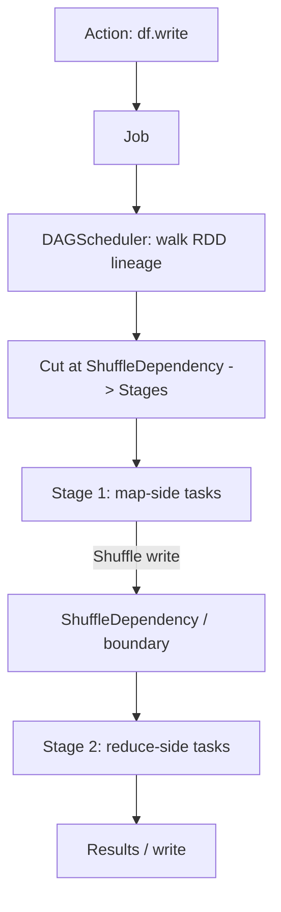
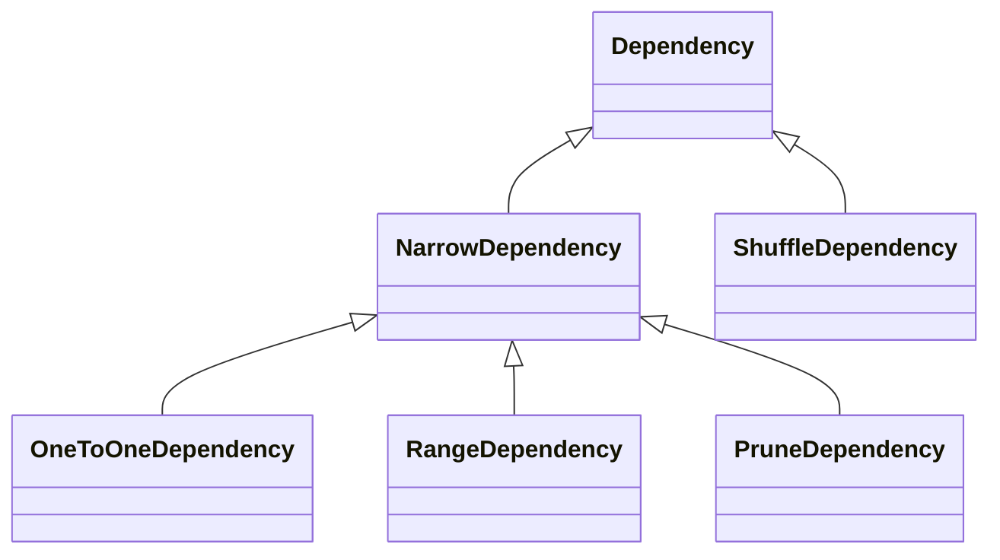
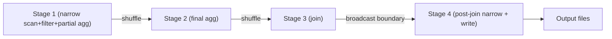

# Narrow vs Wide Transformations

> The narrow/wide distinction is the single most useful mental model in Spark. It is what separates a *pipeline* from a *barrier*: narrow transformations chain into the same task with no data movement, while wide transformations cut the DAG, force a shuffle, and start a new stage. Once you can look at any DataFrame/SQL program and immediately say "here is the stage boundary, here is what pipelines, here is what materializes," you can predict performance, spot skew, read execution plans, and reason about failure recovery — all without running the job. This chapter gives you that model, plus the vocabulary (`Dependency`, `Stage`, `Job`, `Task`) that the rest of Spark's internals are built on.

## TL;DR

- **Narrow transformation:** each output partition depends on **one** input partition → no network, pipelined into the same task. Examples: `map`, `filter`, `flatMap`, `select`, `withColumn`, `union`, `coalesce` (no shuffle), `mapPartitions`, `zip`.
- **Wide transformation:** each output partition depends on **many** input partitions → requires a **shuffle**, cuts the DAG into **stages**. Examples: `groupByKey`/`reduceByKey`, join (non-broadcast), `distinct`/`dropDuplicates`, `repartition`, `sortBy`/`orderBy`, window functions, `intersection`, `cartesian`.
- **A Spark job = 1 action.** A job is split into **stages** at every `ShuffleDependency`; each stage runs many **tasks** (one per partition).
- **Reading the plan:** `Exchange` nodes are shuffle boundaries (= wide). Everything between two `Exchange`s pipelines (narrow). `BroadcastExchange` is a *special* boundary that also stops pipelining but is not a shuffle of the big data.
- **Fewer stages + narrower pipelines = faster.** Every wide transformation adds network I/O, disk spill, serialization, and a barrier.
- **Stage boundaries can be good:** they are the **materialization points** that enable AQE re-optimization. Not all stages are "bad."
- Narrow/wide is orthogonal to "which transformation": `coalesce` is narrow, `repartition` is wide; `join` is wide *unless* broadcast.

---

## 1. Definitions and core vocabulary

| Term | Meaning |
|---|---|
| **Transformation** | A lazy operation on an RDD/DataFrame that builds up the lineage (`map`, `filter`, `join`, ...). |
| **Action** | An operation that triggers execution (`count`, `collect`, `write`, `show`, `foreach`). Submits a **Job**. |
| **NarrowDependency** | Output partition depends on a known, small set of input partitions (usually one). Enables pipelining. |
| **ShuffleDependency** | Output partition depends on *all* input partitions (key-based redistribution). Requires a shuffle; splits stages. |
| **`OneToOneDependency`** | The most common narrow case: partition `i` → partition `i`. |
| **`RangeDependency`** | Narrow; used by `union` (each child range maps to a parent range). |
| **`PruneDependency`** | Narrow; used by partitioning-aware RDDs (e.g. `PartitionwiseSampledRDD`). |
| **Lineage / DAG** | The graph of RDDs connected by dependencies. The DAG scheduler splits it into stages. |
| **Stage** | A set of tasks with no shuffle between them; bounded by shuffle dependencies (or the job's start/end). |
| **Job** | Triggered by one action; a set of stages. |
| **Task** | One unit of work over one partition of one stage; the smallest schedulable unit. |
| **Pipelining** | Executing several narrow transformations within the same task without materializing intermediate RDDs. |
| **Materialization point** | Where a stage's output is fully computed before the next stage begins (a shuffle read/write or broadcast). |
| **Whole-stage codegen** | Fusing the operators of a stage into one generated function (Tungsten). Only works *within* a stage. |
| **Exchange** | The physical-plan node representing a shuffle (`ShuffleExchangeExec`) or broadcast (`BroadcastExchangeExec`). |
| **`Exchange` in plans** | Visual marker of a stage boundary — the thing to look for when reading `explain()`. |

> **Senior note:** "Wide" describes the **dependency**, not the operator. `join` and `coalesce` are ambiguous: `broadcast(big).join(small)` has a broadcast exchange (a boundary but not a wide shuffle of the big table), and `coalesce(n)` is narrow. Always ask "does this depend on *one* parent partition or *many*?"

---

## 2. What problem it solves / why it matters

Spark must decide, for every operator, **whether data can stay where it is**. That decision:

1. **Determines the network cost.** Narrow = local; wide = full change of data location. Network is ~10–100× slower than local memory/disk.
2. **Determines the DAG shape.** Wide deps cut stages; the number of stages and their dependency structure *is* the execution plan the scheduler runs.
3. **Determines failure recovery.** Spark recomputes lost partitions from lineage. A wide dependency means a lost partition can require re-running an entire upstream stage; a narrow one means recomputing a single partition.
4. **Determines where AQE acts.** Only at materialization points (shuffle boundaries). Understanding boundaries tells you where runtime statistics become available.
5. **Determines where codegen and Tungsten apply.** Fused operators within a stage run orders of magnitude faster than a chain of separate iterators.
6. **Explains the "why is my plan slow" puzzle.** Counting `Exchange` nodes and the size of each is 80% of performance diagnosis.

---

## 3. How it works internally

### 3.1 Dependencies, stages, jobs — the hierarchy



- `SparkContext.runJob` submits the DAG of RDDs to the `DAGScheduler`.
- The scheduler walks **backwards** from the final RDD, accumulating narrow dependencies into the current stage, and **cuts a new stage whenever it crosses a `ShuffleDependency`**.
- The result is a DAG of stages with **parent/child** relationships: a shuffle-map stage produces data consumed by a shuffle-reduce stage.
- Each stage is submitted when its parents complete; each stage's tasks are scheduled by the `TaskScheduler` onto executors.

### 3.2 Pipelining: how narrow transformations avoid materialization

```python
# All narrow: one pass over every partition, no intermediate RDDs materialized
(df.filter("amount > 0")
   .select("customer_id", "amount")
   .withColumn("amount2", F.col("amount") * 2)
   .mapPartitions(some_udf))
```

Internally (RDD iterator model), this is nested iterators:

```
FilterIterator( MapIterator( ProjectIterator( inputIterator ) ) )
```

Each `next()` bubbles through the chain, one record at a time — no per-stage arrays, no shuffle. Tungsten's **whole-stage codegen** goes further: it generates a single JVM method that fuses these into straight-line code with no virtual calls.

```sql
-- Same idea in SQL: everything before the exchange pipelines
EXPLAIN FORMATTED
SELECT customer_id, SUM(amount) FROM orders
WHERE amount > 0 AND ds = '2024-01-01'
GROUP BY customer_id;
```

```
== Physical Plan ==
*(2) HashAggregate(keys=[customer_id], ...)      <-- reduce side
+- Exchange hashpartitioning(customer_id, 200)   <-- STAGE BOUNDARY (wide)
   +- *(1) HashAggregate(keys=[customer_id], ...) <-- map side (partial agg)
      +- *(1) Filter (ds = ... AND amount > 0)    <-- narrow, pipelines
         +- *(1) ColumnarToRow
            +- FileScan parquet                         <-- narrow, pipelines
```

Notice the `*(1)` / `*(2)` markers: **each `*(n)` group is a whole-stage-codegen unit = one stage**. This is the fastest way to see stage boundaries in a plan.

### 3.3 The dependency taxonomy



| Dependency | Narrow/Wide | Where used |
|---|---|---|
| `OneToOneDependency` | Narrow | `map`, `filter`, `flatMap`, `mapValues` |
| `RangeDependency` | Narrow | `union` |
| `PruneDependency` | Narrow | partition-pruned RDDs |
| `ShuffleDependency` | Wide | `reduceByKey`, `groupByKey`, joins, `sortByKey`, `distinct`, `repartition` |

`ShuffleDependency` carries: the `Partitioner`, `serializer`, `keyOrdering`, `mapSideCombine` flag, and the `shuffleId`. Every one of these influences execution (see chapter 01).

### 3.4 Transformation cheat-sheet (RDD + DataFrame/SQL)

**Narrow (no shuffle):**

| RDD | DataFrame / SQL | Notes |
|---|---|---|
| `map`, `flatMap`, `filter` | `select`, `where`, `withColumn`, `filter` | 1:1 partitions |
| `mapPartitions`, `mapPartitionsWithIndex` | `mapInPandas`, `mapInArrow` | per-partition |
| `union` | `union`, `unionAll` | `RangeDependency` |
| `coalesce(n)` | `coalesce(n)`, `/*+ COALESCE(n) */` | merges adjacent; narrow |
| `zip`, `zipWithIndex`(per-partition) | — | narrow |
| `sample` | `sample`, `TABLESAMPLE` | narrow |
| — | `explode`, `posexplode` | narrow |
| — | `limit` (with local/global nuance) | usually narrow-ish |

**Wide (shuffle):**

| RDD | DataFrame / SQL | Notes |
|---|---|---|
| `reduceByKey`, `aggregateByKey`, `combineByKey` | `groupBy().agg()`, `GROUP BY` | partial agg on map side |
| `groupByKey` | `groupBy().agg(collect_list)` | no map-side combine → heavy |
| `join`, `cogroup`, `leftOuterJoin` | `join` (non-broadcast) | SMJ/SHJ |
| `distinct` | `distinct`, `dropDuplicates` | full shuffle of keys |
| `repartition(n[, cols])` | `repartition`, `REPARTITION` hint | full shuffle |
| `sortByKey`, `sortBy` | `orderBy`, `sort` | range partition |
| `intersection`, `subtract`, `subtractByKey` | `intersect`, `except` | joins under the hood |
| `cartesian` | `crossJoin` | cartesian product; huge |
| `repartitionAndSortWithinPartitions` | — | sort during shuffle |
| — | window functions (`over(Window...)`) | shuffle by partition key |
| — | `repartitionByRange`, `REBALANCE` hint | range shuffle |

> **Senior note:** `limit(n)` on a large dataset can be surprisingly expensive because Spark may need to touch partitions until it collects `n` rows; with `ORDER BY` it's a global sort. And a `join` whose small side is broadcast uses `BroadcastExchangeExec` — a boundary, yes, but not a shuffle of the large dataset.

### 3.5 Stage boundaries in physical plans

You will see these boundary nodes:

| Physical node | Meaning |
|---|---|
| `Exchange hashpartitioning(k, N)` | Shuffle by hash of key into N partitions |
| `Exchange rangepartitioning(k, N)` | Range shuffle (sort/orderBy) |
| `Exchange SinglePartition` | Shuffle everything to 1 partition (global agg/`coalesce(1)`) |
| `Exchange RoundRobinPartitioning(N)` | Even re-distribution (`repartition(n)`) |
| `BroadcastExchange` | Broadcast the small side of a join |
| `ShuffleExchangeExec` | The operator implementing the above |
| `ReusedExchange` | AQE/CSE reused an existing exchange (a win) |
| `AdaptiveSparkPlan` | AQE wrapper; sub-plans may be finalized at runtime |
| `AQEShuffleRead ... coalesced` | AQE coalesced post-shuffle partitions |

Everything **between** two boundary nodes of the same `*(n)` group pipelines.

### 3.6 Why barriers still matter (and are sometimes desirable)

A shuffle boundary is where:

- Data is **materialized** (written to disk + registered) → enables fault tolerance (recompute from shuffled data rather than from the very start).
- **Runtime statistics** become available (map output sizes) → AQE can coalesce partitions, switch join strategies, handle skew.
- **Broadcast** can be reused (`ReusedExchange`) across multiple consumers.

So the goal is never "zero stages"; it's "the minimum number of *necessary* stages, with each existing stage doing useful work."

---

## 4. How to implement it / tune it

### 4.1 Count stages before running

```python
df = (spark.read.parquet("s3://lake/orders")
        .filter("ds = '2024-01-01'")
        .select("customer_id", "amount")
        .withColumn("amount2", F.col("amount") * 2))

agg = df.groupBy("customer_id").agg(F.sum("amount2"))     # stage boundary #1
sorted = agg.orderBy(F.desc("sum(amount2)"))              # stage boundary #2 (range)
print(sorted.explain("formatted"))
```

```
== Physical Plan ==
AdaptiveSparkPlan isFinalPlan=false
+- Sort [sum(amount2) DESC], true                        <-- needs ordered data
   +- Exchange rangepartitioning(...)                    <-- BOUNDARY 2
      +- HashAggregate ...
         +- Exchange hashpartitioning(customer_id, 4000) <-- BOUNDARY 1
            +- HashAggregate ...                          <-- partial agg (pipelines)
               +- Filter ...                              <-- narrow
                  +- FileScan parquet                     <-- narrow
```

You can *see* the two boundaries before spending a dime of cluster time.

### 4.2 Reduce the number of stages

```python
# 3 boundaries: agg -> join -> sort. Can we cut one?
plan = (fact.groupBy("k").sum("v")
            .join(dim, "k")            # boundary 2
            .orderBy("k"))             # boundary 3
```

Options:
1. **Broadcast the dimension** → boundary 2 becomes a broadcast (still a boundary, but no shuffle of the fact table, and the plan can use a single partitioner for the sort).
2. **Sort by the same key you group/join by** → Spark can reuse the existing partitioning; `orderBy("k")` after `repartition(k)` may avoid a second exchange.
3. **Full outer join / groupBy combinations** → restructure SQL so one shuffle serves two operators.

### 4.3 Pipeline-friendly code

```python
# BAD: two passes, a Python boundary, an extra shuffle
df.rdd.map(lambda r: (r.k, r.v)).groupByKey().mapValues(list).toDF()

# GOOD: one narrow pass + one well-tuned wide op
(df.groupBy("k").agg(F.collect_list("v")))
```

```python
# BAD: repartition between narrow ops (adds an unnecessary stage)
(df.withColumn("x", F.col("a")+1).repartition(200).withColumn("y", F.col("x")*2))

# GOOD: reorder so the shuffle happens once and later ops are narrow
(df.withColumn("x", F.col("a")+1).withColumn("y", F.col("x")*2).repartition(200))
```

### 4.4 Verify stage boundaries and sizes

```python
# SQL tab in the UI shows per-stage input/output sizes and task skew.
df.explain("cost")                 # cost-based estimates
df.explain("formatted")            # formatted physical plan with *(n) groups
spark.conf.set("spark.sql.codegen.wholeStage", "true")   # default true
```

```python
# See how AQE rewrote the plan after execution
df.explain("formatted")
# Look for: AdaptiveSparkPlan isFinalPlan=true, AQEShuffleRead coalesced, BroadcastHashJoin
```

### 4.5 Key configs related to stage behavior

| Config | Default | Effect |
|---|---|---|
| `spark.sql.codegen.wholeStage` | true | Fuse a stage's operators |
| `spark.sql.codegen.maxFields` | 100 | Split codegen if too many columns |
| `spark.sql.shuffle.partitions` | 200 | Partition count → task count per stage |
| `spark.sql.autoBroadcastJoinThreshold` | 10m | Turn a wide join's side into a broadcast |
| `spark.sql.adaptive.enabled` | true (3.2+) | Re-optimize at boundaries |
| `spark.sql.adaptive.localShuffleReader.enabled` | true | Skip a shuffle when its partitioning isn't needed |
| `spark.sql.optimizer.excludedRules` | none | Disable specific rules |

---

## 5. Where to implement it (deployment targets, config locations)

| Platform | Relevance |
|---|---|
| **Any Spark** | Stage count is a property of the *plan*, so it is identical across YARN/K8s/Databricks/EMR. What differs is task cost. |
| **Databricks** | Photon vectorizes within stages; AQE on by default; the "Query Profile" UI visualizes stages/groups. |
| **K8s/YARN** | Stage/task scheduling latency is higher with pod/container churn → fewer, larger stages/tasks preferred. |
| **Spark SQL vs RDD** | Whole-stage codegen and AQE apply to the SQL/DataFrame engine; RDD-API wide ops do not benefit from AQE. |
| **Structured Streaming** | Micro-batches create jobs per batch; a wide op means a shuffle per micro-batch. Some stateful ops reduce shuffles. |

**Version differences:** whole-stage codegen (Tungsten) since 2.0; AQE stage-boundary re-optimization since 3.0 (default on 3.2); `AQEShuffleRead`/local shuffle reader 3.0; skew-join and `REBALANCE` 3.2; `AdaptiveSparkPlan` display improvements 3.1+.

---

## 6. Patterns and anti-patterns

### Patterns

- **Reorder operations to minimize boundaries.** Put all narrow work *before* a shuffle, not after.
- **Broadcast the small side** to turn a wide join into a broadcast boundary.
- **Reuse partitioning.** Sort/group/join on the same key so one exchange serves multiple ops.
- **Read the `*(n)` markers** to see stages, and count `Exchange` nodes to size the cost.
- **Push filters/columns early** (predicate/projection pushdown) so the shuffle ships less.
- **Accept necessary stages** and use them as AQE checkpoints.

### Anti-patterns

- **`repartition` sprinkled everywhere** — each is a full shuffle.
- **`groupByKey` for aggregation** — no map-side combine; mega-shuffle.
- **`sortBy`/`orderBy` "just to be sure"** — global sort is a range shuffle you often don't need.
- **`distinct()` to dedupe a huge dataset when a keyed aggregation suffices.**
- **Chaining Python UDFs across a boundary** — serialization + unvectorized overhead, and they hide from the optimizer.
- **`cartesian`/`crossJoin` on large inputs** — quadratic explosion (usually accidental join-key omission).
- **Assuming stage count is fixed** — Catalyst may add/remove exchanges as versions/rules change.
- **Ignoring `BroadcastExchange` cost** — even a "boundary" has a cost (broadcast + materialization time, `spark.sql.broadcastTimeout`).

---

## 7. Real-world use cases and industry applications

- **ETL joins.** Fact/dim joins are the classic wide op; broadcasting the dim table is the classic optimization.
- **Deduplication.** `dropDuplicates(businessKey)` shuffles the key set — every dedupe stage in every pipeline.
- **Windowed analytics.** `row_number() over (partition by tenant order by ts)` — shuffle per tenant; hot tenants skew.
- **Global ranking / metrics.** `ORDER BY ... LIMIT` produces a range shuffle + global sort; used in dashboards and ML ranking.
- **Graph / ML joins.** Edge lists joined to vertices; usually broadcastable vertices.
- **Streaming aggregation.** Each micro-batch performs the wide aggregation; stateful `mapGroupsWithState` reduces it.

---

## 8. Senior-level deep dive

### 8.1 Anatomy of a multi-stage job



Stage 1 does all the cheap work (read → filter → project → partial aggregate). Stage 2 completes aggregation. Stage 3 joins. Stage 4 is narrow. The performance question is: *can stage 3 be broadcast, and can stage 2's shuffle be smaller?* Everything else is secondary.

### 8.2 Trade-offs

| Decision | Narrow/small stages | Wide/fat stages |
|---|---|---|
| Latency | Lower overhead per op, more ops | Fewer barriers, more work per barrier |
| Fault tolerance | Cheaper recompute (single partition) | Expensive recompute (whole upstream stage) |
| Memory | Streaming, low | Materialization, high |
| AQE opportunity | None | Re-optimization possible |
| Codegen efficiency | High (fused) | Broken at each boundary |

**The senior instinct:** don't count stages as "bad." Count **unnecessary** stages and **oversized** stages. A job with 8 stages where each does real work beats a job with 4 stages where one blows up memory.

### 8.3 Failure modes & debugging

| Symptom | Explanation | Debug |
|---|---|---|
| Job "hangs at 99%" | One task (last partition of a wide op) is huge → skew | Task duration table in stage detail |
| Repeated stage retries | Lost shuffle output upstream | Fetch failures, ESS (chapter 01) |
| `explain()` shows more exchanges than expected | Extra `repartition`/`orderBy`/join | Grep `Exchange` count, compare to intent |
| Codegen disabled (`WholeStageCodegen off`) | Too many fields, or unsupported op | `spark.sql.codegen.maxFields`, fallback ops |
| Plan has `CartesianProduct` | Missing join condition | Search for `crossJoin`/missing `on=` |
| AQE didn't rewrite | No exchange, or AQE off | Check `AdaptiveSparkPlan`, budget `spark.sql.adaptive.*` |

**Debugging workflow:**
1. `df.explain("formatted")` → count `Exchange`s, note partitioners.
2. Spark UI → Stages → for each stage, get task duration distribution and shuffle read/write.
3. Identify the widest/fattest stage; attack *that* (broadcast, pre-aggregate, repartition).
4. Re-run; compare. Only then touch cluster size.

### 8.4 Architecture decision: RDD vs DataFrame

The DataFrame/SQL engine gives you Catalyst, Tungsten codegen, AQE, and CBO. The RDD API gives you control but **no AQE and no codegen across your closures**. A senior at an architecture review will push: "is this transformation expressible in SQL/DataFrames?" because that answer decides whether you get runtime re-optimization at all. Drop to RDDs/`mapInPandas` only when you truly need low-level control (custom partitioners, non-relational workloads, certain graph/ML loops).

---

## 9. Common mistakes and how to avoid them

1. **Thinking all transformations are equal.** Wide vs narrow is a 10–100× difference.
2. **Adding `repartition` "to be safe."** Every one is a full shuffle.
3. **Putting narrow work after a shuffle** when it could be before.
4. **Not looking for `Exchange` nodes** in `explain()`.
5. **Confusing "stage" with "shuffle".** A stage boundary is a shuffle or broadcast; a narrow op is not a stage.
6. **Assuming `join` is always wide.** Broadcast joins are not (big-data) shuffles.
7. **Forgetting the boundary cost of broadcasts** (`broadcastTimeout`, driver/executor memory).
8. **Using wide ops in tight loops** (per-iteration repartition in ML training).
9. **Ignoring that AQE only helps at boundaries** — narrow RDD code gets no benefit.
10. **Believing more stages always means slower** — materialization enables optimization and fault tolerance.

---

## 10. Exercises / interview questions

1. Define narrow vs wide in terms of *dependencies*, not operators. Which dependency does `union` produce? Which does `distinct`?
2. Given a plan with `Exchange hashpartitioning` → `HashAggregate` → `Exchange rangepartitioning` → `Sort`, identify the stages and which ones do useful work.
3. Why can a lost partition be recomputed cheaply in a narrow dependency but expensively across a shuffle?
4. Is `coalesce` narrow or wide? What about `coalesce(n, shuffle=true)`? Justify with the dependency type.
5. Convert a "reduce one big stage" job into "fewer but necessary stages": given `read → filter → repartition → join → orderBy → write`, propose a minimal-stage rewrite.
6. How does whole-stage codegen interact with shuffle boundaries? Where does it stop and why? *(Hint: `*(n)` groups.)*
7. A stage has 200 tasks, 199 finish in 3 s and one takes 900 s. Is this a narrow/wide problem or a skew problem? What's the next diagnostic?
8. How does AQE use materialization points? Name two optimizations it performs exactly at a boundary.
9. When would you *deliberately* introduce a shuffle boundary? *(Hint: better partitioning for a downstream join, broadcasting, fault tolerance.)*
10. Why does the RDD API "lose" AQE and codegen, and when is that an acceptable trade?

---

## References

- Apache Spark, *RDD Programming Guide — Transformations and Actions*: https://spark.apache.org/docs/latest/rdd-programming-guide.html#transformations
- Apache Spark, *RDD Paper* (Zaharia et al., NSDI 2012), *Resilient Distributed Datasets: A Fault-Tolerant Abstraction for In-Memory Cluster Computing*: https://www.usenix.org/system/files/conference/nsdi12/nsdi12-final138.pdf
- Apache Spark, *Job Scheduling — Stages*: https://spark.apache.org/docs/latest/job-scheduling.html
- Apache Spark, *SQL Performance Tuning / Adaptive Query Execution*: https://spark.apache.org/docs/latest/sql-performance-tuning.html
- Apache Spark, *EXPLAIN* SQL reference: https://spark.apache.org/docs/latest/sql-ref-syntax-qry-explain.html
- Databricks, *Deep Dive into Spark SQL's Catalyst Optimizer*: https://www.databricks.com/blog/2015/04/13/deep-dive-into-spark-sqls-catalyst-optimizer.html
- Databricks, *Spark SQL: Relational Data Processing in Spark* (SIGMOD 2015): https://people.csail.mit.edu/matei/papers/2015/sigmod_spark_sql.pdf
- Apache Spark source, *DAGScheduler.scala*: https://github.com/apache/spark/blob/master/core/src/main/scala/org/apache/spark/scheduler/DAGScheduler.scala
- Apache Spark source, *ShuffleExchangeExec.scala*: https://github.com/apache/spark/blob/master/sql/core/src/main/scala/org/apache/spark/sql/execution/exchange/ShuffleExchangeExec.scala
