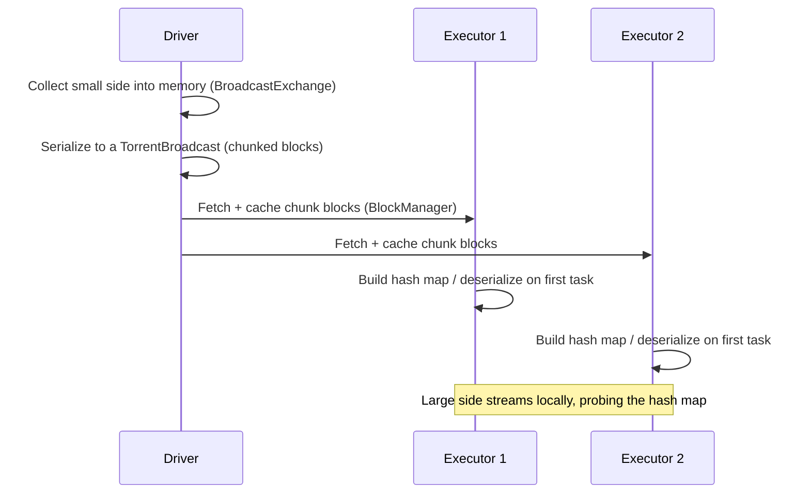
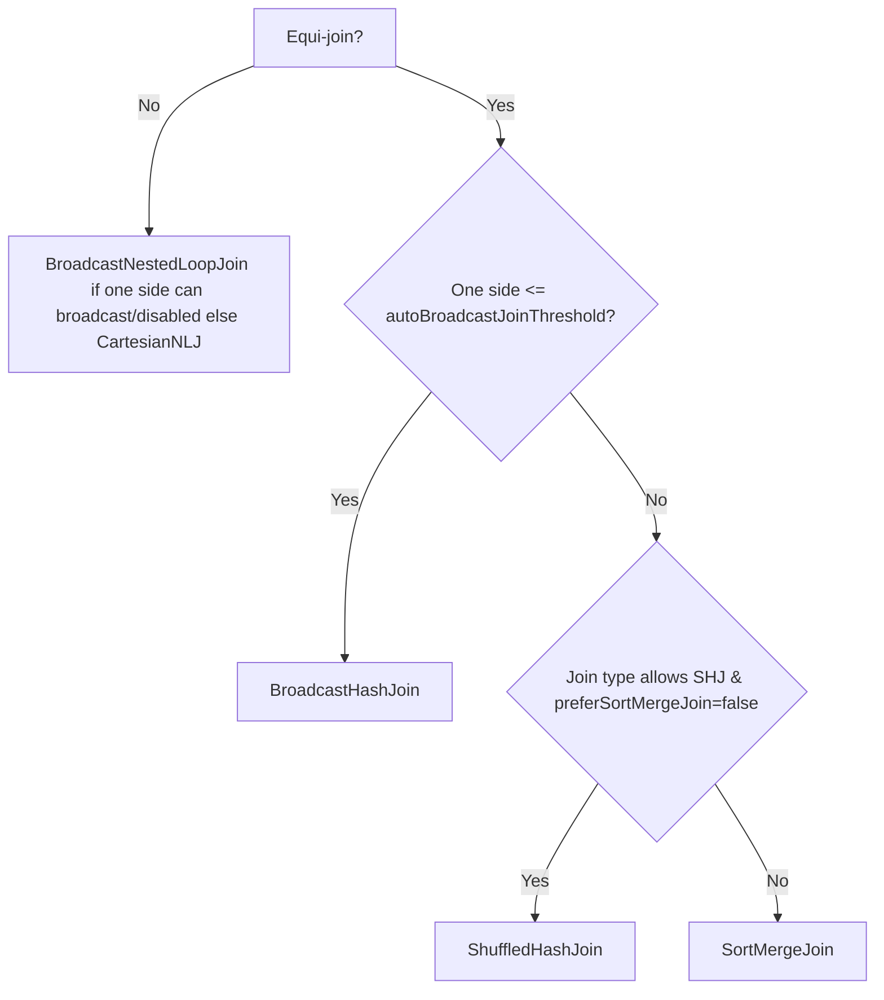
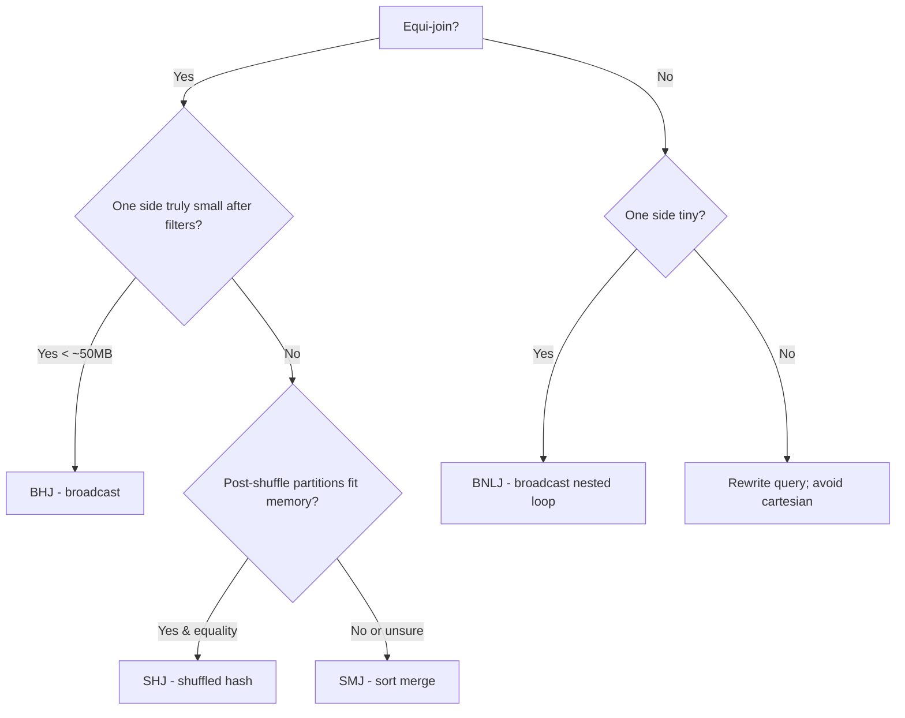

# Broadcast Joins

> A broadcast join turns the most expensive part of a distributed join — shuffling the big table — into a one-time push of the small table to every executor. Instead of co-locating both sides by key across the network, Spark ships the small side as a replicated hash map and each task probes it locally. It is the highest-leverage single optimization in Spark: a 6-hour sort-merge join can become a 20-minute broadcast hash join. It is also one of the most dangerous: broadcasting something that isn't actually small causes driver OOMs, executor OOMs, broadcast timeouts, and job failures that are hard to explain. This chapter teaches you when to broadcast, when you must not, and how the three join strategies (broadcast hash, sort-merge, shuffled hash) actually compare.

## TL;DR

- **Broadcast join (BHJ)** replicates the **small** side to every executor and builds a hash map once; the **large** side is only *scanned* (no shuffle). It is a **map-side join**.
- Spark picks it automatically when the estimated size of one side ≤ `spark.sql.autoBroadcastJoinThreshold` (**10 MB** default). `-1` disables broadcasting.
- **Hints** override the estimate: `/*+ BROADCAST(t) */` / `df.join(broadcast(small))`; also `MERGE`, `SHUFFLE_HASH`, `SHUFFLE_REPLICATE_NL`.
- **When it wins:** one side genuinely small (dimension tables, lookup/enrichment, small aggregated result), and the other side is large; it especially wins when it eliminates a huge shuffle and a sort.
- **When it loses:** the "small" side is large after all, or it is *not* small per-executor (broadcast is replicated per *executor*/executor-memory, not per cluster), or the join is not an equi-join, or the build side is skewed and the other side is tiny.
- **Build side matters:** the *smaller* relation should be the build (hash) side. Left/full outer joins constrain which side can be broadcast.
- **Broadcasts are materialized at a boundary** (`BroadcastExchange`), respect `spark.sql.broadcastTimeout` (300 s), and can be **reused** across multiple operations on the same DataFrame.
- **AQE can convert SMJ → BHJ at runtime** when the actual (post-filter) size turns out to be small — plus a **local shuffle reader** to avoid reading shuffled data.
- **Do not broadcast** to avoid a shuffle if the resulting broadcast is hundreds of MB × hundreds of executors; the memory×replication cost dominates.

---

## 1. Definitions and core vocabulary

| Term | Meaning |
|---|---|
| **Broadcast hash join (BHJ)** | Build a hash table from the small side (the **build side**), replicate it to all executors, stream the large side (**probe side**) against it. No shuffle of the large side. |
| **Broadcast nested loop join (BNLJ)** | Broadcast one side for **non-equi** joins (`<`, `>`, `!=`, `OR` conditions); nested-loop probe. Slower per row but avoids a shuffle. |
| **Build side** | The relation materialized into the hash map (the broadcast one). |
| **Probe side** | The relation streamed through the hash map. |
| **Sort-merge join (SMJ)** | Both sides shuffled by key, sorted, then merged. Robust default for large-large equi-joins. |
| **Shuffled hash join (SHJ)** | Both sides shuffled, then one side built into a per-partition hash map; equality join, often faster than SMJ when partitions fit memory. |
| **`spark.sql.autoBroadcastJoinThreshold`** | Size threshold (bytes) below which a side is auto-broadcast. Default 10 MB; `-1` disables. |
| **`spark.sql.broadcastTimeout`** | Max seconds to wait for a broadcast to complete (default 300). |
| **`BroadcastExchangeExec`** | The physical operator that computes and replicates the small side. |
| **`BroadcastHashJoinExec`** | The physical operator that probes the broadcast hash map. |
| **Broadcast hint** | `/*+ BROADCAST(t) */` (SQL) or `broadcast(df)` (DataFrame). |
| **ReusedExchange** | The same broadcast reused by multiple consumers (common with self-joins or multiple aggregations). |
| **Local shuffle reader** | AQE optimization to read shuffle data locally when partitioning isn't needed after SMJ→BHJ conversion. |
| **Skewed broadcast** | Broadcasting a table that is small in bytes but huge in *rows* × executors, or the probe side is skewed. |

> **Senior note:** The threshold compares to the **estimated size of the relation** as Spark's statistics see it — which may be pre-filter estimates or Parquet footer stats. A "10 MB" table with terrible stats can be estimated at 2 GB (no broadcast → slow) or a table with no stats can be estimated at 10 bytes (bad broadcast → OOM). Stats quality drives broadcast decisions.

---

## 2. What problem it solves / why it matters

Consider joining a 5 TB fact table with a 40 MB dimension:

```
5 TB fact table, 40 MB dim
Sort-merge join : shuffle 5 TB + 40 MB  -> hours, spills, network saturation
Broadcast join  : ship 40 MB to every executor, scan 5 TB -> minutes
```

Broadcasting is essentially **caching a hash table inside every task**, converting a *data-shuffle* problem into a *scan* problem. It wins because:

1. **Eliminates the big shuffle.** No network redistribution of the large side, no sort, no reduce-side spill.
2. **Turns a reducer into a mapper.** Each task joins a local partition against the broadcast data → embarrassingly parallel, no barrier.
3. **Enables enrichment/lookup patterns.** Joining a stream of events with a small lookup (country, SKU, status) is a per-record local hash probe.
4. **Interacts with AQE.** Runtime stats can downgrade an expensive SMJ to BHJ, and a local shuffle reader avoids re-reading shuffled data.

It matters because broadcasting decisions are where senior engineers save the most time with the least code — and where juniors most often cause production incidents (broadcast OOM).

---

## 3. How it works internally

### 3.1 The broadcast lifecycle



**Details:**

- The small side is collected to the **driver** (this is why a giant "small" side OOMs the driver). It is serialized and cut into blocks.
- A **`TorrentBroadcast`** serves the blocks peer-to-peer: executors fetch pieces from the driver *and from each other*, reducing driver network load.
- Each executor **stores the broadcast in its BlockManager** (so the cost is per-executor per-broadcast, not per-task).
- On the first task that needs it, the executor deserializes/builds the lookup structure. For `BroadcastHashJoinExec` the broadcast value is a specialized `HashedRelation` (UnsafeHashedRelation when Tungsten is used), a compact off-heap-ish structure.
- Execution waits on the broadcast **as a barrier**: `spark.sql.broadcastTimeout` (300 s) bounds the wait; the conversion itself is asynchronous and can be cancelled if a slower side finishes first.

### 3.2 Why the build side must be small

Memory budget for a broadcast = `runtime size of the build side × num_executors` (replicated!). If an executor has 8 GB heap and you broadcast 2 GB, you may exceed executor memory → `OutOfMemoryError` or GC thrash. Additionally:

- The driver must **materialize** the whole side (`collect`) → driver heap pressure.
- The hash map has overhead above the raw data (buckets, pointers).
- Under **dynamic allocation**, a large broadcast is replicated to every executor you *could* have — even large clusters with 500 executors pay 500 × size.

**Rule of thumb:** broadcast is safe for sides of a few MB to a few tens of MB; treat 100 MB+ as risky and 500 MB+ as a bug *unless* you use a very small executor count and have explicit headroom.

### 3.3 Strategy selection in Catalyst

The physical planner (`JoinSelection` in `SparkStrategies`) decides, roughly:



Key rules:

- **Hints win** over the threshold (BROADCAST > MERGE > SHUFFLE_HASH > SHUFFLE_REPLICATE_NL).
- **Build-side choice** respects join type: for a **left outer** join the *right* (small) side can be broadcast; for a **right outer**, the left side; **full outer** joins cannot be broadcast on one side (both sides must be shuffled) unless the other side is also broadcast-able (both-sides-broadcast in newer versions for small-small).
- **CBO/AQE** refine sizes: `spark.sql.adaptive.autoBroadcastJoinThreshold` (default = `autoBroadcastJoinThreshold`) applies at runtime.

### 3.4 BHJ vs SMJ vs SHJ — the honest comparison

| Property | Broadcast Hash Join (BHJ) | Sort-Merge Join (SMJ) | Shuffled Hash Join (SHJ) |
|---|---|---|---|
| Shuffle of large side | **No** | Yes (both sides) | Yes (both sides) |
| Sort required | No | Yes | No |
| Memory | Broadcast replicated per executor | Sort buffers, spill-capable | Build-side hash map per partition (can spill in newer versions) |
| Best when | One side small (≤ tens of MB) | Both sides large; robust default | Both sides medium, partitions fit memory, equality join |
| Worst when | "Small" side isn't small | Skewed keys; huge shuffle | Build side too large → OOM/spill |
| Failure mode | Driver/executor OOM, broadcast timeout | Shuffle spill, skew straggler | Hash map OOM |
| Non-equi conditions | BNLJ variant (nested loop) | Not applicable | Not applicable |

> **Senior note:** SMJ is the *safe generalist*. BHJ is the *speed specialist*. SHJ is the *sometimes-winner* that Spark historically avoided because of OOM risk; AQE's `maxShuffledHashJoinLocalMapThreshold` lets it pick SHJ when partitions provably fit.

### 3.5 AQE: converting SMJ → BHJ at runtime

Because pre-execution estimates can be wrong (a `WHERE` filter shrinks a side 100×), AQE re-decides **after** the shuffle write, when it knows real partition sizes:

```
Without AQE: SMJ on a heavily filtered 40 MB side that the planner thought was 40 GB.
With AQE   : shuffle finishes, AQE sees the side is 40 MB, converts to BHJ,
             and uses a local shuffle reader -> no second read of shuffled data.
spark.sql.adaptive.autoBroadcastJoinThreshold = 10m
spark.sql.adaptive.localShuffleReader.enabled = true
```

---

## 4. How to implement it / tune it

### 4.1 Automatic broadcast

```python
spark.conf.set("spark.sql.autoBroadcastJoinThreshold", 30 * 1024 * 1024)  # 30 MB
dim = spark.table("dim_country")            # ~2 MB
fact = spark.table("fact_sales")            # 5 TB
fact.join(dim, "country_code").explain()    # -> BroadcastHashJoin
```

```
== Physical Plan ==
* BroadcastHashJoin [country_code], [country_code], Inner, BuildRight
:- * ColumnarToRow
:  +- FileScan parquet fact_sales
+- BroadcastExchange HashedRelationBroadcastMode(...)
   +- * FileScan parquet dim_country
```

Read it: **BuildRight** = the right side is the broadcast/build side.

### 4.2 Explicit hints

```python
from pyspark.sql.functions import broadcast

# DataFrame hint
fact.join(broadcast(dim), "country_code")

# SQL hint (BROADCAST / BROADCASTJOIN / MAPJOIN are synonyms)
spark.sql("""
  SELECT /*+ BROADCAST(d) */ f.*, d.country_name
  FROM   fact_sales f
  JOIN   dim_country d ON f.country_code = d.country_code
""")

# Force a strategy for testing
spark.sql("SELECT /*+ MERGE(f, d) */ * FROM fact_sales f JOIN dim_country d ON f.country_code=d.country_code")
spark.sql("SELECT /*+ SHUFFLE_HASH(d) */ * FROM fact_sales f JOIN dim_country d ON f.country_code=d.country_code")
```

```scala
// Scala
val joined = fact.join(broadcast(dim), Seq("country_code"))
```

### 4.3 Non-equi and multi-condition joins

```python
# Range/inequality join -> BroadcastNestedLoopJoin (one side must be small)
geo.join(broadcast(ranges), (geo.value >= ranges.lo) & (geo.value < ranges.hi))

# Mixed equality + inequality: broadcast if possible, BNLJ over the non-equi part
a.join(broadcast(b), (a.k == b.k) & (a.ts > b.start_ts))
```

### 4.4 The "semi-join / anti-join" pattern (also broadcast-friendly)

```python
# Filter a huge table by a small dimension: semi-join avoids the shuffle too
small_keys = spark.table("active_accounts").select("account_id")   # small
filtered = fact.join(broadcast(small_keys), "account_id", "left_semi")
```

### 4.5 Broadcasting a plain (non-DataFrame) lookup

```python
# Driver-side broadcast variable: same replication mechanism, non-join use
lookup = {row.code: row.name for row in spark.table("dim_country").collect()}
bc = spark.sparkContext.broadcast(lookup)
rdd.map(lambda r: bc.value.get(r.code, "UNKNOWN"))
```

### 4.6 Key configs

| Config | Default | Meaning |
|---|---|---|
| `spark.sql.autoBroadcastJoinThreshold` | 10 MB | Auto-broadcast size threshold; `-1` disables |
| `spark.sql.adaptive.autoBroadcastJoinThreshold` | (=above) | AQE-time threshold (3.2+) |
| `spark.sql.broadcastTimeout` | 300 s | Max wait for broadcast completion |
| `spark.sql.adaptive.localShuffleReader.enabled` | true | Local read after SMJ→BHJ (3.0+) |
| `spark.sql.join.preferSortMergeJoin` | true | Prefer SMJ over SHJ when not broadcast-able |
| `spark.sql.adaptive.maxShuffledHashJoinLocalMapThreshold` | 0 | Allow SHJ when partitions ≤ this size |
| `spark.sql.statistics.size.autoUpdate.enabled` | false | Update table stats after writes (helps estimates) |
| `spark.sql.cbo.enabled` | true (3.2+) | Cost-based join selection using stats |
| `spark.sql.broadcastExchange.maxThreadThreshold` | 4 | Threads used to broadcast |
| `spark.sql.maxBroadcastTableSizeInBytes` (internal) | — | Guardrails in some engines |

### 4.7 `spark-submit` snippet

```bash
spark-submit \
  --conf spark.sql.autoBroadcastJoinThreshold=52428800 \   # 50 MB
  --conf spark.sql.adaptive.autoBroadcastJoinThreshold=52428800 \
  --conf spark.sql.broadcastTimeout=600 \
  --conf spark.sql.adaptive.localShuffleReader.enabled=true \
  --conf spark.sql.cbo.enabled=true \
  --conf spark.sql.statistics.size.autoUpdate.enabled=true \
  --conf spark.driver.memory=8g \                           # headroom for broadcast collect
  jobs/enrich_events.py
```

---

## 5. Where to implement it (deployment targets, config locations)

| Platform | Notes |
|---|---|
| **Any Spark (YARN/K8s/EMR/standalone)** | Threshold & hints are engine-level; the physical plan is identical. |
| **Databricks** | AQE + Photon; hint/`broadcast()` same semantics; watch driver memory on large broadcasts; `autoBroadcastJoinThreshold` still applies. |
| **EMR** | `spark-defaults` classification; CBO enabled by default in recent EMR releases. |
| **K8s** | Broadcast memory is per-executor; autoscaling to more executors multiplies replication cost. |
| **Structured Streaming** | Broadcast side is re-broadcast per micro-batch unless cached; static lookups should be broadcast once and reused (or use `foreachBatch` with a cached broadcast). |

**Version differences:**

- Broadcast hash join: since Spark 1.x (`spark.sql.autoBroadcastJoinThreshold` since 1.1).
- **AQE runtime broadcast conversion**: 3.0 (with local shuffle reader); `adaptive.autoBroadcastJoinThreshold` 3.2.
- **SHJ** discouraged by default since 1.x due to OOM; `maxShuffledHashJoinLocalMapThreshold` (3.2) makes it safe in specific cases.
- **CBO** default off until 3.2 (now on by default).
- **Storage Partition Join** (3.3+) can make "not-broadcastable" large-large joins shuffle-free without broadcast.

---

## 6. Patterns and anti-patterns

### Patterns

- **Broadcast the dimension, stream the fact.** The canonical warehouse pattern.
- **Broadcast a pre-aggregated result**, not the raw table: aggregate to the join grain first (shrink before broadcasting).
- **Push filters before the broadcast** so the build side is genuinely small (and AQE can act on post-filter size).
- **Cache and reuse the small side** so a single broadcast serves multiple joins (`ReusedExchange`).
- **Left-semi/anti join** to filter a big table by a small key set — a broadcast semi-join.
- **Verify the plan** contains `BroadcastHashJoin` + `BroadcastExchange` before trusting it.

### Anti-patterns

- **Broadcasting a "small" table that is 500 MB–5 GB.** Driver OOM, executor OOM, timeout, or a job that "works" on 3 executors and dies on 50.
- **Setting `autoBroadcastJoinThreshold` to a huge value globally.** It becomes an OOM time bomb across all jobs.
- **Assuming `broadcast()` fixes a skewed join.** If the *probe* side is skewed, one task still processes the hot partition. Broadcast fixes the *shuffle*, not the *skew*.
- **Broadcasting to shorten a join whose other side is also small.** Let the planner pick; two small sides may be cheaper as SHJ or both-broadcast.
- **Broadcasting a streaming/dynamic right side** that changes every micro-batch (re-broadcast cost every batch).
- **Ignoring driver memory.** The collect step runs on the driver; a small driver OOMs before executors do.
- **Broadcasting on a broken `left outer` orientation.** Full outer joins can't be broadcast on one side.
- **Using BNLJ without realizing the quadratic cost** on non-equi joins.

---

## 7. Real-world use cases and industry applications

- **Star-schema analytics.** Fact joins several dimension tables; each small dimension is broadcast → zero fact shuffles.
- **Enrichment / streaming lookups.** Kafka event stream enriched with a small reference table (currency, SKU, geo) → BHJ per micro-batch.
- **Feature engineering for ML.** Joining a large training set with a small feature dictionary; `left_semi` to filter by active entities.
- **Log filtering.** Big logs joined against a small allow-list of IPs/account IDs.
- **GDPR/DSAR deletions.** Small set of subject IDs broadcast to filter massive tables (semi-join).
- **A/B test assignment.** Small assignment table broadcast against a large event stream.
- **Data quality checks.** Small rule/reference tables broadcast against big tables for validation joins.

---

## 8. Senior-level deep dive

### 8.1 Decision tree for join strategy



### 8.2 The real cost model

Broadcast cost ≈ **size(build) × (1 driver collect + replication to E executors)** + **hash-map build per executor**. Benefit ≈ **size.avoided shuffle + sort of the large side**. Broadcast wins when:

```
size(build) × E  <<  size(large_side)  +  size(build)     (shuffle bytes avoided)
```

With `E = 200` executors and a 200 MB build side, you replicate **40 GB** across the cluster before a single fact row is joined — usually not worth it. With `E = 10` and a 20 MB side, you replicate 200 MB to avoid a multi-TB shuffle — an obvious win. **Cluster size changes the answer.**

### 8.3 Failure modes and debugging

| Symptom | Root cause | Fix |
|---|---|---|
| `java.lang.OutOfMemoryError` on the **driver** | Build side too large for `collect` | Raise driver memory or disable broadcast for that join |
| `OutOfMemoryError` / GC thrash on **executors** | Broadcast + probe too large per executor | Lower `autoBroadcastJoinThreshold`, raise executor memory |
| `TimeoutException: Could not get broadcast ...` | Broadcast took > 300 s | Raise `spark.sql.broadcastTimeout`, investigate slow build side, or false broadcast |
| Job "works on small cluster, dies on big" | Replication × more executors | Stop broadcasting; use SMJ |
| Broadcast doesn't happen despite a small table | Missing/stale stats, or a filter the planner can't estimate | `ANALYZE TABLE`, `spark.sql.statistics.size.autoUpdate.enabled`, hint, CBO |
| BHJ still slow with one long task | Probe-side skew | Salting / AQE skew join (chapter 05) |
| Plans show SMJ then BHJ after run | AQE conversion (good) | Confirm with `AdaptiveSparkPlan isFinalPlan=true` |

**How to inspect sizes:** `DESCRIBE EXTENDED table` (stats), `df.explain("cost")`, Spark UI "SQL" tab shows `BroadcastExchange` size, and `spark.sql.adaptive.*` runtime stats appear as `Statistics(sizeInBytes=..., isRuntime=true)`.

### 8.4 Trade-offs and architecture decisions

| Decision | Broadcast | Sort-merge |
|---|---|---|
| Shuffle of big side | None | Full |
| Memory shape | Replicated per executor (multiplied by cluster size) | Per-reduce partition, spill-capable |
| Scaling | Gets **worse** as cluster grows | Scales with cluster |
| Driver pressure | High (collect) | Low |
| Skew tolerance | Fixes shuffle skew, not probe skew | Neither |
| Best architecture | Dimension/lookup enrichment | Fact-fact, unknown-size, huge-both |

**Architecture rule:** broadcasting is a *per-query* optimization tied to your *cluster size*. A pipeline that broadcasts correctly at 10 executors may need `autoBroadcastJoinThreshold` lowered when autoscaling to 200. Encode this in job configuration, not in the code.

### 8.5 Reused broadcasts and caching

If the same DataFrame is joined multiple times, Catalyst's `ReuseExchange` rule reuses the broadcast instead of re-collecting. `df.join(broadcast(lookup), ...)` twice → one `BroadcastExchange`, two `BroadcastHashJoin`s (marked `ReusedExchange`). This is a real win in wide pipelines with many dimension joins; verify it in the plan.

---

## 9. Common mistakes and how to avoid them

1. **Trusting "it's small" without measuring** — check `DESCRIBE EXTENDED`/`explain("cost")`.
2. **Lowering the threshold globally as a "fix" for OOM** — the fix is a targeted hint or disabling broadcast for that join.
3. **Raising the threshold globally to force broadcasts** — OOM incidents across the fleet.
4. **Broadcasting the raw table instead of a pre-aggregated/pre-filtered version.**
5. **Assuming broadcast removes skew** — it removes the shuffle, not probe-side skew.
6. **Forgetting driver memory** for the `collect` step.
7. **Full outer joins + broadcast** — not supported on one side; rewrite the query.
8. **Re-broadcasting a static lookup every streaming micro-batch** — cache/reuse instead.
9. **Non-equi joins treated as cheap** — they become nested-loop.
10. **Never verifying the plan** — always confirm `BroadcastHashJoin` actually appears.

---

## 10. Exercises / interview questions

1. Why does broadcasting a table reduce the large side's work from *shuffle* to *scan*? What is the asymptotic difference in network bytes?
2. You have 100 executors and a 300 MB table. Should you broadcast it? Show the replication arithmetic and the decision.
3. Given `BuildRight` in `BroadcastHashJoin`, which side was broadcast? What does `BuildLeft` mean for an outer join?
4. Enumerate the ways a join that *should* broadcast fails to. *(Hint: stats, filter estimation, join type, threshold.)*
5. How does AQE convert SMJ→BHJ at runtime, and what does the local shuffle reader save?
6. When is `ShuffledHashJoin` better than both BHJ and SMJ? What config enables it safely?
7. Why can a broadcast join make a 3-executor job fast and a 50-executor job die? *(Hint: replication × E.)*
8. Rewrite a large-large join as a broadcast join by pre-aggregating: given `fact ⋈ dim`, what aggregation on `dim` first makes broadcasting viable?
9. What happens on a **full outer** join when the planner wants to broadcast one side? How would you restructure the query?
10. Design an enrichment pipeline joining a 3 TB event stream with a 5 MB lookup that changes hourly. Where do you broadcast, and how do you avoid per-micro-batch re-broadcast cost?

---

## References

- Apache Spark, *Performance Tuning — Optimizing the Join Strategy / Automatically Broadcasting Joins*: https://spark.apache.org/docs/latest/sql-performance-tuning.html#optimizing-the-join-strategy
- Apache Spark, *SQL Hints — Join hints (BROADCAST, MERGE, SHUFFLE_HASH)*: https://spark.apache.org/docs/latest/sql-ref-syntax-qry-select-hints.html#join-hints
- Apache Spark, *Configuration* (`spark.sql.autoBroadcastJoinThreshold`, `spark.sql.broadcastTimeout`): https://spark.apache.org/docs/latest/configuration.html
- Databricks, *Adaptive Query Execution: Speeding Up Spark SQL at Runtime* (SMJ→BHJ conversion): https://www.databricks.com/blog/2020/05/29/adaptive-query-execution-speeding-up-spark-sql-at-runtime.html
- Databricks, *Deep Dive into Spark SQL's Catalyst Optimizer*: https://www.databricks.com/blog/2015/04/13/deep-dive-into-spark-sqls-catalyst-optimizer.html
- Apache Spark source, *JoinSelection / SparkStrategies.scala*: https://github.com/apache/spark/blob/master/sql/core/src/main/scala/org/apache/spark/sql/execution/SparkStrategies.scala
- Apache Spark source, *BroadcastHashJoinExec.scala*: https://github.com/apache/spark/blob/master/sql/core/src/main/scala/org/apache/spark/sql/execution/joins/BroadcastHashJoinExec.scala
- Apache Spark source, *TorrentBroadcast.scala*: https://github.com/apache/spark/blob/master/core/src/main/scala/org/apache/spark/broadcast/TorrentBroadcast.scala
- Databricks, *Broadcast joins and hints*: https://docs.databricks.com/aws/en/optimizations/spark-ui-guide
