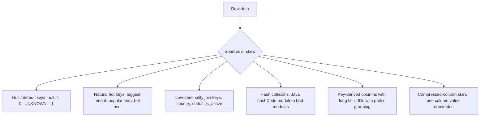

# Data Skew

> Data skew is the situation where a tiny number of partitions hold a disproportionate share of the data. In a shuffle, one reduce task then processes gigabytes while its peers process megabytes, so a stage that should take 4 minutes takes 4 hours — and it happens nondeterministically, on the days a hot key appears. Skew is not a Spark bug: it is a property of your *data distribution* meeting a *partitioning function*. It is the most common cause of "the job was fast yesterday and slow today," the most common reason a job "works at 100 GB and dies at 1 TB," and one of the hardest problems to fix because the naive fixes (more partitions, `repartition`) do not touch it. This chapter gives you detection, the fix menu (salting, custom partitioners, AQE skew join, two-phase aggregation), and the important distinction between skew in **joins** and skew in **groupBy/aggregations**.

## TL;DR

- **Skew = non-uniform partition sizes.** Typically a few "hot keys" (a null/default user, a top tenant, a crawler bot) dominate the shuffle.
- **Detect it** with: task-duration distribution per stage (Spark UI), `groupBy(key).count()` on the largest keys, `spark_partition_id()` distribution, and AQE's `OptimizeSkewedJoin` metrics.
- **AQE skew join handling** (Spark 3.0+, `spark.sql.adaptive.skewJoin.enabled=true`, on by default 3.2) automatically **splits skewed SMJ partitions** and replicates the matching side. It fixes **sort-merge joins**, not `groupBy` aggregations.
- **Salting** = add a random suffix to the skewed key (`key -> key || '_' || rand(0..N)`), aggregate/join in two phases, and collapse. The universal manual fix for both joins and aggregations.
- **Custom partitioner** = for the RDD API, write a `Partitioner` that spreads hot keys by count or by domain knowledge. Powerful but low-level.
- **Two-phase aggregation** (`partial_agg` → re-partition by key → final agg) isolates hot keys so they don't stall the final stage.
- **For `groupBy`/`window` skew AQE will NOT help** — you must salt, isolate hot keys, or pre-aggregate.
- **Prevent skew upstream**: partition by a composite key (`tenant_id + date`), filter/route null keys, or use higher-cardinality join keys.

---

## 1. Definitions and core vocabulary

| Term | Meaning |
|---|---|
| **Skew** | Uneven distribution of records/bytes across partitions, usually due to hot keys. |
| **Hot key** | A key value appearing far more often than others (e.g. `null`, `0`, `"UNKNOWN"`, a bot user, your biggest customer). |
| **Partition size skew** | `max partition bytes / median partition bytes` — the practical skew metric. |
| **Straggler task** | The one task that runs far longer than its peers because its partition is huge. |
| **Salting** | Appending a random `0..N-1` suffix to a key to split it into `N` sub-keys, then removing the salt in a second aggregation/join. |
| **Custom partitioner** | An RDD `Partitioner` implementing your own key → partition mapping (e.g. count-based, composite). |
| **Two-phase aggregation** | Partial aggregation with salt → shuffle → merge by unsalted key, used to fix `groupBy` skew. |
| **AQE skew join** | `OptimizeSkewedJoin` adaptive rule: splits skewed shuffle partitions of one side and replicates the corresponding partitions of the other side. |
| **`skewedPartitionFactor`** | A partition is skewed if its size > factor × median AND > `skewedPartitionThresholdInBytes`. |
| **Map-side skew** | Skew in the *write* phase (one huge input partition) vs **reduce-side skew** (one huge output partition). |
| **Cardinality** | Number of distinct keys; low cardinality + high volume = skew risk. |
| **Salted join** | Join on `(key, salt)` where both sides are salted, then a second pass to recover exactness (or accept approximate). |

> **Senior note:** Distinguish skew from *simple under-parallelism*. A stage with 5 tasks each of 2 GB is not skewed — it is under-partitioned. Skew is a **distribution** property (one partition ≫ median); under-parallelism is a **count** property. The fixes differ.

---

## 2. What problem it solves / why it matters

Think of a shuffle-reduce stage as a synchronized race. All reduce tasks start together and the stage finishes when the **slowest** task finishes. If one task has 30× the data of the median:

```
200 tasks, median 100 MB, one task 3 GB
  - 199 tasks finish in ~2 min
  - 1 task runs ~60 min (plus spill, GC, retries)
  - stage wall-clock = ~60 min instead of ~2 min
  - cluster utilization = 199 idle slots for most of the time
Effective throughput = ~1/30th of the cluster.
```

Consequences:

1. **Wall-clock explosion** — a job that is "basically done" waits on one task.
2. **OOM and spill** on the hot task — it may not fit memory, spills to disk, or fails outright.
3. **Wasted compute** — you are paying for 200 executors to run 1.
4. **Non-determinism** — skew appears only when a hot key enters today's data; the job passes in dev and fails in prod.
5. **Retry loops** — OOM → retry → OOM → task failure → stage failure, sometimes succeeded only because the task is retried alone on a bigger/free executor.

Skew is the difference between a pipeline that *scales linearly* and one that *does not scale at all* past a threshold. That threshold is a senior-level concern.

---

## 3. How it works internally

### 3.1 Where skew comes from



Common real examples: `user_id = null` for 40% of events; a single `account_id` that is your largest customer; a `country_code = 'US'` in an otherwise global dataset; a `session_id` for a runaway crawler; a `device_id = 0` placeholder.

### 3.2 How skew shows up in the engine

- **Shuffle write:** one *map* task may be huge if an input partition is huge (map-side skew), or all map tasks write heavily to the *same* reduce partition (`shuffle_<sid>_<mid>_<reduceId>` for the hot reduceId).
- **Shuffle read:** when the hot reduce task starts, it **fetches** the hot partition from *every* map task (N map outputs, all containing a slice of the hot key). This is also a `Fetch` traffic hotspot and can trigger `TooLargeFrame` or `maxSizeInFlight` pressure.
- **Reduce:** the aggregator/sorter for that partition accumulates millions/billions of records for one key → spills, GC, OOM.
- **AQE:** after shuffle write, AQE inspects per-partition sizes and can split skewed partitions (SMJ only).

### 3.3 AQE skew join handling (`OptimizeSkewedJoin`)

After the shuffle stage completes, AQE has real partition sizes. For a `SortMergeJoin`, the rule:

1. Computes the median partition size (over shuffle partitions).
2. Marks a partition **skewed** if `size > skewedPartitionFactor × median` **and** `size > skewedPartitionThresholdInBytes`.
3. **Splits** the skewed partition into multiple sub-partitions (roughly by `advisoryPartitionSizeInBytes`), and **replicates** the matching partition from the other join side so each sub-partition can be joined independently.
4. Produces extra tasks (`AQEShuffleRead` with skew markers) so work is balanced.

```sql
SET spark.sql.adaptive.skewJoin.enabled=true;
SET spark.sql.adaptive.skewJoin.skewedPartitionFactor=5;
SET spark.sql.adaptive.skewJoin.skewedPartitionThresholdInBytes=256m;
SET spark.sql.adaptive.advisoryPartitionSizeInBytes=64m;
```

| Config | Default | Meaning |
|---|---|---|
| `spark.sql.adaptive.skewJoin.enabled` | true | Enable skew join handling |
| `spark.sql.adaptive.skewJoin.skewedPartitionFactor` | 5.0 | size > factor × median → candidate |
| `spark.sql.adaptive.skewJoin.skewedPartitionThresholdInBytes` | 256 MB | absolute lower bound for "skewed" |
| `spark.sql.adaptive.advisoryPartitionSizeInBytes` | 64 MB | target size when splitting |
| `spark.sql.adaptive.forceOptimizeSkewedJoin` | false | Force even if extra shuffle is required (3.3+) |

> **Critical limitation:** AQE skew join only applies to **sort-merge joins** (and `REBALANCE`/`OptimizeSkewedJoin`-eligible plans). It does **not** fix skew in a plain `GROUP BY` aggregation, nor in a broadcast join's **probe** side, nor in RDD-API shuffles.

### 3.4 Salting — the mechanism

The idea: transform the hot key so it maps to *many* partitions, then merge results.

**For aggregation (`groupBy` skew):**

```
Phase 1 (salt):  key -> (key, salt)   where salt = rand(0..N-1)
                 partial aggregate per (key, salt)
Phase 2 (merge): (key, salt) -> key    sum partials per key
```

**For joins (when AQE can't help, e.g. RDD or a non-SMJ plan):**

```
Salt the SKEWED side with N salts, and EXPLODE (replicate) the other side by the same N salts,
then join on (key, salt). Co-partitioning is by (key, salt) -> hot key spreads over N partitions.
```

### 3.5 Custom partitioners (RDD API)

A `Partitioner` can balance by **observed counts** or domain knowledge:

```python
# Map hot keys to specific partitions, everything else hashed
HOT = {"BIG_TENANT", "CRAWLER_BOT"}
class HotKeyPartitioner(Partitioner):
    def __init__(self, n, hot_keys):
        self.n = n
        self.hot = set(hot_keys)
    def __call__(self, key):
        if key in self.hot:
            return self.n - 1          # dedicate a partition (or spread via salt)
        return hash(key) % (self.n - 1)
```

This is powerful but manual: you must know the hot keys and you break automatic partitioning knowledge.

### 3.6 Two-phase aggregation (isolation of hot keys)

A robust pattern that doesn't require salting correctness:

```sql
-- Phase 1: pre-aggregate the hot key separately at finer grain
WITH pre AS (
  SELECT tenant_id, date, SUM(amount) AS amt
  FROM   events
  GROUP  BY tenant_id, date   -- increases cardinality -> smaller per-key groups
)
SELECT tenant_id, SUM(amt) FROM pre GROUP BY tenant_id;
```

Or split the pipeline: process hot keys with a different strategy (broadcast if small, or dedicated salt) and `UNION` back.

---

## 4. How to implement it / tune it

### 4.1 Detect skew

```python
import pyspark.sql.functions as F

df = spark.table("events")

# 1) Top keys dominating the data
(df.groupBy("user_id").count()
   .orderBy(F.desc("count"))
   .show(20, truncate=False))

# 2) Distribution across current partitions (after the shuffle)
(df.groupBy(F.spark_partition_id().alias("pid"))
   .agg(F.count("*").alias("rows"),
        F.max("user_id").alias("sample_key"))
   .orderBy(F.desc("rows"))
   .show(20))
```

```
+-------+----------+
|user_id|     count|
+-------+----------+
|   null| 480000000|   <-- 60% of all rows
|   u_17|  95000000|
|   u_az|  11000000|
|   ... |       ...|
+-------+----------+
```

**Spark UI:** Stage detail → *Summary Metrics* → task duration `Max / 75th percentile`; a `Max` 30× the `75th%` is skew. Also *Shuffle Read Size / Records*: `Max` ≫ `Median`.

**AQE metrics:** in the SQL UI details you'll see `OptimizeSkewedJoin` and `number of skewed partitions`.

### 4.2 Fix aggregation skew with salting

```python
import pyspark.sql.functions as F
from pyspark.sql.types import LongType

SALT = 16

# Phase 1: salt + partial aggregate
salted = (df
  .withColumn("salt", (F.rand() * SALT).cast("int"))
  .groupBy("user_id", "salt")
  .agg(F.sum("amount").alias("partial_amount"),
       F.count("*").alias("partial_count")))

# Phase 2: drop salt, merge partials
result = (salted
  .groupBy("user_id")
  .agg(F.sum("partial_amount").alias("amount"),
       F.sum("partial_count").alias("count")))
```

**Why it works:** `(user_id, salt)` has `N×` the cardinality, so the hot key's records spread over `N` partitions in phase 1 while the *partial* results are `N×` smaller. Phase 2 shuffles a much smaller dataset.

### 4.3 Fix join skew manually (salted join / explode)

```python
SALT = 16

# Force the salted plan: explode the small side by the salt range
salted_fact = fact.withColumn("salt", (F.rand() * SALT).cast("int"))

salted_dim = dim.crossJoin(
    spark.range(SALT).withColumnRenamed("id", "salt")
)   # replicates the dimension N times (safe if dim is small)

joined = (salted_fact
  .join(salted_dim, on=["user_id", "salt"], how="inner")
  .groupBy("user_id")                       # collapse replicates if needed
  .agg(...))
```

**Caveat:** exploding the non-skewed side multiplies its size by `N`. Only viable if that side is small or aggregated. When both sides are huge, prefer AQE skew join or a composite key.

### 4.4 Composite / higher-cardinality keys

```python
# Instead of groupBy("tenant_id") -> groupBy("tenant_id","date","device_type")
agg = df.groupBy("tenant_id", "dt", "device_type").agg(F.sum("amount"))
final = agg.groupBy("tenant_id").agg(F.sum("sum(amount)"))

# Join on a composite key to spread hot tenants
fact.join(dim, on=["tenant_id", "dt"])     # adds cardinality -> spreads
```

### 4.5 Null / sentinel key handling

```python
# Route null keys to their own partition instead of one giant bucket
clean = df.withColumn(
    "join_key",
    F.when(F.col("user_id").isNull(), F.concat(F.lit("NULL_"), (F.rand()*64).cast("int")))
     .otherwise(F.col("user_id").cast("string")))

# Or filter/handle them separately
nulls = df.filter(F.col("user_id").isNull())
valid = df.filter(F.col("user_id").isNotNull())
```

### 4.6 RDD custom partitioner for hot keys

```python
rdd = df.rdd.keyBy(lambda r: r["user_id"])
# Partition count ~ a few × cores; dedicate partitions to known hot keys or salt them
parted = rdd.partitionBy(512, partitionFunc=lambda k: (hash(k) + random.randint(0, 7)) % 512)
```

### 4.7 AQE-first recipe

```python
spark.conf.set("spark.sql.adaptive.enabled", "true")
spark.conf.set("spark.sql.adaptive.skewJoin.enabled", "true")
spark.conf.set("spark.sql.adaptive.advisoryPartitionSizeInBytes", "64m")
spark.conf.set("spark.sql.adaptive.skewJoin.skewedPartitionThresholdInBytes", "256m")
spark.conf.set("spark.sql.adaptive.skewJoin.skewedPartitionFactor", "5")
# Aggregation skew is NOT fixed by AQE -> salt the groupBy as in 4.2
```

### 4.8 Key configs

| Config | Default | Notes |
|---|---|---|
| `spark.sql.adaptive.skewJoin.enabled` | true | Auto split skewed SMJ partitions |
| `spark.sql.adaptive.skewJoin.skewedPartitionThresholdInBytes` | 256 MB | Absolute skew floor |
| `spark.sql.adaptive.skewJoin.skewedPartitionFactor` | 5.0 | Relative-to-median factor |
| `spark.sql.adaptive.advisoryPartitionSizeInBytes` | 64 MB | Split target size |
| `spark.sql.adaptive.forceOptimizeSkewedJoin` | false | Force even with extra shuffle (3.3+) |
| `spark.sql.adaptive.optimizeSkewsInRebalancePartitions.enabled` | true | Split skewed `REBALANCE` partitions (3.2+) |
| `spark.sql.adaptive.rebalancePartitionsSmallPartitionFactor` | 0.2 | Merge small rebalance partitions |
| `spark.sql.shuffle.partitions` | 200 | More partitions dilutes but doesn't remove skew |

---

## 5. Where to implement it (deployment targets, config locations)

| Platform | Notes |
|---|---|
| **Any Spark 3.2+** | AQE skew join on by default — but only for SMJ. |
| **Databricks** | AQE + Photon; skew often handled automatically; still salt aggregation skew; `REBALANCE` hint for skewed writes. |
| **EMR / YARN / K8s** | Same engine behavior; config through `spark-defaults`/`--conf`/Operator spec. |
| **Streaming** | Skew is *per micro-batch*; a hot key can appear at any time → prefer salting/pre-aggregation over static partitioning. |
| **Delta/Iceberg writes** | `REBALANCE` hint (3.2+) or `OPTIMIZE`/compaction to avoid skewed output files; liquid clustering to spread. |
| **Snowflake/BigQuery parity** | Their engines handle skew internally; Spark does not — this is a Spark-specific skill. |

**Version differences:** AQE skew join added 3.0; skew handling in `REBALANCE` 3.2; `forceOptimizeSkewedJoin` 3.3; storage-partition-join skew optimizations 3.4+ (`spark.sql.sources.v2.bucketing.partiallyClusteredDistribution.enabled`).

---

## 6. Patterns and anti-patterns

### Patterns

- **Measure the top keys** before choosing a fix.
- **Salt when cardinality is low and one key dominates.**
- **Two-phase aggregate** to shrink before the final shuffle.
- **Composite keys** to raise cardinality naturally.
- **Handle null/sentinel keys explicitly** — they are the most common skew source.
- **Use AQE for joins, salt for groupBy.**
- **Isolate hot keys** and process them with a dedicated strategy, then `UNION`.
- **Prevent at the source**: filter bad keys at ingestion, use higher-cardinality join keys.

### Anti-patterns

- **"Just increase `spark.sql.shuffle.partitions`."** The hot key still lands in exactly one partition; you moved 199 tasks, not the hot one.
- **`repartition(n, key)` to fix skew.** It hash-partitions by the hot key → same problem.
- **Expecting AQE to fix `groupBy` skew.** It won't; it's a join-only rule.
- **Salting both sides of a join without exploding.** Breaks join semantics (you salt the *skewed* side and explode the *other* side).
- **Salting with too few salts.** `N=2` barely helps; use 8–64 and verify.
- **Assuming skew will stay fixed.** New hot keys appear; monitor, don't set-and-forget.
- **Ignoring map-side skew** — a single huge input partition (a giant file) is also skew.
- **`collect()`ing a skewed key to "handle it in the driver."**

---

## 7. Real-world use cases and industry applications

- **Multi-tenant SaaS analytics.** One giant tenant dominates `tenant_id`; salt or composite keys.
- **Ad-tech impression→user joins.** Bot/automation users produce millions of events; salting spreads them.
- **E-commerce recommendations.** A few popular items (or the "unknown item" placeholder) dominate item-level joins.
- **Log analytics.** `null`/`0` device IDs and default UA strings create mega-partitions.
- **Finance ledgers.** A single high-frequency account or a nightly-batch "adjustment" entry skews by `account_id`.
- **IoT telemetry.** One malfunctioning/fleet device floods a `device_id`; also a very low-cardinality `region`.
- **A/B experimentation.** The control bucket (often `null` variant) is by far the largest group.
- **CDC merge pipelines.** A hot primary key in a `MERGE`/upsert causes skew in the merge join.

---

## 8. Senior-level deep dive

### 8.1 Detection → decision tree

```mermaid
flowchart TD
    A[Stage slow, one task straggler] --> B{Join or aggregation?}
    B -->|Join (SMJ)| C{AQE enabled & SMJ?}
    C -->|Yes| D[Let AQE split skewed partitions]
    C -->|No / RDD| E[Salt skewed side + explode other side]
    B -->|GroupBy / window| F[AQE won't help]
    F --> G[Salt + two-phase aggregate]
    B -->|Broadcast join| H[Skew is in probe side -> salt probe key or pre-aggregate]
    A --> I{One huge input partition?}
    I -->|Yes| J[Map-side skew: repartition input, fix file layout]
```

### 8.2 The cost model of salting

Salting with `N` salts multiplies the *number of partitions* used by the hot key by `N` and multiplies the *non-skewed side's size* by `N` if you explode it. Net effect:

```
Before: T_hot bytes in 1 task      -> wall clock ~ f(T_hot)
After : T_hot / N bytes in N tasks -> wall clock ~ f(T_hot / N) + salt overhead
```

Tune `N` so the hot partition size ≈ `advisoryPartitionSizeInBytes` (~64–128 MB). Over-salting adds shuffle overhead for the non-hot keys too (they're also salted → more partitions, more small tasks). The right `N` balances the hot key's data volume against the target task size.

### 8.3 Failure modes and debugging

| Symptom | Cause | Fix |
|---|---|---|
| One task 30× longer, huge `Shuffle Read` | Reduce-side key skew | AQE skew join / salt / composite key |
| One **map** task much larger | Map-side skew (huge input partition) | `repartition`, smaller `maxPartitionBytes`, split the file |
| OOM in one reduce task | Hot partition doesn't fit memory | Salt; raise memory; AQE split |
| Job unpredictable across days | Transient hot keys | Salting (robust), not static partitioning |
| AQE skew metrics present but stage still slow | Skew is in `groupBy`, not a join | Salt aggregation |
| Whole-stage codegen fails on hot task | Too many rows → generated code too large | `spark.sql.codegen.maxFields`, fallback |
| `TooLargeFrame` fetch failures | One block for the hot partition > frame limit | More partitions / salt / `spark.maxRemoteBlockSizeFetchToMem` |

**Debugging workflow:**
1. Spark UI → the slow stage → *Summary Metrics* → task duration & shuffle read max vs median.
2. Find *which* partition/key is hot: `groupBy(spark_partition_id())` or `groupBy(key).count()`.
3. Decide join vs aggregation (read the plan) → apply the matching fix.
4. Re-measure the max/median ratio and wall-clock.

### 8.4 Trade-offs

| Fix | Effort | Exactness | Works for | Downside |
|---|---|---|---|---|
| AQE skew join | None (config) | Exact | SMJ joins | Only SMJ; needs stats |
| Salting (agg) | Medium | Exact (if done right) | groupBy, window | Extra shuffle, N× intermediate |
| Salted join + explode | Medium | Exact | joins | Explodes non-skewed side |
| Custom partitioner | High | Exact | RDD | Manual, brittle |
| Composite key | Low | Exact | both | Requires a natural finer key |
| Isolate hot keys | Medium | Exact | both | Two code paths, union |
| Filter null keys | Low | Depends | both | Loses rows (document it) |

**Architecture rule:** the *durable* fix is a data model with adequate cardinality and controlled nulls. Salting is a *tactical* fix; if you salt the same job every night, fix the key.

---

## 9. Common mistakes and how to avoid them

1. **Increasing partitions to fix skew** — doesn't move the hot key.
2. **`repartition` by the hot key** — recreates the skew.
3. **Assuming AQE handles all skew** — it's join-only.
4. **Salting only one side of a join** — breaks semantics; you must salt the skewed side and explode the other.
5. **Not measuring after the fix** — verify the max/median ratio.
6. **Over-salting** — creates tiny-task overhead for non-hot keys.
7. **Ignoring null/sentinel keys** — usually the worst offender.
8. **Forgetting map-side skew** — a giant input file is also a skew problem.
9. **Static salt counts for dynamic data** — size salts against current-volume data.
10. **Treating skew as a Spark config problem** — it's a data-distribution problem.

---

## 10. Exercises / interview questions

1. Distinguish skew from under-parallelism. Give an example of each and the different fixes.
2. A stage's task durations are 2, 2, 3, 2, 180, 2 minutes. What do you inspect next and what fix do you consider?
3. Why doesn't raising `spark.sql.shuffle.partitions` fix a hot-key skew? Where does the hot key go?
4. Explain AQE's `OptimizeSkewedJoin`: what triggers "skewed," what does it do to each side, and what are its limits?
5. Design a salted `groupBy` for a key where one value is 70% of the rows. How do you choose `N`?
6. Why must you salt the skewed side and *explode* the other side in a salted join? What happens if you salt both?
7. A `left outer` join is skewed on the *probe* side. Will AQE fix it? Will broadcast fix it? What will?
8. You have a `null` join key for 40% of rows. Propose three ways to handle it and their trade-offs.
9. When is a *custom partitioner* the right tool, and what do you lose versus AQE?
10. Given a job that is fast on Monday and slow on Tuesday, outline the skew-confirmation checklist you'd run.

---

## References

- Apache Spark, *Performance Tuning — Optimizing Skew Join (AQE)*: https://spark.apache.org/docs/latest/sql-performance-tuning.html#optimizing-skew-join
- Apache Spark, *Configuration — `spark.sql.adaptive.skewJoin.*`*: https://spark.apache.org/docs/latest/configuration.html
- Databricks, *Adaptive Query Execution: Speeding Up Spark SQL at Runtime* (skew join section): https://www.databricks.com/blog/2020/05/29/adaptive-query-execution-speeding-up-spark-sql-at-runtime.html
- Databricks, *Skew joins and AQE*: https://docs.databricks.com/aws/en/optimizations/aqe
- Databricks, *Skipping the shuffle: handling skew in joins*: https://www.databricks.com/blog/2021/10/25/skipping-the-shuffle-a-fresh-look-at-co-partitioned-joins-in-apache-spark.html
- Apache Spark source, *OptimizeSkewedJoin.scala*: https://github.com/apache/spark/blob/master/sql/core/src/main/scala/org/apache/spark/sql/execution/adaptive/OptimizeSkewedJoin.scala
- Apache Spark source, *OptimizeSkewInRebalancePartitions.scala*: https://github.com/apache/spark/blob/master/sql/core/src/main/scala/org/apache/spark/sql/execution/adaptive/OptimizeSkewInRebalancePartitions.scala
- Apache Spark source, *Partitioner.scala*: https://github.com/apache/spark/blob/master/core/src/main/scala/org/apache/spark/Partitioner.scala
- Databricks, *Best practices: Delta Lake / performance tuning (skew, compaction, clustering)*: https://docs.databricks.com/aws/en/delta/best-practices
- Databricks, *Query optimization — skew handling and REBALANCE hints*: https://docs.databricks.com/aws/en/optimizations/aqe
