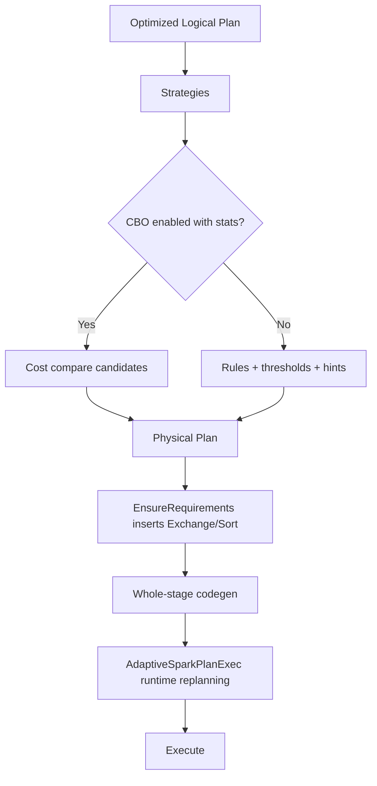

# Catalyst Optimizer

> Catalyst is Spark SQL's query optimizer: a rule-based, extensible, tree-rewriting engine that turns your logical query into an efficient physical plan, and then Tungsten compiles that plan into JVM bytecode. Understanding Catalyst is what lets you predict *why* Spark produced the plan it did, and change the input (statistics, ordering, hints, UDFs) so it produces a better one. A working Spark user writes SQL; a senior engineer reads the plan, understands which rules fired, spots the missing `ColumnPruning` or `PushDownPredicate`, and knows the difference between planning time (logical + physical), **compilation time** (whole-stage codegen), and **runtime re-optimization** (AQE). This chapter covers the four phases, the rule engine, cost-based optimization, and the Tungsten execution layer.

## TL;DR

- **Four phases:** (1) **Analysis** — resolve names/types against the Catalog; (2) **Logical Optimization** — apply rule batches (predicate pushdown, column pruning, constant folding, join reorder...); (3) **Physical Planning** — `Strategy` objects turn logical operators into executable physical operators; (4) **Code Generation** — Tungsten whole-stage codegen fuses operators into JVM code.
- **Catalyst is a tree-rewriting engine:** `TreeNode` + `Rule[TreeType]` + `RuleExecutor`. Rules are grouped into **batches** with a strategy (`Once` or `FixedPoint(maxIterations)`).
- **Rules are extensible**: Spark exposes extension points (`SparkSessionExtensions`, `injectOptimizerRule`, `injectPlannerStrategy`) — the same mechanism used by Delta, Iceberg, and Databricks Photon.
- **Cost-Based Optimization (CBO)** uses table/column statistics (`ANALYZE TABLE ... COMPUTE STATISTICS`) to choose join order, build side, and join type. **On by default since 3.2**, but useless with missing/stale stats.
- **Tungsten** is the execution substrate: `UnsafeRow` binary format, off-heap memory, cache-aware computation, and **whole-stage codegen** that fuses a stage's operators into one generated function.
- **Whole-stage codegen breaks at shuffle and broadcast boundaries** (the `*(n)` groups in `explain("formatted")`).
- **AQE** (`AdaptiveSparkPlanExec`) is a *runtime* re-planning layer that re-runs the optimizer + planner at materialization points using real statistics — it sits *on top of* Catalyst, not instead of it.
- **Read plans in this order:** `explain()` (optimized logical) → `explain("formatted")` (physical, with codegen groups) → `explain("cost")` (row estimates) → Spark UI SQL tab (runtime stats).

---

## 1. Definitions and core vocabulary

| Term | Meaning |
|---|---|
| **Catalyst** | Spark SQL's tree-manipulation/optimization framework (queries *and* expressions are trees). |
| **TreeNode** | Base class of all plan/expression nodes (`LogicalPlan`, `Expression`). |
| **Rule** | A function `TreeType => TreeType` that rewrites a plan (e.g. `PushDownPredicate`). |
| **RuleExecutor** | Applies a list of `Batch`es, each containing rules, with a strategy. |
| **Batch** | A named group of rules (e.g. "Operator Optimization before Inferring Filters"). |
| **Strategy (`Once` / `FixedPoint`)** | Execute a batch once, or repeatedly until a fixpoint or `maxIterations`. |
| **Analyzer** | The phase that resolves `UnresolvedAttribute`/`UnresolvedRelation` using the **Catalog**. |
| **Catalog** | Metadata store: databases, tables, functions, column stats (`SessionCatalog`, Hive, V2). |
| **LogicalPlan** | Abstract query tree (no execution detail): `Filter`, `Project`, `Join`, `Aggregate`, `Sort`... |
| **PhysicalPlan / SparkPlan** | Executable operator tree: `FilterExec`, `HashJoinExec`, `Exchange`, ... |
| **Strategy (physical)** | Maps a logical operator to one or more candidate physical operators (`JoinSelection`, `Aggregation`, ...). |
| **CBO** | Cost-Based Optimization using statistics to pick among candidate plans. |
| **Statistics** | Row count, size in bytes, distinct counts, min/max, null counts, histograms. |
| **Whole-stage codegen** | Fusing consecutive operators of one stage into a single generated Java function. |
| **Tungsten** | The project/execution layer: `UnsafeRow`, off-heap, cache-aware, codegen. |
| **`AdaptiveSparkPlanExec`** | AQE wrapper; re-runs optimization at runtime (`queryStageOptimizerRules`). |
| **LogicalQueryStage** | AQE's logical representation of a completed/ongoing materialized stage. |
| **Exchange** | A physical node that redistributes data (shuffle or broadcast); a stage boundary. |
| **`AQEShuffleRead`** | AQE-aware shuffle read node (coalesced/skew/single-partition). |

> **Senior note:** "Catalyst" strictly means the *tree framework*; the optimization pipeline is Analyzer → Optimizer → Planner → Codegen. Blogs blur this. When someone says "Catalyst rule," they mean a logical optimization rule; when they say "Catalyst optimizer," they usually mean the whole front-end.

---

## 2. What problem it solves / why it matters

A SQL/DataFrame query can be executed in astronomically many ways: join orders, join algorithms, aggregation strategies, filter placement, column pruning, sort elimination. The naive execution of user-written SQL is almost always terrible.

Catalyst's job:

1. **Make declarative correct.** Take a *declarative* query (SQL/DataFrames) with no execution hints and produce a *correct* executable plan.
2. **Make declarative fast.** Rewrite it so that far less data is read, shuffled, sorted, and computed (pushdown pruning) and so the plan uses the right algorithms.
3. **Be extensible.** Support custom rules, data sources, and cost models without forking Spark — this is why Delta, Iceberg, and Photon are possible.
4. **Adapt to reality.** With AQE, correct the planner's *estimates* using *facts* measured at runtime.

For a senior, Catalyst matters because **you cannot tune what you cannot read.** Most "why is this slow" answers live in the plan: a missing predicate pushdown, a non-broadcast join, a `Sort` you didn't ask for, a `Generate` (explode) before a filter, a UDF blocking a rule.

---

## 3. How it works internally

### 3.1 The four phases

```mermaid
flowchart LR
    SQL["SQL / DataFrame"] --> P["Parser (ANTLR)"]
    P --> U["Unresolved Logical Plan"]
    U --> A["Analyzer (+ Catalog)"]
    A --> L["Analyzed Logical Plan"]
    L --> O["Optimizer (rule batches + CBO)"]
    O --> LO["Optimized Logical Plan"]
    LO --> PP["Physical Planner (Strategies)"]
    PP --> PH["Physical Plan (SparkPlan)"]
    PH --> CG["Whole-stage Codegen (Tungsten)"]
    CG --> EX["Executable stages -> RDDs -> tasks"]
```



### 3.2 Phase 1 — Analysis (resolution)

Input: an **unresolved** logical plan where names are symbolic (`UnresolvedRelation("orders")`, `UnresolvedAttribute("customer_id")`). The `Analyzer` runs batches of **resolution rules**:

- `ResolveRelations` — look up tables in the Catalog (metastore/Hive/V2/Iceberg/Delta).
- `ResolveReferences` — bind attribute names to the right input columns (and detect ambiguity).
- `ResolveFunctions` — bind built-ins/UDFs.
- `ResolveAggregateFunctions` / `ResolveWindowFrame` — validate grouping/window semantics.
- `ResolveHints` — parse `/*+ BROADCAST(t) */`, `MERGE`, `REPARTITION`, etc.
- `TypeCoercion` — insert casts (e.g. `int` vs `bigint`).
- `ResolveSubquery`, `ResolveInlineTables`, `ResolveLambdaVariables`.
- `ReplaceExpressions`, `EliminateSubqueryAliases`, `EliminateView`, `ComputeCurrentTime`, `GetCurrentDatabase` (in "Finish Analysis").

Output: a typed, name-bound **analyzed logical plan**. Errors you see (`AnalysisException: cannot resolve 'x'`) come from here.

### 3.3 Phase 2 — Logical optimization (the rule engine)

`RuleExecutor` applies batches. Each batch is a list of rules + a strategy:

```
Batch "Operator Optimization before Inferring Filters": FixedPoint(100)
  ConstantFolding, SimplifyCasts, SimplifyCaseConversionExpressions,
  BooleanSimplification, SimplifyConditionals, RemoveDispensableExpressions,
  CombineFilters, EliminateLimits, CombineUnions,
  OptimizeIn, RemoveLiteralFromGroupExpressions, SimplifyBinaryComparison,
  PushDownPredicates, PushDownLeftSemiAntiJoin, PushDownRightOuterJoin,
  ReorderJoin, EliminateOuterJoin, PruneFilters, ...
Batch "Operator Optimization after Inferring Filters": FixedPoint(100)
  ...
```

Representative high-value rules:

| Rule | What it does | Why it matters |
|---|---|---|
| `PushDownPredicate` (`PushDownPredicates`) | Moves `Filter` as close to the scan as possible | Less data read/shuffled |
| `ColumnPruning` | Drops unused columns from projections/scans | Columnar I/O savings (Parquet/ORC) |
| `ConstantFolding` | Evaluates constant expressions at plan time | Removes work from tasks |
| `EliminateOuterJoin` | Converts outer → inner when a filter proves inner semantics | Enables better join strategies |
| `ReorderJoin` | Reorders inner joins for early filtering | Smaller intermediates |
| `RewriteDistinctAggregates` | Splits multi-distinct aggregations | Parallel partial aggregation |
| `ReplaceDistinctWithAggregate` | `distinct` → `groupBy` | Reuses aggregation machinery |
| `EliminateSorts` | Removes sorts whose order is unused | Avoids range shuffles |
| `RewriteSubquery` / `PullupCorrelatedPredicates` | Decorrelate subqueries into joins | Avoids nested-loop per row |
| `ObjectSerializerPruning` | Drops unneeded serializers | Less deserialization |
| `NullPropagation` | Simplifies expressions that are null-propagating | Cheaper evaluation |
| `OptimizeIn` | Converts `IN(list)` to a hash-set lookup | Faster filtering |
| `TransposeWindow` / `CollapseWindow` | Merge adjacent windows | Fewer shuffles |

Each rule is a `TreeNode` transformation. Because queries are trees, a rule is typically a `transformDown`/`transformUp` with a partial function over node types.

**Why UDFs hurt:** a Python/Scala UDF is a black box. Rules can't see through it (no constant folding, no predicate pushdown into it, no pushdown *through* it if it's used in a filter), and codegen falls back to the slow per-row path. This is the #1 "my plan is bad" cause that is fixable by the user.

### 3.4 Cost-Based Optimization (CBO)

Rule-based optimization is "always do X." CBO is "choose the cheapest among candidates given statistics."

- **Statistics sources:** (a) data source metadata (Parquet footer: row counts, min/max), (b) **Catalog** stats from `ANALYZE TABLE ... COMPUTE STATISTICS [FOR COLUMNS]`, (c) **runtime** stats (AQE).
- **Consumers:** join-type selection, **build-side** selection, **join-order** selection (`JoinReorderDP` with dynamic programming, `spark.sql.cbo.joinReorder.dp.threshold` default 12), star-schema detection.
- **Estimators:** row count and size estimates flow bottom-up; selectivity estimates per predicate; a histogram improves range-predicate selectivity.

```sql
-- Feed the CBO
ANALYZE TABLE fact_orders COMPUTE STATISTICS;                 -- table size/rows
ANALYZE TABLE fact_orders COMPUTE STATISTICS FOR COLUMNS customer_id, amount;
DESCRIBE EXTENDED fact_orders;                                -- inspect stats
EXPLAIN COST SELECT ...;                                      -- see estimated rows/size
```

| Config | Default | Meaning |
|---|---|---|
| `spark.sql.cbo.enabled` | true (3.2+) | Enable cost-based plan comparison |
| `spark.sql.cbo.planStats.enabled` | (depends) | Collect plan-level stats for cost |
| `spark.sql.cbo.joinReorder.enabled` | true | Reorder joins by cost |
| `spark.sql.cbo.joinReorder.dp.threshold` | 12 | Max joins for DP reordering |
| `spark.sql.cbo.starSchemaDetection` | false | Detect star schema for reorder |
| `spark.sql.statistics.histogram.enabled` | false | Collect histograms with ANALYZE |
| `spark.sql.statistics.size.autoUpdate.enabled` | false | Update table size after writes |
| `spark.sql.optimizer.maxIterations` | 100 | FixedPoint iteration cap |
| `spark.sql.optimizer.excludedRules` | none | Disable specific rules |

> **Senior note:** CBO without stats is *worse* than no CBO — it estimates from defaults and can pick a bad plan. If you enable CBO (default), **collect stats** with `ANALYZE` or rely on AQE's runtime stats. On Delta/Iceberg, `DESCRIBE DETAIL`/file metadata often suffices.

### 3.5 Phase 3 — Physical planning

`Strategies` in `SparkPlanner` translate each logical operator into candidate physical alternatives; the planner picks among them (using CBO when enabled):

| Logical | Physical candidates | Selection driver |
|---|---|---|
| `Join` | `BroadcastHashJoinExec`, `ShuffledHashJoinExec`, `SortMergeJoinExec`, `BroadcastNestedLoopJoinExec`, `CartesianProductExec` | size threshold/hints/CBO/AQE |
| `Aggregate` | `HashAggregateExec`, `SortAggregateExec`, `ObjectHashAggregateExec` | key types, `collect_list`/unorderable types |
| `Filter`,`Project` | `FilterExec`, `ProjectExec`, `WholeStageCodegenExec` wrapper | always |
| `Sort` | `SortExec` / `TakeOrderedAndProjectExec` (with limit) | limit present |
| `Window` | `WindowExec` (+ base aggregate/sort) | window frame |
| `Generate` (explode) | `GenerateExec` | |
| Shuffle-producing ops | `ShuffleExchangeExec` (hash/range/round-robin/single) | partitioning requirement |

Physical plans are also trees of `SparkPlan`; `prepare()` injects requirement checks (e.g. an `EnsureRequirements` rule inserts `Exchange`/`Sort` nodes when a child's output partitioning/sort order doesn't satisfy the parent). **`EnsureRequirements` is the rule that inserts many of the shuffles you see** — worth knowing by name.

### 3.6 Phase 4 — Whole-stage codegen (Tungsten)

**Tungsten** tackles CPU and memory, not partitioning:

1. **Binary in-memory format (`UnsafeRow`):** rows stored as raw bytes with fixed 8-byte-aligned offsets and a null bitmap, so a whole row can be copied with `memcpy`, comparisons are word-wise, and cache lines are used efficiently. No JVM object per field, no boxing.
2. **Off-heap / explicit memory management:** `MemoryManager` + `TaskMemoryManager` let Spark manage memory as bytes rather than GC'd objects, reducing GC pressure.
3. **Cache-aware algorithms:** e.g. sort on `(partitionId, pointer)` pairs (8 bytes/record) so the sorting array fits in cache.
4. **Whole-stage code generation:** instead of a chain of `Iterator`s with virtual `next()` calls per row, generate a single Java method per stage that does filter → project → aggregate inline.

```
Without codegen:                     With codegen (Tungsten):
FilterExec.next()                    def processNext(): Boolean = {
  -> ProjectExec.next()                  while (input.hasNext) {
    -> input.next()                          row = input.next()
      -> ...  (virtual dispatch)             if (row.ds == "2024-01-01") agg.update(row)
                                           ...
                                         }
```

| Config | Default | Meaning |
|---|---|---|
| `spark.sql.codegen.wholeStage` | true | Enable whole-stage codegen |
| `spark.sql.codegen.fallback` | true | Fall back to the iterator model if codegen is too big/fails |
| `spark.sql.codegen.maxFields` | 100 | Split a stage if the row has too many fields |
| `spark.sql.codegen.methodSplitThreshold` | 1024 | Split generated method when it gets huge |
| `spark.sql.codegen.splitConsumeFuncByOperator` | true | Better method splitting |
| `spark.sql.codegen.logging.maxLines` | 1000 | Log generated code size |
| `spark.sql.columnVector.offheap.enabled` | false | Off-heap columnar vectors (where supported) |

In `explain("formatted")`, `*(1)`, `*(2)` prefix groups are whole-stage-codegen units. A node **without** the `*` prefix is executing in iterator (fallback) mode — a signal that something (a UDF, an unsupported type/operator, too many fields) blocked codegen.

### 3.7 Where AQE plugs in

`AdaptiveSparkPlanExec` **wraps** the physical plan. It:

1. Executes leaf stages first.
2. At each materialization point, collects runtime statistics (`ExchangeQueryStageExec` sizes).
3. Re-runs a *subset* of the optimizer (`queryStageOptimizerRules`) + the physical planner with those stats.
4. Applies adaptive rules: `CoalesceShufflePartitions`, `OptimizeSkewedJoin`, `OptimizeLocalShuffleReader`, `OptimizeSkewInRebalancePartitions`, `DynamicJoinSelection`.

So: **Catalyst plans; AQE re-plans.** Chapter 07 covers AQE in depth.

### 3.8 Rule tracing / debugging the optimizer

```python
# See which rules changed the plan (Spark 3.4+)
spark.conf.set("spark.sql.optimizer.planChangeLog.level", "WARN")
spark.conf.set("spark.sql.optimizer.planChangeLog.rules", "PushDownPredicate,ColumnPruning")

spark.conf.set("spark.sql.planChangeLog.level", "WARN")   # physical plan changes including AQE
```

`EXPLAIN` modes:

```python
df.explain()                    # optimized logical plan (default "simple")
df.explain("extended")          # parsed + analyzed + optimized logical + physical
df.explain("formatted")         # formatted physical plan, with *(n) codegen groups
df.explain("cost")              # physical plan with estimated rows/size
df.explain("codegen")           # the generated Java code (huge)
```

```sql
EXPLAIN FORMATTED SELECT ...;
EXPLAIN COST SELECT ...;
```

---

## 4. How to implement it / tune it

### 4.1 Read a plan end-to-end

```python
from pyspark.sql import functions as F

df = (spark.table("events")
        .filter("dt = '2024-06-01'")
        .select("user_id", "amount", "country", "session_id"))

dim = spark.table("dim_country")          # small
res = (df.join(dim, "country")
         .groupBy("user_id")
         .agg(F.sum("amount").alias("amt"))
         .orderBy(F.desc("amt"))
         .limit(10))

res.explain("formatted")
```

```
== Physical Plan ==
TakeOrderedAndProject (11)
+- AdaptiveSparkPlan (10)
   +- == Final Plan ==
      * Sort [amt DESC], true (9)
      +- AQEShuffleRead coalesced (8)               <-- AQE coalesced partitions
         +- ShuffleQueryStage (7)                   <-- materialization point
            +- Exchange rangepartitioning(amt, 200) <-- BOUNDARY (range)
               +- * HashAggregate (6)
                  +- AQEShuffleRead coalesced (5)
                     +- ShuffleQueryStage (4)
                        +- Exchange hashpartitioning(user_id, 200)  <-- BOUNDARY (hash)
                           +- * HashAggregate (3)
                              +- * Project (2)
                                 +- * BroadcastHashJoin BuildRight (1)
                                    :- * ColumnarToRow
                                    :  +- FileScan parquet events [user_id, amount, country, ...]
                                    +- BroadcastExchange HashedRelationBroadcastMode
                                       +- * FileScan parquet dim_country
```

What to read, in order:
1. **Join strategy:** `BroadcastHashJoin` (good, small dim). If it were `SortMergeJoin` with a 2 MB side, you'd want to broadcast it.
2. **Filters pushed to the scan?** Look for `Filter` right above `FileScan`. If not, the filter is above a project/exchange → pushdown failed.
3. **Column pruning?** `FileScan parquet events [user_id, amount, country]` should list only used columns.
4. **Exchanges:** two here (user_id hash, amt range). Could the range exchange be avoided (drop `orderBy`)? Could the hash exchange be avoided via pre-bucketing?
5. **Codegen groups (`*(n)`):** many `*` nodes = good; a node without `*` = fallback (UDF?).
6. **AQE:** `AQEShuffleRead coalesced` means AQE reduced partition count.

### 4.2 Give the optimizer what it needs

```python
# 1) Stats for CBO
#    SQL:  ANALYZE TABLE t COMPUTE STATISTICS FOR COLUMNS ...
#    PySpark:
spark.sql("ANALYZE TABLE fact_orders COMPUTE STATISTICS FOR ALL COLUMNS")

# 2) Keep pruning intact: don't select * when you need 3 columns
df.select("a", "b", "c")          # enables ColumnPruning/scan pushdown

# 3) Avoid opaque UDFs in filters -> use built-ins
#    BAD: df.filter(lambda_udf(col("x")))
#    GOOD: df.filter(F.col("x").rlike("^[A-Z]{3}$"))

# 4) Materialize small sides for broadcast
from pyspark.sql.functions import broadcast
df.join(broadcast(dim), "country")
```

### 4.3 Inspect and fix common plan problems

| Plan smell | Diagnosis | Fix |
|---|---|---|
| `Filter` above `Join` (not pushed to scan) | Predicate pushdown blocked (UDF, type, subquery) | Rewrite filter with built-ins; push into subquery |
| `FileScan` lists many unneeded columns | Column pruning blocked | Avoid `select *`, avoid UDFs returning structs early |
| `SortMergeJoin` with a tiny side | Stats missing or threshold too low | `ANALYZE`, hint `BROADCAST`, raise threshold |
| Unexpected `Exchange SinglePartition` | `coalesce(1)`/global agg/no partitioner | Fix partitioning intent |
| `CartesianProduct` | missing join condition | add `on=` |
| Missing `*(n)` on a node | codegen fallback (UDF/unsupported op) | reduce fields, replace UDF |
| Repeated identical `Exchange` | no `ReuseExchange` / different objects | build once, reuse the DataFrame |
| Large `NestedLoopJoin` | non-equi join with a big side | rewrite to equi-join or broadcast a small side |

### 4.4 Extending Catalyst (custom rules)

```scala
// Scala: register a custom optimizer rule (e.g. block a dangerous function)
object SparkSessionExt extends (SparkSessionExtensions => Unit) {
  def apply(e: SparkSessionExtensions): Unit =
    e.injectOptimizerRule(_ => new Rule[LogicalPlan] {
      def apply(plan: LogicalPlan): LogicalPlan = plan.transformDown {
        case f @ Filter(cond, _) if cond.sql.contains("dump_all") =>
          throw new AnalysisException("blocked")
      }
    })
}
```

This is the same extension surface Delta/Iceberg/Photon use to inject rules, strategies, and parsers (`injectParser`, `injectPlannerStrategy`, `injectColumnar`).

### 4.5 `spark-submit` snippet

```bash
spark-submit \
  --conf spark.sql.codegen.wholeStage=true \
  --conf spark.sql.codegen.maxFields=200 \
  --conf spark.sql.cbo.enabled=true \
  --conf spark.sql.cbo.joinReorder.enabled=true \
  --conf spark.sql.statistics.histogram.enabled=true \
  --conf spark.sql.optimizer.planChangeLog.level=WARN \
  --conf spark.sql.optimizer.planChangeLog.rules=PushPredicateThroughJoin,ColumnPruning \
  jobs/reporting.py
```

---

## 5. Where to implement it (deployment targets, config locations)

| Platform | Notes |
|---|---|
| **Any Spark** | Catalyst/Tungsten are engine-internal; behavior is identical across YARN/K8s/EMR/local. |
| **Databricks (Photon)** | Photon is a **vectorized C++ execution engine** that replaces the whole-stage-codegen layer for supported operators; Catalyst still plans, Photon executes. Plans/hints semantics preserved. |
| **Delta / Iceberg** | Inject Catalyst rules and table-specific stats; enable partition pruning and merge into the plan. |
| **Hive metastore** | `ANALYZE TABLE` populates stats the CBO reads. |
| **Velox / Gluten / Comet** | Third-party native execution engines plugging in at the physical/codegen layer, again via Catalyst extension points. |

**Version differences:**

- **2.0:** Tungsten whole-stage codegen GA; `UnsafeRow`.
- **2.2:** CBO introduced (`spark.sql.cbo.enabled`, default false).
- **3.0:** AQE framework (`AdaptiveSparkPlanExec`), dynamic partition pruning improvements.
- **3.1:** runtime filter / DPP enhancements; rule exclusion configs.
- **3.2:** CBO **on by default**; AQE on by default.
- **3.4/3.5:** plan change logs, better subquery decorrelation, more pushdown rules.

---

## 6. Patterns and anti-patterns

### Patterns

- **Write SQL, not UDFs**, whenever a built-in exists → keeps rules and codegen alive.
- **Analyze tables** (or rely on data-source stats) so CBO/AQE have real numbers.
- **Select only needed columns** so `ColumnPruning` can push a narrow schema to the scan.
- **Put filters as early and as simple as possible** (pushdown).
- **Use `explain("formatted")` as your default debugging surface.**
- **Reuse DataFrames/exchanges** to enable `ReuseExchange`.
- **Let AQE do runtime fixing** for joins/partitions; don't over-hint.

### Anti-patterns

- **`select *`** — blocks pruning, inflates rows/codegen.
- **Python UDFs in filters/joins** — opaque to Catalyst; disable codegen; slow.
- **Assuming the plan is stable across versions** — rules change; re-verify.
- **Enabling CBO without stats** — worse plans than rule-based defaults.
- **Over-hinting** (`BROADCAST` everywhere) — fights the optimizer and can OOM.
- **Ignoring `explain()` because "it works"** — you're leaving 10× on the table.
- **`collect()`-then-`parallelize`** to "do it myself" — breaks the optimizer entirely.
- **Believing `EXPLAIN EXTENDED` is the *executed* plan** — it's the *planned* one; runtime plan can differ (AQE).

---

## 7. Real-world use cases and industry applications

- **Warehouse migration.** A team moving Hive/Redshift SQL to Spark relies on Catalyst + CBO to reproduce good plans; they learn to inspect `EXPLAIN COST`.
- **Lakehouse engines (Delta/Iceberg).** Extend Catalyst with rules for file pruning, mergetree optimization, and stats, making the physical plan aware of table layout.
- **Photon / native engines.** Databricks Photon, Gluten, and Velox plug in at the physical/codegen layer to vectorize execution while keeping Catalyst's planning.
- **Streaming SQL.** Structured Streaming re-plans the same Catalyst pipeline per micro-batch, so plan quality directly sets micro-batch latency.
- **Data science pipelines with UDFs.** Heavy pandas/Scala UDFs kill codegen and rules; seniors push logic into built-ins or vectorized UDFs (`mapInPandas`/Arrow).
- **Cost governance.** Better plans = less compute = lower cloud bill; plan-reading is a cost-optimization skill.

---

## 8. Senior-level deep dive

### 8.1 The planner's decision surface



The **`EnsureRequirements`** rule is under-appreciated: even a "good" logical plan generates shuffles because a parent requires a partitioning/sort its child doesn't provide. Reading plans means recognizing *requirement-driven* exchanges (a `Sort` before `SortMergeJoin`, a `HashPartitioning` before `HashAggregate`) versus *user-driven* ones (`repartition`, `orderBy`).

### 8.2 Trade-offs

| Decision | Rule-based | Cost-based | AQE |
|---|---|---|---|
| Data needed | None | Table/column stats | None (runtime) |
| Planning time | Fast | Slower (DP search) | Re-plan at each stage |
| Robustness to bad stats | High | Low (can be worse) | High |
| Why it matters | Predictable | Better plans on clean stats | Adapts to reality |

Combined strategy for a senior: **collect stats for the tables you join a lot; keep AQE on; avoid UDFs; read the plan.** That combination dominates any single knob.

### 8.3 Failure modes / debugging

| Symptom | Cause | Debug |
|---|---|---|
| Plan ignores your filter | UDF or type coercion blocked pushdown | `explain("extended")` to see where `Filter` sat; rewrite |
| `AnalysisException` | Name/type/subquery resolution failed | Fix references; check catalog; `explain("extended")` |
| Codegen fallback | UDF/unsupported op/too many fields | Look for nodes without `*(n)`; `spark.sql.codegen.maxFields` |
| Giant generated code / `MethodTooLargeException` | Too many fields/operators | `spark.sql.codegen.methodSplitThreshold`, reduce columns |
| CBO picks the wrong join order | Missing/stale stats | `ANALYZE TABLE`, `explain("cost")` |
| Rules not applying | Excluded rule, or pattern mismatch | `spark.sql.optimizer.excludedRules`, plan change log |
| AQE not rewriting | No exchange, AQE off, or plan ineligible | Check `AdaptiveSparkPlan`, configs |

**Tooling:** `spark.sql.optimizer.planChangeLog.level/rules` (3.4+) prints before/after per rule; the Spark UI SQL tab shows the final physical plan with runtime stats and per-node metrics; `spark.sql.planChangeLog.level` shows AQE's message log.

### 8.4 Architecture decisions

- **SQL/DataFrame vs RDD:** the RDD API bypasses Catalyst entirely. Any transformation you can express declaratively gets Catalyst + Tungsten + AQE for free.
- **Native engines (Photon/Velox/Gluten):** they replace the *execution* layer; Catalyst planning remains, so plan-reading skills stay relevant.
- **UDF strategy:** prefer built-ins > vectorized UDFs (`applyInPandas`, `mapInArrow`) > pure Python UDFs. This ordering is about what the optimizer can see.

---

## 9. Common mistakes and how to avoid them

1. **Not reading `explain()`** — the plan is the source of truth.
2. **`select *` everywhere** — kills pruning.
3. **Python UDFs for logic Spark already has** — kills rules + codegen.
4. **Enabling CBO without stats / never running `ANALYZE`.**
5. **Over-hinting**, fighting the optimizer.
6. **Confusing the analyzed, optimized, and physical plans** — they answer different questions.
7. **Assuming `EXPLAIN` equals runtime** — AQE re-plans; use `isFinalPlan=true`.
8. **Ignoring `EnsureRequirements`-inserted shuffles** as "user mistakes."
9. **Blaming Catalyst for a data problem** (skew, tiny files) the optimizer can't see.
10. **Not re-checking plans after a Spark upgrade.**

---

## 10. Exercises / interview questions

1. Name the four Catalyst phases and the artifact produced by each.
2. What does a `Rule` look like, and what distinguishes `Once` from `FixedPoint` batches?
3. Why would `PushDownPredicate` fail to push a filter to the scan? Give three plausible reasons.
4. Explain how CBO chooses a join order and why missing stats make it dangerous.
5. What is `EnsureRequirements` and why does it insert exchanges you never wrote?
6. What does `*(n)` mean in `explain("formatted")`, and what does a node *without* it tell you?
7. Describe `UnsafeRow` and why it makes operations faster than JVM objects.
8. How does whole-stage codegen interact with a shuffle boundary? Where does it stop?
9. Trace how AQE reuses the Catalyst optimizer at runtime; what is `LogicalQueryStage` for?
10. Given a plan with `SortMergeJoin` on a 3 MB side and no `Filter` pushdown to the scan, list the exact configs/rewrites you'd try, in order.

---

## References

- Databricks, *Deep Dive into Spark SQL's Catalyst Optimizer*: https://www.databricks.com/blog/2015/04/13/deep-dive-into-spark-sqls-catalyst-optimizer.html
- Armbrust et al., *Spark SQL: Relational Data Processing in Spark* (SIGMOD 2015): https://people.csail.mit.edu/matei/papers/2015/sigmod_spark_sql.pdf
- Apache Spark, *SQL Performance Tuning (CBO, statistics, AQE)*: https://spark.apache.org/docs/latest/sql-performance-tuning.html
- Apache Spark, *EXPLAIN SQL reference*: https://spark.apache.org/docs/latest/sql-ref-syntax-qry-explain.html
- Apache Spark, *ANALYZE TABLE SQL reference*: https://spark.apache.org/docs/latest/sql-ref-syntax-aux-analyze-table.html
- Apache Spark, *Configuration* (`spark.sql.cbo.*`, `spark.sql.codegen.*`, `spark.sql.optimizer.*`): https://spark.apache.org/docs/latest/configuration.html
- Databricks, *Adaptive Query Execution at runtime*: https://www.databricks.com/blog/2020/05/29/adaptive-query-execution-speeding-up-spark-sql-at-runtime.html
- Apache Spark source, *Catalyst optimizer rules*: https://github.com/apache/spark/blob/master/sql/catalyst/src/main/scala/org/apache/spark/sql/catalyst/optimizer/Optimizer.scala
- Apache Spark source, *SparkStrategies (physical planning)*: https://github.com/apache/spark/blob/master/sql/core/src/main/scala/org/apache/spark/sql/execution/SparkStrategies.scala
- Apache Spark source, *WholeStageCodegenExec.scala*: https://github.com/apache/spark/blob/master/sql/core/src/main/scala/org/apache/spark/sql/execution/WholeStageCodegenExec.scala
- Apache Spark source, *AdaptiveSparkPlanExec.scala*: https://github.com/apache/spark/blob/master/sql/core/src/main/scala/org/apache/spark/sql/execution/adaptive/AdaptiveSparkPlanExec.scala
