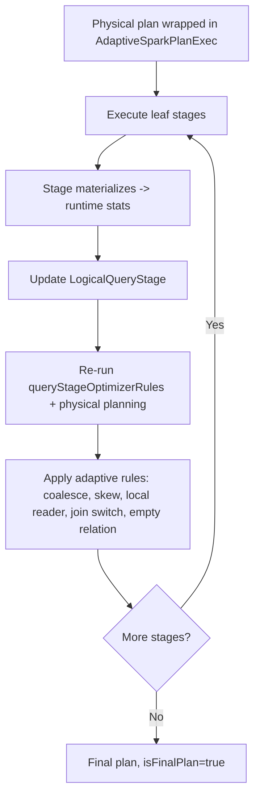
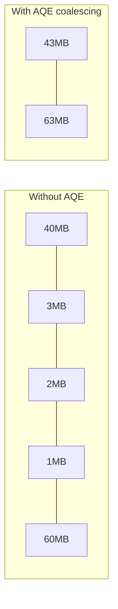
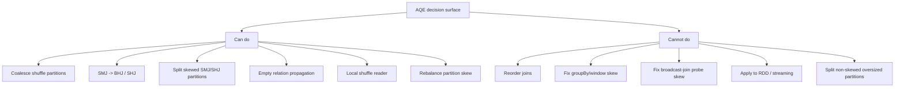

# Adaptive Query Execution (AQE)

> Adaptive Query Execution is Spark's answer to a fundamental problem: **the query planner does not know how big your data actually is.** It plans with estimates from stale statistics, unfiltered table sizes, and imperfect cardinality models — then executes. If the estimate was wrong, you get a 10-hour sort-merge join where a 20-minute broadcast join would do, 20,000 two-second tasks after a shuffle, or one straggler task processing 40 GB because of a hot key. AQE fixes all three **during execution**, at the materialization points (shuffle/broadcast boundaries) where Spark finally knows the real partition sizes. Since Spark 3.2 it is on by default; a senior engineer needs to know what it does, when it *doesn't* act, how to read the final adaptive plan, and which few knobs are worth touching.

## TL;DR

- **AQE = runtime query re-optimization.** At each shuffle/broadcast boundary, Spark collects real statistics and re-runs a subset of the optimizer + planner.
- **Four core features (Spark 3.x):**
  1. **Dynamically coalescing shuffle partitions** — merge many tiny post-shuffle partitions into ~target-sized ones.
  2. **Dynamically switching join strategies** — convert SMJ → BHJ (or SHJ) when runtime sizes say so.
  3. **Dynamically handling skew joins** — split skewed SMJ/SHJ partitions and replicate the other side.
  4. **Empty relation propagation** — detect a side that returned zero rows and prune the plan.
- **Config:** `spark.sql.adaptive.enabled` (default **true** since 3.2; default false in 3.0/3.1).
- **Set a large `spark.sql.shuffle.partitions` (1000–5000) and let AQE coalesce** — that's the recommended modern pattern. AQE can only merge partitions, never split non-skewed ones.
- **AQE applies to SQL/DataFrame queries that contain at least one exchange or subquery — never to streaming queries, never to RDD-API shuffles.**
- **It does NOT reorder joins**, does NOT fix `groupBy`/window skew, and **never optimizes skew in broadcast joins**.
- **Skew only counts as skew if** partition > `skewedPartitionThresholdInBytes` (256 MB) **and** > `skewedPartitionFactor` (5) × median — otherwise nothing happens.
- **Read the final plan:** `AdaptiveSparkPlan isFinalPlan=true`, `AQEShuffleRead` (older name `CustomShuffleReader`) with `coalesced`/`skewed`, and `Statistics(..., isRuntime=true)`.
- **AQE composes with Dynamic Partition Pruning (DPP)** — a separate optimizer feature (SPARK-11150, Spark 3.0) that prunes fact-table partitions at runtime using broadcast filter values from the dimension side.

---

## 1. Definitions and core vocabulary

| Term | Meaning |
|---|---|
| **AQE** | Adaptive Query Execution: re-optimizing the physical plan during execution using runtime statistics. |
| **Materialization point** | A shuffle or broadcast boundary where a stage completes and real sizes become known. |
| **Query stage** | A subsection of the query bounded by materialization points; AQE's unit of planning/execution. |
| **`AdaptiveSparkPlanExec`** | The physical-plan wrapper that owns the adaptive process and holds initial + current + final plans. |
| **`LogicalQueryStage`** | Logical representation of a materialized query stage (`ShuffleQueryStage`, `BroadcastQueryStage`). |
| **`ShuffleQueryStageExec` / `ExchangeQueryStageExec`** | Physical node wrapping a completed/ongoing exchange; carries runtime stats. |
| **`AQEShuffleRead`** | Post-shuffle read node produced by AQE (coalesced/skew/local-shuffle-reader). Called `CustomShuffleReader` before Spark 3.2. |
| **`isFinalPlan`** | Flag on `AdaptiveSparkPlan`: false before/during execution, true after. |
| **`queryStageOptimizerRules`** | The subset of optimizer rules re-run at each materialization point. |
| **`SimpleCostEvaluator`** | Default cost function used to compare adaptive plan candidates. |
| **Local shuffle reader** | Reading shuffle data locally when partitioning is no longer needed (e.g. after SMJ→BHJ). |
| **Dynamic partition pruning (DPP)** | Runtime pruning of a partitioned table's partitions using filters from the other join side. |
| **Empty relation propagation** | AQE replacing plan subtrees with an empty relation when a side yields zero rows. |
| **`REBALANCE`** | Hint that re-partitions for balanced output; AQE can split its skewed partitions too. |
| **`nonEmptyPartitionRatioForBroadcastJoin`** | Guard: ratio of non-empty partitions below which AQE skips SMJ→BHJ conversion. |

> **Senior note:** Do not confuse **AQE** (Spark 3.0+, broad re-planning framework) with the **Spark 1.6 "adaptive execution"** feature, which only coalesced partitions. The Databricks docs call this out explicitly; old blog posts conflate the two.

---

## 2. What problem it solves / why it matters

The classic Spark tuning loop is: run the job → observe bad behavior → guess a config → re-run → hope. AQE collapses that loop into the query itself, addressing the specific failure modes of **static planning**:

| Static-planning failure | AQE response |
|---|---|
| `spark.sql.shuffle.partitions` guessed for the wrong data volume | Coalesce to a target size |
| A side estimated at 4 GB but actually 30 MB after a filter | Convert SMJ → BHJ |
| Stats missing/stale → wrong join strategy | Decide from real sizes |
| Hot key → one giant partition | Split skewed partitions |
| A filtered side is empty but the plan still scans | Empty relation propagation |
| Shuffle written only to be read locally | Local shuffle reader |

Why it matters:

1. **Removes CDE (Constant Data Engineering)** — you don't need to "know your data" to get a good plan; AQE discovers it.
2. **Robustness to changing data** — data grows, filters change, a new tenant appears; AQE adapts per run.
3. **Fewer production incidents** — the most common "it was fast yesterday" cases are exactly AQE's targets.
4. **It is on by default in modern Spark** — meaning your tuning must account for it (e.g. raising `spark.sql.shuffle.partitions` no longer hurts as much, and manual hints can conflict).

But it has hard limits, and a senior must know them: **no join reordering, no `groupBy` skew handling, no broadcast-join skew handling, no RDD support, no streaming support.** AQE is a powerful *layer*, not a replacement for data modeling.

---

## 3. How it works internally

### 3.1 The adaptive loop



Concretely (`AdaptiveSparkPlanExec`):

1. `initialPlan` = the statically planned physical plan, wrapped.
2. AQE splits it into **query stages** at materialization points.
3. It executes all **leaf** (source) stages first — those with no unfinished parents.
4. When a stage completes, its `ShuffleQueryStageExec` is marked complete and its **runtime statistics** (partition sizes in bytes/rows) are attached.
5. AQE calls `createQueryStage` / `reOptimize`: it converts completed stages into `LogicalQueryStage`s, re-runs `queryStageOptimizerRules`, the optimizer, and the physical planner.
6. Adaptive physical rules then apply:

| Rule | Feature |
|---|---|
| `CoalesceShufflePartitions` | Merge small contiguous shuffle partitions |
| `OptimizeSkewedJoin` | Split skewed SMJ/SHJ partitions |
| `OptimizeLocalShuffleReader` | Read shuffle locally when partitioning is unneeded |
| `OptimizeSkewInRebalancePartitions` | Split skewed `REBALANCE` partitions (3.2+) |
| `DynamicJoinSelection` (older) / join-strategy switching | SMJ → BHJ / SHJ |
| `PropagateEmptyRelation` (adaptive) | Empty relation propagation |

7. The loop repeats until the query is done; the final plan is exposed with `isFinalPlan=true`.

### 3.2 Feature 1 — Dynamically coalescing shuffle partitions

**Problem:** the ideal post-shuffle partition count depends on the data, which varies per stage and per run.

**Mechanism:** after the map side writes shuffle data, AQE knows each shuffle partition's size. `CoalesceShufflePartitions` merges **contiguous** partitions until each is close to `spark.sql.adaptive.advisoryPartitionSizeInBytes` (default 64 MB), respecting `coalescePartitions.minPartitionSize` (1 MB) and `coalescePartitions.minPartitionNum` (default ≈ 2 × cores, when not overridden).

**Crucial subtlety — `parallelismFirst`:** with `spark.sql.adaptive.coalescePartitions.parallelismFirst=true` (default), AQE **ignores the advisory size** and only enforces the **minimum** partition size, to maximize parallelism and avoid regressions. Databricks recommends setting it to `false` on a busy cluster to avoid many tiny tasks:

```
spark.sql.adaptive.coalescePartitions.parallelismFirst=false   # honor advisory size
spark.sql.adaptive.advisoryPartitionSizeInBytes=128m
```

**How to enable coalescing well:** set `spark.sql.shuffle.partitions` *high* (e.g. 4000) and `coalescePartitions.initialPartitionNum` to the same high number, then let AQE merge down. If you set it too low, AQE can only merge a little; if too high, the scheduler pays for many empty tasks — so pick high but not absurd.



### 3.3 Feature 2 — Dynamically switching join strategies

**SMJ → BHJ:** if, after the shuffle (or after a filter), one side's runtime size ≤ `spark.sql.adaptive.autoBroadcastJoinThreshold` (default = `spark.sql.autoBroadcastJoinThreshold`, 10 MB), AQE converts the sort-merge join into a broadcast hash join. Better: with `spark.sql.adaptive.localShuffleReader.enabled=true` (default), the already-shuffled data can be read **locally**, avoiding a second shuffle entirely.

**SMJ → SHJ:** if all post-shuffle partitions are ≤ `spark.sql.adaptive.maxShuffledHashJoinLocalMapThreshold` (default 0 = disabled), AQE may prefer a shuffled hash join.

**Guard:** AQE will **not** apply SMJ→BHJ if the fraction of non-empty partitions is too low (`spark.sql.adaptive.nonEmptyPartitionRatioForBroadcastJoin`, default 0.2) — broadcasting a relation with many empty partitions is not worth it.

**Constraint:** the join type limits which side can be converted. AQE can't broadcast the left side of a `LEFT OUTER` join, etc.

### 3.4 Feature 3 — Dynamically handling skew joins

After runtime sizes are known, `OptimizeSkewedJoin` computes the median partition size and marks partitions skewed when:

```
size > skewedPartitionFactor (5) × median   AND   size > skewedPartitionThresholdInBytes (256MB)
```

Then it **splits** the skewed partition into `ceil(size / advisoryPartitionSizeInBytes)` sub-partitions and **replicates** the corresponding partition from the other side, producing balanced tasks.

**Scope table (which side can be optimized):**

| Join type | Left side skew | Right side skew |
|---|---|---|
| `INNER` | Yes | Yes |
| `CROSS` | Yes | Yes |
| `LEFT OUTER` | Yes | No |
| `RIGHT OUTER` | No | Yes |
| `LEFT SEMI` | Yes | No |
| `LEFT ANTI` | Yes | No |
| `FULL OUTER` | No | No |

**Limits:** only **shuffle-based joins** (SMJ, SHJ); **never broadcast joins**; **never `groupBy`/window aggregations** (salt those manually — chapter 05).

### 3.5 Feature 4 — Empty relation propagation

If a runtime stage yields zero rows, AQE can replace parts of the plan with an empty relation (`LocalTableScan []`), short-circuiting downstream work. Enable via `spark.sql.adaptive.emptyRelationPropagation.enabled` (default true in modern versions; Databricks exposes `spark.databricks.adaptive.emptyRelationPropagation.enabled`).

### 3.6 Dynamic Partition Pruning (DPP) — adjacent, and often mistaken for AQE

DPP is a **Catalyst/AQE-era optimizer feature** (SPARK-11150, Spark 3.0) that prunes a *partitioned fact table's* partitions at runtime using the filter result from the *other* join side:

```sql
SELECT * FROM fact f JOIN dim d ON f.day = d.day
WHERE d.country = 'US';
-- Without DPP: scans all partitions of fact
-- With DPP:    broadcasts the US day-list from dim, then prunes fact partitions
```

```
== Physical Plan ==
* BroadcastHashJoin ...
:- * FileScan parquet fact [DynamicPruningExpression(Subquery broadcast#...)]   <-- DPP
+- * BroadcastExchange ... dim (filtered: country = US)
```

| Config | Default | Meaning |
|---|---|---|
| `spark.sql.optimizer.dynamicPartitionPruning.enabled` | true | Enable DPP |
| `spark.sql.optimizer.dynamicPartitionPruning.useStats` | true | Use stats to skip DPP when the dim is not selective enough |
| `spark.sql.optimizer.dynamicPartitionPruning.fallbackFilterRatio` | 0.5 | Skip DPP if the pruning filter isn't selective enough |
| `spark.sql.optimizer.dynamicPartitionPruning.reuseBroadcastOnly` | true | Only reuse an existing broadcast (avoid a new one) |

DPP reduces **I/O**; AQE reduces **task imbalance/strategy**. They compose.

### 3.7 AQE configuration surface

| Config | Default | Meaning |
|---|---|---|
| `spark.sql.adaptive.enabled` | **true (3.2+)**, false in 3.0/3.1 | Master switch |
| `spark.sql.adaptive.coalescePartitions.enabled` | true | Enable coalescing |
| `spark.sql.adaptive.coalescePartitions.initialPartitionNum` | (=shuffle.partitions) | Pre-coalescing partition count |
| `spark.sql.adaptive.coalescePartitions.minPartitionSize` | 1 MB | Floor when coalescing |
| `spark.sql.adaptive.coalescePartitions.minPartitionNum` | (2 × cores) | Never go below this many partitions |
| `spark.sql.adaptive.coalescePartitions.parallelismFirst` | true | Prefer parallelism over target size; set false on busy clusters |
| `spark.sql.adaptive.advisoryPartitionSizeInBytes` | **64 MB** | Target partition size (coalesce target + skew split target) |
| `spark.sql.adaptive.autoBroadcastJoinThreshold` | (=10 MB) | Runtime broadcast threshold |
| `spark.sql.adaptive.localShuffleReader.enabled` | true | Local shuffle reads after conversion |
| `spark.sql.adaptive.maxShuffledHashJoinLocalMapThreshold` | 0 | Enable SHJ when partitions fit |
| `spark.sql.adaptive.nonEmptyPartitionRatioForBroadcastJoin` | 0.2 | Skip BHJ conversion below this ratio |
| `spark.sql.adaptive.skewJoin.enabled` | true | Enable skew join handling |
| `spark.sql.adaptive.skewJoin.skewedPartitionFactor` | 5.0 | Relative-to-median factor |
| `spark.sql.adaptive.skewJoin.skewedPartitionThresholdInBytes` | 256 MB | Absolute skew floor |
| `spark.sql.adaptive.forceOptimizeSkewedJoin` | false | Force split even with extra shuffle (3.3+) |
| `spark.sql.adaptive.optimizeSkewsInRebalancePartitions.enabled` | true | Split skewed `REBALANCE` partitions (3.2+) |
| `spark.sql.adaptive.rebalancePartitionsSmallPartitionFactor` | 0.2 | Merge small rebalance partitions |
| `spark.sql.adaptive.optimizer.excludedRules` | none | Disable specific adaptive rules |
| `spark.sql.adaptive.customCostEvaluatorClass` | none | Custom cost model (3.2+) |
| `spark.sql.adaptive.logLevel` | WARN | Log adaptive plan changes |
| `spark.sql.adaptive.ui.enabled` | true | Show AQE details in the SQL UI |
| `spark.sql.shuffle.partitions` | 200 | Initial partition count (set high with AQE) |

---

## 4. How to implement it / tune it

### 4.1 The recommended modern configuration

```python
# Start high, let AQE coalesce; size partitions by target bytes
spark.conf.set("spark.sql.adaptive.enabled", "true")
spark.conf.set("spark.sql.adaptive.coalescePartitions.enabled", "true")
spark.conf.set("spark.sql.shuffle.partitions", "4000")
spark.conf.set("spark.sql.adaptive.coalescePartitions.initialPartitionNum", "4000")
spark.conf.set("spark.sql.adaptive.advisoryPartitionSizeInBytes", "128m")
spark.conf.set("spark.sql.adaptive.coalescePartitions.parallelismFirst", "false")  # busy clusters
spark.conf.set("spark.sql.adaptive.skewJoin.enabled", "true")
spark.conf.set("spark.sql.adaptive.autoBroadcastJoinThreshold", "30m")
spark.conf.set("spark.sql.adaptive.localShuffleReader.enabled", "true")
```

### 4.2 Run and read the adaptive plan

```python
res = (spark.table("fact")
        .join(spark.table("dim"), "k")
        .groupBy("k").agg(F.sum("v")))

res.explain("formatted")
```

Before execution:

```
AdaptiveSparkPlan isFinalPlan=false
+- HashAggregate ...
   +- Exchange hashpartitioning(k, 4000)
      +- ...
         +- SortMergeJoin [k], [k], Inner
            :- Exchange hashpartitioning(k, 4000)
            +- Exchange hashpartitioning(k, 4000)
```

After execution (AQE rewrote it):

```
AdaptiveSparkPlan isFinalPlan=true
+- HashAggregate ...
   +- AQEShuffleRead coalesced                 <-- merged small partitions
      +- ShuffleQueryStage 1
         +- Exchange hashpartitioning(k, 4000)
            +- ...
               +- BroadcastHashJoin [k], [k], Inner, BuildRight   <-- SMJ -> BHJ
                  :- AQEShuffleRead local
                  :  +- ShuffleQueryStage 0
                  +- BroadcastExchange ... dim
```

Signals to read:

| Plan element | Meaning |
|---|---|
| `AdaptiveSparkPlan isFinalPlan=true` | The plan shown is the one that actually ran |
| `AQEShuffleRead coalesced` (`CustomShuffleReader` pre-3.2) | Partition coalescing applied |
| `AQEShuffleRead local` | Local shuffle reader applied (no re-shuffle) |
| `AQEShuffleRead skew` / `isSkew=true` | Skew split applied |
| `BroadcastHashJoin` where SMJ was planned | Runtime join switch |
| `Statistics(sizeInBytes=..., isRuntime=true)` | Real measured size, not an estimate |
| `LocalTableScan [], isStreaming=false` | Empty relation propagation |

### 4.3 Skew: AQE for joins, salting for aggregations

```python
# Join skew: let AQE handle it
spark.conf.set("spark.sql.adaptive.skewJoin.enabled", "true")
spark.conf.set("spark.sql.adaptive.advisoryPartitionSizeInBytes", "64m")
spark.conf.set("spark.sql.adaptive.skewJoin.skewedPartitionThresholdInBytes", "128m")

# Aggregation skew: AQE will NOT help -> salt manually (see chapter 05)
salted = (df.withColumn("salt", (F.rand()*16).cast("int"))
            .groupBy("k", "salt").agg(F.sum("v").alias("p")))
final = salted.groupBy("k").agg(F.sum("p"))
```

### 4.4 Balanced writes with the `REBALANCE` hint

```sql
-- Redistribute for even output file sizes; AQE splits skewed rebalance partitions
INSERT OVERWRITE TABLE out
SELECT /*+ REBALANCE(32, dt) */ * FROM staging;

-- Or via DataFrame API
df.repartition(32, "dt").write.mode("overwrite").saveAsTable("out")
```

### 4.5 Customize AQE

```python
# Exclude a specific adaptive rule
spark.conf.set("spark.sql.adaptive.optimizer.excludedRules",
               "org.apache.spark.sql.execution.adaptive.OptimizeSkewedJoin")

# Turn on adaptive plan logging to see what changed
spark.conf.set("spark.sql.adaptive.logLevel", "DEBUG")
spark.conf.set("spark.sql.planChangeLog.level", "WARN")
```

```scala
// Custom cost evaluator (Scala)
class MyCostEvaluator extends CostEvaluator {
  override def compare(left: Cost, right: Cost): Int =
    if (left.simpleCost <= right.simpleCost) -1 else 1
}
// spark.sql.adaptive.customCostEvaluatorClass = com.acme.MyCostEvaluator
```

### 4.6 `spark-submit`

```bash
spark-submit \
  --conf spark.sql.adaptive.enabled=true \
  --conf spark.sql.adaptive.coalescePartitions.enabled=true \
  --conf spark.sql.shuffle.partitions=4000 \
  --conf spark.sql.adaptive.coalescePartitions.initialPartitionNum=4000 \
  --conf spark.sql.adaptive.advisoryPartitionSizeInBytes=128m \
  --conf spark.sql.adaptive.coalescePartitions.parallelismFirst=false \
  --conf spark.sql.adaptive.autoBroadcastJoinThreshold=30m \
  --conf spark.sql.adaptive.localShuffleReader.enabled=true \
  --conf spark.sql.adaptive.skewJoin.enabled=true \
  --conf spark.sql.optimizer.dynamicPartitionPruning.enabled=true \
  jobs/adaptive_report.py
```

---

## 5. Where to implement it (deployment targets, config locations)

| Platform | Notes |
|---|---|
| **Apache Spark 3.0/3.1** | `spark.sql.adaptive.enabled` default **false** — must enable explicitly. |
| **Apache Spark 3.2+** | Default **true**. |
| **Databricks Runtime 7.0+** | AQE features included; DBR 8.0+ enables by default; `spark.sql.shuffle.partitions=auto` for auto-optimized shuffle (Databricks-specific), `spark.databricks.adaptive.autoBroadcastJoinThreshold` (default 30 MB), empty relation propagation. Photon executes the final plan. |
| **EMR 6.x** | Spark 3.x; AQE on from EMR 6.4/Spark 3.2+; set seeds in `spark-defaults` classification. |
| **K8s / YARN / standalone** | Same engine behavior; configure via `--conf` / `SparkApplication.spec.sparkConf` / `spark-defaults.conf`. |
| **Structured Streaming** | **AQE does not apply to streaming queries.** You cannot change `spark.sql.shuffle.partitions` between restarts of the same checkpoint. |

**version timeline:**

- **3.0** — AQE introduced (coalesce, join switch, skew join; default off).
- **3.1** — stability, `optimizer.excludedRules`, UI improvements.
- **3.2** — **default on**; `autoBroadcastJoinThreshold`, `localShuffleReader`, rebalance skew splitting, `customCostEvaluatorClass`, `AQEShuffleRead` rename.
- **3.3** — `forceOptimizeSkewedJoin`, more `REBALANCE` skew handling.
- **3.4 / 3.5** — plan-change logs, deeper integration with storage-partition-join and Coalesce/DPP.

---

## 6. Patterns and anti-patterns

### Patterns

- **High `spark.sql.shuffle.partitions` + AQE.** Let the runtime decide the real count.
- **Set `advisoryPartitionSizeInBytes`** to your real task target (64–128 MB).
- **Turn `parallelismFirst=false`** on busy clusters to avoid tiny tasks.
- **Keep `localShuffleReader` on** to skip avoidable shuffles.
- **Let AQE do the join switching**; only hint when you *know* better (a static broadcast is usually better than a runtime conversion).
- **Use AQE for join skew; salt for aggregation skew.**
- **Inspect the final plan** (`isFinalPlan=true`) after a slow run before changing anything.
- **Combine with DPP** for partitioned tables filtered by a joined dimension.

### Anti-patterns

- **Leaving `spark.sql.shuffle.partitions=200` while assuming AQE will fix it.** AQE merges, it does not *split* (except skew) — 200 partitions of a 4 TB shuffle stay 200 giant partitions.
- **Assuming AQE fixes `groupBy` skew.** It doesn't.
- **Assuming AQE reorders joins.** It doesn't (use CBO + stats).
- **Expecting AQE on RDD jobs.** It's a SQL/DataFrame-only layer.
- **Expecting AQE in Structured Streaming.** Not applied.
- **Blaming AQE when it "didn't do anything"** — check that the join type allows conversion, that partitions actually cross the 256 MB skew threshold, and that `isFinalPlan=true`.
- **Over-tuning** — most workloads need none of these knobs; the defaults are good.
- **Setting `coalescePartitions.minPartitionNum`** on Databricks — overrides `minPartitionSize`; docs advise against it.

---

## 7. Real-world use cases and industry applications

- **Lakehouse reporting on Delta/Iceberg.** AQE coalesces thousands of small post-shuffle partitions and converts SMJ→BHJ when a filtered dimension shrinks — the single most common "why is this dashboard slow" fix.
- **Multi-tenant analytics with skew.** AQE skew join splits the big tenant's join partition; `groupBy` skew still needs salting.
- **Streaming-adjacent batch jobs with wildly varying volume.** AQE adapts per run without a data-percentile guess.
- **Partitioned fact tables + dimension filters.** DPP prunes fact partitions at runtime, dramatically cutting I/O.
- **Ad-hoc SQL on a lake.** Analysts don't tune configs; AQE (plus CBO with stats) delivers decent plans automatically.
- **Data migration from warehouses.** Simulating warehouse-style adaptive plans in Spark requires AQE for acceptable parity.

---

## 8. Senior-level deep dive

### 8.1 What AQE can and cannot do



### 8.2 Trade-offs

| Decision | Static planning | AQE |
|---|---|---|
| Planning overhead | Once, cheap | Re-plan at each boundary (small, amortized) |
| Determinism | Highly predictable | Plan varies with data → harder to reproduce |
| Guarantees | Fixed partition counts | Variable counts, harder to reason about in tests |
| Robustness | Fragile to bad stats | Robust |
| Hint interaction | Hints respected | Hints respected, AQE adds more |

The **non-determinism** is a real cost: AQE makes performance tests noisier and plans harder to pin down. For SLA-critical pipelines, a senior may *disable* AQE for specific stability-sensitive queries (rare) — but far more often the answer is to enable it and add observability.

### 8.3 Failure modes and debugging

| Symptom | Cause | Fix |
|---|---|---|
| One task 40× longer, AQE didn't split | Skew below thresholds, or a `groupBy`, or a broadcast join | Lower `skewedPartitionThresholdInBytes`; salt aggregation skew |
| Plan still has 200 giant partitions | `spark.sql.shuffle.partitions` too low; AQE only merges | Raise initial partition count |
| SMJ not converted to BHJ despite a small side | Join type doesn't allow it; non-empty ratio too low; threshold too low | Check join type; adjust `autoBroadcastJoinThreshold`/hint |
| Thousands of tiny tasks | `parallelismFirst=true` ignoring advisory size | Set `parallelismFirst=false`; raise advisory size |
| AQE appeared to do nothing | No exchange, streaming query, or plan already optimal | Verify `AdaptiveSparkPlan`, `isFinalPlan=true` |
| Plan differs run-to-run | AQE adapting to data variance (expected) | Pin configs; use `AQEShuffleRead` counts in tests |
| `explain()` shows SMJ but run used BHJ | `EXPLAIN` doesn't execute; AQE re-plans | Use `isFinalPlan=true` plan from UI/logs |
| Skew handling not triggering | Both conditions (factor AND threshold) unmet | Lower the threshold; increase data visibility |

**How to see what AQE changed:** Spark UI SQL tab shows the *current* plan and updates live; `spark.sql.adaptive.logLevel` (and `spark.sql.planChangeLog.level`) logs each re-optimization; `DataFrame.explain()` shows plan + stats with `isRuntime=true` markers.

### 8.4 Architecture decisions

- **AQE + CBO together.** CBO gives good *initial* plans (join order, build side); AQE fixes *estimation errors* at runtime. Use CBO for join order (AQE won't reorder) and AQE for everything dynamic.
- **AQE + DPP.** DPP cuts scanned partitions; AQE balances the remaining tasks. Complementary.
- **AQE + native engines.** Photon/Velox execute the adaptive plan; the plan-level decisions remain identical.
- **Determinism vs adaptivity.** Accept AQE's variance unless you have a hard reproducibility requirement; then pin configs and test with fixed data.

---

## 9. Common mistakes and how to avoid them

1. **Assuming AQE is on everywhere** — it's off by default in 3.0/3.1 and never applies to streaming or RDD.
2. **Leaving `shuffle.partitions=200` and expecting AQE to fix a huge shuffle** — AQE merges, not splits.
3. **Expecting AQE to fix `groupBy` skew** — salt it.
4. **Expecting AQE to fix broadcast-join probe skew** — it never does.
5. **Expecting join reordering** — that's CBO + stats.
6. **Reading the pre-execution `explain()` as the truth** — check `isFinalPlan=true`.
7. **Not knowing the skew thresholds** — 256 MB and 5× median; below both, nothing happens.
8. **Setting `coalescePartitions.minPartitionNum`** — it overrides `minPartitionSize`.
9. **Overriding AQE with aggressive hints** — hints win and defeat the adaptivity.
10. **Changing `spark.sql.shuffle.partitions` between streaming restarts** — checkpoint incompatibility.

---

## 10. Exercises / interview questions

1. Describe the AQE loop from `AdaptiveSparkPlanExec` to the final plan. What exactly triggers re-optimization?
2. Why does AQE need a *high* `spark.sql.shuffle.partitions`, and why can't it split a non-skewed oversized partition?
3. What is `parallelismFirst` and why would you set it to `false` on a busy cluster?
4. Given a plan that converts SMJ→BHJ at runtime, what does the local shuffle reader save? What enables it?
5. State the exact two conditions that mark a partition as skewed, and list the join types on which AQE can optimize the left side.
6. Why can't AQE fix a `groupBy` skew? Propose the manual fix and choose its salt count.
7. Enumerate three reasons AQE would fail to broadcast a genuinely small side.
8. How does `EXPLAIN` differ from the executed plan under AQE, and how do you see the executed one?
9. Explain how DPP prunes a partitioned fact table at runtime; name its configs and when it's skipped.
10. Design a production configuration for a 3 TB nightly join + aggregation job: give AQE/CBO/shuffle settings and justify each. What still requires manual intervention?

---

## References

- Databricks, *Adaptive Query Execution: Speeding Up Spark SQL at Runtime* (Wenchen Fan et al., 2020): https://www.databricks.com/blog/2020/05/29/adaptive-query-execution-speeding-up-spark-sql-at-runtime.html
- Databricks (AWS), *Adaptive query execution*: https://docs.databricks.com/aws/en/optimizations/aqe
- Azure Databricks (Microsoft Learn), *Adaptive query execution*: https://learn.microsoft.com/en-us/azure/databricks/optimizations/aqe
- Apache Spark, *Performance Tuning — Adaptive Query Execution*: https://spark.apache.org/docs/latest/sql-performance-tuning.html#adaptive-query-execution
- Apache Spark, *Performance Tuning — Optimizing Skew Join*: https://spark.apache.org/docs/latest/sql-performance-tuning.html#optimizing-skew-join
- Apache Spark, *Configuration* (`spark.sql.adaptive.*`): https://spark.apache.org/docs/latest/configuration.html
- Databricks, *AQE demo notebook*: https://docs.databricks.com/aws/en/notebooks/source/aqe-demo.html
- Databricks, *Dynamic partition pruning*: https://docs.databricks.com/aws/en/optimizations/dynamic-partition-pruning
- Apache Spark JIRA, *SPARK-11150 — Dynamic Partition Pruning*: https://issues.apache.org/jira/browse/SPARK-11150
- Apache Spark JIRA, *SPARK-23128 — Adaptive Query Execution design*: https://issues.apache.org/jira/browse/SPARK-23128
- Apache Spark source, *AdaptiveSparkPlanExec.scala*: https://github.com/apache/spark/blob/master/sql/core/src/main/scala/org/apache/spark/sql/execution/adaptive/AdaptiveSparkPlanExec.scala
- Apache Spark source, *CoalesceShufflePartitions.scala*: https://github.com/apache/spark/blob/master/sql/core/src/main/scala/org/apache/spark/sql/execution/adaptive/CoalesceShufflePartitions.scala
- Apache Spark source, *OptimizeSkewedJoin.scala*: https://github.com/apache/spark/blob/master/sql/core/src/main/scala/org/apache/spark/sql/execution/adaptive/OptimizeSkewedJoin.scala
- Databricks, *Cost-based optimizer*: https://docs.databricks.com/aws/en/optimizations/cbo
