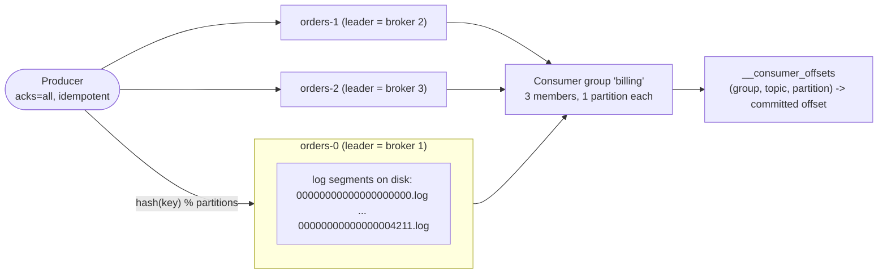

# Kafka Fundamentals

> Apache Kafka is not "a message queue with a fancy name" — it is a **replicated, partitioned, append-only commit log** that happens to expose pub/sub APIs. Almost every hard question in streaming engineering (ordering, replay, exactly-once, backpressure, consumer lag) is answered by understanding the log: how it is segmented on disk, how replicas converge, how the high watermark advances, and who owns the metadata. A senior engineer who can reason about `ISR`, `LEO`, and segment roll timing will debug in ten minutes what a junior debugs in two days.

## TL;DR

- A **topic** is a logical stream; it is physically split into **partitions**, and each partition is an **ordered, immutable, append-only log** of record batches on disk.
- Kafka's ordering guarantee is **per partition only**. The key's hash (or an explicit partition) decides the partition; no key means round-robin/sticky, so order is effectively lost.
- Data is stored in **log segments** (`*.log` + `*.index` + `*.timeindex`) rolled by size/time, with retention (delete), compaction (compact), or both (`compact,delete`).
- **Replication** is leader/follower within a partition. The **ISR** (in-sync replicas) is the set eligible to be leader; the **high watermark** is the highest offset replicated to all ISR members and it is the only offset a `read_committed` consumer may read.
- `acks=all` + `min.insync.replicas>=2` + `replication.factor=3` is the baseline durability config. `unclean.leader.election.enable=true` trades correctness for availability; keep it `false`.
- Since **Kafka 4.0 (2025) ZooKeeper is gone**: KRaft (Kafka's own Raft quorum, KIP-500/595) is the only mode. The controller quorum stores cluster metadata in `__cluster_metadata`, not in topic data.
- Throughput comes from **sequential I/O + OS page cache + zero-copy `sendfile` + batching/compression**, not from magic.
- Producer defaults are safe since 3.0 (`acks=all`, `enable.idempotence=true`); the dangerous defaults now live on the **consumer** side (`enable.auto.commit=true`, `auto.offset.reset=latest`).
- Partition count is the unit of parallelism and is **one-way ratchet** (you can add, never remove or reorder) — and adding partitions *breaks key-to-partition affinity*.

## 1. Definitions and core vocabulary

| Term | Definition | Why a senior cares |
|---|---|---|
| **Record / message** | Key (optional), value, timestamp, headers | Key drives partition affinity; headers carry trace/metadata |
| **Record batch** | A compressed group of records with one base offset (v2 format, `magic=2`) | Compression ratio and CRC are per batch, not per record |
| **Topic** | Named, logical stream of records; a namespace of partitions | Unit of config, ACL, retention, schema, ownership |
| **Partition** | Ordered, append-only log; the unit of parallelism, replication, ordering | The single most important design decision after keys |
| **Offset** | 64-bit monotonic position of a record inside a partition | Never global; only meaningful with (topic, partition) |
| **Broker** | A Kafka server process that stores partitions and serves clients | One broker can host thousands of partition replicas |
| **Cluster** | Set of brokers + a controller quorum (KRaft) | Metadata is a separate replicated state machine |
| **Cluster metadata** | Topic configs, partition→leader assignments, ACLs, SCRAM, quotas | Stored in the `__cluster_metadata` log in KRaft |
| **Log segment** | One `*.log` file plus its `*.index`/`*.timeindex` sidecars | Retention and compaction operate at segment granularity |
| **Leader replica** | Per-partition replica that serves all reads/writes | Only the leader talks to clients |
| **Follower replica** | Replica that fetches from the leader to stay caught up | Not the default read path for clients — unless you enable rack-aware follower fetching (KIP-392) to cut cross-AZ read cost |
| **ISR** | In-sync replicas: followers whose LEO is "close enough" to the leader's (bounded by `replica.lag.time.max.ms`, default 30s) | The election pool; the quorum for `acks=all` |
| **LEO** | Log End Offset — next offset to be written | Per replica; lags indicate replication problems |
| **High Watermark (HW)** | Highest offset replicated to *all* ISR members | Consumers can only read up to HW with `isolation.level=read_committed` |
| **Log start offset** | Oldest retained offset (advances with retention/compaction) | What `auto.offset.reset=earliest` actually resolves to |
| **Retention** | Time/size based deletion of whole segments | `log.retention.ms`/`bytes`, plus topic overrides |
| **Compaction** | Keeps the latest record per key, deletes older ones | Turns a stream into a changelog/KTable; tombstones delete keys |
| **Producer** | Client that appends records to partition leaders | Batching, idempotence, transactions live here |
| **Consumer / Consumer group** | Client that fetches records; group shares partitions | Group = a distributed, rebalancing "queue" (see [03-consumer-groups.md](./03-consumer-groups.md)) |
| **Controller** | The broker (KRaft: from the controller quorum) that drives metadata changes | Single active controller; standby controllers take over in seconds |
| **KRaft** | Kafka Raft metadata quorum replacing ZooKeeper | Mandatory since Kafka 4.0 |
| **`__consumer_offsets`** | Internal compacted topic storing group offsets | 50 partitions by default; see [04-offsets.md](./04-offsets.md) |
| **`__transaction_state`** | Internal compacted topic storing transaction metadata | Drives exactly-once (`transaction.state.log.replication.factor=3`) |

### 1.1 The one diagram to remember



```text
Partition 0 on disk (one directory = one partition):

  /var/lib/kafka/data/orders-0/
    ├── 00000000000000000000.log        # records, baseOffset=0
    ├── 00000000000000000000.index      # offset -> file position (sparse)
    ├── 00000000000000000000.timeindex  # timestamp -> offset (sparse)
    ├── 00000000000000004211.log        # rolled at 1 GiB (log.segment.bytes)
    ├── 00000000000000004211.index
    ├── 00000000000000004211.timeindex
    ├── leader-epoch-checkpoint         # epoch/offset pairs for truncation
    └── partition.metadata              # topic id / dir mapping

  log start offset ─────────────┐                 ┌──── high watermark
                                ▼                 ▼
  [deleted][deleted]  ...  | ... records ...  | active segment (open for append; uncounted in retention)
  ▲                                              ▲
  retention deletes whole segments               last offset (LEO-1)
```

## 2. What problem it solves / why it matters

Jay Kreps' 2013 essay *"The Log: What every software engineer should know about real-time data's unifying abstraction"* is the canonical framing: a log is a **totally ordered, replayable sequence with a subscribable tail**. Systems that look unrelated — a database (WAL), a replication fabric (leader/follower), an integration bus (pub/sub), a state store (changelog + materialized view) — are all logs with different consumers.

Kafka's contribution was to make that log:

1. **Distributed and replicated** (no single-writer bottleneck, unlike a database WAL).
2. **Partitioned** (parallelism proportional to partitions, not to brokers).
3. **Retained** (unlike a queue, consumption does not delete data) — so you can add a new consumer and replay history.
4. **Cheap to read many times** (sequential I/O, page cache, zero-copy), so N consumers cost roughly one copy.

Concrete problems it solves, mapped to architectural pain:

| Pain | Without Kafka | With Kafka |
|---|---|---|
| 12 teams need the same "order created" event | Point-to-point integrations (N² connectors) | One topic, N independent consumer groups |
| Downstream service was down for 3 hours | Events lost, or upstream blocked | Data retained; consumer catches up |
| Need to rebuild a derived store | Re-run ETL against production OLTP | Replay the topic from offset 0 (or a compacted topic's snapshot) |
| Peak load 10× normal | Upstream throttles or queue blows up | Log absorbs the burst; consumers drain at their own rate (backpressure is *offset lag*, not a crash) |
| "Who changed this record and when?" | Only current state exists | The log of change events *is* the history |
| Debugging a bad deploy | Hope the payload in the DLQ is enough | Replay the exact same stream into a staging consumer and diff |

> **Senior note.** Kafka is a *log*, not a database. It has no secondary indexes, no transactions across consumer reads and arbitrary side effects, and no sub-millisecond random reads. Reaching for Kafka as the source of truth for "get user by id" is a classic (and expensive) architecture mistake — that is what compacted topics + a real store, or a table format (Iceberg/Hudi/Delta) on top of the topic, are for.

## 3. How it works internally (mechanisms, internals)

### 3.1 The write path

```mermaid
sequenceDiagram
  participant Prod as Producer
  participant L as Partition Leader (broker 1)
  participant F1 as Follower (broker 2)
  participant F2 as Follower (broker 3)
  Prod->>L: ProduceRequest(batch, acks=all)
  Note over L: 1. Validate CRC, idempotent seq, transactional state<br/>2. Append batch to page cache (mmap'd segment)<br/>3. LEO advances; HW does NOT yet (needs ISR acks)
  F1->>L: FetchRequest(fetchOffset=LEO_f1)
  F2->>L: FetchRequest(fetchOffset=LEO_f2)
  L-->>F1: batch (zero-copy sendfile)
  L-->>F2: batch
  F1->>L: Fetch → HW update candidate
  F2->>L: Fetch → HW update candidate
  Note over L: HW = min(LEO of all ISR members)
  L-->>Prod: ProduceResponse(offset=4211, logAppendTime)
  Note over L: Producer is acked once ISR has the batch
```

Key mechanics:

- **Append happens in the OS page cache**, not via an fsync per message by default (`log.flush.interval.messages=Long.MAX_VALUE`). Durability relies on *replication*, not on `fsync`. This is why Kafka throughput is I/O-sequential, and why a single broker's power loss can lose data that was acked if replication is misconfigured — and why "just fsync" is the wrong instinct.
- **Zero-copy**: for a normal (uncompressed-transport) fetch, the broker sends file bytes directly from page cache to the socket with `sendfile()`, avoiding user-space copies. Compression and TLS/SSL break the pure zero-copy path (TLS does; broker-side recompression in older inter-broker protocols does).
- **Sparse indexes**: `.index` maps offset → physical position every `log.index.interval.bytes` (default 4096 B). Reading offset 42,100,999 does a binary search in the index, then a linear scan within ~4 KiB. That is the "random read that is actually fast".
- **Segment rolling** happens when `log.segment.bytes` (default 1 GiB) is exceeded, `log.roll.ms`/`log.roll.hours` (default 168h) elapses, or the time index is full. **Retention never deletes the active segment**, which is why a topic with 7-day retention and a 1 GiB segment that fills in 30 days will hold ~30 days.
- **Time-based retention uses the *maximum* timestamp of the *largest* record in the segment** (`log.message.timestamp.type=CreateTime` by default). A producer with a wildly wrong clock, or a record with a far-future timestamp, can *pin* a segment indefinitely.

### 3.2 Replication, ISR, HW, and leader election

```text
replication.factor = 3, min.insync.replicas = 2, acks = all

  Acked?  | Leader available | ISR size | Outcome
  --------+------------------+----------+-----------------------------------------
  yes     | yes              | 3        | normal
  yes     | yes              | 2        | normal (1 follower lagging/restarting)
  NO      | yes              | 1        | NotEnoughReplicasException — producer retries
  yes*    | partition leader   | 1        | *only if min.insync.replicas=1 (unsafe)
  yes*    | unclean election   | any      | *only if unclean.leader.election.enable=true → silent data loss
```

- A follower joins/leaves the ISR based on `replica.lag.time.max.ms` (default 30,000 ms) and a `lag.max.messages`-style heuristic. Being out of the ISR is not ejection from the cluster: the follower keeps fetching and re-enters when caught up.
- **HW advancement**: the leader computes `HW = min(LEO over ISR)`. With no followers (RF=1) the HW equals the LEO, so everything is immediately readable.
- **Leader election**: the controller picks a new leader from the ISR (plus the **ELR** — Eligible Leader Replicas, KIP-966 — in newer versions, which fixes the "last replica standing" data-loss scenario). The new leader **truncates its log to the HW** to discard uncommitted records, then sets the HW from the epoch checkpoint file (`leader-epoch-checkpoint`) to prevent fetch loops.
- **Epochs and fencing**: leader epoch bumps on every leader change. Producing with a stale `producerId`/`epoch` (a "zombie" from a previous leader or a fenced transactional producer) is rejected — this is the foundation of exactly-once and of safe rolling restarts.
- **Unclean leader election** (`unclean.leader.election.enable=true`) elects an out-of-ISR replica: availability up, **data loss and ordering/consistency violations** down. In practice: `false` for any topic that is a source of truth; `true` only for ephemeral telemetry where loss is acceptable and partition unavailability is not.

### 3.3 Metadata: KRaft vs ZooKeeper

| Aspect | ZooKeeper mode (≤ Kafka 3.x, removed in 4.0) | KRaft (KIP-500/595, default since 4.0) |
|---|---|---|
| Metadata store | ZooKeeper znode tree | Internal Raft log `__cluster_metadata`, snapshotted to `*.checkpoint` |
| Controller(s) | One elected broker-controller, state in ZK | Quorum of 3 (or 5) controllers, each a Raft replica; one active leader |
| Failover | ZK watches + controller re-election, seconds | Raft leader election, sub-second-ish; standby controllers are warm |
| Scalability limits | ~200k partitions, slow full metadata fetch on controller change | Millions of partitions, incremental metadata fetch (KIP-866-ish metadata fetch) |
| Operational surface | Two systems to secure/monitor/upgrade | One system; simpler TLS/SASL story |
| Recovery from metadata corruption | Restore ZK | Restore/rewrite from `__cluster_metadata` snapshot + log; `kafka-metadata-quorum` CLI |
| Ports (typical) | broker 9092 | broker 9092, controller 9093; `process.roles=broker,controller` for combined nodes |

```properties
# Kraft server.properties (combined broker+controller, 3-node dev/edge cluster)
process.roles=broker,controller
node.id=1
controller.quorum.voters=1@kafka1:9093,2@kafka2:9093,3@kafka3:9093
listeners=PLAINTEXT://:9092,CONTROLLER://:9093
advertised.listeners=PLAINTEXT://kafka1:9092
controller.listener.names=CONTROLLER
log.dirs=/var/lib/kafka/data
# durability of the metadata log itself
controller.quorum.election.timeout.ms=1000
controller.quorum.fetch.timeout.ms=2000
```

> **Senior note.** KRaft does not make Kafka "Raft-based" — only *metadata* is Raft. Data replication is still Kafka's own ISR/leader-epoch protocol. This is precisely why KIP-966 (Eligible Leader Replicas) is needed: Raft-style quorums and ISR-style quorums have different failure semantics.

### 3.4 Delivery semantics inside the broker

Three independent knobs produce three behaviors:

| Guarantee | Producer config | Failure mode |
|---|---|---|
| At-most-once | `acks=0` (fire and forget) or retries=0 | Loss on broker failure/network blip |
| At-least-once | `acks=all`, retries>0, `enable.idempotence=false` | Duplicates on retry |
| Exactly-once (to Kafka) | `acks=all`, `enable.idempotence=true`, `transactional.id=X`, consumers `isolation.level=read_committed` | Higher latency; needs `__transaction_state`; fenced zombies |

Full treatment: [05-delivery-semantics.md](./05-delivery-semantics.md).

## 4. How to implement it (CLI, Python, Java)

### 4.1 CLI: create, inspect, produce, consume

```bash
# --- Topics -----------------------------------------------------------------
# Create with explicit settings: do not rely on auto.create.topics.enable
kafka-topics.sh --bootstrap-server localhost:9092 --create \
  --topic orders.v1 \
  --partitions 12 \
  --replication-factor 3 \
  --config min.insync.replicas=2 \
  --config retention.ms=604800000 \
  --config cleanup.policy=delete \
  --config max.message.bytes=2097152

# Describe: leaders, replicas, ISR (the single most useful ops command)
kafka-topics.sh --bootstrap-server localhost:9092 --describe --topic orders.v1
kafka-topics.sh --bootstrap-server localhost:9092 --describe --under-replicated-partitions
kafka-topics.sh --bootstrap-server localhost:9092 --describe --unavailable-partitions

# Change retention (note: this is an ALTER; validate with --describe after)
kafka-configs.sh --bootstrap-server localhost:9092 --alter \
  --entity-type topics --entity-name orders.v1 \
  --add-config retention.ms=2592000000

# Reassign partitions / move leadership (rack-aware, decommissioning nodes)
kafka-reassign-partitions.sh --bootstrap-server localhost:9092 \
  --reassignment-json-file reassign.json --execute

# --- Produce / consume -------------------------------------------------------
# key:value with an explicit key parser -> stable partitioning
kafka-console-producer.sh --bootstrap-server localhost:9092 --topic orders.v1 \
  --property parse.key=true --property key.separator=:
# > ORD-1:{"order_id":"ORD-1","amount":42.5,"currency":"EUR"}

# Read from the beginning, show keys, cap at 10 records
kafka-console-consumer.sh --bootstrap-server localhost:9092 --topic orders.v1 \
  --from-beginning --max-messages 10 \
  --property print.key=true --property print.partition=true --property print.offset=true

# --- Offsets / lag -----------------------------------------------------------
kafka-get-offsets.sh --bootstrap-server localhost:9092 --topic orders.v1   # LEO per partition
kafka-consumer-groups.sh --bootstrap-server localhost:9092 \
  --describe --group billing         # CURRENT, LOG-END, LAG per partition
kafka-consumer-groups.sh --bootstrap-server localhost:9092 \
  --group billing --reset-offsets --to-earliest --topic orders.v1 --execute

# --- Internals inspection ----------------------------------------------------
# Dump a segment: shows batches, flags, timestamps, compression — ground truth
kafka-dump-log.sh --files /var/lib/kafka/data/orders-0/00000000000000004211.log \
  --print-data-log --deep-iteration | head -40

# KRaft metadata quorum state
kafka-metadata-quorum.sh --bootstrap-server localhost:9092 describe --status
kafka-metadata-quorum.sh --bootstrap-server localhost:9092 describe --replication
```

### 4.2 Python producer (`confluent-kafka`)

```python
# pip install confluent-kafka
from confluent_kafka import Producer
import json, socket, time

def delivery_report(err, msg):
    if err is not None:
        # Treat this as a page-worthy event in production: it means a batch failed.
        print(f"DELIVERY FAILED for {msg.key()}: {err}")
    else:
        print(f"-> {msg.topic()}[{msg.partition()}] @ {msg.offset()}")

producer = Producer({
    "bootstrap.servers": "kafka1:9092,kafka2:9092,kafka3:9092",
    "client.id": socket.gethostname(),
    "acks": "all",                       # durability
    "enable.idempotence": True,          # exactly-once per producer session
    "max.in.flight.requests.per.connection": 5,
    "compression.type": "zstd",          # bandwidth/disk win, small CPU cost
    "linger.ms": 20,                     # batching window
    "batch.size": 262144,                # 256 KiB per partition batch
    "delivery.timeout.ms": 120000,       # upper bound: retries+linger+inflight
    "queue.buffering.max.messages": 100000,
})

def send_order(order: dict) -> None:
    # Key choice IS the ordering contract: same key -> same partition -> ordered
    producer.produce(
        topic="orders.v1",
        key=order["order_id"].encode("utf-8"),
        value=json.dumps(order).encode("utf-8"),
        headers={"schema.subject": "orders.v1", "trace-id": "abc123"},
        on_delivery=delivery_report,
    )
    producer.poll(0)  # serve delivery callbacks; without this, queue grows

for i in range(1000):
    send_order({"order_id": f"ORD-{i%50}", "amount": 10 + i, "currency": "EUR",
                "created_at": int(time.time() * 1000)})

producer.flush(30)  # block until all in-flight are delivered, max 30s
```

### 4.3 Python consumer (manual commit, no data loss)

```python
from confluent_kafka import Consumer, KafkaError, KafkaException
import json

consumer = Consumer({
    "bootstrap.servers": "kafka1:9092,kafka2:9092,kafka3:9092",
    "group.id": "billing-v1",
    "auto.offset.reset": "earliest",       # only used when no committed offset
    "enable.auto.commit": False,           # commit only after real processing
    "isolation.level": "read_committed",   # skip aborted transactional batches
    "max.poll.interval.ms": 300000,        # must exceed worst-case batch processing time
    "session.timeout.ms": 45000,
    "fetch.min.bytes": 65536,              # throughput vs latency knob
    "fetch.max.wait.ms": 250,
})
consumer.subscribe(["orders.v1"])

try:
    while True:
        msg = consumer.poll(1.0)
        if msg is None:
            continue
        if msg.error():
            if msg.error().code() == KafkaError._PARTITION_EOF:
                continue
            raise KafkaException(msg.error())

        order = json.loads(msg.value())
        process(order)                          # MUST be idempotent
        consumer.commit(asynchronous=False)     # sync commit == correctness over speed
finally:
    consumer.close()                            # leaves the group cleanly (no rebalance storm)
```

### 4.4 Java producer/consumer (the reference implementations)

```java
// Producer: idempotent, compressed, batched
Properties p = new Properties();
p.put(ProducerConfig.BOOTSTRAP_SERVERS_CONFIG, "kafka1:9092");
p.put(ProducerConfig.KEY_SERIALIZER_CLASS_CONFIG, StringSerializer.class.getName());
p.put(ProducerConfig.VALUE_SERIALIZER_CLASS_CONFIG, StringSerializer.class.getName());
p.put(ProducerConfig.ACKS_CONFIG, "all");
p.put(ProducerConfig.ENABLE_IDEMPOTENCE_CONFIG, "true");
p.put(ProducerConfig.COMPRESSION_TYPE_CONFIG, "zstd");
p.put(ProducerConfig.LINGER_MS_CONFIG, "20");
p.put(ProducerConfig.DELIVERY_TIMEOUT_MS_CONFIG, "120000");

try (KafkaProducer<String, String> producer = new KafkaProducer<>(p)) {
    producer.send(new ProducerRecord<>("orders.v1", orderId, payload), (md, ex) -> {
        if (ex != null) log.error("send failed for {}", orderId, ex);
        else log.debug("{}@{}", md.partition(), md.offset());
    });
    producer.flush();
}
```

```java
// Consumer: explicit commit after side effects, with cooperative rebalancing
Properties c = new Properties();
c.put(ConsumerConfig.BOOTSTRAP_SERVERS_CONFIG, "kafka1:9092");
c.put(ConsumerConfig.GROUP_ID_CONFIG, "billing-v1");
c.put(ConsumerConfig.KEY_DESERIALIZER_CLASS_CONFIG, StringDeserializer.class.getName());
c.put(ConsumerConfig.VALUE_DESERIALIZER_CLASS_CONFIG, StringDeserializer.class.getName());
c.put(ConsumerConfig.ENABLE_AUTO_COMMIT_CONFIG, "false");
c.put(ConsumerConfig.ISOLATION_LEVEL_CONFIG, "read_committed");
c.put(ConsumerConfig.PARTITION_ASSIGNMENT_STRATEGY_CONFIG,
      "org.apache.kafka.clients.consumer.CooperativeStickyAssignor"); // Kafka 4.0 default
c.put(ConsumerConfig.MAX_POLL_INTERVAL_MS_CONFIG, "300000");

try (KafkaConsumer<String, String> consumer = new KafkaConsumer<>(c)) {
    consumer.subscribe(List.of("orders.v1"), new ConsumerRebalanceListener() {
        @Override public void onPartitionsRevoked(Collection<TopicPartition> parts) {
            // Flush buffers, then commit BEFORE losing ownership.
            consumer.commitSync(currentOffsetsFor(parts));
        }
        @Override public void onPartitionsAssigned(Collection<TopicPartition> parts) { }
    });
    while (running) {
        ConsumerRecords<String, String> records = consumer.poll(Duration.ofMillis(500));
        for (ConsumerRecord<String, String> r : records) process(r);
        if (!records.isEmpty()) consumer.commitSync();  // or async + commit on close
    }
}
```

### 4.5 Configuration cheat sheet (the ones that actually matter)

| Config | Scope | Default | Recommended (durable, high-throughput) | Why |
|---|---|---|---|---|
| `acks` | producer | `all` (3.0+) | `all` | Durability requires ISR ack |
| `enable.idempotence` | producer | `true` (3.0+) | `true` | Removes duplicate-on-retry |
| `compression.type` | producer/topic | `none` (producer), `producer` (topic) | `zstd` or `lz4` | 2–5× disk/network savings |
| `linger.ms` / `batch.size` | producer | `0` / `16384` | `20` / `262144` | Batching is where throughput comes from |
| `max.in.flight.requests.per.connection` | producer | `5` | `5` with idempotence | Ordering preserved via sequences |
| `retries` | producer | `2147483647` (3.0+) | leave default | `delivery.timeout.ms` is the real bound |
| `replication.factor` | topic | `1` (broker default) | `3` (min 2 in prod) | Survives a broker loss |
| `min.insync.replicas` | topic/broker | `1` | `2` | Prevents acking to a single replica |
| `unclean.leader.election.enable` | broker | `false` | `false` | Prevents silent data loss |
| `log.retention.ms` / `.bytes` | topic | `168h` / `-1` | workload-driven | Storage vs replay window |
| `log.segment.bytes` | topic | `1073741824` | `268435456`–`1073741824` | Segment size bounds retention granularity & compaction cost |
| `enable.auto.commit` | consumer | `true` | `false` | Auto-commit = at-most-once surprises |
| `auto.offset.reset` | consumer | `latest` | explicit (`earliest`/`latest`) | Never rely on a default for correctness |
| `isolation.level` | consumer | `read_uncommitted` | `read_committed` for EOS pipelines | Avoids reading aborted data |
| `max.poll.records` / `max.poll.interval.ms` | consumer | `500` / `300000` | tune to worst-case batch time | Prevents rebalance storms |
| `fetch.min.bytes` / `fetch.max.wait.ms` | consumer | `1` / `500` | `65536` / `250` | Batch fetches: throughput without latency cliffs |

## 5. Where to implement it

| Platform | What it is | When it fits | Watch out for |
|---|---|---|---|
| **Apache Kafka (self-managed)** | The reference implementation, KRaft | Full control, on-prem/air-gapped, custom plugins, cost at scale | You own upgrades, rebalancing, disk sizing, security patching |
| **Confluent Cloud / Platform** | Managed Kafka + Schema Registry, Connect, ksqlDB/Flink, connectors | Fast path to production with schema governance, ksqlDB/Flink SQL | Cost model (throughput + storage + CKUs); avoid unbounded topics |
| **Amazon MSK** | Managed Kafka on AWS; MSK Serverless and Express brokers | AWS-native stacks, IAM integration, VPC isolation | Broker-type limits, cross-AZ cost, tiered storage availability |
| **Redpanda** | Kafka-API compatible, single binary, no JVM, thread-per-core | Low-latency, small ops team, higher per-node throughput, simpler deploys | Ecosystem tooling maturity; verify API compatibility surface for advanced features |
| **Azure Event Hubs** | Kafka-protocol-compatible service with native AMQP SDK; capture to Blob | Azure-centric, huge fan-in, wants managed partitions + Capture for batch | Partition count fixed at creation; retention limits; consumer semantics differ slightly |
| **Google Cloud Pub/Sub** | Fully managed pub/sub, not Kafka | GCP-native, serverless, huge scale, no partition management | No log offsets/partitions as first-class; ordering keys; seek is limited |
| **Amazon Kinesis Data Streams** | Managed sharded stream | AWS-only, simple fan-in with Lambda | 1 MB/s per shard ingest, shard splitting, 24h–365d retention |
| **Apache Pulsar** | Log + separate bookies (BookKeeper), multi-tenancy, geo-replication built in | Multi-region, queue+stream in one, tiered storage by default | Two systems to operate; smaller community |

**Processing layer** (where records become state):

| Engine | Mental model | Choose when |
|---|---|---|
| **Kafka Streams** | Library in your JVM app; state in RocksDB backed by changelog topics | You want a microservice to own its state, no separate cluster, exactly-once with `processing.guarantee=exactly_once_v2` |
| **Flink** | True streaming, event-time first-class, checkpoints | Complex event time, late data, large state, exactly-once sinks, SQL/DataStream duality |
| **Spark Structured Streaming** | Micro-batch (or continuous) over the same Catalyst engine | You already run Spark, unified batch+stream code, Delta/Iceberg sinks |
| **ksqlDB / Flink SQL** | SQL over streams and tables | Analytics teams, fast iteration, less code ownership |

> **Senior note.** The cheapest architecture is usually "Kafka + one processing engine + a lake sink". The most expensive is "Kafka + three engines + four duplicating pipelines". Pick one engine as the system of record for stream state; use the others only for clearly different SLOs (e.g., sub-second alerting vs. hourly lake ingestion).

## 6. Patterns and anti-patterns

### Patterns

| Pattern | Shape | Notes |
|---|---|---|
| **Event-carried state transfer** | Events contain full entity state, no callback needed | Decouples consumers; costs bandwidth/storage |
| **Changelog + materialized view** | Compacted topic per entity; consumers rebuild state on start | Kafka Streams `KTable`, ksqlDB tables |
| **Topic-per-event-type, keyed by entity id** | `orders.v1`, key = `order_id`, 12–N partitions | Preserves per-entity order; easy fan-out |
| **Outbox topic** | DB outbox table → CDC → topic | Solves dual-write (see [02-event-driven-architecture.md](./02-event-driven-architecture.md)) |
| **Retry + DLQ topics** | `orders.v1.retry.5m` → `orders.v1.dlq` | Keeps head-of-line blocking away from the main consumer |
| **Tiered storage** | Segments offloaded to S3/GCS, local disk is a cache | Cheap long retention/replay (KIP-405) |
| **MirrorMaker 2 / Cluster Linking** | Cross-cluster replication with offset translation | DR, region locality, migration |

### Anti-patterns

| Anti-pattern | Symptom | Fix |
|---|---|---|
| **`auto.create.topics.enable=true` in prod** | Topics created with RF=1 and wrong partitions by a typo'd name | Disable it; topics via IaC/Terraform |
| **One topic for everything** | Mixed ordering requirements, giant retention cost, ACL granularity too coarse | Topic per event family + domain ownership |
| **Reusing a key that isn't the entity** | Hot partitions, gaps in ordering | Key = entity id (or explicit partition with a documented contract) |
| **Unkeyed events where order matters** | Interleaved updates, walrus-looking state | Keys, or accept the loss of ordering explicitly |
| **Kafka as a database** | Consumers scanning full topics for point lookups | Compacted topic + key-value store, or a table format |
| **Huge messages (MBs)** | `RecordTooLargeException`, GC pressure, skewed partitions | Store blobs in S3, send the reference in the event |
| **`acks=0`/`acks=1` for business events** | Silent loss on failover | `acks=all` + `min.insync.replicas=2` |
| **Randomly increasing partitions to fix lag** | Key affinity broken; consumers see reordering | Add partitions only with a plan (rekey or new topic + migration) |
| **No schema** | Consumers break on every field addition | Schema Registry + compatibility policy |
| **Retention = 7 days by default for everything** | Cannot replay incidents, cannot onboard new consumers | Explicit retention per topic; tiered storage for long horizons |
| **Consumer group per environment sharing a cluster** | Test traffic pollutes prod lag metrics and offsets | Separate clusters or clear naming/ACL boundaries |

## 7. Real-world use cases and industry applications

- **LinkedIn (origin, ~7 trillion messages/day class)**: unified activity/data pipeline — the log replaced dozens of point-to-point ETL paths (the Kreps essay and the 2011 NetDB paper describe this).
- **Cloudflare**: uses Kafka as the buffer that absorbs enormous ingest spikes; their "1 trillion messages" post documents how the log decouples producers from downstream processing.
- **Uber**: real-time data infrastructure with Kafka as the backbone between rider/driver events, dispatch, and analytics; uses uReplicator-style (now built into MirrorMaker 2 / Cluster Linking) cross-DC replication.
- **Netflix**: Keystone pipeline — Kafka as the transport between ingest and multiple sinks (S3, Elasticsearch, Iceberg); the pipeline philosophy is "Kafka as the contract, sinks as plug-ins".
- **Retail / commerce**: order lifecycle events, inventory updates, price changes; compacted topics for current product state, delete topics for clickstream.
- **Banks / insurance**: change data capture (Debezium) from core systems → Kafka → fraud scoring, ledger enrichment, and downstream event sourcing with immutable audit trails.
- **Observability & telemetry**: high-volume metrics/logs topics with short retention and tiered storage; compacted topics for scrape target configs.
- **IoT / manufacturing**: per-device keys for ordered sensor state; compacted `device-config` topics pushed to edge gateways.
- **Gaming**: matchmaking, player state changes, leaderboards — keyed by player/session for ordering.

## 8. Senior-level deep dive

### 8.1 Partition count: the decision you cannot take back

```text
Target throughput T (MB/s), single-partition ceiling ~ P MB/s (consumer dependent)
partitions >= ceil(T / P)   AND   partitions >= max consumer parallelism you'll ever need

Example: 300 MB/s peak, one consumer thread sustains ~25 MB/s with JSON+zstd decode
  -> ceil(300/25) = 12 partitions minimum; add headroom for skew/failover => 18-24
  -> cost: 24 partitions * RF 3 = 72 replicas, ~72 * 1 GiB segments on disk per topic
```

Costs of high partition counts: more open file handles, more replication threads, slower controller failover/metadata propagation, longer leader elections, more memory for producer buffers (`buffer.memory` per partition batch), and slower `__consumer_offsets` commits (one offset partition per group, hash of `group.id`). Kafka 4.x + KRaft push the practical ceiling far higher (millions of partitions) than the ZK era, but the *consumer-side* costs do not disappear.

**Adding partitions silently breaks ordering**: `hash(key) % N` changes when N changes, so the same order id can land on a different partition halfway through the topic's history. Symptoms: state store shows "old" then "new" then "old" values. Mitigations: (a) over-provision partitions up front; (b) create `orders.v2` with the new count and dual-write/migrate with a documented cutover; (c) use a custom partitioner with an explicit, versioned mapping table.

### 8.2 Durability math (the table to keep in your head)

| RF | min.insync.replicas | acks | Brokers you can lose without losing data | Brokers you can lose and still accept writes | Notes |
|---|---|---|---|---|---|
| 1 | 1 | all | 0 | 0 | Dev only |
| 2 | 1 | all | 1 (with unclean election risk) | 1 | Cheaper, weaker |
| 2 | 2 | all | 1 | 0 | Safe but brittle under maintenance |
| 3 | 2 | all | 1 | 1 | The standard |
| 3 | 3 | all | 1 | 0 | Strongest, no tolerance for maintenance |
| 3 | 2 | 1 | 0 | 2 | Fast, loses data |

The production rule: **RF=3, min.insync.replicas=2, acks=all, unclean.leader.election=false**, and use `--describe --under-replicated-partitions` alarms as a hard gate before rolling restarts (`broker.rack` set so replicas are spread across AZs/racks; otherwise all three replicas of a partition can land in the same AZ and a zone outage takes the partition down).

### 8.3 Failure modes and how they present

| Symptom | Likely cause | Where to look |
|---|---|---|
| `NotEnoughReplicasException` from producers | ISR < `min.insync.replicas` (single-broker that is the only ISR member, or many followers lagging) | `--describe --under-replicated-partitions`, broker logs for ISR shrink events |
| Producer p99 latency spike, no errors | `linger.ms` + `delivery.timeout.ms` interaction, or leader re-election | `record-queue-time-avg`, `request-latency-avg`, controller logs |
| Under-replicated partitions that never shrink | Follower can't fetch fast enough: disk saturation, NIC saturation, too many partitions per broker | `kafka.server:type=ReplicaFetcherManager`, node disk/NIC metrics |
| Consumer lag growing with flat input | Processing slower than ingestion (backpressure) or a stuck partition | `kafka-consumer-groups --describe`, thread dumps, GC logs |
| Lag growing on exactly one partition | Key skew (hot key) | Partition-level `LOG-END-OFFSET` per partition histogram, producer key distribution |
| Records "missing" with future timestamps | `CreateTime` retention pinning | `kafka-dump-log --print-data-log`, `message.timestamp.type` |
| Controller flaps | Metadata log replication lag or overloaded controller | `kafka-metadata-quorum describe --status`, controller event-queue metrics |
| `OutOfOrderSequenceException` in producer | Producer state evicted (log rolled while producer was idle > `transaction.max.timeout.ms`/ producer id expiry) | Turn on idempotence-aware alerting; check `transaction.partition.verification.enable` |
| Broker OOM/GC pauses | Page cache pressure, oversized `replica.fetch.response.max.bytes`, too many partitions | Heap vs. direct memory metrics; usually the real fix is fewer/larger brokers or disks |

### 8.4 Backpressure: Kafka's version

Kafka has **no push back-pressure**. Producers push at their rate; if consumers are slower, the only signals are (a) offset lag, (b) disk growth, (c) retention deleting unconsumed data. That means:

- **Lag is a product requirement**, not just a metric: define an SLO ("lag < 30s at p99") and alarm on it; something must consume before retention expires.
- **Shedding is explicit**: either throttle producers (quota: `producer_byte_rate`), or have the consumer decide what to drop (drop-on-lag-mode, sampling), or scale consumers until partition count is the ceiling. If you hit the partition ceiling, you must add partitions + rekey — a project, not a config change.
- `fetch.min.bytes` + `fetch.max.wait.ms` and `max.partition.fetch.bytes` trade latency for throughput. Raising `fetch.min.bytes` too far with idle producers silently adds latency; measure end-to-end.

### 8.5 Debugging workflow (what a senior does first)

```text
1. Is it the producer, the broker, or the consumer?
   - Producer: delivery errors/queue time metrics, app logs for retries
   - Broker: under-replicated partitions, ISR shrink events, disk latency
   - Consumer: lag per partition, poll durations vs max.poll.interval.ms

2. Freeze the scope: one topic? one partition? one consumer group? one AZ?
   kafka-consumer-groups --describe --group G          # per-partition lag
   kafka-topics --describe --under-replicated-partitions
   kafka-metadata-quorum describe --status             # controller health

3. Read the actual bytes. kafka-dump-log.sh is ground truth for
   "did the record arrive, with what key, timestamp, offset, and headers?"

4. Reproduce on a single partition: consume only partition P with a separate
   group from an earlier offset; compare with the downstream store.

5. Only then tune. Most "Kafka is slow" tickets are downstream DB latency,
   oversized payloads, or a hot key — not Kafka.
```

### 8.6 Trade-offs table

| Decision | Option A | Option B | Decides on |
|---|---|---|---|
| Ordering scope | Per-partition (cheap) | Global (impossible in Kafka) | Whether you need a single partition/leader or a global sequencer |
| Latency vs throughput | `linger.ms=0`, small batches | `linger.ms=20+`, 256 KiB batches | SLO: p99 latency vs cost per byte |
| Durability | `acks=all`, RF=3, mISR=2 | `acks=1`, RF=2 | Cost of a lost event vs cost of 3× storage/latency |
| Retention | 7 days local | Tiered storage, months | Replay/onboarding needs, cost, compliance |
| Cleanup | `delete` | `compact` or `compact,delete` | Stream semantics vs compacted state semantics |
| Region topology | Single cluster | MirrorMaker 2 / Cluster Linking active-passive or active-active | RPO/RTO, offset translation, conflict handling |

## 9. Common mistakes and how to avoid them

1. **Relying on default replication factor of 1.** Set broker-level `default.replication.factor=3` and `min.insync.replicas=2`, and be aware broker defaults do **not** apply to `__consumer_offsets` (which follows its own configs).
2. **Treating `latest` as a safe default.** A new consumer with `auto.offset.reset=latest` silently skips all existing data. Be explicit, always.
3. **Auto-commit + long processing.** `enable.auto.commit=true` with 5 s interval means offsets can be committed before side effects land (data loss) or after processing restarts (duplicates). Commit after work, idempotently.
4. **Increasing partitions to fix lag without a rekey plan.** See 8.1.
5. **Assuming global ordering.** Kafka orders *per partition*. If two events about the same entity must be ordered, they need the same key.
6. **Ignoring the active segment and time-based retention semantics.** Retention is segment-granular and pinned by max record timestamp; a topic can hold far more or far less than you expect.
7. **Using `acks=0` for "throughput".** Measure instead: batching and compression give the throughput; `acks=0` only removes the part you need for correctness.
8. **Unbounded keys / `null` keys with expectations of order.** `null` keys use the sticky partitioner; order is per-partition but your records are scattered.
9. **Not setting `broker.rack`.** Rack-unaware replication can put all replicas in one AZ.
10. **Forgetting `message.max.bytes` triple agreement** (producer `max.request.size`, broker `message.max.bytes`, topic `max.message.bytes`) — mismatches produce confusing size errors.
11. **Kafka as the only storage for a "user profile" lookup path.** Use compacted topics for state, but serve reads from a store.
12. **Skipping offsets documentation.** Committing offsets is a *contract about side effects*; document what "processing is done" means (see [04-offsets.md](./04-offsets.md)).

## 10. Exercises / interview questions

*(Hints only — work the answer yourself.)*

1. RF=3, `min.insync.replicas=2`, `acks=all`. One broker reboots. Do producers fail? What if a second broker then dies? *(Hint: count ISR members, not live brokers.)*
2. A consumer sees `ORD-7` with amount 50 then amount 20. The producer insists it sent 20 last. What are the three plausible explanations? *(Hint: partitions, replication/truncation, out-of-order retries.)*
3. Why can a topic with `retention.ms=86400000` hold a segment for weeks? *(Hint: active segment, segment roll triggers, max timestamp of the largest record.)*
4. You must add capacity by going from 12 to 24 partitions on `orders.v1`. What breaks, and what are two migration strategies? *(Hint: `hash % N`.)*
5. Explain why KRaft is not "Kafka is Raft". *(Hint: scope of the quorum, ISR vs Raft quorum, KIP-966.)*
6. Your p99 produce latency jumped from 8 ms to 400 ms after a config change to `compression.type=lz4` and `linger.ms=50`. How do you attribute the increase? *(Hint: `record-queue-time-avg` vs `request-latency-avg`.)*
7. Where does Kafka's durability actually come from — `fsync` or something else? What happens on a broker power loss in each case?
8. Design the topic layout for a clickstream + order pipeline where analytics needs 90 days of raw events but fraud scoring needs <1 s. *(Hint: two topics, different retention/partitions, tiered storage.)*
9. What is the difference between the high watermark and the LEO, and which one limits what a `read_committed` consumer can see?
10. Given `localhost:9092` and no other info, list the five commands you'd run to find out whether a cluster is healthy. *(Hint: `--describe` variants, `kafka-metadata-quorum`, consumer group describe, dump-log.)*

## References

- Apache Kafka documentation (design, implementation, configuration): <https://kafka.apache.org/documentation/>
- Kafka design — replication, log, delivery semantics: <https://kafka.apache.org/documentation/#design>
- Kafka implementation — log segmentation, indexes, high watermark, zero-copy: <https://kafka.apache.org/documentation/#implementation>
- Kafka log compaction: <https://kafka.apache.org/documentation/#compaction>
- Topic configs (`cleanup.policy`, `log.segment.bytes`, retention): <https://kafka.apache.org/documentation/#topicconfigs>
- Producer / consumer / broker configs: <https://kafka.apache.org/documentation/#producerconfigs> · <https://kafka.apache.org/documentation/#consumerconfigs>
- KIP-500: Replace ZooKeeper with a Self-Managed Metadata Quorum: <https://cwiki.apache.org/confluence/display/KAFKA/KIP-500%3A+Replace+ZooKeeper+with+a+Self-Managed+Metadata+Quorum>
- KIP-595: A Raft Protocol for the Metadata Quorum: <https://cwiki.apache.org/confluence/display/KAFKA/KIP-595%3A+A+Raft+Protocol+for+the+Metadata+Quorum>
- KIP-392: Allow Consumers to Fetch from Closest Replica (rack-aware follower fetching): <https://cwiki.apache.org/confluence/display/KAFKA/KIP-392%3A+Allow+Consumers+to+Fetch+from+Closest+Replica>
- KIP-405: Kafka Tiered Storage: <https://cwiki.apache.org/confluence/display/KAFKA/KIP-405%3A+Kafka+Tiered+Storage>
- Kafka 4.0 documentation (KRaft-only release line): <https://kafka.apache.org/40/documentation.html>
- Confluent — Apache Kafka design docs (replication, compaction, delivery semantics): <https://docs.confluent.io/platform/current/kafka/design.html> · <https://docs.confluent.io/kafka/design/replication.html> · <https://docs.confluent.io/kafka/design/log_compaction.html> · <https://docs.confluent.io/kafka/design/delivery-semantics.html>
- Confluent — choosing the number of topics/partitions: <https://www.confluent.io/blog/how-choose-number-topics-partitions-kafka-cluster/>
- Confluent — "Kafka is the fastest messaging system" (benchmark methodology, batching, zero-copy): <https://www.confluent.io/blog/kafka-fastest-messaging-system/>
- Confluent — Kafka security (TLS, SASL, ACLs, quotas): <https://www.confluent.io/blog/apache-kafka-security-authorization-authentication-encryption/>
- Confluent — client docs: <https://docs.confluent.io/platform/current/clients/producer.html> · <https://docs.confluent.io/platform/current/clients/consumer.html>
- Confluent — Kafka monitoring metrics: <https://docs.confluent.io/platform/current/kafka/monitoring.html>
- Confluent — operations tools / topic configs reference: <https://docs.confluent.io/kafka/operations-tools/kafka-tools.html> · <https://docs.confluent.io/kafka/operations-tools/topic-configs.html>
- Jay Kreps, *The Log: What every software engineer should know about real-time data's unifying abstraction*: <https://web.archive.org/web/2023/https://engineering.linkedin.com/distributed-systems/log-what-every-software-engineer-should-know-about-real-time-datas-unifying>
- Cloudflare — Kafka at 1 trillion messages: <https://blog.cloudflare.com/using-apache-kafka-to-process-1-trillion-messages/>
- Amazon MSK developer guide: <https://docs.aws.amazon.com/msk/latest/developerguide/what-is-msk.html> · monitoring: <https://docs.aws.amazon.com/msk/latest/developerguide/monitoring.html>
- Redpanda documentation: <https://docs.redpanda.com/current/>
- Azure Event Hubs (Kafka compatibility) overview: <https://learn.microsoft.com/en-us/azure/event-hubs/event-hubs-about>
- Google Cloud Pub/Sub overview: <https://cloud.google.com/pubsub/docs/overview>
- Amazon Kinesis Data Streams developer guide: <https://docs.aws.amazon.com/streams/latest/dev/introduction.html>
- Trino Kafka connector (reading topics as tables — useful for ad-hoc replay): <https://trino.io/docs/current/connector/kafka.html>
