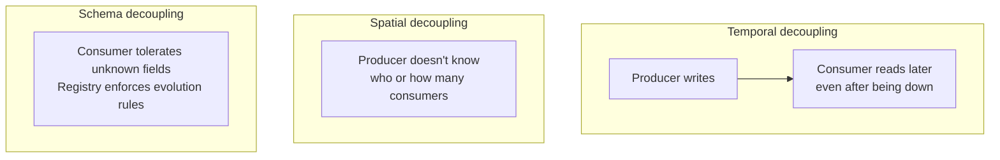
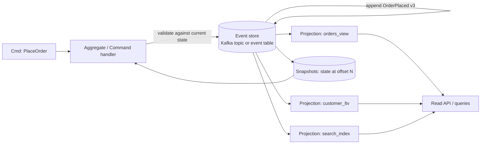
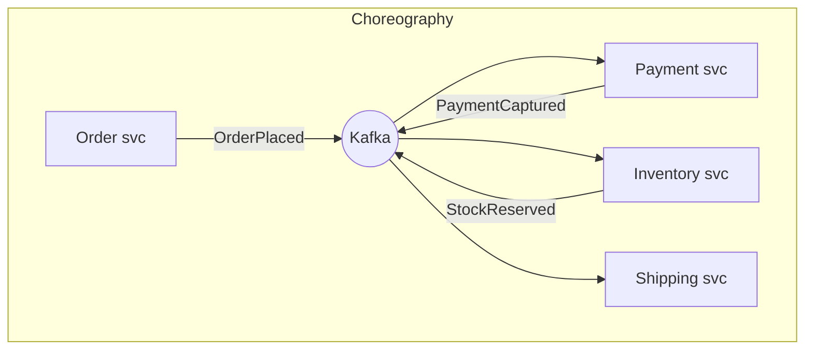

# Event-Driven Architecture

> Event-driven architecture (EDA) is the discipline of building systems where **state changes are communicated as immutable facts**, and integration happens by publishing those facts rather than by calling other services. The trap is that EDA looks like "just publish to Kafka", but the real decisions are semantic: is this an *event* or a *command*? Who owns the truth? How do I write to my database **and** publish an event without a 2PC? What happens when a consumer replays a year of history? Getting these wrong produces systems that are eventually consistent in ways nobody can reason about — and that is a business-level failure, not a technical one.

## TL;DR

- **Event = fact about the past** (`OrderPlaced`), immutable, past tense, named in the domain's ubiquitous language. **Command = request to do something** (`PlaceOrder`), may be rejected, has exactly one intended handler.
- Distribution styles differ: **event notification** (thin: "something changed, go look") vs **event-carried state transfer** (fat: payload has all needed data) vs **event sourcing** (the log *is* the source of truth). Pick deliberately per event type.
- **Pub/sub**: publisher does not know consumers. This buys temporal decoupling (consumer can be down) and organizational decoupling (teams ship independently) at the price of losing "did anyone handle this?" visibility.
- **CQRS** separates write model (normalized, invariant-enforcing) from read models (denormalized, query-shaped), kept eventually consistent by events.
- **Event sourcing** stores state as a sequence of events and derives state by replay; snapshotting and schema/event versioning become first-class concerns because your history is now a long-lived API.
- **Choreography** (services react to events) scales organizationally but hides the workflow; **orchestration** (a coordinator/saga drives steps) makes the workflow explicit and debuggable but centers the coordinator.
- **Schemas are contracts.** Schema Registry + a compatibility mode (`BACKWARD` in production) turns schema drift from a 3 a.m. incident into a CI failure.
- **Dual writes are broken.** Writing to a DB and publishing to Kafka without atomicity loses or duplicates events. The **transactional outbox** (or CDC from the WAL) is the standard fix.
- All of this is at-least-once in practice; **consumers must be idempotent** and deduplicate on a business key + event id (see [05-delivery-semantics.md](./05-delivery-semantics.md)).

## 1. Definitions and core vocabulary

| Term | Definition | Trap |
|---|---|---|
| **Event** | Immutable record that something happened, in the past tense, owned by a producer | "Events" that are really commands (imperative names, single handler) |
| **Command** | Intent to change state; can be rejected; ideally point-to-point | Broadcasting commands to many consumers → unwanted side effects |
| **Event notification** | Thin event: id + type + minimal metadata | Consumers must call back (temporal coupling, chatty) |
| **Event-carried state transfer (ECST)** | Fat event with a snapshot of the data consumers need | Payload churn, large messages, implicit shared schema |
| **Domain event** | Fact meaningful to the business (`PaymentCaptured`) | Anemic CRUD events (`row_updated`) leaking storage concerns |
| **Event sourcing** | Persist state as an ordered log of events; state = fold(events) | Unbounded replay time; needs snapshots + versioning |
| **CQRS** | Command (write) model separate from query (read) models | People assume strong consistency |
| **Projection / materialized view** | Read model built by consuming events | Rebuilds are expensive without replay tooling |
| **Choreography** | Each service reacts to events, no central brain | Implicit workflow, hard to know "where are we?" |
| **Orchestration / Saga** | A coordinator drives steps and compensations | Coordinator bottleneck / logic concentration |
| **Schema Registry** | Service + subjects storing and versioning schemas | Not a governance strategy by itself |
| **Subject** | Naming scope for schema versions (`orders.v1-value`) | Using `TopicNameStrategy` without thinking about reuse |
| **Compatibility mode** | `BACKWARD`, `FORWARD`, `FULL`, `NONE`, and transitive variants | `NONE` in prod = silent breakage |
| **Transactional outbox** | Write the event into your DB in the same transaction; publish from there | Forgetting to make the publisher idempotent |
| **CDC** | Change data capture — read the DB's WAL/binlog and publish | Replicating internal tables as if they were contracts |
| **Idempotent consumer** | Reprocessing the same event yields the same state | Dedup needs durable storage, not an in-memory set |
| **DLQ** | Dead-letter queue/topic for poison messages | DLQ without a retry/drain procedure is a dumpster |
| **Event mesh / event catalog** | Discoverable, governed set of topics with owners and schemas | A wiki that rots |

### 1.1 The three styles, side by side

```text
1. Event notification (thin)
   producer ──▶ { "type": "OrderPlaced", "orderId": "ORD-1" } ──▶ consumer calls Order API

2. Event-carried state transfer (fat)
   producer ──▶ { "type": "OrderPlaced", "orderId": "ORD-1", "lines": [...],
                  "customer": {...}, "total": 42.5 }            ──▶ consumer uses payload only

3. Event sourcing (the log IS the truth)
   command ──▶ validate ──▶ append(OrderPlaced) ──▶ ... append(OrderShipped)
                            │
                            └─▶ projection: state = replay(events)
```

Martin Fowler's taxonomy of these three (see References) is the right mental starting point: they have different failure modes, different coupling, and different cost profiles.

## 2. What problem it solves / why it matters

Batch/request-response integration decays in predictable ways:

| Problem | EDA answer |
|---|---|
| N services × M integrations = N×M point-to-point calls | One topic per event type; consumers subscribe independently |
| Synchronous call chains where one slow dependency takes down the caller | The log absorbs the burst; consumers drain at their own pace |
| "We lost the events during the deploy" | Retained log + offsets: replay from before the deploy |
| Analytics blocked on OLTP schema changes | CDC stream + read models decoupled from the OLTP schema |
| Changing one team's schema breaks three others | Schema Registry + enforced compatibility = contract |
| Audit / compliance ("what did we know at time T?") | Event log is the audit trail; state can be rebuilt as-of |
| New product needs historical data | Replay from topic history or a lake sink |

The real payoff is **decoupling three axes at once**:



> **Senior note.** EDA does not remove coupling; it *moves* it. Instead of compile-time coupling (RPC interfaces) you now have **data-shape coupling** (schemas), **semantic coupling** (what does `OrderPlaced` mean when an order is later cancelled?), and **operational coupling** (everyone shares the cluster). A senior engineer makes that coupling explicit, versioned, and owned.

## 3. How it works internally

### 3.1 The dual-write problem (and why outbox exists)

```mermaid
sequenceDiagram
  participant S as Service
  participant DB as Postgres
  participant K as Kafka
  S->>DB: INSERT order  ✅ committed
  S->>K: produce OrderPlaced  ❌ crash / timeout / broker down
  Note over S,K: Result: DB says order exists; nobody was told.<br/>Reverse the order and you get events for orders that don't exist.<br/>A local transaction cannot span DB + Kafka.
```

Solutions, ranked by operational cost:

| Approach | Mechanism | Pros | Cons |
|---|---|---|---|
| **Transactional outbox + CDC** | Insert into `outbox` table in the same DB transaction; Debezium tails the WAL and publishes | No 2PC, no polling, preserves DB commit order, at-least-once | Requires CDC pipeline + schema discipline |
| **Transactional outbox + publisher** | Same table, a worker polls and publishes, marks rows sent | Simple, works with any DB | Polling latency/cost; ordering requires care |
| **Kafka transactions (EOS)** | Produce to Kafka + write offsets in one Kafka transaction; DB write is *not* included | True atomicity **within Kafka** | Does not cover the DB write — still dual write |
| **Listen-to-yourself / event sourcing** | The event is the primary write, state is derived | No dual write at all | Big architectural shift |
| **2PC / XA** | Distributed transaction across DB + Kafka | Strong | Kafka has no XA support; operational nightmare |

### 3.2 Internals of the outbox pattern

```sql
-- Same transaction as the business write => atomicity by construction
BEGIN;
INSERT INTO orders (id, customer_id, total, status) VALUES ('ORD-1', 'C-9', 42.50, 'PLACED');
INSERT INTO outbox (id, aggregate_type, aggregate_id, type, payload, created_at)
VALUES (gen_random_uuid(), 'Order', 'ORD-1', 'OrderPlaced',
        '{"orderId":"ORD-1","customerId":"C-9","total":42.50}', now());
COMMIT;
-- Debezium captures the outbox INSERT from the WAL, applies the OutboxEventRouter SMT,
-- and produces to Kafka with key = aggregate_id => per-aggregate ordering preserved.
```

```json
{
  "name": "orders-outbox-connector",
  "config": {
    "connector.class": "io.debezium.connector.postgresql.PostgresConnector",
    "database.hostname": "pg-primary",
    "database.dbname": "appdb",
    "database.user": "debezium",
    "plugin.name": "pgoutput",
    "slot.name": "debezium_outbox",
    "publication.autocreate.mode": "filtered",
    "table.include.list": "public.outbox",
    "topic.prefix": "cdc",
    "tombstones.on.delete": "false",
    "transforms": "outbox",
    "transforms.outbox.type": "io.debezium.transforms.outbox.EventRouter",
    "transforms.outbox.table.field.event.id": "id",
    "transforms.outbox.table.field.event.key": "aggregate_id",
    "transforms.outbox.table.field.event.type": "type",
    "transforms.outbox.table.field.event.payload": "payload",
    "transforms.outbox.route.by.field": "aggregate_type",
    "transforms.outbox.route.topic.replacement": "orders.events.v1",
    "key.converter": "io.confluent.connect.avro.AvroConverter",
    "key.converter.schema.registry.url": "http://schema-registry:8081",
    "value.converter": "io.confluent.connect.avro.AvroConverter",
    "value.converter.schema.registry.url": "http://schema-registry:8081"
  }
}
```

Two design details that a senior must get right:

1. **Ordering key** must be the aggregate id (that is what Kafka guarantees ordering on), not `created_at` or a UUID-per-event.
2. **Outbox table hygiene**: an outbox table grows forever if you use the polling publisher. With CDC you can *delete* rows after publication (Debezium keeps the WAL position, so deletion of already-captured rows is safe) or move them to an archive partition. Without a cleanup plan, the outbox becomes your largest table.

### 3.3 Event sourcing and CQRS, mechanically



- **Write path**: load aggregate → replay events (or load latest snapshot + tail) → validate command → append new event(s) with `expected_version` (optimistic concurrency, i.e. compare-and-append on the stream position).
- **Read path**: projections consume the log and upsert into read-optimized stores. Each projection has its own offset and can be rebuilt from zero.
- **Snapshots** exist because replaying 4 years of events per command is not a latency budget you can defend. Snapshot every N events or T minutes.
- **Event versioning**: upstream events are an API. You need `OrderPlaced` v1/v2/v3 side by side, with upcasters in the replay path. This is the single most underestimated cost of event sourcing.
- **Kafka as event store**: a compacted (or `compact,delete` with long retention) topic keyed by aggregate id is a workable event store, but you lose per-stream compare-and-append unless you implement it (e.g., `read_committed` + expected offset checks + optimistic locking in a state store). Genuine event stores (EventStoreDB, Axon Server, Marten) give you that primitive natively.

### 3.4 Choreography vs orchestration



```mermaid
flowchart TB
  subgraph Orchestration (Saga coordinator)
    ORC[Order saga orchestrator] -->|command| PAY[Payment svc]
    ORC -->|command| INV[Inventory svc]
    ORC -->|command| SHP[Shipping svc]
    PAY -->|reply| ORC
    INV -->|reply| ORC
    SHP -->|reply| ORC
    ORC -->|compensations on failure| PAY
  end
```

| Dimension | Choreography | Orchestration (saga) |
|---|---|---|
| Coupling | Loose — services only know events | Coordinator knows all steps |
| Visibility | Poor — "where is order ORD-1?" requires correlation across topics | Excellent — the coordinator has the state machine |
| Timeouts / compensation | Hard to express | Natural (`PaymentTimeout` → compensate) |
| Change cost | Add a consumer; nobody else changes | Modify the saga definition |
| Team topology fit | Many teams owning independent services | One team owns the workflow |
| Testing | Integration-heavy | Coordinator unit-testable with fakes |
| Failure mode | Event loops, missing terminal event, invisible dead-ends | Coordinator is a single point of logic (make it horizontally scaled + idempotent) |

The pragmatic rule: **choreograph within a bounded context, orchestrate across contexts** — especially for anything with money, compensation, or a regulatory timeout.

### 3.5 Schema Registry internals

- Subjects are versioned lists of schemas. For Kafka, the default `TopicNameStrategy` gives `orders.v1-value` and `orders.v1-key`. `RecordNameStrategy` lets one topic carry multiple event types; `TopicRecordNameStrategy` mixes both.
- The wire format is: `magic byte (0) | 4-byte schema id | serialized payload`. Consumers resolve the schema by id from the registry (cached locally), not by parsing the payload.
- Compatibility is checked **on registration**:

| Mode | New schema can read old data? | Old schema can read new data? | Practical meaning |
|---|---|---|---|
| `BACKWARD` (default) | ✅ | ❌ | Consumers can be upgraded *after* the producer; add optional fields, delete-with-default |
| `FORWARD` | ❌ | ✅ | Consumers upgrade first; add fields consumers must understand |
| `FULL` | ✅ | ✅ | Only add/remove optional fields — safest, most restrictive |
| `NONE` | — | — | Anything goes; you will regret it |
| `*_TRANSITIVE` | all versions, not just last | all versions | Use transitive in prod when consumers may lag many versions |

- Practical production policy: `BACKWARD_TRANSITIVE` for event topics (consumers are the ones who deploy late), `FULL_TRANSITIVE` for shared core event families, and **CI enforcement** — register schemas in CI (`mvn schema-registry:test-local-compatibility` or the REST API) so a breaking change fails the build, not production.

## 4. How to implement it

### 4.1 Avro + Schema Registry producer (Python)

```python
from confluent_kafka import Producer
from confluent_kafka.schema_registry import SchemaRegistryClient
from confluent_kafka.schema_registry.avro import AvroSerializer
from confluent_kafka.serialization import SerializationContext, MessageField
from confluent_kafka.serializing_producer import SerializingProducer

# 1) Look up the schema from the platform's schema repository (do not inline schemas
#    by hand in each service — that is how drift starts).
sr = SchemaRegistryClient({"url": "http://schema-registry:8081"})
value_schema_str = sr.get_latest_version("orders.events.v1-value").schema.schema_str

producer = SerializingProducer({
    "bootstrap.servers": "kafka1:9092",
    "key.serializer": lambda k, ctx: k.encode("utf-8"),
    "value.serializer": AvroSerializer(sr, value_schema_str),
    "acks": "all",
    "enable.idempotence": True,
})

def publish_order_placed(order: dict) -> None:
    # Rules of thumb for a well-formed domain event:
    #  - id: unique per event (for consumer dedup)
    #  - type + version: what happened, which contract
    #  - aggregate id + version: ordering + optimistic concurrency
    #  - occurred_at: business time (NOT the Kafka broker timestamp)
    event = {
        "event_id": order["event_id"],
        "event_type": "OrderPlaced",
        "event_version": 1,
        "aggregate_id": order["order_id"],
        "aggregate_version": order["version"],
        "occurred_at": order["occurred_at_ms"],
        "producer": "order-service",
        "trace_id": order.get("trace_id"),
        "tenant_id": order.get("tenant_id"),
        "payload": {
            "order_id": order["order_id"],
            "customer_id": order["customer_id"],
            "total": order["total"],
            "currency": order["currency"],
            "lines": order["lines"],
        },
    }
    producer.produce(
        topic="orders.events.v1",
        key=event["aggregate_id"],                 # ordering key = aggregate
        value=event,
        on_delivery=lambda err, msg: handle(err, msg),
    )

def handle(err, msg):
    if err:
        # Never swallow: routing to DLQ or alerting happens here
        raise RuntimeError(f"delivery failed for {msg.key()!r}: {err}")

producer.poll(0)
producer.flush()
```

### 4.2 Idempotent consumer with dedup table (SQL + Python)

```sql
CREATE TABLE processed_events (
    event_id     uuid PRIMARY KEY,
    consumer     text NOT NULL,
    processed_at timestamptz NOT NULL DEFAULT now()
);

CREATE TABLE orders_view (
    order_id    text PRIMARY KEY,
    customer_id text NOT NULL,
    total       numeric(12,2) NOT NULL,
    status      text NOT NULL,
    version     integer NOT NULL        -- aggregate_version, for out-of-order detection
);
```

```python
def apply_order_placed(conn, event: dict) -> None:
    with conn:  # single transaction: dedup + state change, atomically
        cur = conn.cursor()
        cur.execute(
            "INSERT INTO processed_events (event_id, consumer) VALUES (%s, 'orders-projection') "
            "ON CONFLICT (event_id) DO NOTHING RETURNING event_id",
            (event["event_id"],),
        )
        if cur.fetchone() is None:
            return  # duplicate delivery — safe to skip
        p = event["payload"]
        cur.execute(
            """
            INSERT INTO orders_view (order_id, customer_id, total, status, version)
            VALUES (%s, %s, %s, 'PLACED', %s)
            ON CONFLICT (order_id) DO UPDATE
              SET total = EXCLUDED.total,
                  status = EXCLUDED.status,
                  version = EXCLUDED.version
              WHERE orders_view.version < EXCLUDED.version   -- ignore replays/out-of-order
            """,
            (p["order_id"], p["customer_id"], p["total"], event["aggregate_version"]),
        )
```

> **Senior note.** The dedup table grows forever. Partition/purge it by time (`processed_at < now() - interval '30 days'`) — but only if you can bound redelivery window (retention of the source topic + DLQ replays). If you can't, key your dedup on the business operation instead of the event id and make the state change naturally idempotent (upsert with a version guard, like above).

### 4.3 CQRS with Kafka Streams (write model → read model)

```java
// A materialized, queryable read model fed by the event stream.
StreamsBuilder b = new StreamsBuilder();

KStream<String, OrderEvent> events = b.stream("orders.events.v1",
    Consumed.with(Serdes.String(), orderEventSerde)
            .withTimestampExtractor(new OrderTimeExtractor()));   // business time, not broker time

KTable<String, OrderState> orders = events
    .groupByKey()
    .aggregate(
        OrderState::empty,
        (key, event, state) -> OrderState.apply(event),           // pure, idempotent fold
        Materialized.<String, OrderState, KeyValueStore<Bytes, byte[]>>as("orders-store")
            .withKeySerde(Serdes.String())
            .withValueSerde(orderStateSerde));

// Queries are served from the local store, backed by a changelog topic => restart-safe.
ReadOnlyKeyValueStore<String, OrderState> store = kafkaStreams.store(
    StoreQueryParameters.fromNameAndType("orders-store", QueryableStoreTypes.keyValueStore()));
OrderState s = store.get("ORD-1");
```

`processing.guarantee=exactly_once_v2` makes the state store, changelog topics, and sink writes atomic — EOS *inside Kafka's boundary* (see [05-delivery-semantics.md](./05-delivery-semantics.md)).

### 4.4 Death/retry topology (poison messages without head-of-line blocking)

```text
orders.events.v1  ──►  consumer (happy path)
      │ failure (N retries with backoff)
      ▼
orders.events.v1.retry.5m ──► delayed consumer ──► back to happy path
      │ still failing after M attempts
      ▼
orders.events.v1.dlq ──► human triage / automated replay tool (NEVER auto-consumed)

Design rules:
 - Retry topics are per-cause, not per-message-retry-count, or you lose ordering.
 - DLQ consumers must be able to replay to the source topic with the SAME key.
 - Every DLQ message must carry the original topic/partition/offset/headers.
 - Alert on DLQ depth and on age-of-oldest-DLQ-message, not on rate alone.
```

## 5. Where to implement it

| Capability | Kafka-native | Confluent Cloud | MSK | Event Hubs | Google Cloud | Notes |
|---|---|---|---|---|---|---|
| Event backbone | Kafka topics | Kafka + Cluster Linking | Kafka (MSK/Serverless/Express) | Kafka API + native AMQP | Pub/Sub (+ Eventarc for GCP events) | Choose by cloud gravity + SLA |
| Schema governance | DIY (Apicurio, Karapace) | Schema Registry (Avro/JSON/Protobuf) | Glue Schema Registry (integration) | Schema Registry in Event Hubs | Pub/Sub schemas (Avro/Protobuf) | Governance is the deciding feature |
| CDC | Debezium (self-managed) | Managed connectors | Debezium/DMS → MSK | Event Hubs Capture / CDC connectors | Datastream | Managed CDC saves a team |
| Stream processing | Kafka Streams | Flink (ksqlDB deprecated in CC) | Flink/MSK on EKS/Managed Flink | Stream Analytics / Functions | Dataflow | Pick one engine as the owner of state |
| Outbox support | Debezium OutboxEventRouter SMT | same, managed | same | native connector / manual | Datastream CDC | Broker/topic config: `cleanup.policy=delete` (events, not state) |
| Event catalog | DataHub, OpenMetadata, Backstage plugin | Stream Catalog / Stream Lineage | Glue Data Catalog | Event Hubs schemas | Dataplex | Start with ownership + schema + SLO fields |

**When each fits:**

- **Kafka-native** when you want one model everywhere and can staff platform ops.
- **Confluent Cloud** when you need Schema Registry + Connect + Flink with a single SLA and don't want to run brokers. Budget for CKU/throughput pricing.
- **MSK** when you're AWS-heavy, need IAM/VPC integration, and want Kafka semantics without running brokers.
- **Event Hubs** when Azure is your home and you want Kafka-protocol ingest with native capture to Blob/ADLS.
- **Pub/Sub / Eventarc** for GCP serverless fan-out, GCP-service events, and when you do not want to think about partitions at all (you trade away offsets/log semantics).
- **RabbitMQ / SQS** are *queues*, not logs: great for command/work distribution (competing consumers, per-message ack, routing keys), wrong for replayable event history. Using a queue as an event backbone is a classic mistake when someone needs to onboard a new consumer six months later.

## 6. Patterns and anti-patterns

| Pattern | Intent | Sketch |
|---|---|---|
| **Transactional outbox** | Atomic "write DB + publish event" | Outbox table + CDC (3.2) |
| **Event sourcing** | History as truth | Append-only stream per aggregate + snapshots |
| **CQRS / projection** | Query-optimized read models | Consumers upsert into read stores |
| **Saga** | Distributed workflow with compensation | Choreographed or orchestrated (3.4) |
| **Event carrier + pointer** | Small events, big payloads in blob store | Huge documents go to S3, event carries URI |
| **Claim-check** | Same idea, per-message | For payloads > a few hundred KB |
| **Correlation id / trace id** | Follow a business flow across topics | Header + W3C traceparent |
| **Outbox-to-topic-per-aggregate-type** | Bounded ordering scope | Critical for multi-consumer fan-out |
| **Snapshot + delta** | Bound replay cost | Full state every N events |
| **Fan-out-on-write** (fat events) | Consumers need no callbacks | Higher storage, simpler consumers |
| **Fan-out-on-read** (thin events) | Lower storage, latest data | Callbacks, temporal coupling |
| **Consumer-driven contracts** | Test producers against real consumer expectations | Pact-style; enforce in CI |

### Anti-patterns

| Anti-pattern | Why it hurts | Instead |
|---|---|---|
| **Events named like commands** (`SendEmail`) | Many handlers "obey", side effects multiply | Past-tense facts (`OrderPlaced`); send commands point-to-point to one owner |
| **Entity-only events with full snapshots as "the" event** | Consumers can't tell *what changed*; lost intent | Include both the delta (`OrderPlaced`) and, if needed, the new state |
| **Shared "uber" event** (`EntityChanged` with 80 optional fields) | Nobody knows what's required; every change breaks someone | One event type per meaningful fact; version them |
| **Dual write** | Lost/phantom events | Outbox + CDC |
| **Unversioned events** | Silent consumer breakage | `event_version` + Registry compatibility |
| **Schema Registry with `NONE`** | Every producer deploy is a lottery | `BACKWARD_TRANSITIVE` |
| **Choreography for money flows** | No visibility of a half-completed transfer | Saga with explicit compensations |
| **Auto-consumed DLQ** | Poison messages loop forever | Manual/automated triage with metrics |
| **No idempotency in consumers** | Duplicates corrupt state | Dedup table or version-guarded upsert |
| **Timestamps from the broker used as business time** | Wrong analytics windows; late/early events classified wrongly | Carry `occurred_at`; use [07-watermarks.md](./07-watermarks.md) |
| **Topic per service instead of per event family** | Consumers can't subscribe without coupling to the publisher's internals | Domain-event topics + ownership |
| **CDC publishing raw tables to consumers** | Internal schema leaks as a public contract | Model explicit topics; use routing/transformations |
| **Replay without rate limiting** | Rebuild storm saturates downstream DB | Throttle replay consumers; use separate consumer groups and lower `max.poll.records` |

## 7. Real-world use cases and industry applications

- **E-commerce order lifecycle**: `OrderPlaced` → payment, inventory reservation, fraud scoring, email, analytics. The event log is also the customer-facing "order timeline".
- **Fintech ledgers**: double-entry ledgers are naturally event-sourced; corrections are new entries, never mutations. Kafka gives durability, retention, and fan-out to risk/AML projections.
- **Ride-hailing / logistics**: driver position and trip state events feed dispatch (sub-second), pricing, ETA models, and analytics. Keyed by driver/trip for ordering.
- **Retail inventory**: CDC from the ERP/warehouse system → compacted `inventory-current` topic → storefront, POS, and replenishment all consume one contract.
- **Telecom / IoT**: device/telemetry events with ECST; compacted `device-config` topics pushed to gateways; per-device keys for ordering.
- **Healthcare**: HL7/FHIR events through a clinical event bus; audit requirements make the immutable log valuable.
- **SaaS multi-tenant apps**: per-tenant event streams (tenant id in the key or topic naming) driving billing metering, usage analytics, and webhooks.
- **Streaming ML features**: events → feature store (Kafka + Flink → online store), training sets from the same stream (point-in-time correctness requires the event log plus watermarks).

## 8. Senior-level deep dive

### 8.1 Choosing event granularity (the decision that ages worst)

```text
Too coarse:  EntityChanged  -> consumers can't react selectively; every field is optional
             (you reimplemented a database table as a message)

Too fine:    OrderLineQuantityUpdated, OrderLinePriceUpdated, OrderLineRemoved...
             (chatty, forces consumers to assemble intent, ordering nightmare)

Right level: business facts at the aggregate boundary
             OrderPlaced, OrderLineAdded, OrderCancelled, OrderShipped, OrderRefunded
             (each a complete, meaningful intent, keyed by order_id)
```

Test to apply: *"If I replay only this event type, can a consumer implement its business rule without calling back to my service?"* If no, the event is too thin. *"Does this event carry anything a consumer needs but shouldn't see?"* If yes, it's too fat.

### 8.2 Consistency reasoning: what EDA actually guarantees

| Interaction | Guarantee | Consequence |
|---|---|---|
| Producer → Kafka | At-least-once (with idempotent producer: exactly-once per session) | Consumer must dedup |
| Kafka → Consumer state | At-least-once unless transactional sink + `read_committed` | Design idempotent projections |
| Producer to DB → Kafka (outbox) | At-least-once, ordered per aggregate | Dedup on `event_id` |
| Projection vs write model | Eventual consistency, lag = consumer lag | UI must tolerate "just wrote, not yet visible" → read-your-writes patterns (route the user's next read to the write model, or a token/version check) |
| Saga across services | No ACID; compensations may be non-idempotent by nature | Design every step with an explicit inverse or a "stuck" state + alert |

**Read-your-writes is the #1 UX problem in CQRS systems.** Standard answers: (a) return the new version/token from the write and poll the projection for it; (b) read from the write model for the entity the user just modified; (c) accept the lag and show an optimistic UI.

### 8.3 Performance and cost levers

| Lever | Effect | Cost |
|---|---|---|
| Fewer, fatter events vs many thin events | Fewer records → less overhead | Bigger payloads, more schema churn |
| Compression (`zstd`) | 2–5× storage/network | CPU in producer, consumer, broker recompression on new schema |
| Partition count | Parallelism | Metadata overhead, rebalance cost, key-affinity ratchet |
| Retention + tiered storage | Replay window | Storage cost, S3 GET costs on deep replay |
| Compacted topics | Bounded state size, fast bootstrap | Compaction CPU/IO; tombstones needed for deletes |
| Schema registry caching | Avoid per-record HTTP | Stale cache if ID reuse (use `use.latest.version` carefully) |
| Record batching (`linger.ms`) | Throughput | Latency floor |

### 8.4 Failure modes and debugging

| Symptom | Likely cause | First move |
|---|---|---|
| Projection behind by hours, lag flat | A single poison message retried forever, or a slow downstream | Inspect consumer logs, add retry/DLQ topology, check per-partition lag |
| Duplicate rows in a read model | Missing/incorrect dedup or a non-idempotent upsert | Check `processed_events` growth, verify version guards |
| Consumers disagree about order | Different keys used to produce, or partitions added | Verify keys in `kafka-dump-log`, check partition count history |
| Events missing for some orders | Dual write without outbox (partial failure window) | Move to outbox/CDC; mine the outbox table for reconstruction |
| Cascade of consumer restarts (rebalance storm) | `max.poll.interval.ms` exceeded by slow handlers | Increase interval / reduce `max.poll.records` / move work off the poll thread (see [03-consumer-groups.md](./03-consumer-groups.md)) |
| Schema registration suddenly failing CI | Someone made a breaking change | Check registry compatibility; add an upcaster or a new subject version |
| Unknown topics consuming prod CPU | Orphaned groups from experiments | Audit groups (`kafka-consumer-groups --list`), enforce ownership in the catalog |
| Event loop between two services | Choreography without loop guards | Add causation ids and reject events caused by yourself |
| Replay saturates the OLTP read replicas | No backpressure on replay | Throttle consumer, use separate group, off-peak window |

### 8.5 Architecture decision checklist

1. **Who owns the event?** One producer, documented. Multi-writer topics destroy causality reasoning.
2. **What is the key?** Must be the aggregate id (ordering) and must be stable forever.
3. **Is the event a contract or an implementation detail?** Contracts get schema governance + SLAs + on-call.
4. **What happens on replay?** Can every consumer process the full history? If not, they must be able to start at a known offset (see [04-offsets.md](./04-offsets.md)).
5. **What is the dedup key and the retention of the dedup window?**
6. **How is a workflow's state visible to an operator?** Correlation ids + a queryable saga state store or an orchestrated coordinator.
7. **What is the DLQ drain procedure, and who is on call for it?**
8. **What is the blast radius of a schema change?** CI compatibility checks + consumer contract tests.
9. **Retention vs rebuild cost:** How long does a projection rebuild take from offset zero? If it exceeds your RTO, you need snapshots or a lake/table-format source of truth.
10. **Where is the eventual consistency visible to users, and how do we explain it?**

## 9. Common mistakes and how to avoid them

1. **Calling commands events.** Past-tense facts; one owner per command.
2. **Dual writes.** Outbox + CDC, or design the event as the primary write.
3. **Assuming exactly-once end-to-end.** You get at-least-once + idempotent consumers; anything crossing into a non-transactional store (S3 by hand, REST call, email) is at-least-once forever.
4. **Skipping schema governance until the first outage.** Registry from day one, `BACKWARD_TRANSITIVE` in prod, CI compatibility gate.
5. **No event id / no dedup.** Add `event_id` and a durable dedup mechanism before you need it.
6. **Using broker timestamps as business time.** Carry `occurred_at`; windows depend on it.
7. **Unbounded key space with ordering requirements.** Choose keys whose ordering you actually need.
8. **DLQ with no owner.** Alert, triage runbook, replay tooling.
9. **Event-sourcing everything.** Event sourcing costs versioning, snapshots, and replay infrastructure. Use it for genuinely audit-critical aggregates, not for a "users" table.
10. **Choreography without observability.** Correlation ids + a workflow view, or orchestrate.
11. **Polling the outbox naively.** Polling with `SELECT ... FOR UPDATE SKIP LOCKED` is fine for low volume; at scale use CDC.
12. **Shared topics across environments/tenants without isolation.** Separate clusters, or strict prefixing + ACLs + per-tenant quotas.
13. **Forgetting idempotency keys on the API boundary** where events enter the system: a client retry becomes two events.

## 10. Exercises / interview questions

*(Hints only.)*

1. Your service writes to Postgres and produces to Kafka. Enumerate every failure window and the resulting inconsistency, then design the outbox solution including the cleanup job. *(Hint: commit-then-produce vs produce-then-commit.)*
2. When is event notification *better* than event-carried state transfer? Give a concrete pair of services where each wins. *(Hint: data size, churn rate, who owns the truth.)*
3. A consumer must ignore out-of-order duplicates of the same aggregate. Design the state update so it is order-tolerant without a global sequence. *(Hint: monotonic `aggregate_version` + guarded upsert.)*
4. You need a 7-step order fulfilment workflow with refunds. Sketch it as a saga, list compensations, and identify steps that cannot be compensated. *(Hint: shipping, external emails.)*
5. Your team wants `FULL_TRANSITIVE` on a topic that flows through a 4-step pipeline where each step adds a field. Which mode makes sense, and where do you deploy first? *(Hint: compatibility direction vs deploy order.)*
6. How would you expose to a support agent "current state of the checkout workflow" in a purely choreographed system? *(Hint: correlation ids + a workflow projection.)*
7. A read model is 3 hours behind. Distinguish a *performance* problem from a *correctness* problem and describe the diagnostic sequence. *(Hint: lag shape over time, per-partition breakdown.)*
8. Design replay for onboarding a new projection that must not disturb production. *(Hint: separate group, throttling, snapshot from a lake, rate limits.)*
9. Where do you put the "expected aggregate version" check if you use Kafka as your event store, and what breaks if you skip it? *(Hint: optimistic concurrency, `read_committed`, a keyed state store.)*
10. Convince a skeptical architect that `entity_changed` with 80 columns is worse than 5 domain events.

## References

- Martin Fowler — *What do you mean by "Event-Driven"?* (event notification vs ECST vs event sourcing): <https://martinfowler.com/articles/201701-event-driven.html>
- Martin Fowler — Event Sourcing: <https://martinfowler.com/eaaDev/EventSourcing.html>
- Martin Fowler — CQRS: <https://martinfowler.com/bliki/CQRS.html>
- microservices.io — Transactional Outbox: <https://microservices.io/patterns/data/transactional-outbox.html>
- microservices.io — Saga: <https://microservices.io/patterns/data/saga.html>
- microservices.io — Event Sourcing: <https://microservices.io/patterns/data/event-sourcing.html>
- microservices.io — CQRS: <https://microservices.io/patterns/data/cqrs.html>
- microservices.io — Transaction log tailing (CDC as outbox publisher): <https://microservices.io/patterns/data/transaction-log-tailing.html>
- Debezium — Outbox Event Router SMT: <https://debezium.io/documentation/reference/stable/transformations/outbox-event-router.html>
- Debezium — architecture and connectors (PostgreSQL example): <https://debezium.io/documentation/reference/stable/architecture.html> · <https://debezium.io/documentation/reference/stable/connectors/postgresql.html>
- Confluent — Event sourcing, CQRS, and stream processing: <https://www.confluent.io/blog/event-sourcing-cqrs-stream-processing-apache-kafka-whats-connection/>
- Confluent — Why you need a Schema Registry: <https://www.confluent.io/blog/schema-registry-kafka-stream-processing-yes-virginia-you-really-need-one/>
- Confluent — Schema Registry docs: fundamentals, schema evolution, compatibility: <https://docs.confluent.io/platform/current/schema-registry/index.html> · <https://docs.confluent.io/platform/current/schema-registry/fundamentals/index.html> · <https://docs.confluent.io/platform/current/schema-registry/fundamentals/schema-evolution.html> · <https://docs.confluent.io/platform/current/schema-registry/fundamentals/compatibility.html>
- Confluent — Avro serialization and wire format: <https://docs.confluent.io/platform/current/schema-registry/fundamentals/serdes-develop/serdes-avro.html>
- Confluent — Schema Registry REST API: <https://docs.confluent.io/platform/current/schema-registry/develop/api.html>
- Confluent — Kafka Streams concepts and DSL (KTable, aggregation): <https://docs.confluent.io/platform/current/streams/concepts.html> · <https://docs.confluent.io/platform/current/streams/developer-guide/dsl-api.html>
- Apache Kafka Streams documentation: <https://kafka.apache.org/documentation/streams/>
- Apache Kafka delivery semantics (design doc): <https://kafka.apache.org/documentation/#semantics>
- Confluent — Kafka Connect: <https://docs.confluent.io/platform/current/connect/index.html>
- Confluent — ksqlDB: <https://docs.confluent.io/platform/current/ksqldb/index.html>
- CloudEvents specification (interoperable event envelope): <https://cloudevents.io/>
- RabbitMQ — AMQP concepts (why queues ≠ logs): <https://www.rabbitmq.com/tutorials/amqp-concepts>
- Google Cloud Eventarc overview (cloud-native event routing): <https://cloud.google.com/eventarc/docs/overview>
- Cloudflare — Kafka at 1 trillion messages (fan-out at scale): <https://blog.cloudflare.com/using-apache-kafka-to-process-1-trillion-messages/>
