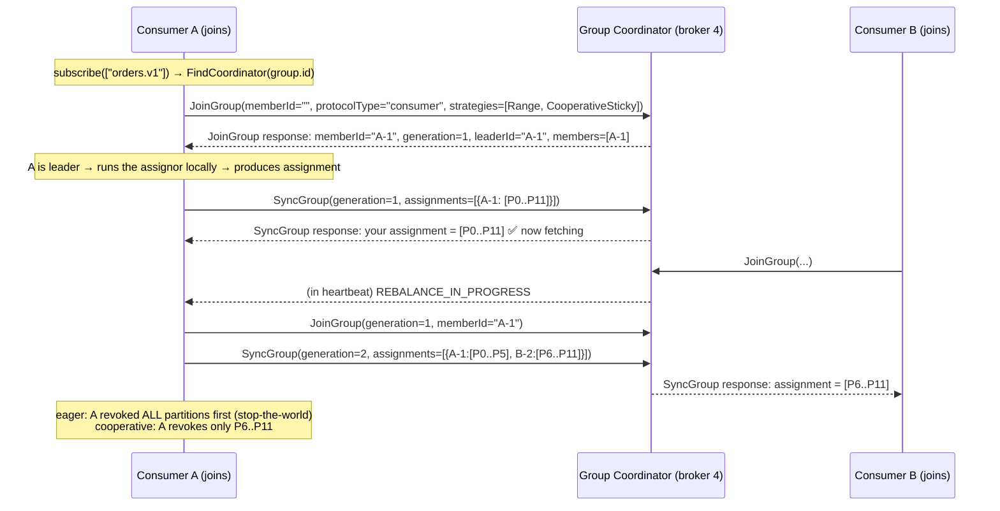

# Consumer Groups

> A consumer group is Kafka's answer to the question "how do I get N processes to share the work of a topic without stepping on each other?" The answer — a broker-side coordinator that leases each partition to exactly one member at a time — is elegant and deceptively simple. Everything painful about operating Kafka consumers lives here: rebalance storms, `max.poll.interval.ms` timeouts, partitions stranded on a dead instance, lag spikes during deploys, and the difference between a rolling restart that is invisible and one that drops throughput to zero. A senior must know the protocol, not just the config names.

## TL;DR

- A group is a **distributed lease manager**: each partition is assigned to exactly one member at a time; each member can own many partitions.
- Coordination is handled by a **group coordinator** — the broker that owns the partition of `__consumer_offsets` for `hash(group.id)`.
- Two generations of protocol:
  - **Classic (eager)**: `JoinGroup → leader computes assignment → SyncGroup`; every rebalance revokes *all* partitions (stop-the-world).
  - **Cooperative (KIP-429)**: incremental revocation — only moved partitions are revoked, so throughput never drops to zero.
  - **KIP-848 (new consumer protocol)**, GA in Kafka 4.0: the **broker computes assignments** and heartbeats are decoupled from the poll loop, enabling far faster, incremental rebalances.
- `max.poll.interval.ms` (default 300 s) is the #1 cause of "mystery rebalances": if your processing takes longer than that between polls, the coordinator evicts the member and rebalance-storms begin.
- `session.timeout.ms` (45 s) governs failure detection for heartbeats; `heartbeat.interval.ms` (3 s) is how often liveness is reported. They are different mechanisms and different tuning targets.
- **Static membership** (`group.instance.id`, KIP-345) makes a planned restart *not* trigger a rebalance within `session.timeout.ms`.
- Partition counts cap consumer parallelism. 10 partitions → 11 consumers = one idle consumer. Add consumers only after you add partitions.
- **Rebalance storms are an architectural smell**, not a tuning problem: they usually mean a slow handler, a crash loop, or too many partitions per member.

## 1. Definitions and core vocabulary

| Term | Definition | Notes |
|---|---|---|
| **Consumer group** | Named set of consumers that jointly consume a set of topics | Identified by `group.id`; the unit of offset tracking |
| **Member** | One consumer instance in a group | Identified by `member.id` (ephemeral) and optionally `group.instance.id` (static) |
| **Group coordinator** | Broker responsible for a group's membership + commits | `__consumer_offsets` partition = `abs(hash(group.id)) % 50` |
| **Group leader** | The member the coordinator asks to compute the assignment (classic/cooperative) | Under KIP-848 the broker is the assignor instead |
| **Generation** | Monotonic counter incremented on each successful rebalance | Commits with a stale generation are rejected → prevents zombie writes |
| **Assignment / assignor** | Strategy mapping partitions → members | `RangeAssignor`, `RoundRobinAssignor`, `StickyAssignor`, `CooperativeStickyAssignor`; KIP-848: `uniform`, `range` |
| **Eager rebalance** | All members revoke all partitions, then rejoin | Stop-the-world |
| **Cooperative rebalance** | Only partitions that must move are revoked | Incremental, requires two rebalance rounds |
| **Rebalance storm** | Repeated rebalances because members keep leaving/joining | Caused by poll-interval violations, OOM/crash loops, network flaps |
| **Static membership** | Member identity persists across restarts (`group.instance.id`) | Avoids rebalance on planned restarts (KIP-345) |
| **Zombie consumer** | Member that was evicted but still commits | Rejected via generation/fencing; fenced by `member.epoch` in KIP-848 |
| **`__consumer_offsets`** | Internal compacted topic storing committed offsets + group metadata | Default 50 partitions, RF 3 |
| **Rebalance timeout** | How long the coordinator waits for all members to rejoin | `max.poll.interval.ms` (classic) / `group.consumer.max.session.timeout.ms` (new) |
| **Standby replica / task** | Kafka Streams concepts that map 1:1 onto partitions | Streams has its own assignment layer (see [§8.3](#83-kafka-streams-a-consumer-group-with-a-brain)) |

### 1.1 Anatomy of a group

```text
Topic orders.v1: 12 partitions            Group "billing-v1": 4 members
                                 ┌──────────────────────────────┐
 P0  ──▶ member A                 │ JoinGroup / SyncGroup /      │
 P1  ──▶ member A                 │ Heartbeat / LeaveGroup       │
 P2  ──▶ member A                 └──────────────┬───────────────┘
 P3  ──▶ member B                                │
 P4  ──▶ member B                                ▼
 P5  ──▶ member B                    Coordinator = broker owning
 P6  ──▶ member C                    __consumer_offsets-<hash("billing-v1") % 50>
 P7  ──▶ member C
 P8  ──▶ member C                    Commits: (group, orders.v1, P0) -> 4211
 P9  ──▶ member D
 P10 ──▶ member D                    Guard: generation = 17
 P11 ──▶ member D                    (stale-generation commits are rejected)
```

**Key invariant:** a partition is assigned to at most one member of a group at a time. Different groups consume the same partitions independently. This is why Kafka is both "a queue" (within a group) and "a broadcast bus" (across groups).

## 2. What problem it solves / why it matters

| Problem | Mechanism |
|---|---|
| Horizontal scaling of consumption | Partition-level parallelism via group membership |
| Automatic failover | Coordinator re-assigns orphaned partitions after session timeout |
| No duplicate processing from the same consumer app | Single-owner lease per partition |
| Per-group progress tracking | Committed offsets in `__consumer_offsets` |
| Rolling deploys without data loss | Cooperative/static membership + commit-before-revoke |
| Backpressure via lag | Unprocessed data stays in the log; lag becomes the metric |
| Isolation of environments/teams | Distinct `group.id` namespaces + ACLs |

But groups also introduce their own failure modes — rebalance interruption, partition starvation, and delayed failure detection — which is why understanding the protocol is mandatory before operating it at scale.

## 3. How it works internally

### 3.1 The classic protocol, step by step



Details that matter:

- **`FindCoordinator`** resolves the coordinator host from `hash(group.id) % __consumer_offsets.num.partitions`.
- The coordinator maintains, per group: member ids, `group.instance.id`s, protocols, assignment, generation, and per-partition committed offsets.
- **The client-side leader** runs the assignor in classic mode. This is why a clever custom assignor works — and also why a bad one can starve a member.
- **Heartbeats** are sent on a background thread (`heartbeat.interval.ms`, 3 s). Failing to heartbeat for `session.timeout.ms` (45 s) → member removed → rebalance.
- **The poll loop is a second, independent liveness mechanism**: if the app does not call `poll()` within `max.poll.interval.ms` (300 s), the client *leaves the group voluntarily* (it sends `LeaveGroup`). This is the most common production surprise: a slow DB batch job between polls causes the consumer to be evicted — and it will look like "broker flakiness" in the logs if you don't know this.
- **Commits carry the generation.** A commit with an old generation gets `ILLEGAL_GENERATION` and the client rejoins. That fencing is what stops a paused-then-resumed zombie from advancing offsets over records another member already processed.

### 3.2 Cooperative rebalancing (KIP-429)

Classic eager rebalancing: **every** rebalance revokes everything. Adding a 4th consumer to a 3-member group means all 12 partitions are unowned for the duration, then re-fetched from the last committed offset. ~5–30 s of lost throughput per rebalance, on every rolling restart.

Cooperative (adjust-and-revoke, two rounds):

```text
Round 1: leader computes the new assignment, and *tells* members which partitions they
         must give up. Members that don't lose partitions keep consuming.
         Members that lose partitions revoke them and rejoin.
Round 2: remaining partitions are handed to the new owner.
=> Only the moving partitions pause.
```

Rules of thumb:

- Migrate by changing `partition.assignment.strategy` to `CooperativeStickyAssignor` **in two rolling restarts** (once from eager → `CooperativeStickyAssignor`+`StickyAssignor` on the "upgrade path", then drop the eager assignor), otherwise the group flips into an "unknown/`none`" assignment state and you get an outage. Kafka 4.0 default is `[RangeAssignor, CooperativeStickyAssignor]`, so new groups are cooperative-aware.
- Use `ConsumerRebalanceListener`'s `onPartitionsRevoked` to commit before releasing ownership. Under cooperative mode this fires only for the partitions actually being revoked.
- A cooperative assignor cannot fully fix a *bad member*: if one member processes slowly, the assignment may oscillate. Slow members are the root cause in most "rebalance storm" tickets.

### 3.3 The new consumer protocol (KIP-848, GA in Kafka 4.0)

| Aspect | Classic / cooperative | KIP-848 (new protocol) |
|---|---|---|
| Who computes the assignment | Group leader client | **Broker** (`group.consumer.assignors=uniform,range` on the coordinator) |
| Heartbeats | Must come from the poll thread's client | Decoupled background heartbeats; session timeout driven by *heartbeat* liveness |
| Liveness for slow processing | `max.poll.interval.ms` eviction | `max.poll.interval.ms` still defaults to 5 min for `consumer` code paths but the protocol's session is heartbeat-driven |
| Rebalance trigger | Join/Sync rounds with a global barrier | Incremental: assignment changes are computed and pushed without stopping the group |
| Reconciling | Full revoke or plan-based | Continuous reconciliation of desired vs. current assignment, with a **member epoch** |
| Group type | `classic` | `consumer` (set by `group.version` feature flag / `group.coordinator.rebalance.protocols=classic,consumer`) |
| Upgrade path | — | A group converts to the new protocol when the first new-protocol consumer joins; classic members can interoperate if the assignor embeds no custom metadata |

Server-side config (broker):

```properties
# Which rebalance protocols the coordinator accepts
group.coordinator.rebalance.protocols=classic,consumer
# State-machine threads for ALL groups on a coordinator broker (raise on busy clusters)
group.coordinator.threads=4
group.coordinator.append.linger.ms=5

# Consumer-protocol (KIP-848) session/heartbeat bounds
group.consumer.session.timeout.ms=45000
group.consumer.min.session.timeout.ms=45000
group.consumer.max.session.timeout.ms=60000
group.consumer.heartbeat.interval.ms=5000
group.consumer.min.heartbeat.interval.ms=5000
group.consumer.max.heartbeat.interval.ms=15000

# Server-side assignors (first entry is the default)
group.consumer.assignors=uniform,range
# Member cap per group (protects shared clusters)
group.consumer.max.size=2147483647
# classic <-> consumer protocol conversion policy for non-empty groups
group.consumer.migration.policy=bidirectional
```

> **Senior note.** KIP-848's real win is that rebalance latency is no longer proportional to the number of members doing a stop-the-world sync. Groups with hundreds of members and thousands of partitions — which were painful in classic mode — become tractable. The migration caveat: you must not mix `CooperativeStickyAssignor`-style custom assignor metadata with the new protocol, and you should validate with `kafka-consumer-groups.sh --describe` (it shows the group type/protocol).

### 3.4 Assignment strategies in detail

| Strategy | Behavior | Best for | Watch out |
|---|---|---|---|
| `RangeAssignor` | For each topic, divide partitions into contiguous ranges per member | Few topics, needs co-partitioning *by topic index* (e.g. joining two topics with the same partition counts) | Imbalance across many topics: early members get more |
| `RoundRobinAssignor` | Distribute all subscribed partitions round-robin | Homogeneous consumers, many topics | Co-partitioning is broken (member A may not get partition 3 of both topics) |
| `StickyAssignor` (eager) | Balance + minimize movement | Reducing movement on rebalance | Still eager: all revoked |
| `CooperativeStickyAssignor` | Balance + minimize movement + incremental revoke | **Default recommendation** | Two-round rebalances; requires listener-based commits |
| `uniform` / `range` (KIP-848) | Server-side equivalents | New groups on Kafka 4.0+ | Requires 4.0+ clients/servers and the new protocol enabled |

```text
Co-partitioning example (stream-stream join in Kafka Streams / Flink):
  USERS  (12 partitions, key = user_id)
  ORDERS (12 partitions, key = user_id)
  With RangeAssignor, member i gets USERS-i and ORDERS-i => local join, no repartition.
  With RoundRobinAssignor, member i may get USERS-i and ORDERS-j => shuffle/repartition.
```

### 3.5 Static membership (KIP-345)

Set `group.instance.id` to a stable, unique value per instance (pod name, hostname+ordinal, instance id from the orchestrator):

```properties
group.instance.id=billing-consumer-3          # broker keeps the member alive across restarts
session.timeout.ms=60000                       # can be raised safely with static members
```

Effect: a planned restart (deploy, autoscaling event, k8s pod move) within `session.timeout.ms` does **not** trigger a rebalance; the member rejoins and gets the same assignment back. Turn down/rebalance timeouts still apply for crashed members.

Cautions: (a) `group.instance.id` must be unique per *active* member, or you get `FencedInstanceIdException` loops — a huge source of self-inflicted outages when pods share names or scale beyond the ordinal space; (b) long session timeouts increase the time to detect a real crash (mitigate with Kubernetes liveness + explicit `consumer.close()`); (c) static membership interacts with partition-count changes: if the group scales beyond available partitions, some members idle.

### 3.6 Group state machine

```text
                ┌──────────┐  join/leader promoted
                │  Empty   │─────────────┐
                └────┬─────┘             ▼
                     │ member joins   ┌──────────────┐
                     ├──────────────▶ │ PreparingRebalance │
                     │                └───────┬──────┘
                     │                        │ all joined
                     │                        ▼
                     │                  ┌──────────────┐   assignment pushed
                     │                  │  Completing  │──────────────┐
                     │                  └──────────────┘              │
                     │                                                ▼
   no members  ◀─────┴──────────────  ┌───────────┐   member joins / leaves / session expires
                                      │  Stable   │──────────────▶ PreparingRebalance
                                      └───────────┘
   Dead: coordinator lost the group's data (e.g. offsets retained but membership lost)
```

Diagnose with:

```bash
kafka-consumer-groups.sh --bootstrap-server localhost:9092 --describe --group billing-v1
#   GROUP       TOPIC      PARTITION  CURRENT-OFFSET  LOG-END-OFFSET  LAG   CONSUMER-ID  HOST  CLIENT-ID
# - Also useful: --state, --members, --list, --delete
kafka-consumer-groups.sh --bootstrap-server localhost:9092 --describe --group billing-v1 --state
kafka-consumer-groups.sh --bootstrap-server localhost:9092 --describe --group billing-v1 --members --verbose
```

## 4. How to implement it

### 4.1 CLI

```bash
# List groups / inspect membership & assignment
kafka-consumer-groups.sh --bootstrap-server localhost:9092 --list
kafka-consumer-groups.sh --bootstrap-server localhost:9092 --describe --group billing-v1 --members --verbose
kafka-consumer-groups.sh --bootstrap-server localhost:9092 --describe --group billing-v1 --state

# Delete a group (only works when Empty; never delete a live group's offsets by hand)
kafka-consumer-groups.sh --bootstrap-server localhost:9092 --delete --group stale-test-group

# Reset offsets for a group (stop consumers first!)
kafka-consumer-groups.sh --bootstrap-server localhost:9092 --group billing-v1 \
  --topic orders.v1 --reset-offsets --to-datetime 2026-01-01T00:00:00.000 --execute

# Look inside the coordinator's storage
kafka-console-consumer.sh --bootstrap-server localhost:9092 \
  --topic __consumer_offsets --formatter "kafka.coordinator.group.GroupMetadataManager\$OffsetsMessageFormatter" \
  --from-beginning --max-messages 5
```

### 4.2 Python (`confluent-kafka`) with a rebalance listener and cooperative assignor

```python
from confluent_kafka import Consumer, TopicPartition, KafkaError
import logging, signal, time

log = logging.getLogger("billing")

class BillingConsumer:
    def __init__(self):
        self.buffer = {}          # topic-partition -> pending work not yet committed
        self.consumer = Consumer({
            "bootstrap.servers": "kafka1:9092,kafka2:9092,kafka3:9092",
            "group.id": "billing-v1",
            "group.instance.id": "billing-1",          # static membership (KIP-345)
            "partition.assignment.strategy": "cooperative-sticky",
            "enable.auto.commit": False,
            "auto.offset.reset": "earliest",
            "session.timeout.ms": 60000,
            "heartbeat.interval.ms": 3000,
            "max.poll.interval.ms": 300000,             # must exceed worst-case batch time
            "max.poll.records": 200,                    # bounded work per poll
            "fetch.min.bytes": 65536,
            "isolation.level": "read_committed",
            # New protocol (Kafka 4.0+, needs broker support):
            # "group.protocol": "consumer",
        })
        self.running = True

    # --- Rebalance callbacks: the only safe place to commit -----------------
    def on_assign(self, consumer, partitions):
        log.info("assigned %s", partitions)
        # Cold state (per-partition caches) should be initialized/loaded here.

    def on_revoke(self, consumer, partitions):
        """Called when this member is losing these partitions. Commit NOW."""
        log.info("revoked %s", partitions)
        # 1) flush in-flight work for these partitions
        # 2) commit offsets so the next owner resumes exactly where we stopped
        # 3) release resources tied to those partitions
        try:
            consumer.commit(asynchronous=False)
        except Exception as e:
            log.exception("commit on revoke failed: %s", e)

    def on_lost(self, consumer, partitions):
        """Partitions revoked because we exceeded max.poll.interval.ms.
        Assumption: another member may already be processing them."""
        log.error("LOST partitions %s — processing took too long; work will be reprocessed", partitions)

    def run(self):
        self.consumer.subscribe(["orders.v1"],
                                on_assign=self.on_assign,
                                on_revoke=self.on_revoke,
                                on_lost=self.on_lost)
        try:
            while self.running:
                msgs = self.consumer.consume(num_messages=200, timeout=1.0)
                if not msgs:
                    continue
                for m in msgs:
                    if m.error():
                        if m.error().code() != KafkaError._PARTITION_EOF:
                            log.error("consume error: %s", m.error())
                        continue
                    self.process(m)
                # Commit once per batch, synchronously, after side effects are durable.
                self.consumer.commit(asynchronous=False)
        finally:
            # close() sends LeaveGroup + commits; skipping it causes a stall
            # until session.timeout.ms expires.
            self.consumer.close()

    def process(self, msg):
        # MUST be idempotent. Track offsets explicitly if you commit per-partition.
        order = msg.value()
        db_upsert_idempotent(order)
```

**Latency/throughput note:** `consume(num_messages=N, timeout=T)` returns as soon as it has *some* messages or the timeout expires, which is the right shape for batch processing with bounded work per poll. If your per-record work is slow, keep `max.poll.records` low enough that `records × worst_case_processing_time < max.poll.interval.ms`.

### 4.3 Java with an explicit, safe commit-on-revoke

```java
public class BillingWorker implements Runnable {
    private final KafkaConsumer<String, String> consumer;
    private final Map<TopicPartition, OffsetAndMetadata> pending = new ConcurrentHashMap<>();

    public BillingWorker(Properties base) {
        Properties p = new Properties();
        p.putAll(base);
        p.put(ConsumerConfig.GROUP_ID_CONFIG, "billing-v1");
        p.put(ConsumerConfig.ENABLE_AUTO_COMMIT_CONFIG, "false");
        p.put(ConsumerConfig.PARTITION_ASSIGNMENT_STRATEGY_CONFIG,
              "org.apache.kafka.clients.consumer.CooperativeStickyAssignor");
        p.put(ConsumerConfig.MAX_POLL_RECORDS_CONFIG, "200");
        p.put(ConsumerConfig.MAX_POLL_INTERVAL_MS_CONFIG, "300000");
        p.put(ConsumerConfig.SESSION_TIMEOUT_MS_CONFIG, "45000");
        this.consumer = new KafkaConsumer<>(p);
    }

    @Override public void run() {
        consumer.subscribe(List.of("orders.v1"), new ConsumerRebalanceListener() {
            @Override public void onPartitionsRevoked(Collection<TopicPartition> parts) {
                // Commit exactly the offsets we've finished, only for the lost partitions.
                Map<TopicPartition, OffsetAndMetadata> toCommit = new HashMap<>();
                for (TopicPartition tp : parts) {
                    OffsetAndMetadata o = pending.remove(tp);
                    if (o != null) toCommit.put(tp, o);
                }
                if (!toCommit.isEmpty()) consumer.commitSync(toCommit);
                log.info("revoked and committed {}", toCommit.keySet());
            }
            @Override public void onPartitionsAssigned(Collection<TopicPartition> parts) {
                log.info("assigned {}", parts);
            }
        });

        try {
            while (true) {
                ConsumerRecords<String, String> records = consumer.poll(Duration.ofMillis(500));
                for (ConsumerRecord<String, String> r : records) {
                    processIdempotently(r);
                    pending.put(new TopicPartition(r.topic(), r.partition()),
                                new OffsetAndMetadata(r.offset() + 1));
                }
                if (!records.isEmpty()) consumer.commitSync();   // at-least-once
            }
        } finally {
            consumer.close(Duration.ofSeconds(30));              // LeaveGroup + final commit
        }
    }
}
```

**Preventing `max.poll.interval.ms` violations with slow work** (the "poll thread vs. worker thread" pattern):

```text
poll thread  ──poll()──▶ queue (bounded, e.g. ArrayBlockingQueue(2000))
                             │  if full: consumer.pause(assignedPartitions)
                             ▼
worker pool  ──process──▶ queue full → resume() on drain

Why: poll() keeps the liveness contract alive while work happens off-thread.
Rules:  (a) the queue MUST be bounded, or you just move the OOM;
        (b) pause() MUST be called before the queue fills, not after;
        (c) commits must still be ordered: commit offset N only after N is done
            (use a per-partition watermark of completed offsets);
        (d) in cooperative mode, pause()/resume() interact with revocations —
            always flush + commit for revoked partitions.
```

### 4.4 Scaling decisions: algebra, not intuition

```text
partitions = P, consumers = C

C < P : every consumer owns >= 1 partition; adding consumers scales linearly
C = P : maximum parallelism; each consumer owns exactly 1 partition
C > P : P consumers work, C-P are IDLE (still heartbeating, still counted as members)

Effective throughput ≈ min(P × per-consumer-throughput, downstream capacity)

Rule: scale consumers to min(P, downstream capacity / per-consumer-throughput).
      If you need more parallelism than P, you must add partitions — and accept
      the key-affinity consequences (see 01-kafka-fundamentals.md §8.1).
```

## 5. Where to implement it

| Runtime | Group support | Notes |
|---|---|---|
| **Apache Kafka clients (Java)** | Native, all protocols | The reference implementation; KIP-848 client since 3.7, GA on 4.0 |
| **`confluent-kafka` (Python/C/Go/.NET)** | librdkafka, classic + cooperative | `partition.assignment.strategy=cooperative-sticky`; rebalance callbacks are `on_assign/on_revoke/on_lost` |
| **kafka-python** | Classic only, minimal KIP-848 support | Avoid for new high-throughput work; librdkafka-based clients are better maintained |
| **Kafka Connect** | Each connector/task set is a group | `tasks.max` governs parallelism; source/sink tasks get partitions via the group |
| **Kafka Streams** | Owns a group per application, plus tasks + standby replicas | `num.stream.threads`, `num.standby.replicas`; Streams rebalance protocol (KIP-1071) is evolving separately from KIP-848 |
| **Flink Kafka connector** | Consumer groups are *conventionally* used but Flink tracks offsets in checkpoints | Set `group.id` for monitoring/visibility; enable checkpointing or offsets in checkpoints are ignored |
| **Spark Structured Streaming** | Either the Kafka connector's group tracking (`kafka.group.id`, `groupIdPrefix`) or offset-in-checkpoint | Checkpoint-based offset management gives EOS with idempotent/transactional sinks |
| **Amazon MSK** | Same as Apache Kafka | `group.initial.rebalance.delay.ms` tuning matters at scale; Express brokers reduce rebalance pain |
| **Confluent Cloud** | Same, plus KIP-848 enabled by default on newer clusters | Serverless clusters have per-group limits; check quotas for member counts |
| **Azure Event Hubs** | Kafka-compatible consumer groups, but the native model is "consumer groups = independent readers" with ownership via blob leases | Retention matters more than rebalancing; a slow reader can lose data past retention |
| **Redpanda** | Kafka-compatible groups | Lower tail latencies; verify KIP-848 support level for your version |

## 6. Patterns and anti-patterns

| Pattern | Intent |
|---|---|
| **One consumer group per (service, environment, purpose)** | Stable isolation; `billing-prod-v2` |
| **Cooperative + static membership for rolling deploys** | No stop-the-world, no rebalance on restarts |
| **Commit-on-revoke** | Exactly the partitions you finished; resume elsewhere without reprocessing much |
| **Bounded queue + pause/resume (slow work)** | Prevent `max.poll.interval.ms` eviction |
| **Per-partition offset watermarks** | Commit the *lowest unfinished* offset per partition, not "the last message seen" |
| **Separate groups for replay vs live** | Replays cannot disturb production lag/progress |
| **`group.id` includes schema/version** | `orders-v2-processor` for a breaking change |
| **Idle-consumer alarm** | Members with zero partitions = oversubscription |

### Anti-patterns

| Anti-pattern | Symptom | Fix |
|---|---|---|
| **Unbounded work between polls** | "Consumer group rebalanced" every few minutes; `on_lost` fires; duplicates | Lower `max.poll.records`, increase `max.poll.interval.ms`, or move work off the poll thread |
| **Committing before processing** | Silent data loss on crash | Commit after side effects; make them idempotent |
| **Auto-commit with async processing** | Random "skipped" records | `enable.auto.commit=false` |
| **All members in one AZ/rack** | Coordinator/network hiccup removes several members at once → storms | Spread members across racks; use static membership |
| **More consumers than partitions** | Idle pods, wasted money | Match C ≤ P; scale partitions first |
| **Same `group.instance.id` on multiple pods** | `FencedInstanceIdException` loop | Derive from a truly unique, stable identity (StatefulSet ordinal) |
| **Committing in `on_partitions_revoked` with async commit** | Offset loss when the process dies right after | Use sync commit (or wait for the async future) before releasing ownership |
| **Deleting a group with a script while consumers run** | Consumers with unknown offsets restart from `auto.offset.reset` | Only delete Empty groups |
| **Mixing eager and cooperative strategies during upgrade** | `UnknownMemberId`/`none` assignments, stalls | Follow the two-phase upgrade path in the docs |
| **Relying on `session.timeout.ms` to detect crashes when it is huge** | Slow failover, long lag spikes | Static membership + explicit `close()` + K8s liveness |
| **Assuming exactly-once per group** | Duplicates after any failure | Idempotent handler + transactional sink |
| **One giant group for many unrelated topics** | One slow topic rebalance-storms the whole app | Split by responsibility |

## 7. Real-world use cases and industry applications

- **Payment/billing pipelines**: exactly one charge per order — idempotent consumer + commit-after-effects; cooperative rebalancing keeps latency flat during deploys.
- **Fraud scoring**: low-latency single-partition-per-consumer layouts; static membership to avoid interruptions during autoscaling.
- **Clickstream enrichment**: many partitions (1000+), hundreds of consumers; KIP-848 materially reduces rebalance cost at this scale.
- **CDC into a warehouse**: Connect tasks as a group; a rebalance mid-load is invisible because offsets and idempotent MERGE handle replay.
- **IoT fleets**: consumer groups per fleet/tenant; partitions keyed by device id for per-device ordering.
- **Kafka Streams microservices**: a group per application, tasks per partition, standby replicas for fast failover during rolling restarts.
- **Logs/metrics pipelines**: many small consumer groups (per sink), each independently scalable; lag SLOs differ per sink.

## 8. Senior-level deep dive

### 8.1 Rebalance storms: a diagnostic decision tree

```text
Rebalances repeating every few minutes?
│
├─ Consumers log "Member A-1 ... has left the group" + app logs show long gaps between polls
│   → max.poll.interval.ms exceeded. FIX: reduce max.poll.records, raise interval,
│     move work off the poll thread, bound the queue, add pause/resume.
│
├─ Pods restarting / OOMKilled
│   → memory pressure from caching state per partition or unbounded queues.
│     FIX: bound caches; check GC logs; check heap vs container limit.
│
├─ Network timeouts to the coordinator (broker X unreachable)
│   → coordinator on a specific broker is overloaded/unreachable.
│     FIX: check that broker's disk/CPU; spread members; raise session timeouts.
│
├─ Everything looks fine but rebalances persist, members churn with new member ids
│   → duplicate group.instance.id (static membership) or LB/ephemeral hostnames
│     used as instance ids. FIX: use StatefulSet ordinals / unique stable ids.
│
├─ Rebalance-triggered by schema/topic changes
│   → topic partition count changed, or a pattern subscription matched a new topic.
│     FIX: avoid regex subscriptions in prod; freeze partition counts; document.
│
└─ Rebalances only during deploys
    → expected; make them cheap: cooperative assignor + static membership +
      commit-on-revoke + a `group.initial.rebalance.delay.ms` sized to the deploy wave.
```

Coordinator-side tuning that matters at scale:

```properties
# Broker (coordinator) side
group.initial.rebalance.delay.ms=3000     # wait for a wave of members after a coordinator
                                          # change instead of rebalancing per arrival
offsets.topic.num.partitions=50           # changing this requires a migration
offsets.topic.replication.factor=3
group.max.size=2147483647                 # cap runaway groups in shared clusters
group.consumer.max.size=2147483647        # KIP-848 group member cap
```

### 8.2 Metrics that actually predict trouble

| Metric (JMX / client) | What it tells you | Alarm heuristic |
|---|---|---|
| `consumer-coordinator-metrics:rebalance-total` | Count of rebalances | Any sustained increase in steady state = investigate |
| `...:rebalance-latency-avg/max` | Time consumers spend not fetching | p99 > a few seconds is a red flag |
| `...:assigned-partitions` | Partitions per member | A drop to 0 = idle member; uneven = skew |
| `...:last-heartbeat-seconds-ago` | Coordinator reachability | > heartbeat.interval.ms × 3 |
| `consumer-fetch-manager-metrics:records-lag-max` | Worst partition lag | Alert on *sustained* growth, not spikes |
| `...:fetch-latency-avg` | Broker responsiveness to fetches | Jumps indicate broker-side saturation |
| `consumer-metrics:commit-latency-avg` | `__consumer_offsets` health | Rising p99 → coordinator/offsets-topic pressure |
| `consumer-metrics:poll-idle-ratio-avg` | Fraction of time with no records | High ratio + high lag = wrong partition/key distribution |
| Cluster: `group-coordinator-metrics` | Coordinator-X thread pool queued tasks | Backlog means group ops are queuing |

**The lag shape matters more than the lag number:**

```text
flat low lag                    → healthy
sawtooth (up then down)         → batch processing; check the down-leg duration
monotonic growth, one partition → hot key or a stuck partition
monotonic growth, all partitions→ downstream slow or consumers under-provisioned
lag drops to 0 then jumps       → commits racing with fetch; investigate commit strategy
lag spikes exactly with deploys → rebalance cost; fix deployment/assignment strategy
```

### 8.3 Kafka Streams: a consumer group with a brain

Kafka Streams reuses consumer groups but adds:

- **Tasks**: one task per input partition (the unit of state). Task assignment ≈ partition assignment.
- **Standby replicas** (`num.standby.replicas=1`): warm state on another instance so failover doesn't have to restore from the changelog.
- **Changelog topics** per state store: state restoration on rebalance is a *consumer* operation on the changelog — this is why restores can be slow after long downtime.
- **`num.stream.threads`**: multiple tasks per instance, but the group member count is per instance (threads share the member).
- **EOS**: `processing.guarantee=exactly_once_v2` (or `exactly_once` for older versions) makes task state + offsets + sink writes transactional.
- **Streams rebalance protocol (KIP-1071)**: a Streams-specific evolution of KIP-848 that improves standby handling and task movement.

Operational implications: `max.poll.interval.ms` must cover restore time on a cold start; `session.timeout.ms` and `num.standby.replicas` drive failover behavior; and `application.server` enables interactive queries that pin reads to the owning instance — a load-balancer concern, not a Kafka one.

### 8.4 Failure modes and what to do

| Failure | Observable | Recovery semantics | Mitigation |
|---|---|---|---|
| Consumer crash (SIGKILL) | Heartbeat stops → session timeout → rebalance | Partitions resume from last commit → reprocessing of uncommitted records | Idempotent sink; commit more often; shorter batches |
| Consumer hang (slow DB) | `max.poll.interval.ms` exceeded → `on_lost` | Same, but another member may already have processed them | Bounded work per poll; pause/resume pattern; DB timeouts |
| Network partition between consumer and coordinator | Frequent `REBALANCE_IN_PROGRESS`, membership churn | Repeated revoke/assign cycles, lag grows | Static membership, tuned timeouts, spread members across racks |
| Coordinator broker failure | Group moves to a new coordinator; offsets survive in `__consumer_offsets` | Brief pause then resume | RF=3 on `__consumer_offsets`; `group.initial.rebalance.delay.ms` |
| Zombie consumer (paused JVM, resumed) | Commit fails with `ILLEGAL_GENERATION` / `FENCED_INSTANCE_ID` | Correctly rejected — no data corruption | Do not swallow commit errors; make the app exit and restart |
| Offset topic unavailable | Commits fail, consumers re-join from old offsets | Duplicates on recovery | Monitor `__consumer_offsets` under-replication |
| Deployment wave | Many members rejoin at once | Multiple rebalances if not tuned | Static membership + `group.initial.rebalance.delay.ms` + cooperative assignor |
| Autoscaler adds members faster than partitions | Idle members, wasteful | None | Cap replicas at partition count; scale on lag with a floor/ceiling |

### 8.5 Deployment recipe (the one that actually avoids incidents)

```text
1. Use cooperative-sticky assignment (or group.protocol=consumer on Kafka 4.0+).
2. Set static membership with orchestrator-derived stable ids (StatefulSet ordinal).
3. Tune: session.timeout.ms=45-60s, heartbeat.interval.ms=3s,
        max.poll.interval.ms = 3-5x worst-case batch time.
4. Commit in on_revoke (sync) and after each batch; never auto-commit.
5. Bound the work: max.poll.records such that worst_case_time < max.poll.interval.ms.
6. Deploy in waves with a documented order; watch rebalance-rate and lag as gates.
7. Alert on: rebalance-rate-per-hour, lag-per-partition p99, idle members,
   INITIAL_REBALANCING/DISCONNECTED member counts.
8. Rollback plan: previous version of the group.id if the new one has a breaking
   state change; otherwise revert the deployment (offsets are shared and safe).
```

## 9. Common mistakes and how to avoid them

1. **Assuming rebalances are broker problems.** They are almost always consumer problems: slow polls, crash loops, unstable instance identity.
2. **Using `enable.auto.commit=true` with async work.** Commits outrun processing → data loss on crash.
3. **Committing "the last message seen" instead of "the last message processed".** Track per-partition completion watermarks when processing is concurrent.
4. **Async commit in `on_revoke`.** The process can die before the commit lands; use sync.
5. **Not calling `consumer.close()`.** You wait out `session.timeout.ms`, delaying failover.
6. **Scaling to more consumers than partitions.** Idle pods, no throughput gain.
7. **Duplicate/generic `group.instance.id`**. Fencing loops are self-inflicted outages.
8. **Regex topic subscriptions in production.** A new matching topic causes an unplanned rebalance and unexpected load.
9. **Sharing one group across two different applications** ("we'll just both read the same topic with the same group"). You've built a random work-splitter: each app sees a random subset of messages.
10. **Ignoring `__consumer_offsets` health.** Set `offsets.topic.replication.factor=3`; monitor its ISR.
11. **Rebalancing at 3 a.m. because nobody watches `rebalance-rate`.** Alert on it.
12. **Assuming partition assignment is stable across restarts.** It is not guaranteed; make per-partition state rebuild cheap or use static membership.
13. **Using consumer groups for broadcast semantics.** Use separate `group.id` per logical consumer instead.
14. **Forgetting that topic partition count changes trigger "rebalances"** and re-shuffle key affinity.

## 10. Exercises / interview questions

*(Hints only.)*

1. A group of 3 consumers processes 12 partitions. You add a 4th. With `RangeAssignor` vs `CooperativeStickyAssignor`, describe exactly which partitions move and for how long they stop. *(Hint: contiguous ranges vs balanced minimal movement; revoke semantics.)*
2. Your handler occasionally takes 12 minutes. Which two timeouts matter, and what is the difference between the two failure signatures you'll see in the logs? *(Hint: `max.poll.interval.ms` → `LeaveGroup` (self-eviction); `session.timeout.ms` → coordinator eviction.)*
3. Explain why committing with a stale generation is *desirable* rather than a bug. *(Hint: fencing zombies, safety over availability.)*
4. What breaks if you set `group.instance.id` to the pod's random name in Kubernetes? *(Hint: uniqueness across the live group, fencing.)*
5. Design a consumer for a topic with 50 partitions where 5 partitions get 80% of the traffic. What do you change and what do you refuse to change? *(Hint: key skew, custom partitioner with a mapping table, not more partitions.)*
6. Why is `auto.offset.reset` irrelevant for an existing group, and what is the failure mode for a *new* group that forgets to set it? *(Hint: committed offsets vs. no offset.)*
7. Sketch the poll-thread/worker-pool pattern with bounded queues and pause/resume. Where do commits happen, and how do you keep offsets monotonic per partition?
8. When would you deliberately use *eager* rebalancing? *(Hint: co-partitioned joins where you need all partitions of two topics together, or quick assignment changes in low-throughput systems.)*
9. A group shows 0 lag but an SLO breach. What else could be wrong? *(Hint: end-to-end latency, consumer-side processing time, misrouted topics, duplicate delivery, checkpoint/commit latency.)*
10. Describe the exact sequence you'd follow to migrate 200 consumers from classic to KIP-848 with zero downtime. *(Hint: feature flags, `group.version`, mixed-protocol interop, rollback strategy.)*

## References

- Apache Kafka — Consumer Rebalance Protocol (KIP-848 GA, classic vs consumer protocol): <https://kafka.apache.org/40/operations/consumer-rebalance-protocol/>
- Apache Kafka — Consumer Rebalance Protocol (Kafka 4.1): <https://kafka.apache.org/41/operations/consumer-rebalance-protocol/>
- KIP-848: The Next Generation of the Consumer Rebalance Protocol: <https://cwiki.apache.org/confluence/display/KAFKA/KIP-848%3A+The+Next+Generation+of+the+Consumer+Rebalance+Protocol>
- KIP-429: Kafka Consumer Incremental Rebalance Protocol: <https://cwiki.apache.org/confluence/display/KAFKA/KIP-429%3A+Kafka+Consumer+Incremental+Rebalance+Protocol>
- KIP-345: Introduce static membership protocol to reduce consumer rebalances: <https://cwiki.apache.org/confluence/display/KAFKA/KIP-345%3A+Introduce+static+membership+protocol+to+reduce+consumer+rebalances>
- KIP-1071: Streams Rebalance Protocol: <https://cwiki.apache.org/confluence/display/KAFKA/KIP-1071%3A+Streams+Rebalance+Protocol>
- Confluent — KIP-848: A New Consumer Rebalance Protocol for Apache Kafka 4.0: <https://www.confluent.io/blog/kip-848-consumer-rebalance-protocol/>
- Confluent — Incremental cooperative rebalancing in Kafka: <https://www.confluent.io/blog/incremental-cooperative-rebalancing-in-kafka/>
- Confluent — Cooperative rebalancing in Kafka Streams, consumers, and ksqlDB: <https://www.confluent.io/blog/cooperative-rebalancing-in-kafka-streams-consumer-ksqldb/>
- Confluent — Kafka consumer client docs (configs, assignors): <https://docs.confluent.io/platform/current/clients/consumer.html>
- Confluent — Developer course: Kafka consumers and consumer groups: <https://developer.confluent.io/courses/apache-kafka/consumers/>
- Confluent — Kafka Streams architecture (tasks, standby replicas, changelogs): <https://docs.confluent.io/platform/current/streams/architecture.html>
- Confluent — Kafka Streams developer guide (configs incl. `num.standby.replicas`, guarantees): <https://docs.confluent.io/platform/current/streams/developer-guide/config-streams.html>
- Apache Kafka — Consumer configs (`max.poll.interval.ms`, `session.timeout.ms`, `group.instance.id`): <https://kafka.apache.org/documentation/#consumerconfigs>
- Apache Kafka — Broker/group configs (`group.initial.rebalance.delay.ms`, `group.consumer.*`): <https://kafka.apache.org/documentation/>
- Confluent — consumer group command reference: <https://docs.confluent.io/kafka/operations-tools/consumer-command-reference.html>
- Confluent — broker and controller configuration reference: <https://docs.confluent.io/platform/7.6/installation/configuration/broker-configs.html>
- Confluent — Kafka monitoring metrics (consumer/coordinator): <https://docs.confluent.io/platform/current/kafka/monitoring.html>
- Confluent — `__consumer_offsets` / transactions internals: <https://docs.confluent.io/platform/current/kafka/transactions.html>
- Apache Kafka — delivery semantics and replication design: <https://kafka.apache.org/documentation/#semantics> · <https://kafka.apache.org/documentation/#design>
- Amazon MSK — monitoring (consumer lag via CloudWatch/Open Monitoring): <https://docs.aws.amazon.com/msk/latest/developerguide/monitoring.html>
