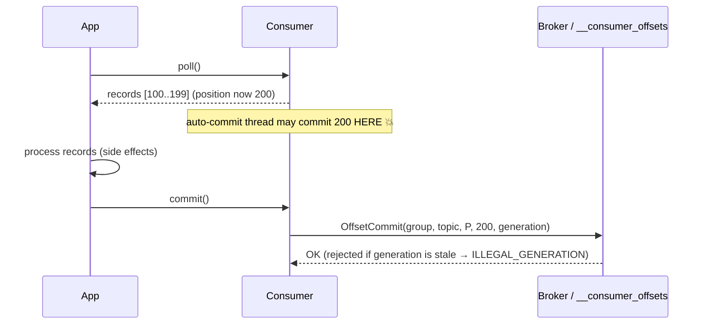

# Offsets

> An offset is a 64-bit integer. That is all it is. Yet offsets are where correctness lives in streaming: they are the cursor that says "we have fully processed up to here", they are the input to every lag metric, they are the transaction payload that makes exactly-once possible, and they are the thing you will reset at 2 a.m. after a bad deploy. A senior engineer treats offset commits as a *contract about side effects*, not as bookkeeping. This chapter covers what offsets are, where they live, every commit strategy and its failure modes, reset policies, lag semantics, and how transactions turn offsets into an atomic part of a larger pipeline.

## TL;DR

- An offset identifies a record's position in one partition, forever. It is stable because partitions are append-only.
- **Committed offsets** live in `__consumer_offsets`, a compacted internal topic; key = `(group.id, topic, partition)`. The broker owning `hash(group.id) % 50` is that group's coordinator.
- **Consumers never need to commit offsets to read** — committing is purely about *where to resume after failure*. `auto.offset.reset` applies only when no committed offset exists (or the committed offset is out of range).
- Default `enable.auto.commit=true` commits *offsets returned by `poll()`*, not offsets you've actually processed. It is an at-most-once footgun.
- **Commit after side effects are durable** (at-least-once) or inside a transaction (exactly-once). Never commit before.
- `auto.offset.reset=latest` silently skips history for new groups; `earliest` re-reads everything from `log start offset`. Set it explicitly on every consumer.
- **Lag = `log-end-offset - committed-offset`** per partition. Watch the *shape* (monotonic vs sawtooth vs single-partition) — it tells you whether the cause is downstream slowness, key skew, or a stuck consumer.
- **Group offset expiry**: `offsets.retention.minutes` (default 10080 = 7 days) deletes offsets for groups with **no active members**. After expiry, a restarted consumer hits `auto.offset.reset` — which is how "we lost our place over the weekend" happens.
- **Transactions** (`transactional.id` + `sendOffsetsToTransaction`) commit *output records and input offsets atomically*, which is what makes Kafka-to-Kafka exactly-once real. Kafka 4.0 defaults `transaction.version=2` and supports `isolation.level=read_committed` cheaply.
- Kafka's exactly-once boundary stops at Kafka. Any sink outside Kafka (S3, Postgres, an HTTP call) needs idempotency or its own transactional protocol.

## 1. Definitions and core vocabulary

| Term | Meaning | Where it lives / notes |
|---|---|---|
| **Offset** | Monotonic 64-bit index of a record within a partition | Broker-side; `ConsumerRecord.offset()` |
| **LEO (log end offset)** | Next offset to be appended | Per replica |
| **High watermark (HW)** | Max offset readable by consumers (`read_committed`) | `min(LEO)` over ISR |
| **LSO (last stable offset)** | Max offset for which no transaction is open (`read_committed`) | Consumers stop at the LSO, not the HW, when transactions are in flight |
| **Log start offset** | Oldest retained offset | Advances with retention/compaction/truncation |
| **Current offset / position** | The consumer's next offset to fetch | In-client state |
| **Committed offset** | The offset the group will resume from after restart | `__consumer_offsets` |
| **`__consumer_offsets`** | Internal compacted topic holding group offsets + metadata | 50 partitions (`offsets.topic.num.partitions`), RF 3 (`offsets.topic.replication.factor`) |
| **Group coordinator** | Broker that owns a group | `abs(hash(group.id)) % offsets.topic.num.partitions` |
| **Auto commit** | Client commits `poll()` results in the background | `enable.auto.commit=true`, `auto.commit.interval.ms=5000` |
| **Sync vs async commit** | `commitSync` blocks (retries, errors surfaced) vs `commitAsync` (fire-and-forget with callback) | Async is faster; sync is safer at shutdown/revoke |
| **`auto.offset.reset`** | Behavior when there is no valid committed offset | `earliest`, `latest`, `none`, `by_duration` (newer clients) |
| **Offset retention** | Expiry of committed offsets for inactive groups | `offsets.retention.minutes` (broker) |
| **`__transaction_state`** | Internal topic holding transaction metadata | `transaction.state.log.replication.factor=3` |
| **LSO / aborted txns** | `read_committed` consumers filter aborted batches | Uses `AbortedTransactions` in the fetch response |
| **`storeOffsetsToTransaction` / `sendOffsetsToTransaction`** | Add offset commits to a producer transaction | The key API for EOS pipelines |
| **Consumer lag** | `LEO - committed offset` (per partition) | The primary backlog SLO metric |
| **Offset reset** | Administrative move of a group's position | `kafka-consumer-groups --reset-offsets` |

## 2. What problem it solves / why it matters

Offsets give you five things no queue system offers cleanly:

1. **Resumable progress without locks or acks**: an integer per partition is enough to know where to continue.
2. **Multiple independent readers of the same data**: each group has its own cursor, so adding a consumer never affects another.
3. **Replay**: reset a cursor backwards to reprocess (rebuild a projection, fix a bug, backfill a new field).
4. **Backlog visibility**: lag is a first-class, per-partition metric → you can do capacity planning and SLO alerting.
5. **Atomicity with outputs** (with transactions): offsets become part of a transaction, closing the gap between "output written" and "input marked as done".

Failure modes are equally fundamental: committing too early loses data; committing too late duplicates it; losing committed offsets re-reads or skips history; and a stale offset can resurrect a deleted partition or a compacted key.

## 3. How it works internally

### 3.1 Where committed offsets live

```text
__consumer_offsets (50 partitions, cleanup.policy=compact, RF=3)
├── partition 7 ← owns groups whose abs(hash(group.id)) % 50 == 7
│    key   = [version(2B)] [group(UTF8)] [topic(UTF8)] [partition(4B)]
│    value = [version(2B)] [offset(8B)] [leaderEpoch(4B)] [metadata(UTF8)] [commitTimestamp(8B)]
│           (+ optional [expireTimestamp(8B)])
└── also stored here: group metadata messages (membership, generation, protocol)

Coordinator for a group = broker leading the __consumer_offsets partition for hash(group.id)
```

Consequences a senior must internalize:

- **A commit is a produce to an internal topic.** It costs a round trip, participates in ISR, and can be delayed by that topic's health. That is why `commit-latency-avg` and `__consumer_offsets` under-replication matter.
- **Offsets are compacted, not deleted on use.** They are cheap and permanent-ish, subject to `offsets.retention.minutes` for *inactive* groups.
- **The offsets topic has its own replication config**, independent of `default.replication.factor`: set `offsets.topic.replication.factor=3` and `transaction.state.log.replication.factor=3` explicitly.
- **Offset expiry rule (Kafka ≥ 2.1)**: for a group with **no active members**, committed offsets are removed after `offsets.retention.minutes` (default 10080). For an *empty but existing* group the same rule applies; only actively-heartbeating groups are safe. This is the classic "we came back Monday and re-read 3 days of data".

### 3.2 The commit timeline and the two classic bugs

```text
A) Commit-before-process (at-most-once, silent loss)
   poll() → returns records 100..199 → commit(200) → process(100..199) → 💥 crash
   restart: fetch from 200 → records 100..199 are GONE from this consumer's perspective

B) Process-then-commit (at-least-once, duplicates)
   poll() → returns 100..199 → process(100..199) → 💥 crash before commit
   restart: fetch from 100 → records reprocessed (consumer MUST be idempotent)

C) Auto-commit (accidental at-most-once)
   enable.auto.commit=true, auto.commit.interval.ms=5000
   The background thread commits the *last polled* offsets every 5 s,
   regardless of whether your handler finished. Worst of both worlds.
```



### 3.3 Every commit strategy, ranked

| Strategy | Data loss risk | Duplicate risk | Use when |
|---|---|---|---|
| `enable.auto.commit=true` | **High** (commits unprocessed) | Low | Never in production for data pipelines |
| `commitAsync()` periodically | Medium (errors ignored) | Medium | High-throughput, loss-tolerant, plus sync commit on close |
| `commitSync()` per batch | None (if after processing) | Low–Medium (on crash) | Default choice for correctness |
| `commitSync()` per record | None | Minimal (window = 1 record) | Low-volume, strict correctness; very slow |
| Per-partition watermark commits | None | Low | Concurrent processing across partitions |
| Commit on revoke/close only | Depends on the window | Higher | Combined with periodic commits; never alone |
| Offsets in an external store (DB/checkpoint) | Depends | Depends | Engines that own offsets (Spark/Flink), or atomic-with-sink patterns |
| `sendOffsetsToTransaction()` | None in Kafka | None in Kafka | Kafka-to-Kafka EOS |
| `commitTransaction()` in Kafka Streams | None in Kafka | None | Stream processing apps |

### 3.4 `auto.offset.reset` semantics precisely

| Value | Behavior | When it bites |
|---|---|---|
| `earliest` | Start at `log start offset` (oldest retained) | A brand-new consumer accidentally reprocesses years of data |
| `latest` | Start at the current LEO | A new consumer silently misses all existing data |
| `none` | Throw `NoOffsetForPartitionException` | Deliberate: fail fast instead of guessing |
| `by_duration:<ms>` | Start at first offset with timestamp ≥ now − duration | Time-based catch-up (librdkafka/Kafka 4.x) |

Two facts that trip people up:

- Reset applies **per partition**, only when no committed offset exists *or* the committed offset is out of range (`OffsetOutOfRangeException`) — e.g. after retention deleted the data.
- Setting it does **not** move an existing group's cursor. For that you must reset offsets administratively (stop the consumers first).
- Offsets can also be out of range *below* `log start offset` after **log truncation** or **compaction**; a compacted topic can lose intermediate offsets with no error.

### 3.5 Offset lookup by time

```python
from confluent_kafka import Consumer, TopicPartition
# Find the offset corresponding to a wall-clock timestamp — the basis of "replay from T"
c = Consumer({"bootstrap.servers": "localhost:9092", "group.id": "tmp-lookup"})
tps = [TopicPartition("orders.v1", p) for p in range(12)]
ts_ms = 1_767_225_600_000  # 2026-01-01T00:00:00Z
for tp in c.offsets_for_times([TopicPartition(tp.topic, tp.partition, ts_ms) for tp in tps]):
    print(tp)  # .offset is the first offset with timestamp >= ts_ms, or -1 if none
```

This is how you implement "rebuild the last 24 hours" without guessing offsets.

## 4. How to implement it

### 4.1 CLI: inspect, reset, and repair

```bash
# --- Where is the group now? -------------------------------------------------
kafka-consumer-groups.sh --bootstrap-server localhost:9092 --describe --group billing-v1
# GROUP      TOPIC      PART  CURRENT-OFFSET  LOG-END-OFFSET  LAG  CONSUMER-ID  HOST  CLIENT-ID
# billing-v1 orders.v1  0     42110           42120           10   consumer-1-...  /10.0.1.5

# Per-partition LEO (to compute lag yourself, or to spot one hot partition)
kafka-get-offsets.sh --bootstrap-server localhost:9092 --topic orders.v1

# Oldest available offset (log start offset) — the real floor for 'earliest'
kafka-get-offsets.sh --bootstrap-server localhost:9092 --topic orders.v1 --time -2
kafka-get-offsets.sh --bootstrap-server localhost:9092 --topic orders.v1 --time -1   # LEO

# --- Reset (STOP CONSUMERS FIRST; dry run, then --execute) -------------------
kafka-consumer-groups.sh --bootstrap-server localhost:9092 --group billing-v1 \
  --topic orders.v1 --reset-offsets --to-earliest            # dry run
kafka-consumer-groups.sh --bootstrap-server localhost:9092 --group billing-v1 \
  --topic orders.v1 --reset-offsets --to-earliest --execute  # apply

kafka-consumer-groups.sh --bootstrap-server localhost:9092 --group billing-v1 \
  --topic orders.v1 --reset-offsets --to-datetime 2026-01-01T00:00:00.000 --execute
kafka-consumer-groups.sh --bootstrap-server localhost:9092 --group billing-v1 \
  --topic orders.v1:3 --reset-offsets --to-offset 999 --execute   # one partition
kafka-consumer-groups.sh --bootstrap-server localhost:9092 --group billing-v1 \
  --topic orders.v1 --reset-offsets --shift-by -1000 --execute    # back 1000 records

# --- Inspect committed offsets directly (ground truth) ----------------------
kafka-console-consumer.sh --bootstrap-server localhost:9092 \
  --topic __consumer_offsets --from-beginning --max-messages 3 \
  --formatter "kafka.coordinator.group.GroupMetadataManager\$OffsetsMessageFormatter"
# [billing-v1,orders.v1,0]::[OffsetAndMetadata(offset=42110, leaderEpoch=..., metadata='')]

# --- Delete a group's offsets (only if no active members) -------------------
kafka-consumer-groups.sh --bootstrap-server localhost:9092 --delete --group stale-group
```

### 4.2 Python: sync, async, and per-partition watermark commits

```python
from confluent_kafka import Consumer, KafkaException
from collections import defaultdict
import logging

log = logging.getLogger("offsets")

PENDING: dict[tuple[str, int], int] = defaultdict(int)   # (topic, partition) -> next offset to commit

def make_consumer(group: str) -> Consumer:
    return Consumer({
        "bootstrap.servers": "kafka1:9092",
        "group.id": group,
        "enable.auto.commit": False,        # 1) never let the client guess
        "auto.offset.reset": "earliest",    # 2) be explicit
        "isolation.level": "read_committed",
        "max.poll.records": 500,
        "session.timeout.ms": 45000,
        "max.poll.interval.ms": 300000,
    })

def commit_async_with_logging(consumer: Consumer) -> None:
    """Async commit = throughput. Errors are surfaced in the callback, and the
    client keeps retrying on the next commit; use it mid-stream, never at shutdown."""
    def _cb(err, partitions):
        if err is not None:
            if err.retriable() and err.code() == KafkaException._RETRY:
                log.warning("retriable commit failure: %s", err)
            else:
                log.error("commit FAILED (won't retry): %s", err)
                # Non-retriable errors (fenced, illegal generation) mean this consumer
                # is no longer the owner — the process should exit and restart.
        else:
            log.debug("committed %s", [(p.topic, p.partition, p.offset) for p in partitions])

    consumer.commit(asynchronous=True, on_commit=_cb)

def commit_watermark(consumer: Consumer, pending: dict, done_watermarks: dict) -> None:
    """Commit only the contiguous completed offset per partition.
    Safe even if records complete out of order across/inside partitions."""
    to_commit = []
    for (topic, part), next_offset in done_watermarks.items():
        to_commit.append(TopicPartition(topic, part, next_offset))
    if to_commit:
        consumer.commit(offsets=to_commit, asynchronous=False)

def run(group: str) -> None:
    consumer = make_consumer(group)
    consumer.subscribe(["orders.v1"])
    done = {}
    try:
        while True:
            msgs = consumer.consume(num_messages=500, timeout=1.0)
            if not msgs:
                continue
            max_offset = {}
            for m in msgs:
                if m.error():
                    continue
                handle_idempotently(m)                            # side effect first
                max_offset[(m.topic(), m.partition())] = m.offset() + 1
            # Simple, correct baseline: commit after the whole batch is done.
            consumer.commit(asynchronous=False)
    finally:
        # 3) final sync commit guarantees no work is repeated after a clean shutdown
        consumer.commit(asynchronous=False)
        consumer.close()
```

### 4.3 Java: transactional consume-transform-produce (EOS within Kafka)

```java
Properties tp = new Properties();
tp.put(ProducerConfig.BOOTSTRAP_SERVERS_CONFIG, "kafka1:9092");
tp.put(ProducerConfig.TRANSACTIONAL_ID_CONFIG, "order-enricher-1");  // fenced on restart
tp.put(ProducerConfig.ENABLE_IDEMPOTENCE_CONFIG, "true");
tp.put(ProducerConfig.ACKS_CONFIG, "all");
tp.put(ProducerConfig.TRANSACTION_TIMEOUT_MS_CONFIG, "60000");

Properties cp = new Properties();
cp.put(ConsumerConfig.BOOTSTRAP_SERVERS_CONFIG, "kafka1:9092");
cp.put(ConsumerConfig.GROUP_ID_CONFIG, "order-enricher");
cp.put(ConsumerConfig.ENABLE_AUTO_COMMIT_CONFIG, "false");
cp.put(ConsumerConfig.ISOLATION_LEVEL_CONFIG, "read_committed");
cp.put(ConsumerConfig.AUTO_OFFSET_RESET_CONFIG, "earliest");

var producer = new KafkaProducer<String, String>(tp);
producer.initTransactions();
var consumer = new KafkaConsumer<String, String>(cp);
consumer.subscribe(List.of("orders.v1"));

while (true) {
    ConsumerRecords<String, String> records = consumer.poll(Duration.ofMillis(500));
    if (records.isEmpty()) continue;
    try {
        producer.beginTransaction();
        for (ConsumerRecord<String, String> r : records) {
            String enriched = enrich(r.value());
            producer.send(new ProducerRecord<>("orders.enriched.v1", r.key(), enriched));
        }
        // THE key call: input offsets become part of the same transaction.
        // On commit, downstream read_committed consumers see output + the new
        // group position together — or neither.
        producer.sendOffsetsToTransaction(
            offsetsOf(records),                       // Map<TopicPartition, OffsetAndMetadata>
            consumer.groupMetadata());
        producer.commitTransaction();
    } catch (ProducerFencedException | OutOfOrderSequenceException | AuthorizationException e) {
        // Unrecoverable: this producer instance has been superseded. Exit the process.
        throw new RuntimeException("producer fenced — aborting instance", e);
    } catch (KafkaException e) {
        producer.abortTransaction();                  // records 100..199 will be re-read
        consumer.seekToCommittedOffsets(records);     // reset local position to last commit
    }
}
```

Note `consumer.groupMetadata()` (KIP-447): it lets the producer include the consumer's generation so a rebalanced (zombie) consumer cannot commit a transaction for partitions it no longer owns. Without it (older patterns), you can get "zombie write" bugs during rebalances.

### 4.4 Offsets when an engine owns them (Spark / Flink / Connect)

| Engine | Offset storage | Consequence |
|---|---|---|
| **Spark Structured Streaming** | Checkpoint directory (`checkpointLocation/offsets/`) — a WAL for progress; offsets are *not* committed to `__consumer_offsets` unless you set `kafka.group.id` | `auto.offset.reset` in the source options only matters on a fresh start; the checkpoint is the source of truth. **EOS requires a transactional/idempotent sink** (`foreachBatch` + MERGE / Delta `txnVersion` / `checkpointLocation` in the Kafka sink) |
| **Flink** | Flink checkpoints (offsets inside the checkpoint state) | Set `setCommitOffsetsOnCheckpoints(true)` and `group.id` to *also* surface progress in Kafka; otherwise Kafka has no idea where Flink is |
| **Kafka Connect** | Connect `offsets` topic (source) and `__consumer_offsets` (sink consumer group) | Sink connector offsets are the group's; a connector restart resumes there. Source offsets are in Connect's own compacted topic |
| **Kafka Streams** | `__consumer_offsets` + transaction commits with `processing.guarantee=exactly_once_v2` | The strongest Kafka-native EOS; state store, changelog, and sink are atomic |

```python
# Spark Structured Streaming: offsets live in the checkpoint, NOT in __consumer_offsets.
df = (spark.readStream.format("kafka")
        .option("kafka.bootstrap.servers", "kafka1:9092")
        .option("subscribe", "orders.v1")
        .option("startingOffsets", "earliest")      # used only on first start
        .option("failOnDataLoss", "false")          # careful: silently skips gaps on retention/compaction
        .option("kafka.group.id", "orders-ss")      # OPTIONAL: mirror progress for monitoring
        .load())

# EOS pattern with a transactional sink (Delta example)
def upsert(batch_df, batch_id):
    (batch_df.write.format("delta").mode("append")
        .option("txnAppId", "orders-ss").option("txnVersion", batch_id)   # idempotent batch
        .saveAsTable("silver.orders"))

(df.writeStream.foreachBatch(upsert)
   .option("checkpointLocation", "s3://chk/orders-ss")
   .trigger(processingTime="1 minute").start())
```

## 5. Where to implement it

| Concern | Where it belongs | Notes |
|---|---|---|
| Committed offsets | `__consumer_offsets` (Kafka) | Set `offsets.topic.replication.factor=3`, monitor ISR |
| Offset durability SLO | Coordinator broker health + `commit-latency-avg` | Commit latency spikes = offset-topic write pressure |
| Lag monitoring | `kafka-consumer-groups`, JMX `records-lag-max`, Burrow, kafka_exporter → Prometheus, Confluent Control Center, MSK CloudWatch (`MaxOffsetLag`,`SumOffsetLag`) | Alert on shape; store per-partition time series |
| Reset tooling | `kafka-consumer-groups --reset-offsets`, `offsets_for_times` | Build internal runbooks + guardrails (dry run, approvals) |
| Transaction state | `__transaction_state` | RF 3, `transaction.state.log.min.isr` |
| Engine offsets | Spark checkpoints, Flink checkpoints, Connect offsets topic | Never manage both engine offsets and consumer-group offsets for the same pipeline without documenting which wins |
| External atomic sinks | Postgres (same tx as side effect), Iceberg/Delta (txn ids), Snowflake/BigQuery (merge + dedup key) | Offsets in a DB row next to the data = the most portable "exactly-once with a non-transactional sink" pattern |

## 6. Patterns and anti-patterns

| Pattern | Shape | Notes |
|---|---|---|
| **Commit after durable side effect** | `poll → process → commit` | Baseline at-least-once |
| **Per-partition watermark commit** | Commit min contiguous done offset per partition | Required with parallel processing |
| **Commit-on-revoke + on-close** | Flush and commit before losing ownership | Eliminates most reprocessing on deploys |
| **Offsets next to data** | Store `(partition, offset)` in the sink's row/table in the same transaction | Exactly-once with any transactional store |
| **Transactional EOS** | `beginTransaction → send → sendOffsetsToTransaction → commitTransaction` | Exactly-once inside Kafka |
| **Replay by time** | `offsetsForTimes` to find the start offset, then a dedicated group | Safe reprocessing without impacting live groups |
| **Separate replay group** | `billing-v1-replay` with its own SLO | Replays never move production lag |
| **Initial-offset decorator** (Flink) | Seek to a timestamp on start | Deterministic backfills |
| **Clock-based cutover** | Reset to a timestamp that predates the bad deploy | Standard incident-recovery pattern |

### Anti-patterns

| Anti-pattern | Failure | Fix |
|---|---|---|
| Auto-commit | Commits unprocessed records → loss | Manual commit |
| Commit before processing | Loss on crash | Commit after durable effects |
| `commitAsync` at shutdown | Silent loss of the final offsets | `commitSync` on close/revoke |
| Resetting offsets while consumers run | Unpredictable position; consumers re-commit over it | Stop consumers, reset, restart |
| Sharing one group between two services | Random work split, unmatchable lag | Separate groups |
| Relying on `latest` for new producers/consumers | Skipped history | Explicit `auto.offset.reset` + tests |
| Ignoring `offsets.retention.minutes` | Offsets expire for idle groups → full re-read | Alert on active membership during planned downtime; consider a periodic "touch" consumer |
| Assuming offsets are contiguous in compacted topics | Gaps look like data loss | Understand compaction semantics; don't assert offset arithmetic on compacted topics |
| Using offsets as a record count | Compaction/retention makes counts wrong | Count records, not offsets |
| `failOnDataLoss=false` everywhere in Spark | Silent gaps after retention | Use it only with monitoring for `OffsetOutOfRangeException` |
| Long-running replay with the production group | Lag SLO blown, alerts noisy | Dedicated group + throttling |
| Deleting a group to "reset" it | Loses membership/offsets for everyone | Reset instead |

## 7. Real-world use cases and industry applications

- **Incident recovery**: "the enrichment had a bug for 6 hours" → reset the group to a timestamp before the deploy, replay into a staging sink, diff, then replay into production with throttling.
- **Backfills**: a new column requires replaying 30 days; a dedicated group reads from the topic (or from tiered storage/lake) while production continues.
- **New consumer onboarding**: a new projection group starts at `earliest` (or at a snapshot offset) and catches up at full speed.
- **Billing/metering**: offsets next to the ledger entry (same transaction) so a restart can't double-charge or lose usage.
- **Fraud/AML**: transactional EOS between raw and enriched topics; auditors get a consistent history where no output exists without its input offset.
- **Metrics pipelines**: lag as an SLO; autoscaling on lag; capacity planning by observing LEO growth rate.
- **Multi-region replication**: MirrorMaker 2/Cluster Linking translate offsets; checkpoint records map source→target offsets so consumers can migrate with a known position.
- **Event-sourced stores in Kafka** (compacted): offsets are effectively "stream versions"; per-aggregate offsets behave like a version vector.

## 8. Senior-level deep dive

### 8.1 Lag: definitions that differ, and why your dashboard lies

| Definition | Formula | Notes |
|---|---|---|
| **Partition lag** | `LEO − committed offset` (or `LEO − current position`) | Committed-offset lag is what `kafka-consumer-groups` shows; it lags reality if you commit infrequently |
| **Consumer position lag** | `LEO − consumer's in-memory position` | More accurate while processing; only visible via client metrics (`records-lag-max`) |
| **Time lag** | `now − timestamp of the record at LEO−lag` | The metric your users care about; can be very different from record lag |
| **In-flight lag** | Records fetched but not yet processed | Bounded by `max.poll.records` × partitions; invisible in most dashboards |
| **Group lag** | Sum over partitions | Hides single-partition catastrophes — always look per-partition |

**Record-based lag is a poor SLO.** 10k records of lag can be 2 seconds or 2 hours depending on throughput. Add a time-lag panel (compare the record timestamp at the head of the log with now) and alarm on both.

### 8.2 The `read_committed` interaction (LSO)

With transactions:

```text
LEO ──────────────────────────────────────────▶
          HW ─────────────▶           (replicated to all ISR)
             LSO ──────────────▶      (no open transaction before this point)
                 ▲
  read_committed consumers may only fetch up to the LSO.
  => an open transaction on a partition STALLS read_committed consumers
     on that partition for transaction.timeout.ms (default 60s).
```

Operational consequences:

- Long transactions increase consumer latency floor. Keep transactions short (batch size, not wall time).
- A crashed transactional producer blocks `read_committed` consumers on those partitions until the transaction times out or a new instance with the same `transactional.id` aborts it (that is why reusing `transactional.id` on restart matters).
- `read_uncommitted` consumers see aborted records — mixing isolation levels on the same topic is a correctness bug waiting to happen.
- `transaction.max.timeout.ms` (broker, default 900000) caps what producers may request; `transaction.timeout.ms` (producer) must be ≤ that.

### 8.3 Commit frequency economics

```text
Cost per commit ≈ one produce round trip to __consumer_offsets (compacted, replicated)
Throughput impact:
  commit per record  : ~1 commit per record  → dominant cost at high volume
  commit per batch   : ~1 commit per max.poll.records → negligible
  commit every N ms  : bounded by timer → predictable, but widen the duplicate window

Duplicate window ≈ the amount of processed-but-uncommitted work.
Choose it against your idempotency cost, not against the "safety feeling".
```

Rule: **commit as often as your idempotency can tolerate, not as often as you can afford.** If your sink is a MERGE keyed by event id, a 30-second commit window is free. If your sink is an email sender, the window is a customer-visible duplicate.

### 8.4 Failure modes and debugging

| Symptom | Cause | Diagnosis | Fix |
|---|---|---|---|
| Lag grows forever, `COMMIT` fails | `ILLEGAL_GENERATION` (rebalance) or fenced | Consumer logs show rejoin loops | Fix rebalance root cause; handle non-retriable commit errors by exiting |
| Lag resets to LEO unexpectedly | Offsets expired for an idle group (`offsets.retention.minutes`) then `auto.offset.reset=latest` | Check `__consumer_offsets` for the group's keys; check group state | Explicit `auto.offset.reset`; keep membership alive or reset deliberately |
| Data "disappeared" | Committed offset > log start offset after retention | `kafka-get-offsets --time -2` vs committed | Accept the loss, or increase retention/tiered storage |
| Duplicates on every deploy | Offsets uncommitted when partitions are revoked | Look at commit-on-revoke logging | Commit on revoke (sync) + idempotent sink |
| Consumers stall on one partition only | Hot key or a poison record retried forever | Per-partition lag; consumer logs | Retry/DLQ topology; partitioner review |
| Commit latency p99 spikes | `__consumer_offsets` leader busy / under-replicated | JMX commit-latency, topic ISR | Increase offsets partitions only with a migration; fix broker health |
| `OffsetOutOfRangeException` | Retention/compaction removed the committed offset's data | `log start offset` vs committed | `auto.offset.reset` policy + alerting on this exception |
| Kafka Streams restore takes forever | Long changelog restore after downtime | Streams restore metrics | Add standby replicas; reduce state size; increase `max.poll.interval.ms` |
| Transactions never commit | Producer fenced by a newer instance with the same `transactional.id` | Producer logs `ProducerFencedException` | Ensure unique `transactional.id` per task, unique per running instance |
| Spark job reprocesses everything | Checkpoint deleted/moved | Check `checkpointLocation` existence and version | Never share a checkpoint between queries; keep it durable |

### 8.5 The "exactly-once" checklist for a pipeline

```text
1. Producer: acks=all, enable.idempotence=true, transactional.id set (if EOS).
2. Consumer: isolation.level=read_committed, enable.auto.commit=false.
3. Offsets: committed in the SAME transaction as outputs (sendOffsetsToTransaction)
   or stored in the SAME DB transaction as the side effect.
4. Sink: idempotent (MERGE on a business key, txn-versioned file write) or absent.
5. Restart: same transactional.id → the old instance is fenced, in-flight tx aborted.
6. Rebalances: commit-on-revoke; group generation included (KIP-447).
7. Observability: track aborted transactions, transaction timeouts, fenced producers.
8. Honesty: document which parts of the pipeline are EOS and which are
   at-least-once + idempotent. Most systems are the latter.
```

### 8.6 Architecture decision matrix

| Requirement | Choose | Because |
|---|---|---|
| Simple, lossless, tolerant of duplicates | Manual commit after effects + idempotent sink | Cheapest correct option |
| Duplicates unacceptable, Kafka→Kafka only | Transactions + `read_committed` | Native atomicity |
| Duplicates unacceptable, sink is a warehouse | Offsets stored with the data + MERGE/dedup key | Crosses the non-transactional boundary |
| Very high throughput, bounded loss acceptable | Async commit + periodic sync + monitoring | Commit cost amortized |
| Replay-heavy operations | Dedicated groups + `offsetsForTimes` + tiered storage | Isolation + long history |
| Multi-team shared cluster | Per-team ACLs on groups; `group.id` naming standard | Blast radius control |

## 9. Common mistakes and how to avoid them

1. **Leaving `enable.auto.commit=true` in a data pipeline.** It commits `poll()` results, not processed records.
2. **Not setting `auto.offset.reset`.** `latest` for an existing-but-expired group silently skips data.
3. **Resetting offsets with live consumers.** Always stop them; the reset is a coordinator-side write.
4. **Committing async in `on_revoke`/close.** The commit may never land.
5. **Treating offsets as counts or as contiguous.** Compaction and retention break both assumptions.
6. **Forgetting offset expiry.** Set an operational check for long-idle groups with important progress, or keep them alive.
7. **Ignoring `__consumer_offsets` health.** Under-replicated offsets topics cause commit failures at the worst time.
8. **Mixing `read_uncommitted` consumers with transactional producers.** You'll process aborted records.
9. **Long transactions.** You stall `read_committed` consumers on those partitions.
10. **Reusing `transactional.id` across concurrent instances.** Constant fencing; use one per task/partition or per instance.
11. **Managing offsets in two places without deciding the owner** (Spark checkpoint + consumer group). Document which is authoritative.
12. **No time-based lag metric.** Record lag hides user-visible latency.
13. **No commit-latency metric.** You discover offset-topic pressure only during an incident.
14. **Committing "the last record polled" with concurrent processing.** Commit only contiguous completed ranges.

## 10. Exercises / interview questions

*(Hints only.)*

1. Your consumer commits every 30 s and the sink is an HTTP POST. What is your duplicate exposure, and what are the two ways to shrink it? *(Hint: window size vs. idempotency key at the receiver.)*
2. A group was idle for 10 days; on restart it processed only new records. Explain the two configs responsible and how to make the failure loud instead of silent. *(Hint: offset expiry + reset policy; `none`.)*
3. Design the state machine for committing offsets when 16 worker threads process records from 4 partitions. Where is the commit point and how do you keep it monotonic per partition? *(Hint: watermarks, in-flight sets.)*
4. Why does an open transaction on partition P delay `read_committed` consumers, and what bounds the delay? *(Hint: LSO, `transaction.timeout.ms`.)*
5. You must reprocess 24 hours without affecting the production group's SLO. Write the exact command sequence and the guardrails. *(Hint: `--to-datetime`, new group, throttling, dry run.)*
6. When would storing offsets in your own database be better than committing to Kafka? *(Hint: atomic-with-side-effect, non-Kafka sinks, engines with checkpoints.)*
7. Compute the maximum duplicate window in records for: 8 partitions, `max.poll.records=1000`, commit per batch, crash instantly after a poll. *(Hint: `partitions × records per poll` worst case.)*
8. Explain what `sendOffsetsToTransaction` does that `commitSync` cannot. *(Hint: atomicity with output records, KIP-447 generation checks.)*
9. Your lag dashboard shows 0 for a group, but the warehouse is 4 hours behind. List five explanations. *(Hint: commit vs. sink lag, time lag, sink batching, specific partition, filtering.)*
10. A Kafka Streams app with `exactly_once_v2` writes duplicates to a JDBC sink. Why? *(Hint: EOS ends at Kafka; the JDBC write is not transactional.)*

## References

- Apache Kafka — consumer configs (`enable.auto.commit`, `auto.offset.reset`, `isolation.level`, `max.poll.records`): <https://kafka.apache.org/documentation/#consumerconfigs>
- Apache Kafka — broker configs (`offsets.retention.minutes`, `offsets.topic.*`, `transaction.*`): <https://kafka.apache.org/documentation/#brokerconfigs>
- Apache Kafka — delivery semantics and message delivery guarantees: <https://kafka.apache.org/documentation/#semantics>
- Confluent — delivery semantics (at-most-once / at-least-once / exactly-once): <https://docs.confluent.io/kafka/design/delivery-semantics.html>
- Confluent — transactions and `__transaction_state` internals: <https://docs.confluent.io/platform/current/kafka/transactions.html>
- Confluent — Exactly-once semantics in Kafka (transactions blog): <https://www.confluent.io/blog/transactions-apache-kafka/>
- Confluent — Exactly-once semantics are possible (how Kafka does it): <https://www.confluent.io/blog/exactly-once-semantics-are-possible-heres-how-apache-kafka-does-it/>
- Confluent — consumer client docs (commit strategies): <https://docs.confluent.io/platform/current/clients/consumer.html>
- Confluent — consumer group command reference (`--reset-offsets`): <https://docs.confluent.io/kafka/operations-tools/consumer-command-reference.html>
- Confluent — Kafka monitoring metrics (commit latency, lag): <https://docs.confluent.io/platform/current/kafka/monitoring.html>
- KIP-98: Exactly Once Delivery and Transactional Messaging: <https://cwiki.apache.org/confluence/display/KAFKA/KIP-98+-+Exactly+Once+Delivery+and+Transactional+Messaging>
- KIP-447: Producer scalability for exactly once semantics: <https://cwiki.apache.org/confluence/display/KAFKA/KIP-447%3A+Producer+scalability+for+exactly+once+semantics>
- Kafka Streams developer guide (`processing.guarantee`, EOS v2): <https://docs.confluent.io/platform/current/streams/developer-guide/config-streams.html>
- Spark Structured Streaming programming guide (checkpointing, watermarks, output modes): <https://spark.apache.org/docs/latest/structured-streaming-programming-guide.html>
- Spark Structured Streaming + Kafka integration (offsets, `startingOffsets`, `failOnDataLoss`): <https://spark.apache.org/docs/latest/structured-streaming-kafka-integration.html>
- Delta Lake — streaming and idempotent writes (`txnVersion`/`txnAppId`): <https://docs.delta.io/latest/delta-streaming.html>
- Apache Iceberg — Spark Structured Streaming writes: <https://iceberg.apache.org/docs/latest/spark-structured-streaming/>
- Flink — Kafka connector (offset committing on checkpoints): <https://nightlies.apache.org/flink/flink-docs-stable/docs/connectors/datastream/kafka/>
- Flink — checkpointing overview: <https://nightlies.apache.org/flink/flink-docs-stable/docs/ops/state/checkpoints/>
- Kafka Connect — offset management (source `offsets` topic, sink consumer offsets): <https://docs.confluent.io/platform/current/connect/devguide.html>
- LinkedIn Burrow — consumer lag checking: <https://github.com/linkedin/Burrow>
- kafka_exporter — Prometheus metrics incl. per-group/per-partition lag: <https://github.com/danielqsj/kafka_exporter>
- librdkafka — configuration reference for the Python/C/Go clients: <https://github.com/confluentinc/librdkafka>
