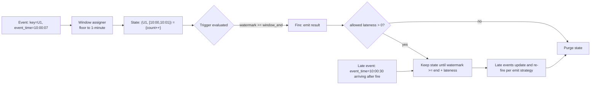

# Windowing

> Windowing is how a stream — an unbounded, ever-growing sequence — is turned into finite, computable answers: "orders per minute", "sessions per user", "5-minute moving average". It looks like a GROUP BY with a time column. It is not: windowing forces you to answer three questions that batch processing never asks — *what time do I trust?* (event vs processing), *how long do I wait for stragglers?* (watermarks + allowed lateness), and *when do I emit results, and can I retract them?* Almost every streaming bug you will debug in production is a wrong answer to one of those three.

## TL;DR

- **Four window shapes**: tumbling (fixed, non-overlapping), hopping/sliding (fixed size, fixed slide, overlapping), session (dynamic, gap-based per key), global (one unbounded window, custom triggers required).
- Window assignment is normally based on **epoch-aligned arithmetic**: `start = floor(ts / size) * size`, aligned to UTC epoch. Timezone/calendar windows (monthly, business days) are *not* native — you implement them with custom keys.
- **Semantics change with the time attribute**:
  - *Event time* — deterministic and reproducible, needs watermarks and tolerates lateness. **Use this for anything you'll re-run or audit.**
  - *Processing time* — simple, low latency, but results depend on when the job happened to run. Use for monitoring/alerting only.
  - *Ingestion time* — an event-time approximation stamped by the broker/engine. Rarely worth the confusion.
- A window is a **state machine keyed by (key, window)**: create on first event, update on subsequent events, emit at the trigger, and keep/delete according to allowed lateness.
- **State size = distinct keys × live windows.** Windowed state is the #1 cause of streaming OOM: high-cardinality keys + long windows/slides + late-data retention = unbounded growth.
- **Sliding windows are expensive**: an event belongs to `size / slide` windows, so per-event aggregation cost and state grow multiplicatively.
- **Session windows are per-key and unbounded by nature** — cap the gap and the allowed lateness, and beware of a key that never closes.
- Engines differ in *defaults and expressiveness*, but the model is the same: Kafka Streams (`TimeWindows`/`SlidingWindows`/`SessionWindows` + `grace`), Flink (window assigners + triggers + `allowedLateness` + window TVFs in SQL), Spark Structured Streaming (`window()`/`session_window()` + `withWatermark` + output mode restrictions).
- Windowing is inseparable from [07-watermarks.md](./07-watermarks.md): a window without a watermark never closes, and a watermark without allowed lateness silently drops late data.

## 1. Definitions and core vocabulary

| Term | Definition | Why it matters |
|---|---|---|
| **Window** | A bounded time interval associated with an aggregation | The unit of state and of output |
| **Window assigner** | Function mapping an event timestamp to 0..N windows | Determines overlap and cost |
| **Tumbling window** | Fixed size, non-overlapping; each event in exactly 1 window | Cheapest; analytics-friendly |
| **Hopping / sliding window** | Fixed size with a slide < size; an event may be in `size/slide` windows | Overlapping results; higher cost |
| **Session window** | Dynamic window, extended by activity, closed after `gap` of inactivity, per key | Naturally models user sessions |
| **Global window** | One window for the infinite key space; requires a custom trigger | Power tool: custom logic; state risk |
| **Event time** | When the event actually occurred (producer-supplied) | Reproducible, correct for analytics |
| **Processing time** | When the record is processed by the operator | Low latency, non-deterministic |
| **Ingestion time** | When the record entered the streaming system (broker/topic timestamp) | Middle ground; rarely used |
| **Watermark** | "No more events with timestamp ≤ T are expected" | Decides when windows can fire/finalize |
| **Trigger** | Condition that causes a window to emit | Controls latency vs completeness |
| **Allowed lateness / grace** | Extra time after the watermark during which late events still update results | Controls correctness vs state size |
| **Late event** | Event arriving after (watermark + allowed lateness) has passed | Dropped or side-output |
| **Eviction / cleanup** | Removing window state after it is no longer updatable | Prevents OOM |
| **Emit strategy** | When results are emitted: on update vs on window close (final) | Determines downstream fan-out and idempotency needs |
| **Window operator state** | Per (key, window) accumulator | The dominant memory consumer |
| **Output mode (Spark)** | `append`, `update`, `complete` | Determines what (and whether) results can be emitted |
| **Retraction / accumulate mode (Flink SQL)** | Emitting `-U/+U` change rows vs a single final row | Consumer must handle retractions |
| **Window TVF (Flink SQL)** | `TUMBLE`, `HOP`, `CUMULATE`, `SESSION` table functions | The modern SQL API for windowing |
| **Trigger interval / grace period** | Engine-specific knobs for firing | Tuning latency |

### 1.1 The four shapes

```text
Tumbling (size=1m, no overlap)
  events:   |•  •  •|•   •   |  • •  |•       |
  windows:  [  W1  ][  W2  ][  W3  ][  W4   ]
            ── each event belongs to exactly one window ──

Hopping / sliding (size=1m, slide=30s —— overlap = 2 windows per event)
  windows:  [────W1────]
                [────W2────]
                    [────W3────]
            ── an event lands in size/slide windows (here: 2) ──

Session (gap=30s, per key)
  key A:    •• •••        ••              •• ••
            [──S1──]      [──S2──]        [──S3──]
            ── window boundaries depend on the data, not on a clock ──

Global (one window, custom trigger)
  [──────────────── the whole stream ────────────────]
            ── fires when YOUR trigger says so (e.g. every 1000 events) ──
```

### 1.2 Epoch alignment (why your "daily" window starts at 01:00 local time)

```text
Tumbling 1h windows are aligned to the epoch: 00:00, 01:00, 02:00 ... UTC.
  start(ts) = ts_ms - (ts_ms % window_size_ms)

Consequences:
 - With UTC+1 (and DST), a "daily" epoch-aligned window does NOT match local midnight.
 - To align to local time, shift the timestamp: ts - tz_offset, or key by a date field
   computed in the desired timezone (e.g. a `local_date` column produced upstream).
 - Monthly / business-calendar windows are NOT expressible as fixed durations:
   use a derived key (`year_month`, `fiscal_week`) as the grouping key with a
   global-like or 1-month hop window, or pre-bucket the events upstream.
```

## 2. What problem it solves / why it matters

Streams have no end, so any aggregate ("count", "average", "max") over "all data" is unbounded and meaningless as a real-time metric. Windowing makes aggregation decidable:

| Requirement | Window answer |
|---|---|
| "Orders per minute, ready within ~30 s of the minute closing" | Tumbling 1-minute event-time windows + watermark 30 s + emit on close |
| "Moving 5-minute average, refreshed every 30 s" | Hopping (size 5m, slide 30s) |
| "Sessionize user activity, close after 15 min idle" | Session windows, gap 15m, allowed lateness 5m |
| "Top-N products per hour" | Tumbling + windowed aggregation + top-N per window |
| "Detect bursts with no fixed cadence" | Global window with a custom trigger, or CEP |
| "Deduplicate within 10 minutes" | Tumbling 10m window + first-per-key per window (or `dropDuplicatesWithinWatermark`) |
| "Compute a stream-stream join" | Windowed join over a bounded interval (see §8.5) |

Windowing also gives you a **natural SLO**: window size + watermark delay = the latency target. If a business asks "how fresh is the number?", the answer is derived from the windowing config — which is why windowing belongs in the design doc, not in a random PR.

## 3. How it works internally

### 3.1 The lifecycle of a window



### 3.2 Cost model: the arithmetic that predicts OOM

```text
Live window state ≈ keys_in_flight × windows_per_key × accumulator_size

Tumbling 1m, 10k active keys, 2 min retention
  = 10_000 × 2 × ~100 B ≈ 2 MB              (trivial)

Hopping size=1h, slide=1m, 10k keys
  windows_per_key = 60 → 10_000 × 60 × ~100 B ≈ 60 MB     (fine)

Hopping size=24h, slide=1m, 1M keys
  windows_per_key = 1440 → 1_000_000 × 1440 × 100 B ≈ 144 GB  (NOT fine)

Session gap=30m, 1M keys, allowed lateness=1h → each key holds an open
  session for ~90 min; the count of simultaneously open sessions depends on
  activity distribution, and heavy-tail keys dominate.
```

RocksDB-backed state (Kafka Streams, Flink with RocksDB) moves this to disk instead of heap, but it does not remove the cost: it converts OOM into disk throughput and restore time.

### 3.3 Event time vs processing time, mechanically

```text
Real-world arrival pattern (arrival time on the x axis, event time labels on events):

  processing time ─────────────────────────────────────────▶
  arrivals:  [t=1] [t=1] [t=2] [t=3] [t=2] [t=4] [t=3] [t=5]
    event ts:  10:00 10:01 10:00 10:02 10:00 10:03 10:02 10:04
                              ▲ late     ▲ very late

Event-time 5-min tumbling windowing:
  - window [10:00,10:05) closes when watermark passes 10:05 (e.g. EventTime - 30s rule)
  - events with ts in [10:00,10:05) that arrive after the close are "late"
Processing-time windowing:
  - groups whatever ARRIVED within a wall-clock interval
  - identical input replayed → different results
```

Determinism is the discriminating property: **event-time results are reproducible** (reprocessing from the same offsets gives the same answers), which is why event time is the only defensible choice for anything that feeds a report, a bill, or an audit.

### 3.4 How each engine models windows

| Aspect | Kafka Streams | Flink (DataStream) | Flink (SQL) | Spark Structured Streaming |
|---|---|---|---|---|
| Time attribute | `TimestampExtractor` (default = record timestamp) | `WatermarkStrategy` + timestamps | `WATERMARK FOR col AS ...` | Event-time column from the data (`timestamp` type) |
| Tumbling | `TimeWindows.ofSizeWithNoGrace(Duration)` | `TumblingEventTimeWindows.of(...)` | `TUMBLE(TABLE t, DESCRIPTOR(ts), INTERVAL '1' MINUTE)` | `F.window(col, "1 minute")` |
| Hopping/sliding | `TimeWindows.ofSizeAndGrace(size, grace).advanceBy(slide)`; `SlidingWindows.ofTimeDifferenceWithNoGrace(d)` (count-based over time diff) | `SlidingEventTimeWindows.of(size, slide)` | `HOP(TABLE t, DESCRIPTOR(ts), INTERVAL '1' MINUTE, INTERVAL '1' HOUR)` | `F.window(col, "30 seconds", "5 minutes")` (slide, size) |
| Session | `SessionWindows.ofInactivityGapAndGrace(gap, grace)` | `EventTimeSessionWindows.withGap(...)` | `SESSION(TABLE t, DESCRIPTOR(ts), INTERVAL '15' MINUTE)` | `F.session_window(col, "15 minutes")` |
| Global | — (use "unbounded" suppression) | `GlobalWindows.create()` + custom trigger | — | — |
| Late data | `grace` period; late records dropped (or handled by a custom processor) | `allowedLateness(...)` + `sideOutputLateData(...)` | `table.exec.emit.late-fire` / window state TTL | Late records update aggregates if within watermark; dropped otherwise (`append` mode) |
| Emit control | `suppress(untilWindowCloses(...))`, caching/commit interval | Triggers (`EventTimeTrigger`, `ContinuousEventTimeTrigger`, `CountTrigger`, `PurgingTrigger`) + `allowedLateness` | `table.exec.emit.early-fire.*`, `late-fire`, `allow-late-fire-after-gc` | Output mode (`append` = final only; `update` = incremental updates) |
| State backend | RocksDB (default) or in-memory; changelog-backed | RocksDB/ForSt heap, checkpointed | RocksDB via `state.backend` | Spark state store (HDFS/DB-backed; `spark.sql.streaming.stateStore.providerClass`) |
| Cumulative windows | Emulate with `suppress` + custom | Emulate | `CUMULATE(TABLE t, ..., INTERVAL '1' MINUTE, INTERVAL '1' HOUR)` (cumulative within a window) | Emulate (re-aggregate progressively) |

> **Senior note on Flink SQL modes.** Flink SQL windowing has three emit behaviors: `emit.early-fire` (periodic partial results, i.e. updates), `emit.late-fire` (updates when late data arrives), and the default "emit only when the window is complete" (append-only). Downstream consumers must know which one they get: a Kafka sink with `upsert-kafka` and a primary key handles retractions/updates; a plain append sink requires the append-only mode.

## 4. How to implement it

### 4.1 Kafka Streams: tumbling, hopping, and session windows

```java
StreamsBuilder b = new StreamsBuilder();
KStream<String, Order> orders = b.stream("orders.v1",
    Consumed.with(Serdes.String(), orderSerde));

// --- Tumbling: orders per customer per 5 minutes, emitted when the window closes
KTable<Windowed<String>, Long> perCustomer5m = orders
    .groupByKey()
    .windowedBy(TimeWindows.ofSizeAndGrace(Duration.ofMinutes(5), Duration.ofMinutes(1)))
    .count(Materialized.as("orders-per-customer-5m"));

perCustomer5m.toStream()
    .map((wk, count) -> KeyValue.pair(
        wk.key() + "@" + Instant.ofEpochMilli(wk.window().start()), count))
    .to("metrics.orders.5m", Produced.with(Serdes.String(), Serdes.Long()));

// --- Hopping: 1-hour revenue, recomputed every 5 minutes (overlap = 12 windows/event)
KTable<Windowed<String>, Double> revenue1h = orders
    .groupByKey()
    .windowedBy(TimeWindows.ofSizeAndGrace(Duration.ofHours(1), Duration.ofMinutes(5))
                            .advanceBy(Duration.ofMinutes(5)))
    .aggregate(() -> 0.0,
               (k, order, agg) -> agg + order.amount(),
               Materialized.<String, Double, WindowStore<Bytes, byte[]>>as("revenue-1h")
                   .withValueSerde(Serdes.Double()));

// --- Session: customer browsing sessions, closed after 15 min of inactivity
KTable<Windowed<String>, SessionStats> sessions = orders
    .groupByKey()
    .windowedBy(SessionWindows.ofInactivityGapAndGrace(
        Duration.ofMinutes(15), Duration.ofMinutes(5)))
    .aggregate(SessionStats::empty,
               (k, order, agg) -> agg.add(order),
               (k, left, right) -> left.merge(right),
               Materialized.as("sessions"));

// --- Final-only output: suppress intermediate updates, emit when the window closes
perCustomer5m.toStream()
    .suppress(Suppressed.untilWindowCloses(BufferConfig.unbounded()))
    .to("metrics.orders.5m.final");
```

Key rules:

- **Windowed keys** carry `(key, window)`; when you write to a topic, flatten `wk.key() + window start` (or use a structured key) — downstream needs the window boundary.
- **`grace` is the Kafka Streams name for allowed lateness.** With `ofSizeAndGrace`, late records within grace still update the window; beyond it they are dropped.
- **`suppress(untilWindowCloses)`** converts an update stream into a finalized stream — at the cost of holding state until close.
- **Windowed stores are the state**: set `materialized.withRetention(...)`/`Materialized.as(...)` appropriately, and monitor RocksDB size and restore time.

### 4.2 ksqlDB (SQL over the same model)

```sql
-- Tumbling windowed aggregation, emitted as updates
CREATE TABLE orders_per_minute AS
  SELECT order_id,
         COUNT(*) AS order_count,
         SUM(amount) AS revenue
  FROM orders_stream
  WINDOW TUMBLING (SIZE 1 MINUTE)
  GROUP BY order_id
  EMIT CHANGES;

-- Hopping window with retentions
CREATE TABLE revenue_1h AS
  SELECT region,
         SUM(amount) AS revenue
  FROM orders_stream
  WINDOW HOPPING (SIZE 1 HOUR, ADVANCE BY 5 MINUTES, RETENTION 2 HOURS)
  GROUP BY region
  EMIT CHANGES;

-- Session window
CREATE TABLE browsing_sessions AS
  SELECT user_id,
         COUNT(*) AS pageviews,
         AS_VALUE(user_id) AS user
  FROM clicks_stream
  WINDOW SESSION (15 MINUTES)
  GROUP BY user_id
  EMIT CHANGES;
```

### 4.3 PyFlink DataStream: windows, triggers, allowed lateness, late side output

```python
from pyflink.common import Duration, WatermarkStrategy, Types
from pyflink.common.time import Time
from pyflink.datastream import StreamExecutionEnvironment
from pyflink.datastream.functions import ProcessWindowFunction
from pyflink.datastream.window import (
    TumblingEventTimeWindows, SlidingEventTimeWindows,
    EventTimeSessionWindows, GlobalWindows,
    CountTrigger, PurgingTrigger, ContinuousEventTimeTrigger,
)

env = StreamExecutionEnvironment.get_execution_environment()
env.set_parallelism(4)

# Event time via the record's own timestamp field (or a Kafka timestamp strategy)
wm = (WatermarkStrategy.for_bounded_out_of_orderness(Duration.of_seconds(30))
      .with_timestamp_assigner(OrderTimestampAssigner())
      .with_idleness(Duration.of_minutes(2)))          # idle sources must not stall watermarks

stream = (env.from_source(kafka_source, wm, "orders")
             .map(parse_order, output_type=Types.PICKLED_BYTE_ARRAY()))

# Tumbling 5-minute windows with 1 minute of allowed lateness and a late-data side output
(stream.key_by(lambda o: o["customer_id"])
       .window(TumblingEventTimeWindows.of(Time.minutes(5)))
       .allowed_lateness(Time.minutes(1))
       .side_output_late_data(late_tag)
       .aggregate(CustomerRevenueAgg(), CustomerRevenueWindowFn()))

# Sliding 1-hour window advanced every 5 minutes
(stream.key_by(lambda o: o["region"])
       .window(SlidingEventTimeWindows.of(Time.hours(1), Time.minutes(5)))
       .aggregate(RegionRevenueAgg()))

# Session windows
(stream.key_by(lambda o: o["user_id"])
       .window(EventTimeSessionWindows.with_gap(Time.minutes(15)))
       .process(SessionFn()))

# Global window with a custom trigger (e.g. emit every 1000 events, or every 30s of event time)
(stream.key_by(lambda o: o["tenant_id"])
       .window(GlobalWindows.create())
       .trigger(PurgingTrigger.of(CountTrigger.of(1000)))
       .process(TenantBatchFn()))
```

For the late side output:

```python
late_tag = OutputTag("late-orders", Types.PICKLED_BYTE_ARRAY())
result = ...  # the windowed stream above
late_stream = result.get_side_output(late_tag)
late_stream.sink_to(kafka_late_sink)    # audit/alert instead of silent loss
```

> **Senior note.** Always wire `side_output_late_data`. "Late data disappeared" is the most common windowing incident, and the only way to prove the volume and the cause is a side output with its own metric. Pair it with a dashboard showing late-event rate per key and per hour.

### 4.4 Flink SQL window TVFs (the modern SQL way)

```sql
-- Tumbling
SELECT window_start, window_end, customer_id, COUNT(*) AS orders, SUM(amount) AS revenue
FROM TABLE(TUMBLE(TABLE orders, DESCRIPTOR(event_time), INTERVAL '1' MINUTE))
GROUP BY window_start, window_end, customer_id;

-- Hopping (emit a result every 5 minutes for the trailing hour)
SELECT window_start, window_end, region, SUM(amount) AS revenue
FROM TABLE(HOP(TABLE orders, DESCRIPTOR(event_time),
               INTERVAL '5' MINUTE, INTERVAL '1' HOUR))
GROUP BY window_start, window_end, region;

-- Cumulative: a running total that resets every day (here: refresh every 10 minutes)
SELECT window_start, window_end, SUM(amount) AS revenue_so_far
FROM TABLE(CUMULATE(TABLE orders, DESCRIPTOR(event_time),
                    INTERVAL '10' MINUTE, INTERVAL '1' DAY))
GROUP BY window_start, window_end;

-- Session
SELECT window_start, window_end, user_id, COUNT(*) AS events
FROM TABLE(SESSION(TABLE clicks, DESCRIPTOR(event_time), INTERVAL '15' MINUTE))
GROUP BY window_start, window_end, user_id;
```

Emit behavior control (important for correctness downstream):

```sql
SET 'table.exec.emit.early-fire.enabled' = 'true';
SET 'table.exec.emit.early-fire.delay'   = '5s';      -- partial results as updates
SET 'table.exec.emit.late-fire.enabled'  = 'true';    -- update when late data arrives
SET 'table.exec.emit.allow-late-fire-after-gc' = 'false';
-- Window state cleanup (Flink 1.20+: per-operator/table TTL)
SET 'table.exec.state.ttl' = '24h';
```

### 4.5 Spark Structured Streaming: `window()` and `session_window()`

```python
from pyspark.sql import functions as F

events = (spark.readStream.format("kafka")
          .option("kafka.bootstrap.servers", "kafka1:9092")
          .option("subscribe", "orders.v1")
          .option("startingOffsets", "earliest")
          .load()
          .select(F.from_json(F.col("value").cast("string"), schema).alias("e"))
          .select("e.*"))

# ---- Tumbling window: 1 minute, watermark = event_time - 2 minutes ----------
tumbling = (events
    .withWatermark("event_time", "2 minutes")                 # MUST precede the aggregation
    .groupBy(F.window("event_time", "1 minute").alias("w"), "region")
    .agg(F.count("*").alias("orders"), F.sum("amount").alias("revenue")))

# In `update` mode you get partial updates; in `append` mode results are emitted
# only once the window's data can no longer change (i.e. watermark passed the window end).
(tumbling.writeStream
    .outputMode("append")                                     # final results only
    .option("checkpointLocation", "s3://chk/orders-1m/")
    .trigger(processingTime="30 seconds")
    .format("delta")
    .option("txnAppId", "orders-1m").option("txnVersion", "1")  # idempotent sink (see ch. 5)
    .start())

# ---- Hopping window: 5-minute slide over a 1-hour window --------------------
hopping = (events
    .withWatermark("event_time", "10 minutes")
    .groupBy(F.window("event_time", "1 hour", "5 minutes").alias("w"), "region")
    .agg(F.sum("amount").alias("revenue_1h")))

# ---- Session window: 15-minute inactivity gap ------------------------------
sessions = (events
    .withWatermark("event_time", "10 minutes")
    .groupBy(F.session_window("event_time", "15 minutes").alias("s"), "user_id")
    .agg(F.count("*").alias("pageviews"),
         F.min("event_time").alias("session_start"),
         F.max("event_time").alias("session_end")))

# ---- Dedup within a watermark (windowing's practical cousin) ----------------
deduped = events.dropDuplicatesWithinWatermark(["event_id"])
```

Working with the window column (using `window.end` for pruning with watermark-aware sinks):

```python
out = (tumbling
   .select(F.col("w.start").alias("window_start"),
           F.col("w.end").alias("window_end"),
           "region", "orders", "revenue")
   .withWatermark("window_end", "10 minutes"))     # allows MERGE/BATCH to prune old windows
```

> **Senior note.** In Spark, **`append` mode requires a watermark** for streaming aggregations, and once the watermark passes the window end the result is final. In `update` mode you get continuously updated rows, which are cheap to emit but require a downstream upsert (and a key of `(window, dimensions)`). Mixing an `update`-mode aggregation into an `append`-only sink is a classic duplicate/corruption source.

### 4.6 Windowed stream-stream joins (a windowing use case people forget)

```python
# Join orders with shipments within a 30-minute window (standard pattern)
orders_w = orders.withWatermark("event_time", "10 minutes")
ship_w   = shipments.withWatermark("event_time", "15 minutes")

joined = (orders_w.alias("o").join(
            ship_w.alias("s"),
            F.expr("""
              o.order_id = s.order_id AND
              s.event_time BETWEEN o.event_time AND o.event_time + INTERVAL 30 MINUTES
            """), "leftOuter"))

# Flink equivalent (interval join / window join)
#   orders.keyBy(order_id).intervalJoin(shipments.keyBy(order_id))
#         .between(Time.minutes(-30), Time.minutes(0))
```

Both engines need bounds on both sides; unbounded joins accumulate state forever. This is windowing applied to *relationships* rather than to aggregations.

## 5. Where to implement it

| Runtime | Window support | Best when | Watch out |
|---|---|---|---|
| **Kafka Streams** | Tumbling, hopping, sliding, session; `grace`; `suppress` | The state belongs to a microservice; you want no extra cluster | RocksDB state sizing/restore; windowed-store retention; `suppress` holds state |
| **ksqlDB (Confluent)** | SQL windows incl. `RETENTION` | Analytics teams, quick iteration on windowed aggregates | Materialized tables per window; storage growth |
| **Flink DataStream** | Full model: assigners, triggers, lateness, side outputs, global windows | Maximum control; complex event-time logic; largest state | Trigger semantics are subtle; state backend tuning |
| **Flink SQL** | Window TVFs (`TUMBLE`/`HOP`/`CUMULATE`/`SESSION`) + emit modes | SQL-first teams; the `CUMULATE` window has no simple equivalent elsewhere | Emit mode must match the sink's upsert capability |
| **Spark Structured Streaming** | `window()`, `session_window()`, watermark, output modes | Unified batch/stream code, Delta/Iceberg sinks, existing Spark platform | `append` requires a watermark; session windows are "best effort" (a very late record can create a new session); state store sizing |
| **Managed Flink** (Confluent Cloud, Amazon Managed Service for Apache Flink, Ververica) | Flink semantics, managed state | Teams wanting Flink without cluster ops | Cost of state checkpoints; connector availability |
| **Dataflow (Beam)** | `Window`/`Trigger`/`AccumulationMode` | GCP-native, unified batch/stream | Trigger/accumulation API complexity |
| **Materialize / RisingWave / ClickHouse** | SQL over streams with time functions or materialized views | Near-real-time SQL analytics without writing code | Not the same semantics as event-time windowing; check lateness handling |

## 6. Patterns and anti-patterns

| Pattern | Shape | Notes |
|---|---|---|
| **Tumbling for dashboards** | Window = reporting granularity | Cheapest state; aligns with BI |
| **Hopping for smooth trends** | Slide < size | Beware state multiplier |
| **Session for user behavior funnels** | Gap-based | Cap the gap; watch never-closing keys |
| **Cumulative windows** | Running total within a larger period (Flink `CUMULATE`) | Great for intraday progress |
| **Two-stage (windowed pre-aggregate + merge)** | Reduce cardinality inside the window, then merge | Shrinks state enormously |
| **Watermark + allowed lateness + late side output** | Correctness with observability | Always add the side output |
| **Suppress-until-close** | Emit only finalized windows | Cleaner downstream; more state |
| **Windowed dedup** | `dropDuplicatesWithinWatermark` / first-per-key-per-window | Cheaper than a global dedup store |
| **Windowed join** | Bounded join interval | Prevents unbounded join state |
| **Key bucketing to control window fan-out** | Pre-aggregate on a salted key | Hot-key mitigation |

### Anti-patterns

| Anti-pattern | Consequence | Fix |
|---|---|---|
| **Processing-time windows for business metrics** | Non-reproducible numbers; a replay changes history | Event time + watermark |
| **Tiny windows with huge cardinality** | State explosion, GC/OOM | Larger windows + pre-aggregation |
| **Very large sliding windows** (`size/slide` ≫ 1) | Multiplicative state and CPU | Cumulative/tumbling + merge, or change the SLO |
| **Unbounded global windows with default triggers** | State grows forever; nothing emits | Custom trigger + TTL/state cleanup |
| **No allowed lateness and no late output** | Silent data loss | `allowedLateness`/`grace` + side output |
| **Watermark delay = 0** | Almost everything is "late" | Realistic delay based on measured lateness p99.9 |
| **Session gap smaller than the real user pause** | Thousands of micro-sessions | Tune from data, not intuition |
| **Emitting updates into an append-only sink** | Duplicate/contradictory rows | Upsert sink + key, or append-final mode |
| **Assuming window results are ordered** | Downstream ordering bugs | Window start/end in the key; sort in the sink |
| **Local-timezone alignment assumptions** | Off-by-one-hour (or 30-minute) windows | Explicit timezone handling; derived date keys |
| **Same key used for windowing and for partitioning in Kafka** without checking | Skew | Review the key's cardinality and distribution |
| **Ignoring `date_format`/timestamp precision** | Wrong bucket boundaries with second-precision data | Use millisecond timestamps end-to-end |
| **Windows over a watermark column that isn't monotonic per key** | Windows close too early and drop data | Verify the timestamp field semantics and per-source bounds |

## 7. Real-world use cases and industry applications

- **E-commerce dashboards**: 1-minute tumbling revenue by region; 1-hour hopping trends; cumulative "orders today so far".
- **Ad tech**: impression/click windows for pacing and budget burn; windowed joins between clicks and conversions.
- **User behavior analytics**: sessionization for funnels, retention curves, and clickstream summarization (session windows are the canonical use case).
- **Financial market data**: VWAP/trade-rate windows (1 s tumbling, 5 min hopping), volatility over fixed windows; strict event time for auditability.
- **Fraud/AML**: rolling transaction velocity ("count of transactions per card in the last 10 minutes") using hopping windows — a standard feature for real-time scoring.
- **IoT/industrial telemetry**: 30-second averages for anomaly detection; session windows for machine "runs"; cumulative windows for shift totals.
- **Gaming**: matchmaking metrics, DAU-like windows, session-based engagement.
- **SRE/observability**: error-rate windows, burn-rate alerts (multi-window: 5m + 1h), p99 latency over sliding windows.
- **Logistics**: ETA prediction accuracy over hopping windows; geofence dwell time via session windows.
- **ML feature stores**: streaming features defined as windowed aggregations (e.g. "orders in last 30 minutes") materialized for online serving.

## 8. Senior-level deep dive

### 8.1 Choosing window parameters from data (not opinions)

```text
Step 1: measure event-time lateness (event_time vs arrival time) over a week.
        p50, p99, p99.9, max, and the shape (bimodal? batch-producer spikes?)
Step 2: choose watermark delay ≈ lateness p99.9 (not max — a single rogue
        producer shouldn't hold the watermark forever).
Step 3: choose allowed lateness = additional budget for the tail;
        anything beyond → late side output + alert.
Step 4: choose window size from the business SLO and from cardinality:
        state ≈ keys × (window + lateness) × accumulator.
Step 5: validate with a replay: same input, same output (determinism check).

Example numbers:
  lateness p99.9 = 12s, max = 6h (one batch producer)
  → watermark delay = 30s (2.5x p99.9), allowed lateness = 2 min,
    side output = road to the batch producer's data (already counted elsewhere).
```

### 8.2 State sizing worksheet

```text
state_per_window = keys × bytes_per_accumulator
live_windows_per_key = ceil((window_size + allowed_lateness) / slide)   [for hopping]
                       (for tumbling) = ceil((window_size + lateness) / window_size) = 1..2
                       (for session) = number of concurrently open sessions per key

Total ≈ Σ_keys live_windows × state_per_window

Rules of thumb:
 - Keep total windowed state under ~50% of the StateStore memory/disk budget.
 - Prefer RocksDB when > a few GB; accept the restore-time cost.
 - Track: state size per operator, checkpoint size, checkpoint duration (Flink);
   RocksDB size and restore time (Kafka Streams); state store memory (Spark).
```

### 8.3 Trigger design (Flink's most under-used feature)

| Trigger | Emits | Use for |
|---|---|---|
| `EventTimeTrigger` (default) | Once, when the watermark passes the window end | Final results |
| `ContinuousEventTimeTrigger(interval)` | Periodically during the window, plus at the end | Live dashboards (updates) |
| `ProcessingTimeTrigger` | After wall-clock time | Fallback when watermarks are unreliable |
| `CountTrigger(n)` | Every n elements | Event-count batches (global windows) |
| `DeltaTrigger(deltaFn, threshold)` | When a metric delta exceeds a threshold | Anomaly-driven output |
| `PurgingTrigger.of(t)` | Clears state after firing | Global windows with per-batch output |

Combining triggers with `allowedLateness` produces the full spectrum: early/on-time/late firings. Each firing you emit, the downstream must either upsert (keyed) or tolerate duplicates — decide this explicitly.

Late-data policy options and their costs:

| Policy | Mechanism | Cost |
|---|---|---|
| Drop | Watermark + no lateness; ignore late | Silent loss; only acceptable with a side output + agreement |
| Update | `allowedLateness`/`grace` > 0 | Keeps state longer; re-fires (downstream must upsert) |
| Route to a side output | Flink `sideOutputLateData`; Spark: a second query on raw events | Extra pipeline; but auditable |
| Reprocess | Replay the raw topic with a corrected watermark | Heavy; needs idempotent sinks |
| Extend the window | Custom window + dynamic gap (session semantics) | Complexity |

### 8.4 Emit strategy and downstream contracts

```text
If you emit UPDATES (early/late fires, Spark `update` mode, ksqlDB `EMIT CHANGES`):
   → the sink must be a UPSERT keyed by (window_start, window_end, dimensions)
   → the consumer sees intermediate results and must not "sum the stream"
   → exactly-once is on the row, not on the emission

If you emit FINAL only (suppress-until-closed, Flink append-only, Spark `append`):
   → the sink can be an append store
   → fewer rows, simpler consumers, LOWER latency? no — HIGHER latency, because
     you wait for window close + watermark delay
   → you need state to hold the entire window
```

The latency formula to put in a design doc:

```text
result_visibility_latency ≈ window_end
                          + watermark_delay
                          + trigger/checkpoint/commit interval
                          + sink commit (checkpoint interval for 2PC sinks)

Example: 1-minute tumbling + 30s watermark + 10s checkpoint = ~1m40s worst case,
         ~40s at best (last record of the window arriving just before close).
```

### 8.5 Failure modes and debugging

| Symptom | Likely cause | First checks |
|---|---|---|
| Windows never emit / no output | Watermark stuck (idle source, one partition lagging), or `append` mode without a watermark, or a trigger that requires window close but the window never closes | Flink: `currentWatermark` per subtask, idle sources; Spark: no watermark defined; check per-partition offsets |
| Massive late-event volume | Watermark delay too small; clock skew; a batch producer replaying old data | Latency distribution, arrival-time vs event-time scatter, per-source skew |
| Window results change on replay | Processing-time windows in use | Confirm time attribute = event time; check for `current_timestamp()` |
| OOM / long checkpoints / restore | Windowed state too large (cardinality × windows) | State size per operator, keys cardinality, window/slide ratio |
| Duplicate window rows downstream | Emitting updates into an append sink | Output mode, sink type, key |
| Results missing for some keys | Key skew: the hot partition lags and its watermark is low, so *downstream* windows are delayed | Per-partition lag; watermark per partition |
| Skewed window sizes | Timezone/epoch alignment mismatch with the business calendar | Confirm alignment policy |
| Session windows that never close | A key with continuous activity (bot, always-on device) | Cap gaps; add a max-session-duration rule |
| Huge CPU with modest input | Large `size/slide` ratio | Reduce overlap; use cumulative windows |
| Late side output flooding | Upstream is genuinely out of order (batch backfills) | Separate the backfill stream from the live stream |

### 8.6 Windowing vs the alternatives (decision table)

| Requirement | Windowing | Alternative |
|---|---|---|
| Periodic aggregates | Yes | Materialized views refreshed periodically (batch) |
| Per-user sessions | Session windows | Stateful keyed process with manual timers |
| "Last N events per key" | Global window + count trigger / count-based sliding | Keyed state + a ring buffer |
| Pattern detection (A then B within T) | Windowed join | Flink CEP / a windowed join + state machine |
| Deduplication | Windowed first-per-key | Dedup table keyed by event id |
| Anomaly detection | Hopping window + threshold | CEP patterns, or a streaming ML model |
| Point-in-time features for training | Windows with the *same* definitions offline | Feature store with shared definitions (avoid training/serving skew) |

## 9. Common mistakes and how to avoid them

1. **Processing-time windows for anything a business will audit.** Use event time.
2. **Using the broker/ingest timestamp as the event time.** Late/backfilled data gets mislabeled.
3. **Forgetting to set a watermark (Spark) or idle-source handling (Flink).** Windows stall forever.
4. **No late-data side output.** You will have no evidence of loss.
5. **Watermark delay of zero.** Everything is late.
6. **Assuming 1 partition's lag doesn't matter.** The minimum watermark across partitions governs window closure — one stuck partition delays everyone.
7. **Huge overlapping windows without checking state.** Do the arithmetic before you ship.
8. **Emitting updates into an append-only sink.** Key your sink by the window.
9. **Unbounded session gaps.** A permanently active key holds state forever.
10. **Ignoring timezone/epoch alignment.** "Daily" reports won't match the business day.
11. **Not putting window bounds in the output key.** Downstream cannot dedupe or order.
12. **Recomputing windows on late data without upsert semantics.** Duplicate/contradictory rows.
13. **Using windowing where a simple count-based rule belongs.** Global window + count trigger might be clearer and cheaper.
14. **Feature definitions in a different system than the training pipeline.** Train/serve skew from mismatched windows.
15. **State store sizing by guesswork.** Measure state size, checkpoint duration, and restore time in a load test before production.

## 10. Exercises / interview questions

*(Hints only.)*

1. Design the windows for: (a) live revenue dashboard refreshed every 10 s, (b) hourly executive report, (c) 15-minute idle-based user sessions. Give size/slide/gap, watermark delay, allowed lateness, and emit mode for each. *(Hint: latency tolerance drives the trigger, auditability drives event time.)*
2. Compute live window state for 1M keys, hopping size=1h/slide=1m, accumulator=120 B. Will it fit in memory? What would you change? *(Hint: 1440 windows per key; state budget; pre-aggregation.)*
3. Why can one lagging partition delay an entire windowed aggregation? How do you mitigate it? *(Hint: watermarks are the minimum across inputs.)*
4. Explain why `append` mode in Spark requires a watermark. What breaks if you use `update` mode with an append-only sink?
5. A stakeholder asks why the 1-minute metric showed a value and then changed. Give the three possible causes and how to prevent each. *(Hint: emit strategy, late data, retraction.)*
6. Implement "count of transactions per card in the last 10 minutes" for fraud scoring. Which window type, and what is the cost? *(Hint: hopping 10m/1m; 10 windows per event.)*
7. When is a global window with a count trigger better than a tumbling window? Give a concrete case.
8. Your session windows for a popular tenant never close. Enumerate the fixes and the trade-offs. *(Hint: cap duration, split by activity type, TTL.)*
9. How would you verify that event-time windowing is deterministic across a replay? Describe the test.
10. Design a stream-stream join with bounded state and explain the failure mode if either side stops sending. *(Hint: watermark on both sides, interval bound, state TTL.)*

## References

- Apache Flink — Windows (assigners, triggers, evictors, lateness): <https://nightlies.apache.org/flink/flink-docs-stable/docs/dev/datastream/operators/windows/>
- Apache Flink — Windows (window assigners section): <https://nightlies.apache.org/flink/flink-docs-stable/docs/dev/datastream/operators/windows/#window-assigners>
- Apache Flink — Event time and time attributes: <https://nightlies.apache.org/flink/flink-docs-stable/docs/dev/datastream/event-time/>
- Apache Flink — Time concepts (event/processing/ingestion time): <https://nightlies.apache.org/flink/flink-docs-stable/docs/concepts/time/>
- Apache Flink — Generating watermarks: <https://nightlies.apache.org/flink/flink-docs-stable/docs/dev/datastream/event-time/generating_watermarks/>
- Apache Flink — Joins (interval/stream joins): <https://nightlies.apache.org/flink/flink-docs-stable/docs/dev/datastream/operators/joining/>
- Apache Flink — ProcessFunction (timers, side outputs, late data): <https://nightlies.apache.org/flink/flink-docs-stable/docs/dev/datastream/operators/process_function/>
- Apache Flink — Kafka connector (event-time and watermark interplay): <https://nightlies.apache.org/flink/flink-docs-stable/docs/connectors/datastream/kafka/>
- Apache Flink SQL — Window aggregation TVFs (`TUMBLE`, `HOP`, `CUMULATE`, `SESSION`): <https://nightlies.apache.org/flink/flink-docs-release-1.20/docs/dev/table/sql/queries/window-agg/>
- Kafka Streams — DSL windowing (TimeWindows, SlidingWindows, SessionWindows, grace): <https://kafka.apache.org/documentation/streams/developer-guide/dsl-api.html#windowing>
- Confluent — Kafka Streams DSL windowed aggregations: <https://docs.confluent.io/platform/current/streams/developer-guide/dsl-api.html#windowed-aggregations>
- Confluent — Kafka Streams stateful stream processing (state stores, suppression): <https://docs.confluent.io/platform/current/streams/developer-guide/dsl-api.html#stateful-stream-processing>
- Confluent — Kafka Streams concepts: <https://docs.confluent.io/platform/current/streams/concepts.html>
- Spark — Structured Streaming programming guide (window operations, watermarks, output modes, joins): <https://spark.apache.org/docs/latest/structured-streaming-programming-guide.html>
- Spark — `pyspark.sql.functions.window` reference: <https://spark.apache.org/docs/latest/api/python/reference/pyspark.sql/api/pyspark.sql.functions.window.html>
- Spark — `pyspark.sql.functions.session_window` reference: <https://spark.apache.org/docs/latest/api/python/reference/pyspark.sql/api/pyspark.sql.functions.session_window.html>
- Databricks — Apply watermarks to control data processing thresholds: <https://docs.databricks.com/aws/en/structured-streaming/watermarks>
- Databricks — Structured Streaming overview: <https://docs.databricks.com/aws/en/structured-streaming/>
- Confluent Cloud for Apache Flink — Timely stream processing (watermarks, windowing in SQL): <https://docs.confluent.io/cloud/current/flink/concepts/timely-stream-processing.html>
- Apache Beam — Windowing and triggers in the programming model: <https://beam.apache.org/documentation/programming-guide/>
- Apache Flink — Complex event processing (the alternative to windows for patterns): <https://nightlies.apache.org/flink/flink-docs-stable/docs/libs/cep/>
