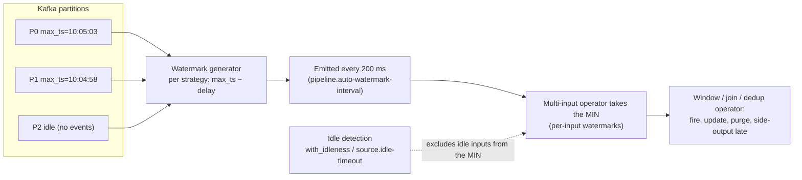

# Watermarks

> A watermark is a **heuristic assertion that time has progressed**: "I have seen all events with a timestamp less than or equal to X, and I expect no more." It is a bet — not a guarantee — and every streaming system's correctness properties (when a window closes, when a join can emit, when state can be deleted) rest on it. Get the delay wrong and you either drop data silently or wait forever for results. That makes watermark design the highest-leverage, lowest-visibility decision in a streaming pipeline: nobody sees it in a dashboard, and everybody sees the consequences in the numbers.

## TL;DR

- **Watermark = progress signal** in event time, propagated through the operator graph; downstream operators never see an event older than the current watermark (they see it as *late*).
- Sources generate watermarks from observed timestamps using a strategy: `for_monotonous_timestamps` (rarely true in distributed systems) or `for_bounded_out_of_orderness(delay)` (the workhorse).
- **The delay must come from measured data**: `p99.9` of (arrival time − event time), not from intuition. Watermark delay + window size = the latency of the *final* answer.
- A watermark is **per input, and multi-input operators use the minimum** — so one idle or lagging partition/source can freeze the whole pipeline. Idle-source detection (`with_idleness`, `table.exec.source.idle-timeout`) and watermark alignment are mandatory operational hygiene.
- **Allowed lateness (`allowedLateness` / `grace`) is separate from the watermark delay**: the delay decides when a window fires *first*; allowed lateness decides how long it may still be updated afterwards. Confusing the two is the most common watermark mistake.
- **Late data must be observable**: side outputs (Flink), metrics (`numRowsDroppedByWatermark` in Spark), and alerts. Silent drops are unacceptable.
- Kafka gives no cross-partition ordering, so out-of-orderness is inherent: are you reading 12 partitions from 3 producers? Then the "monotonous" strategy is a latent data-loss bug.
- **Future timestamps are catastrophic**: a single event with a timestamp in 2035 pushes the watermark forward, causing all normal data to be classified as late and dropped. Validate/clamp timestamp fields at the edge.
- Spark's watermark rules are strict: `withWatermark` must precede the aggregation, `append` mode requires it, and `update` mode emits intermediate results. Dedup within a watermark (`dropDuplicatesWithinWatermark`) uses the same mechanism.
- **Kafka Streams has no first-class watermark**: it uses *stream time* (max observed timestamp) and a `grace` period, which is an implicit watermark. Know the difference when comparing behaviors across engines.

## 1. Definitions and core vocabulary

| Term | Definition | Notes |
|---|---|---|
| **Event time** | Timestamp of when the event occurred, assigned by the producer | The time attribute streams should aggregate on |
| **Processing time** | Wall-clock at the operator | Non-deterministic |
| **Ingestion time** | Timestamp assigned by the system on entry | An approximation of event time |
| **Timestamp assigner** | Function extracting the event-time timestamp from a record | `with_timestamp_assigner`, JSON field, Kafka record timestamp |
| **Watermark** | Monotonic value `W` meaning "no more events with ts ≤ W" | Per input/partition, then merged |
| **Watermark strategy** | How watermarks are generated from timestamps | Monotonous / bounded-out-of-orderness / custom |
| **Bounded out-of-orderness** | `watermark = max_seen_ts − delay` | The standard strategy |
| **Idle source / idle partition** | An input that stops producing events while others continue | Without handling, it pins the watermark at its last value forever |
| **Watermark alignment** | Coordinating watermarks across inputs/tasks to prevent one fast input racing ahead | Prevents unbounded state on the fast side |
| **Watermark lag** | `now − watermark` (or watermark vs. max observed event time) | The key health metric |
| **Trigger** | Emit condition (often "watermark ≥ window end") | See [06-windowing.md](./06-windowing.md) |
| **Allowed lateness / grace** | Time after the window fires during which late events still update it | Distinct from the watermark delay |
| **Late event** | `event_ts < watermark` at the moment of arrival | Dropped, updated, or side-outputted |
| **Side output** | A secondary stream receiving late data | Flink's `side_output_late_data` |
| **Final / complete window** | A window whose result can no longer change | Emitted in `append` mode / after grace expires |
| **Stream time** | Kafka Streams' term for the max observed timestamp of a stream | Used with `grace` to implement time semantics |
| **Watermark interval** | How often watermarks are emitted (`pipeline.auto-watermark-interval`, default 200 ms in Flink) | Affects latency but not correctness (with bounded delay) |
| **Punctuated vs periodic watermark** | Emitted per-element vs on a timer | Periodic is the norm; punctuated for precise control |
| **End of stream watermark (`MAX`)** | A bounded source signals completion with watermark `Long.MAX_VALUE` | Used by batch-over-bounded-stream; careful: sockets-file case |

### 1.1 The picture to keep in your head

```text
  max_event_time_seen ───────────────────────────────────────▶ (time)
        │
        │   delay (bounded out-of-orderness)
        ├──────────────▶ watermark W = max_ts − delay
        │
  data arriving now can have event_time anywhere in [.., max_ts]
  events with event_time < W arriving now are LATE

  Window [10:00, 10:05):
     fires when W >= 10:05
     can still be updated until W >= 10:05 + allowed_lateness
     then its state is purged
```

## 2. What problem it solves / why it matters

Streaming has no "end of file". To compute a deterministic result you must decide when a computation is *done*, and to do that you need progress in the same domain as the data: event time.

| Question | Answer without watermarks | Answer with watermarks |
|---|---|---|
| When do I emit a window's final result? | Guess, or use processing time | When `watermark ≥ window_end` |
| How long do I keep window/join state? | Forever (leak) or arbitrary TTL | Until `watermark ≥ window_end + lateness` |
| How do I know a stream is late? | I don't | Arrival with `ts < watermark` |
| How do I join two streams with bounded state? | Unbounded state | Join only within the watermark window |
| How do I test determinism? | Impossible | Replay + same watermarks → identical output |
| How do I report pipeline health? | Consumer lag only | Lag **and** watermark lag (data-time vs now) |

Watermark lag is the single best "is my pipeline healthy as a data system?" metric: consumer lag tells you how many records are queued; **watermark lag tells you how far behind *the data* is**, which is what anyone who asks "is the number fresh?" actually means.

## 3. How it works internally

### 3.1 Generation, emission, and propagation



Mechanics worth knowing:

- **Per-input watermarks, min at merge.** A two-input operator (a join) only advances its watermark when *both* inputs have advanced. This is why an idle or slow partition stalls everything downstream.
- **Idle handling** is not automatic: Flink needs `with_idleness(duration)` (DataStream) or `table.exec.source.idle-timeout` (SQL) to *temporarily remove* an input from the min computation. Without it, a topic where one partition has no data for hours blocks all windows that depend on that operator.
- **Watermarks do not flow backwards and cannot be lowered.** Mechanisms to "fix" a rookie watermark (e.g. lowering the delay) require a restart from a checkpoint or a replay.
- **Backpressure does not advance watermarks**; they are carried in-band (or via a special channel). If an operator is busy, both data and watermarks queue. In Flink, *unaligned checkpoints* help checkpoints, not watermarks — a fully congested pipeline still has stale watermarks, which is a useful signal: **watermark lag ≈ how far behind your computation is in data time.**
- **Emission frequency is a latency knob, not a correctness knob** (for bounded delay): emitting every 200 ms means a window may close up to 200 ms late; emitting every 5 s adds up to 5 s. Spark's watermark is evaluated per micro-batch, so the trigger interval also bounds how often late data can be noticed.
- **Bounded sources** end with a `MAX` watermark so downstream windows/joins can finalize (Flink's bounded/unbounded transition; Spark's batch-over-stream cases do not apply).

### 3.2 The three watermark strategies, and when each is a bug

| Strategy | Formula | Correct when | Bug when |
|---|---|---|---|
| Monotonous (`for_monotonous_timestamps`) | `W = max_ts` | A single producer/partition, strictly increasing timestamps (e.g. a compacted config stream, or an engine-generated *ingestion* timestamp) | Anything with multiple producers/partitions or network reordering → the second out-of-order event is dropped as late |
| Bounded out-of-orderness (`for_bounded_out_of_orderness(delay)`) | `W = max_ts − delay` | Any real-world stream; the default choice | When `delay` is not derived from measured lateness → silent drops or excessive latency |
| Custom / punctuated | Any logic (e.g. only advance on a heartbeat record, or when a marker key arrives) | CDC-style streams with explicit progress markers; multi-source alignment | Complexity and obscure failures if not observable |

```text
Why monotonicity is almost never true in practice:
  Kafka topic with 12 partitions × 3 producer instances.
  P0 produced by instance A with clocks 5s ahead of instance B on P7.
  Reads interleave across partitions => the merged stream is inherently out of order
  by up to the clock skew + the network reordering window.
```

### 3.3 Watermark delay vs allowed lateness (the distinction that matters)

```text
                  window_end
                      │
   ── events ─────────┼────────────────────────────────────────────────▶
                      │
    first fire ───────┤ at W >= window_end            (final-looking output)
                      │
   allowed lateness ──┼───────────┤ up to window_end + lateness,
                      │           │ late events still UPDATE the result
                      │           │ (extra emissions / retractions)
                      │           │
   purge ─────────────┴───────────┴──▶ state released; later events
                                       are "too late": drop or side-output

Delay  → when results appear (latency).
Lateness → how long results can still change (correctness/state cost).
Sum   → total state retention ≈ (window + delay + lateness) worth of data.
```

**Flink** exposes both explicitly: the strategy's delay and `allowedLateness`/`withGap` + `sideOutputLateData`. **Spark** exposes *only* a watermark delay for `window()`; there is no separate "allowed lateness" — in `update` mode, late events within the watermark still update results, and once the watermark passes the window end plus the delay, the window's state is dropped and later records are counted as dropped-by-watermark. **Kafka Streams** uses `grace`, which behaves like allowed lateness after the "stream time" watermark.

### 3.4 Engine comparison

| Aspect | Flink | Spark Structured Streaming | Kafka Streams |
|---|---|---|---|
| Time attribute | `WatermarkStrategy` (DataStream) / `WATERMARK FOR` (SQL) | An event-time column of type `timestamp` | `TimestampExtractor` |
| Watermark generation | Explicit strategy, per source and per split (per-partition in the Kafka connector) | Implicit from `withWatermark(col, delay)` on a query | Implicit: stream time = max observed timestamp |
| Cross-partition ordering | Per-partition watermarks (Kafka connector, since 1.17 / FLIP-27) | Global per micro-batch: the watermark is the max over the rows read in the batch | Stream time is global per task (= per assigned partition set) |
| Idle handling | `with_idleness`, `table.exec.source.idle-timeout` | Not needed in the same way (watermark is computed from actual rows) | Not needed (stream time from rows) |
| Alignment across inputs | Watermark alignment (`with_watermark_alignment`) | Not applicable | Not applicable |
| Allowed lateness | `allowedLateness(...)` + `sideOutputLateData(...)` | Implicit; `update` mode + window state TTL | `grace` in the window definition |
| Latency knob | `pipeline.auto-watermark-interval` (200 ms default) | Trigger interval (watermark evaluated per batch) | `commit.interval.ms`, caching, `suppress` |
| Observability | `currentWatermark` metric per task, plus watermark lag dashboards | `numRowsDroppedByWatermark` streaming metric | Stream-time / lag metrics; late records dropped silently unless custom |

> **Senior note.** The three engines implement the *same idea* with different ergonomics. The most common cross-engine bug: a team migrates a Flink job to Spark and assumes "allowed lateness" exists separately. In Spark, the delay *is* the lateness budget for `window()` aggregations — raising it trades latency for correctness.

## 4. How to implement it

### 4.1 PyFlink: strategies, idleness, alignment, and late side output

```python
from pyflink.common import Duration, WatermarkStrategy, Types
from pyflink.datastream import StreamExecutionEnvironment, OutputTag
from pyflink.datastream.functions import WatermarkGenerator
from pyflink.common.watermark_strategy import TimestampAssigner

env = StreamExecutionEnvironment.get_execution_environment()
env.set_parallelism(8)

# --- 1) The standard strategy: bounded out-of-orderness ----------------------
# delay derived from measured p99.9 lateness (here: 30 seconds)
wm = (WatermarkStrategy.for_bounded_out_of_orderness(Duration.of_seconds(30))
      .with_timestamp_assigner(OrderTimestampAssigner("event_time"))  # field, not broker time
      .with_idleness(Duration.of_minutes(2)))   # idle partitions must not pin the watermark

# --- 2) Watermark alignment: keep subtasks from drifting apart --------------
# Without this, one fast subtask can run far ahead, buffering unbounded state
# on the slow side of a join/aggregation.
# Java: WatermarkStrategy.withWatermarkAlignment(group, maxDrift[, updateInterval]);
# PyFlink exposes the same control through its watermark-alignment params.
wm = wm.with_watermark_alignment(
    group_name="orders-alignment",
    max_drift=Duration.of_minutes(3),
    update_interval=Duration.of_seconds(10),
)

orders = (env.from_source(kafka_source, wm, "orders")
             .map(parse_order, output_type=Types.PICKLED_BYTE_ARRAY())
             .name("parse-orders"))

# --- 3) Windowing with allowed lateness + late side output -------------------
late_orders = OutputTag("late-orders", Types.PICKLED_BYTE_ARRAY())

per_region = (orders.key_by(lambda o: o["region"])
                    .window(TumblingEventTimeWindows.of(Time.minutes(1)))
                    .allowed_lateness(Time.minutes(2))          # still updatable for 2 min
                    .side_output_late_data(late_orders)         # NEVER silently drop
                    .aggregate(RevenueAggregate(), RevenueWindowFn()))

per_region.get_side_output(late_orders).sink_to(kafka_late_sink)
per_region.sink_to(kafka_metrics_sink)

env.execute("orders-1m")
```

A custom generator, for cases where the timestamp field is not the right progress signal:

```python
class HeartbeatWatermarkGenerator(WatermarkGenerator):
    """Advance the watermark only when the stream itself says it's safe — e.g. a
    control record ('batch 42 complete, max_ts=X') emitted by the upstream job."""

    def __init__(self, delay_ms: int):
        self.delay_ms = delay_ms
        self.max_ts = -1

    def on_event(self, event, event_timestamp, output):
        if event.get("type") == "heartbeat":
            self.max_ts = max(self.max_ts, event["max_event_time_seen"])
            # emit eagerly: we have an explicit progress marker
            output.emit_watermark(Watermark(self.max_ts - self.delay_ms))
        else:
            self.max_ts = max(self.max_ts, event_timestamp)

    def on_periodic_emit(self, output):
        if self.max_ts > 0:
            output.emit_watermark(Watermark(self.max_ts - self.delay_ms))
```

### 4.2 Flink SQL: `WATERMARK` DDL, idle timeout, and window fire modes

```sql
CREATE TABLE orders (
  order_id    STRING,
  region      STRING,
  amount      DECIMAL(12,2),
  event_time  TIMESTAMP(3),
  -- Watermark: event time minus 5 seconds of tolerated out-of-orderness
  WATERMARK FOR event_time AS event_time - INTERVAL '5' SECOND
) WITH (
  'connector' = 'kafka',
  'topic' = 'orders.v1',
  'properties.bootstrap.servers' = 'kafka1:9092',
  'properties.group.id' = 'flink-orders-sql',
  'scan.startup.mode' = 'earliest-offset',
  'format' = 'json'
);

-- Treat a source as idle after 30s so it stops pinning the watermark
SET 'table.exec.source.idle-timeout' = '30s';

-- Decide WHEN results are emitted (this is the Flink SQL equivalent of
-- "watermark delay for output latency" + "allowed lateness for updates"):
SET 'table.exec.emit.early-fire.enabled' = 'true';   -- partial results (updates)
SET 'table.exec.emit.early-fire.delay'   = '5s';
SET 'table.exec.emit.late-fire.enabled'  = 'true';   -- late data updates the result
SET 'sql-execution-...';                             -- (state cleanup below)

-- Keep window state bounded (Flink 1.20+): state TTL is the operational guard rail
SET 'table.exec.state.ttl' = '48h';

INSERT INTO revenue_1m
SELECT window_start, window_end, region, COUNT(*) AS orders, SUM(amount) AS revenue
FROM TABLE(TUMBLE(TABLE orders, DESCRIPTOR(event_time), INTERVAL '1' MINUTE))
GROUP BY window_start, window_end, region;
```

Notes:

- The SQL watermark clause is what makes a column an **event-time attribute**; without it, `TUMBLE`/`HOP`/`SESSION` cannot be used with that column.
- `table.exec.source.idle-timeout` is the SQL equivalent of `with_idleness`. **Set it on every source in a multi-source job.**
- `early-fire`/`late-fire` change the *semantics of the output stream* (updates vs append). Match it to the sink: a plain Kafka sink needs `upsert-kafka` semantics or append-only emission.

### 4.3 Spark Structured Streaming: `withWatermark`, dedup, joins, metrics

```python
from pyspark.sql import functions as F

events = (spark.readStream.format("kafka")
          .option("kafka.bootstrap.servers", "kafka1:9092")
          .option("subscribe", "orders.v1")
          .option("startingOffsets", "earliest")
          .load()
          .select(F.from_json(F.col("value").cast("string"), schema).alias("e"))
          .select("e.*"))

# Rules of thumb that the engine enforces:
#  - withWatermark MUST be called before the aggregation it applies to.
#  - In `append` mode, streaming aggregations require a watermark.
#  - The watermark is defined per query on a column; "delay" IS the lateness budget.

agged = (events
    .withWatermark("event_time", "10 minutes")     # 10 min of tolerated lateness
    .groupBy(F.window("event_time", "5 minutes"), "region")
    .agg(F.count("*").alias("orders")))

# Append mode: a row is emitted only when the watermark passes window end
# => "final" results, no updates. Latency ≈ window + delay + trigger interval.
agg_query = (agged.writeStream.outputMode("append")
    .option("checkpointLocation", "s3://chk/orders-5m/")
    .trigger(processingTime="1 minute")
    .format("delta").start())

# Update mode: partial results as they change. Downstream MUST upsert on
# (window.start, window.end, region).
upd_query = (agged.writeStream.outputMode("update")
    .option("checkpointLocation", "s3://chk/orders-5m-update/")
    .trigger(processingTime="30 seconds")
    .format("delta").start())

# Dedup within the watermark — the pattern to prefer over a global dedup store
deduped = events.dropDuplicatesWithinWatermark(["event_id"])

# Watch the dropped-rows metric in the Streaming tab: `numRowsDroppedByWatermark`.
# A nonzero, growing value means the delay is too small (or timestamps are wrong).
```

Streaming-join watermarks (both sides need bounds):

```python
orders_w  = events_orders.withWatermark("event_time", "10 minutes")
ship_w    = shipments.withWatermark("event_time", "20 minutes")   # looser side, larger delay

joined = (orders_w.join(ship_w,
          F.expr("""o_order_id = s_order_id AND
                    s_event_time BETWEEN o_event_time
                                    AND o_event_time + INTERVAL 30 MINUTES"""),
          "leftOuter"))
# The operator's watermark = min(both sides). A stalled side stalls the join.
```

### 4.4 Kafka Streams: stream time and `grace` (the implicit watermark)

```java
// Kafka Streams has no explicit Watermark API. "Stream time" = max observed timestamp.
// `grace` = how long after stream time passes the window end the window can still update.
KTable<Windowed<String>, Long> counts = orders
    .groupByKey()
    .windowedBy(TimeWindows.ofSizeAndGrace(Duration.ofMinutes(5), Duration.ofMinutes(1)))
    //                                     ▲ window size          ▲ grace == allowed lateness
    .count();

// Emit only once the window is final (adds state retention until the window closes)
counts.toStream()
      .suppress(Suppressed.untilWindowCloses(BufferConfig.unbounded()))
      .to("counts.5m.final");

// Time semantics are governed by the TimestampExtractor:
//  default: RecordTimestampExtractor (producer/broker timestamps)
//  custom:  read your own event_time field -- REQUIRED when produce time != event time
```

```properties
# Tuning the effective "watermark interval" and cache behavior
commit.interval.ms=1000       # how often state is flushed/committed
statestore.cache.max.bytes=10485760
# Streams drops records that arrive after the window is closed+grace, silently,
# unless you handle them with a custom Processor/Transformer.
```

### 4.5 Timestamp assignment: the code that decides everything

```python
class OrderTimestampAssigner(TimestampAssigner):
    """Extract event time from the payload, defensively.

    Rules:
      1. NEVER use the broker/append time as the event time for business windows.
      2. Clamp obviously-invalid future timestamps: a single far-future event
         pushes the watermark forward and turns all real data into 'late'.
      3. Treat unparseable timestamps as a data-quality incident, not as 'now'.
    """
    MAX_FUTURE_SKEW_MS = 60_000        # 1 minute of tolerated clock skew

    def __init__(self, field: str, max_future_skew_ms: int | None = None):
        self.field = field
        self.max_future_skew = max_future_skew_ms or self.MAX_FUTURE_SKEW_MS

    def extract_timestamp(self, value, record_timestamp: int) -> int:
        ts = value.get(self.field)
        if not isinstance(ts, int) or ts <= 0:
            # Missing/unparseable -> fall back to ingestion time AND count it
            metrics.increment("ts_missing", tags={"field": self.field})
            return record_timestamp
        now = int(time.time() * 1000)
        if ts > now + self.max_future_skew:
            metrics.increment("ts_future_clamped", tags={"field": self.field})
            return now                      # clamp: do not poison the watermark
        return ts
```

> **Senior note.** This function is where most watermark incidents originate. Real cases: a mobile client with a device clock 11 months ahead; a producer switched from ISO-8601 local time to UTC and started emitting "future" timestamps during DST; a CDC connector replaying a table where `created_at` is a *scheduled* future date. Each of them pushes the watermark to the future and drops all subsequent data as late — a total, silent loss of a metric that looks like "the dashboard stopped updating".

## 5. Where to implement it

| Layer | Where the watermark logic lives | What to configure |
|---|---|---|
| **Kafka / brokers** | Nowhere — Kafka has no watermark concept | Provide reliable `event_time` fields; consider log append time only as an ingestion-time fallback |
| **Flink DataStream** | `WatermarkStrategy` on each source | Delay, timestamp assigner, idleness, alignment |
| **Flink SQL** | `WATERMARK FOR col AS ...` in DDL | `table.exec.source.idle-timeout`, `early-fire`/`late-fire`, `state.ttl` |
| **Spark Structured Streaming** | `withWatermark(col, delay)` on the query | Trigger interval, output mode, checkpoint location, `numRowsDroppedByWatermark` alerts |
| **Kafka Streams / ksqlDB** | `TimestampExtractor` + window `grace` | `commit.interval.ms`, state store retention, `suppress` |
| **Managed Flink (Confluent Cloud, Amazon Managed Service for Apache Flink, Ververica)** | Same semantics; usually configured in SQL DDL | Per-statement/table state TTL; checkpoint interval drives output latency |
| **Dataflow (Beam)** | `TimestampAssigner` + `withAllowedLateness` + trigger | Late firings, accumulation mode |
| **dbt / warehouse side** | No watermarks, but *listen* to them: use the watermark lag metric to decide when a table is complete | Schedule batch jobs after watermark completion, or use event-time partitioning with idempotent MERGE |

## 6. Patterns and anti-patterns

| Pattern | Shape | Notes |
|---|---|---|
| **Delay from measured p99.9 lateness** | `delay = f(data)` | Recompute monthly; lateness changes with producers and regions |
| **Separate live and backfill streams** | CDC/backfill to a different topic with its own watermark | Prevents backfills from poisoning the live watermark |
| **Explicit heartbeat/progress events** | Upstream emits `max_event_time_seen` markers | Makes custom watermarks reliable across shards |
| **Idle detection everywhere** | `with_idleness`, `source.idle-timeout` | Mandatory for multi-partition/multi-source jobs |
| **Watermark alignment** | `with_watermark_alignment` | Keeps state bounded when subtasks drift |
| **Late side output + alerting** | Side stream to a topic + dashboard | The only honest way to handle late data |
| **Clamped timestamps at the edge** | Timestamp assigner validation | Prevents the "watermark in the future" catastrophe |
| **Watermark-lag SLO** | `now − watermark` per job | Data freshness measured in data time |
| **Bounded replay with a MAX watermark** | Batch-over-bounded-stream for backfills | Lets windows finalize deterministically at the end |

### Anti-patterns

| Anti-pattern | Consequence | Fix |
|---|---|---|
| **Using broker/ingestion time as event time** | Late data mislabeled; windows wrong after a backfill | Carry and use `event_time` |
| **`for_monotonous_timestamps` on a multi-partition topic** | Silent drops of out-of-order records | Bounded out-of-orderness with a measured delay |
| **Delay = 0** | Almost everything is late | Measure lateness, then set the delay |
| **Delay = 24h "to be safe"** | All results are a day old; state balloons | Match the delay to the business latency SLO |
| **Ignoring idle sources** | Watermark frozen; no windows emit for hours | Idle detection |
| **No watermark observability** | Cannot distinguish "no data" from "stuck watermark" | Emit watermark metrics; dashboards + alerts |
| **Future timestamps from a single producer** | Watermark jumps ahead; mass drops | Clamp + validate + alarm |
| **Conflating watermark delay with allowed lateness** | Either silent drops or unexpected late updates | Treat them as two separate knobs |
| **Late data dropped silently (Streams/SQL defaults without a side path)** | Data loss with no evidence | Side outputs / late-fire + alerts |
| **Backfill into the live topic** | Watermark poisoned, live dashboards destroyed | Separate topic, separate job, own watermark |
| **A watermark per micro-batch assumed to be per-record** (Spark) | Coarse closure; late rows counted differently | Understand the per-batch evaluation model |
| **Changing the watermark delay without a replay plan** | Old and new results are inconsistent in the same table | Version the pipeline; reprocess into a new table |

## 7. Real-world use cases and industry applications

- **Real-time dashboards (retail/ride-sharing)**: 1-minute event-time windows, 30-second watermark delay, `early-fire`/`update` for live numbers, final results for BI.
- **Financial market data**: strict event time with millisecond watermarks; lateness tolerated within a few hundred milliseconds; VPIN/volatility windows where determinism is a regulatory requirement.
- **Ad tech attribution**: watermark-based joins between impression and click streams; conversions that arrive beyond the watermark are attributed via a batch reconciliation job (an explicit, documented policy).
- **IoT/telemetry**: device buffering and reconnection cause minutes-to-hours of lateness; watermarks must be generous, and a "late replay" path is needed for reconnected devices.
- **Fraud/risk**: hopping windows with a tight delay (best-effort) *plus* a batch recomputation for accuracy — the standard "fast approximate, slow exact" architecture.
- **CDC pipelines (Debezium)**: the source is a log with a single ordinal — watermarks derived from the WAL position/commit time work well; explicit progress markers beat delay heuristics.
- **Data lake ingestion**: watermark completion is used to trigger compaction, snapshot expiration, and downstream batch jobs (a table is "complete up to T").
- **ML feature pipelines**: windowed features online and offline use the *same* window definitions and the same lateness policy to avoid train/serve skew.
- **Observability/SRE**: burn-rate alerts use multi-window (5m + 1h) event-time computations; a stalled watermark is itself an alert signal.

## 8. Senior-level deep dive

### 8.1 Deriving the watermark delay from data (the procedure, with numbers)

```text
1. Instrument arrival & event time for a week (per topic and per producer):
     lateness = arrival_ts − event_time
2. Compute the distribution: p50, p90, p99, p99.9, max, and the count above thresholds.
     p50=0.2s  p90=1.1s  p99=6.4s  p99.9=14s  max=22h (one batch producer, 2 events)
3. Choose:
     watermark_delay ≈ p99.9 rounded up with margin → 20s
     allowed_lateness = business tolerance (e.g. 2 min) → beyond that, side output
4. Compute the latency of the FINAL result:
     worst_case ≈ window_size + watermark_delay + trigger_interval + sink_commit
              = 60s + 20s + 1s + 10s = ~91s
5. Publish the SLO and monitor:
     watermark_lag = now − watermark   (alert if > threshold)
     late_event_rate = late / total    (alert if > 0.1%)
     numRowsDroppedByWatermark (Spark) must be ~0 outside known outliers
6. Revisit quarterly or after any producer change (new SDK, new region, new retry policy).
```

Rule of thumb: **watermark delay ≈ 2–3× p99.9 lateness**, capped by the latency SLO. Anything beyond that belongs in `allowed_lateness` (updates) or in a side output.

### 8.2 Watermark propagation in non-trivial graphs

```text
                          ┌── filter ──┐
  source A (wm: t−5s) ────┤            ├── union ──▶ window op
                          └── map ─────┘                │ watermark = min(all inputs)
                                                        ▼
  source B (wm: t−30s) ───────────────▶ join ──▶ operator: wm = min(A_wm, B_wm)
                                                        │
  source C (idle!) ────────────────────▶ dedup ─────────┘  ← pins the watermark forever
                                                        unless idleness is handled

Anomaly: a keyed shuffle (                         ) splits the stream by key, but the
watermark is broadcast to ALL downstream subtasks: a single subtask with slow input
holds back its own windows only. (Flink broadcasts watermarks to all downstream tasks,
so global progress is the min across upstream subtasks feeding a given task.)
```

Practical consequences:

- **Any operator with multiple inputs has the min watermark.** Adding a low-traffic side input (a config stream, a lambda that fires rarely) can freeze a pipeline. Handle with idleness or by broadcasting the config via state instead of a stream.
- **Watermark alignment matters mostly for the fast side of a join**: without it, the fast side buffers everything until the slow side catches up.
- **Repartitioning does not "fix" out-of-orderness**; it redistributes it. Per-key punctuality still requires the timestamp to be correct.

### 8.3 Stuck watermarks: the debugging decision tree

```text
Watermarks not advancing (no window output, watermark lag growing):
│
├─ Is any source idle? (partition with no data, or a topic where the producer stopped)
│    → Flink: idle source not configured. FIX: with_idleness / source.idle-timeout
│    → Spark: not applicable (watermark comes from rows) — look for "no new data"
│
├─ Is one partition lagging badly? (hot key, slow broker, consumer lag on one partition)
│    → watermark = min across partitions ⇒ the slow partition pins everything.
│      FI²: fix the partition (rebalancing, producer fix), or align watermarks.
│
├─ Are timestamps wrong (in the past)? (clock skew, timezone parsing, epoch/seconds mixup)
│    → check the max event_time metric per partition. If it's hours behind "now",
│      the data's time domain is wrong, not the watermark.
│
├─ Are timestamps wrong (in the future)? (device clock, DST bug, scheduled dates)
│    → watermark jumps ahead; late_event_rate spikes; windows vanish.
│      FIX: clamp at the edge, alert on future timestamps, replay.
│
├─ Is the pipeline backpressured? (consumer lag high, sink slow)
│    → data AND watermarks queue; watermark lag ≈ real lag. Fix throughput first.
│
└─ Is the emission interval too large? (auto-watermark-interval, trigger interval)
    → increases window close latency but never stops progress. Verify with metrics.
```

### 8.4 Interaction with exactly-once and checkpoints

```text
Flink: watermarks are part of the snapshot. On restore, the job resumes with the
       watermark stored in the checkpoint, so no windows are re-opened/re-closed
       incorrectly. Sinks with 2PC commit on checkpoint completion => the emitted
       window result is atomic with the input offsets (see 05-delivery-semantics.md).

Spark: the watermark is derived from the latest processed data and stored with the
       query's state; on restart the watermark is recomputed from the restored state,
       so it cannot go backwards. Late rows are counted, not silently ignored, in
       metrics.

Kafka Streams: stream time is part of the state store; on restore, suppressed
       windows continue from the restored stream time. Grace-expired windows are
       dropped as configured.
```

Implication: **changing the watermark delay requires either a restart from a fresh checkpoint or a full replay.** A "small tuning change" applied mid-run produces tables with two different time semantics in different partitions — the classic inconsistent-analytics incident.

### 8.5 Observability: the six metrics that matter

| Metric | Where | Alarm heuristic |
|---|---|---|
| `currentWatermark` / watermark value per task | Flink metrics (`kafka.apache.org`-style `/metrics`) | Should be within `delay + lag_SLO` of `now` |
| Watermark lag (`now − watermark`) | Derived in Prometheus | Alert if > 2× expected (delay + processing) |
| `numRowsDroppedByWatermark` | Spark Structured Streaming metrics | Alert on any nonzero sustained value |
| Late event rate per key/hour | Side output counters | Alert on rate change, not absolute |
| Idle source count / `idleTimeMs` | Flink source metrics | Alert if a normally busy partition is idle > N min |
| Window state size / checkpoint size & duration | Flink/Kafka Streams/Spark state stores | Alert on monotonic growth or checkpoint duration > threshold |

Add a *pair* of panels: (a) records lag per partition, and (b) watermark lag. Together they distinguish "we're behind on processing" (both high), "a partition is idle" (records lag low, watermark lag high), and "processing is fine but the data is old" (records lag low, watermark lag high with a specific timestamp distribution).

### 8.6 Trade-off table

| Decision | Option A | Option B | Decides on |
|---|---|---|---|
| Watermark delay | Small (fresh, risky) | Large (safe, stale) | Business freshness SLO vs late-drop risk |
| Allowed lateness | 0 (append only) | 2× delay (updates) | Sink's upsert capability + state cost |
| Timestamp source | Producer event time | Ingestion/broker time | Determinism vs simplicity |
| Idle handling | None | Aggressive (30 s) | Correctness under intermittent sources |
| Watermark alignment | Off | On (drift bound) | Fast-side buffering vs coordination overhead |
| Emission cadence | 200 ms | Batch-aligned (1 min) | Downstream write amplification vs latency |
| Late policy | Drop with metrics | Side output + reprocess | Data completeness vs pipeline complexity |
| Backfills | Into the live topic | Into a separate topic/job | Live metric integrity |

## 9. Common mistakes and how to avoid them

1. **Watermark = broker timestamp.** Removes event time's meaning and breaks determinism on replay.
2. **Delay chosen by intuition (or 0).** Either drops data or makes everything stale.
3. **Monotonous strategy on a multi-partition topic.** Guaranteed silent drops.
4. **Not handling idle sources.** The most common "nothing is emitting" cause in Flink.
5. **Treating watermark delay and allowed lateness as the same knob.** Especially when moving between Flink/Spark/Kafka Streams.
6. **No late-data observability.** You cannot prove data loss without a side output or metric.
7. **Unvalidated timestamps.** A single future timestamp silently destroys a metric.
8. **Backfilling into the live topic.** Poisons the watermark for the current day.
9. **Forgetting the second input in joins.** The min watermark of both sides governs.
10. **Assuming Spark's watermark is per record.** It is evaluated per micro-batch.
11. **Changing the delay without a replay.** Produces two time semantics in one table.
12. **Ignoring watermark lag because record lag looks fine.** Record lag measures queueing; watermark lag measures data freshness.
13. **Timezone/epoch mistakes** (seconds vs. milliseconds, local time parsed as UTC). Always assert the timestamp's unit and zone at the edge.
14. **Too-frequent watermark emission costs.** In very high-throughput Flink jobs, a 200 ms interval with millions of subtasks adds overhead — but correctness first, then tune.
15. **Assuming Kafka Streams "watermark" behaves like Flink's.** Stream time is driven by the records a task actually sees; a stalled partition changes everything.

## 10. Exercises / interview questions

*(Hints only.)*

1. Given the lateness distribution `p50=0.2s, p99=6.4s, p99.9=14s, max=22h`, pick a delay, an allowed lateness, and the resulting final-result latency for a 1-minute tumbling window. Justify each number. *(Hint: 2–3× p99.9; outliers go to a side output.)*
2. A Flink job computes windowed metrics from 24 Kafka partitions. One partition receives no data at night; dashboards stop updating every night at the same time. Diagnose and fix. *(Hint: min watermark + idle sources.)*
3. Explain why `for_monotonous_timestamps` is dangerous on a 12-partition topic, even with a single producer.
4. Your Spark job's `numRowsDroppedByWatermark` spikes at 09:00 daily. List four possible causes and how to distinguish them. *(Hint: batch producer, clock skew, timezone, backfill.)*
5. Compare Flink's `allowedLateness` with Spark's watermark delay. What is the equivalent of "the window can still be updated" in Spark's `append` vs `update` modes?
6. You need "orders per minute, available within 30 seconds, and correct". What is the minimum feasible window+delay+trigger combination? What do you tell the stakeholder about the trade-off?
7. A join between orders and shipments produces nothing for hours; each input has data. What is the first metric you check and what is the likely cause? *(Hint: per-input watermarks, alignment, one side's delay set too high.)*
8. How do you test that a watermarking change does not regress correctness? Describe the replay test and the assertions.
9. Why can backfilling historical data into the live topic destroy the day's metrics, and what are three safer designs?
10. Design the alerting for a pipeline with a 60-second freshness SLO: which two metrics, what thresholds, and how do you distinguish "no data" from "broken watermark"?

## References

- Apache Flink — Generating watermarks (strategies, idleness, watermark alignment): <https://nightlies.apache.org/flink/flink-docs-stable/docs/dev/datastream/event-time/generating_watermarks/>
- Apache Flink — Built-in watermark generators (`BoundedOutOfOrdernessWatermarks`, `AscendingTimestamps`): <https://nightlies.apache.org/flink/flink-docs-stable/docs/dev/datastream/event-time/built_in/>
- Apache Flink — Dealing with idle sources: <https://nightlies.apache.org/flink/flink-docs-stable/docs/dev/datastream/event-time/generating_watermarks/#dealing-with-idle-sources>
- Apache Flink — Event time and time attributes: <https://nightlies.apache.org/flink/flink-docs-stable/docs/dev/datastream/event-time/>
- Apache Flink — Time concepts (event/processing/ingestion time): <https://nightlies.apache.org/flink/flink-docs-stable/docs/concepts/time/>
- Apache Flink — Windows, triggers, allowed lateness: <https://nightlies.apache.org/flink/flink-docs-stable/docs/dev/datastream/operators/windows/>
- Apache Flink — ProcessFunction (timers, side outputs for late data): <https://nightlies.apache.org/flink/flink-docs-stable/docs/dev/datastream/operators/process_function/>
- Apache Flink — Kafka connector (event-time assignment, per-partition watermarks): <https://nightlies.apache.org/flink/flink-docs-stable/docs/connectors/datastream/kafka/>
- Apache Flink — Metrics (currentWatermark and friends): <https://nightlies.apache.org/flink/flink-docs-stable/docs/ops/metrics/>
- Apache Flink — Checkpointing and state (watermarks inside snapshots): <https://nightlies.apache.org/flink/flink-docs-stable/docs/dev/datastream/fault-tolerance/checkpointing/>
- Apache Flink SQL — Table config (`table.exec.source.idle-timeout`, state TTL): <https://nightlies.apache.org/flink/flink-docs-stable/docs/dev/table/config/>
- Apache Flink SQL — Window aggregation with watermarks (`TUMBLE`/`HOP`/`CUMULATE`/`SESSION`): <https://nightlies.apache.org/flink/flink-docs-release-1.20/docs/dev/table/sql/queries/window-agg/>
- FLIP-27: Refactor Source Interface (per-split/per-partition watermarks): <https://cwiki.apache.org/confluence/display/FLINK/FLIP-27%3A+Refactor+Source+Interface>
- Spark — Structured Streaming programming guide (watermarking, late data, output modes, joins): <https://spark.apache.org/docs/latest/structured-streaming-programming-guide.html>
- Spark — `withWatermark` API reference: <https://spark.apache.org/docs/latest/api/python/reference/pyspark.sql/api/pyspark.sql.DataFrame.withWatermark.html>
- Spark — `dropDuplicatesWithinWatermark` API reference: <https://spark.apache.org/docs/latest/api/python/reference/pyspark.sql/api/pyspark.sql.DataFrame.dropDuplicatesWithinWatermark.html>
- Databricks — Apply watermarks to control data processing thresholds: <https://docs.databricks.com/aws/en/structured-streaming/watermarks>
- Databricks — Structured Streaming in production (monitoring, metrics such as dropped rows): <https://docs.databricks.com/aws/en/structured-streaming/production>
- Databricks — Feature deep dive: watermarking in Spark Structured Streaming: <https://www.databricks.com/blog/feature-deep-dive-watermarking-apache-spark-structured-streaming>
- Kafka Streams — windowing and grace (stream time semantics): <https://kafka.apache.org/documentation/streams/developer-guide/dsl-api.html#windowing>
- Confluent — Kafka Streams developer guide: windowed aggregations and suppression: <https://docs.confluent.io/platform/current/streams/developer-guide/dsl-api.html#windowed-aggregations>
- Confluent Cloud for Apache Flink — Timely stream processing (watermark clauses in SQL): <https://docs.confluent.io/cloud/current/flink/concepts/timely-stream-processing.html>
- Confluent Cloud for Apache Flink — CREATE TABLE DDL with `WATERMARK`: <https://docs.confluent.io/cloud/current/flink/reference/statements/create-table.html>
- Apache Beam — Windowing, triggers, accumulation and lateness: <https://beam.apache.org/documentation/programming-guide/>
- Apache Flink — Kafka Table connector (SQL event-time attributes): <https://nightlies.apache.org/flink/flink-docs-stable/docs/connectors/table/kafka/>
