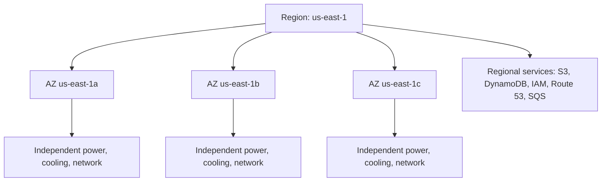
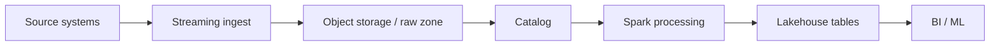

# Cloud Fundamentals

> The cloud is not "someone else's computer" and it is not "a data center you rent by the
> hour." It is a set of *programmable*, *multi-tenant*, *regionally distributed* APIs that
> abstract physical infrastructure behind a control plane. A senior data engineer must
> understand the primitives — service models, regions and availability zones, elasticity,
> the shared responsibility model — because every architecture decision downstream
> (compute choice, storage tier, network topology, cost) is a consequence of them. Get the
> mental model wrong here and you will over-provision for years, or design a pipeline that
> silently loses data when a single zone blips.

## TL;DR

- **Cloud = control plane + data plane.** The control plane is the API that creates,
  configures and deletes resources; the data plane is the traffic your workload actually
  serves. They fail independently, and most "the cloud went down" incidents are control
  plane or single-AZ failures.
- **Service model ladder:** IaaS → CaaS → PaaS → FaaS → SaaS. The higher you go, the less
  you operate and the less you control. There is no universally "right" level — data
  workloads often span two or three levels simultaneously.
- **Region ≠ zone ≠ edge.** A region is a geographic cluster of isolated Availability
  Zones (AZs); AZs have independent power, cooling and network. Design so that losing one
  AZ is a non-event.
- **Elasticity ≠ scalability.** Scalability is the *ability* to grow; elasticity is doing
  it *automatically and reversibly*, often down to zero. Batch data jobs want elasticity
  (scale to 1000 nodes for 40 minutes, then to 0); stateful services want controlled
  scalability.
- **Shared responsibility model:** the provider secures *the cloud*; you secure *what you
  put in the cloud*. The line moves with the service model — IaaS leaves you patching the
  OS, SaaS does not.
- **Multi-cloud is an architecture and org design decision, not a checkbox.** Hybrid and
  multi-cloud buy optionality at the price of duplicated skills, tooling, and egress.
- **Data gravity and egress costs are the physics of cloud architecture.** Data is cheap to
  put in and expensive to take out; bring compute to the data, not the reverse.
- Everything here has a cross-cloud equivalent — learn the *concept* first, the vendor
  product name second.

## 1. Definitions and core vocabulary

### 1.1 What "cloud computing" formally is

The canonical definition is NIST SP 800-145. Cloud computing is a model for enabling
ubiquitous, convenient, on-demand network access to a shared pool of configurable computing
resources that can be rapidly provisioned and released with minimal management effort. It
has **five essential characteristics**, **three service models**, and **four deployment
models**.

**Five essential characteristics:**

| Characteristic | Meaning | What it changes for a data engineer |
|---|---|---|
| On-demand self-service | Provision without human interaction | You can spin up a 200-node cluster via API at 02:00 |
| Broad network access | Reachable over standard networks | Pipelines can consume from anywhere; so can attackers → networking/IAM matter |
| Resource pooling | Multi-tenant, dynamically assigned | You share physical hosts (noisy-neighbor risk), but also get economies of scale |
| Rapid elasticity | Scale up/down, often automatically | Batch/cluster sizing becomes a policy, not a purchase order |
| Measured service | Metering and pay-per-use | Cost becomes a per-query, per-byte, per-DPU engineering metric |

**Three service models (the "as-a-Service" ladder):**

```text
More managed / less control  ──────────────────────────────►  More control / more ops
   SaaS            PaaS / FaaS         CaaS              IaaS
   (Snowflake,     (BigQuery, Glue,    (GKE/EKS/AKS,     (EC2/VM,
    Databricks      Lambda, Synapse     Fargate, ECS)     GCE, Azure VM)
    SQL, dbt Cloud) serverless)
   You: data only  You: code/config    You: containers   You: OS + everything above
```

**Four deployment models:** public, private, hybrid (public + on-prem/private with
connectivity), and community (shared by organizations with common concerns). "Multi-cloud"
is an orthogonal practice: using two or more *public* providers, either deliberately or
through M&A.

### 1.2 The vocabulary you must speak fluently

- **Region** — a geographic area (e.g. `us-east-1`, `europe-west1`, `westeurope`) containing
  multiple isolated AZs and a set of regional services. Chosen for latency, data residency,
  price, and service availability.
- **Availability Zone (AZ)** — one or more discrete data centers with redundant power,
  cooling and networking, physically separated (typically kilometers apart, on separate
  flood plains and power grids). Intra-region AZ-to-AZ latency is single-digit
  milliseconds.
- **Edge location / PoP** — a CDN or DNS point of presence closer to users, for caching and
  low-latency delivery.
- **Control plane / data plane** — API vs. traffic. See §3.1.
- **Elasticity vs scalability vs agility** — scalability = can grow; elasticity = grows and
  *shrinks* automatically; agility = how fast you can provision new capability.
- **Blast radius** — the maximum scope of impact of a single failure (one pod, one AZ, one
  region, one account).
- **Multi-tenancy** — many customers share physical resources with logical isolation.
- **Data gravity** — the tendency of data to attract applications and services; moving data
  is expensive and slow, so compute accretes around it.
- **Egress** — data leaving the provider's network. Usually the single largest surprise on a
  cloud bill.
- **Cell-based architecture** — partitioning a system into many independent "cells" so a
  failure is contained to one cell. Regional/AZ design is the macro form of this.

### 1.3 The shared responsibility model

The provider is responsible for **security *of* the cloud**; you are responsible for
**security *in* the cloud**. Where the line sits depends entirely on the service model.

```text
                 IaaS         PaaS/FaaS        SaaS
Data & access    You          You              You
Identity (IAM)   You          You              You + provider
Application      You          You              Provider
Runtime          You          Provider         Provider
OS / patching    You          Provider         Provider
Virtualization   Provider     Provider         Provider
Network fabric   Provider     Provider         Provider
Physical DC      Provider     Provider         Provider
```

> Senior note: the shared responsibility model is a *security* model but the same logic
> applies to **reliability** and **cost**. On RDS, AWS patches the engine and replicates
> storage — but *you* are responsible for backups you can restore, for Multi-AZ, and for the
> cost of over-provisioned IOPS. "Managed" never means "my problem disappears"; it means the
> failure modes change.

## 2. What problem it solves / why it matters

### 2.1 The problems

1. **Capital expenditure and capacity planning.** Before cloud, you bought hardware for peak
   load, and it sat idle the other 90% of the time — and you still had to guess right three
   quarters ahead. Cloud converts capex to opex and decouples capacity from procurement.
2. **Time-to-first-byte for new capability.** Provisioning a data warehouse, message bus, or
   GPU cluster went from months to minutes.
3. **Global reach without global ops.** You can place data and compute close to users and
   regulators without building data centers on three continents.
4. **Undifferentiated heavy lifting.** Patching kernels, replacing disks, racking servers,
   and negotiating hardware support are tasks that do not differentiate your product.
5. **Elastic demand.** Data workloads are bursty by nature: end-of-month close, a nightly
   Spark job that reads 40 TB and writes 2 TB, a Black Friday stream. You want capacity only
   during the burst.

### 2.2 Why a *senior* must know the fundamentals

At junior level, "cloud" means "a machine where my code runs." At senior level it means a
**cost and reliability surface**. Two engineers write the same Spark job; one pays $40 per
run and one pays $400 because of a region choice, a spot strategy, a storage class, and a
network path. The difference is not the Spark code — it is the understanding of the cloud
primitives in this chapter. Fundamentals are where architecture decisions are actually made.

## 3. How it works internally (mechanisms, internals)

### 3.1 Control plane vs data plane

Every cloud resource has two planes:

```text
        ┌───────────────────────────────────────────────────────────┐
        │  CONTROL PLANE  (create/configure/delete, quota, IAM)     │
        │   API: ec2:RunInstances, s3:CreateBucket, iam:PutRole...  │
        │   Failure here  → you can't provision, but running work   │
        │                   keeps running                           │
        └───────────────────────────────────────────────────────────┘
                                  │ provisions
                                  ▼
        ┌───────────────────────────────────────────────────────────┐
        │  DATA PLANE  (your packets, reads, writes, queries)       │
        │   Failure here  → your workload fails or degrades         │
        └───────────────────────────────────────────────────────────┘
```

Implication: a control-plane outage (e.g. you cannot call the API to create a cluster) is
**not** the same as a data-plane outage (your running pipeline stops serving). Senior
architects distinguish them because mitigation differs: control-plane outages are mitigated
by pre-provisioning and cached state; data-plane outages require redundant replicas in
multiple AZs.

### 3.2 Virtualization and hardware isolation

On IaaS, the provider runs a **hypervisor** (or, in AWS's case, mostly the **Nitro System**)
to partition physical hosts into isolated VMs. Two designs:

- **Type-1 (bare-metal) hypervisor** — runs directly on hardware (Xen historically, KVM,
  Hyper-V). The traditional model.
- **Offloaded / hardware-assisted** — AWS Nitro moves networking, storage, and management to
  dedicated cards, so the main CPU is nearly line-rate and tenants are isolated in hardware.
  This is why modern instance families reach near-bare-metal performance.

The consequence for data workloads: **noisy neighbors are real but bounded**, and you cannot
assume stable latency unless you (a) use dedicated tenancy, (b) provision enough headroom,
or (c) choose instance families with dedicated network bandwidth.

### 3.3 Regions, AZs, and fault domains



Key internals:

- AZs within a region are connected by **low-latency, high-bandwidth, redundant** links
  (single-digit ms). Cross-region is typically tens to hundreds of ms and is billed.
- **AZ IDs vs AZ names.** In AWS, the mapping from `us-east-1a` (a name) to a physical zone
  (an ID like `use1-az1`) is *different per account*. If you hardcode `us-east-1a` you may
  co-locate your "spread across AZs" workloads in the *same* physical zone as another team.
  Use AZ IDs when coordination across accounts matters.
- Some services are **regional** (S3 buckets, DynamoDB tables, IAM, Route 53) and some are
  **zonal** (EC2 instances, EBS volumes, subnets). A zonal resource dies with its AZ.
- Azure has **region pairs** (e.g. East US ↔ West US) used for geo-redundant replication and
  staged platform updates. GCP publishes **SLA** per service and treats zones similarly to
  AWS AZs.

### 3.4 Elasticity mechanics

Elasticity is implemented by three loops that all data engineers must know:

1. **Horizontal autoscaling** — add/remove instances/pods based on a metric (CPU, queue
   depth, lag). Bounded by quotas and AMI/image start latency.
2. **Vertical autoscaling / right-sizing** — change instance size. Harder, often disruptive.
3. **Scheduling/queueing** — the *best* elasticity for batch: submit 500 units of work to a
   scheduler (Kubernetes jobs, YARN, AWS Batch, EMR Serverless) and let it bin-pack; scale
   workers to zero when the queue drains.

> Senior note: **cold-start latency is the tax on elasticity.** Node provisioning can take
> 30 s–5 min; FaaS cold starts are 100 ms–seconds; serverless query engines have a
> "session" warm-up. The correct elasticity policy is dictated by your *SLA for start time*,
> not by how clever the autoscaler is.

### 3.5 The metering internals (why bills look the way they do)

Metering happens at multiple granularities, and the granularity *is* a design constraint:

| Dimension | Typical granularity | Design consequence |
|---|---|---|
| VM runtime | per second (min 60 s on AWS) | Killing an idle VM matters; partial hours still bill |
| Serverless invocations | per request + GB-ms | Chatty functions are expensive; batch them |
| Object storage | per GB-month | Deleting stale data is a real optimization |
| Warehouse compute | per second of cluster uptime (Snowflake) / slots (BigQuery) | Auto-suspend policy is a design decision |
| Scanned bytes | per TB scanned (Athena, BigQuery on-demand) | Partitioning/columnar layout is a *cost* control |
| Requests | per 1k API calls (S3 GET/PUT) | Many small files = many requests = surprise bill |
| Egress | per GB out | Topology and replication location matter |

This table is the bridge to chapter 8 (cost optimization): cost is a first-class architectural
property, not an afterthought.

## 4. How to implement it (step-by-step, with IaC/CLI/config examples)

### 4.1 Establish account/project structure first

The single most important early decision is the **account/project boundary**, because it is
the natural blast radius, IAM boundary, and billing boundary.

```text
AWS Organizations            GCP Resource Hierarchy        Azure
──────────────────           ──────────────────────        ─────────────────────
Root                         Organization                  Tenant (Entra ID)
 └ Management OU              └ Folder (e.g. prod)          └ Management Group
    ├ Core OU                  └ Project (=account)          └ Subscription
    ├ Prod OU  ─► Account         - billing + IAM boundary   └ Resource Group
    └ Sandbox OU ─► Account
```

Recommended: **one account/project per environment per domain** (prod-data, prod-app,
nonprod, sandbox, shared-services/log-archive, networking hub).

### 4.2 Terraform provider bootstrap

```hcl
# versions.tf
terraform {
  required_version = ">= 1.6"
  required_providers {
    aws = { source = "hashicorp/aws", version = "~> 5.0" }
  }
  backend "s3" {
    bucket         = "acme-tfstate-prod"
    key            = "network/terraform.tfstate"
    region         = "us-east-1"
    dynamodb_table = "acme-tfstate-lock"
    encrypt        = true
  }
}

provider "aws" {
  region = var.region
  default_tags {
    tags = {
      Environment = var.env        # prod | nonprod | sandbox
      Owner       = "data-platform"
      CostCenter  = "DE-042"
      ManagedBy   = "terraform"
    }
  }
}
```

`default_tags` is not cosmetic: **tags are the substrate of cost allocation, IAM conditions,
and automation** (see chapters 6 and 8).

### 4.3 Pick regions deliberately

```bash
# AWS: list regions with AZ counts and status
aws ec2 describe-regions \
  --query 'Regions[].RegionName' --output text

aws ec2 describe-availability-zones \
  --region eu-west-1 \
  --query 'AvailabilityZones[].[ZoneName,ZoneId,State]' --output table

# GCP: list zones for a region
gcloud compute zones list --filter="region:europe-west1"

# Azure: list regions and their paired region
az account list-locations -o table
```

Selection criteria, in order: (1) **data residency/compliance**, (2) **service availability**
(not every service exists in every region — check before you commit), (3) **latency to users
and to upstream systems**, (4) **price** (varies 5–20% across regions), (5) **DR pairing**.

### 4.4 Provision an AZ-aware, minimal footprint

```hcl
data "aws_availability_zones" "available" { state = "available" }

resource "aws_vpc" "main" {
  cidr_block           = "10.20.0.0/16"
  enable_dns_support   = true
  enable_dns_hostnames = true
  tags = { Name = "data-platform-vpc" }
}

resource "aws_subnet" "private" {
  count             = 3
  vpc_id            = aws_vpc.main.id
  cidr_block        = cidrsubnet(aws_vpc.main.cidr_block, 4, count.index)
  availability_zone = data.aws_availability_zones.available.names[count.index]
  tags = { Name = "data-private-${count.index}", "kubernetes.io/role/internal-elb" = "1" }
}
```

Note the pattern: **subnets per AZ**, derive CIDRs with `cidrsubnet`, and tag for downstream
discovery. Networking is covered in depth in chapter 4.

### 4.5 Tag everything at creation

```bash
aws s3api put-bucket-tagging \
  --bucket acme-datalake-prod \
  --tagging 'TagSet=[{Key=Environment,Value=prod},{Key=DataClass,Value=PII}]'

# Azure: use a policy to enforce tags
az policy assignment create --name require-costcenter \
  --policy /providers/Microsoft.Authorization/policyDefinitions/... \
  --scope /subscriptions/<sub-id>
```

## 5. Where to implement it (AWS / Azure / GCP equivalents — always map across the three clouds)

### 5.1 Conceptual mapping

| Concept | AWS | Azure | GCP |
|---|---|---|---|
| Accounts/boundary | AWS Accounts + Organizations | Subscriptions + Management Groups | Projects + Folders |
| Region | Region | Region (region pairs) | Region |
| AZ | Availability Zone | Availability Zone | Zone |
| Edge / PoP | CloudFront edge | Azure Front Door edge | Cloud CDN edge |
| IaaS compute | EC2 | Virtual Machines | Compute Engine |
| Container service | ECS / EKS | AKS / ACI | GKE / Cloud Run |
| Serverless (FaaS) | Lambda | Azure Functions | Cloud Functions |
| Managed batch | AWS Batch | Azure Batch | Cloud Batch |
| Object storage | S3 | Blob Storage | Cloud Storage |
| Block storage | EBS | Managed Disks | Persistent Disk / Hyperdisk |
| File storage | EFS / FSx | Azure Files / NetApp | Filestore / NetApp |
| Relational DB | RDS / Aurora | Azure SQL / Database for PostgreSQL | Cloud SQL / AlloyDB |
| Warehouse | Redshift | Synapse Dedicated SQL | BigQuery |
| Lake catalog | Glue Data Catalog | Purview / Unity Catalog* | Dataplex |
| Streaming ingest | Kinesis / MSK | Event Hubs | Pub/Sub |
| Managed Spark | EMR (Serverless) | Synapse Spark / HDInsight | Dataproc (Serverless) |
| Orchestration | MWAA / Step Functions | Data Factory | Cloud Composer |
| IaC | CloudFormation / CDK | Bicep / ARM | Deployment Manager / Terraform |
| Identity | IAM + STS | Entra ID + Managed Identity | Cloud IAM + service accounts |
| Key management | KMS | Key Vault | Cloud KMS |
| Secrets | Secrets Manager | Key Vault Secrets | Secret Manager |
| Network isolation | VPC | Virtual Network | VPC |
| Private service access | PrivateLink | Private Link | Private Service Connect |
| Monitoring | CloudWatch | Monitor | Cloud Monitoring |

\*Unity Catalog is Databricks-specific but runs on all three clouds.

### 5.2 The same architecture, three clouds

A typical lakehouse ingest path:



| Layer | AWS | Azure | GCP |
|---|---|---|---|
| Ingest | Kinesis / MSK | Event Hubs | Pub/Sub |
| Raw zone | S3 | ADLS Gen2 | GCS |
| Catalog | Glue Data Catalog | Purview / Unity | Dataplex / Unity |
| Processing | EMR Serverless / Glue | Synapse Spark / Databricks | Dataproc Serverless / Databricks |
| Serving | Athena / Redshift / S3+Iceberg | Synapse / Databricks | BigQuery / Dataproc |
| GitOps CI | CodePipeline + GitHub Actions | Azure DevOps + GitHub Actions | Cloud Build + GitHub Actions |

## 6. Patterns and anti-patterns

### 6.1 Patterns

- **Landing zone / multi-account by design.** Use AWS Control Tower, Azure Landing Zones
  (the Microsoft Cloud Adoption Framework), or GCP Folders + org policies to standardize
  guardrails, logging, and networking before teams onboard.
- **Cell / AZ-independent design.** Every stateful component replicated across ≥2 AZs; every
  stateless component horizontally scalable; no "the" instance.
- **Bring compute to the data.** Co-locate Spark/warehouse in the same region (ideally same
  AZ for the data source) as the data lake.
- **Tag-and-policy from day one.** Enforce Environment/Owner/CostCenter tags with policy; use
  them for IAM conditions and cost allocation.
- **Ephemeral everything.** Treat compute as cattle: clusters, notebooks, and warehouses
  created on demand and destroyed after.
- **Right service model per layer.** Ephemeral Spark on FaaS/serverless; steady-state Kafka on
  IaaS/managed; correctness-critical ingest landing in object storage (SaaS-like durability).

### 6.2 Anti-patterns

- **Lift-and-shift of everything.** Moving an on-prem Oracle + 200 custom shell jobs to a VM
  unchanged gives you all the cost of cloud and none of the elasticity.
- **Single-AZ stateful workloads.** RDS without Multi-AZ, a single NAT gateway, a single-AZ
  Kafka broker set.
- **Region-of-convenience.** Defaulting to `us-east-1` for a European company → residency
  violation and higher latency.
- **Hardcoded AZ names.** Breaks cross-account co-location assumptions.
- **Multi-cloud by accident.** Two providers, no shared control plane, twice the security
  review, twice the egress exposure.
- **"Managed" = "no ownership."** No backups tested, no cost alerts, no monitoring on the
  managed service.
- **Snowflake environment per engineer.** Unbounded account sprawl → orphaned resources and
  a bill nobody can attribute.

## 7. Real-world use cases and industry applications

- **Retail / e-commerce:** Black Friday burst. Elastic compute (autoscaling, spot, serverless)
  absorbs 20× traffic for 12 hours; a fixed data center would be 90% idle otherwise.
- **Fintech:** Regulatory residency drives multi-region deployment (EU data in EU regions),
  with region-pair DR and immutable, WORM-compliant log archives (S3 Object Lock).
- **Healthcare / life sciences:** Genomic pipelines run in *batch* → EMR/Dataproc/Batch with
  spot, scaling to thousands of cores for hours, then to zero.
- **Media:** Rendering and transcoding are embarrassingly parallel; multiple AZs + spot
  reduce cost 60–90% for non-urgent renders.
- **SaaS analytics vendors:** Multi-tenant lakehouse with per-tenant isolation using account
  /project/subscription boundaries.
- **Public sector:** Sovereign clouds / dedicated regions; hybrid connectivity to on-prem
  systems of record via Direct Connect / ExpressRoute / Cloud Interconnect.

## 8. Senior-level deep dive: trade-offs, architecture decisions, performance, failure modes, debugging, cost

### 8.1 Trade-off: managed depth vs. lock-in

Going up the service ladder (IaaS → SaaS) buys operational leverage and *sells* portability.
A BigQuery SQL dialect, Snowflake's credit model, and DynamoDB's partition keys are sticky.
Decision rule:

- If the capability is **commodity** (VM hosting, object storage, messaging with basic
  semantics), use the abstraction you can swap; keep the interfaces portable (Kafka API,
  S3 API, SQL, Iceberg).
- If the capability is **your differentiator** (a specialized query engine, a unique stream
  processor), accept coupling and invest in it.

> Senior note: portability is usually bought *cheaper* one layer below the product — e.g.
> keep data in Parquet/Iceberg on object storage and *compute* on any engine, rather than
> trying to be portable between warehouses. **Storage is the lock-in; compute is disposable.**

### 8.2 Trade-off: multi-AZ/region cost vs. RTO/RPO

| Setup | RTO | RPO | Cost multiplier | When |
|---|---|---|---|---|
| Single AZ | hours | hours–data loss | 1.0× | dev/non-prod, reproducible data |
| Multi-AZ active/passive | minutes | ~0 | ~2× storage, 1× compute idle | production OLTP, warehouses |
| Multi-AZ active/active | seconds | 0 | ~2–3× | critical read scaling |
| Multi-region active/passive | minutes–hours | seconds–minutes | ~2× + egress/replication | regulated DR |
| Multi-region active/active | seconds | 0 | ~2–4× + complexity | global user-facing |

The question is never "should we be multi-region?" but "what is our *documented* RTO/RPO,
and does the runbook achieve it?" An untested failover is not a DR plan; it is a hope.

### 8.3 Failure modes and how they manifest

- **Single-AZ dependency hidden in a "regional" service.** E.g. an RDS instance in one AZ
  with a read replica in another — the primary still dies with its AZ.
- **Quota exhaustion.** Hitting a vCPU quota during a scale-out event *looks* like an app
  failure. Always monitor service quotas; request increases ahead of known peaks.
- **Control-plane throttling.** Aggressive create/delete loops (or per-object Terraform) get
  throttled; batch API calls, and use `terraform` judiciously for high-cardinality objects.
- **Silent egress.** Cross-AZ traffic inside a "free" setup, cross-region replication, and
  NAT gateway data processing all show up as separate line items.
- **AZ name/locality assumptions.** Two "spread" workloads placed in the same physical zone
  due to per-account AZ name mapping.

### 8.4 Debugging cloud architecture

1. **Establish the plane.** Is it control-plane (can't create/describe) or data-plane (traffic
   failing)? Check the provider status page and your own dashboards.
2. **Localize by fault domain.** Does it fail in one AZ? One region? One account? One service?
3. **Trace the hop.** Follow the request path: DNS → LB → app → dependency → data store.
   Cloud-native tracing (X-Ray / Application Insights / Cloud Trace) plus VPC Flow Logs.
4. **Compare to a known-good unit.** Reprovision the same stack in another AZ/region with IaC;
   if it works there, it's a fault domain; if it fails there too, it's configuration.
5. **Check quotas and IAM last, not never.** Throttling and AccessDenied are the two most
   common "mystery" failures.

### 8.5 Cost as an architectural property

The mental model: **[unit of work] × [units] × [price per unit]**, where unit of work is the
architect's job to define (per query byte scanned, per GB-month stored, per vCPU-hour, per
invocation). Design so that *the dominant cost dimension is one you can control*:

- Prefer **bytes scanned** (controllable via partitioning/clustering) over **bytes stored**
  where engines charge for scans (Athena/BigQuery).
- Prefer **spot/preemptible** for fault-tolerant batch.
- Prefer **serverless autoscaling to zero** for spiky batch.
- Keep data within a region; **never** shuttle raw data across regions to run compute you
  could have run next to it.

### 8.6 Architecture decision record (ADR) template

```markdown
# ADR-014: Single provider (AWS) with portability at the storage layer
Status: Accepted
Context: 3 product teams, 2 data engineers, regulated EU customers.
Decision: Standardize on AWS eu-west-1; mandate Iceberg + Parquet on S3 as the
          portable data substrate; allow per-team compute choice (Athena/EMR/Redshift).
Consequences: Avoid multi-cloud tooling duplication; retain ability to move compute
              to another engine; accept AWS-specific IAM/network design.
Alternatives: Multi-cloud (rejected: skills duplication, egress cost, no requirement).
```

## 9. Common mistakes and how to avoid them

| Mistake | Why it bites | Fix |
|---|---|---|
| Treating cloud as rented hardware | No elasticity, no cost benefit | Design for ephemerality; use managed services |
| Ignoring AZ IDs | Cross-account co-location breaks | Use AZ IDs, not names, when coordinating |
| Region chosen by default | Residency + latency + price penalties | Choose by compliance, latency, service availability, price |
| No account/project isolation | Blast radius = whole org; blobby IAM | One account per env/domain; landing zone |
| Untagged resources | No cost attribution, no policy | Enforce tags via policy, `default_tags` in Terraform |
| "It's managed, so it's backed up" | Data loss on operator error | Own and *test* backups/restore; PITR |
| Single NAT gateway | Cross-AZ charges + AZ failure | One NAT per AZ; VPC endpoints |
| Quota surprises at peak | Scale-out fails at the worst time | Monitor quotas; pre-request increases |
| Multi-cloud without a requirement | 2× everything | Only multi-cloud with a documented driver |
| No documented RTO/RPO | Failover is theater | ADR with RTO/RPO + periodic game days |

## 10. Exercises / interview questions (hints only)

1. **Design a landing zone** for a 200-person company with data in three regions. What
   accounts/projects/subscriptions, and what controls live where? *(Hint: OU/folder design,
   log archive, shared networking, guardrails via SCP/org policy/policy.)*
2. **Your nightly Spark job takes 6 hours and costs $2k/run.** Which cloud primitives from
   this chapter would you examine first to cut cost by 50% without changing the logic?
   *(Hint: spot, region co-location, storage class, ephemeral cluster, scan volume.)*
3. **A "regional" analytics service fails.** Walk through how you'd determine whether it's a
   control-plane or data-plane fault, and which integration points keep working. *(Hint:
   pre-provisioned capacity, cached metadata.)*
4. **Explain the shared responsibility line for RDS vs. Aurora Serverless vs. Snowflake.**
   Who patches, who backs up, who scales? *(Hint: it moves with the service model.)*
5. **Everyone says you should be multi-AZ.** Give one workload where single-AZ is the correct
   choice and justify it. *(Hint: reproducible data, dev/non-prod, cost.)*
6. **Map a Kafka→S3→Spark→BI pipeline onto all three clouds** without looking at §5. Then
   compare. *(Hint: Pub/Sub vs Kinesis, ADLS vs GCS, Dataproc vs EMR.)*
7. **Why is egress expensive, and what design choices reduce it?** *(Hint: topology, PrivateLink,
   in-region compute, CDN.)*
8. **Estimate the cost** of storing 500 TB in object storage for a year in three different
   storage classes, and of scanning all of it once a month. Which dimension dominates?
   *(Hint: storage vs scan pricing models.)*

## References

- NIST SP 800-145, *The NIST Definition of Cloud Computing* —
  https://csrc.nist.gov/pubs/sp/800/145/final
- AWS Well-Architected Framework — https://docs.aws.amazon.com/wellarchitected/latest/framework/welcome.html
- The pillars of the framework — https://docs.aws.amazon.com/wellarchitected/latest/framework/the-pillars-of-the-framework.html
- AWS Shared Responsibility Model — https://aws.amazon.com/compliance/shared-responsibility-model/
- AWS Regions and Availability Zones — https://docs.aws.amazon.com/AWSEC2/latest/UserGuide/using-regions-availability-zones.html
- AWS Nitro System — https://aws.amazon.com/ec2/nitro/
- AWS Organizations — https://docs.aws.amazon.com/organizations/latest/userguide/orgs_introduction.html
- AWS Control Tower — https://docs.aws.amazon.com/controltower/latest/userguide/what-is-control-tower.html
- Microsoft Cloud Adoption Framework (Azure landing zones) — https://learn.microsoft.com/en-us/azure/cloud-adoption-framework/ready/landing-zone/
- Azure regions and availability zones — https://learn.microsoft.com/en-us/azure/reliability/availability-zones-overview
- Google Cloud resource hierarchy — https://cloud.google.com/resource-manager/docs/cloud-platform-resource-hierarchy
- Google Cloud regions and zones — https://cloud.google.com/compute/docs/regions-zones
- Google Cloud Architecture Framework — https://cloud.google.com/architecture/framework
- Well-Architected Framework (GCP) — https://cloud.google.com/architecture/framework
- AWS Prescriptive Guidance — https://docs.aws.amazon.com/prescriptive-guidance/
- FinOps Foundation Framework — https://www.finops.org/framework/
