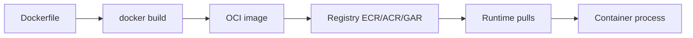

# Compute for Data Workloads

> Compute is where the money, the failures, and the complexity live. Every data pipeline
> you will ever design reduces to one question: *where does the CPU run?* The answer ranges
> from a persistent VM to a container orchestrated by Kubernetes to a function that exists
> for 300 milliseconds to a batch fleet you rent by the second. A senior engineer chooses
> compute by **workload shape** (latency, duration, statefulness, fault tolerance, cost
> sensitivity), not by fashion — and knows that the same Spark job can be 10× cheaper or
> 10× slower depending on which substrate it lands on.

## TL;DR

- **Four families to master:** VMs (IaaS), containers + Kubernetes (CaaS), serverless/FaaS,
  and managed batch/autoscaling clusters. Each optimizes a different axis.
- **Choose by shape, not hype:** long-running stateful → VM; portable packaging + scheduling
  → Kubernetes; bursty event handlers → FaaS; massive embarrassingly-parallel jobs → batch
  with spot.
- **Containers give you reproducibility; Kubernetes gives you scheduling.** Neither gives
  you elasticity for free — you still have to configure (and pay for) autoscaling.
- **Serverless is not "no servers," it's "no servers *you* manage."** The trade is cold
  starts, execution limits, and a price model that punishes long-running or chatty work.
- **Spot/preemptible instances are the single biggest cost lever for batch data** — often
  60–90% cheaper — but only for workloads that are interruptible, checkpointed, and
  idempotent.
- **Autoscale on the right signal.** CPU is a proxy; for data, the right signals are queue
  depth / consumer lag / pending tasks.
- **The cheapest compute is the compute you don't run.** Auto-suspend, scale-to-zero, and
  shutdown policies beat instance-type tuning every time.

## 1. Definitions and core vocabulary

- **Virtual Machine (VM) / instance** — a whole operating system on virtualized hardware.
  You own the kernel, patching, and the full cost while it runs. AWS EC2, Azure VM, GCP
  Compute Engine.
- **Container** — an OS-level virtualization unit: a process tree + filesystem bundled with
  its dependencies, sharing the host kernel. Docker/OCI image format is the de-facto standard.
- **Orchestrator** — software that schedules containers onto machines, restarts them, and
  scales them. Kubernetes (EKS/AKS/GKE), ECS, Nomad.
- **Serverless / FaaS** — event-driven functions with managed scaling and pay-per-invocation.
  Lambda, Azure Functions, Cloud Functions / Cloud Run (functions mode).
- **CaaS** — Containers-as-a-Service: managed container platforms (ECS, Cloud Run, ACI) that
  sit between raw VMs and full Kubernetes.
- **Managed batch** — a scheduler that queues jobs and provisions workers on demand: AWS
  Batch, Azure Batch, GCP Batch.
- **Serverless Spark / query** — engines that provision compute per job: EMR Serverless, Glue,
  Dataproc Serverless, BigQuery, Athena, Synapse serverless.
- **Spot / preemptible / low-priority** — spare capacity at a discount, revocable with short
  notice. AWS Spot, Azure Spot, GCP Spot VMs.
- **Cold start** — latency to initialize a fresh execution environment.
- **Graviton / Ampere / Tau / Axion** — ARM-based, cost-optimized CPU families offered by the
  three clouds.
- **Right-sizing** — matching instance size to actual utilization.
- **Bin-packing** — packing multiple workloads onto fewer machines to raise utilization.

## 2. What problem it solves / why it matters

### 2.1 The core tension

Data workloads have wildly different shapes:

| Workload | Duration | Statefulness | Latency need | Fault tolerance |
|---|---|---|---|---|
| Streaming consumer | indefinite | stateful (offsets, windows) | low | medium |
| Nightly ETL (Spark) | 10 min – 6 h | none (checkpointed) | none | high (retryable) |
| API / feature serving | indefinite | stateless | very low | high (replicas) |
| Event-triggered transform | ms | none | medium | high |
| Ad-hoc analytics query | seconds–minutes | none | medium | high |
| Model training | hours–days | checkpointed | none | high on spot |

No single compute substrate is optimal for all of these. The engineering value is in
**matching substrate to shape** and being able to justify it.

### 2.2 Why a senior must know this

Compute is typically **60–80% of a data platform's bill**. The difference between a naive
and a well-architected compute design is routinely a 3–10× cost difference *for identical
output*. Additionally, compute choice determines your *operational surface*: who patches,
who scales, who debugs the OOM, and how fast you can ship a new job. This is where senior
engineers create or destroy the most value.

## 3. How it works internally (mechanisms, internals)

### 3.1 VMs

A hypervisor partitions a physical host into VMs, each with its own kernel. Isolation is
strong (hardware-assisted; e.g. AWS Nitro). Startup is tens of seconds to minutes; images
(AMIs) are machine-scale snapshots. You pay for the whole instance while it exists, including
idle time. **Instance store vs EBS** matters: instance-store (NVMe) is ephemeral but fast;
EBS survives instance stop/terminate (depending on `DeleteOnTermination`).

```text
Physical host
├── VM 1  (your DataNode)   kernel, 16 vCPU, 64 GiB
├── VM 2  (another tenant)  kernel, 8 vCPU, 32 GiB
└── Hypervisor / Nitro cards (network + storage offload)
```

### 3.2 Containers

A container is a set of Linux namespaces (PID, mount, network, user) + cgroups (resource
limits) around a process tree, using a shared kernel. Benefits: fast start (ms–s), small
image, identical across environments. Costs: **weaker isolation** (shared kernel), and you
must think about image size, base images, and multi-arch (ARM vs x86) builds.



Layering is the key internal detail: images are content-addressed layers, so caching only
works if you order your Dockerfile from least- to most-frequently-changed.

### 3.3 Kubernetes

Kubernetes is a desired-state control loop. You declare "I want 5 replicas of this Pod spec";
the scheduler binds pods to nodes; kubelet runs them; controllers reconcile continuously.

```text
kube-apiserver  ← the control plane state (etcd)
   ▲    │
   │    ▼
controllers (Deployment/StatefulSet/Job/DaemonSet/CronJob/HPA/Operator)
          │ schedules
          ▼
        Nodes (kubelet + container runtime)
```

Relevant object types for data:

- **Job / CronJob** — run-to-completion batch; the primary batch primitive.
- **StatefulSet** — stable identity + storage; for Kafka/Spark-standalone/databases.
- **DaemonSet** — one pod per node; for log shippers, agents, Spark node daemons.
- **Operator** — a custom controller encoding domain knowledge (Spark Operator, Flink
  Operator, Strimzi for Kafka, Airflow's KubernetesExecutor).
- **HPA / VPA / Cluster Autoscaler / Karpenter** — the scaling loops.

### 3.4 Serverless / FaaS

A function is packaged (zip or container image), registered, and invoked by an event
(HTTP, queue, schedule, object-created). The provider runs it in a micro-VM (AWS Firecracker)
or sandbox, and meters per request + GB-seconds. Mechanics that matter:

- **Concurrency model.** Reserved/provisioned concurrency vs. on-demand; each concurrent
  invocation of a function instance handles one event at a time (mostly).
- **Cold start.** New execution environment → runtime init → your init code. Mitigations:
  provisioned concurrency, smaller packages, SnapStart (Java), keep-warm hacks (anti-pattern
  if overused).
- **Limits.** Execution time (Lambda 15 min), memory (Lambda 10 GB), payload sizes, ephemeral
  `/tmp` storage. These *force* architecture: long jobs must be decomposed or run elsewhere.
- **Statelessness.** Assume the environment can be created/destroyed any time; state goes to
  S3/DynamoDB/Redis.

### 3.5 Managed batch + autoscaling clusters

A job queue + a worker fleet with autoscaling. The internals: submit job → scheduler places
work units on workers → workers pull tasks → workers terminate when queue is empty. Scale to
**zero** is the defining feature.

For managed Spark (EMR/Dataproc/Databricks), the internals are a driver + a set of executors
(cores and memory) with **autoscaling policies** that add/remove *task* nodes based on
pending tasks, while keeping the driver and core nodes stable.

### 3.6 Spot / preemptible mechanics

The provider auctions spare capacity. When demand rises, your instance is reclaimed with a
**notice**: AWS emits a **two-minute interruption notice** (via instance metadata and
EventBridge) and can also emit a **rebalance recommendation** before the notice; Azure and
GCP give ~30 seconds (`SIGTERM`-style) for Spot/Preemptible VMs.

The correct pattern for data:

```text
Spot-safe workload = (checkpointed OR restartable) AND (idempotent) AND (no local durable state)
```

Spark on spot is spot-safe because a lost executor merely causes **task re-execution** — as
long as the driver is stable and the data source/sink are idempotent. Kafka consumers on spot
are safe *if* offsets are committed and processing is idempotent.

## 4. How to implement it (step-by-step, with IaC/CLI/config examples)

### 4.1 Dockerfile — a good data-workload image

```dockerfile
# Order layers least→most frequently changed for cache hits.
FROM python:3.12-slim AS base
ENV PYTHONUNBUFFERED=1 PIP_NO_CACHE_DIR=1

# 1. OS deps (rarely change)
RUN apt-get update && apt-get install -y --no-install-recommends \
      openjdk-17-jre-headless curl && rm -rf /var/lib/apt/lists/*

# 2. Python deps (change occasionally)
COPY requirements.txt .
RUN pip install -r requirements.txt

# 3. Code (changes constantly)
COPY src/ /app/src/
WORKDIR /app
# Run as non-root; data pipelines should not be root in production.
RUN useradd -m app && chown -R app /app
USER app
ENTRYPOINT ["python", "-m", "src.job"]
```

Build multi-arch (ARM is cheaper on all three clouds):

```bash
docker buildx build --platform linux/amd64,linux/arm64 \
  -t 123456789012.dkr.ecr.eu-west-1.amazonaws.com/etl:1.4.0 --push .
```

### 4.2 AWS Batch — a spot-optimized job definition

```json
{
  "jobDefinitionName": "nightly-etl",
  "type": "container",
  "containerProperties": {
    "image": "123456789012.dkr.ecr.eu-west-1.amazonaws.com/etl:1.4.0",
    "resourceRequirements": [
      { "type": "VCPU",   "value": "4" },
      { "type": "MEMORY", "value": "16384" }
    ],
    "environment": [ { "name": "LANDING", "value": "s3://lake/raw" } ],
    "jobRoleArn": "arn:aws:iam::123456789012:role/etl-execution"
  },
  "retryStrategy": { "attempts": 3 },
  "timeout": { "attemptDurationSeconds": 14400 }
}
```

```bash
# Compute environment preferring SPOT with an on-demand fallback
aws batch create-compute-environment --compute-environment-name etl-spot \
  --type MANAGED --state ENABLED \
  --compute-resources type=SPOT,minvCpus=0,maxvCpus=2000,desiredvCpus=0,\
instanceTypes=optimal,subnets=subnet-a,subnet-b,subnet-c,\
instanceRole=arn:aws:iam::123456789012:instance-profile/batch-ecs
```

Note the two levers: `minvCpus=0` (scale to zero) and `type=SPOT` (cost).

### 4.3 Kubernetes — a spot-tolerant Spark batch Job

```yaml
apiVersion: batch/v1
kind: Job
metadata:
  name: daily-aggregate
spec:
  backoffLimit: 4
  ttlSecondsAfterFinished: 3600      # auto-cleanup → less junk
  template:
    spec:
      nodeSelector: { karpenter.sh/capacity-type: spot }
      tolerations:
        - key: "sku"; operator: "Equal"; value: "spot"; effect: "NoSchedule"
      terminationGracePeriodSeconds: 120
      containers:
        - name: agg
          image: 123456789012.dkr.ecr.eu-west-1.amazonaws.com/etl:1.4.0
          resources:
            requests: { cpu: "2", memory: "8Gi" }
            limits:   { cpu: "4", memory: "12Gi" }
---
apiVersion: keda.sh/v1alpha1
kind: ScaledObject             # scale on a real signal: Kafka lag / queue depth
metadata: { name: consumer-scaler }
spec:
  scaleTargetRef: { name: stream-consumer }
  minReplicaCount: 1
  maxReplicaCount: 60
  triggers:
    - type: kafka
      metadata:
        bootstrapServers: kafka:9092
        consumerGroup: stream-consumer
        topic: events
        lagThreshold: "5000"
```

`ttlSecondsAfterFinished`, `backoffLimit`, `nodeSelector`, and a KEDA/ScaledObject based on
**lag** (not CPU) are the four things most teams forget.

### 4.4 Autoscaling the cloud-side (managed Spark)

```bash
# EMR managed scaling on a transient cluster
aws emr create-cluster \
  --name "nightly" --release-label emr-7.1.0 \
  --applications Name=Spark \
  --managed-scaling-policy '{"ComputeLimits":{"UnitType":"OnDemandUnit","MinimumCapacityUnits":2,"MaximumCapacityUnits":64,"MaximumOnDemandCapacityUnits":8}}' \
  --instance-fleets '[{"InstanceFleetType":"MASTER","TargetOnDemandCapacity":1,"InstanceTypeConfigs":[{"InstanceType":"m7g.xlarge"}]},
                      {"InstanceFleetType":"CORE","TargetOnDemandCapacity":2,"InstanceTypeConfigs":[{"InstanceType":"m7g.xlarge"}]},
                      {"InstanceFleetType":"TASK","TargetSpotCapacity":60,"InstanceTypeConfigs":[{"InstanceType":"m7g.xlarge"},{"InstanceType":"m6g.xlarge"},{"InstanceType":"m5.xlarge"}]}]' \
  --auto-terminate
```

Spreading task nodes across **several instance types** dramatically reduces spot interruption
risk (they don't all get reclaimed at once).

### 4.5 Lambda sizing and provisioned concurrency (Terraform)

```hcl
resource "aws_lambda_function" "transform" {
  function_name    = "s3-transform"
  runtime          = "python3.12"
  architectures    = ["arm64"]           # ~20% cheaper than x86
  handler          = "src.handler.main"
  filename         = "build/transform.zip"
  memory_size      = 1769                # memory also scales CPU
  timeout          = 300
  role             = aws_iam_role.lambda.arn

  environment { variables = { OUTPUT_BUCKET = "lake-curated" } }
}

resource "aws_lambda_provisioned_concurrency_config" "warm" {
  function_name                     = aws_lambda_function.transform.function_name
  qualifier                         = aws_lambda_alias.live.name
  provisioned_concurrent_executions = 20
}
```

## 5. Where to implement it (AWS / Azure / GCP equivalents)

### 5.1 Compute service map

| Capability | AWS | Azure | GCP |
|---|---|---|---|
| Virtual machines | EC2 | Virtual Machines | Compute Engine |
| ARM instances | Graviton (m7g/c7g/r8g) | Ampere (Dpsv5) / Cobalt | Tau T2A / Axion |
| Managed containers (simple) | ECS / App Runner | Container Apps / ACI | Cloud Run |
| Kubernetes | EKS | AKS | GKE (Autopilot) |
| Serverless functions | Lambda | Azure Functions | Cloud Functions |
| Serverless containers (no k8s) | Fargate / App Runner | Container Apps | Cloud Run |
| Managed batch | AWS Batch | Azure Batch | Cloud Batch |
| Managed Spark | EMR / EMR Serverless / Glue | Synapse Spark / HDInsight / Databricks | Dataproc / Dataproc Serverless / Databricks |
| Spot / preemptible | EC2 Spot | Azure Spot VMs | Spot VMs / Preemptible VMs |
| GPU | P/G families | NC/ND series | A/G series |
| Scale-to-zero k8s | Karpenter + KEDA | KEDA + KEDA-addon | GKE Autopilot |

### 5.2 Decision table: which substrate for which data workload

| Data workload | Best substrate | Why |
|---|---|---|
| Kafka brokers | VMs / StatefulSet (managed: MSK/Event Hubs) | Long-running, stateful, storage-attached |
| Streaming consumer (Flink/Spark) | Kubernetes or managed Flink/k8s | Long-running, stateful, needs controlled scaling |
| Nightly Spark ETL | EMR/Dataproc/Databricks with spot + autoscale | Batch, interruptible, scale to zero |
| Ad-hoc SQL on lake | Athena / BigQuery / Synapse serverless | Serverless, pay-per-scan |
| Event-driven file transform | Lambda / Functions | Short, spiky, event-triggered |
| Feature serving API | Container on k8s (HPA) or Cloud Run | Low latency, stateless, horizontal |
| Model training | GPU cluster / spot batch | Long, checkpointed, GPU-bound |
| Batch OCR/render/genomics | AWS Batch / GCP Batch, spot | Embarrassingly parallel, interruptible |
| Warehouse transforms (dbt) | Managed warehouse (Snowflake/Redshift/BigQuery) | SQL, elastic warehouse |
| Scheduler/orchestrator | Managed Airflow (MWAA/Composer/ADF) | Long-running control loop, low compute |

## 6. Patterns and anti-patterns

### 6.1 Patterns

- **Queue-fed autoscaling.** Never scale on CPU for data; scale on queue depth, consumer lag,
  pending executors, or partition count.
- **Spot with diversification.** Multiple instance types + multiple AZs + on-demand baseline
  for the driver/core.
- **Cattle, not pets.** Clusters are ephemeral, created per job/run, destroyed after.
- **Checkpoint to durable storage.** Every long job writes progress to S3/Blob/GCS or a
  checkpoint store, so a preemption costs minutes, not hours.
- **Idempotent sinks.** Overwrite-by-partition / MERGE / upsert so retries and re-executions
  don't duplicate data.
- **Right image, right arch.** ARM where possible; slim base images; pinned dependencies.
- **Tie compute to data location.** Same region (and ideally AZ) as the lake.
- **Backpressure + bounded concurrency.** Protect downstream systems from an autoscaler's
  enthusiasm.

### 6.2 Anti-patterns

- **Always-on clusters for nightly work.** 23 hours of idle cost per day.
- **Scaling on CPU for streaming.** Lag grows while CPU sits at 20%.
- **Lambda for long jobs.** Fighting the 15-minute limit with hacks instead of decomposing.
- **Single instance type on spot.** One capacity pool → correlated interruptions.
- **Stateful data on ephemeral local disk.** Preemption = data loss.
- **Kubernetes for one cron job.** You now own a control plane to run a script.
- **"We'll fix cold starts later."** Users feel them; make warm capacity a decision.
- **Ignoring `terminationGracePeriodSeconds`.** Preempted pods get SIGKILLed mid-write.
- **Over-provisioned requests = wasted scheduling.** Requesting 8 CPU for a job that uses 1.

## 7. Real-world use cases and industry applications

- **Streaming at a rideshare company:** Flink on Kubernetes with lag-based autoscaling handles
  10× surge at rush hour and scales down at night.
- **Retail batch:** AWS Batch on spot processes 40 TB of clickstream nightly at ~15% of
  on-demand price; job-level retries absorb preemptions.
- **Genomics:** Thousands of short tasks (alignments) on GCP Batch / AWS Batch, spot-heavy,
  orchestrated by a DAG; scale-to-zero between runs.
- **Fintech risk:** Persistent Kafka (MSK/Event Hubs) + streaming consumers on k8s; batch
  reconciliation on managed Spark with spot task nodes.
- **Media transcoding:** Serverless/spot workers triggered by object-created events; per-minute
  billing matches the workload exactly.
- **SaaS product analytics:** Event-driven Lambda/Functions for real-time counters + overnight
  warehouse transforms.

## 8. Senior-level deep dive: trade-offs, architecture decisions, performance, failure modes, debugging, cost

### 8.1 The master trade-off matrix

| Substrate | Start latency | Ops burden | Cost model | Statefulness | Best for |
|---|---|---|---|---|---|
| VM | 30 s–min | High (OS, patching) | per hour/second, always-on | Strong | Kafka, long-running services |
| Containers (CaaS) | s | Medium | per vCPU/mem-second | Medium | Stateless services, simple jobs |
| Kubernetes | s–min (node) | High | whatever nodes cost | Strong (StatefulSet) | Mixed, portable, complex scheduling |
| FaaS | ms–s (cold) | Low | per request + GB-s | None | Short event handlers |
| Managed batch | min | Low–medium | per instance-second | None | Large parallel batch |
| Serverless Spark/query | 30 s–min | Very low | per job / per scan | None | Spiky analytics, ad-hoc |

### 8.2 Decision procedure

1. **Is it stateful and long-running?** → VM or StatefulSet (or managed equivalent).
2. **Is it short and event-driven (<15 min) and spiky?** → FaaS.
3. **Is it long, parallel, and interruptible?** → managed batch + spot.
4. **Is it long, parallel, and NOT interruptible?** → managed batch + on-demand, or
   checkpoint aggressively so it *becomes* interruptible.
5. **Is it a query?** → serverless query engine, unless you have steady high concurrency
   (then provisioned warehouse/slots).
6. **Is it a low-latency serving API?** → containers + HPA on RPS/latency.

> Senior note: the second-order question is always **"who pays for idle time and who pays for
> start time?"** You are always trading one for the other. Spot and scale-to-zero trade idle
> cost for interruption handling; provisioned concurrency trades idle cost for latency.

### 8.3 Performance internals that bite

- **Memory-to-CPU ratio and OOM kills.** Most container OOMs are because the JVM/heap was not
  sized to the cgroup limit. Set both `requests` and `limits`, and respect them.
- **Network bandwidth per instance.** Instance families have caps; a "big" VM with a small
  network pipe bottlenecks shuffle. Check the bandwidth spec.
- **EBS/disk throughput.** Provisioned IOPS vs gp3 vs instance-store; a shuffle-heavy job
  hitting an under-provisioned volume is disk-bound, not CPU-bound.
- **CPU steal / noisy neighbors.** Rare on modern providers, but visible as high `steal%` on
  shared tenancy; dedicated tenancy fixes it at a premium.
- **JVM warm-up / JIT.** For short tasks, JVM startup dominates; SnapStart, GraalVM, or
  Python/Go may win.
- **Data locality.** Remote reads (cross-region, cross-AZ) can dominate runtime; co-locate.

### 8.4 Failure modes and debugging

| Symptom | Likely cause | Debug lever |
|---|---|---|
| Job killed mid-run, no OOM | Spot preemption | Check interruption notice/logs; add retries + checkpointing |
| Tasks fail on some executors | Lost nodes / preemption | Enable Spark task retry, blacklist flaky nodes |
| Slow streaming, growing lag | Under-provisioned consumers or partitions | Check lag vs. partition count; scale or repartition |
| Lambda timeouts | Exceeded 15-min limit or downstream slow | Decompose; raise memory (raises CPU) |
| Pods `Pending` forever | Autoscaler can't find capacity / quota | Inspect node pool limits, quotas, taints |
| Cold-start latency spikes | Scale-from-zero | Provisioned concurrency / min replicas |
| High cost, low utilization | Over-provisioned, always-on | Utilization metrics; downsize or scale-to-zero |

Debugging sequence: **metrics → events → logs → traces → reprovision**. For Kubernetes,
`kubectl describe pod` and events are gold; for Spark, the driver log and the Spark UI's
"Executors" tab tell you about preemptions and skew.

### 8.5 Cost mechanics

Model each substrate's bill as:

```text
VM:            vCPU_hours × price + storage + data transfer
Containers:    container_vCPU_seconds × price (Fargate) or node cost (k8s)
FaaS:          requests × price + GB_seconds × price (+ provisioned concurrency $)
Managed batch: instance_seconds × (spot price or on-demand price) + orchestrator
Serverless SQL: bytes_scanned × price (or slots/months for committed capacity)
Managed Spark:  DBU/node-hour × price + storage + transfer
```

The levers, ranked by typical impact:

1. **Run on spot/preemptible** (60–90% off, needs fault tolerance).
2. **Scale to zero** (eliminates idle).
3. **Reduce the work** (partition pruning, column pruning, fewer bytes scanned/shuffled).
4. **Right-size** (match vCPU:mem:disk to actual usage).
5. **ARM instances** (10–40% better price/performance for many workloads).
6. **Reserved/committed use** for the *steady-state baseline* only.

## 9. Common mistakes and how to avoid them

| Mistake | Consequence | Fix |
|---|---|---|
| Scale on CPU for data pipelines | Lag grows; overspend | Scale on lag/queue depth/pending tasks |
| Always-on clusters | 20× idle cost | Ephemeral clusters, auto-terminate, scale-to-zero |
| Single spot pool | Correlated preemption | Diversify instance types + AZs |
| Non-idempotent sinks | Duplicate rows on retry | MERGE/upsert, partition overwrite |
| Lambda for >15-min work | Timeouts, hacks | Decompose or use batch/k8s |
| Wrong arch image | Wasted money or `exec format error` | Multi-arch buildx; ARM where possible |
| Ignoring graceful termination | Truncated writes on preemption | `preStop`, `terminationGracePeriodSeconds` |
| Relying on local disk | Data loss on preemption | Durable checkpoints |
| No resource requests | OOM + noisy neighbors | Set requests/limits; test under load |
| Kubernetes for trivial jobs | Control-plane ops tax | Use CaaS/serverless instead |
| Over-requesting resources | Wasted scheduling, spend | Right-size from real metrics |
| Forgetting quotas | Scale-out fails at peak | Monitor + pre-request quota increases |

## 10. Exercises / interview questions (hints only)

1. **A Spark job runs 8 h/night at $3k.** Propose three independent changes that could cut
   cost by 70% and estimate each. *(Hint: spot, executors, scaling policy, scan volume.)*
2. **When is Lambda the *wrong* choice, even if it fits in 15 minutes?** *(Hint: sustained
   high-throughput cost, VPC cold starts, concurrency limits, state.)*
3. **You must run a stateful Kafka broker yourself on Kubernetes.** What object type, what
   storage, and how do you survive a node loss? *(Hint: StatefulSet + PVC + repl ; operator.)*
4. **Design autoscaling for a Flink stream consumer** that must keep end-to-end latency under
   2 s. What do you scale on, and what are the limits? *(Hint: partitions / parallelism / lag;
   checkpointing under rebalance.)*
5. **Explain why spot is safe for Spark but dangerous for a single-node database.** *(Hint:
   task re-execution vs. durable primary.)*
6. **Compare the real cost of 1,000 × 5-minute FaaS invocations vs. one 5-vCPU VM for the
   same total work.** Under what concurrency do they cross over? *(Hint: GB-s vs vCPU-h;
   utilization.)*
7. **Your k8s pods are always `Pending` during the nightly peak.** List five possible causes
   and the metric for each. *(Hint: quota, node pool max, taints, requests, AZ capacity.)*
8. **How would you make a 4-hour ML training job spot-tolerant?** *(Hint: checkpoints, resume,
   task-level retries.)*

## References

- AWS Well-Architected — Performance Efficiency & Cost Optimization pillars — https://docs.aws.amazon.com/wellarchitected/latest/framework/welcome.html
- Amazon EC2 instance types — https://docs.aws.amazon.com/ec2/latest/instancetypes/instance-types.html
- Amazon EC2 Spot: interruptions and best practices — https://docs.aws.amazon.com/AWSEC2/latest/UserGuide/spot-interruptions.html
- EKS cost optimization: Spot interruption handling — https://docs.aws.amazon.com/prescriptive-guidance/latest/eks-cost-optimization/spot-instance-interruption-handling.html
- AWS Fargate or AWS Lambda? decision guide — https://docs.aws.amazon.com/decision-guides/latest/decision-guides/fargate-or-lambda.html
- Deploy Lambda functions with container images — https://docs.aws.amazon.com/prescriptive-guidance/latest/patterns/deploy-lambda-functions-with-container-images.html
- AWS Batch — https://docs.aws.amazon.com/batch/latest/userguide/what-is-batch.html
- Amazon EMR managed scaling — https://docs.aws.amazon.com/emr/latest/ManagementGuide/emr-managed-scaling.html
- Amazon EMR Serverless — https://docs.aws.amazon.com/emr/latest/EMR-Serverless-UserGuide/emr-serverless.html
- Kubernetes: Horizontal Pod Autoscaling — https://kubernetes.io/docs/concepts/workloads/autoscaling/horizontal-pod-autoscale/
- Kubernetes Job / CronJob — https://kubernetes.io/docs/concepts/workloads/controllers/job/
- KEDA — https://keda.sh/docs/
- Karpenter — https://karpenter.sh/docs/
- Databricks enhanced autoscaling — https://docs.databricks.com/aws/en/ldp/auto-scaling
- Azure Container Apps — https://learn.microsoft.com/en-us/azure/container-apps/overview
- Azure Batch — https://learn.microsoft.com/en-us/azure/batch/batch-technical-overview
- Google Cloud Run — https://cloud.google.com/run/docs/overview/what-is-cloud-run
- Google Cloud Batch — https://cloud.google.com/batch/docs
- Dataproc Serverless — https://cloud.google.com/dataproc-serverless/docs
