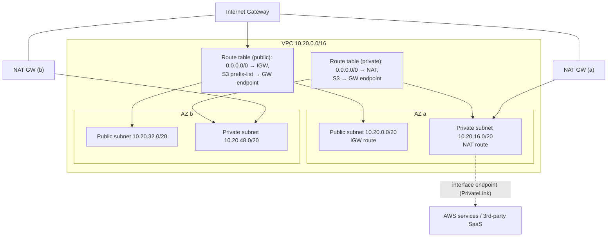

# Networking for Data Pipelines

> Networking is the layer data engineers inherit and rarely design — until a Spark job moves
> 30 TB across regions, a Kafka consumer can't reach a broker behind a private subnet, a
> warehouse can't read a "public" S3 bucket, or the NAT gateway quietly costs more than the
> compute. The cloud network is not a black box: it is a VPC you define, subnets you carve,
> routes you write, and security groups you attach. Understanding it is the difference
> between a pipeline that works and one that is inexplicably slow, unreachable, or
> terrifying expensive.

## TL;DR

- **A VPC is your private, isolated network** — a CIDR block you own, divided into **subnets**
  (one AZ each), connected by route tables. Everything else (security, isolation, cost) hangs
  off this.
- **Security groups = stateful, instance-level allow rules. NACLs = stateless, subnet-level
  allow/deny.** You design with security groups; NACLs are a coarse second layer.
- **Private subnets + NAT for egress, public subnets for ingress.** The NAT gateway is a
  convenience that costs real money per GB — replace it with **VPC endpoints/PrivateLink**
  wherever the traffic is to cloud services.
- **Load balancers (ALB/NLB, App Gateway, Cloud LB) distribute traffic**; for data, they
  front APIs, Grafana, and databases (NLB for L4/TCP), not Spark jobs.
- **DNS is the routing layer nobody debugs until it breaks:** private hosted zones, service
  discovery, TTLs, split-horizon DNS for hybrid.
- **Latency is topological, not magical.** Same-AZ ≪ cross-AZ ≪ cross-region ≪ internet.
  Co-locate compute with data and know which hops you're paying for.
- **Egress is a first-class design constraint.** Cross-AZ, cross-region, NAT, and internet
  egress all cost; PrivateLink/endpoints and co-location cut it.
- **Hybrid connectivity (Direct Connect/ExpressRoute/Interconnect, VPN)** is how the data
  center and the cloud meet — with bandwidth, latency, and failure-mode trade-offs.

## 1. Definitions and core vocabulary

- **VPC / VNet (Virtual Private Cloud / Network)** — an isolated virtual network with your own
  IP ranges, routing, and gateways. AWS "VPC", Azure "Virtual Network", GCP "VPC network".
- **CIDR block** — the IP range of the VPC, e.g. `10.20.0.0/16` (65,536 addresses). Plan it
  once, because overlapping ranges break peering and VPN forever.
- **Subnet** — a slice of the VPC CIDR bound to **one AZ** (AWS/Azure). GCP subnets are
  regional, not zonal — an important difference.
- **Public vs private subnet** — a public subnet has a route to an internet gateway; private
  subnets route outbound through a NAT device and have no inbound internet path.
- **Route table** — rules mapping destination CIDRs to targets (IGW, NAT, peering, TGW, VPN).
- **Internet Gateway (IGW)** — VPC attachment enabling internet traffic (with a public IP).
- **NAT Gateway / NAT instance** — outbound-only internet for private subnets.
- **Security Group** — stateful, instance/ENI-level virtual firewall (allow rules only).
- **Network ACL (NACL)** — stateless, subnet-level firewall (allow and deny, evaluated in
  order).
- **Load balancer** — L4 (NLB) or L7 (ALB/Application Gateway/Cloud LB) traffic distributor.
- **VPC endpoint (gateway / interface)** — private access to a cloud service without
  traversing the internet/NAT. Interface endpoints are powered by **PrivateLink**.
- **Transit Gateway / Virtual WAN / Network Connectivity Center** — hub for interconnecting
  many VPCs and on-prem networks.
- **Peering** — direct VPC-to-VPC connectivity (non-transitive).
- **Route 53 / Azure DNS / Cloud DNS** — managed DNS, including private hosted zones.
- **Direct Connect / ExpressRoute / Cloud Interconnect** — dedicated private links to on-prem.
- **VPC Flow Logs / NSG Flow Logs** — metadata of accepted/rejected traffic, the primary
  network debugging tool.
- **MTU / jumbo frames** — larger frames reduce overhead; must match end-to-end.

## 2. What problem it solves / why it matters

Networking answers four questions for every data system:

1. **Reachability:** Can the pipeline component talk to the data source and sink? (Private
   subnets, endpoints, routes, DNS.)
2. **Isolation and security:** Who can reach the database? (Security groups, private subnets,
   PrivateLink, no public IPs.)
3. **Performance:** How fast can bytes move? (Topology, bandwidth, MTU, distance.)
4. **Cost:** What does moving those bytes cost? (Cross-AZ, cross-region, NAT, egress.)

A senior data engineer does not need to be a network architect, but must be able to (a) read
a route table, (b) reason about a security group, (c) know why a private subnet needs a NAT
or endpoint, and (d) forecast the data-transfer consequences of a placement decision. Most
"the pipeline can't connect" incidents and a large share of surprise bills are networking.

## 3. How it works internally (mechanisms, internals)

### 3.1 The anatomy of a VPC



The critical internals:

- **Routes are per-subnet via a route table association.** Two subnets can share a route
  table (as above) or have different ones. Most "it works in the public subnet but not the
  private one" bugs are a missing route.
- **Security groups are stateful:** return traffic is automatically allowed. You do not open
  ephemeral port ranges (unlike NACLs).
- **NACLs are stateless:** you *do* need to allow ephemeral ports, and ordering matters.
- **NAT is per-AZ.** A single NAT gateway in one AZ means cross-AZ charges for workloads in
  other AZs and an AZ failure that cuts egress. Put a NAT in each AZ.
- **Gateways don't have security groups.** IGW, NAT, TGW, and endpoints are not protected by
  SGs (except interface endpoints).

### 3.2 Security groups vs. NACLs

| Property | Security Group | Network ACL |
|---|---|---|
| Scope | Instance/ENI | Subnet |
| State | Stateful | Stateless |
| Rules | Allow only | Allow + Deny |
| Evaluation | All rules combined | Ordered, first match |
| Return traffic | Automatic | Must be explicitly allowed |
| Use | Primary defense | Coarse subnet guardrail |

> Senior note: NACLs are almost never the reason something works, but they are frequently the
> reason something *doesn't*. When a connection is silently dropped, check the NACL for
> missing ephemeral-port rules before blaming the app.

### 3.3 Load balancers

- **L4 (NLB / Azure Load Balancer / GCP TCP/UDP LB):** forwards TCP/UDP; fast, preserves
  source IP (optional); used for databases, Kafka, custom protocols.
- **L7 (ALB / Application Gateway / GCP HTTP(S) LB):** HTTP-aware; paths, hosts, TLS
  termination, WAF; used for APIs and dashboards.

For data platforms, LBs matter for: **REST APIs on warehouse/feature stores**, **Grafana/
Superset/Airflow UIs**, **proxying Kafka (NLB),** and **ingress to Kubernetes** (Ingress/
Gateway API → ALB/NLB/GCP LB).

### 3.4 VPC endpoints / PrivateLink

An **interface endpoint** creates an ENI in your subnet with a private IP that fronts a cloud
service (or a third-party service via PrivateLink). Traffic never leaves the VPC's private
addressing or reaches the internet — improving security *and* eliminating NAT data-processing
charges. A **gateway endpoint** (S3, DynamoDB in AWS) is a route-table target; it is free.

```text
Before:  Private subnet ──► NAT GW (per-GB charge) ──► Internet ──► S3 (public endpoint)
After:   Private subnet ──► Gateway endpoint (free) ──────────────► S3 (private)
Or:      Private subnet ──► Interface endpoint ENI ──► KMS/Secrets/ECR (PrivateLink)
```

This is one of the highest-ROI changes for a data platform: it removes NAT cost, removes
internet exposure, and stabilizes latency.

### 3.5 DNS internals

DNS is the layer that "just works" until it doesn't. The pieces that matter:

- **Public zone** — records resolvable on the internet (`api.acme.com`).
- **Private hosted zone** — records resolvable only inside your VPC(s); essential for
  service discovery and for keeping internal endpoints internal.
- **Split-horizon DNS** — the same name resolves differently inside vs. outside; common in
  hybrid setups.
- **TTL** — low TTL = fast failover but more queries; high TTL = cheaper/steadier but slower
  to change.
- **Health checks + failover routing** — DNS-based failover is *slow* (TTL-bound) and should
  be a last resort for RTO-critical paths; use load balancers or global accelerators instead.

### 3.6 Latency and bandwidth: the physics

Order-of-magnitude one-way latencies (illustrative):

```text
Same host / same AZ, same rack:      < 0.1 ms
Same AZ, different rack:             0.1–0.5 ms
Cross-AZ within region:              0.5–2 ms
Cross-region (e.g. US East↔West):    30–70 ms
Cross-continent:                     80–200 ms
Internet (variable):                 10–300+ ms
```

Bandwidth is per-instance and per-flow limited; a single TCP flow rarely saturates a fast NIC
without parallelism. **For data movement, parallelism beats a bigger pipe** — many concurrent
readers/writers, not one hero connection.

### 3.7 The cost topology of data transfer

```text
Ingress (into a region from the internet):     usually free
Intra-AZ traffic:                              usually free (same VPC/AZ)
Cross-AZ traffic:                              billed per GB (both directions)
Cross-region traffic:                          billed per GB (higher)
Internet egress:                               billed per GB (highest)
NAT gateway:                                   hourly + per-GB data processing
PrivateLink endpoints:                         hourly + per-GB
```

Design consequence: **keep chatty traffic intra-AZ, keep bulk-to-service traffic on endpoints,
and never run a reader in region A against a dataset in region B when you could move the
reader.**

## 4. How to implement it (step-by-step, with IaC/CLI/config examples)

### 4.1 A production-grade VPC with Terraform

```hcl
data "aws_availability_zones" "az" { state = "available" }

resource "aws_vpc" "main" {
  cidr_block           = "10.20.0.0/16"
  enable_dns_support   = true
  enable_dns_hostnames = true
  tags = { Name = "data-vpc" }
}

resource "aws_internet_gateway" "igw" { vpc_id = aws_vpc.main.id }

# Public subnets (ALB, NAT)
resource "aws_subnet" "public" {
  count             = 3
  vpc_id            = aws_vpc.main.id
  cidr_block        = cidrsubnet(aws_vpc.main.cidr_block, 4, count.index)           # 10.20.0.0/20, ...
  availability_zone = data.aws_availability_zones.az.names[count.index]
  map_public_ip_on_launch = false
  tags = { Name = "public-${count.index}", "kubernetes.io/role/elb" = "1" }
}

# Private subnets (data, apps, RDS, k8s nodes)
resource "aws_subnet" "private" {
  count             = 3
  vpc_id            = aws_vpc.main.id
  cidr_block        = cidrsubnet(aws_vpc.main.cidr_block, 4, count.index + 8)      # 10.20.128.0/20, ...
  availability_zone = data.aws_availability_zones.az.names[count.index]
  tags = { Name = "private-${count.index}", "kubernetes.io/role/internal-elb" = "1" }
}

resource "aws_nat_gateway" "nat" {                  # one per AZ → no cross-AZ NAT charges
  count         = 3
  allocation_id = aws_eip.nat[count.index].id
  subnet_id     = aws_subnet.public[count.index].id
  depends_on    = [aws_internet_gateway.igw]
}
resource "aws_eip" "nat" { count = 3, domain = "vpc" }

resource "aws_route_table" "private" {
  count  = 3
  vpc_id = aws_vpc.main.id
  route {
    cidr_block     = "0.0.0.0/0"
    nat_gateway_id = aws_nat_gateway.nat[count.index].id
  }
}
resource "aws_route_table_association" "private" {
  count          = 3
  subnet_id      = aws_subnet.private[count.index].id
  route_table_id = aws_route_table.private[count.index].id
}

# Free gateway endpoint for S3 — no NAT, no internet
resource "aws_vpc_endpoint" "s3" {
  vpc_id            = aws_vpc.main.id
  service_name      = "com.amazonaws.eu-west-1.s3"
  vpc_endpoint_type = "Gateway"
  route_table_ids   = aws_route_table.private[*].id
}

# Interface endpoints for control-plane services (PrivateLink)
resource "aws_vpc_endpoint" "interface" {
  for_each            = toset(["kms", "secretsmanager", "ecr.api", "ecr.dkr", "logs", "sts"])
  vpc_id              = aws_vpc.main.id
  service_name        = "com.amazonaws.eu-west-1.${each.value}"
  vpc_endpoint_type   = "Interface"
  subnet_ids          = aws_subnet.private[*].id
  security_group_ids  = [aws_security_group.endpoints.id]
  private_dns_enabled = true
}
```

### 4.2 Security groups with least privilege (service-to-service)

```hcl
resource "aws_security_group" "rds" {
  name   = "rds-data"
  vpc_id = aws_vpc.main.id
  # No ingress rules here; add only from the app SG below.
}

resource "aws_security_group" "app" {
  name   = "app"
  vpc_id = aws_vpc.main.id
  egress { from_port = 0, to_port = 0, protocol = "-1", cidr_blocks = ["0.0.0.0/0"] }
}

# Allow Postgres only from the app SG (SG referencing SG — no CIDRs to maintain)
resource "aws_security_group_rule" "app_to_rds" {
  type                     = "ingress"
  from_port                = 5432
  to_port                  = 5432
  protocol                 = "tcp"
  security_group_id        = aws_security_group.rds.id
  source_security_group_id = aws_security_group.app.id
}
```

The **SG-references-SG** pattern is the professional idiom: it stays correct as IPs change.

### 4.3 Private endpoints and DNS checks

```bash
# Create an interface endpoint (CLI)
aws ec2 create-vpc-endpoint \
  --vpc-id vpc-0abc \
  --vpc-endpoint-type Interface \
  --service-name com.amazonaws.eu-west-1.kms \
  --subnet-ids subnet-a subnet-b subnet-c \
  --security-group-ids sg-0endpoints \
  --private-dns-enabled

# Verify a private hosted zone / endpoint DNS
aws route53 list-hosted-zones-by-vpc --vpc-id vpc-0abc --vpc-region eu-west-1
nslookup kms.eu-west-1.amazonaws.com 10.20.0.2   # should resolve to a private IP
```

```bash
# GCP: private Google access + Private Service Connect
gcloud compute networks subnets update data-subnet --region=europe-west1 \
  --enable-private-ip-google-access
gcloud compute addresses create psc-addr --global --purpose=PRIVATE_SERVICE_CONNECT

# Azure: service endpoints / private endpoints
az network vnet subnet update -g rg-data -n data-subnet \
  --service-endpoints Microsoft.Storage Microsoft.KeyVault
az network private-endpoint create -g rg-data -n pe-storage \
  --vnet-name data-vnet --subnet data-subnet \
  --private-connection-resource-id /subscriptions/.../storageAccounts/acmelake \
  --group-id blob --connection-name pe-storage-conn
```

### 4.4 Flow logs — the network's flight recorder

```bash
aws ec2 create-flow-logs \
  --resource-type VPC --resource-ids vpc-0abc \
  --traffic-type REJECT \
  --log-destination-type cloud-watch-logs \
  --log-group-name /aws/vpc/flowlogs
```

Query for the classic "who is dropping my traffic" question (CloudWatch Logs Insights):

```sql
fields @timestamp, srcAddr, dstAddr, dstPort, action
| filter action = "REJECT"
| stats count(*) by srcAddr, dstAddr, dstPort
| sort count desc
| limit 20
```

### 4.5 Hybrid connectivity

```text
On-prem ──(BGP over dedicated link: Direct Connect / ExpressRoute / Interconnect)──► VPC
On-prem ──(BGP over IPSec VPN: backup, lower bandwidth)────────────────────────────► VPC
```

Guidance: dedicated links for steady high-volume transfer (initial migrations, ongoing ETL
from on-prem); VPN as backup/for low volume. Use **Transit Gateway / Virtual WAN / NCC** to
avoid N×M peering meshes. Route carefully to avoid asymmetric paths.

## 5. Where to implement it (AWS / Azure / GCP equivalents)

### 5.1 Networking service map

| Capability | AWS | Azure | GCP |
|---|---|---|---|
| Private network | VPC | Virtual Network (VNet) | VPC network |
| Subnet scope | **Zonal** | **Zonal** | **Regional** |
| Firewall (instance) | Security Group | Network Security Group (NSG) | Firewall rules (by tag/SA) |
| Subnet ACL | Network ACL | Subnet NSG / NSG rules | Hierarchical firewall policies |
| Public egress | Internet Gateway | Internet (default) | Cloud NAT / external IP |
| Private egress (NAT) | NAT Gateway | NAT Gateway | Cloud NAT |
| L4 LB | Network Load Balancer | Azure Load Balancer | Network TCP/UDP LB |
| L7 LB | Application Load Balancer | Application Gateway | HTTP(S) Load Balancer |
| Global LB | Global Accelerator | Front Door | Global External LB |
| Private service access | PrivateLink / VPC endpoints | Private Link / service endpoints | Private Service Connect |
| DNS | Route 53 (private zones) | Azure DNS (private zones) | Cloud DNS (private zones) |
| Peering | VPC Peering | VNet Peering | VPC Peering |
| Hub | Transit Gateway | Virtual WAN | Network Connectivity Center |
| Dedicated link | Direct Connect | ExpressRoute | Cloud Interconnect |
| VPN | Site-to-Site VPN | VPN Gateway | Cloud VPN |
| Flow logs | VPC Flow Logs | NSG Flow Logs | VPC Flow Logs |
| Service discovery | Cloud Map | Azure Private DNS | Cloud DNS / Service Directory |

### 5.2 Same topology, three clouds

| Layer | AWS | Azure | GCP |
|---|---|---|---|
| Public entry | ALB in public subnet | App Gateway in a VNet | Global LB + backend service |
| Private app tier | Private subnets, N SGs | Private VNet, NSGs | Private subnets, firewall rules |
| Data services access | Gateway + interface endpoints | Service/private endpoints | Private Google Access + PSC |
| On-prem link | Direct Connect + TGW | ExpressRoute + vWAN | Interconnect + NCC |

## 6. Patterns and anti-patterns

### 6.1 Patterns

- **Three-tier subnets per AZ** (public/private/data) with least-privilege SGs.
- **SG-to-SG references** instead of CIDR lists.
- **One NAT per AZ** (or better, endpoints instead of NAT).
- **Gateway endpoints for S3/DynamoDB; interface endpoints for control-plane services.**
- **Transit Gateway / vWAN / NCC for hub-and-spoke** rather than full-mesh peering.
- **Private hosted zones** for internal DNS and service discovery.
- **Flow logs on REJECT at minimum**, to a central log account.
- **Non-overlapping CIDR planning** across all VPCs, before you peer.
- **Centralized egress/inspection VPC** for regulated environments.

### 6.2 Anti-patterns

- **Overlapping CIDRs** → peering/VPN impossible later.
- **A single NAT gateway** → cross-AZ charges + AZ-level egress outage.
- **Route-table copy-paste with missing endpoints** → services unreachable privately.
- **Wide-open security groups** (`0.0.0.0/0` on 22/5432/9092) → the most common breach vector.
- **Public subnets for data services** → needless exposure.
- **Relying on NACLs** for security instead of SGs.
- **All traffic through a firewall appliance by default** → latency + cost + single point of
  failure without careful design.
- **Ignoring cross-AZ traffic in a distributed system** → silent cost and latency.
- **DNS TTLs of 24 h** → 24-hour failover time.
- **No flow logs** → blind during incidents.

## 7. Real-world use cases and industry applications

- **Data lake access:** Spark in private subnets reads S3 through a gateway endpoint; no
  internet path, no NAT cost, no exposure.
- **Hybrid ETL:** on-prem Oracle → cloud warehouse over Direct Connect with a replication
  appliance, then transform in-region.
- **Regulated isolation:** all egress through a centralized inspection VPC; service endpoints
  for object storage; no public IPs anywhere.
- **Multi-tenant SaaS data plane:** per-tenant VPC or shared VPC with tenant-scoped SGs and
  IAM, providing isolation without 1:1 infrastructure.
- **Streaming:** Kafka brokers in private subnets with an NLB for client bootstrap, or MSK/
  Event Hubs with PrivateLink so consumers stay private.
- **Kubernetes ingress:** ALB/App Gateway terminates TLS; pods behind it never expose public IPs.

## 8. Senior-level deep dive: trade-offs, architecture decisions, performance, failure modes, debugging, cost

### 8.1 Trade-offs

**NAT gateway vs. VPC endpoints:**

| Dimension | NAT Gateway | VPC/Private Endpoint |
|---|---|---|
| Cost | hourly + per-GB processing | endpoint hourly (interface) or free (gateway) |
| Security | traffic to public endpoints | private addressing, no internet |
| Coverage | anything on the internet | specific services |
| Ops | simple | per-service endpoint management |
| Best | general outbound internet | traffic to cloud services at scale |

**Centralized vs. distributed egress:** centralizing (hub VPC) simplifies inspection and cost
visibility but adds hops, a shared failure domain, and coupling. Distribute until regulation
forces centralization.

**Peering vs. Transit Gateway:** peering is simple and cheaper for 2–3 VPCs; TGW/vWAN/NCC
scales to dozens/hundreds with a hub, at a per-GB + per-attachment cost.

### 8.2 Architecture decisions

1. **CIDR plan.** Reserve `/16` per VPC, `/20` per subnet, leave room for growth and peering.
   Document it. This is a one-time, irreversible-ish decision.
2. **One NAT per AZ or endpoints-only?** Endpoints-only is cheaper and more secure for a
   typical data platform; keep a NAT only for genuinely internet-bound traffic.
3. **PrivateLink for third-party SaaS** (Snowflake, Databricks, MongoDB) to avoid internet +
   egress and improve determinism.
4. **Where does compute live relative to data?** Same account/region/AZ. Cross-AZ only for
   HA, not for throughput.
5. **Should the warehouse reach the lake via endpoint or via internet?** Endpoint (or the
   provider's private-link offering), always, for cost and security.

### 8.3 Performance internals

- **MTU/jumbo frames (9001)** reduce per-packet overhead for bulk transfer; can be ~10%
  throughput gain when all hops support it. Path MTU mismatches cause mysterious stalls.
- **TCP window / single-flow limits.** Use parallel readers (many file parts, many connections)
  rather than a single stream.
- **Distance dominates.** No tuning beats moving the reader next to the writer.
- **Load balancer idle timeouts** silently kill long-lived connections (e.g. a streaming
  consumer through an ALB); tune and use TCP keepalives.
- **Conntrack/NAT port exhaustion** on busy egress paths causes intermittent connection
  failures at high connection churn — a classic symptom of many short-lived connections.
- **DNS resolution latency and caching** on each node affects connection setup; use a local
  resolver (node-local DNS cache) for high-churn services.

### 8.4 Failure modes and debugging playbook

| Symptom | Likely cause | Check |
|---|---|---|
| Connection times out (no RST) | SG/NACL/route missing | SG inbound? NACL ephemeral ports? route to target? |
| Connection refused | Service not listening / wrong port | App logs, listener |
| Works cross-AZ, fails same-AZ | Asymmetric route / SG scope | Route tables, SGs, subnet |
| Works in public, fails in private | Missing NAT/endpoint/route | Route table for private subnet |
| Intermittent 5xx under load | LB idle timeout, conntrack exhaustion | LB logs, connection reuse |
| Slow bulk transfer | Cross-region path, single flow, MTU | Flow logs, parallelism, MTU |
| DNS name resolves publicly but not privately | Missing private hosted zone | Route 53 private zone association |
| Hybrid link flaky | BGP/route asymmetry, VPN saturation | TGW/ExpressRoute metrics, BGP status |

Method: **never guess — look at flow logs.** They tell you whether the packet left the source
and whether it was accepted or rejected at the destination, which narrows it to
source/config/target in one step.

### 8.5 Cost mechanics

```text
Cross-AZ GB × price (both directions, both parties in some models)
+ Cross-region GB × price
+ Internet egress GB × price
+ NAT GW (hourly × count) + GB processed through NAT
+ Interface endpoints (hourly × count × AZ) + GB processed
+ Load balancer (hourly + LCU/NLCU usage)
+ Transit Gateway (per attachment + per GB)
+ Direct Connect (port hours + egress)
```

Levers, ranked:

1. **Eliminate NAT for cloud-service traffic** (endpoints) — often the biggest easy win.
2. **Keep compute in the data's AZ/region** to avoid cross-AZ/region GB.
3. **Reduce bytes moved** (compression, columnar, projection pruning) before optimizing the path.
4. **Consolidate NAT/endpoints sensibly** — many idle interface endpoints in many AZs add up.
5. **Right-size load balancers** (LCU-based billing punishes chatty traffic).

## 9. Common mistakes and how to avoid them

| Mistake | Impact | Fix |
|---|---|---|
| Overlapping CIDRs | No peering/VPN ever | Plan address space up front |
| Single NAT gateway | Cross-AZ cost + AZ outage | NAT per AZ or endpoints-only |
| SG `0.0.0.0/0` on data ports | Breach | SG-to-SG rules; private subnets |
| No endpoints for S3/KMS/ECR | NAT cost + internet exposure | Gateway/interface endpoints |
| Stateless NACL rules for return traffic forgotten | Silent drops | Allow ephemeral ports, or use SGs |
| Public subnets for RDS/Kafka | Exposure | Private subnets + NLB/PrivateLink |
| No flow logs | Blind debugging | Enable flow logs to a central account |
| Cross-region reads | Egress + latency | Co-locate compute |
| Long-lived LB connections untuned | Random disconnects | Raise idle timeout, keepalives |
| DNS TTLs too high | Slow failover | Lower TTLs on critical records |
| Hardcoded IPs | Breaks on change | DNS/service discovery |
| Full-mesh peering | Unmanageable at scale | Transit Gateway/vWAN/NCC |

## 10. Exercises / interview questions (hints only)

1. **Design a VPC** for a data platform needing private Spark, a private RDS, S3 access, and
   no internet egress except patches. List subnets, routes, SGs, endpoints. *(Hint: 3 AZs,
   endpoints-only, no NAT or one NAT for patch egress.)*
2. **Why did the private-subnet job fail to reach S3 while the public-subnet one succeeded?**
   *(Hint: routes, endpoints, NAT.)*
3. **Your cross-AZ data transfer bill doubled.** What are the likely architecture causes?
   *(Hint: chatty services split across AZs, replication, replicas.)*
4. **When is a NAT gateway the right choice over a VPC endpoint?** *(Hint: arbitrary internet
   destinations, patching, third parties without PrivateLink.)*
5. **Explain the difference between an SG and a NACL when debugging a drop.** *(Hint: stateful
   vs stateless, port ranges.)*
6. **Design hybrid connectivity for 5 TB/day from on-prem to cloud.** *(Hint: Direct Connect +
   TGW, bandwidth math, VPN backup.)*
7. **How would you give a Snowflake/BigQuery/Databricks workspace private access to your
   lake?** *(Hint: PrivateLink/service endpoints/Private Service Connect.)*
8. **Your Kafka consumers through an ALB disconnect every 60 s.** Why? *(Hint: idle timeout,
   keepalive, NLB for L4.)*

## References

- AWS VPC User Guide — https://docs.aws.amazon.com/vpc/latest/userguide/what-is-amazon-vpc.html
- Control subnet traffic with network ACLs — https://docs.aws.amazon.com/vpc/latest/userguide/vpc-network-acls.html
- Security groups — https://docs.aws.amazon.com/vpc/latest/userguide/vpc-security-groups.html
- Access AWS services through AWS PrivateLink — https://docs.aws.amazon.com/vpc/latest/privatelink/privatelink-access-aws-services.html
- Create an interface endpoint — https://docs.aws.amazon.com/vpc/latest/privatelink/create-interface-endpoint.html
- Gateway endpoints for S3 — https://docs.aws.amazon.com/vpc/latest/privatelink/vpc-endpoints-s3.html
- NAT gateway pricing — https://docs.aws.amazon.com/vpc/latest/userguide/nat-gateway-pricing.html
- VPC Flow Logs — https://docs.aws.amazon.com/vpc/latest/userguide/flow-logs.html
- Elastic Load Balancing (ALB/NLB) — https://docs.aws.amazon.com/elasticloadbalancing/latest/userguide/what-is-load-balancing.html
- AWS Transit Gateway — https://docs.aws.amazon.com/vpc/latest/tgw/what-is-transit-gateway.html
- AWS Direct Connect — https://docs.aws.amazon.com/directconnect/latest/UserGuide/Welcome.html
- Route 53 private hosted zones — https://docs.aws.amazon.com/Route53/latest/DeveloperGuide/hosted-zones-private.html
- Azure Virtual Network — https://learn.microsoft.com/en-us/azure/virtual-network/virtual-networks-overview
- Azure network security groups — https://learn.microsoft.com/en-us/azure/virtual-network/network-security-groups-overview
- Azure Private Link — https://learn.microsoft.com/en-us/azure/private-link/private-link-overview
- Azure ExpressRoute — https://learn.microsoft.com/en-us/azure/expressroute/expressroute-introduction
- Google Cloud VPC — https://cloud.google.com/vpc/docs/vpc
- Cloud NAT — https://cloud.google.com/nat/docs/overview
- Private Service Connect — https://cloud.google.com/vpc/docs/private-service-connect
- Cloud Interconnect — https://cloud.google.com/network-connectivity/docs/interconnect
