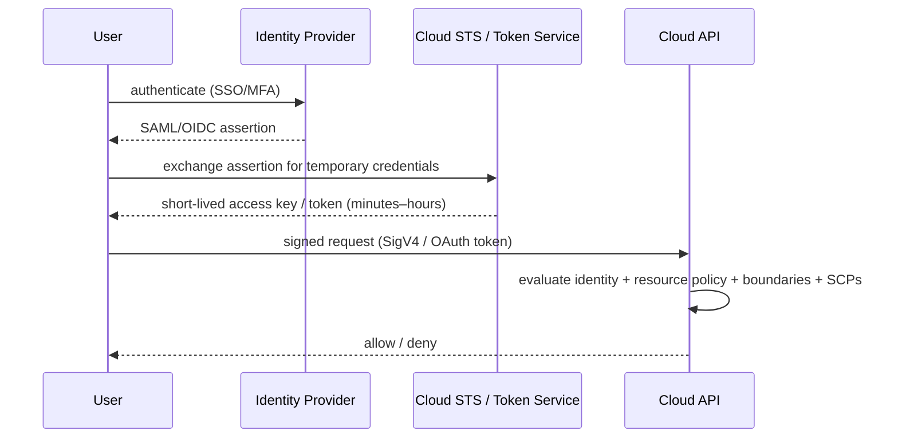

# IAM and Security for Data Platforms

> Data platforms are high-value targets: they aggregate PII, financial records, and
> proprietary signals, and they are accessed by many humans and many machines. Security is
> therefore not a gate you pass once — it is a set of architectural properties you build in:
> every identity is explicit, every permission is scoped, every secret is short-lived, every
> byte is encrypted, every action is logged, and every network path is intentional. A senior
> data engineer must design identity and access *as an interface* between systems, because
> the alternative — a shared admin key in a config file — is how breaches (and audit
> findings) happen.

## TL;DR

- **Identity is the new perimeter.** With no VPN and no fixed network boundary, *who* and
  *what* can call an API is the primary control.
- **Four identity types to master:** human/federated users, service identities (roles,
  service accounts, managed identities), workload identity (IRSA/GKE WI/pod identity), and
  machine-to-machine federation (OIDC from CI). Prefer short-lived credentials over static
  keys, always.
- **Least privilege is a process, not a policy.** Start with broad access in a sandbox, observe,
  then shrink to the observed set; use IAM Access Analyzer / Policy Analyzer / role
  recommendations to do it mechanically.
- **Encryption everywhere:** at rest (SSE-KMS/CMEK/Key Vault, customer-managed keys when
  required), in transit (TLS everywhere, including intra-VPC where feasible), and key
  management with rotation, separation of duties, and audit.
- **Secrets must be short-lived and central.** Secrets Manager/Key Vault/Secret Manager + IAM
  roles and federation beat environment variables; rotate and audit.
- **Network isolation is defense in depth:** private subnets, security groups, private
  endpoints, WAF, and egress control. Combine with IAM — neither alone is enough.
- **Auditing is non-negotiable:** CloudTrail/Activity Log/Cloud Audit Logs, S3 data events,
  query history, and centralized immutable log storage in a separate account.
- **Assume breach.** Design so a compromised workload can only do what its role allows, and
  can be revoked centrally.
- **Compliance drives architecture:** PCI/SOC2/HIPAA/GDPR requirements become concrete
  controls (residency, encryption, access logging, retention, WORM).

## 1. Definitions and core vocabulary

- **Principal** — anything that can make a request: user, role, service account, federated
  identity, or anonymous.
- **Identity provider (IdP)** — the source of truth for people (Okta, Entra ID, Google
  Workspace, SAML/OIDC).
- **Federation** — trusting an external IdP to authenticate; the cloud issues temporary
  credentials (AWS STS `AssumeRoleWithSAML/WebIdentity`, Azure federated credentials, GCP
  Workload Identity Federation).
- **Role / service account / managed identity** — a non-human identity assumed by workloads.
  AWS IAM role, GCP service account, Azure managed identity.
- **Policy** — a document defining allowed/denied actions on resources. AWS JSON policy,
  GCP IAM policy bindings + `roles`, Azure RBAC role definitions/assignments.
- **Permission boundary / SCP** — an outer limit on what an identity or account can do.
  AWS Service Control Policies and permission boundaries; Azure Policy; GCP org policies.
- **Least privilege** — the minimum permissions to perform the task, no more.
- **Resource-based policy** — policy attached to a resource (bucket policy, KMS key policy,
  queue policy) that grants cross-account or service access.
- **Trust policy vs. permission policy** (AWS) — who may assume the role vs. what the role may do.
- **Secret vs. credential vs. key** — secret = sensitive config (password, token); credential
  = authentication material; key = cryptographic material (KMS/CMEK).
- **Envelope encryption** — encrypt data with a data key; encrypt the data key with a KMS
  master key. The basis of nearly all cloud encryption.
- **KMS / CMK / CMEK** — key management service / customer master key / customer-managed
  encryption key.
- **Encryption in transit** — TLS/mTLS on the wire; **at rest** — encryption of stored bytes.
- **Network isolation** — private subnets, SGs, NACLs, private endpoints, egress control.
- **Audit trail** — immutable log of API activity (CloudTrail, Cloud Audit Logs, Activity Log).
- **Data classification** — Public / Internal / Confidential / Restricted; drives controls.
- **Zero trust** — no implicit trust based on network location; authenticate and authorize
  every request.

## 2. What problem it solves / why it matters

### 2.1 The threat model for data platforms

- **Credential leakage.** Static keys in code, notebooks, CI, or Slack. The #1 initial access
  vector in cloud breaches.
- **Over-broad permissions.** An analytics role with `s3:*` on all buckets turns one compromise
  into a full data exfiltration.
- **Lateral movement.** Flat networks and shared credentials let an attacker move from a
  compromised service to the data.
- **Insider/operator error.** Accidental deletion, public buckets, or a misconfigured policy.
- **Supply chain.** A compromised dependency or a third-party SaaS with broad access.
- **Compliance gaps.** Regulators require demonstrable control over access, encryption, and
  retention.

### 2.2 Why a senior must own it

Security cannot be entirely delegated to a security team: **the data engineer designs the
access paths**. Data engineers write the IAM policies for pipelines, set up the KMS keys,
put secrets in the right place, configure bucket policies and private endpoints, and enable
audit logging. A senior engineer knows that *the fastest incident response is an architecture
in which the incident can't happen*, and that the cheapest compliance audit is one where the
controls were code from day one.

## 3. How it works internally (mechanisms, internals)

### 3.1 Identity and credential flows



**Key internal facts:**

- **Authorization is the AND of several layers** (AWS): identity policy ∧ resource policy ∧
  permission boundary ∧ SCP ∧ VPC endpoint policy ∧ session policy. An explicit `Deny`
  anywhere wins. This is why "I gave it the right policy but it still fails."
- **Credentials are temporary by design.** AssumeRole returns an access key, secret,
  session token, and expiry. Long-lived IAM user keys exist but should be treated as a
  legacy escape hatch.
- **Policy evaluation uses conditions** (`aws:SourceVpc`, `aws:PrincipalOrgID`,
  `aws:SourceAccount`, `s3:prefix`, `kms:ViaService`, tags). Conditions are how you express
  "only from this VPC" or "only in my org."
- **GCP** evaluates IAM bindings (who → role → resource) plus **org policies** and **VPC
  Service Controls**; **Azure** evaluates RBAC role assignments (scope + role) plus **Azure
  AD** conditional access and **resource locks**.
- **Workload identity** removes static keys: a Kubernetes pod assumes a cloud role via its
  service account token (EKS IRSA, GKE Workload Identity, AKS Workload Identity), and CI
  assumes a role via OIDC (GitHub Actions → AWS/Azure/GCP) with **no stored secrets**.

### 3.2 Encryption internals

**Envelope encryption** (the universal pattern):

```text
Plaintext data
   │  encrypt with data key (AES-256-GCM)
   ▼
Ciphertext  +  EncryptedDataKey
                   │
                   │  data key was itself encrypted ("wrapped") by a KMS master key
                   ▼
              KMS (HSM-backed) holds the master key; never leaves the HSM in plaintext
```

Why it matters: KMS is not in the data path for every byte (only for wrapping/unwrapping
data keys and for authenticated operations), so it scales; and **auditing key use**
(`kms:Decrypt` events) gives you a signal on who read what.

- **At rest:** SSE-S3/SSE-KMS/SSE-C (S3), CMEK (GCS), customer-managed keys (Azure Storage
  encryption with Key Vault). Encryption is on by default in all three clouds; **customer-
  managed keys** add control and audit but also risk (a deleted key = permanent data loss).
- **In transit:** TLS 1.2+ everywhere; certificate management via ACM/Certificate Manager;
  mTLS for service-to-service where required.
- **Field-level / application-level encryption:** encrypt specific columns (PII) before
  storage so even a storage compromise doesn't expose plaintext. Increasingly complemented by
  **tokenization** and **format-preserving encryption**.
- **Key policies are the real access control.** In AWS, a KMS key policy plus IAM must *both*
  allow the caller. A key policy that grants `*` to the account root delegates to IAM; one
  that doesn't, blocks IAM grants. **Deleting or rotating keys is a security-critical op.**

### 3.3 Secrets internals

```text
Bad:   API_KEY=... in a repo / env var / notebook  → leaked forever, no rotation, no audit
Good:  workload assumes a role → calls Secrets Manager GetSecretValue → secret cached
       in memory with TTL → rotated centrally, audited, revocable
Best:  no secret at all → workload identity (IRSA/WI) to the target service
```

Secrets Manager (AWS), Key Vault (Azure), Secret Manager (GCP) provide: encrypted storage,
versioning, automatic rotation (native for RDS/Redshift/etc.), fine-grained access,
and audit logs. The senior pattern is **"credential-less by design, secrets as fallback."**

### 3.4 Network isolation internals (as a security control)

Layered, not either/or:

1. **Private subnets** — no route to the internet; data services unreachable from outside.
2. **Security groups** — least-privilege, SG-to-SG references.
3. **Private endpoints / PrivateLink / Private Service Connect** — service traffic never
   traverses the internet.
4. **Egress control** — restrict outbound to allow-listed destinations (data exfiltration
   prevention).
5. **WAF / rate limiting** — at the edge for public APIs.
6. **VPC Service Controls (GCP)** — a perimeter that blocks data exfiltration even by a
   compromised service account.

### 3.5 Auditing internals

- **Control-plane audit:** CloudTrail (management events), Azure Activity Log, GCP Cloud
  Audit Logs (Admin Activity). Answers "who deleted the bucket / changed the policy."
- **Data-plane audit:** S3 CloudTrail data events, Blob diagnostic logs, GCS data access
  logs, and **query history** (Snowflake, BigQuery `JOBS`, Redshift `STL`). Answers "who read
  this data / ran this query."
- **Storage of logs:** a **separate, restricted account/project** with immutable (WORM) buckets
  and its own access controls, so a compromised workload can't erase its trail.
- **Detection:** GuardDuty / Defender for Cloud / Security Command Center for anomaly
  detection; CloudTrail Lake / Log Analytics / BigQuery for querying the trail.

## 4. How to implement it (step-by-step, with IaC/CLI/config examples)

### 4.1 The correct credential-free pattern for CI (GitHub Actions → AWS via OIDC)

```yaml
# .github/workflows/deploy.yml
name: deploy
on: { push: { branches: [main] } }
permissions:
  id-token: write          # required for OIDC
  contents: read
jobs:
  deploy:
    runs-on: ubuntu-latest
    steps:
      - uses: actions/checkout@v4
      - uses: aws-actions/configure-aws-credentials@v4
        with:
          role-to-assume: arn:aws:iam::123456789012:role/gha-deploy
          aws-region: eu-west-1
      - run: terraform init && terraform apply -auto-approve
```

The IAM role's trust policy restricts the token to a specific repo/branch:

```json
{
  "Version": "2012-10-17",
  "Statement": [{
    "Effect": "Allow",
    "Principal": { "Federated": "arn:aws:iam::123456789012:oidc-provider/token.actions.githubusercontent.com" },
    "Action": "sts:AssumeRoleWithWebIdentity",
    "Condition": {
      "StringEquals": { "token.actions.githubusercontent.com:aud": "sts.amazonaws.com" },
      "StringLike":   { "token.actions.githubusercontent.com:sub": "repo:acme/data-platform:ref:refs/heads/main" }
    }
  }]
}
```

**No long-lived keys anywhere.** This is the single most important identity pattern for
data-platform CI.

### 4.2 A least-privilege pipeline role (scoped to one prefix)

```json
{
  "Version": "2012-10-17",
  "Statement": [
    { "Sid": "ReadRaw", "Effect": "Allow",
      "Action": ["s3:GetObject","s3:ListBucket"],
      "Resource": ["arn:aws:s3:::acme-lake-prod","arn:aws:s3:::acme-lake-prod/raw/orders/*"] },
    { "Sid": "WriteSilver", "Effect": "Allow",
      "Action": ["s3:PutObject","s3:AbortMultipartUpload"],
      "Resource": "arn:aws:s3:::acme-lake-prod/silver/orders/*",
      "Condition": { "StringEquals": { "s3:x-amz-server-side-encryption": "aws:kms" } } },
    { "Sid": "GlueCatalog", "Effect": "Allow",
      "Action": ["glue:GetTable","glue:GetDatabase","glue:UpdateTable"],
      "Resource": ["arn:aws:glue:eu-west-1:123456789012:catalog","arn:aws:glue:eu-west-1:123456789012:database/lake_silver","arn:aws:glue:eu-west-1:123456789012:table/lake_silver/*"] },
    { "Sid": "DecryptOnlyViaS3", "Effect": "Allow",
      "Action": ["kms:Decrypt","kms:GenerateDataKey"],
      "Resource": "arn:aws:kms:eu-west-1:123456789012:key/abcd-...",
      "Condition": { "StringEquals": { "kms:ViaService": "s3.eu-west-1.amazonaws.com" } } }
  ]
}
```

Note: no wildcards on resources, KMS use restricted to via-S3, and write restricted by an
encryption condition. This is what "least privilege" looks like in practice.

### 4.3 Terraform: role, policy, and IRSA for a Kubernetes workload

```hcl
data "aws_iam_policy_document" "assume_irsa" {
  statement {
    effect  = "Allow"
    actions = ["sts:AssumeRoleWithWebIdentity"]
    principals { type = "Federated" identifiers = [var.oidc_provider_arn] }
    condition {
      test     = "StringEquals"
      variable = "${var.oidc_provider_url}:sub"
      values   = ["system:serviceaccount:data:spark-operator"]
    }
  }
}

resource "aws_iam_role" "spark" {
  name               = "spark-job-role"
  assume_role_policy = data.aws_iam_policy_document.assume_irsa.json
}

resource "aws_iam_role_policy_attachment" "spark_s3" {
  role       = aws_iam_role.spark.name
  policy_arn = aws_iam_policy.pipeline_scoped.arn   # the scoped policy from §4.2
}

# Permission boundary: even if a policy is too broad, the boundary caps blast radius.
resource "aws_iam_role" "spark_bounded" {
  name                 = "spark-job-role-bounded"
  assume_role_policy   = data.aws_iam_policy_document.assume_irsa.json
  permissions_boundary = aws_iam_policy.boundary.arn
}
```

### 4.4 Encryption and key management (Terraform)

```hcl
resource "aws_kms_key" "data" {
  description             = "CMK for acme data lake"
  enable_key_rotation     = true
  deletion_window_in_days = 30
  policy = jsonencode({
    Version = "2012-10-17",
    Statement = [
      { Sid = "KeyAdmins", Effect = "Allow",
        Principal = { AWS = "arn:aws:iam::123456789012:role/key-admin" },
        Action = "kms:*", Resource = "*" },
      { Sid = "AllowDataUseViaServices", Effect = "Allow",
        Principal = { AWS = "arn:aws:iam::123456789012:root" },
        Action = ["kms:Decrypt","kms:GenerateDataKey*","kms:DescribeKey"],
        Resource = "*",
        Condition = { StringEquals = { "kms:ViaService" = [
          "s3.eu-west-1.amazonaws.com", "glue.eu-west-1.amazonaws.com" ] } } }
    ]
  })
}
```

Rule: **separate key-admin from key-use.** Key admins cannot read data; data users cannot
change policies. This is a common audit requirement.

### 4.5 Auditing (Terraform, org-level trail to a log account)

```hcl
resource "aws_cloudtrail" "org" {
  name                          = "org-trail"
  s3_bucket_name                = aws_s3_bucket.cloudtrail.id
  is_organization_trail         = true
  is_multi_region_trail         = true
  enable_log_file_validation    = true          # tamper-evidence
  include_global_service_events = true
  kms_key_id                    = aws_kms_key.audit.arn
  advanced_event_selector {
    name = "s3-data-events"
    field_selector { field = "eventCategory", equals = ["Data"] }
    field_selector { field = "resources.type", equals = ["AWS::S3::Object"] }
  }
}
```

### 4.6 Secrets at runtime (Python, cached + role-based)

```python
import boto3, json, time
from botocore.config import Config

# No static keys: the pod/instance role supplies credentials.
sm = boto3.client("secretsmanager", config=Config(retries={"max_attempts": 10, "mode": "adaptive"}))
_cache = {"value": None, "expires": 0}

def get_secret(arn: str, ttl_seconds: int = 900) -> dict:
    now = time.time()
    if _cache["value"] is None or now >= _cache["expires"]:
        raw = sm.get_secret_value(SecretId=arn)["SecretString"]
        _cache["value"] = json.loads(raw)
        _cache["expires"] = now + ttl_seconds
    return _cache["value"]
```

### 4.7 Azure and GCP equivalents

```bash
# Azure: managed identity, no secrets in code
az identity create -g rg-data -n data-job-mi
az role assignment create --assignee <mi-principal-id> \
  --role "Storage Blob Data Contributor" --scope /subscriptions/<sub>/resourceGroups/rg-data/.../acmelake

# GCP: service account with scoped roles
gcloud iam service-accounts create spark-job
gcloud storage buckets add-iam-policy-binding gs://acme-lake-prod \
  --member="serviceAccount:spark-job@proj.iam.gserviceaccount.com" \
  --role="roles/storage.objectViewer"
# Better: Workload Identity Federation for GKE — no key files
```

## 5. Where to implement it (AWS / Azure / GCP equivalents)

### 5.1 Security service map

| Capability | AWS | Azure | GCP |
|---|---|---|---|
| Identity (workload) | IAM role | Managed Identity | Service account |
| Identity (human) | IAM Identity Center + IdP | Entra ID + PIM | Cloud Identity + IdP |
| Policy language | JSON IAM policies | RBAC role assignments | IAM bindings (`roles/*`) |
| Outer guardrails | SCPs, permission boundaries | Azure Policy, locks | Org policies, VPC SC |
| Temporary creds | STS | Entra token / MSI | OAuth2 tokens / WI |
| Secrets | Secrets Manager | Key Vault | Secret Manager |
| Key management | KMS | Key Vault (HSM) | Cloud KMS / Cloud HSM |
| Encryption defaults | SSE-S3/SSE-KMS | SSE with Microsoft-managed keys | Google-managed keys |
| Customer keys | CMK (KMS) | Customer-managed keys | CMEK |
| Private service access | PrivateLink / VPC endpoints | Private Link / service endpoints | Private Service Connect |
| Network perimeter | SG/NACL + endpoints | NSG + private endpoints | Firewall + VPC Service Controls |
| Audit (control plane) | CloudTrail | Activity Log | Cloud Audit Logs (admin) |
| Audit (data plane) | CloudTrail data events | Diagnostic settings | Data Access logs |
| Threat detection | GuardDuty | Defender for Cloud | Security Command Center |
| Access analysis | IAM Access Analyzer | Entra Permissions Mgmt | Policy Analyzer / IAM recommender |
| Data catalog + governance | Glue + Lake Formation | Purview | Dataplex / Dataplex Catalog |
| Compliance programs | AWS Artifact | Service Trust Portal | Compliance reports |

### 5.2 Isolation primitives mapped

| Goal | AWS | Azure | GCP |
|---|---|---|---|
| Isolate bucket from internet | S3 Block Public Access + bucket policy | Blob `Allow Blob public access = false` | IAM + VPC SC |
| Restrict key usage | KMS key policy + `kms:ViaService` | Key Vault access policy/RBAC | KMS IAM + `resource.type` |
| Prevent exfiltration | SCP + endpoint policy + PrivateLink | Azure Policy + Private Endpoint | **VPC Service Controls** |
| Per-tenant isolation | Account per tenant | Subscription/RG per tenant | Project per tenant |

### 5.3 Lake-governance services

AWS **Lake Formation** (fine-grained table/column/row access), Azure **Purview** (catalog +
policy), GCP **Dataplex** (catalog + zone-based governance), and **Unity Catalog** (Databricks,
cross-cloud) provide table/column-level grants, tag-based access control, and lineage — the
governance layer that sits on top of IAM for structured data. For sensitive lakes, this is
where row-level ("analyst sees only their region") and column-level ("mask PII") rules live.

## 6. Patterns and anti-patterns

### 6.1 Patterns

- **No static keys.** Roles + federation + workload identity. Rotate anything that must exist.
- **One role per workload**, not one role shared by a team.
- **Resource-scoped policies** with conditions (prefix, VPC, org, encryption).
- **Permission boundaries / SCPs** as a safety net against overly broad grants.
- **Separate accounts for prod/non-prod** and for logs/audit.
- **Separate the data plane from the control plane** in permissions (who can read data vs. who
  can change config).
- **CMEK + key rotation + separate key admins.**
- **Secrets centrally, rotation automated, TTL-cached in memory.**
- **Private endpoints for all service traffic; egress allow-listing.**
- **Centralized, immutable, tamper-evident logs** in a dedicated account.
- **Data classification tags** enforced by policy, propagated to access control.
- **Break-glass procedure** for emergencies: audited, time-boxed, alerted.
- **Automated access reviews** using Access Analyzer / IAM recommender to shrink permissions.

### 6.2 Anti-patterns

- **Long-lived IAM user access keys** in CI or notebooks.
- **`s3:*` / `*:*` / `Owner` role** for convenience.
- **One shared service account for all jobs.** No attribution, huge blast radius.
- **Secrets in environment variables / Docker images / notebooks / Git.**
- **Public buckets or public endpoints** for internal data.
- **No MFA** on privileged human identities.
- **Wildcard KMS key policies** (`Principal: "*"`).
- **Logs stored in the same account the workload can delete.**
- **Ignoring data-plane logging** (you can't answer "who read the PII").
- **Relying on network isolation alone** (no IAM scoping) or IAM alone (no network controls).
- **Never rotating** database passwords or keys.
- **Over-trusting "managed" services** — you still own the policies and the data.
- **Deny-by-omission confusion:** assuming a `Deny` in one layer isn't overridden elsewhere.

## 7. Real-world use cases and industry applications

- **Healthcare (HIPAA):** PHI isolated in a dedicated account/VPC, CMEK, private endpoints,
  full data-access logging, least-privilege roles per pipeline, de-identification before
  analytics.
- **Fintech (PCI-DSS / SOC 2):** segregation of duties (key admins vs. data users), no static
  keys, immutable audit trail, quarterly access reviews, break-glass alarms.
- **Government/defense:** sovereign regions, VPC Service Controls-style perimeters, hardware
  key management, no internet egress without inspection.
- **SaaS multi-tenant:** per-tenant account/project or per-tenant row-level security enforced
  by Lake Formation/Unity Catalog, with tenant-scoped roles.
- **ML platforms:** training data in a governed lake with column-level access; model artifacts
  in a separate account with its own key; no PII leaves the perimeter.
- **CI/CD:** OIDC federation so deployments carry no stored credentials and every change is
  attributable to a commit.

## 8. Senior-level deep dive: trade-offs, architecture decisions, performance, failure modes, debugging, cost

### 8.1 Trade-offs

| Decision | Option A | Option B | Considerations |
|---|---|---|---|
| Human access | Federated SSO + short sessions | IAM users | SSO scales, auditors prefer it |
| Workload identity | Role/SA per job | Shared role | Isolation vs. management overhead |
| Encryption keys | Provider-managed | Customer-managed (CMEK) | Control/audit vs. operational risk + cost |
| Isolation | Account/project per tenant | Shared account + row-level security | Cost/complexity vs. blast radius |
| Perimeter | Network controls | Identity controls | Defense in depth beats either alone |
| Secrets | Secrets manager | Workload identity | WI is better where available |

> Senior note: **CMEK is a double-edged sword.** It satisfies regulators, but a mis-issued key
> deletion or a policy change can make data unrecoverable. Always separate key admins, enable
> deletion protection, and rehearse key-recovery.

### 8.2 Architecture decisions

1. **Account/project/subscription topology** — the primary isolation boundary. One per
   environment, plus log-archive and shared-services.
2. **Identity strategy** — federate humans (SSO/MFA), use roles/service accounts for machines,
   OIDC for CI, workload identity for k8s.
3. **Key strategy** — provider-managed by default; CMEK where required; separate admins/rotation.
4. **Network strategy** — private subnets everywhere, private endpoints for services, egress
   control, no public data endpoints.
5. **Catalog/governance strategy** — pick the fine-grained governance layer early (Lake
   Formation / Purview / Dataplex / Unity Catalog) or you will retrofit painfully.
6. **Logging and retention strategy** — central, immutable, long retention; data-plane events.
7. **Access-review cadence** — quarterly at minimum; automate with analyzer tooling.

### 8.3 Performance considerations

Security has a performance cost — measure it:

- **KMS throttling.** Millions of small encryption calls can hit KMS request limits; use
  **S3 Bucket Keys** and SDK data-key caching to cut requests by orders of magnitude.
- **Private endpoints** add a hop but improve determinism; usually a net win.
- **Inspection/firewall appliances** add latency and are a bottleneck; size them or use
  native controls.
- **TLS handshakes** on high-churn connections add CPU/latency; use connection pooling and
  session resumption.
- **Row/column-level security** in a warehouse can change query plans; test with realistic data.

### 8.4 Failure modes and debugging

| Symptom | Likely cause | Debug |
|---|---|---|
| `AccessDenied` on S3 | Missing bucket policy / blocked public / KMS key policy | IAM Policy Simulator, Access Analyzer |
| Works for some objects, not others | Prefix missing in resource ARN | Check `Resource` patterns |
| `KMSAccessDeniedException` | Key policy + IAM don't both allow | Check key policy for a `Deny` or missing grant |
| Workload can't assume role | Trust policy condition mismatch (repo/branch/sub) | Decode the token claims vs. condition |
| Secret readable in console, not in job | Missing `secretsmanager:GetSecretValue` or wrong region | Check role policy + region |
| Enemy of "it worked yesterday" | New SCP / org policy / guardrail | Activity Log / CloudTrail org events |
| Data exfiltration alert | Over-broad role or missing perimeter | VPC SC / SCP; audit data events |
| Cascade of auth failures | Credential or key rotation | Check rotation windows and caches |

Method: **read the actual `AccessDenied` message** (it often names the missing action), then
use the provider's policy simulator, then check *each* authorization layer (identity, resource,
boundary, SCP, endpoint, session, key policy). Most "mystery" denials are one layer you
forgot exists.

### 8.5 Cost mechanics of security

- **KMS**: per-key per-month + per-request (the request cost is the one that surprises; bucket
  keys + data key caching fix it).
- **CloudTrail data events**: billed per 100k events — high-traffic buckets can cost real
  money; scope which buckets have data events.
- **Log storage/analytics**: logging everything to an expensive analytics tier costs; tier it.
- **Private endpoints**: hourly per endpoint per AZ + per-GB.
- **CMEK**: per key + per request, plus operational cost.
- **GuardDuty/Defender/SCC**: per-account/subscription/usage-based.

Design implication: security costs are real but almost always *small relative to the risk*;
optimize by scoping (not by disabling). The classic error is disabling data events, which
removes the answer to "who read this."

## 9. Common mistakes and how to avoid them

| Mistake | Impact | Fix |
|---|---|---|
| Static keys in CI/code | Breach, no rotation, no audit | OIDC federation / workload identity |
| One shared service account | No attribution; huge blast radius | Role per workload |
| `s3:*` / wildcard resources | Total exposure | Scope to prefixes/actions; conditions |
| Secrets in env vars/images | Leakage | Secrets manager + role-based access |
| Public buckets/endpoints | Exfiltration | Block public access; private endpoints |
| No MFA on admins | Account takeover | Enforce MFA/conditional access |
| Key policy `Principal:*` | Anyone with IAM can use the key | Restrict to ViaService + specific roles |
| Logs in the same account | Trail erased by attacker | Central log account, WORM |
| No data-plane logging | Can't answer "who read it" | Enable S3/Blob/GCS data events + query history |
| Network-only security | Misconfigured SG = open | Layer IAM + network |
| Never rotating creds | Long window of exposure | Automate rotation; short TTLs |
| Skipping access reviews | Permission creep | Analyzer + quarterly review |
| Assuming SCPs apply to the management account | False safety | Know where guardrails don't reach |

## 10. Exercises / interview questions (hints only)

1. **Design the identity model** for a platform with 30 data engineers, 200 pipelines, and 5
   external partners. Who are the principals and how do they authenticate? *(Hint: SSO,
   roles, OIDC, cross-account roles, partner-scoped.)*
2. **A pipeline works locally but gets `AccessDenied` in the cluster.** Enumerate the layers
   you'd check. *(Hint: identity/resource/boundary/SCP/endpoint/key policy.)*
3. **You must satisfy "only our VPC can read this bucket."** How? *(Hint: bucket policy
   `aws:SourceVpc` / VPC endpoint policy / VPC SC.)*
4. **When is CMEK worth the risk?** *(Hint: regulation, key custody, blast radius of key loss.)*
5. **Explain how to read PII from a lake without giving the analyst the right to the PII
   columns.** *(Hint: Lake Formation/Unity Catalog/Purview column-level + masking.)*
6. **Design the audit trail** so it survives a compromised production account. *(Hint: separate
   account, WORM, replication, org trail.)*
7. **Why is KMS request cost a design concern, and how do S3 Bucket Keys help?** *(Hint:
   envelope encryption, per-object calls, key re-use.)*
8. **How do you give a Databricks/Snowflake/GKE workload access to S3/GCS without keys?**
   *(Hint: IRSA / storage integration / workload identity.)*

## References

- AWS IAM User Guide — https://docs.aws.amazon.com/IAM/latest/UserGuide/introduction.html
- Security best practices in IAM — https://docs.aws.amazon.com/IAM/latest/UserGuide/best-practices.html
- Prepare for least-privilege permissions — https://docs.aws.amazon.com/IAM/latest/UserGuide/getting-started-reduce-permissions.html
- AWS IAM Access Analyzer — https://docs.aws.amazon.com/IAM/latest/UserGuide/what-is-access-analyzer.html
- Policy evaluation logic (AWS) — https://docs.aws.amazon.com/IAM/latest/UserGuide/reference_policies_evaluation-logic.html
- Service control policies — https://docs.aws.amazon.com/organizations/latest/userguide/orgs_manage_policies_scps.html
- AWS KMS — https://docs.aws.amazon.com/kms/
- AWS KMS key policies — https://docs.aws.amazon.com/kms/latest/developerguide/key-policies.html
- AWS Secrets Manager: secret encryption and decryption — https://docs.aws.amazon.com/secretsmanager/latest/userguide/security-encryption.html
- AWS CloudTrail data events — https://docs.aws.amazon.com/awscloudtrail/latest/userguide/logging-data-events-with-cloudtrail.html
- Amazon S3 Bucket Keys — https://docs.aws.amazon.com/AmazonS3/latest/userguide/bucket-key.html
- AWS Lake Formation — https://docs.aws.amazon.com/lake-formation/latest/dg/what-is-lake-formation.html
- Configuring IAM roles for service accounts (EKS) — https://docs.aws.amazon.com/eks/latest/userguide/iam-roles-for-service-accounts.html
- Azure managed identities — https://learn.microsoft.com/en-us/entra/identity/managed-identities-azure-resources/overview
- Azure RBAC — https://learn.microsoft.com/en-us/azure/role-based-access-control/overview
- Azure Key Vault — https://learn.microsoft.com/en-us/azure/key-vault/general/overview
- Microsoft Purview — https://learn.microsoft.com/en-us/purview/purview
- Google Cloud IAM — https://cloud.google.com/iam/docs/overview
- Google Cloud service accounts — https://cloud.google.com/iam/docs/service-account-overview
- VPC Service Controls — https://cloud.google.com/security/vpc-service-controls
- Google Cloud KMS — https://cloud.google.com/kms/docs
- Google Cloud Audit Logs — https://cloud.google.com/logging/docs/audit
- GKE Workload Identity — https://cloud.google.com/kubernetes-engine/docs/how-to/workload-identity
- CISA/NCSC guidance on identity — https://www.cisa.gov/resources-tools/resources/zero-trust-maturity-model
