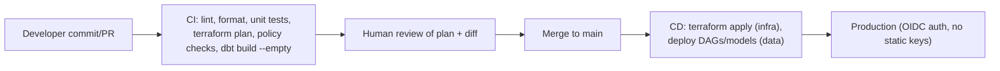

# Infrastructure as Code and DevOps for Data

> A data platform is a distributed system with a deployment problem. You will run dozens of
> pipelines, clusters, warehouses, catalogs, and IAM roles — and you must be able to recreate
> them from scratch, change them safely, roll back, and prove that what is running matches
> what you intended. Clicking through a console does not scale, cannot be reviewed, and drifts
> silently. Infrastructure as Code (IaC) and DevOps are how a senior engineer makes a data
> platform **reproducible, reviewable, testable, and recoverable** — and they are a
> prerequisite for everything else in this chapter (security, networking, cost).

## TL;DR

- **IaC = the desired state of your platform stored as versioned code**, applied by a tool
  that reconciles reality to it. Terraform, OpenTofu, Pulumi, CloudFormation/CDK, Bicep, ARM.
- **Declarative > imperative > console.** Declarative tools compute the diff and can recreate
  a lost environment; imperative scripts cannot.
- **State is the crown jewel.** Remote, locked, encrypted, versioned state (S3+GCS+Blob
  backends) is mandatory for team work; local state is a foot-gun.
- **Layering and modules beat one giant stack.** Separate network / data / IAM / compute layers
  with explicit inputs and outputs; module reuse prevents copy-paste drift.
- **CI/CD for data means two pipelines:** one for infrastructure (plan/apply, guarded) and one
  for pipelines themselves (code + DAGs + transformations promoted through environments).
- **GitOps = Git as the single source of truth**, with a controller reconciling the cluster
  (Argo CD/Flux) so drift is corrected automatically.
- **Environments should be identical by construction** (same modules, different variables) — the
  only safe way to make "it works in staging" meaningful.
- **Test infrastructure itself:** `plan` review, policy-as-code (OPA/Conftest/Sentinel/Checkov),
  ephemeral preview environments, and periodic `apply` from scratch.
- **Never store state or secrets in Git.** Use remote backends + secret managers + OIDC.
- **Data pipelines are code too:** version SQL/dbt models/Python, run them in CI, and gate
  promotion on tests.

## 1. Definitions and core vocabulary

- **Infrastructure as Code (IaC)** — managing infrastructure through machine-readable
  definition files rather than manual processes.
- **Declarative vs. imperative IaC** — declare the desired end state (Terraform, CloudFormation)
  vs. script the steps (a shell/CLI script). Declarative tools are idempotent.
- **Provisioning vs. configuration management** — creating resources (Terraform) vs. configuring
  software on them (Ansible, cloud-init, Helm, Kustomize). Often both.
- **State** — the mapping between your code and real resources (IDs, attributes, dependencies).
- **Plan / apply** — the diff preview and the execution. Review the plan; apply is a write.
- **Provider** — the plugin that talks to a cloud API (aws, azurerm, google).
- **Module** — a reusable, parameterized group of resources.
- **Drift** — when real infrastructure diverges from code (manual console change, external
  mutation). Detected by `plan`/refresh.
- **Remote backend** — where state lives (S3, GCS, Azure Blob, Terraform Cloud) with locking.
- **Workspace / environment / stack** — an isolated instance of a configuration (dev/staging/prod).
- **CI/CD** — continuous integration (build/test on every change) and continuous delivery/
  deployment (automated promotion to environments).
- **GitOps** — Git is the source of truth; an in-cluster controller continuously reconciles
  cluster state to the repo (Argo CD, Flux).
- **Policy as code** — encoding policy (security, cost, naming) as executable rules (OPA/
  Conftest, Sentinel, Checkov, c7n).
- **Immutable infrastructure** — replace rather than mutate resources; the basis of
  reproducibility.
- **Ephemeral/preview environment** — a temporary, fully provisioned environment per PR.
- **Pipeline as code** — DAGs/workflows defined in version control (Airflow DAGs, dbt models,
  Argo Workflows).
- **DAG** — directed acyclic graph of tasks; the unit of orchestration.

## 2. What problem it solves / why it matters

### 2.1 The problems

1. **Unreproducible environments.** If the only way to recreate prod is "ask the person who
   built it," you have an outage waiting to happen and a DR plan that doesn't exist.
2. **Drift and configuration creep.** Console changes accumulate; nobody knows the current
   state; incidents are unreproducible.
3. **Review and change safety.** Code review catches security and cost mistakes *before*
   deployment. The console does not.
4. **Speed at scale.** Onboarding a new environment or team should be a PR, not a project.
5. **Auditability and compliance.** Every change is a commit with an author, a reviewer, and a
   timestamp — exactly what auditors ask for.
6. **Disaster recovery.** IaC lets you rebuild infrastructure in a new region in hours, and
   data replication handles the rest.

### 2.2 Why a senior must own it

Because **the platform's reliability is bounded by its deployability**. If deploying a change
is scary, changes are rare, and the platform ossifies. Senior data engineers are expected to
define the deployment model: how environments are provisioned, how pipelines are promoted, how
infra changes are gated, and how a bad change is rolled back. This is also where security
(IAM as code), networking (VPC as code), and cost (tagging/budgets as code) are actually
enforced.

## 3. How it works internally (mechanisms, internals)

### 3.1 How a declarative IaC tool works

```mermaid
flowchart LR
  code["HCL / YAML / TS config"] --> graph["Build resource graph"]
  state["Remote state (S3+GCS+Blob)"] --> refresh["Refresh real resources"]
  refresh --> plan["Plan: compute diff"]
  graph --> plan
  plan -->|"review"| apply["Apply (ordered, dependency-aware)"]
  apply --> real["Cloud APIs"]
  apply --> state
```

Internals that matter:

- **A dependency graph is built from references.** `aws_subnet.private.id` implies "subnet
  depends on VPC." Apply is topologically ordered; destruction is reversed. This is why you
  rarely order things manually.
- **State records attributes returned by the API** (e.g. an ARN you didn't specify). Without
  state, the tool can't know the resource exists and will try to create a duplicate.
- **Refresh reconciles state with reality**, surfacing drift. `-refresh-only` plans show drift
  without changing anything.
- **Idempotency:** applying twice produces no changes if reality matches code. Non-idempotent
  scripts re-run side effects.
- **Locking** prevents two applies from racing on the same state (DynamoDB lock table on AWS,
  native locks on GCS/Blob backends).
- **Providers are versioned APIs**; pin versions, because provider upgrades can change plans.

### 3.2 CloudFormation / ARM / Bicep internals

CloudFormation is a service: it takes a template, builds a stack, and manages resource
lifecycles with rollback on failure. **AWS CDK** synthesizes CloudFormation from real code
(TypeScript/Python/etc.). Azure's analogue is ARM templates and the friendlier **Bicep** DSL
(which compiles to ARM). GCP has Deployment Manager (declining) and generally prefers
Terraform. Key internal difference: managed services hold the state for you (no state file to
lose) but constrain the provider surface.

| Aspect | Terraform/OpenTofu | CloudFormation | Bicep/ARM |
|---|---|---|---|
| State | Yours (remote backend) | Managed by AWS | Managed by Azure |
| Multi-cloud | Yes | No | No |
| Language | HCL | YAML/JSON | Bicep/JSON |
| Rollback | Manual (re-apply) | Automatic stack rollback | Deployment rollback |
| Drift detection | `plan` | Drift detection | What-if |
| Ecosystem | Huge registry | AWS-only | Azure-only |

### 3.3 CI/CD internals



The important internals:

- **Authentication via OIDC**, not stored keys (see chapter 6). The CI job assumes a cloud role.
- **`plan` is the review artifact.** Policy checks run on the plan (what will actually change).
- **Environments are promoted by reference**, not rebuilt: the same image/artifact and the same
  IaC modules with different variables.
- **Data pipelines deploy separately from infra**, because DAGs and models change far more
  often than the VPC. Two pipelines, two cadences.
- **Rollback strategy differs:** infra rollback = re-apply the previous commit; data rollback
  = revert the artifact and re-run idempotently (or restore from time travel).

### 3.4 GitOps internals

A GitOps controller (Argo CD/Flux) runs *inside* the cluster, watches a Git repo, and
continuously reconciles cluster state to it. Properties:

- **Pull-based deployments** — no CI system needs cluster credentials.
- **Continuous drift correction** — manual `kubectl edit` gets reverted.
- **Declarative everything** — manifests, Helm, Kustomize, or generated (e.g. from a CDK/Helm
  chart).
- **Auditability** — the repo is the history of deployments.

For data, GitOps often covers the *platform* (Kubernetes workloads: Spark operator, Kafka,
Airflow) while Terraform covers the *cloud resources* (VPC, buckets, IAM, warehouses).

### 3.5 Containerization for data

Containers make pipeline code **portable and reproducible**: the same image runs on a laptop,
in CI, on Kubernetes, on managed Spark (as a dependency archive or image), and on FaaS
(container images).

```text
Code + deps + runtime  →  immutable image (digest)  →  same everywhere
                           pinned by digest, not tag, in production
```

Key internals: layer caching (order Dockerfile least→most frequent changes), multi-stage
builds (small runtime image), non-root user, multi-arch (amd64/arm64), and **image scanning**
(vulnerabilities) in CI.

### 3.6 Reproducible infrastructure: the layers

```text
Layer 0  Code in Git (infra + pipelines + config)      ← source of truth
Layer 1  Locked dependency versions (providers, images) ← no surprise upgrades
Layer 2  Remote state + locking                        ← team-safe, recoverable
Layer 3  Modules (reuse, no copy-paste)                ← consistency
Layer 4  Environments as variables, not forks          ← parity
Layer 5  Policy-as-code gates                          ← guardrails enforced
Layer 6  Automated apply + drift detection             ← reality matches intent
```

## 4. How to implement it (step-by-step, with IaC/CLI/config examples)

### 4.1 Repository layout for a data platform

```text
data-platform/
├── infra/
│   ├── modules/
│   │   ├── network/            # VPC, subnets, endpoints
│   │   ├── lake/               # S3 buckets, lifecycle, KMS
│   │   ├── warehouse/          # Redshift/Snowflake config
│   │   └── k8s-namespace/      # namespace + RBAC + quotas
│   ├── envs/
│   │   ├── dev/    { main.tf, terraform.tfvars, backend.tf }
│   │   ├── staging/
│   │   └── prod/
│   └── global/                 # org, IAM, budget, trail
├── pipelines/
│   ├── dags/                   # Airflow/Composer DAGs
│   ├── dbt/                    # models, tests, seeds
│   └── spark/                  # job code + Dockerfiles
├── k8s/                        # GitOps manifests (Argo CD apps)
└── .github/workflows/          # CI for infra + data
```

### 4.2 Terraform with a real remote backend and workspaces per env

```hcl
# infra/envs/prod/backend.tf
terraform {
  required_version = ">= 1.6"
  required_providers {
    aws = { source = "hashicorp/aws", version = "~> 5.40" }   # pin!
  }
  backend "s3" {
    bucket         = "acme-tfstate"
    key            = "prod/terraform.tfstate"
    region         = "eu-west-1"
    encrypt        = true
    kms_key_id     = "arn:aws:kms:eu-west-1:123456789012:key/tfstate"
    dynamodb_table = "acme-tfstate-lock"                       # state locking
  }
}
```

```hcl
# infra/envs/prod/main.tf
module "network" {
  source      = "../../modules/network"
  env         = "prod"
  cidr        = "10.20.0.0/16"
  az_count    = 3
}

module "lake" {
  source              = "../../modules/lake"
  env                 = "prod"
  bucket_name         = "acme-lake-prod"
  kms_key_arn         = module.network.key_arn
  raw_retention_days  = 730
}
```

Apply sequence and safety:

```bash
terraform -chdir=infra/envs/prod init -upgrade=false
terraform -chdir=infra/envs/prod validate
terraform -chdir=infra/envs/prod plan -out=tfplan -lock-timeout=5m
terraform -chdir=infra/envs/prod show -json tfplan | jq '.resource_changes[].change.actions' | sort | uniq -c
terraform -chdir=infra/envs/prod apply tfplan
```

> Always apply a **saved plan file**, never a bare `apply`, in production. It guarantees the
> reviewed plan is what runs.

### 4.3 Policy-as-code gate in CI (Checkov + Conftest)

```yaml
# .github/workflows/infra.yml
name: infra
on:
  pull_request:
    paths: ["infra/**"]
permissions: { id-token: write, contents: read, pull-requests: write }
jobs:
  plan:
    runs-on: ubuntu-latest
    steps:
      - uses: actions/checkout@v4
      - uses: aws-actions/configure-aws-credentials@v4
        with:
          role-to-assume: arn:aws:iam::123456789012:role/gha-infra-plan
          aws-region: eu-west-1
      - name: Static IaC scan
        run: |
          docker run --rm -v "$PWD:/tf" bridgecrew/checkov -d /tf/infra --quiet
      - name: Terraform fmt + validate
        run: terraform -chdir=infra/envs/prod fmt -check && terraform -chdir=infra/envs/prod init -backend=false && terraform -chdir=infra/envs/prod validate
      - name: Plan
        run: terraform -chdir=infra/envs/prod plan -no-color -out=tfplan
      - name: Policy check on plan
        run: conftest test --policy ./policy <(terraform -chdir=infra/envs/prod show -json tfplan)
```

```rego
# policy/iam.rego — deny wildcard IAM actions (example)
package main
deny[msg] {
  resource := input.resource_changes[_]
  resource.type == "aws_iam_policy"
  contains(resource.change.after.policy, "\"Action\": \"*\"")
  msg := sprintf("Wildcard IAM action in %s", [resource.address])
}
```

### 4.4 Deploying data pipelines (dbt + Airflow) via CI

```yaml
# promote dbt models to prod after tests pass
jobs:
  dbt-ci:
    runs-on: ubuntu-latest
    steps:
      - uses: actions/checkout@v4
      - run: pip install dbt-core dbt-snowflake
      - run: dbt deps && dbt build --select state:modified+ --defer --state ./target --target ci
        env: { DBT_SNOWFLAKE_PASSWORD: ${{ secrets.DBT_CI_ROLE_TOKEN }} }
  dbt-prod:
    needs: dbt-ci
    if: github.ref == 'refs/heads/main'
    runs-on: ubuntu-latest
    steps:
      - uses: actions/checkout@v4
      - run: dbt deps && dbt build --target prod
```

Key practices: **`state:modified+`** (Slim CI — only build what changed), **`--defer`** (use
prod artifacts for unchanged refs), and **tests as gates** (`dbt test`/`dbt build` runs tests).

### 4.5 GitOps for Kubernetes data workloads (Argo CD)

```yaml
apiVersion: argoproj.io/v1alpha1
kind: Application
metadata:
  name: spark-operator
  namespace: argocd
spec:
  project: data-platform
  source:
    repoURL: https://github.com/acme/data-platform.git
    targetRevision: main
    path: k8s/spark-operator
    helm:
      valueFiles: ["values-prod.yaml"]
  destination:
    server: https://kubernetes.default.svc
    namespace: data
  syncPolicy:
    automated: { prune: true, selfHeal: true }    # drift is auto-corrected
    syncOptions: [CreateNamespace=true]
```

`selfHeal: true` means a manual `kubectl edit` is reverted to the repo state — the essence of
GitOps.

### 4.6 Immutable container images and promotion

```bash
# Build once, promote the digest (not a mutable tag) across environments
IMAGE=123456789012.dkr.ecr.eu-west-1.amazonaws.com/etl:1.4.0
docker buildx build --platform linux/amd64,linux/arm64 -t "$IMAGE" --push .
DIGEST=$(aws ecr describe-images --repository-name etl --image-ids imageTag=1.4.0 \
         --query 'imageDetails[0].imageDigest' --output text)

# Deploy by digest — guarantees the tested artifact
kubectl set image job/etl "etl=$IMAGE@$DIGEST" -n data
```

### 4.7 Ephemeral preview environments

```hcl
# infra/envs/preview/main.tf — one per PR, torn down on merge
module "network" {
  source = "../../modules/network"
  env    = "pr-${var.pr_number}"
  cidr   = cidrsubnet("10.100.0.0/16", 8, var.pr_number)   # deterministic, non-overlapping
}
```

Preview environments are the highest-leverage testing tool for data platforms: they let you
run the entire pipeline against a real (small) dataset before merge. Caveat: **never point a
preview at prod data**; use masked/synthetic subsets.

## 5. Where to implement it (AWS / Azure / GCP equivalents)

### 5.1 IaC and DevOps service map

| Capability | AWS | Azure | GCP |
|---|---|---|---|
| IaC (declarative, multi-cloud) | Terraform / OpenTofu | Terraform / Bicep for Azure-native | Terraform / OpenTofu |
| Vendor IaC | CloudFormation, CDK | ARM, Bicep | Deployment Manager, Config Connector |
| State backend | S3 + DynamoDB lock | Azure Blob (lease lock) | GCS (native lock) |
| CI/CD | CodePipeline / CodeBuild / GitHub Actions | Azure DevOps Pipelines / GitHub Actions | Cloud Build / GitHub Actions |
| Container registry | ECR | ACR | Artifact Registry |
| Container orchestration | EKS / ECS | AKS / Container Apps | GKE / Cloud Run |
| GitOps controller | Argo CD / Flux (any k8s) | Argo CD / Flux | Config Sync / Argo CD |
| Secrets in pipelines | Secrets Manager + OIDC | Key Vault + OIDC/federated creds | Secret Manager + Workload Identity Federation |
| Policy as code | SCPs, Config rules, c7n | Azure Policy, Bicep linter | Org Policy, Config Validator |
| Drift detection | CloudFormation drift, `terraform plan` | What-if, Azure Policy | `terraform plan`, Config Validator |
| Artifact / data CI | CodeArtifact, Glue CI | Azure Artifacts | Artifact Registry |
| Orchestration deploy | MWAA (S3-synced DAGs) | Data Factory (Git-integrated) | Composer (GCS-synced DAGs) |

### 5.2 Same workflow, mapped

| Stage | AWS | Azure | GCP |
|---|---|---|---|
| Auth from CI | OIDC → IAM role | Workload identity federation → App/SP | Workload Identity Federation → SA |
| Plan infra | Terraform on GitHub Actions | Terraform/Bicep on Azure DevOps | Terraform on Cloud Build |
| Store images | ECR | ACR | Artifact Registry |
| Deploy workflows | S3 sync of Airflow DAGs | ADF Git mode | Composer GCS sync |
| Reconcile k8s | Argo CD | Argo CD / Flux | Config Sync / Argo CD |

## 6. Patterns and anti-patterns

### 6.1 Patterns

- **Everything in Git, everything reviewed.** No console changes in prod (break-glass only).
- **Layered stacks** (bootstrap → org → network → data → apps) with explicit interfaces.
- **Modules for reuse**, versioned and pinned.
- **Remote state + locking + encryption**, one state per environment/layer.
- **Policy-as-code** for security, naming, tags, and cost.
- **Plan artifacts** reviewed in PRs; apply the saved plan.
- **Two CI pipelines:** infra (slow, guarded) and data (fast, frequent).
- **Immutable artifacts** promoted by digest across environments.
- **Ephemeral preview environments** for realistic integration testing.
- **Automated drift detection** (scheduled `plan`/`what-if`) with alerting.
- **Backups of state** (versioned bucket) — losing state is losing your platform's addresses.
- **Runbooks and bootstrap docs** so the platform can be rebuilt from zero.

### 6.2 Anti-patterns

- **ClickOps in production.** Untracked, unreviewable, causes drift.
- **Local state** (or state in Git — which also leaks secrets).
- **One monolithic root module** for everything → slow plans, blast radius, coupling.
- **Hardcoded values** instead of variables/modules → copy-paste environments that diverge.
- **Secrets in tfvars/vars/repos.**
- **Mutable image tags** (`:latest`) in production.
- **Applying without reviewing the plan** (`-auto-approve` in prod with no gate).
- **Forking environments** (copy a folder per env) instead of parameterizing.
- **No test for pipelines** → a change breaks the DAG at 02:00.
- **Deploying DAGs by hand to the scheduler** → drift between repo and runtime.
- **Ignoring provider/image version updates** until they break.
- **No rollback plan** for data (schema/model changes without backward compatibility).

## 7. Real-world use cases and industry applications

- **Rebuild a region in hours:** IaC + replicated data lets you recreate the platform in a new
  region; the runbook is `terraform apply` + restore.
- **Regulated change management:** every infra change is a reviewed PR — the audit trail
  auditors ask for.
- **Multi-team platform:** modules + namespaces + RLS let teams self-serve within guardrails.
- **Slim CI for dbt:** only modified models are built/tested in PRs; prod builds on merge.
- **GitOps for Kafka/Spark/Airflow:** the platform is declared in Git and reconciled, so drift
  is impossible to sustain.
- **Ephemeral ML/dev environments:** spin up a full stack per engineer or PR; tear down after.

## 8. Senior-level deep dive: trade-offs, architecture decisions, performance, failure modes, debugging, cost

### 8.1 Trade-offs

| Decision | Option A | Option B | Considerations |
|---|---|---|---|
| IaC tool | Terraform/OpenTofu | CloudFormation/Bicep | Multi-cloud/ecosystem vs. managed state + native |
| State location | Remote managed backend | Local | Team safety, locking, recoverability |
| Stack granularity | Many small stacks | One big stack | Blast radius + speed vs. wiring overhead |
| Deploy model | Push (CI applies) | Pull (GitOps) | CI credentials vs. in-cluster reconciler |
| Env strategy | Same modules, different vars | Separate forked repos | Parity vs. isolation |
| Pipeline CI | Build all | Slim CI (modified only) | Correctness vs. speed/cost |
| Rollback | Re-apply previous commit | Blue/green + cutover | Speed vs. complexity |

### 8.2 Architecture decisions

1. **Choose the IaC tool** for your org (multi-cloud → Terraform; all-AWS → CDK is fine).
2. **Define the layer/stack boundaries** (bootstrap, network, data, apps) and their interfaces.
3. **Decide the deploy model** (CI push vs. GitOps pull) — often both, by resource type.
4. **Define environment parity** and how promotion works (artifacts by digest).
5. **Define the testing pyramid** for infra (fmt/validate → policy → plan review → preview env
   → smoke test) and for data (unit → schema/contract → integration on a subset).
6. **Define rollback and DR** (previous commit, data time travel, replicated state).
7. **Bootstrap the bootstrap** (who creates the state bucket and the CI role? Document it.)

### 8.3 Performance and scale of IaC itself

- **Plan time grows with resource count**, and a single giant state becomes slow and risky.
  Split by layer/lifecycle: things that change daily (pipelines) separate from things that
  change rarely (network).
- **API throttling.** Terraform making thousands of calls (per-object S3, per-policy IAM) can be
  throttled; batch, use fewer resources, or use `-parallelism` tuning.
- **Provider caching/plugins** get re-downloaded; use a plugin cache in CI.
- **DAG parse time** in Airflow grows with DAG count — keep top-level DAG files light and avoid
  heavy imports at parse time.
- **Container image size** affects cold start and pull time — multi-stage builds and slim bases.

### 8.4 Failure modes and debugging

| Symptom | Likely cause | Fix / debug |
|---|---|---|
| `Error acquiring the state lock` | Another apply or a crashed run | Inspect the lock (DynamoDB), force-unlock only if sure |
| State drift on `plan` | Manual console change | Import/adopt or re-apply; add drift detection |
| `apply` partially failed | Provider error mid-graph | Re-run; Terraform is incremental; check tainted resources |
| Duplicate resources created | State lost / wrong key | Restore state from versioned bucket; `terraform import` |
| CI auth failure | OIDC trust condition mismatch | Decode token claims; check `sub`/`aud` |
| Secrets in Git history | Committed `.tfvars`/`tfstate` | Rotate, purge history, use secret manager + remote state |
| DAG missing in scheduler | Not synced / parse error | Check sync bucket, scheduler logs, import errors |
| k8s manifest reverted unexpectedly | GitOps selfHeal | Intended; change the repo, not the cluster |
| Provider upgrade changed plan | Pinned version bump | Review changelog; pin and test in non-prod |

Debugging: **`plan` is the debugger.** A surprising plan is the answer to "why is reality
different." For data pipelines, the equivalent is a dry-run/`--empty` build and a preview
environment.

### 8.5 Cost of DevOps

- **Flagged resources cost money:** preview environments, idle clusters, orphaned resources
  after a failed apply. Use `ttlSecondsAfterFinished`, scheduled teardown, and `terraform
  destroy` in CI for previews.
- **CI minutes** are a real cost at scale; cache dependencies and images.
- **Data copied into preview environments** can be a hidden cost — use small subsets.
- **Value of IaC is rarely in raw $ savings** but in avoided incidents, faster onboarding, and
  the ability to enforce cost controls (budgets, tags, right-sizing) mechanically.

## 9. Common mistakes and how to avoid them

| Mistake | Impact | Fix |
|---|---|---|
| Console changes in prod | Drift, unreviewable | IaC-only; break-glass with audit |
| Local/committed state | Team collisions, secret leaks | Remote backend + locking + encryption |
| One giant stack | Slow, risky | Layer by lifecycle |
| Hardcoded env values | Divergent environments | Modules + variables |
| `:latest` images | Non-reproducible deploys | Pin digests |
| No plan review / auto-approve prod | Blind changes | Plan artifact + gate |
| Secrets in repo | Breach | Secret manager + OIDC |
| No pipeline tests | 02:00 failures | dbt tests, contract tests, preview envs |
| No drift detection | Silent divergence | Scheduled plan/what-if |
| Forked environments | Maintenance nightmare | Parameterize |
| No rollback plan | Long outages | Previous-commit apply + data time travel |
| Manual DAG uploads | Runtime ≠ repo | CI-synced DAGs / GitOps |
| Unpinned providers | Surprise plans | Pin + renovate deliberately |

## 10. Exercises / interview questions (hints only)

1. **Design the repo and CI** for a platform with infra, 100 dbt models, and 30 Airflow DAGs.
   *(Hint: layers, two pipelines, slim CI, promotion.)*
2. **Your teammate changed an SG in the console.** How do you detect and reconcile it?
   *(Hint: `plan`, drift detection, import/refresh, policy.)*
3. **When is CloudFormation/CDK a better choice than Terraform?** *(Hint: all-AWS, managed
   state, rollback, native integration.)*
4. **Explain why state must be remote and locked**, and what breaks without each. *(Hint:
   concurrency, torn state, lost ARNs.)*
5. **How do you test an infrastructure change before prod?** *(Hint: fmt/validate → policy →
   plan review → preview env → smoke.)*
6. **Design a rollback for a bad dbt model deploy at 09:00 on a business day.** *(Hint:
   backward-compatible schema, time travel, revert + re-run.)*
7. **What goes in GitOps vs. Terraform?** *(Hint: in-cluster workloads vs. cloud resources.)*
8. **How do you make "it works in staging" actually mean something for data?** *(Hint: same
   modules, same artifact, masked prod-like data, parity checks.)*

## References

- Terraform documentation — https://developer.hashicorp.com/terraform/docs
- Terraform remote state — https://developer.hashicorp.com/terraform/language/state/remote
- Terraform backends (S3) — https://developer.hashicorp.com/terraform/language/backend/s3
- Terraform modules — https://developer.hashicorp.com/terraform/language/modules
- Terraform recommended practices — https://developer.hashicorp.com/terraform/cloud-docs/recommended-practices
- OpenTofu — https://opentofu.org/docs/
- Pulumi — https://www.pulumi.com/docs/
- AWS CloudFormation — https://docs.aws.amazon.com/AWSCloudFormation/latest/UserGuide/Welcome.html
- AWS CDK — https://docs.aws.amazon.com/cdk/v2/guide/home.html
- CloudFormation drift detection — https://docs.aws.amazon.com/AWSCloudFormation/latest/UserGuide/detect-drift-stack.html
- Azure Bicep — https://learn.microsoft.com/en-us/azure/azure-resource-manager/bicep/overview
- Azure deployment what-if — https://learn.microsoft.com/en-us/azure/azure-resource-manager/templates/deploy-what-if
- Google Cloud Deployment Manager — https://cloud.google.com/deployment-manager/docs
- Argo CD — https://argo-cd.readthedocs.io/en/stable/
- Flux — https://fluxcd.io/flux/
- Open Policy Agent / Conftest — https://www.openpolicyagent.org/docs/latest/ and https://www.conftest.dev/
- Checkov — https://www.checkov.io/
- dbt Slim CI — https://docs.getdbt.com/best-practices/best-practice-workflows
- Airflow best practices — https://airflow.apache.org/docs/apache-airflow/stable/best-practices.html
- GitHub Actions OIDC to AWS — https://docs.github.com/en/actions/deployment/security-hardening-your-deployments/configuring-openid-connect-in-amazon-web-services
- Docker multi-stage builds — https://docs.docker.com/build/building/multi-stage/
- Google Cloud Config Sync — https://cloud.google.com/anthos-config-management/docs/config-sync-overview
