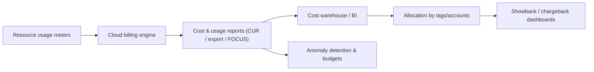

# Cost Optimization and FinOps for Data Platforms

> Cloud data platforms fail financially before they fail technically. A pipeline that runs
> correctly but scans 40 TB to produce 2 GB, a warehouse left running overnight, a Kafka
> cluster sized for peak, or 200 million tiny files — each is a plausible engineering choice
> that quietly compounds into a bill nobody can explain. A senior engineer treats **cost as an
> architectural property**: it is measured, attributed, forecast, and optimized with the same
> rigor as latency and correctness. This chapter gives you the cost model of cloud data, the
> levers, and the operating discipline (FinOps) to keep a platform both fast and affordable.

## TL;DR

- **The universal cost equation:** `cost = unit_price × quantity_of_units`, but *which* unit
  dominates depends entirely on the service. Find the dominant unit before you optimize
  anything.
- **Four architectures of cost:** per-second compute, per-byte storage, per-scan data
  processing, and per-request/per-throughput. Data platforms usually pay all four at once.
- **The biggest lever is usually "do less work":** partition pruning, column projection, file
  compaction, incremental loads, and caching reduce the *quantity of units*, which beats
  negotiating unit prices.
- **Compute is elastic and stoppable; storage is persistent and cheap(er).** Turn compute off
  (scale to zero, auto-suspend, transient clusters); tier storage (lifecycle, archive).
- **Spot/preemptible is the single largest discount available** (60–90%) for fault-tolerant
  batch — if you design for interruption.
- **Right-sizing beats over-provisioning every time;** measure utilization, then shrink.
- **Autoscaling must target the right signal** (queue depth, lag, pending tasks) or it either
  overspends or under-delivers.
- **Serverless vs. provisioned is a modeling decision,** not a preference: spiky/low-volume →
  serverless; steady/high-volume → committed/provisioned.
- **You cannot optimize what you cannot attribute.** Tagging, account/project isolation, and
  showback/chargeback are prerequisites.
- **FinOps is a loop** (Inform → Optimize → Operate) with named owners, budgets, anomaly
  detection, and unit economics — not a one-off cost-cutting project.
- **Guardrails prevent the disasters** that optimization can't: budgets, per-query byte limits,
  quotas, and anomaly alerts.

## 1. Definitions and core vocabulary

- **FinOps** — an operational framework and culture for managing cloud value; it blends
  finance, engineering, and business. Defined by the FinOps Foundation.
- **Unit economics** — cost per *business unit* (per order, per active user, per 1,000 events,
  per GB ingested). The only cost metric that survives scaling.
- **Cost allocation** — attributing spend to a team/product/environment via tags/accounts.
- **Showback** — reporting costs to teams so they can see and act on them.
- **Chargeback** — actually *billing* teams / transferring budget for their consumption.
- **TCO (total cost of ownership)** — all costs, including egress, support, ops labor, and
  opportunity cost — not just the sticker price.
- **Egress** — data leaving the provider's network; billed per GB.
- **Data processing unit** — a billing unit for bytes processed (Athena scanned bytes, BigQuery
  bytes billed, NAT data processing, Glue DPU-hour, Databricks DBU).
- **Right-sizing** — matching capacity to actual need.
- **Autoscaling** — automatic adjustment of capacity to demand.
- **Scale to zero** — capacity released when idle (serverless, suspended warehouses).
- **Spot / preemptible / low-priority** — discounted, revocable capacity.
- **Committed use / savings plan / reserved capacity** — prepay or commit for a discount on
  steady-state usage.
- **Lifecycle policy** — automated storage tiering/expiry by age/tags.
- **Idle / orphaned resources** — unattached volumes, unused IPs, old snapshots, forgotten
  clusters; the "garbage" of cloud spend.
- **Anomaly detection** — alerts on unexpected spend spikes (budgets, Cost Anomaly Detection).
- **Amortization** — spreading upfront commitments across the period they cover for accurate
  monthly cost.
- **FOCUS** — the FinOps Open Cost and Usage Specification, a common schema for cost data across
  providers.

## 2. What problem it solves / why it matters

### 2.1 Why cloud cost is different

In a data center, cost is mostly fixed and invisible to engineering. In the cloud, **cost is a
direct function of code and configuration, produced continuously, and it accrues whether or
not you are looking.** This creates two failure modes:

1. **Constant overpayment.** Everyone runs 30% over because nobody measured.
2. **Catastrophic surprises.** A single unpartitioned query, a stuck autoscaler, or an infinite
   retry loop can cost five or six figures overnight.

### 2.2 Why a senior must own it

Because cost decisions are architecture decisions, made *before* anyone can see a bill:
partitioning strategy, file sizes, spot vs. on-demand, serverless vs. provisioned, region
selection, storage class, replication, and topology. A senior data engineer is expected to
answer "what will this cost, and how do we know?" as readily as "will this work?" The best
cost optimization is not a monthly cleanup — it is designing the pipeline so the expensive
thing never happens.

### 2.3 The FinOps thesis

FinOps exists because cloud cost is a *distributed* responsibility with a *central* reporting
burden. Its three phases:

```text
INFORM → OPTIMIZE → OPERATE → (repeat)
```

- **Inform:** visibility, allocation, budgets, forecasting, benchmarking.
- **Optimize:** right-size, use discounts, eliminate waste, choose efficient architectures.
- **Operate:** embed cost into the SDLC, quotas/guardrails, continuous improvement, unit KPIs.

## 3. How it works internally (mechanisms, internals)

### 3.1 The cost model of cloud data (four axes)

```text
                     ┌────────────────────────────────────────────────┐
 Compute units  ────►│ vCPU-hour, GB-hour, DBU, DPU, credit, slot-hour │
 Storage units  ────►│ GB-month by storage class, IOPS, snapshots      │
 Processing     ────►│ bytes scanned, bytes processed, requests        │
 Network units  ────►│ egress GB, cross-AZ/region GB, NAT, endpoints   │
                     └────────────────────────────────────────────────┘
```

Every data platform pays across these. The senior task is to identify **which axis dominates**
for each workload and attack that.

| Service | Dominant unit | What makes the bill explode |
|---|---|---|
| Spark (EMR/Dataproc/DBX) | instance/DBU-hour × cluster size × duration | over-sized clusters, long runtime, no spot, no auto-terminate |
| Snowflake | credit/second × warehouse size × clusters | no auto-suspend, oversized warehouse, runaway queries |
| BigQuery on-demand | bytes scanned | unpartitioned/unclustered scans, `SELECT *` |
| BigQuery editions | slot-hours | over-reserved slots, poor concurrency packing |
| Redshift | node-hours + storage + concurrency scaling | always-on clusters, spilled queries, no pause |
| Athena | bytes scanned | no partitioning, many small files, JSON instead of Parquet |
| S3 | GB-month + requests + retrieval | small files (requests), archive retrieval, no lifecycle |
| Kafka (MSK) | broker-hours + storage | over-brokers, long retention, no tiered storage |
| Kinesis | shard-hours + PUT payload units | too many shards, tiny records |
| NAT gateway | per-GB processing | private-subnet traffic to cloud services without endpoints |
| Cross-region | per-GB | compute far from data, replication of everything |

### 3.2 The mechanics of the biggest levers

**(a) Scan reduction (layout).** In scan-priced engines, cost = `bytes_retrieved × price`.
Columnar formats (Parquet/ORC) + compression + partition pruning + clustering can reduce
scanned bytes by 10–100× for the same query. **Layout is the highest-leverage, lowest-effort
optimization in analytics.**

Let me make this concrete (illustrative prices; always check current):

```text
Query: daily revenue by region for 1 day, over 3 years of data.

Naive:    full table scan of 300 TB CSV    → 300 TB × $5/TB  = $1,500 per query
Parquet:  columnar + zstd                 →  30 TB × $5/TB  =   $150 per query
Partition by dt, filter 1 day             →   0.3 TB × $5/TB =    $1.50 per query
+ column projection (3 cols of 40)        →   0.02 TB        =    $0.10 per query
```

Same question, same answer, ~15,000× cost difference. This is why "the layout decision is
worth more than the storage decision."

**(b) Compute-time reduction (billing granularity).** Compute that bills per second and can
scale to zero turns idle time into zero cost. Snowflake auto-suspend, EMR `--auto-terminate`,
BigQuery zero-slot idle, Databricks job clusters, and Lambda scale-to-zero all convert
"always-on" into "only-when-working."

**(c) Discounts (spot + commitments).**

```text
On-demand price                 100%
+ Savings plan / reserved (1–3y)  40–72% off
+ Spot / preemptible              60–90% off
+ Arm (Graviton/Ampere/Axion)     additional 10–40% price/performance
```

The senior pattern is a **portfolio**: commitments for the steady baseline, spot for the
bulk of fault-tolerant batch, on-demand for the rest and for critical-path work.

**(d) Storage tiering.** Cold data costs ~1/20th of hot data in archive tiers. Lifecycle
automation moves it there automatically — but watch minimum durations and retrieval fees.

**(e) Network topology.** Keeping compute in the data's region/AZ and using private endpoints
instead of NAT frequently removes a *10–30%* line item.

### 3.3 How the billing pipeline works (and why attribution is hard)



Internals that matter:

- **Tags are the allocation key, but they are often missing or late.** Untagged resources fall
  into an "unallocated" bucket and become invisible. Enforce tags at creation.
- **Shared costs** (NAT, TGW, central logging, security tooling) must be *allocated by a rule*
  (usage-proportional, headcount, revenue) — decide and document the rule.
- **Commitments and credits distort month-to-month numbers** — amortize for accurate reporting.
- **Cost data lags** (hours to a day) and is coarse; you need *both* provider billing data
  (authoritative) and service-level telemetry (query history) to optimize.
- **Data transfer and small-request charges** are easy to miss because they don't map to a
  single resource.

### 3.4 The mathematics of right-sizing and autoscaling

For steady-state workloads:

```text
Utilization U = actual_work / provisioned_capacity
If U < ~40% for a sustained period → you are paying for idle → downsize.
If U > ~85% and latency is degrading → you are under-provisioned → upsize or scale out.
Target a band (e.g. 50–75%) that leaves headroom for bursts without waste.
```

For bursty workloads, autoscaling's value is the **area between the demand curve and a
static provisioning line**. Its costs are start latency and the inefficiency of short-lived
capacity. The optimum is a **traffic/demand model**, not a fixed instance count.

## 4. How to implement it (step-by-step, with IaC/CLI/config examples)

### 4.1 Step 1 — Turn on visibility (before optimizing anything)

```bash
# AWS: Cost & Usage Report is the authoritative source; Cost Explorer for quick views
aws ce get-cost-and-usage \
  --time-period Start=2024-03-01,End=2024-04-01 \
  --granularity MONTHLY --metrics "UnblendedCost" \
  --group-by Type=DIMENSION,Key=SERVICE

# Find untagged spend (the thing you cannot allocate)
aws ce get-cost-and-usage \
  --time-period Start=2024-03-01,End=2024-04-01 --granularity MONTHLY \
  --metrics UnblendedCost --filter '{"Not":{"Tags":{"Key":"Owner","Values":["*"]}}}'
```

```bash
# GCP: billing export to BigQuery, then query it
gcloud billing accounts list
bq query --use_legacy_sql=false '
SELECT service.description, SUM(cost) cost
FROM `proj.billing.gcp_billing_export_v1_XXXX`
WHERE invoice.month = "202403"
GROUP BY 1 ORDER BY cost DESC LIMIT 20'
```

```bash
# Azure: cost analysis API / exports
az consumption usage list --start-date 2024-03-01 --end-date 2024-04-01 -o table
```

### 4.2 Step 2 — Budgets, alerts, and anomaly detection (guardrails)

```hcl
resource "aws_budgets_budget" "monthly" {
  name         = "data-platform-monthly"
  budget_type  = "COST"
  limit_amount = "40000"
  limit_unit   = "USD"
  time_unit    = "MONTHLY"
  cost_filter { name = "TagKeyValue" values = ["user:CostCenter$DE-042"] }

  notification {
    comparison_operator        = "GREATER_THAN"
    threshold                  = 80
    threshold_type             = "PERCENTAGE"
    notification_type          = "ACTUAL"
    subscriber_sns_topic_arns  = [aws_sns_topic.finops.arn]
  }
  notification {
    comparison_operator        = "GREATER_THAN"
    threshold                  = 100
    threshold_type             = "FORECASTED"        # warn before you overspend
    notification_type          = "FORECASTED"
    subscriber_sns_topic_arns  = [aws_sns_topic.finops.arn]
  }
}
```

```bash
# AWS Cost Anomaly Detection: ML-based spikes (catches the "infinite retry" disasters)
aws ce create-anomaly-monitor --anomaly-monitor '{"MonitorName":"data-spikes","MonitorType":"DIMENSIONAL","MonitorDimension":"SERVICE"}'
```

### 4.3 Step 3 — Cut scanned bytes (the layout work)

```sql
-- BigQuery: partition + cluster, then measure bytes billed
CREATE OR REPLACE TABLE analytics.events
PARTITION BY DATE(event_ts)
CLUSTER BY user_id, event_type
AS SELECT * FROM staging.events_raw;

-- Dry run to see bytes BEFORE spending
-- bq query --dry_run --use_legacy_sql=false 'SELECT ...'
```

```sql
-- Athena: enforce a per-query byte ceiling so a mistake cannot cost $1,000
-- (set on the workgroup; see chapter 5 §4.1)
-- And always write Parquet + zstd, partitioned by the filter column
OPTIMIZE lake_silver.orders REWRITE DATA USING BIN_PACK   -- Iceberg compaction
```

Compaction and file sizing (the "small file" tax):

```python
# Spark: compact many small files into ~256 MB files before they reach the query engine
(spark.read.table("lake_silver.orders_raw")
      .repartition(200, "dt")                 # control file count
      .writeTo("lake_silver.orders")
      .option("write.target-file-size-bytes", 268_435_456)
      .partitionedBy("dt")
      .createOrReplace())
```

### 4.4 Step 4 — Stop paying for idle compute

```sql
-- Snowflake: auto-suspend is the #1 lever
ALTER WAREHOUSE wh_etl SET AUTO_SUSPEND = 60, AUTO_RESUME = TRUE;
ALTER WAREHOUSE wh_bi  SET AUTO_SUSPEND = 120;
-- Resource monitor: hard stop on runaway spend
CREATE RESOURCE MONITOR rm WITH CREDIT_QUOTA = 3000
  TRIGGERS ON 90 PERCENT DO NOTIFY ON 100 PERCENT DO SUSPEND_IMMEDIATE;
```

```bash
# Redshift: pause when idle (pay only for storage)
aws redshift pause-cluster --cluster-identifier analytics --no-allow-version-upgrade

# EMR: always auto-terminate transient clusters
aws emr create-cluster ... --auto-terminate

# Snowflake/Databricks: schedule suspend at end of business day
```

```hcl
# AWS Instance Scheduler pattern (or a Lambda on a cron) for non-prod hours
resource "aws_scheduler_schedule" "stop_nonprod" {
  name       = "stop-nonprod-nightly"
  schedule_expression = "cron(0 20 ? * MON-FRI *)"
  flexible_time_window { mode = "OFF" }
  target {
    arn      = aws_lambda_function.stop_clusters.arn
    role_arn = aws_iam_role.scheduler.arn
  }
}
```

### 4.5 Step 5 — Use spot for interruptible batch (Terraform, EKS)

```hcl
resource "aws_eks_node_group" "spot_batch" {
  cluster_name    = aws_eks_cluster.main.name
  node_group_name = "spot-batch"
  capacity_type   = "SPOT"
  instance_types  = ["m7g.2xlarge", "m6g.2xlarge", "m7i.2xlarge", "m5.2xlarge"]  # diversify
  scaling_config { min_size = 0, max_size = 100, desired_size = 0 }              # scale to zero
  labels   = { workload = "batch-spot" }
  taint {
    key = "sku", value = "spot", effect = "NO_SCHEDULE"
  }
  # Let Karpenter or Cluster Autoscaler provision; use taints so only spot-tolerant pods land here.
}
```

### 4.6 Step 6 — Commit for the baseline (not for the peak)

```hcl
# AWS Compute Savings Plan / Reserved Instances — cover the steady floor, on-demand the peak
# (purchase via console/CLI; track utilization to avoid unused commitments)
```

```bash
# BigQuery: buy slot commitments only for the steady baseline
bq mk --reservation --location=EU --slots=1000 --commitment_plan=ANNUAL etl_res

# Snowflake: (optional) capacity commitments for predictable steady usage
```

Rule of thumb: **commit ~60–80% of the *minimum* observed usage**, never the peak. Unused
commitments are pure loss.

### 4.7 Step 7 — Eliminate network waste

```hcl
# Gateway endpoint for S3 (free) — kills NAT data-processing charges for lake traffic
resource "aws_vpc_endpoint" "s3" {
  vpc_id            = aws_vpc.main.id
  service_name      = "com.amazonaws.eu-west-1.s3"
  vpc_endpoint_type = "Gateway"
  route_table_ids   = aws_route_table.private[*].id
}
# Interface endpoints for KMS/Secrets/ECR/Logs/STS also remove NAT traffic
```

Also: co-locate compute with data, avoid cross-region reads, and compress data before moving it.

### 4.8 Step 8 — Attribution: tags + showback

```hcl
provider "aws" {
  default_tags {
    tags = {
      Owner       = "data-platform"
      CostCenter  = "DE-042"
      Environment = var.env
      Project     = "lakehouse"
      ManagedBy   = "terraform"
    }
  }
}
```

Enforce tags with policy; then build a showback dashboard: cost by team/day, cost per pipeline,
cost per 1,000 events, and a "top 10 most expensive queries/jobs" view (from BigQuery
`INFORMATION_SCHEMA`, Snowflake `QUERY_HISTORY`, Redshift `STL`, Athena stats).

```sql
-- Snowflake: the most expensive queries in the last day (attribute the pain)
SELECT query_id, warehouse_name, user_name,
       total_elapsed_time/1000 AS seconds,
       credits_used_cloud_services,
       SUBSTR(query_text, 1, 120) AS q
FROM   snowflake.account_usage.query_history
WHERE  start_time > DATEADD(day, -1, CURRENT_TIMESTAMP())
ORDER  BY total_elapsed_time DESC
LIMIT  20;
```

## 5. Where to implement it (AWS / Azure / GCP equivalents)

### 5.1 Cost tooling map

| Capability | AWS | Azure | GCP |
|---|---|---|---|
| Cost explorer/analysis | Cost Explorer | Cost Management | Cloud Billing reports |
| Detailed export | Cost & Usage Report (CUR) | Cost Management exports | Billing export to BigQuery |
| Common schema | FOCUS (via CUR 2.0) | FOCUS exports | FOCUS (BigQuery) |
| Budgets | AWS Budgets | Azure Budgets | Budgets & alerts |
| Anomaly detection | Cost Anomaly Detection | Cost anomaly alerts | Budget/alert + Anomaly Detection |
| Discounts | Savings Plans, RIs, Spot | Reserved Instances, Savings Plan, Spot | CUDs, SUDs, Spot VMs |
| Right-sizing recs | Compute Optimizer, Trusted Advisor | Advisor | Recommender |
| Idle resource finder | Trusted Advisor, Cost Optimization Hub | Advisor | Recommender |
| Tag enforcement | Tag Policies, SCPs | Azure Policy | Org Policy, labels |
| Showback/chargeback | CUR → Athena/QuickSight | Cost Management + Power BI | Billing export + Looker |
| Unit economics | custom (CUR) | custom (exports) | custom (BigQuery) |
| FinOps third party | CloudHealth, Cloudability, Vantage | CloudHealth, Cloudability | CloudHealth, Cloudability |

### 5.2 Discount/efficiency levers across clouds

| Lever | AWS | Azure | GCP |
|---|---|---|---|
| ARM instances | Graviton | Ampere/Cobalt | Tau T2A / Axion |
| Spot discounts | up to 90% | up to 90% | up to 91% |
| Compute commitments | Savings Plans / RI | Savings Plan / RI | CUDs |
| Storage commitments | S3 tiers | Blob tiers | SUDs (storage) |
| Serverless scale-to-zero | Lambda, Athena, Glue | Functions, Synapse serverless | Cloud Run, BigQuery |
| Warehouse pause | Redshift pause | Synapse pause | BigQuery scales to zero |
| Free egress paths | PrivateLink within org | VNet/Private Link | Private Google Access |

## 6. Patterns and anti-patterns

### 6.1 Patterns

- **Design for idle-zero.** Everything that can scale to zero should.
- **Partition and cluster by the query pattern**, then compact files.
- **Incremental by default.** Full reprocessing every night is a design smell; use watermarks,
  CDC, and merge.
- **Right-size from measurements**, not guesses.
- **Spot-first for batch**, with diversification and checkpointing.
- **Commit the floor, rent the peak.**
- **Lifecycle everything**: storage tiers, snapshots, logs, old cluster artifacts.
- **Cost tests in CI:** budgets, `infracost`/`terraform plan` cost deltas on PRs.
- **Per-pipeline cost attribution** (tag jobs, separate warehouses/roles).
- **Anomaly alerts + per-query byte limits** as guardrails.
- **Chargeback or showback with a documented shared-cost allocation rule.**
- **Unit economics as the north-star metric** (cost per 1k events, per GB, per report).

### 6.2 Anti-patterns

- **No visibility.** Optimizing blind.
- **No attribution.** "The platform costs $50k" with no breakdown.
- **`SELECT *` on unpartitioned data.** The classic five-figure query.
- **Small files everywhere.** Request storms + slow jobs.
- **Always-on clusters/warehouses.** 20× idle cost.
- **Over-sizing "to be safe."** Paying perpetually for headroom you never use.
- **Committing to peak usage.** Unused commitments are pure loss.
- **Storing hot data in cold tiers** or cold data in hot tiers.
- **Ignoring egress/NAT.** A silent, large line item.
- **Optimizing unit price before quantity.** A 20% discount on 100× waste is not an optimization.
- **No budgets/quota limits.** One bug = six-figure surprise.
- **Copying data for every consumer** instead of sharing through a catalog.
- **Treating cost as a monthly finance problem**, not a continuous engineering practice.
- **Cutting cost by degrading reliability/SLA without a business decision.**

## 7. Real-world use cases and industry applications

- **Retail:** Black Friday scaling handled by spot + autoscaling + scale-to-zero between peaks;
  commitment covers the normal baseline only.
- **Ad-tech:** event volume 10× growth with flat cost via compaction, partitioning, and
  serverless query — unit economics (cost per million impressions) tracked weekly.
- **Fintech:** regulatory retention in archive tiers (WORM); hot window of 90 days for
  analytics; massive storage savings without losing compliance.
- **Gaming:** telemetry lake optimized for cost-per-event; cost dashboards per game studio
  (chargeback drives team behavior).
- **Healthcare:** genomic batch on spot, cut cost ~70% by designing checkpointing; storage
  tiered after the analysis window.
- **SaaS:** per-tenant unit economics used as a pricing input (cost per active user).

## 8. Senior-level deep dive: trade-offs, architecture decisions, performance, failure modes, debugging, cost

### 8.1 Trade-off tables

**Serverless vs. provisioned (cost fit):**

| Workload profile | Better fit | Why |
|---|---|---|
| Spiky, low volume, unknown | Serverless (Athena/BQ on-demand/Lambda) | pay only for work, no idle |
| Steady, high volume | Provisioned/committed (clusters/slots/warehouses) | lower unit price at high utilization |
| Predictable burst (nightly) | Transient clusters + spot | scale with the burst, pay nothing after |
| High concurrency BI | Dedicated warehouse/reservation | predictability + isolation |

**Spot vs. on-demand vs. reserved:**

| Strategy | Discount | Risk | Use for |
|---|---|---|---|
| Spot | 60–90% | interruption | fault-tolerant batch, stateless workers |
| Reserved/Savings | 40–72% | unused commitment | steady baseline |
| On-demand | 0% | none | peak, critical-path, short-lived, unpredictable |
| ARM + spot | compounding | arch compatibility | most batch after testing |

### 8.2 Architecture decisions

1. **What does this pipeline's cost scale with?** (Events, GB scanned, hours, queries.) Optimize
   that unit.
2. **Can it scale to zero?** If not, why not — and is the reason worth the idle cost?
3. **What's the interruption budget?** (RTO per task.) Determines spot eligibility.
4. **Serverless or provisioned?** Based on volume/concurrency/steady-state.
5. **What's the layout/partitioning contract?** The one decision that most constrains scan cost.
6. **Where does compute live relative to data?** Region/AZ co-location.
7. **What's the unit economic metric** this platform reports to the business?
8. **What guardrails prevent catastrophe?** Budgets, byte limits, quotas, anomaly alerts.

### 8.3 Performance–cost coupling (you can't optimize them separately)

- **Runtime ≈ cost** for per-hour compute; halving runtime halves cost. So performance work
  (skew, shuffle, partitioning, caching) *is* cost work.
- **But sometimes slower is cheaper:** spot instances run longer per task but cost far less
  overall. Price per unit of *work*, not per hour.
- **Caching trades storage/requests for compute:** result caches and materialized views cost
  less than recomputation — until the cache is stale or cold.
- **Compression trades CPU for bytes:** more compression = more CPU, fewer bytes; usually a
  win in the cloud where bytes are the expensive part.
- **Pre-aggregation trades storage for scan:** a summary table costs storage but saves scans.

### 8.4 Failure modes and the "runaway bill" taxonomy

| Runaway | Mechanism | Guardrail |
|---|---|---|
| Infinite retry loop | failed job retries forever | max retries, alert on retry storms |
| Stuck autoscaler | scales up, never down | max capacity caps, scale-down metrics |
| Unpartitioned query | scans everything | per-query byte limits, partitioning, review |
| Abandoned cluster | dev forgets to stop it | auto-terminate, scheduled shutdown, TTL |
| Orphaned resources | deleted instance, leftover volumes/IPs/snapshots | cleanup jobs, tagging + report |
| Data transfer leak | cross-region reads / NAT | endpoints, co-location, alerts on transfer |
| Commitment mismatch | bought reservations, usage changed | utilization monitoring |
| Small-file request storm | millions of GET/LIST | compaction, request-cost monitoring |

Detection is *always* the same: **alert on anomalies and on cost per unit**, not only on totals.

### 8.5 Debugging a cost spike (playbook)

```text
1. When?  → narrow the time window (billing data by day/hour)
2. Where? → by service, then by account/project, then by tag/owner
3. What changed? → correlate with deployments, job schedules, config changes (Git history)
4. Which resource? → the service's own telemetry:
      Snowflake QUERY_HISTORY, BigQuery JOBS, Redshift STL, Athena workgroup stats,
      EMR/Databricks cluster usage, VPC flow logs (transfer), S3 request metrics
5. Reproduce the unit → "this job scanned 40 TB in 20 min" is the explanation
6. Fix structurally, then add the guardrail so it can't recur
```

> Senior note: the highest-value debugging is **preventive** — an anomaly alert at 3 AM is
> worth far more than a root-cause report a month later.

### 8.6 The FinOps operating model (people and cadence)

- **Named owners:** a FinOps lead (often in the platform team) + an empowered engineer per
  team + finance partner.
- **Cadence:** weekly anomaly/trend review; monthly allocation + showback; quarterly
  commitments + architecture review.
- **Artifacts:** a cost dashboard by team/pipeline, unit-economic KPIs, a ranked optimization
  backlog with estimated savings and owners.
- **Incentives:** make savings visible and (ideally) shared; showback changes behavior even
  without chargeback.

## 9. Common mistakes and how to avoid them

| Mistake | Impact | Fix |
|---|---|---|
| No cost visibility | Can't optimize | CUR/export + dashboards first |
| No tagging/allocation | Spend unattributed | Enforce tags, account isolation |
| `SELECT *` / unpartitioned scans | Huge scan bills | Partition, project columns, byte limits |
| Ignoring small files | Request + compute cost | Compaction, target file size |
| Always-on compute | 20× idle cost | Auto-suspend, auto-terminate, scale to zero |
| Over-sizing | Permanent waste | Measure utilization, right-size |
| Committing to peak | Unused commitments | Commit ~60–80% of the floor |
| Optimizing unit price first | Wrong order | Reduce quantity, then negotiate price |
| Ignoring egress/NAT | Silent large line item | Endpoints, co-location |
| Storage in the wrong tier | Overpay or pay restore fees | Lifecycle tuned to access |
| No budgets/anomaly alerts | Catastrophic surprise | Budgets, anomaly detection, quotas |
| Duplicated data per engine | Storage + transfer cost | Share via catalog + open formats |
| Cost as a monthly afterthought | Optimization never sticks | Embed in SDLC + CI cost checks |
| Degrading SLA to save money silently | Business risk | Make the trade-off explicit |

## 10. Exercises / interview questions (hints only)

1. **Your Athena bill is $30k/month.** Outline the first five things you'd check, in order.
   *(Hint: what's scanned, partitioning, file format/size, workgroup limits, query log.)*
2. **A nightly Spark job costs $3k.** List three independent changes and estimate each. *(Hint:
   spot, executor sizing, partition pruning, compaction, incremental.)*
3. **Model the crossover point** between a provisioned warehouse and a serverless one for a
   workload that runs 3 h/day. *(Hint: idle hours × provisioned rate vs. per-scan cost.)*
4. **What fraction of your steady usage would you commit, and why?** *(Hint: minimum observed,
   not peak; utilization monitoring.)*
5. **Explain why a 20% discount on 100× waste is not an optimization.** *(Hint: quantity vs.
   unit price.)*
6. **Design showback for 4 product teams** sharing a lake. What's the allocation rule for shared
   costs (NAT, logging)? *(Hint: usage-proportional vs. headcount; document it.)*
7. **Your bill doubled overnight.** Give a 6-step triage. *(Hint: window → service → account →
   change correlation → resource telemetry → guardrail.)*
8. **What unit economic metric would you put on a dashboard** for an event-ingestion platform,
   and why? *(Hint: cost per million events; it survives growth.)*
9. **How do you make cost a CI concern** for a Spark/dbt change? *(Hint: Infracost, plan deltas,
   dry-run bytes, budget tests.)*
10. **When is it correct to pay more?** *(Hint: reliability/SLA, latency, developer time,
    correctness — cost is one dimension, not the only one.)*

## References

- FinOps Foundation Framework — https://www.finops.org/framework/
- FinOps Foundation: FinOps terminology (showback/chargeback) — https://www.finops.org/assets/terminology/
- FOCUS: FinOps Open Cost and Usage Specification — https://focus.finops.org/
- AWS Well-Architected: Cost Optimization pillar — https://docs.aws.amazon.com/wellarchitected/latest/cost-optimization-pillar/welcome.html
- AWS Cost Explorer — https://docs.aws.amazon.com/cost-management/latest/userguide/ce-what-is.html
- AWS Cost & Usage Report — https://docs.aws.amazon.com/cur/latest/userguide/what-is-cur.html
- AWS Cost Anomaly Detection — https://docs.aws.amazon.com/cost-management/latest/userguide/manage-ad.html
- AWS Compute Optimizer — https://docs.aws.amazon.com/compute-optimizer/latest/ug/what-is-compute-optimizer.html
- AWS Savings Plans — https://docs.aws.amazon.com/savingsplans/latest/userguide/what-is-savings-plans.html
- AWS Spot Instance pricing and best practices — https://docs.aws.amazon.com/AWSEC2/latest/UserGuide/using-spot-instances.html
- Amazon S3 pricing — https://aws.amazon.com/s3/pricing/
- Amazon Athena pricing — https://aws.amazon.com/athena/pricing/
- Amazon VPC pricing (NAT/data transfer) — https://aws.amazon.com/vpc/pricing/
- Amazon Redshift: pause cluster / concurrency scaling — https://docs.aws.amazon.com/redshift/latest/mgmt/managing-clusters-console.html
- Snowflake: understanding compute cost — https://docs.snowflake.com/en/user-guide/cost-understanding-compute
- Snowflake: resource monitors — https://docs.snowflake.com/en/user-guide/resource-monitors
- BigQuery pricing — https://cloud.google.com/bigquery/pricing
- BigQuery: estimating and controlling costs — https://cloud.google.com/bigquery/docs/best-practices-costs
- Azure Cost Management — https://learn.microsoft.com/en-us/azure/cost-management-billing/costs/overview
- Azure Advisor cost recommendations — https://learn.microsoft.com/en-us/azure/advisor/advisor-cost-recommendations
- Google Cloud billing export to BigQuery — https://cloud.google.com/billing/docs/how-to/export-data-bigquery
- Google Cloud Recommender — https://cloud.google.com/recommender/docs/overview
- Databricks cost management / cluster policies — https://docs.databricks.com/aws/en/admin/account-settings/usage
- Infracost (cost in CI) — https://www.infracost.io/docs/
