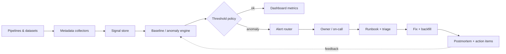
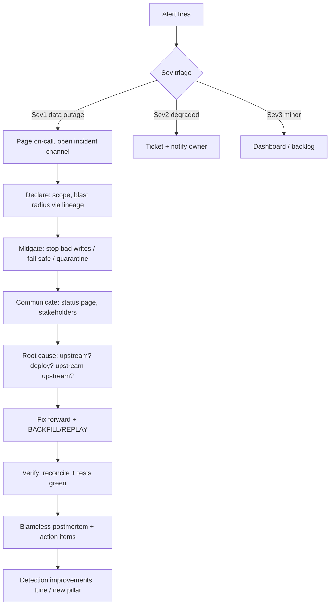

# Data Observability

> Data observability is the discipline of knowing, at any moment, whether the data in your
> platform can be trusted — *before* a human notices it's wrong. Where validation (chapter 01)
> asks "does this known rule hold?", observability asks "has anything, anywhere, drifted outside
> what we expect?" across freshness, volume, schema, lineage, and distribution. A senior
> engineer treats data like a production system: SLIs/SLOs, anomaly detection with tuned
> thresholds, incident severity and on-call, runbooks, and blameless postmortems. This chapter
> is about running data as an observable, incident-managed service.

## TL;DR

- **Observability ≠ monitoring.** Monitoring checks known rules. Observability lets you ask
  *unknown* questions of the system after the fact. Data observability adds an important twist:
  the "system" is data, and its most dangerous failures (silent semantic drift) don't error at
  all.
- **The five pillars:** **freshness, volume, schema, lineage, distribution** (some add
  "quality"). Each pillar is a *detector*; together they cover the common failure modes.
- **Two detection styles:** explicit **rules/tests** (deterministic, low false positives,
  need authoring) and **anomaly detection / ML** (baselines learned from history, catches
  unknown-unknowns, needs tuning). Mature platforms use both.
- **Freshness is the #1 useful signal** — it's cheap, precise, and directly maps to SLA. Volume
  and schema are next. Distribution is the hardest and most valuable.
- **Data SLIs/SLOs:** define measurable indicators (freshness lag, % tests passing, incident
  MTTD/MTTR) and objectives with **error budgets**, exactly as SRE does for services.
- **Incident management for data** needs the same apparatus as software incidents: severity
  levels, on-call, runbooks, communication, and blameless postmortems — plus a *data-specific*
  twist: you must often also **backfill/replay** after the fix.
- **Tools:** Monte Carlo, Soda, Elementary, Datafold, Anomalo, Bigeye, Metaplane, Acceldata,
  Great Expectations — pick by *detection style*, *integrations*, and *who consumes alerts*.
- The hardest problem is not detection, it's **alert fatigue and ownership**. A perfect
  detector nobody trusts is worse than no detector.

## 1. Definitions and core vocabulary

| Term | Meaning |
|------|---------|
| **Observability** | The ability to understand a system's internal state from its external outputs. |
| **Data observability** | Applying observability to data pipelines and datasets: are the data fresh, complete, correct, and trustworthy? |
| **Pillar** | A category of detector: freshness, volume, schema, lineage, distribution. |
| **Metadata** | The signals you collect: run times, row counts, schemas, byte sizes, null ratios, distributions. |
| **Baseline** | The learned "normal" behaviour of a metric (with seasonality). |
| **Anomaly** | A deviation from baseline beyond a threshold. |
| **Detection latency** | Time between the anomaly occurring and being detected. |
| **MTTD / MTTR** | Mean time to detect / mean time to resolve (data incidents). |
| **Data SLI** | A measured indicator (e.g. freshness lag in minutes). |
| **Data SLO** | A target for an SLI (e.g. 99% of hours, freshness ≤ 60 min). |
| **Error budget** | The allowed amount of SLO violation in a period. |
| **Data SLA** | A contract with consequences (external/customer-facing), typically above SLOs. |
| **Incident** | An unplanned event degrading data quality/availability below an acceptable level. |
| **Runbook** | A documented procedure for responding to a specific alert/incident. |
| **Postmortem** | A blameless analysis after an incident: timeline, causes, action items. |
| **Circuit breaker / fail-safe** | Automatically stopping or degrading a pipeline when quality degrades. |
| **Metadata-first** | Collecting signals passively (logs, information_schema) vs reading full data. |

### 1.1 The five pillars, in depth

| Pillar | Detects | Signal source | Cheap? |
|--------|---------|---------------|--------|
| **Freshness** | Stale data (pipeline late or silently stopped) | `max(updated_at)`, watermark, last-modified metadata | Yes — often metadata-only |
| **Volume** | Wrong size (partial load, duplication, upstream filter change) | `count(*)`, bytes written, per-partition counts | Cheap by metadata / stats |
| **Schema** | Structural drift (column added/dropped/retyped, type change) | DDL audit, `information_schema`, manifest | Yes — metadata |
| **Lineage** | Blast radius & upstream cause; missing/nonexistent data | OpenLineage/events, job dependencies | Metadata |
| **Distribution** | Silent semantic drift (null% up, mean shifted, category disappearing) | Column profiling / sketches | Expensive — scans data |

> **Senior note.** Freshness, volume, and schema are *metadata* signals — cheap and usually
> enough to catch 80% of incidents. Distribution is the expensive one, and it's the one that
> catches "the pipeline is green but the numbers are wrong". Budget accordingly: run metadata
> checks on everything, distribution checks only on **critical** columns.

## 2. What problem it solves / why it matters

Software observability has three pillars (metrics, logs, traces) and assumes the system
*errors* when it fails. Data is different: the most damaging failures are **silent**. A shifted
timezone, a currency-unit change, a deduplicated join key, a filter that now excludes 30% of
rows — none of these throw. The pipeline is green; the numbers are wrong.

```
                          ┌─────────────────────────────────────────┐
   classic monitoring     │  "Did the job succeed?"  (green/red)     │  ← necessary, insufficient
                          └─────────────────────────────────────────┘
                          ┌─────────────────────────────────────────┐
   data observability     │  "Is the DATA fresh, complete,           │  ← the missing layer
                          │   well-shaped, and as expected?"         │
                          └─────────────────────────────────────────┘
```

The cost model is brutal (same curve as chapter 01): a defect costs **1×** at ingestion, **10×**
after it reaches the warehouse, **100×** after a decision is made on it. Observability exists to
**shorten detection latency**, which is the dominant term in that cost. If a defect is detected
in 5 minutes, the blast radius is one partition; if it's detected in 5 days, you're backfilling
a month of history and explaining it to finance.

Why it matters at a senior level:

- **Trust is the product.** A data platform's value is the organization's willingness to act on
  it. Silent staleness destroys that faster than outages.
- **Detection latency is the lever.** MTTD dominates cost; observability is the instrument that
  drives MTTD down.
- **It changes priorities.** With freshness/volume/schema auto-monitored, engineers spend time on
  semantics and correctness instead of "did it run".

## 3. How it works internally (mechanisms, internals)

### 3.1 The observability pipeline



Collectors tap into:

- **Orchestrator metadata** (Airflow/Prefect/Dagster run history, durations, statuses).
- **Warehouse metadata** (`information_schema`, query history, `INFORMATION_SCHEMA.TABLES` for
  `LAST_ALTERED`, `ROW_COUNT`; Snowflake `ACCESS_HISTORY`, BigQuery `INFORMATION_SCHEMA`, Spark
  catalog).
- **Engine/catalog events** (Iceberg snapshot metadata: row counts, file counts; Delta log).
- **Lineage events** (OpenLineage — ties a volume/freshness anomaly to a job and its downstream).
- **Data itself** (profiling queries for distribution/nulls/values).

### 3.2 Freshness internals

Freshness is measured as **lag = now − max(event_time)** where `event_time` is either a data
column (`updated_at`) or a metadata watermark (last partition, Iceberg snapshot timestamp). Two
critical distinctions:

- **Event time vs processing time.** A job that ran *now* but processed data from *3 days ago*
  is fresh in processing time, stale in event time. Data freshness is about **event time**.
- **Scheduled vs streaming.** Batch freshness is compared to cadence (daily job → alert if
  > 1.2× cadence); streaming freshness is a sliding lag.

```sql
-- Freshness SLI: lag in minutes for each critical table
SELECT
  table_name,
  max(ingested_at)                                   AS latest_event,
  timestampdiff('minute', max(ingested_at), current_timestamp()) AS lag_min
FROM raw.ingestion_audit
GROUP BY 1
HAVING lag_min > 60;
```

Or metadata-only, with no data scan (Snowflake-style):

```sql
SELECT table_name,
       last_altered,
       timestampdiff('minute', last_altered, current_timestamp()) AS lag_min
FROM information_schema.tables
WHERE table_schema = 'ANALYTICS' AND table_catalog = 'PROD'
ORDER BY lag_min DESC;
```

### 3.3 Volume internals

Volume = row count and bytes, usually per partition and per table, tracked over time. Two things
matter:

- **Absolute vs relative.** An absolute threshold (`row_count > 0`) is crude. The useful signal is
  **relative to a baseline** (`today's count is 30% below the same weekday's median`).
- **Seasonality.** Traffic is seasonal by hour/day/week (and by promo/season). A naive mean±3σ
  will fire every Saturday. Baselines must be **seasonal**: compare `t` to the same
  time-of-week/month/hour.

### 3.4 Schema internals

Schema checks diff the **current schema** against the **last-seen schema** and classify the
change: additive (usually benign), removal (breaking), retype (dangerous), reorder (usually
benign). The collector owns a per-dataset schema history and can leverage the same events as
schema evolution (chapter 02). Schema observability answers: *did the shape change, when, and
who did it?*

### 3.5 Distribution internals (the hard pillar)

Distribution checks profile columns and detect shifts in:

- **Null ratio** (completeness drift).
- **Cardinality** (a dimension losing/adding values — "region CA disappeared").
- **Range / min-max** (out-of-range values appearing).
- **Category sets** (enum membership drift).
- **Statistical shape** (mean, median, stddev, quantiles, histogram distance e.g. PSI/KL).

To keep it affordable, use **sketches and sampling**:

```sql
-- Approximate profile without a full precise scan
SELECT
  count(*)                         AS n,
  approx_count_distinct(customer_id) AS distinct_customers,
  sum(if(total_cents IS NULL,1,0))/count(*) AS null_ratio,
  approx_percentile(total_cents, 0.5)  AS median,
  approx_percentile(total_cents, 0.95) AS p95,
  min(total_cents) AS min_v, max(total_cents) AS max_v
FROM fct_orders
WHERE order_date = current_date - 1;
```

The engine then compares this profile to the baseline and scores the deviation.

### 3.6 Anomaly detection internals

Three families, in increasing sophistication:

```
1. Static thresholds          row_count > 1e6 ; lag < 60min
   + trivial, explainable
   - brittle; seasonal data breaks them

2. Statistical / seasonal      z-score vs same-weekday median, MAD-based robust z, control charts
   + cheap, transparent, good defaults
   - needs history; struggles with multi-modal or sparse data

3. ML models                   Prophet/ARIMA, isolation forest, autoencoders, Bayesian changepoint
   + handles seasonality + multiple signals; learns interactions (freshness×volume×lineage)
   - opaque, needs tuning + enough history, can drift
```

A robust, explainable default is **MAD-based seasonal z-score**:

```
baseline(k)  = median of the same time-bucket over the last N weeks  (e.g. last 8 Tuesdays 03:00)
mad(k)       = median(|x_i - baseline|) over those buckets
robust_z     = 0.6745 * (x_today - baseline) / mad      # 0.6745 ~ 1/1.4826 scaling to σ
alert if |robust_z| > k    (k ~ 3-4), AND |x_today - baseline| > min_abs_delta
```

The `min_abs_delta` guard prevents alerting on tiny absolute changes that are statistically
significant but operationally irrelevant (a 2-row change on a 10M-row table).

> **Senior note.** The best anomaly detectors combine **multiple pillars**: volume drop + freshness
> lag + a schema change on the same dataset in the same hour is a *much* stronger signal than any
> one alone. Single-signal detectors are noisy; correlated detectors are precise.

### 3.7 SLIs, SLOs, SLAs, error budgets

Borrow SRE's framework and apply it to data:

| Concept | Data example |
|---------|--------------|
| **SLI** | Freshness lag (min), % of tests passing, row-count deviation, incident MTTD |
| **SLO** | 99% of the time, `fct_orders` freshness ≤ 60 min |
| **SLA** | Contractual: if freshness > 4h, the exec dashboard is "degraded" and finance is notified |
| **Error budget** | 1% of a month (~7.2h) may exceed the freshness SLO |

```yaml
# A data SLO expressed as code
slo:
  dataset: analytics.marts.fct_orders
  type: freshness
  objective: 0.99
  window: 30d
  sli:
    metric: freshness_lag_minutes
    threshold: 60
    source: observation   # or "request"-style for latency
  error_budget:
    allowed_violations: "7.2h/30d"
  alerting:
    burn_rate_fast:  { window: 1h,  factor: 14 }   # page
    burn_rate_slow:  { window: 6h,  factor: 6 }    # ticket
  owner: orders-platform
```

**Burn-rate alerting** (from SRE) is the antidote to alert fatigue: page only when you're
consuming the error budget fast enough to exhaust it before the window ends, otherwise file a
ticket.

### 3.8 Incident management for data



Severity for data (an example scheme):

| Sev | Definition | Response |
|-----|------------|----------|
| **Sev1** | Customer-facing/regulatory data wrong or unavailable; revenue/finance blocked | Page immediately, war room, exec comms |
| **Sev2** | Internal critical KPI wrong/late; SLO burning fast | Page owner, same-day fix |
| **Sev3** | Non-critical dataset degraded; SLO burn slow | Ticket, next business day |
| **Sev4** | Cosmetic / documentation | Backlog |

**The data-specific step everyone forgets:** after the fix, you must **backfill/replay** the
affected period and **verify by reconciliation** — "green tests" don't mean the historical data
is repaired.

## 4. How to implement it (step-by-step, with examples)

### 4.1 Step 0 — Inventory and tier your data

You cannot observe everything equally. Tier by criticality:

| Tier | Definition | Monitoring |
|------|------------|-----------|
| **T0 (critical)** | Exec/finance/regulatory/ML-in-prod | Freshness + volume + schema + distribution + SLI/SLO + paging |
| **T1 (important)** | Widely used internal marts | Freshness + volume + schema + SLO |
| **T2 (the rest)** | Everything else | Freshness + volume (metadata-only), best-effort |

### 4.2 Step 1 — Collect metadata (the passive layer)

```python
# Collect freshness + volume + schema into a metrics table, purely from metadata
import snowflake.connector, json, datetime as dt

def collect(conn, dataset: str):
    cur = conn.cursor()
    cur.execute(f"SELECT last_altered FROM information_schema.tables "
                f"WHERE table_name = '{dataset}'")
    last_altered = cur.fetchone()[0]
    cur.execute(f"SELECT count(*) FROM {dataset}")     # or rely on table stats
    row_count = cur.fetchone()[0]
    cur.execute(f"SELECT * FROM {dataset} LIMIT 0")
    schema = [(c.name, str(c.type_code)) for c in cur.description]

    cur.execute("""INSERT INTO ops.dataset_metrics
                   (dataset, collected_at, last_altered, row_count, schema_json)
                   VALUES (%s, %s, %s, %s, %s)""",
                (dataset, dt.datetime.utcnow(), last_altered, row_count, json.dumps(schema)))
```

### 4.3 Step 2 — Detect freshness anomaly (seasonal robust z)

```python
import pandas as pd

def freshness_alert(series: pd.DataFrame, now, k=3.5, min_delta_min=30):
    """series: columns [ts, lag_min]. Compare 'now' to same weekday/hour baseline."""
    df = series.copy()
    df["dow"] = df.ts.dt.dayofweek
    df["hour"] = df.ts.dt.hour
    bucket = df[(df.dow == now.dayofweek) & (df.hour == now.hour)]
    baseline = bucket.lag_min.median()
    mad = (bucket.lag_min - baseline).abs().median()
    sigma = 1.4826 * mad if mad > 0 else df.lag_min.std()
    now_lag = df.iloc[-1].lag_min
    z = (now_lag - baseline) / sigma if sigma else 0
    breach = abs(z) > k and (now_lag - baseline) > min_delta_min
    return breach, z, baseline
```

### 4.4 Step 3 — Elementary (dbt-native observability)

Elementary runs anomaly detection and monitors **as dbt tests** — so freshness/volume/schema
anomalies fail a dbt run and route through your normal alerting.

```yaml
# models/marts/fct_orders/schema.yml (Elementary package)
models:
  - name: fct_orders
    tests:
      # column-level anomaly detection (distribution pillar)
      - elementary.column_anomalies:
          column_name: total_usd
          timestamp_column: order_ts
          # detects shifts in null%, cardinality, min/max, average, stddev...
      # volume
      - elementary.volume_anomalies:
          timestamp_column: order_ts
          # row count per bucket vs history
      # freshness (row-level events -> staleness)
      - elementary.freshness_anomalies:
          timestamp_column: order_ts
          # alerts when data stops arriving (a pipeline silently stopped)
      # schema (monitors drift over time)
      - elementary.schema_changes:
          # flags added/removed/retyped columns
```

Run `dbt test --select fct_orders` (or `edr monitor` for the OSS report) and integrate into CI
and the scheduler. This is the lowest-friction path for dbt shops: no separate platform, alerts
are just failing tests.

### 4.5 Step 4 — Distribution monitoring with sketches + distance

```sql
-- Compare yesterday's distribution to the 28-day baseline; flag PSI > 0.2
WITH today AS (
  SELECT approx_percentile(total_cents, 0.5)  AS p50,
         approx_percentile(total_cents, 0.9)  AS p90,
         approx_count_distinct(status)        AS card,
         sum(if(total_cents IS NULL,1,0))/count(*) AS null_ratio
  FROM fct_orders WHERE order_date = current_date - 1
),
base AS (
  SELECT avg(p50) b50, stddev(p50) s50, avg(p90) b90,
         avg(card) bcard, avg(null_ratio) bnull
  FROM (/* nightly profiles of the last 28 days */)
)
SELECT
  today.p50, base.b50, (today.p50-base.b50)/nullif(base.s50,0) AS p50_z,
  today.null_ratio, base.bnull
FROM today, base;
-- Alert on |z|>4 OR null_ratio > base.bnull + 0.02 OR card changed by >10%
```

### 4.6 Step 5 — Wire alerting to owners (not to a firehose)

```yaml
# alert routing policy
routes:
  - match: { severity: page, tier: T0 }
    receivers: [pagerduty-orders-oncall]
    group_wait: 30s
    group_interval: 5m          # batch correlated alerts
    repeat_interval: 2h         # don't re-page every 5 min
  - match: { severity: ticket, tier: [T1, T2] }
    receivers: [jira-data-owners]
  - match: { alertname: LineageStale }
    receivers: [slack-platform]
inhibit_rules:
  # If the table is stale, don't ALSO page for volume=0 on the same dataset
  - source_match: { alertname: FreshnessBreach, dataset: fct_orders }
    target_match: { alertname: VolumeAnomaly, dataset: fct_orders }
    equal: [dataset]
```

The `inhibit_rules` block is what separates a usable system from a noisy one: **one incident =
one alert**. Root-cause alerts suppress their own symptoms.

### 4.7 Step 6 — Add a circuit breaker / fail-safe

```python
def guarded_write(df, dataset, slo):
    profile = profile_df(df)                 # null%, row count, distinct keys
    breaches = check_slo(profile, slo)
    if breaches:
        # Do NOT publish bad data to the curated layer.
        quarantine(df)                       # keep for triage
        raise QualityGateError(breaches)     # fail the task -> no downstream corruption
    publish(df, dataset)
```

For streaming, the fail-safe is "stop consuming / switch to last-good snapshot" rather than
"write bad data fast".

### 4.8 Step 7 — SLO dashboards and burn-rate alerts

```promql
# Freshness SLI as a Prometheus gauge (exported per dataset)
data_freshness_lag_minutes{dataset="fct_orders"}   62.0

# SLO error budget burn rate (30d window)
(
  sum(rate(freshness_violations_total[1h]))
  /
  (0.01 * sum(rate(freshness_total_window[1h])))
) > 14
```

Page on fast burn, ticket on slow burn. Add MTTD/MTTR panels for process improvement.

## 5. Where to implement it (tools/platforms and when each fits)

| Tool | Model | Strength | Fit |
|------|-------|----------|-----|
| **Monte Carlo** | SaaS, ML detectors | Breadth of integrations, automated monitors, lineage | Large orgs wanting turnkey coverage |
| **Soda** | OSS + Cloud | SodaCL checks + anomaly + contracts | Pragmatic start; CI-first |
| **Elementary** | dbt-native OSS/Cloud | Anomaly tests as dbt tests; collect/report | Teams already on dbt |
| **Datafold** | SaaS | Data diff (pre-prod), column-level diff | Migration/refactor confidence |
| **Anomalo** | SaaS | Unsupervised ML detection on many columns | Non-technical stakeholders, ML detection |
| **Bigeye** | SaaS | Automated thresholds, freshness/volume | Enterprise monitoring |
| **Metaplane** | SaaS | Fast setup, broad warehouse support | Mid-size teams |
| **Acceldata / IBM Databand** | Platform | Pipeline + data observability, governance | Enterprise data platforms |
| **Great Expectations** | OSS library | Rich validation + Data Docs | Custom, code-first DQ + observability |
| **dbt + Elementary** | OSS | No new platform, alerts as tests | Warehouse-centric stacks |
| **Native cloud** | Cloud | Snowflake/BigQuery/Databricks lineage + monitoring | Cloud-native, low effort |

**Decision guide:**

- **dbt-centric** → Elementary first; add a SaaS platform only when you outgrow it.
- **Heterogeneous + need turnkey + budget** → Monte Carlo / Bigeye / Anomalo.
- **OSS + engineering-first** → Soda (+ Soda Cloud) or Great Expectations.
- **Migration/refactor validation** → Datafold's data diff is the right tool, not a monitor.

## 6. Patterns and anti-patterns

### Patterns

| Pattern | Why |
|---------|-----|
| **Tier datasets (T0/T1/T2)** | Spend detection budget where it matters |
| **Metadata-first, data-second** | Freshness/volume/schema are cheap; distribution is expensive |
| **Seasonal baselines** | Avoids weekend/promo false positives |
| **Correlate multiple pillars** | Volume + freshness + schema together = precise |
| **Burn-rate alerting** | Page only on fast budget consumption |
| **Inhibit symptom alerts** | One incident, one page |
| **Single owner per dataset** | Alerts go to someone who can act |
| **Runbooks per alert** | Reduce MTTR; capture tribal knowledge |
| **Blameless postmortems + action items** | Convert incidents into reliability improvements |
| **Backfill-after-fix as a required step** | Green tests ≠ repaired history |
| **Circuit breaker** | Don't publish data you know is bad |

### Anti-patterns

| Anti-pattern | Consequence |
|--------------|-------------|
| **Alert on everything at one severity** | Fatigue → alerts muted → silent outages |
| **No ownership** | Alerts page a generic channel; nobody acts |
| **Static thresholds on seasonal data** | Weekly false positives; trust erodes |
| **Distribution checks on all columns** | Cost explosion, noise |
| **Monitor but never act** (no runbook/on-call) | Detection without response |
| **No SLOs** | No objective basis for urgency or investment |
| **Ignore detection latency** | Weekly detection = unrecoverable history |
| **Postmortems blame individuals** | Facts hidden; same incident recurs |
| **"Green dashboard = good data"** | Coverage and meta-monitoring lie to you |
| **No backfill after fix** | Historical data stays wrong forever |

## 7. Real-world use cases and industry applications

- **Fintech.** Freshness SLOs on ledger data (minutes), reconciliation monitors, and Sev1
  incidents when payment totals drift. Distribution monitors catch a currency-unit bug before it
  reaches a report.
- **E-commerce.** Volume anomaly detection catches a broken checkout telemetry stream during a
  flash sale; schema monitors catch a partner API adding a field; lineage-driven blast radius
  when a promo dimension changes.
- **Streaming / ad-tech.** Freshness at second granularity; DLQ depth as an SLI; volume
  anomalies detect a dead bidder before budget is burned.
- **Healthcare / life sciences.** Distribution monitoring on coded values (a new code appearing),
  strong audit trail via lineage, Sev1 for regulatory data.
- **SaaS product analytics.** Behavioral event streams: null% and cardinality monitors catch
  instrumentation regressions (a mobile SDK stops sending an event).
- **ML platforms.** Feature freshness + distribution drift (train/serve skew) with alerts that
  block model retraining or auto-rollback a deployed model.

## 8. Senior-level deep dive

### 8.1 Trade-offs

| Decision | Option A | Option B | Depends on |
|----------|----------|----------|-----------|
| Detection | Rules/tests | ML/anomaly | Unknown-unknowns vs explainability |
| Coverage | All datasets, metadata-only | Critical datasets, deep | Budget, criticality |
| Build vs buy | OSS (Soda/Elementary/GX) | SaaS (Monte Carlo etc.) | Team size, time-to-value, TCO |
| Read the data? | Metadata-only (cheap) | Profile data (accurate) | Cost, criticality |
| Alert latency | Fast (page) | Slow (ticket) | SLO burn rate, decision latency |
| Central vs federated | Platform team monitors all | Owners monitor their own | Org model (mesh vs central) |
| Fail mode | Circuit-break (stop) | Degrade + alert | Cost of stale vs cost of stale-with-alert |

### 8.2 Architecture decisions

- **Metadata store sizing.** Collecting per-run metrics for thousands of tables and thousands of
  runs/day adds up. Partition metrics by day, retain 90–180 days for baselines, and aggregate.
- **Where the detector runs.** In-warehouse (SQL, no data movement) vs external (platform reads
  metadata). Prefer in-warehouse for distribution; metadata APIs for freshness/volume/schema.
- **Lineage integration is what makes triage fast.** A freshness alert alone says "stale"; a
  freshness alert *joined with lineage* says "stale because upstream job X failed; downstream
  impact = {KPI A, KPI B}".
- **Sampling vs exact.** Sample for distribution; be exact for keys, counts, and anything
  regulatory.
- **The fail-safe question.** For a T0 dataset, is it better to publish stale-but-correct data or
  fresh-but-wrong data? Usually the former — which means the *monitor* must be able to **circuit
  break the pipeline**, not just alert.

### 8.3 Failure modes and debugging

| Failure mode | Symptom | Diagnosis |
|--------------|---------|-----------|
| **Alert storm** | Hundreds of alerts from one upstream failure | Inhibit rules + correlation; page the root cause only |
| **Missed detection** | Data wrong, no alert | Coverage gap; add pillar for that dataset; meta-monitor |
| **Detection lag too high** | Only catch it the next day | Move check earlier / add real-time freshness event |
| **False positives** | Alerts on promos/weekends | Seasonal baselines, min_abs_delta, tune k |
| **Stale baselines** | Detector "adapts" to a broken state | Reset baselines after backfill; guard adaptation |
| **Alert routed to a dead channel** | Nobody responds | Ownership registry + routing tests |
| **No backfill** | Tests green, history wrong | Runbook must include backfill+reconcile |
| **Monitoring cost > value** | Warehouse bill from profiling | Tier down; sample; metadata-only for T2 |
| **Monitor silently disabled** | Green forever | Meta-monitor: last evaluation per monitor |

### 8.4 Org and process — running data as a service

- **Define SLOs per tier.** T0 gets tight SLOs + paging; T2 gets best-effort. Without tiers,
  everything is "critical" and nothing is.
- **On-call for data.** Either a dedicated data on-call or a data component in the platform
  on-call. Alerts route to the **dataset owner**.
- **Incident command.** Someone declares severity, someone communicates, someone fixes. For
  Sev1, a single incident channel and a status page.
- **Blameless postmortems with tracked action items.** The output is not "who did it" but "what
  detection/guardrail/test would have prevented or shortened this, and who owns it by when".
- **Metrics that matter:** MTTD, MTTR, alert-to-action ratio, % datasets covered, SLO compliance,
  and postmortem action-item completion. Report them; manage them.
- **Feedback loop:** every incident should produce either a new check, a tighter threshold, or a
  new guardrail. Observability that doesn't learn is just expensive noise.

## 9. Common mistakes and how to avoid them

1. **Treating observability as "more tests".** → It's detection + baselines + routing + response;
   tests are one pillar.
2. **Monitoring everything equally.** → Tier; metadata-first; deep monitoring only where it pays.
3. **No seasonality in baselines.** → Use same-bucket comparisons.
4. **One severity, one channel.** → Route by severity and owner; inhibit symptoms.
5. **No SLOs.** → Set SLIs/SLOs per tier and use burn-rate alerting.
6. **Detection without response (no runbook/on-call).** → Write the runbook; assign the owner.
7. **Forgetting backfill after a fix.** → Make it a mandatory postmortem step.
8. **Measuring nothing about the process.** → Track MTTD/MTTR/false-alarm rate.
9. **Assuming green = good.** → Meta-monitor monitors; measure coverage.
10. **Buying a tool without ownership/routing design.** → A great detector with no owner is
    useless. Design the org/process first.

## 10. Exercises / interview questions

1. *Pillars:* Map five real incidents to the pillar that would have caught each fastest.
   *(Hint: stale (freshness), dup (volume/uniqueness), retype (schema), null% (distribution),
   unknown cause (lineage).)*
2. *Freshness:* Explain event-time vs processing-time freshness and why the distinction caused a
   real-looking "we're fresh!" false negative.
3. *Anomaly math:* Derive a seasonal robust z-score. Why MAD instead of stddev? What does
   `min_abs_delta` protect against?
4. *SLO:* Write a freshness SLO with a 30-day window and a burn-rate page + ticket rule.
5. *Inhibit:* Given a failed upstream job, how do you collapse 50 alerts into one page?
6. *No-unknown-unknowns:* Your rules all pass but the numbers are wrong. Which pillar is missing
   and how do you add it cheaply? *(Hint: distribution / reconciliation.)*
7. *Cost:* Profiling every column of every table is too expensive. Design a tiered monitoring
   plan that stays within budget.
8. *Incident:* Design a data incident runbook for "fct_orders is 30% smaller than baseline".
   Include blast radius, mitigation, root cause, backfill, and postmortem.
9. *Org:* Who should get paged for a T0 dataset in a data mesh, and what artifact assigns that
   ownership?
10. *Trade-off:* When is it better to **circuit-break** a pipeline (refuse to publish) vs
    **publish + alert**? Give a concrete example of each.

## References

- Monte Carlo — What is data observability? The 5 pillars: https://montecarlo.ai/blog-what-is-data-observability
- Conduktor — What is data observability? The five pillars: https://www.conduktor.io/glossary/what-is-data-observability-the-five-pillars
- TechTarget — The 5 pillars of data observability: https://www.techtarget.com/data-technologies/tip/The-5-pillars-of-data-observability
- Elementary — docs (freshness/volume/schema/anomaly tests): https://docs.elementary-data.com/
- Elementary — anomaly detection tests: https://docs.elementary-data.com/data-tests/anomaly-detection-tests/freshness-anomalies
- Elementary — GitHub (dbt-native observability): https://github.com/elementary-data/elementary
- Soda — docs: https://docs.soda.io/
- Great Expectations — docs: https://docs.greatexpectations.io/docs/home/
- Datafold — data diff (pre-production validation): https://docs.datafold.com/
- Google SRE Book — SLOs, error budgets, burn rate: https://sre.google/sre-book/service-level-objectives/
- Google SRE Workbook — Alerting on SLOs: https://sre.google/workbook/alerting-on-slos/
- Snowflake — INFORMATION_SCHEMA: https://docs.snowflake.com/en/sql-reference/information-schema
- BigQuery — INFORMATION_SCHEMA: https://cloud.google.com/bigquery/docs/information-schema-intro
- Apache Iceberg — metadata/snapshots: https://iceberg.apache.org/docs/latest/
- Apache Airflow — callbacks/alerts: https://airflow.apache.org/docs/apache-airflow/stable/howto/notifications.html
